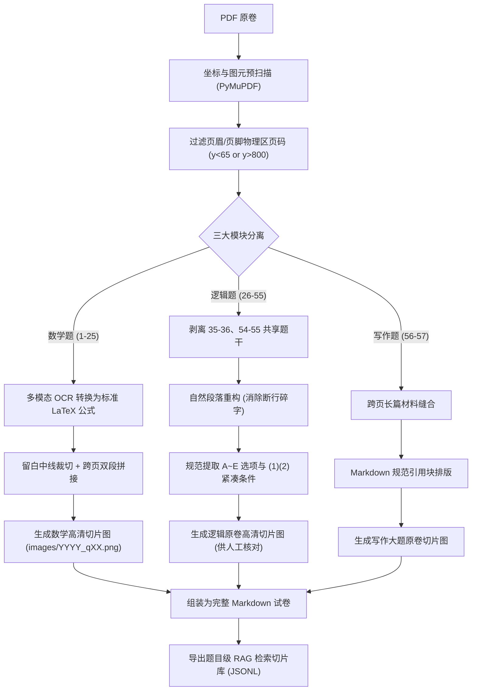

# 考研管综 199 真题 PDF 转 Markdown 与智能切分实战指南

> **文档定位**：本指南系统总结了针对《管理类专业学位联考综合能力》（科目代码：199）历年真题试卷在转录为 Markdown 文档及大模型 RAG 题库切分过程中遇到的全部核心痛点、底层机制、算法方案及工程代码规范，供后续批量优化 2009～2025 全年份试卷参考复用。

---

## 目录
- [一、管综 199 试卷结构与排版特性](#一管综-199-试卷结构与排版特性)
- [二、常见六大痛点与深度解决方案](#二常见六大痛点与深度解决方案)
  - [1. 数学公式乱码与几何配图丢失](#1-数学公式乱码与几何配图丢失)
  - [2. 上下题目切片视觉“露底/渗透”](#2-上下题目切片视觉露底渗透)
  - [3. 跨页排版导致的题干与选项分离](#3-跨页排版导致的题干与选项分离)
  - [4. 中文文本硬断行与“一字一行”碎行](#4-中文文本硬断行与一字一行碎行)
  - [5. 幽灵页码粘连与字符污染](#5-幽灵页码粘连与字符污染)
  - [6. 组合大题干（如 35~36、54~55）丢失断层](#6-组合大题干如-35365455-丢失断层)
- [三、核心工程处理流水线（Pipeline）](#三核心工程处理流水线pipeline)
- [四、完整可复用的 Python 核心处理算法](#四完整可复用的-python-核心处理算法)
- [五、RAG 向量检索切片（Chunking）规范](#五rag-向量检索切片chunking规范)
- [六、真题原卷 100% 忠实还原准则（质检避坑与模型直读实战总结）](#六真题原卷-100-忠实还原准则质检避坑与模型直读实战总结)
  - [1. 告别脆弱脚本批处理，转向大模型视觉逐年直读](#1-告别脆弱脚本批处理转向大模型视觉逐年直读)
  - [2. 拒绝机械套用：原卷结构与大题说明 100% 忠实还原](#2-拒绝机械套用原卷结构与大题说明-100-忠实还原)
  - [3. 条件充分性判断（16～25 题）杜绝小题机械重复选项](#3-条件充分性判断1625-题杜绝小题机械重复选项)
  - [4. 组合共用题干标准范式（仅在首题呈现一次）](#4-组合共用题干标准范式仅在首题呈现一次)
  - [5. 结构化方阵与表格原生 Markdown 化铁律](#5-结构化方阵与表格原生-markdown-化铁律)
  - [6. 切图边界防渗漏与留白中线法则](#6-切图边界防渗漏与留白中线法则)

---

## 一、管综 199 试卷结构与排版特性

管综 199 试卷总分 200 分，考试时间 180 分钟，试题结构极其稳定：
1. **数学基础（1～25 题，共 75 分）**：
   - 问题求解（1～15 题，单选 5 选 1）
   - 条件充分性判断（16～25 题，单选 5 选 1）
   - *特征*：大量分式、根号、指数、矩阵行列式，以及三角形/圆/立体几何插图。
2. **逻辑推理（26～55 题，共 60 分，30 道单选题）**：
   - *特征*：纯中文长文本，包含前提对话、编号条件 `(1)(2)(3)`，以及基于同一背景的多道组合题（如 35~36、54~55 题）。
3. **中文写作（56～57 题，共 65 分）**：
   - 论证有效性分析（56 题，30 分，材料约 600 字）
   - 论说文（57 题，35 分，材料约 100 字）
   - *特征*：大段论述文本，往往横跨 2 个页面。

---

## 二、常见六大痛点与深度解决方案

### 1. 数学公式乱码与几何配图丢失
* **现象**：直接文本抽取时，WPS 公式编辑器会将分式拆成上下错开的字符，加号变成 `\uf02b`，等号变成 `\uf03d`，根号直接蒸发，几何图丢失。
* **终极方案**：
  - **公式文本层**：必须使用多模态视觉 OCR 或人工校验转换为标准 LaTeX 语法（如 `$f(x) = \dfrac{x^4+5x^2+16}{x^2}$`）。
  - **配图保障层**：截取 200 DPI 高清原题矢量切片嵌入 Markdown，即使遇到复杂的坐标系或阴影面积图，也能 100% 还原真实卷面。

### 2. 上下题目切片视觉“露底/渗透”
* **现象**：上一题切片底部露出了下一题的公式顶部，或下一题顶部露出了上一题的选项。
* **原因**：由于公式（如分式、上标）垂直高度超出文字基线，如果直接用下一题文字起始坐标 `y0` 作为上一题的截止坐标，会导致两题重叠。
* **解决方案【动态留白中线裁切算法】**：
  计算上一题最后一行（选项/条件）的底部坐标 `y_end`，与下一题第一行起始坐标 `y_start`，取中间留白的中位线：
  $$\text{CutPoint} = \frac{y_{\text{end}} + y_{\text{start}}}{2}$$
  由于两题之间有 15～30 pt 的空白，该中线保证了**上方不切题、下方不露底**。

### 3. 跨页排版导致的题干与选项分离
* **现象**：题干在当前页底部，而选项 A~E 或条件 (1)(2) 被排在次页顶部（如 2024 年第 7、14、25、30、32 题）。
* **解决方案【跨页双段内存矢量拼接】**：
  1. 探测到题目跨页后，切出前一页底部的 Part 1；
  2. 切出次页顶部的 Part 2；
  3. 创建虚拟高倍率画布，将 Part 1 与 Part 2 垂直拼接为单一 PNG 图片，输出为一张 1:1 的完整试题切片。

### 4. 中文文本硬断行与“一字一行”碎行
* **现象**：PDF 内部按固定宽度强制换行，直接提取会导致句子在逗号甚至词语中间断裂（例如 `看\n到了希\n\n望:`、`画。`、`果均不同。`）。
* **解决方案【中文自然段落重构算法】**：
  - 如果上一行末尾没有段落终结符，且下一行不是选项标记（A~E）或条件标记（`(1)`、`(2)`），则将两行**直接无缝连缀**。
  - 特别注意：编号条件（如 `(4) 只有一组选手...`）内部若发生换行，次行必须追加到该条件末尾，不得作为孤儿行暴露。
  - 条件列表行与行之间采用单换行紧凑排版，避免空行过多导致阅读割裂。

### 5. 幽灵页码粘连与字符污染
* **现象**：页面底部的页码数字（如 `6`、`8`、`15`、`18`）被误当作正文，粘连在选项末尾（如 `仅丁、戊、己。6`）或正文中间（如 `这样，我国的人才 18 数量必将大幅增长`）。
* **解决方案【坐标级物理区域过滤】**：
  在文本抽取第一步，直接通过坐标区间丢弃所有页眉（`y < 65`）和页脚（`y > 800`）的纯数字文本块：
  ```python
  if (b[1] > 800 and text.isdigit()) or (b[1] < 65 and text.isdigit()):
      continue
  ```

### 6. 组合大题干（如 35~36、54~55）丢失断层
* **现象**：组合题的共享背景题干（如 `35—36 题基于以下题干`、`54~55 题基于以下题干`）容易被粘连到前一题选项末尾，导致后续子题目缺失背景。
* **解决方案【共享题干解耦与上下文注入】**：
  1. 正则匹配 `\d+[~～\-－—到至]+\d+\s*题基于以下题干`；
  2. 将其从原文本中单独剥离；
  3. 在 Markdown 中以独立小节展现；
  4. 在 RAG JSONL 索引切片中，**将共享背景材料同时拼接注入到两个子题目中**，保证大模型单题检索的自包含性（Self-contained）。

---

## 三、核心工程处理流水线（Pipeline）



---

## 四、完整可复用的 Python 核心处理算法

### 1. 跨页无缝切片拼接函数
```python
import fitz

def crop_and_stitch(doc, spec, out_path, dpi=200):
    """
    spec 格式:
    单页: [(page_index, y0, y1)]
    跨页: [(page_index1, y0_1, y1_1), (page_index2, y0_2, y1_2)]
    """
    mat = fitz.Matrix(dpi / 72, dpi / 72)
    if len(spec) == 1:
        pno, y0, y1 = spec[0]
        page = doc[pno]
        crop = fitz.Rect(15, y0, page.rect.x1 - 15, y1)
        pix = page.get_pixmap(matrix=mat, clip=crop)
        pix.save(out_path)
    else:
        # 跨页拼接
        pno1, y0_1, y1_1 = spec[0]
        pno2, y0_2, y1_2 = spec[1]
        pix1 = doc[pno1].get_pixmap(matrix=mat, clip=fitz.Rect(15, y0_1, doc[pno1].rect.x1 - 15, y1_1))
        pix2 = doc[pno2].get_pixmap(matrix=mat, clip=fitz.Rect(15, y0_2, doc[pno2].rect.x1 - 15, y1_2))
        
        temp_doc = fitz.open()
        h1 = y1_1 - y0_1
        h2 = y1_2 - y0_2
        tot_h = h1 + h2 + 8
        tot_w = doc[pno1].rect.width
        tpage = temp_doc.new_page(width=tot_w, height=tot_h)
        pix1.save("tmp1.png"); pix2.save("tmp2.png")
        tpage.insert_image(fitz.Rect(0, 0, tot_w, h1), filename="tmp1.png")
        tpage.insert_image(fitz.Rect(0, h1 + 4, tot_w, tot_h), filename="tmp2.png")
        spix = tpage.get_pixmap(dpi=dpi)
        spix.save(out_path)
        import os
        os.remove("tmp1.png"); os.remove("tmp2.png")
```

### 2. 中文自然段落重构与紧凑条件格式化
```python
import re

def clean_logic_stem(raw_stem):
    lines = [l.strip() for l in raw_stem.splitlines() if l.strip()]
    body_parts = []
    curr = ""
    for l in lines:
        is_cond = bool(re.match(r"^[\(（]\d+[\)）]|^[①②③④⑤⑥⑦⑧⑨]", l))
        is_prompt = bool(re.match(r"^(?:根据以上|以下哪项|基于以上|若|假设|根据上述|由此可见)", l))
        curr_is_cond = bool(re.match(r"^[\(（]\d+[\)）]|^[①②③④⑤⑥⑦⑧⑨]", curr))
        
        if is_cond or is_prompt:
            if curr: body_parts.append(curr)
            curr = l
        elif curr_is_cond:
            # 解决条件跨行孤字问题（如 "果均不同。" 追加回上一行）
            curr += l
        else:
            # 正常句子折行缝合
            curr += l
    if curr: body_parts.append(curr)
    
    # 紧凑化条件列表
    formatted = []
    in_cond = False
    for p in body_parts:
        if bool(re.match(r"^[\(（]\d+[\)）]|^[①②③④⑤⑥⑦⑧⑨]", p)):
            formatted.append(p)
            in_cond = True
        else:
            if in_cond:
                formatted.append("")
                in_cond = False
            formatted.append(p)
            formatted.append("")
            
    res = "\n".join(formatted).strip()
    return re.sub(r"\n{3,}", "\n\n", res)
```

---

## 五、RAG 向量检索切片（Chunking）规范

在导出为大模型知识库（JSONL）时，应遵循以下字段规范，使每条知识片段天然自闭包：

```json
{
  "chunk_id": "2024_logic_35",
  "year": 2024,
  "subject": "逻辑推理",
  "question_no": 35,
  "category": "逻辑单选题",
  "stem": "【背景题干】\n某大学进行校园形象动物评选...\n(1)...\n(2)...\n\n【问题】\n根据以上信息，关于上述6种动物的入选情况，可以得出以下哪项?",
  "options": {
    "A": "...",
    "B": "...",
    "C": "...",
    "D": "...",
    "E": "..."
  },
  "image": "images/2024_q35.png"
}
```

* **双重保障**：在 Prompt 检索时，大模型既可以直接读取结构化纯文本文本（含 LaTeX 公式），也可以根据 `image` 路径直接调阅原题原图切片进行二次视觉校验，实现 100% 准确性。

---

## 六、真题原卷 100% 忠实还原准则（质检避坑与模型直读实战总结）

在处理 2024 与 2025 年真题转录过程中，我们系统排查并复盘了传统自动化脚本批处理方案所带来的隐蔽性错误。以下六项准则确立为后续 2009～2023 全年份转录的核心验收标准：

### 1. 告别脆弱脚本批处理，转向大模型视觉逐年直读
* **历史教训**：基于 PyMuPDF 坐标切割、正则表达式切题及本地轻量 OCR 的批处理脚本，在真实复杂试卷中存在灾难性缺陷：
  - **生僻字/繁体字误识**：如繁体“萬”被识成“鼻”（如“2100鼻”）；
  - **题目恶性黏连**：如 2025 年第 55 题末尾被强行粘入第 56 题整篇 600 字写作材料；第 40 题渗漏第 41 题题干残片；
  - **选项倍增**：如第 52 题强行拼接第 53 题选项，生成 10 个选项；
  - **方阵表格崩解**：如 2024 年第 45 题五谷方阵被压成一行乱码 `稷麦黍麦豆黍麦稷稻`。
* **终极工作流**：**单年份独立处理**。利用具备多模态高精度视觉理解能力的大语言模型，直接按页通读 PDF 原卷截图，以“人机协同逐题精校”替代“机械代码批量切割”。

### 2. 拒绝机械套用：原卷结构与大题说明 100% 忠实还原
* **严禁凭空臆造与过度工程化**：
  - 严禁在卷首生硬添加人为构造的 `> **试卷结构**` 摘要框；
  - 严禁人为篡改大题标题。例如 2024 年原卷为 `## 一、问题求解`，切勿擅自升级为 `## 一、数学基础` 并人为发明 `### (一) 问题求解` 这类二次加工层级；
  - **大题干完整性**：必须一字不差保留原卷大题说明。例如条件充分性判断大题中，官方印刷的判断标准（如“条件（1）和（2）单独都不充分...”中的“和（2）”字样）必须忠实还原，不可自行精简为“本大题要求判断...”。
* **题号格式**：
  - 统一使用 `### 第 X 题`，严禁在标题后人为添加 `（问题求解）`、`（条件充分性判断）` 等非原卷自带的标签。

### 3. 条件充分性判断（16～25 题）杜绝小题机械重复选项
* **真实卷面规律**：真实考研管综试卷中，A、B、C、D、E 五项判断结果**仅在第二大题开头的“解题说明”中完整印刷一次**！
* **排版铁律**：
  - 第 16 题至第 25 题的每一个小题卷面上，**仅有题干与条件（1）、条件（2）**；
  - **严禁在每道小题后机械重复粘贴 A～E 五行判断选项**。保持与真实考卷一致的极简清晰风格。

### 4. 组合共用题干标准范式（仅在首题呈现一次）
* **真实卷面规律**：在 35~36、39~40、50~51、52~53、54~55 等基于同一段材料的多题组合中，原卷材料仅在第一道子题前印刷一次。后续子题（如第 40、51、53、55 题）卷面上直接为题目提问与选项。
* **Markdown 呈现标准**：
  ```markdown
  ### 39～40 题基于以下题干

  全球气候正在变暖。权威科学报告显示...
  甲：...
  乙：...

  ### 第 39 题

  根据以上信息，可以得出以下哪项？
  - **A**．...
  ...
  

  ### 第 40 题

  对于上述专家的观点，可以得出以下哪项？
  - **A**．...
  ...
  
  ```
* **注意**：第 40 题严禁在正文中重复复制粘贴背景大题干；但在下游生成 RAG 检索切片（JSONL）时，系统需将背景材料拼接注入到每个子题 chunk 中以满足单题自包含检索需求。

### 5. 结构化方阵与表格原生 Markdown 化铁律
* **背景痛点**：管综逻辑推理中常出现信息匹配表格、方格填字矩阵与考试排班时间表。自动化脚本通常将表格直接丢弃或提取成碎片行，造成题目不可读、不可检索。
* **规范要求**：所有表格信息必须用标准 Markdown 表格 100% 完整复原：
  1. **方阵填字类**（如 2024 年 Q45 五谷方阵、2025 年 Q49 五味方阵）：绘制 $5\times 5$ 对齐表格，准确标注已填字与待填序号 `①` `②`；
  2. **对应关系类**（如 2025 年 Q44 领导检查 5 项工作）：还原“描述一/二/三”与①~⑤对应及正确数量统计表；
  3. **时间排班类**（如 2025 年 Q54~55 监考考场排班）：还原星期一至星期五的上中晚三班时间分布及双人监考标注。

### 6. 切图边界防渗漏与留白中线法则
* **痛点案例**：2025 年第 15 题切片曾因为切图过深，把页面底部的“二、条件充分性判断”大标题及 A~D 说明一并切入图片中；第 16 题切图过浅导致条件（2）下半截被截断。
* **精确裁切算法**：
  - 遇到页面底部存在大题干/跨题过渡时，上一题的裁剪下边界必须取【上一题最后一行文字/图形底部坐标】与【下一题/大标题首行文字起始坐标】之间的**留白几何中线**：
    $$\text{CutY} = \frac{y_{\text{上一题底部}} + y_{\text{下一题顶部}}}{2}$$
  - 跨页试题（如题干在页末、选项在次页开头）：必须在内存中裁出 Part 1 与 Part 2，使用 Pillow 垂直拼接为单一完整 PNG，严禁产生跨页断头切片。

