# 2009 年全国硕士研究生入学统一考试
# 管理类专业学位联考综合能力试题 (199)

> **试卷结构**：
> - 一、数学基础（第 1-25 题，共 75 分）
> - 二、逻辑推理（第 26-55 题，共 60 分）
> - 三、中文写作（第 56-57 题，共 65 分）

---

## 一、数学基础（第 1-25 题，共 75 分）

### (一) 问题求解：第 1~15 小题，每小题 3 分，共 45 分。下列每题给出的五个选项中，只有一项是符合试题要求的。

#### 第 1 题（问题求解）

一家商店为回收资金，把甲、乙两件商品以 480 元一件卖出，已知甲商品赚了 20%，乙商品亏了 20%，则商店盈亏结果为（ ）。

- **A**．不亏不赚
- **B**．亏了 50 元
- **C**．赚了 50 元
- **D**．赚了 40 元
- **E**．亏了 40 元

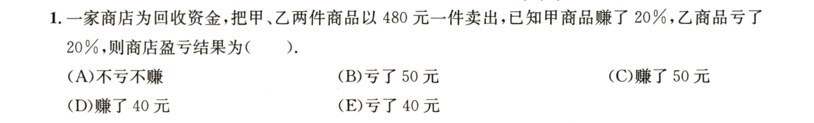

#### 第 2 题（问题求解）

某国参加北京奥运会的男、女运动员的比例原为 $19:12$，由于先增加若干名女运动员，使男、女运动员的比例变为 $20:13$，后又增加了若干名男运动员，于是男、女运动员比例最终变为 $30:19$。如果后增加的男运动员比先增加的女运动员多 3 人，则最后运动员的总人数为（ ）。

- **A**．686
- **B**．637
- **C**．700
- **D**．661
- **E**．600

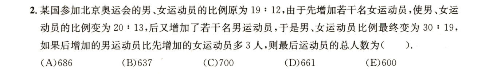

#### 第 3 题（问题求解）

某工厂定期购买一种原料，已知该厂每天需用该原料 6 吨，每吨价格 1800 元，原料的保管等费用平均每天每吨 3 元，每次购买原料需支付运费 900 元，若该工厂要使平均每天支付的总费用最省，则应该每（ ）天购买一次原料。

- **A**．11
- **B**．10
- **C**．9
- **D**．8
- **E**．7

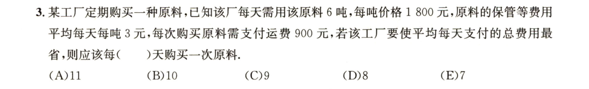

#### 第 4 题（问题求解）

在某实验中，三个试管各盛水若干克。现将浓度为 12% 的盐水 10 克倒入 A 管中，混合后，取 10 克倒入 B 管中，混合后再取 10 克倒入 C 管中，结果 A，B，C 三个试管中盐水的浓度分别为 6%，2%，0.5%，那么三个试管中原来盛水最多的试管及其盛水量各是（ ）。

- **A**．A试管，10克
- **B**．B试管，20克
- **C**．C试管，30克
- **D**．B试管，40克
- **E**．C试管，50克

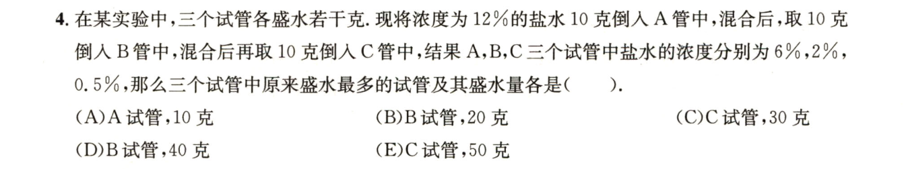

#### 第 5 题（问题求解）

一艘轮船往返航行于甲、乙两个码头之间，若船在静水中的速度不变，则当这条河的水流速度增加 50%，往返一次所需的时间比原来将（ ）。

- **A**．增加
- **B**．减少半个小时
- **C**．不变
- **D**．减少一个小时
- **E**．无法判断

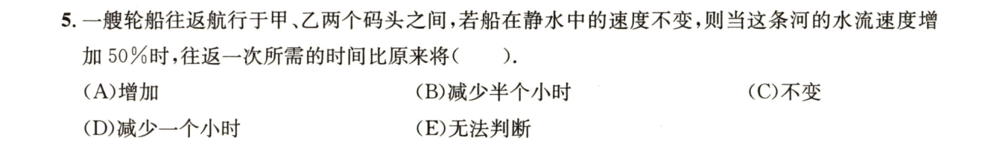

#### 第 6 题（问题求解）

方程 $|x - |2x+1|| = 4$ 的根是（ ）。

- **A**．$x = -5$ 或 $x = 1$
- **B**．$x = 5$ 或 $x = -1$
- **C**．$x = 3$ 或 $x = -\frac{5}{3}$
- **D**．$x = -3$ 或 $x = \frac{5}{3}$
- **E**．不存在

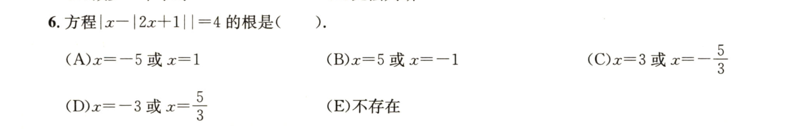

#### 第 7 题（问题求解）

$3x^2 + bx + c = 0$ ($c \neq 0$) 的两个根为 $\alpha, \beta$，如果又以 $\alpha+\beta, \alpha\beta$ 为根的一元二次方程是 $3x^2 - bx + c = 0$，则 $b$ 和 $c$ 分别为（ ）。

- **A**．2, 6
- **B**．3, 4
- **C**．-2, -6
- **D**．-3, -6
- **E**．以上结果都不正确

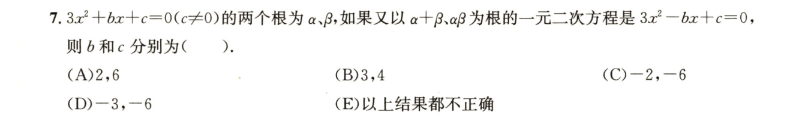

#### 第 8 题（问题求解）

若 $(1+x) + (1+x)^2 + \dots + (1+x)^n = a_1(x-1) + 2a_2(x-1)^2 + \dots + n a_n(x-1)^n$，则 $a_1 + 2a_2 + 3a_3 + \dots + n a_n = $（ ）。

- **A**．$\frac{3^{n+1}-3}{2}$
- **B**．$\frac{3^{n+1}-3}{4}$
- **C**．$\frac{3^n-3}{2}$
- **D**．$\frac{3^n-1}{2}$
- **E**．$\frac{3^{n+1}-1}{4}$

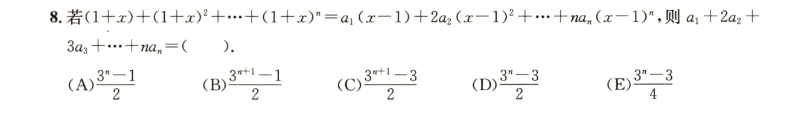

#### 第 9 题（问题求解）

在 36 人中，血型情况如下：A型 12 人，B型 10 人，AB型 8 人，O型 6 人，若从中随机选出两人，则两人血型相同的概率是（ ）。

- **A**．$\frac{77}{315}$
- **B**．$\frac{44}{315}$
- **C**．$\frac{33}{315}$
- **D**．$\frac{9}{122}$
- **E**．以上结果都不正确

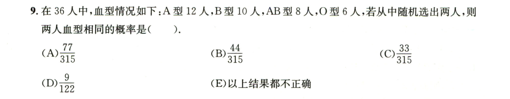

#### 第 10 题（问题求解）

湖中有四个小岛，它们的位置恰好近似构成正方形的四个顶点，若要修建三座桥将这四个小岛连接起来，则不同的建桥方案有（ ）种。

- **A**．12
- **B**．16
- **C**．18
- **D**．20
- **E**．24

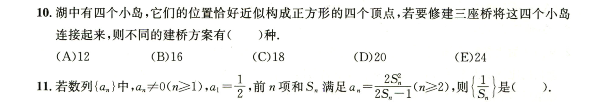

#### 第 11 题（问题求解）

若数列 $\{a_n\}$ 中，$a_n \neq 0$ ($n \ge 1$)，$a_1 = 2$，前 $n$ 项和 $S_n$ 满足 $a_n = -2S_n S_{n-1}$ ($n \ge 2$)，则 $\{ \frac{1}{a_n} \}$ 是（ ）。

- **A**．首项为 2，公比为 $-\frac{1}{2}$ 的等比数列
- **B**．首项为 2，公比为 2 的等比数列
- **C**．既非等差数列也非等比数列
- **D**．首项为 2，公差为 $-\frac{1}{2}$ 的等差数列
- **E**．首项为 2，公差为 2 的等差数列

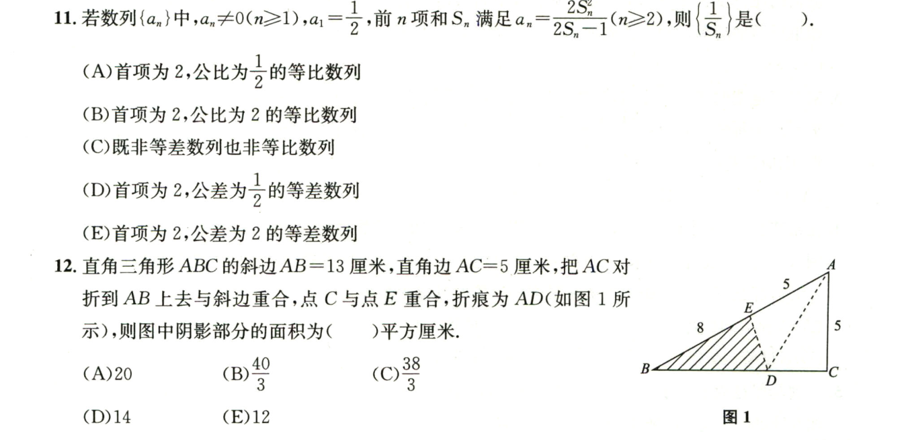

#### 第 12 题（问题求解）

直角三角形 $ABC$ 的斜边 $AB = 13$ 厘米，直角边 $AC = 5$ 厘米，把 $AC$ 对折到 $AB$ 上去与斜边重合，点 $C$ 与点 $E$ 重合，折痕为 $AD$（如图1所示），则图中阴影部分的面积为（ ）平方厘米。

- **A**．20
- **B**．$\frac{40}{3}$
- **C**．$\frac{38}{3}$
- **D**．14
- **E**．12

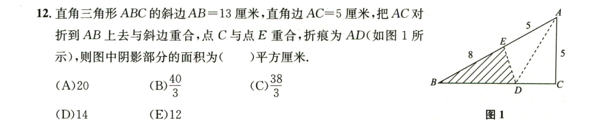

#### 第 13 题（问题求解）

设直线 $nx + (n+1)y = 1$ ($n$ 为正整数) 与两坐标轴围成的三角形面积为 $S_n$ ($n = 1, 2, \dots, 2009$)，则 $S_1 + S_2 + \dots + S_{2009} = $（ ）。

- **A**．$\frac{2009}{2008}$
- **B**．$\frac{2008}{2009}$
- **C**．$\frac{2009}{2010}$
- **D**．$\frac{2010}{2009}$
- **E**．以上结论都不正确

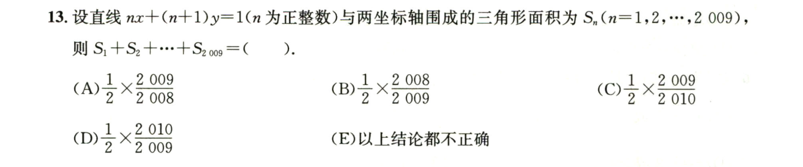

#### 第 14 题（问题求解）

若圆 $C: (x+1)^2 + (y-1)^2 = 1$ 与 $x$ 轴交于 $A$ 点，与 $y$ 轴交于 $B$ 点，则与此圆相切于劣弧 $AB$ 的中点 $M$（注：小于半圆的弧称为劣弧）的切线方程是（ ）。

- **A**．$y = x + 2 - \sqrt{2}$
- **B**．$y = x + 1 - \sqrt{2}$
- **C**．$y = x - 1 + \sqrt{2}$
- **D**．$y = x - 2 + \sqrt{2}$
- **E**．$y = x + 1 - 2\sqrt{2}$

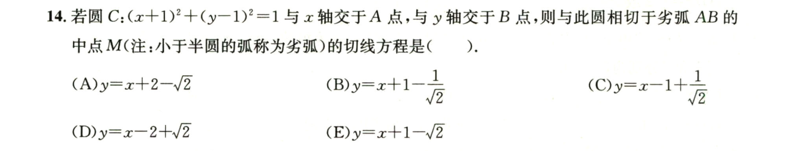

#### 第 15 题（问题求解）

已知实数 $a, b, x, y$ 满足 $y + |x - \sqrt{2}| = 1 - a^2$ 和 $|x - 2| = y - 1 - b^2$，则 $3^{a+b} + 3^{x+y} = $（ ）。

- **A**．25
- **B**．26
- **C**．27
- **D**．28
- **E**．29

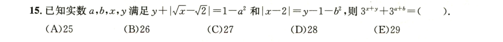

---

### (二) 条件充分性判断：第 16~25 小题，每小题 3 分，共 30 分。要求判断每题给出的条件（1）和条件（2）能否充分支持题干所陈述的结论。
> **判断标准**：
> - **A**．条件 (1) 充分，但条件 (2) 不充分
> - **B**．条件 (2) 充分，但条件 (1) 不充分
> - **C**．条件 (1) 和条件 (2) 单独都不充分，但条件 (1) 和条件 (2) 联合起来充分
> - **D**．条件 (1) 充分，条件 (2) 也充分
> - **E**．条件 (1) 和条件 (2) 单独都不充分，条件 (1) 和条件 (2) 联合起来也不充分

#### 第 16 题（条件充分性判断）

$a_1 + a_2 + a_3 + \dots + a_n = \frac{1}{3}(4^n - 1)$。
(1) 数列 $\{a_n\}$ 的通项公式为 $a_n = 2^n$。
(2) 在数列 $\{a_n\}$ 中，对任意正整数 $n$，有 $a_1 + a_2 + a_3 + \dots + a_n = 2^n - 1$。

- **A**．条件（1）充分，但条件（2）不充分
- **B**．条件（2）充分，但条件（1）不充分
- **C**．条件（1）和条件（2）单独都不充分，但条件（1）和条件（2）联合起来充分
- **D**．条件（1）充分，条件（2）也充分
- **E**．条件（1）和条件（2）单独都不充分，条件（1）和条件（2）联合起来也不充分

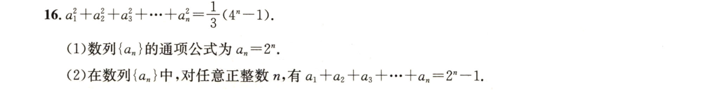

#### 第 17 题（条件充分性判断）

A 企业的职工人数今年比前年增加了 30%。
(1) A 企业的职工人数去年比前年减少了 20%。
(2) A 企业的职工人数今年比去年增加了 50%。

- **A**．条件（1）充分，但条件（2）不充分
- **B**．条件（2）充分，但条件（1）不充分
- **C**．条件（1）和条件（2）单独都不充分，但条件（1）和条件（2）联合起来充分
- **D**．条件（1）充分，条件（2）也充分
- **E**．条件（1）和条件（2）单独都不充分，条件（1）和条件（2）联合起来也不充分

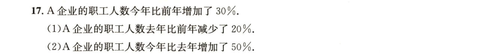

#### 第 18 题（条件充分性判断）

$|\log_a x| > 1$。
(1) $x \in [2, 4], \frac{1}{2} < a < 1$。
(2) $x \in [4, 6], 1 < a < 2$。

- **A**．条件（1）充分，但条件（2）不充分
- **B**．条件（2）充分，但条件（1）不充分
- **C**．条件（1）和条件（2）单独都不充分，但条件（1）和条件（2）联合起来充分
- **D**．条件（1）充分，条件（2）也充分
- **E**．条件（1）和条件（2）单独都不充分，条件（1）和条件（2）联合起来也不充分

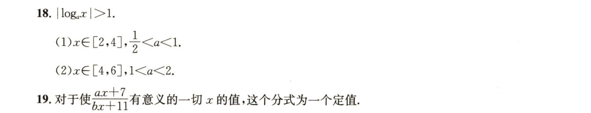

#### 第 19 题（条件充分性判断）

对于使分式 $\frac{ax+7}{bx+11}$ 有意义的一切 $x$ 的值，这个分式为一个定值。
(1) $7a - 11b = 0$。
(2) $11a - 7b = 0$。

- **A**．条件（1）充分，但条件（2）不充分
- **B**．条件（2）充分，但条件（1）不充分
- **C**．条件（1）和条件（2）单独都不充分，但条件（1）和条件（2）联合起来充分
- **D**．条件（1）充分，条件（2）也充分
- **E**．条件（1）和条件（2）单独都不充分，条件（1）和条件（2）联合起来也不充分

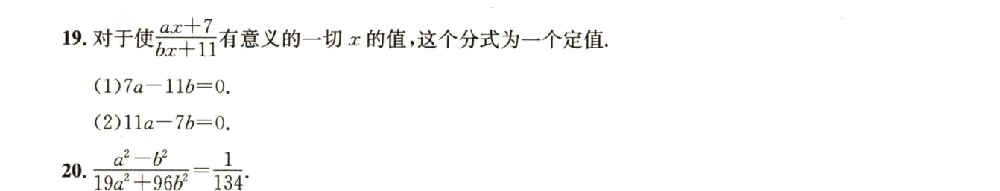

#### 第 20 题（条件充分性判断）

$\frac{a^2 - b^2}{19a^2 + 9b^2} = \frac{1}{34}$。
(1) $a, b$ 均为实数，且 $|a^2 - 2| + (a^2 - b^2 - 1)^2 = 0$。
(2) $a, b$ 均为实数，且 $\frac{a^2 b^2}{a^4 - 2b^4} = 1$。

- **A**．条件（1）充分，但条件（2）不充分
- **B**．条件（2）充分，但条件（1）不充分
- **C**．条件（1）和条件（2）单独都不充分，但条件（1）和条件（2）联合起来充分
- **D**．条件（1）充分，条件（2）也充分
- **E**．条件（1）和条件（2）单独都不充分，条件（1）和条件（2）联合起来也不充分

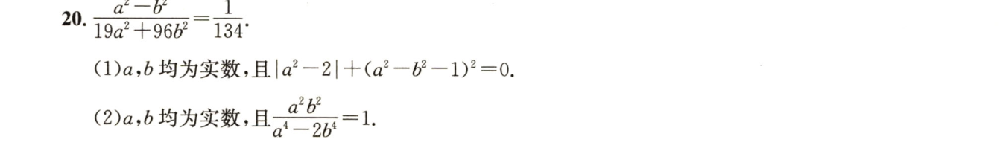

#### 第 21 题（条件充分性判断）

$2a^2 - 5a - 2 + \frac{3}{a^2 + 1} = -1$。
(1) $a$ 是方程 $x^2 - 3x + 1 = 0$ 的根。
(2) $|a| = 1$。

- **A**．条件（1）充分，但条件（2）不充分
- **B**．条件（2）充分，但条件（1）不充分
- **C**．条件（1）和条件（2）单独都不充分，但条件（1）和条件（2）联合起来充分
- **D**．条件（1）充分，条件（2）也充分
- **E**．条件（1）和条件（2）单独都不充分，条件（1）和条件（2）联合起来也不充分

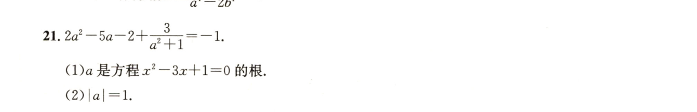

#### 第 22 题（条件充分性判断）

点 $(s, t)$ 落入圆 $(x-a)^2 + (y-a)^2 = a^2$ 内的概率是 $\frac{\pi}{36}$。
(1) $s, t$ 是连续掷一枚骰子两次所得到的点数，$a = 3$。
(2) $s, t$ 是连续掷一枚骰子两次所得到的点数，$a = 2$。

- **A**．条件（1）充分，但条件（2）不充分
- **B**．条件（2）充分，但条件（1）不充分
- **C**．条件（1）和条件（2）单独都不充分，但条件（1）和条件（2）联合起来充分
- **D**．条件（1）充分，条件（2）也充分
- **E**．条件（1）和条件（2）单独都不充分，条件（1）和条件（2）联合起来也不充分

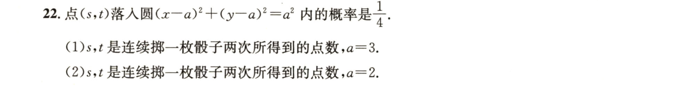

#### 第 23 题（条件充分性判断）

$(x^2 - 2x - 8)(2-x)(2x - 2x^2 - 6) > 0$。
(1) $x \in (-3, -2)$。
(2) $x \in [2, 3]$。

- **A**．条件（1）充分，但条件（2）不充分
- **B**．条件（2）充分，但条件（1）不充分
- **C**．条件（1）和条件（2）单独都不充分，但条件（1）和条件（2）联合起来充分
- **D**．条件（1）充分，条件（2）也充分
- **E**．条件（1）和条件（2）单独都不充分，条件（1）和条件（2）联合起来也不充分

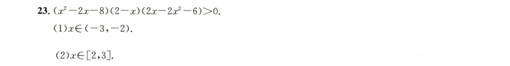

#### 第 24 题（条件充分性判断）

圆 $(x-1)^2 + (y-2)^2 = 4$ 和直线 $(1+2\lambda)x + (1-\lambda)y - 3 - 3\lambda = 0$ 相交于两点。
(1) $\lambda = \frac{2\sqrt{3}}{3}$。
(2) $\lambda = \frac{5\sqrt{3}}{3}$。

- **A**．条件（1）充分，但条件（2）不充分
- **B**．条件（2）充分，但条件（1）不充分
- **C**．条件（1）和条件（2）单独都不充分，但条件（1）和条件（2）联合起来充分
- **D**．条件（1）充分，条件（2）也充分
- **E**．条件（1）和条件（2）单独都不充分，条件（1）和条件（2）联合起来也不充分

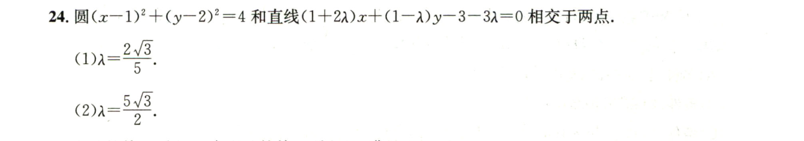

#### 第 25 题（条件充分性判断）

$\{a_n\}$ 的前 $n$ 项和 $S_n$ 与 $\{b_n\}$ 的前 $n$ 项和 $T_n$ 满足 $S_{19} : T_{19} = 3 : 2$。
(1) $\{a_n\}$ 和 $\{b_n\}$ 是等差数列。
(2) $a_{10} : b_{10} = 3 : 2$。

- **A**．条件（1）充分，但条件（2）不充分
- **B**．条件（2）充分，但条件（1）不充分
- **C**．条件（1）和条件（2）单独都不充分，但条件（1）和条件（2）联合起来充分
- **D**．条件（1）充分，条件（2）也充分
- **E**．条件（1）和条件（2）单独都不充分，条件（1）和条件（2）联合起来也不充分

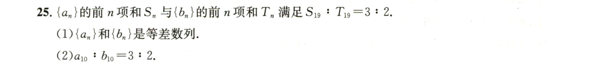

---

## 二、逻辑推理（第 26-55 题，每小题 2 分，共 60 分）
下列每题给出的五个选项中，只有一项是符合试题要求的。

#### 第 26 题（逻辑推理）

某中学发现有学生在课余时间用扑克玩带有赌博性质的游戏，因此规定学生不得带扑克进入学
校，不过即使是硬币，也可以用作赌具，但禁止学生带硬币进入学校是不可思议的，因此，禁止学生
带扑克进入学校是荒谬的。
以下哪项如果为真，最能削弱上述论证?

- **A**．禁止带扑克进入学校不能阻止学生在校外赌博。
- **B**．硬币作为赌具远不如扑克方便。
- **C**．很难查明学生是否带扑克进人学校。
- **D**．赌博不但败坏校风，而且影响学生的学习成绩。
- **E**．有的学生玩扑克不涉及赌博。

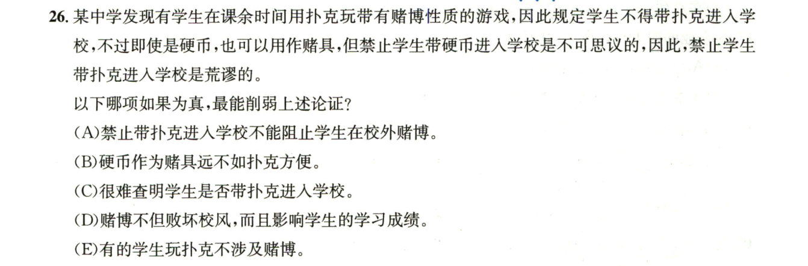

#### 第 27 题（逻辑推理）

甲、乙、丙和丁四人进入某围棋邀请赛半决赛，最后要决出一名冠军。张、王和李三人对结果作了
如下预测∶
张∶冠军不是丙。
王∶冠军是乙。
李∶冠军是甲。
已知张、王、李三人中恰有一人的预测正确，则以下哪项为真?

- **A**．冠军是甲。
- **B**．冠军是乙。
- **C**．冠军是丙。
- **D**．冠军是丁。
- **E**．无法确定冠军是谁。

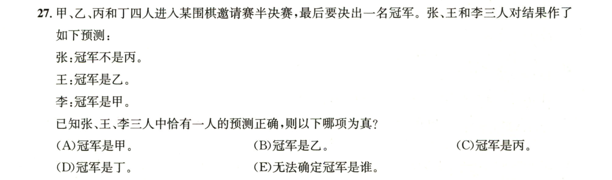

#### 第 28 题（逻辑推理）

除非年龄在 50岁以下，并且能持续游泳3 000米以上，否则不能参加下个月举行的花样横渡长江
活动。同时，高血压和心脏病患者不能参加。老黄能持续游泳3000 米以上，但没有被批准参加这
项活动。
以上断定能推出以下哪项结论?
I.老黄的年龄至少50 岁。
Ⅱ.老黄患有高血压。
Ⅲ.老黄患有心脏病。

- **A**．仅I。
- **B**．仅Ⅱ。
- **C**．仅Ⅲ。
- **D**．I、Ⅱ和Ⅲ至少有一。
- **E**．Ⅰ、Ⅱ和Ⅲ都不能从题干推出。

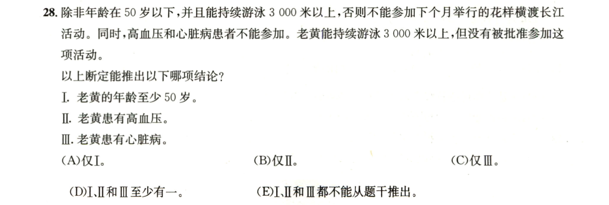

#### 第 29 题（逻辑推理）

一项对西部山区小塘村的调查发现∶小塘村约五分之三的儿童入中学后出现中度以上的近视，，而
他们的父母及祖辈，没有机会到正规学校接受教育，很少出现近视。
以下哪项作为上述断定的结论最为恰当?

- **A**．接受文化教育是造成近视的原因。
- **B**．只有在儿童时期接受正式教育才易于成为近视。
- **C**．阅读和课堂作业带来的视觉压力必然造成儿童的近视。
- **D**．文化教育的发展和近视现象的出现有密切的关系。
- **E**．小塘村约五分之二的儿童是文盲。

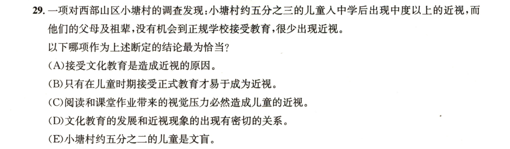

#### 第 30 题（逻辑推理）

小李考上了清华，或者小孙没考上北大。
增加以下哪项条件，能推出小李考上了清华?

- **A**．小张和小孙至少有一人未考上北大。
- **B**．小张和小李至少有一人未考上清华。
- **C**．小张和小孙都考上了北大。
- **D**．小张和小李都未考上清华。
- **E**．小张和小孙都未考上北大。

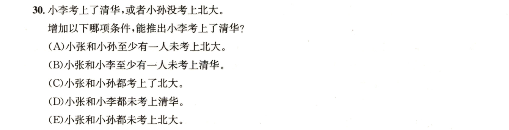

#### 第 31 题（逻辑推理）

大李和小王是某报新闻部的编辑，该报总编计划从新闻部抽调人员到经济部。总编决定;未经大
李和小王本人同意，将不调动两人。大李告诉总编∶"我不同意调动，除非我知道小王是否调动。"
小王说∶"除非我知道大李是否调动，否则我不同意调动。"
如果上述三人坚持各自的决定，则可推出以下哪项结论?

- **A**．两人都不可能调动。
- **B**．两人都可能调动。
- **C**．两人至少有一人可能调动，但不可能两人都调动。
- **D**．要么两人都调动，要么两人都不调动。
- **E**．题干的条件推不出关于两人调动的确定结论。

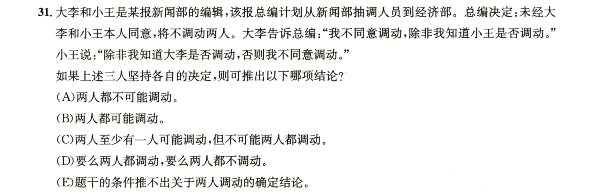

#### 第 32 题（逻辑推理）

去年经纬汽车专卖店调高了营销人员的营销业绩奖励比例。专卖店李经理打算新的一年继续执
行该奖励比例，因为去年该店的汽车销售数量较前年增加了16??陈副经理对此持怀疑态度。她
指出，他们的竞争对手并没有调整营销人员的奖励比例，但在过去的一年中也出现了类似的增长。
以下哪项最为恰当地概括了陈副经理的质疑方法?

- **A**．运用一个反例，否定李经理的一般性结论。
- **B**．运用一个反例，说明李经理的论据不符合事实。
- **C**．运用一个反例，说明李经理的论据虽然成立，但不足以推出结论。
- **D**．指出李经理的论证对一个关键概念的理解和运用有误。
- **E**．指出李经理的论证中包含自相矛盾的假设。

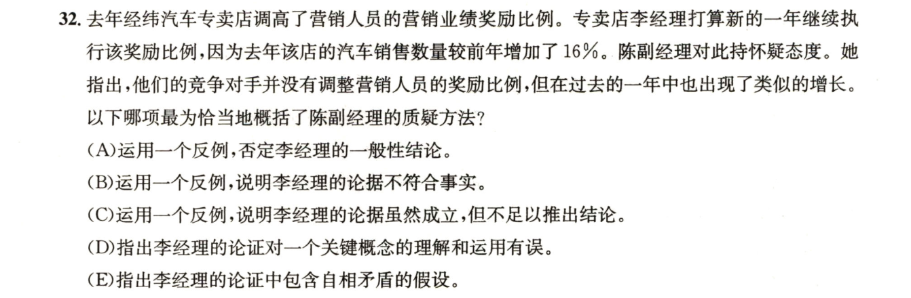

#### 第 33 题（逻辑推理）

某综合性大学只有理科与文科，理科学生多于文科学生，女生多于男生。
如果上述断定为真，则以下哪项关于该大学学生的断定也一定为真?

I.文科的女生多于文科的男生。
Ⅱ.理科的男生多于文科的男生。
Ⅲ.理科的女生多于文科的男生。

- **A**．仅I和Ⅱ。
- **B**．仅Ⅲ。
- **C**．仅Ⅱ和Ⅲ。
- **D**．I、Ⅱ和Ⅲ。
- **E**．I、Ⅱ和Ⅲ都不一定为真。

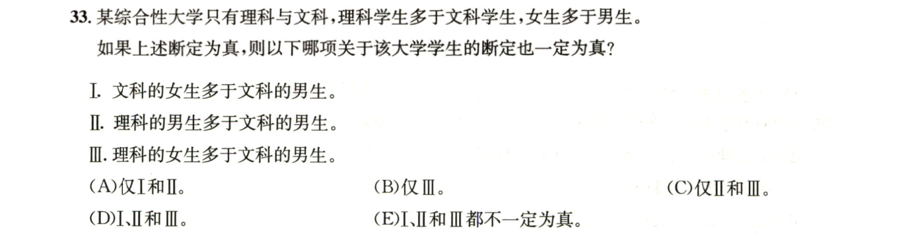

#### 第 34 题（逻辑推理）

对本届奥运会所有奖牌获得者进行了尿样化验，没有发现兴奋剂使用者。
如果以上陈述为假，则以下哪项一定为真?
J.或者有的奖牌获得者没有化验尿样，或者在奖牌获得者中发现了兴奋剂使用者。
Ⅱ.虽然有的奖牌获得者没有化验尿样，但还是发现了兴奋剂使用者。
Ⅲ.如果对所有的奖牌获得者进行了尿样化验，则一定发现了兴奋剂使用者。

- **A**．仅I。
- **B**．仅I
- **C**．仅Ⅲ。
- **D**．仅I和Ⅲ。
- **E**．仅I和Ⅱ。

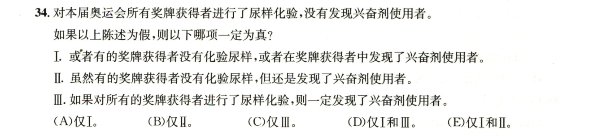

#### 第 35 题（逻辑推理）

某地区过去三年日常生活必需品平均价格增长了30??在同一时期，购买日常生活必需品的开支
占家庭平均月收入的比例并未发生变化。因此，过去三年家庭平均收入一定也增长了30??
以下哪项最可能是上述论证所假设的?

- **A**．在过去的三年中，平均每个家庭购买的日常生活必需品数量和质量没有变化。
- **B**．在过去的三年中，除生活必需品外，其他商品平均价格的增长低于30??
- **C**．在过去的三年中，该地区家庭数量增长了30??
- **D**．在过去的三年中，家庭用于购买高档消费品的平均开支明显减少。
- **E**．在过去的三年中，家庭平均生活水平下降了。36～37题基于以下题干∶张教授;在南美洲发现的史前木质工具存在于13 000年以前。有的考古学家认为，这些工具是其祖先，从西伯利亚迁徙到阿拉斯加的人群使用的。这一观点难以成立，因为要到达南美洲，这些人群必须在13 000年前经历长途跋涉，而在从阿拉斯加到南美洲之间，从未发现13 000年前的木质工具。李研究员∶您恐怕忽视了，这些木质工具是在泥煤沼泽中发现的，北美很少有泥煤沼泽。木质工具在普通的泥土中几年内就会腐烂化解。

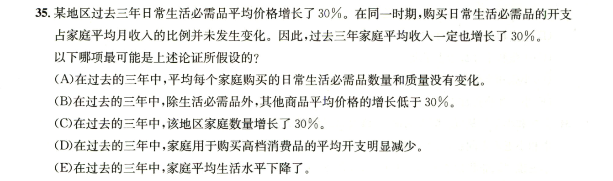

#### 第 36 题（逻辑推理）

以下哪项最为准确地概括了张教授与李研究员所讨论的问题?

- **A**．上述史前木质工具是否是其祖先从西伯利亚迁徙到阿拉斯加的人群使用的?
- **B**．张教授的论据是否能推翻上述考古学家的结论?
- **C**．上述人群是否可能在13 000年前完成从阿拉斯加到南美洲的长途跋涉?
- **D**．上述木质工具是否只有在泥煤沼泽中才不会腐烂化解?
- **E**．上述史前木质工具存在于13 000年以前的断定是否有足够的根据?

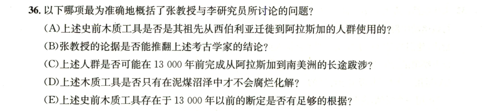

#### 第 37 题（逻辑推理）

以下哪项最为准确地概括了李研究员的应对方法?

- **A**．指出张教授的论据违背事实。
- **B**．引用与张教授的结论相左的权威性研究成果。
- **C**．指出张教授曲解了考古学家的观点。
- **D**．质疑张教授的隐含假设。
- **E**．指出张教授的论据实际上否定其结论。

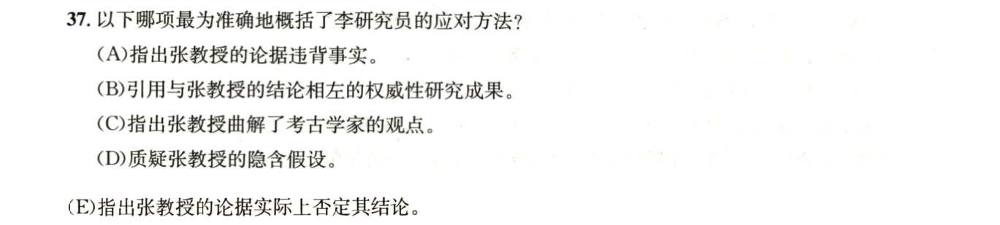

#### 第 38 题（逻辑推理）

一些人类学家认为，如果不具备应付各种自然环境的能力，人类在史前年代就不可能幸存下来。
然而相当多的证据表明，阿法种南猿——一种与早期人类有关的史前物种，在各种自然环境中顽
强生存的能力并不亚于史前人类，但最终灭绝了。因此，人类学家的上述观点是错误的。
上述推理的漏洞也类似地出现在以下哪项中?

- **A**．大张认识到赌博是有害的，但就是改不掉。因此，"不认识错误就不能改正错误"这一断定是不成立的。
- **B**．已经找到了证明造成艾克矿难是操作失误的证据。因此，关于艾克矿难起因于设备老化、年久失修的猜测是不成立的。
- **C**．大李图便宜，买了双旅游鞋，没穿几天就坏了。因此，怀疑"便宜无好货"是没道理的。
- **D**．既然不怀疑小赵可能考上大学，那就没有理由担心小赵可能考不上大学。
- **E**．既然怀疑小赵一定能考上大学，那就没有理由怀疑小赵一定考不上大学。

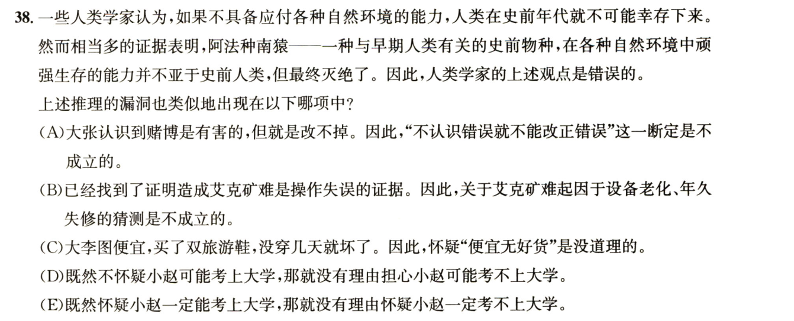

#### 第 39 题（逻辑推理）

关于甲班体育达标测试，三位老师有如下预测∶
张老师说∶"不会所有人都不及格。"
李老师说∶"有人会不及格。"
王老师说∶"班长和学习委员都能及格。"
如果三位老师中只有一人的预测正确，则以下哪项一定为真?

- **A**．班长和学习委员都没及格。
- **B**．班长和学习委员都及格了。
- **C**．班长及格，但学习委员没及格。
- **D**．班长没及格，但学习委员及格了。
- **E**．以上各项都不一定为真。40～41题基于以下题干∶因为照片的影像是通过光线与胶片的接触形成的，所以每张照片都具有一定的真实性。但是，从不同角度拍摄的照片总是反映了物体某个侧面的真实，而不是全部的真实。在这个意义上，照片又是不真实的。因此，在目前的技术条件下，以照片作为证据是不恰当的，特别是在法庭上。

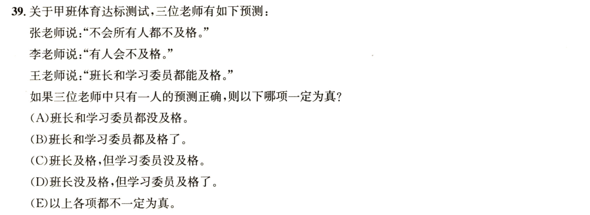

#### 第 40 题（逻辑推理）

以下哪项是上述论证所假设的?

- **A**．不完全反映全部真实的东西不能成为恰当的证据。
- **B**．全部的真实性是不可把握的。
- **C**．目前的法庭审理都把照片作为重要物证。
- **D**．如果从不同角度拍摄一个物体，就可以把握它的全部真实性。
- **E**．法庭具有判定任一证据真伪的能力。

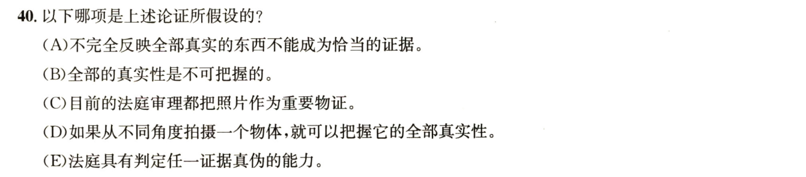

#### 第 41 题（逻辑推理）

以下哪项如果为真，最能削弱上述论证?

- **A**．摄影技术是不断发展的，理论上说，全景照片可以从外观上反映物体的全部真实。
- **B**．任何证据只需要反映事实的某个侧面。
- **C**．在法庭审理中，有些照片虽然不能成为证据，但有重要的参考价值。
- **D**．有些照片是通过技术手段合成或伪造的。
- **E**．就反映真实性而言，照片的质量有很大的差别。

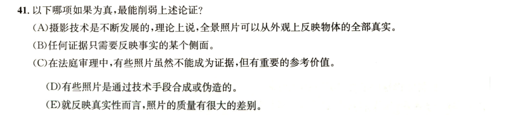

#### 第 42 题（逻辑推理）

如果一个学校的大多数学生都具备足够的文学欣赏水平和道德自律意识，那么，像《红粉梦》和《演
艺十八钗》这样的出版物就不可能成为在该校学生中销售最多的书。去年在 H学院的学生中，
《演艺十八钗》的销售量仅次于《红粉梦》。
如果上述断定为真，则以下哪项一定为真?
I.去年 H学院的大多数学生都购买了《红粉梦》或《演艺十八钗》。
Ⅱ. H学院的大多数学生既不具备足够的文学欣赏水平，也不具备足够的道德自律意识。
Ⅲ.H学院至少有些学生不具备足够的文学欣赏水平，或者不具备足够的道德自律意识。

- **A**．仅I。
- **B**．仅ⅡI。
- **C**．仅Ⅲ。
- **D**．仅Ⅱ和Ⅲ。
- **E**．I、Ⅱ和Ⅲ。

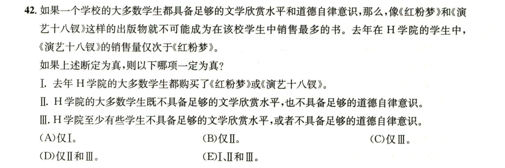

#### 第 43 题（逻辑推理）

这次新机种试飞只是一次例行试验，既不能算成功，也不能算不成功。
以下哪项对于题干的评价最为恰当?

- **A**．题干的陈述没有漏洞。
- **B**．题干的陈述有漏洞，这一漏洞也出现在后面的陈述中∶这次关于物价问题的社会调查结果，既不能说完全反映了民意，也不能说一点也没有反映民意。
- **C**．题干的陈述有漏洞，这一漏洞也出现在后面的陈述中;这次考前辅导，既不能说完全成功，也不能说彻底失败。
- **D**．题干的陈述有漏洞，这一漏洞也出现在后面的陈述中;人有特异功能，既不是被事实证明的科学结论，也不是纯属欺诈的伪科学结论。
- **E**．题干的陈述有漏洞，这一漏洞也出现在后面的陈述中;在即将举行的大学生辩论赛中，我不认为我校代表队一定能进入前四名，我也不认为我校代表队可能进不了前四名。

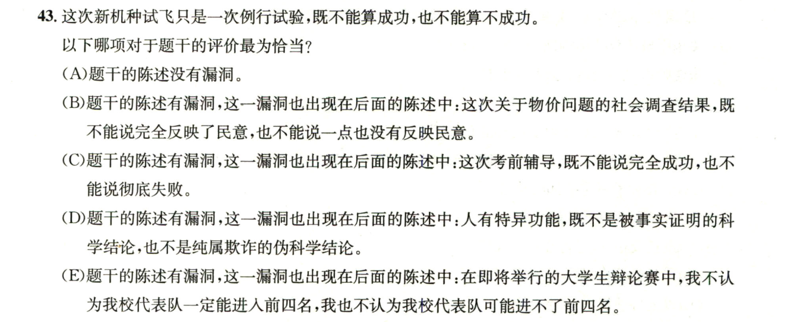

#### 第 44 题（逻辑推理）

S市持有驾驶证的人员数量较五年前增加了数十万，但交通死亡事故却较五年前有明显的减少。
由此可以得出结论∶目前 S市驾驶员的驾驶技术熟练程度较五年前有明显的提高。
以下各项如果为真，都能削弱上述论证，除了∶

- **A**．交通事故的主要原因是驾驶员违反交通规则。
- **B**．目前S市的交通管理力度较五年前有明显加强。
- **C**．S市加强对驾校的管理，提高了对新驾驶员的培训标准。
- **D**．由于油价上涨，许多车主改乘公交车或地铁上下班。
- **E**．S市目前的道路状况及安全设施较五年前有明显改善。

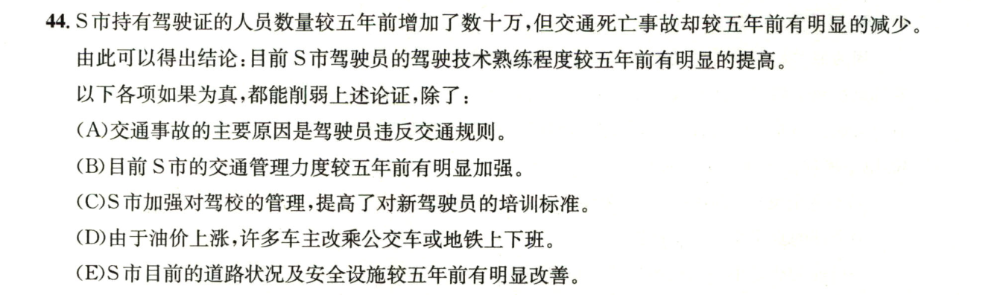

#### 第 45 题（逻辑推理）

肖群一周工作五天，除非这周内有法定休假日。除了周五在志愿者协会，其余四天肖群都在太平
洋保险公司上班。上周没有法定休假日。因此，上周的周一、周二、周三和周四肖群一定在太平洋
保险公司上班。
以下哪项是上述论证所假设的?

- **A**．一周内不可能出现两天以上的法定休假日。
- **B**．太平洋保险公司实行每周四天工作日制度。
- **C**．上周的周六和周日肖群没有上班。
- **D**．肖群在志愿者协会的工作与保险业有关。
- **E**．肖群是个称职的雇员。

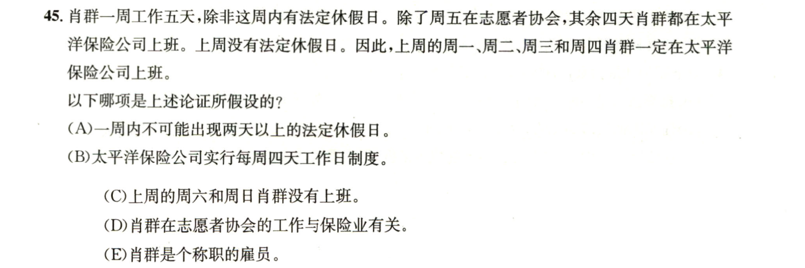

#### 第 46 题（逻辑推理）

在接受治疗的腰肌劳损患者中，有人只接受理疗，也有人接受理疗与药物双重治疗。前者可以得
到与后者相同的预期治疗效果。对于上述接受药物治疗的腰肌劳损患者来说，此种药物对于获得
预期的治疗效果是不可缺少的。
如果上述断定为真，则以下哪项一定为真?
I. 对于一部分腰肌劳损患者来说，要配合理疗取得治疗效果，药物治疗是不可缺少的。
Ⅱ. 对于一部分腰肌劳损患者来说，要取得治疗效果，药物治疗不是不可缺少的。
Ⅲ.对于所有腰肌劳损患者来说，要取得治疗效果，理疗是不可缺少的。

- **A**．仅I。
- **B**．仅Ⅱ。
- **C**．仅Ⅲ。
- **D**．仅I和ⅡI。
- **E**．IIⅡI和Ⅲ。

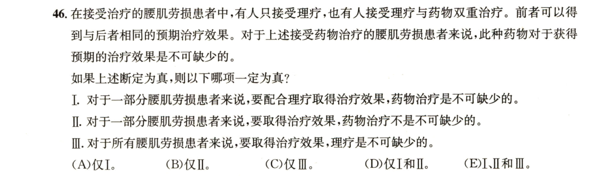

#### 第 47 题（逻辑推理）

在潮湿的气候中仙人掌很难成活，在寒冷的气候中柑橘很难生长。在某省的大部分地区，仙人掌
和柑橘至少有一种不难成活或生长。
如果上述断定为真，则以下哪项一定为假?

- **A**．该省的一半地区，既潮湿又寒冷。
- **B**．该省的大部分地区炎热。
- **C**．该省的大部分地区潮湿。
- **D**．该省的某些地区既不寒冷也不潮湿。
- **E**．柑橘在该省的所有地区都无法生长。

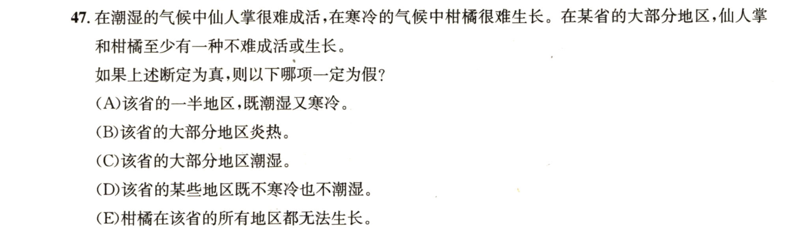

#### 第 48 题（逻辑推理）

主持人;有网友称你为"国学承师"，也有网友称你为"国学大师"。你认为哪个名称更适合你?
上述提问中的不当也存在于以下各项中，除了∶

- **A**．你要社会主义的低速度，还是资本主义的高速度?
- **B**．你主张为了发展可以牺牲环境，还是主张宁可不发展也不能破坏环境?
- **C**．你认为人都自私，还是认为人都不自私?
- **D**．你认为"9·11"恐怖袭击必然发生，还是认为有可能避免?
- **E**．你认为中国队必然夺冠，还是认为不可能夺冠?

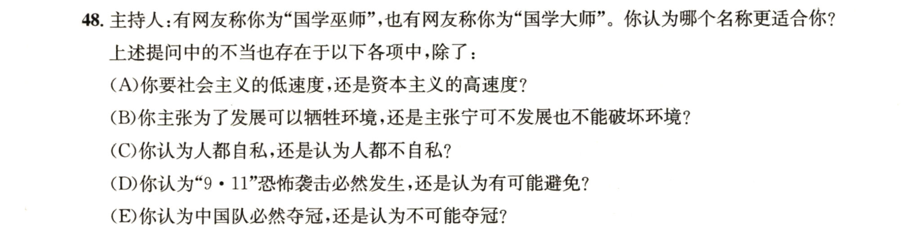

#### 第 49 题（逻辑推理）

张珊∶不同于"刀""枪""箭""载"，"之""乎""者""也"这些字无确定所指。
李思∶我同意。因为"之""乎""者""也"这些字无意义。因此，应当在现代汉语中废止。
以下哪项最有可能是李思认为张珊的断定所蕴含的意思?

- **A**．除非一个字无意义，否则一定有确定所指。
- **B**．如果一个字有确定所指，则它一定有意义。
- **C**．如果一个字无确定所指，则应当在现代汉语中废止。
- **D**．只有无确定所指的字，才应当在现代汉语中废止。
- **E**．大多数的字都有确定所指。

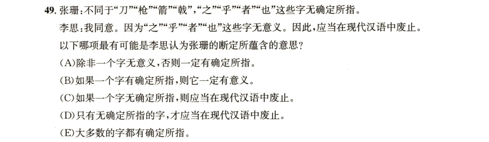

#### 第 50 题（逻辑推理）

中国要拥有一流的国家实力，必须有一流的教育。只有拥有一流的国家实力，中国才能做出应有
的国际贡献。

以下各项都符合题干的意思，除了∶

- **A**．中国难以做出应有的国际贡献，除非拥有一流的教育。
- **B**．只要中国拥有一流的教育，就能做出应有的国际贡献。
- **C**．如果中国拥有一流的国家实力，就不会没有一流的教育。
- **D**．不能设想中国做出了应有的国际贡献，但缺乏一流的教育。
- **E**．中国面临选择∶或者放弃应尽的国际义务，或者创造一流的教育。

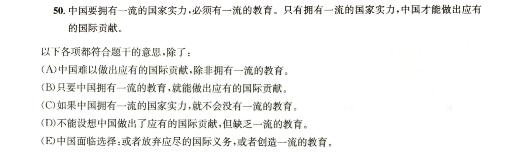

#### 第 51 题（逻辑推理）

科学离不开测量，测量离不开长度单位。千米、米、分米、厘米等基本长度单位的确立完全是一种
人为约定。因此，科学的结论完全是一种人的主观约定，谈不上客观的标准。
以下哪项与题干的论证最为类似?

- **A**．建立良好的社会保障体系离不开强大的综合国力，强大的综合国力离不开一流的国民教育。因此，要建立良好的社会保障体系，必须有一流的国民教育。
- **B**．做规模生意离不开做广告，做广告就要有大额资金投入。不是所有人都能有大额资金投入。因此，不是所有人都能做规模生意。
- **C**．游人允许坐公园的长椅，要坐公园长椅就要靠近它们，靠近长椅的一条路径要踩踏草地。因此，允许游人踩踏草地。
- **D**．具备扎实的舞蹈基本功必须经过常年不懈的艰苦训练。在春节晚会上演出的舞蹈演员必须具备扎实的基本功。常年不懈的艰苦训练是乏味的。因此，在春节晚会上演出是乏味的。
- **E**．家庭离不开爱情，爱情离不开信任。信任是建立在真诚的基础上的。因此，对真诚的背离是家庭危机的开始。

#### 第 52 题（逻辑推理）

所有的灰狼都是狼，这一断定显然是真的。因此，所有的疑似SARS病例都是 SARS病例，这一断
定也是真的。
以下哪项最为恰当地指出了题干论证的漏洞?

- **A**．题干的论证忽略了∶一个命题是真的，不等于具有该命题形式的任一命题都是真的。
- **B**．题干的论证忽略了∶灰狼与狼的关系，不同于疑似 SARS病例和 SARS病例的关系。
- **C**．题干的论证忽略了∶在疑似SARS病例中，大部分不是 SARS病例。
- **D**．题干的论证忽略了∶许多狼不是灰色的。
- **E**．题干的论证忽略了∶此种论证方式会得出其他许多明显违反事实的结论。

#### 第 53 题（逻辑推理）

违法必究，但几乎看不到违反道德的行为受到惩罚，如果这成为一种常规，那么;民众就会失去道
德约束。道德失控对社会稳定的威胁并不亚于法律失控。因此，为了维护社会的稳定，任何违反
道德的行为都不能不受惩治。
以下哪项对上述论证的评价最为恰当?

- **A**．上述论证是成立的。
- **B**．上述论证有漏洞，它忽略了有些违法行为并未受到追究。
- **C**．上述论证有漏洞，它忽略了由违法必究，推不出缺德必究。
- **D**．上述论证有漏洞，它夸大了违反道德行为的社会危害性。
- **E**．上述论证有漏洞，它忽略了由否定"违反道德的行为都不受惩治"，推不出"违反道德的行为都要受惩治"。

#### 第 54 题（逻辑推理）

张珊喜欢喝绿茶，也喜欢喝咖啡。他的朋友中没有人既喜欢喝绿茶;又喜欢喝咖啡，但他的所有朋
友都喜欢喝红茶。
如果上述断定为真，则以下哪项不可能为真?

- **A**．张珊喜欢喝红茶。
- **B**．张珊的所有朋友都喜欢喝咖啡。
- **C**．张珊的所有朋友喜欢喝的茶在种类上完全一样。
- **D**．张珊有一个朋友既不喜欢喝绿茶，也不喜欢喝咖啡。
- **E**．张珊喜欢喝的饮料，他有一个朋友都喜欢喝。

#### 第 55 题（逻辑推理）

一个善的行为，必须既有好的动机，又有好的效果。如果是有意伤害他人，或是无意伤害他人，但
这种伤害的可能性是可以预见的∶在这两种情况下。对他人造成伤害的行为都是恶的行为。
以下哪项叙述符合题干的断定?

- **A**．P先生写了一封试图挑拨 E先生与其女友之间关系的信。P的行为是恶的，尽管这封信起到了与他的动机截然相反的效果。
- **B**．为了在新任领导面前表现自己，争夺一个晋升名额，J先生利用业余时间解决积压的医疗索赔案件，J的行为是善的，因为S小姐的医疗索赔请求因此得到了及时的补偿。
- **C**．在上班途中，M女士把自己的早餐汉堡包给了街上的一个乞丐。乞丐由于急于吞咽而被意外地嗜死了。所以，M女士无意中实施了一个恶的行为。
- **D**．大雪过后，T先生帮邻居铲除了门前的积雪，但不小心在台阶上留下了冰。他的邻居因此摔了一跤。因此，一个善的行为导致了一个坏的结果。
- **E**．S女士义务帮邻居照看3岁的小孩。小孩在S女土不注意时跑到马路上结果被车撞了。尽管S女士无意伤害这个小孩，但她的行为还是恶的。四、写作∶第56~57小题，共65分。其中论证有效性分析30分，论说文35 分。请答在答题纸相应的位置上。

---

## 三、中文写作（第 56-57 题，共 65 分）

#### 第 56 题（论证有效性分析）

论证有效性分析∶分析下述论证中存在的缺陷与漏洞，选择若干要点，写一篇 600 字左右的文章，
对该论证的有效性进行分析和评论。（论证有效性分析的一般要点是;概念特别是核心概念的界
定和使用是否准确并前后一致，有无各种明显的逻辑错误，论证的论据是否成立并支持结论，结论
成立的条件是否充分等。）
1000是100的十倍，但是当分母大到上百亿的时候，作为分子的这两个数的差别就失去了意
义。在知识经济时代，任何人所掌握的知识，都只是沧海一粟，这使得在培养与选拔人才时，知识
尺度已变得毫无意义。
现代网络技术可以使你在最短的时间内查询到你所需要的任何知识信息，有的大学毕业生因
此感叹何必要为学习各种知识数年寒窗，这不无道理。传授知识不应当继续成为教育，特别是高
等教育的功能。学习知识需要记忆。记忆能力，是浅层次的大脑功能。人们在思维方面的差异，
不在于能记住什么，而在于能提出什么。素质教育的真正目标，是培养批判性思维与创造性思维

能力。知识与此种能力之间并没有实质性的联系，否则就难以解释，具备与爱因斯坦相同知识背
景的人多的是，为什么唯独他发现了相对论。硕士、博士这些知识头衔的实际价值一再受到有识
之士的质疑，道理就在这里。
"知识就是力量"这一曾经激励了几代人的口号，正在成为空洞的历史回声，这其实是时代的
进步。

#### 第 57 题（论说文）

论说文∶以"由三鹿奶粉事件所想到的"为题，写一篇 700字左右的论说文。

