# 2010 年全国硕士研究生招生考试管理类专业学位联考综合能力试题 (199)

## 一、问题求解：第 1-15 小题，每小题 3 分，共 45 分。下列每题给出的 A、B、C、D、E 五个选项中，只有一项是符合试题要求的。请在答题卡上将所选的字母涂黑。

### 第 1 题

电影开演时观众中女士与男士人数之比为 5:4，开演后无观众入场，放映一个小时后，女士的 20%、男士的 15% 离场，则此时在场的女士与男士人数之比为（ ）。

- **A**．4:5
- **B**．1:1
- **C**．5:4
- **D**．20:17
- **E**．85:64

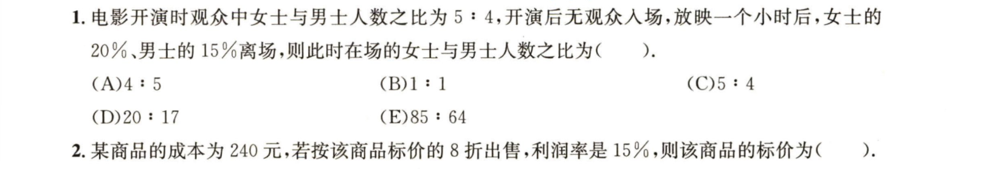

### 第 2 题

某商品的成本为 240 元，若按该商品标价的 8 折出售，利润率是 15%，则该商品的标价为（ ）。

- **A**．276 元
- **B**．331 元
- **C**．345 元
- **D**．360 元
- **E**．400 元

### 第 3 题

三名小孩中有一名学龄前儿童（年龄不足 6 岁），他们的年龄都是质数（素数），且依次相差 6 岁，他们的年龄之和为（ ）。

- **A**．21
- **B**．27
- **C**．33
- **D**．39
- **E**．51

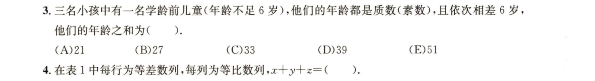

### 第 4 题

在表 1 中每行为等差数列，每列为等比数列，$x + y + z =$（ ）。

表 1

| 2 | $\dfrac{5}{2}$ | 3 |
| :---: | :---: | :---: |
| $x$ | $\dfrac{5}{4}$ | $\dfrac{3}{2}$ |
| $a$ | $y$ | $\dfrac{3}{4}$ |
| $b$ | $c$ | $z$ |

- **A**．2
- **B**．$\dfrac{5}{2}$
- **C**．3
- **D**．$\dfrac{7}{2}$
- **E**．4

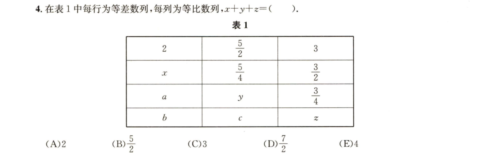

### 第 5 题

如图 1 所示，在直角三角形 $ABC$ 区域内部有座山，现计划从 $BC$ 边上某点 $D$ 开凿一条隧道到点 $A$，要求隧道长度最短，已知 $AB$ 长为 5 千米，$AC$ 长为 12 千米，则所开凿的隧道 $AD$ 的长度约为（ ）。

- **A**．4.12 千米
- **B**．4.22 千米
- **C**．4.42 千米
- **D**．4.62 千米
- **E**．4.92 千米

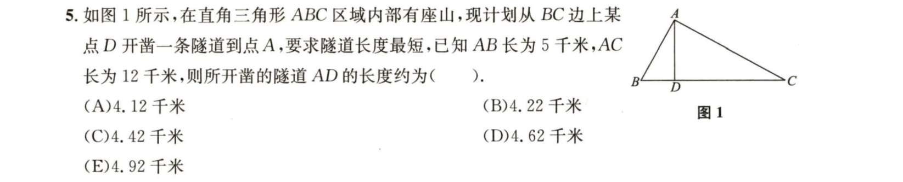

### 第 6 题

某商店举行店庆活动，顾客消费达到一定数量后，可以在 4 种赠品中随机选取 2 个不同的赠品，任意两位顾客所选赠品中，恰有 1 件品种相同的概率是（ ）。

- **A**．$\dfrac{1}{6}$
- **B**．$\dfrac{1}{4}$
- **C**．$\dfrac{1}{3}$
- **D**．$\dfrac{1}{2}$
- **E**．$\dfrac{5}{6}$

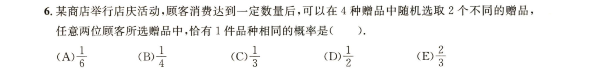

### 第 7 题

多项式 $x^3 + ax^2 + bx - 6$ 的两个因式是 $x-1$ 和 $x-2$，则第三个一次因式为（ ）。

- **A**．$x - 6$
- **B**．$x - 3$
- **C**．$x + 1$
- **D**．$x + 2$
- **E**．$x + 3$

### 第 8 题

某公司的员工中，拥有本科毕业证、计算机等级证、汽车驾驶证的人数分别为 130、110、90，又知只有一种证的人数为 140，三证齐全的人数为 30，则恰有双证的人数为（ ）。

- **A**．45
- **B**．50
- **C**．52
- **D**．65
- **E**．100

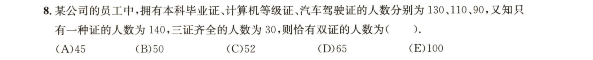

### 第 9 题

甲商店销售某种商品，该商品的进价为每件 90 元，若每件定价 100 元，则一天内能售出 500 件，在此基础上，定价每增 1 元，一天少售出 10 件，若使甲商店获得最大利润，则该商品的定价应为（ ）。

- **A**．115 元
- **B**．120 元
- **C**．125 元
- **D**．130 元
- **E**．135 元

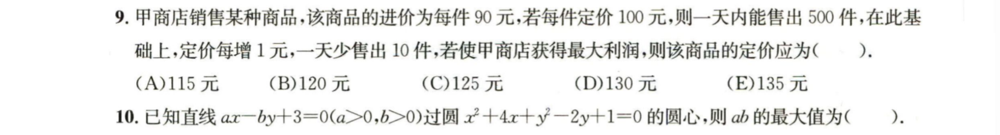

### 第 10 题

已知直线 $ax - by + 3 = 0$ ($a>0, b>0$) 过圆 $x^2 + 4x + y^2 - 2y + 1 = 0$ 的圆心，则 $ab$ 的最大值为（ ）。

- **A**．$\dfrac{9}{16}$
- **B**．$\dfrac{11}{16}$
- **C**．$\dfrac{3}{4}$
- **D**．$\dfrac{9}{8}$
- **E**．$\dfrac{9}{4}$

### 第 11 题

某大学派出 5 名志愿者到西部 4 所中学支教，若每所中学至少有一名志愿者，则不同的分配方案共有（ ）种。

- **A**．240 种
- **B**．144 种
- **C**．120 种
- **D**．60 种
- **E**．24 种

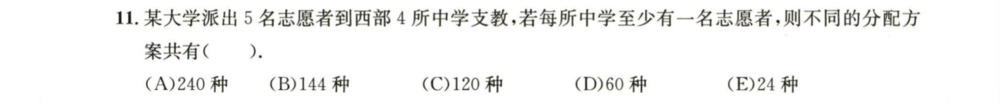

### 第 12 题

某装置的启动密码是由 0 到 9 中的 3 个不同数字组成，连续 3 次输入错误密码，就会导致该装置永久关闭，一个仅记得密码是由 3 个不同数字组成的人能够启动此装置的概率为（ ）。

- **A**．$\dfrac{1}{120}$
- **B**．$\dfrac{1}{168}$
- **C**．$\dfrac{1}{240}$
- **D**．$\dfrac{1}{720}$
- **E**．$\dfrac{3}{1000}$

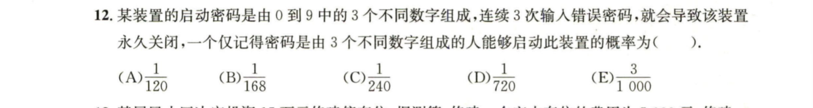

### 第 13 题

某居民小区决定投资 15 万元修建停车位，据测算，修建一个室内车位的费用为 5000 元，修建一个室外车位的费用为 1000 元，考虑到实际因素，计划室外车位的数量不少于室内车位的 2 倍，也不多于室内车位的 3 倍，这笔投资最多可建车位的数量为（ ）。

- **A**．78
- **B**．74
- **C**．72
- **D**．70
- **E**．66

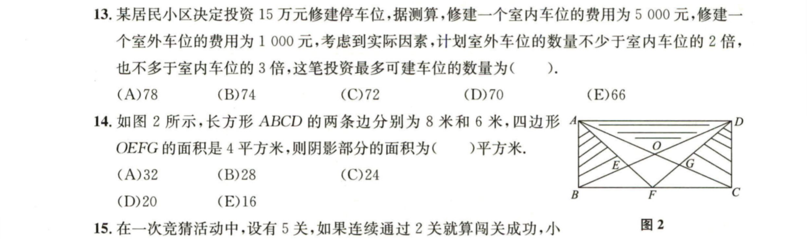

### 第 14 题

如图 2 所示，长方形 $ABCD$ 的两条边分别为 8 米和 6 米，四边形 $OEFG$ 的面积是 4 平方米，则阴影部分的面积为（ ）平方米。

- **A**．32
- **B**．28
- **C**．24
- **D**．20
- **E**．16

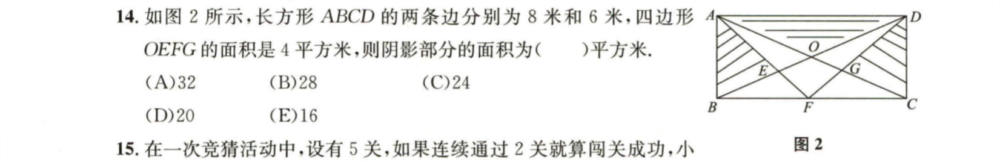

### 第 15 题

在一次竞猜活动中，设有 5 关，如果连续通过 2 关就算闯关成功，小王通过每关的概率都是 $\dfrac{1}{2}$，他闯关成功的概率为（ ）。

- **A**．$\dfrac{1}{8}$
- **B**．$\dfrac{1}{4}$
- **C**．$\dfrac{3}{8}$
- **D**．$\dfrac{4}{8}$
- **E**．$\dfrac{19}{32}$

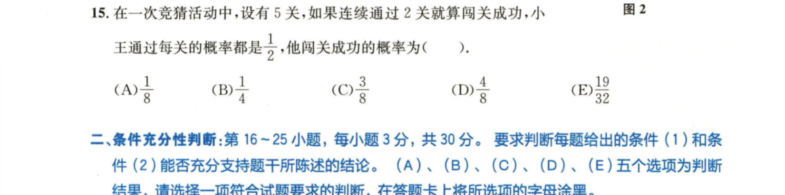

## 二、条件充分性判断：第 16～25 小题，每小题 3 分，共 30 分。要求判断每题给出的条件（1）和（2）能否充分支持题干所陈述的结论。A、B、C、D、E 五个选项为判断结果，请选择一项符合试题要求的判断，在答题卡上将所选项涂黑。

### 解题说明：
- **A**．条件（1）充分，但条件（2）不充分
- **B**．条件（2）充分，但条件（1）不充分
- **C**．条件（1）和（2）单独都不充分，但条件（1）和条件（2）联合起来充分
- **D**．条件（1）充分，条件（2）也充分
- **E**．条件（1）和（2）单独都不充分，条件（1）和条件（2）联合起来也不充分

### 第 16 题

$a|a-b| \ge |a|(a-b)$。

（1）实数 $a > 0$。

（2）实数 $a, b$ 满足 $a > b$。

### 第 17 题

有偶数位来宾。

（1）聚会时所有来宾都被安排坐在一张圆桌周围，且每位来宾与其邻座性别不同。

（2）聚会时男宾人数是女宾人数的两倍。

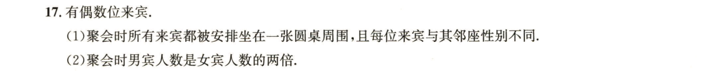

### 第 18 题

售出一件甲商品比售出一件乙商品利润要高。

（1）售出 5 件甲商品，4 件乙商品共获利 50 元。

（2）售出 4 件甲商品，5 件乙商品共获利 47 元。

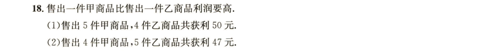

### 第 19 题

已知数列 $\{a_n\}$ 为等差数列，公差为 $d$，$a_1 + a_2 + a_3 + a_4 = 12$，则 $a_4 = 0$。

（1）$d = -2$。

（2）$a_2 + a_4 = 4$。

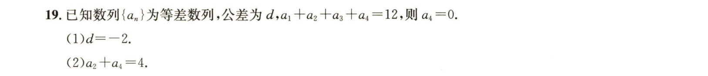

### 第 20 题

甲企业今年人均成本是去年的 60%。

（1）甲企业今年总成本比去年减少 25%，员工人数增加 25%。

（2）甲企业今年总成本比去年减少 28%，员工人数增加 20%。

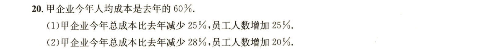

### 第 21 题

该股票涨了。

（1）某股票连续三天涨 10% 后，又连续三天跌 10%。

（2）某股票连续三天跌 10% 后，又连续三天涨 10%。

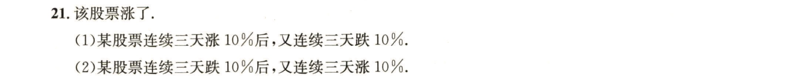

### 第 22 题

某班有 50 名学生，其中女生 26 名，已知在某次选拔测试中，有 27 名学生未通过，则有 9 名男生通过。

（1）在通过的学生中，女生比男生多 5 人。

（2）在男生中，未通过的人数比通过的人数多 6 人。

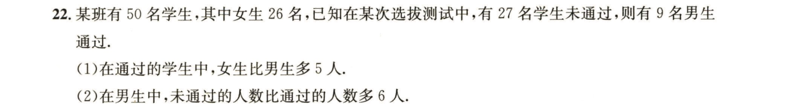

### 第 23 题

甲企业一年的总产值为 $\dfrac{a}{p}[(1+p)^{12} - 1]$。

（1）甲企业一月份的产值为 $a$，以后每月产值的增长率为 $p$。

（2）甲企业一月份的产值为 $\dfrac{a}{2}$，以后每月产值的增长率为 $2p$。

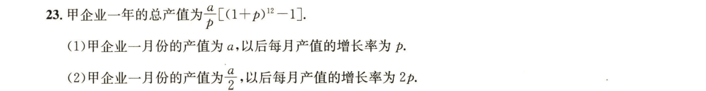

### 第 24 题

设 $a, b$ 为非负实数，则 $a+b \le \dfrac{5}{4}$。

（1）$ab \le \dfrac{9}{16}$。

（2）$a^2 + b^2 \le 1$。

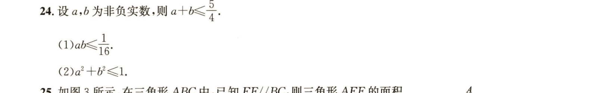

### 第 25 题

如图 3 所示，在三角形 $ABC$ 中，已知 $EF // BC$，则三角形 $AEF$ 的面积等于梯形 $EBCF$ 的面积。

（1）$|AG| = 2|GD|$。

（2）$|BC| = \sqrt{2}|EF|$。

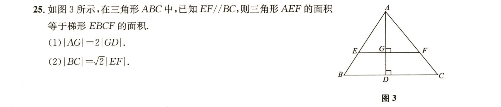

---

## 三、逻辑推理（第 26-55 题，每小题 2 分，共 60 分）

### 第 26 题

针对威胁人类健康的甲型 H1N1 流感，研究人员研制出了相应的疫苗。尽管这些疫苗是有效的，但某大学研究人员发现，阿司匹林、羟苯基乙酰胺等抑制某些酶的药物会影响疫苗的效果，这位研究人员指出：“如果你服用了阿司匹林或者对乙酰氨基酚，那么你注射疫苗后就必然不会产生良好的抗体反应。”

如果小张注射疫苗后产生了良好的抗体反应，那么根据上述研究结果可以得出以下哪项结论？

- **A**．小张服用了阿司匹林，但没有服用对乙酰氨基酚。
- **B**．小张没有服用阿司匹林，但感染了 H1N1 流感病毒。
- **C**．小张服用了阿司匹林，但没有感染 H1N1 流感病毒。
- **D**．小张没有服用阿司匹林，也没有服用对乙酰氨基酚。
- **E**．小张服用了对乙酰氨基酚，但没有服用羟苯基乙酰胺。

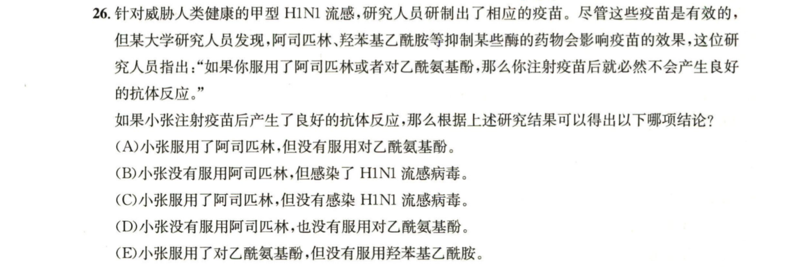

### 第 27 题

为了调查当前人们的识字水平，某实验者列举了 20 个词语，请 30 位文化人士识读，这些人的文化程度都在大专以上。识读结果显示，多数人只读对 3~5 个词语，极少数人读对 15 个以上，甚至有人全部读错。其中，“蹒跚”的辨识率最高，30 人中有 19 人读对；“呱呱坠地”所有人都读错。20 个词语的整体误读率接近 80%。该实验者由此得出，当前人们的识字水平并没有提高，甚至有所下降。

以下哪项如果为真，最能对该实验者的结论构成质疑？

- **A**．实验者选取的 20 个词语不具有代表性。
- **B**．实验者选取的 30 位识读者均没有博士学位。
- **C**．实验者选取的 20 个词语在网络流行语言中不常用。
- **D**．“呱呱坠地”这个词的读音有些大学老师也经常读错。
- **E**．实验者选取的 30 位识读者中约有 50% 大学成绩不佳。

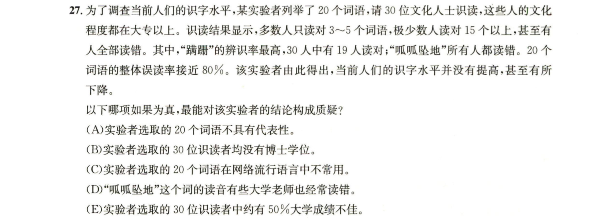

### 第 28 题

域控制器存储了域内的账户、密码和属于这个域的计算机三项信息。当计算机接入网络时，域控制器首先要鉴别这台计算机是否属于这个域，用户使用的登录账户是否存在，密码是否正确。如果三项信息均正确，则允许登录；如果以上信息有一项不正确，那么域控制器就会拒绝这个用户从这台计算机登录。小张的登录账号是正确的，但是域控制器拒绝小张的计算机登录。

基于以上陈述能得出以下哪项结论？

- **A**．小张输入的密码是错误的。
- **B**．小张的计算机不属于这个域。
- **C**．如果小张的计算机属于这个域，那么他输入的密码是错误的。
- **D**．只有小张输入的密码是正确的，他的计算机才属于这个域。
- **E**．如果小张输入的密码是正确的，那么他的计算机属于这个域。

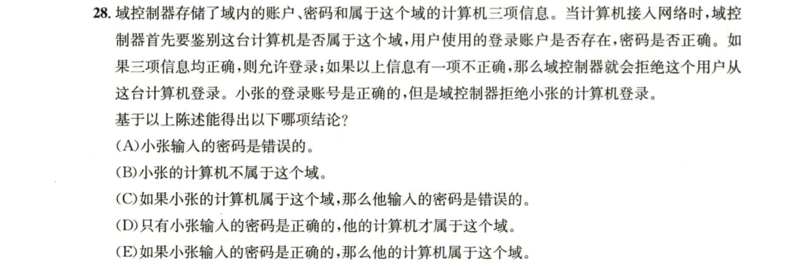

### 第 29 题

现在越来越多的人拥有了自己的轿车，但他们明显地缺乏汽车保养的基本知识。这些人会按照维修保养手册或 4S 店售后服务人员的提示做定期保养。可是，某位有经验的司机会告诉你，每行驶 5000 公里做一次定期检查，只能检查出汽车可能存在问题的一小部分，这样的检查是没有意义的，是浪费时间和金钱。

以下哪项不能削弱该司机的结论？

- **A**．每行驶 5000 公里做一次定期检查是保障车主安全所需要的。
- **B**．每行驶 5000 公里做一次定期检查能发现引擎的某些主要故障。
- **C**．在定期检查中所做的常规维护是保证汽车正常运行所必需的。
- **D**．赵先生的新车未做定期检查，行驶到 5100 公里时出了问题。
- **E**．某公司新购的一批汽车未做定期检查，均安全行驶了 7000 公里以上。

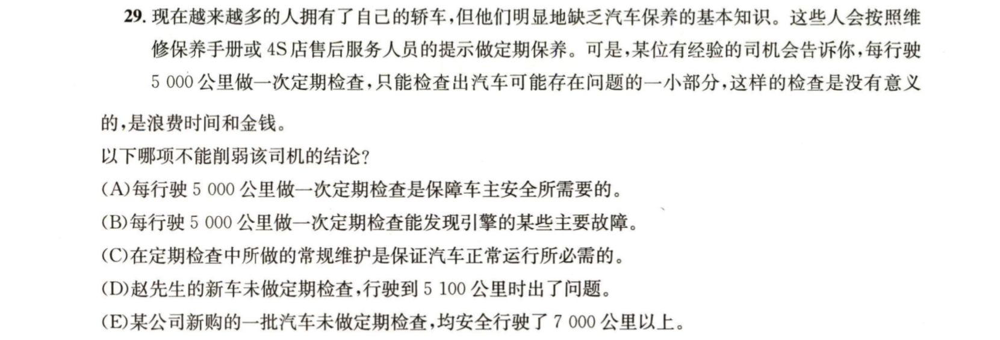

### 第 30 题

化学课上，张老师演示了两个同时进行的教学实验：一个实验是 $\mathrm{KClO_3}$ 加热后，有 $\mathrm{O_2}$ 缓慢产生；另一个实验是 $\mathrm{KClO_3}$ 加热后迅速撒入少量 $\mathrm{MnO_2}$，这时立即有大量的 $\mathrm{O_2}$ 产生。张老师由此指出：$\mathrm{MnO_2}$ 是 $\mathrm{O_2}$ 快速产生的原因。

以下哪项与张老师得出结论的方法类似？

- **A**．同一品牌的化妆品价格越高卖得就越火。由此可见，消费者喜欢价格高的化妆品。
- **B**．居里夫人在沥青矿物中提取放射性元素时发现，从一定量的沥青矿物中提取的全部纯铀的放射性强度比同等数量的沥青矿物中放射性强度低数倍。她据此推断，沥青矿物中还存在其他放射性更强的元素。
- **C**．统计分析发现，30 岁至 60 岁之间，年纪越大，胆子越小，有理由相信：岁月是勇敢的腐蚀剂。
- **D**．将闹钟放在玻璃罩里，使它打铃，可以听到铃声；然后把玻璃罩里的空气抽空，再使闹钟打铃，就听不到铃声了。由此可见，空气是声音传播的介质。
- **E**．人们通过对绿藻、蓝藻、红藻的大量观察，发现结构简单、无根叶是藻类植物的主要特征。

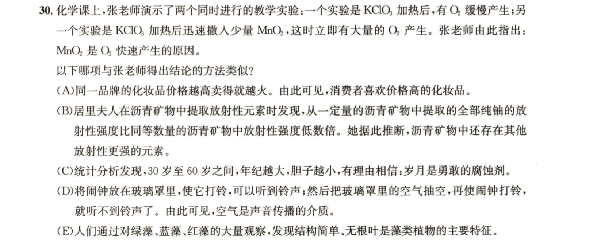

### 第 31 题

湖队是不可能进入决赛的。如果湖队进入决赛，那么太阳就从西边出来了。

以下哪项与上述论证方式最相似？

- **A**．今天天气不冷。如果冷，湖面怎么结冰了？
- **B**．语言是不能创造财富的。若语言能够创造财富，则夸夸其谈的人就是世界上最富有的了。
- **C**．草木之生也柔脆，其死也枯槁。故坚强者死之徒，柔弱者生之徒。
- **D**．天上是不会掉馅饼的。如果你不相信这一点，那上当受骗是迟早的事。
- **E**．古典音乐不流行。如果流行，那就说明大众的音乐欣赏水平大大提高了。

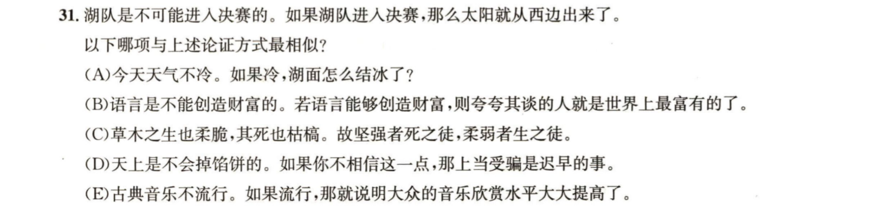

### 第 32 题

在某次课程教学改革的研讨会上，负责工程类教学的程老师说，在工程设计中，用于解决数学问题的计算机程序越来越多了，这样就不必要求工程技术类大学生对基础数学有深刻的理解。因此，在未来的教学体系中，基础数学课程可以用其他重要的工程类课程替代。

以下哪项如果为真，能削弱程老师的上述论证？

I．工程类基础课程中已经包含了相关的基础数学内容。

II．在工程设计中，设计计算机程序需要对基础数学有全面的理解。

III．基础数学课程的一个重要目标是培养学生的思维能力，这种能力对工程设计来说很关键。

- **A**．仅II。
- **B**．仅I和II。
- **C**．仅I和III。
- **D**．仅II和III。
- **E**．I、II和III。

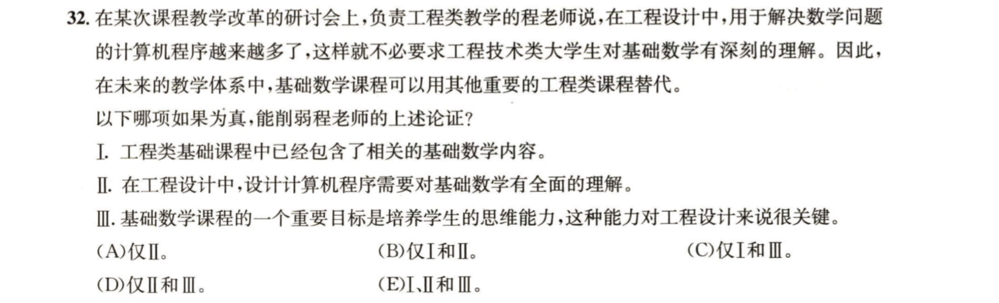

### 第 33 题

蟋蟀是一种非常有趣的小动物。宁夏的夏夜，草丛中传来阵阵清脆悦耳的鸣叫声。那是蟋蟀在唱歌。蟋蟀优美动听的歌声并不是出自它的好嗓子，而是来自它的翅膀。左右两翅一张一合，相互摩擦，就可以发出悦耳的响声了。蟋蟀还是建筑专家，与它那柔软的挖掘工具相比，蟋蟀的住宅真可以算得上是伟大的工程了。在其住宅门口，有一个收拾得非常舒适的平台。夏夜，除非下雨或者刮风，否则蟋蟀肯定会在这个平台上唱歌。

根据以上陈述，以下哪项是蟋蟀在无雨的夏夜所做的？

- **A**．修建住宅。
- **B**．收拾平台。
- **C**．在平台上唱歌。
- **D**．如果没有刮风，它就在抢修工程。
- **E**．如果没有刮风，它就在平台上唱歌。

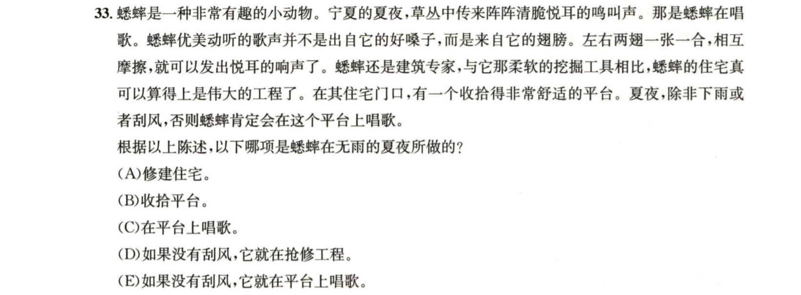

### 第 34 题

一般认为，出生地间隔较远的夫妻所生子女的智商较高。有资料显示，夫妻均是本地人，其所生子女的平均智商为 102.45；夫妻是省内异地的，其所生子女的平均智商为 106.17；而隔省婚配的，其所生子女的智商则高达 109.35。因此，异地通婚可提高下一代的智商水平。

以下哪项如果为真，最能削弱上述结论？

- **A**．统计孩子平均智商的样本数量不够多。
- **B**．不难发现，一些天才儿童的父母均是本地人。
- **C**．不难发现，一些低智商儿童的父母的出生地间隔较远。
- **D**．能够异地通婚者是智商比较高的，他们自身的高智商促成了异地通婚。
- **E**．一些情况下，夫妻双方出生地间隔很远，但他们的基因可能接近。

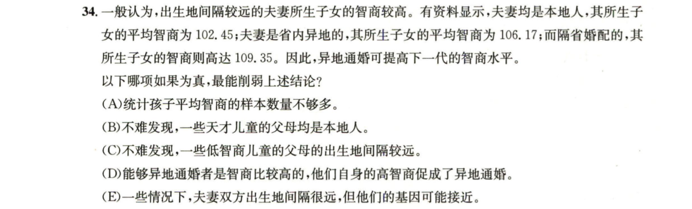

### 第 35 题

成品油生产商的利润在很大程度上受国际市场原油价格的影响，因为大部分原油是按国际市场价购进的。近年来，随着国际原油市场价格的不断提高，成品油生产商的运营成本大幅度增加，但某国成品油生产商的利润并没有减少，反而增加了。

以下哪项如果为真，最有助于解释上述看似矛盾的现象？

- **A**．原油成本只占成品油生产商运营成本的一半。
- **B**．该国成品油价格根据市场供需确定，随着国际原油市场价格的上涨，该国政府为成品油生产商提供相应的补贴。
- **C**．在国际原油市场价格不断上涨期间，该国成品油生产商降低了个别高薪雇员的工资。
- **D**．在国际原油市场价格上涨之后，除进口成本增加外，成品油生产的其他成本也有所提高。
- **E**．该国成品油生产商的原油有一部分来自国内，这部分受国际市场价格波动影响较小。

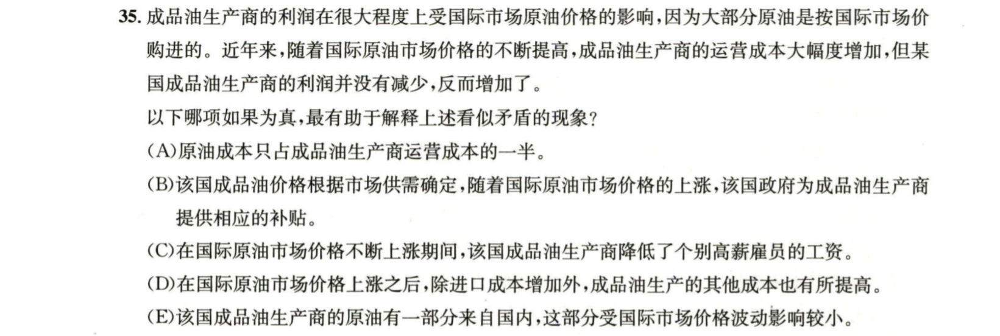

### 第 36 题

太阳风中的一部分带电粒子可以到达 M 星表面，将足够的能量传递给 M 星表面粒子，使后者脱离 M 星表面，逃逸到 M 星大气中。为了判定这些逃逸的粒子，科学家们通过三个实验获得了如下信息：

实验一：或者是 X 粒子，或者是 Y 粒子。

实验二：或者不是 Y 粒子，或者不是 Z 粒子。

实验三：如果不是 Z 粒子，就不是 Y 粒子。

根据上述三个实验，以下哪项一定为真？

- **A**．这种粒子是 X 粒子。
- **B**．这种粒子是 Y 粒子。
- **C**．这种粒子是 Z 粒子。
- **D**．这种粒子不是 X 粒子。
- **E**．这种粒子不是 Z 粒子。

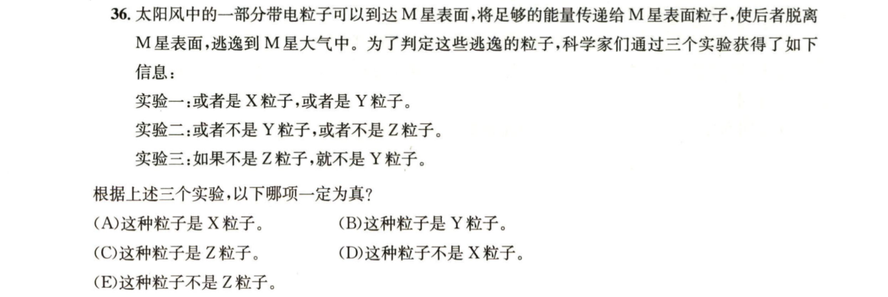

### 第 37 题

美国某大学医学院的研究人员在《小儿科》杂志上发表论文指出，在对 2702 个家庭的孩子进行跟踪调查后发现，如果孩子在 5 岁前每天看电视超过 2 小时，他们长大后出现行为问题的风险将会增加 1 倍多。所谓行为问题是指性格孤僻、言行粗鲁、侵犯他人、难与他人合作等。

以下哪项最好地解释了以上论述？

- **A**．电视节目会使孩子产生好奇心，容易导致孩子出现暴力倾向。
- **B**．电视节目中有不少内容容易使孩子长时间处于紧张、恐惧的状态。
- **C**．看电视时间过长，会影响孩子与其他人的交往，久而久之，孩子便会缺乏与他人打交道的经验。
- **D**．儿童模仿能力强，如果只对电视节目感兴趣，长此以往，会阻碍他们分析能力的发展。
- **E**．每天长时间地看电视，容易使孩子神经系统产生疲劳，影响身心发展。

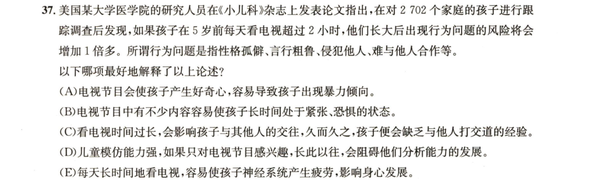

### 第 38 题

一种常见的现象是，从国外引进的一些畅销科普读物在国内并不畅销。有人对此解释说，这与我们多年来沿袭的文理分科有关。文理分科人为地造成了自然科学与人文社会科学的割裂，导致科普类图书的读者市场还没有真正形成。

以下哪项如果为真，最能加强上述观点？

- **A**．有些自然科学工作者对科普读物也不感兴趣。
- **B**．科普读物不是没有需求，而是有效供给不足。
- **C**．由于缺乏理科背景，非自然科学工作者对科学敬而远之。
- **D**．许多科普电视节目都拥有固定的收视群，相应的科普读物也大受欢迎。
- **E**．国内大部分科普读物只是介绍科学常识，很少真正关注科学精神的传播。

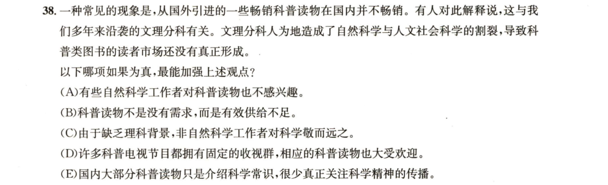

### 第 39 题

大、小行星悬浮在太阳系边缘，极易受附近星体引力作用的影响。据研究人员计算，有时这些力量会将彗星从奥尔特星云拖出。这样，它们更有可能靠近太阳。两位研究人员据此分别做出了以下两种有所不同的断定：

①木星的引力作用要么将它们推至更小的轨道，要么将它们逐出太阳系；

②木星的引力作用或者将它们推至更小的轨道，或者将它们逐出太阳系。

如果上述两种断定只有一种为真，则可以推出以下哪项结论？

- **A**．木星的引力作用将它们推至更小的轨道，并且将它们逐出太阳系。
- **B**．木星的引力作用没有将它们推至更小的轨道，但是将它们逐出太阳系。
- **C**．木星的引力作用将它们推至更小的轨道，但是没有将它们逐出太阳系。
- **D**．木星的引力作用既没有将它们推至更小的轨道，也没有将它们逐出太阳系。
- **E**．木星的引力作用如果将它们推至更小的轨道，就不会将它们逐出太阳系。

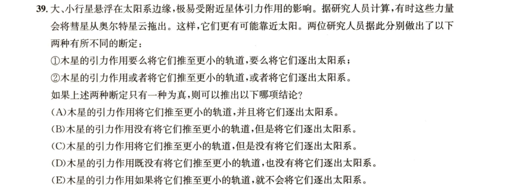

### 第 40 题

鸽子走路时，头部并不是有规律地前后移动，而是一直在往前伸。行走时，鸽子脖子往前一探，然后，头部保持静止，等待着身体和爪子跟进。有学者曾就鸽子走路时伸脖子的现象做出假设：在等待身体跟进的时候，暂时静止的头部有利于鸽子获得稳定的视野，看清周围的食物。

以下哪项如果为真，最能支持上述假设？

- **A**．鸽子行走时如果不伸脖子，很难发现远处的食物。
- **B**．步伐太大的鸟类，伸脖子的幅度远比步伐小的要大。
- **C**．鸽子行走速度的变化，刺激内耳控制平衡的器官，导致伸脖子。
- **D**．鸽子行走时一举翅一投足，都可能出现脖子和头部肌肉的自然反射，所以头部不断运动。
- **E**．如果雏鸽步态受到限制，功能发育不够完善，那么，成年后鸽子的步伐变小，脖子伸缩幅度则会随之降低。

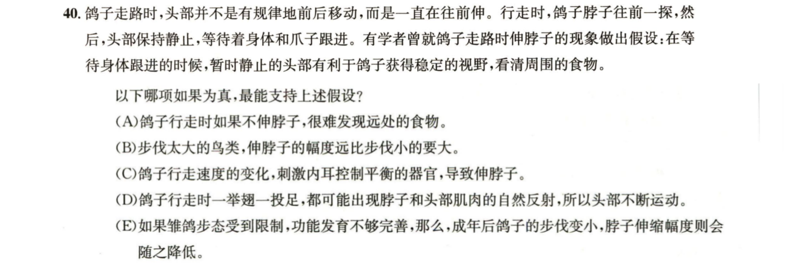

### 第 41 题

S 市环保检测中心的统计分析表明，2009 年空气质量为优的天数为 150 天，比 2008 年多出 22 天。二氧化碳、一氧化碳、二氧化氮、可吸入颗粒物四项污染物浓度平均值，与 2008 年相比分别下降了约 21.3%、25.6%、26.2%、15.4%。S 市环保负责人指出，这得益于近年来本市政府持续采取的控制大气污染的相关措施。

以下除哪项外，均能支持上述市环保负责人的看法？

- **A**．S 市广泛展开环保宣传，加强了市民的生态理念和环保意识。
- **B**．S 市启动了内部控制污染方案，凡是不达标的燃煤锅炉停止运行。
- **C**．S 市执行了机动车排放国Ⅳ标准，单车排放比Ⅲ降低了 49%。
- **D**．S 市市长办公室最近研究了焚烧秸秆的问题，并着手制定相关条例。
- **E**．S 市制定了“绿色企业”标准，继续加快污染重、能耗高的企业的退出。

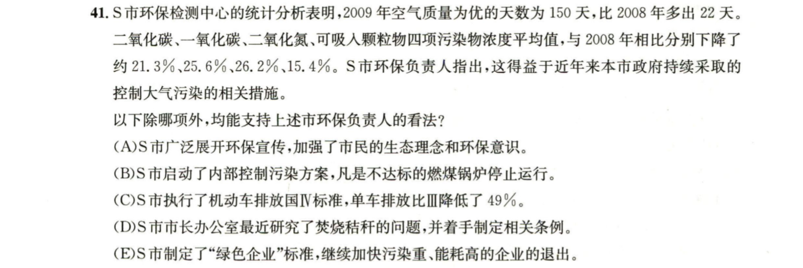

### 第 42 题

在某次思维训练课上，张老师提出“尚左数”这一概念的定义：在连续排列的一组数字中，如果一个数字左边的数字都比其大（或无数字），且其右边的数字都比其小（或无数字），则称这个数字为尚左数。

根据张老师的定义，在 8、9、7、6、4、5、3、2 这列数字中，以下哪项包含了该列数字中所有的尚左数？

- **A**．4、5、7 和 9。
- **B**．2、3、6 和 7。
- **C**．3、6、7 和 8。
- **D**．5、6、7 和 8。
- **E**．2、3、6 和 8。

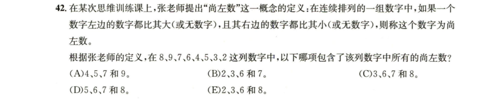

### 第 43 题

一般认为，剑乳齿象是从北美洲迁入南美洲的。剑乳齿象的显著特征是具有较直的长剑型门齿，颚骨较短，齿的齿冠隆起，齿板数目为 7~8 个，并呈乳状突起，剑乳齿象因此得名。剑乳齿象的牙齿比较复杂，这表明它能吃草，在南美洲的许多地方都有证据显示史前人类捕捉过剑乳齿象。由此可以推测，剑乳齿象的灭绝可能与人类的过度捕杀有密切关系。

以下哪项如果为真，最能反驳上述结论？

- **A**．史前动物之间经常发生大规模相互捕杀的现象。
- **B**．剑乳齿象在遇到人类攻击时缺乏自我保护能力。
- **C**．剑乳齿象也存在由南美洲进入北美洲的回迁现象。
- **D**．由于人类活动范围的扩大，大型食草动物难以生存。
- **E**．幼年剑乳齿象的牙齿结构比较简单，自我生存能力弱。

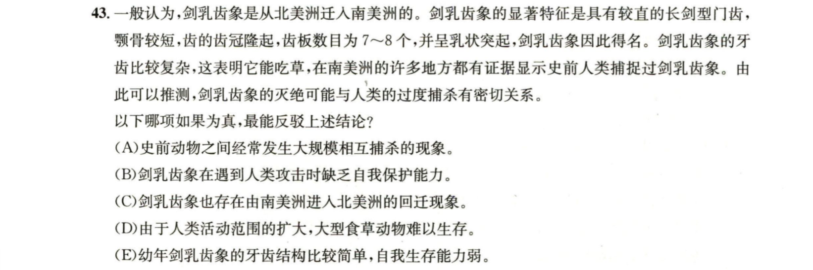

### 第 44 题

小东在玩“勇士大战”游戏，进入第二关时，界面出现四个选项。第一个选项是“选择任意选项都需要支付游戏币”，第二个选项是“选择本项后可以得到额外游戏奖励”，第三个选项是“选择本项后游戏不会进行下去”，第四个选项是“选择某个选项不需要支付游戏币”。

如果四个选项中的陈述只有一句为真，则以下哪项一定为真？

- **A**．选择任意选项都需要支付游戏币。
- **B**．选择任意选项都不需要支付游戏币。
- **C**．选择任意选项都不能得到额外游戏奖励。
- **D**．选择第二个选项后可以得到额外游戏奖励。
- **E**．选择第三个选项后游戏能继续进行下去。

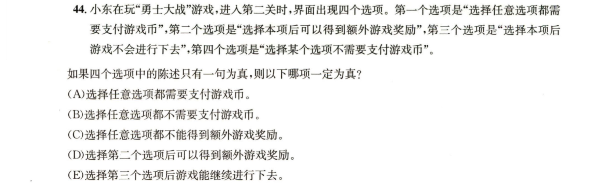

### 第 45 题

有位美国学者做了一个实验，给被试儿童看了三幅图画：鸡、牛、青草，然后让儿童将其分为两类。结果大部分中国儿童把牛和青草归为一类，把鸡归为另一类；大部分美国儿童则把牛和鸡归为一类，把青草归为另一类。这位美国学者由此得出：中国儿童习惯于按照事物之间的关系来分类，美国儿童则习惯于把事物按照各自所属的“实体”范畴进行分类。

以下哪项是这位学者得出结论所必须假设的？

- **A**．马和青草是按照事物之间的关系被归为一类。
- **B**．鸭和鸡蛋是按照各自所属的“实体”范畴被归为一类。
- **C**．美国儿童只要把牛和鸡归为一类，就是习惯于按照各自所属“实体”范畴进行分类。
- **D**．美国儿童只要把牛和鸡归为一类，就不是习惯于按照事物之间的关系来分类。
- **E**．中国儿童只要把牛和青草归为一类，就不是习惯于按照各自所属“实体”范畴进行分类。

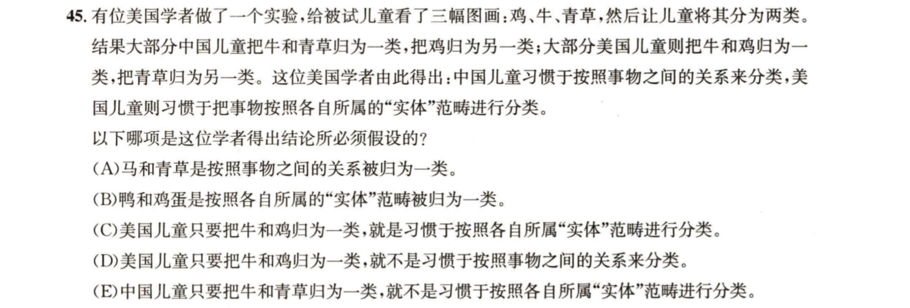

### 第 46 题

相互尊重是相互理解的基础，相互理解是相互信任的前提；在人与人的相互交往中，自重、自信也是非常重要的，没有一个人尊重不自重的人，没有一个人信任他所不尊重的人。

以上陈述可以推出以下哪项结论？

- **A**．不自重的人也不被任何人信任。
- **B**．相互信任才能相互尊重。
- **C**．不自信的人也不自重。
- **D**．不自信的人也不被任何人信任。
- **E**．不自信的人也不受任何人尊重。

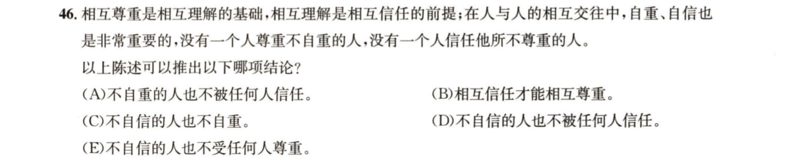

### 第 47 题

学生：IQ 和 EQ 哪个更重要？您能否给我指点一下？

学长：你去书店问问工作人员关于 IQ 和 EQ 的书，哪类销得快，哪类就更重要。

以下哪项与题干中的问答方式最为相似？

- **A**．员工：我们正制定一个度假方案，你说是在本市好，还是去外地好？经理：现在年终了，各公司都在安排出去旅游，你去问问其他公司的同行，他们计划去哪里，我们就不去哪里，不凑热闹。
- **B**．平平：母亲节那天我准备给妈妈送一份礼物，你说是送花好，还是送巧克力好？佳佳：你在母亲节前一天去花店看一下，看看买花的人多不多就行了嘛。
- **C**．顾客：我准备买一件毛衣，你看颜色是鲜艳一点好，还是素一点好？店员：这个需要结合自己的性格与穿衣习惯，各人可以有自己的选择与喜好。
- **D**．游客：我们前面有两条山路，走哪一条更好？导游：你仔细看看，哪一条山路上车马的痕迹深，我们就走哪一条。
- **E**．学生：我正在准备期末复习，是做教材上的练习重要，还是理解教材内容更重要？老师：你去问问高年级得分高的同学，他们是否经常背书、做练习。

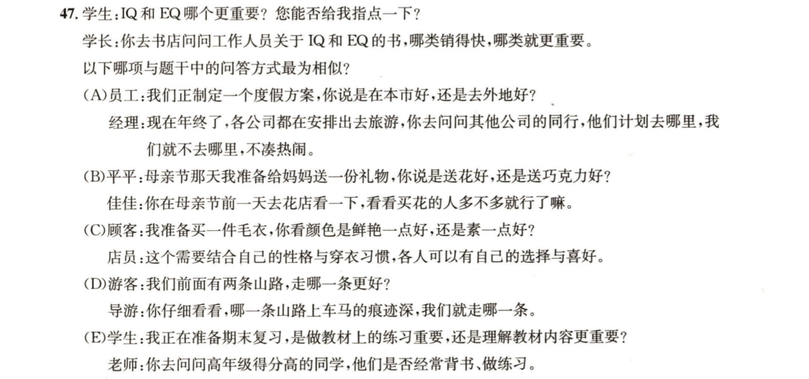

### 第 48 题

李赫、张岚、林宏、何柏、邱辉 5 位同事近日各自买了一台不同品牌的小轿车，分别为雪铁龙、奥迪、宝马、奔驰、桑塔纳。这五辆车的颜色分别与 5 人名字最后一个字谐音的颜色不同。已知，李赫买的是蓝色的雪铁龙。

以下哪项排列可能依次对应张岚、林宏、何柏、邱辉所买的车？

- **A**．灰色奥迪、白色宝马、灰色奔驰、红色桑塔纳。
- **B**．黑色奥迪、红色宝马、灰色奔驰、白色桑塔纳。
- **C**．红色奥迪、灰色宝马、白色奔驰、黑色桑塔纳。
- **D**．白色奥迪、黑色宝马、红色奔驰、灰色桑塔纳。
- **E**．黑色奥迪、灰色宝马、白色奔驰、红色桑塔纳。

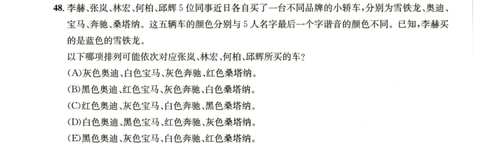

### 第 49 题

克鲁特是德国家喻户晓的“明星”北极熊，北极熊是北极名副其实的霸主，因此，克鲁特是名副其实的北极霸主。

以下除哪项外，均与上述论证中出现的谬误相似？

- **A**．儿童是祖国的花朵，小雅是儿童，因此，小雅是祖国的花朵。
- **B**．鲁迅的作品不是一天能读完的，《祝福》是鲁迅的作品。因此，《祝福》不是一天能读完的。
- **C**．中国人是不怕困难的，我是中国人。因此，我是不怕困难的。
- **D**．康怡花园坐落在清水街，清水街的建筑属于违章建筑。因此，康怡花园的建筑属于违章建筑。
- **E**．西班牙语是外语，外语是普通高等学校招生的必考科目。因此西班牙语是普通高等学校招生的必考科目。

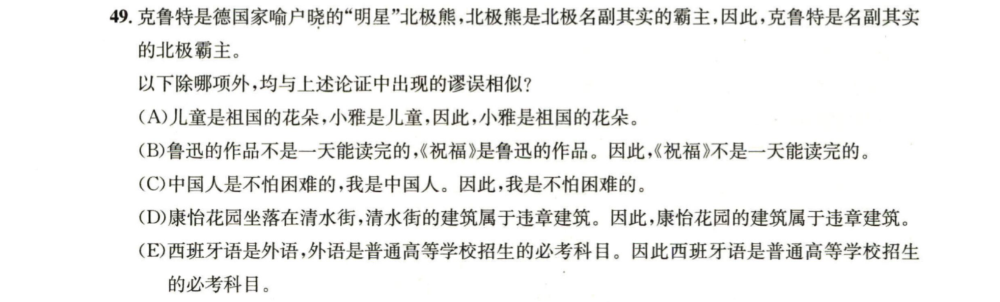

### 第 50 题

在本年度篮球联赛中，长江队主教练发现，黄河队五名主力队员之间的上场配置有如下规律：

（1）若甲上场，则乙也要上场。

（2）只有甲不上场，丙才不上场。

(3)要么丙不上场，要么乙和戊中有人不上场。

(4)除非丙不上场，否则丁上场。

若乙不上场，则以下哪项配置合乎上述规律？

- **A**．甲、丙、丁同时上场。
- **B**．丙不上场，丁、戊同时上场。
- **C**．甲不上场，丙、丁都上场。
- **D**．甲、丁都上场，戊不上场。
- **E**．甲、丁、戊都不上场。

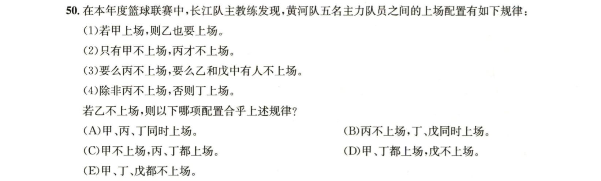

### 第 51 题

陈先生：未经许可侵入别人的电脑，就好像开偷来的汽车撞伤了人，这些都是犯罪行为。但后者性质更严重，因为它既侵占了有形财产，又造成了人身伤害；而前者只是在虚拟世界中捣乱。

林女士：我不同意，例如，非法侵入医院的电脑，有可能扰乱医疗数据，甚至危及病人的生命。因此，非法侵入电脑同样会造成人身伤害。

以下哪项最为准确地概括了两人争论的焦点？

- **A**．非法侵入别人电脑和开偷来的汽车是否同样会危及人的生命？
- **B**．非法侵入别人电脑和开偷来的汽车伤人是否都构成犯罪？
- **C**．非法侵入别人电脑和开偷来的汽车伤人是否是同样性质的犯罪？
- **D**．非法侵入别人电脑的犯罪性质是否和开偷来的汽车伤人一样的严重？
- **E**．是否只有侵占有形财产才构成犯罪？

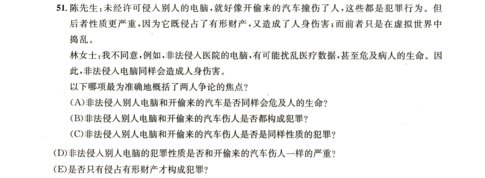

### 第 52 题

小明、小红、小丽、小强、小梅五人去听音乐会，他们五人在同一排且座位相连，其中只有一个座位最靠近走廊，如果小强想坐在最靠近走廊的座位上，小丽想跟小明紧挨着，小红不想跟小丽紧挨着，小梅想跟小丽紧挨着，但不想跟小强或小明紧挨着。

以下哪项顺序符合上述五人的意愿？

- **A**．小明，小梅，小丽，小红，小强。
- **B**．小强，小红，小明，小丽，小梅。
- **C**．小强，小梅，小红，小丽，小明。
- **D**．小明，小红，小梅，小丽，小强。
- **E**．小强，小丽，小梅，小明，小红。

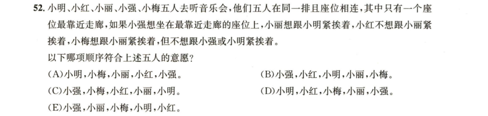

### 第 53 题

参加某国际学术研讨会的 60 名学者中，亚裔学者 31 人，博士 33 人，非亚裔学者中无博士学位的 4 人。

根据上述陈述，参加此次国际研讨会的亚裔博士有几人？

- **A**．1 人。
- **B**．2 人。
- **C**．4 人。
- **D**．7 人。
- **E**．8 人。

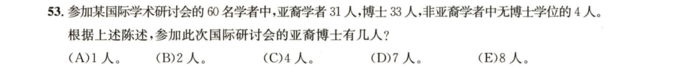

### 第 54 题

对某高校本科生的某项调查统计发现：在因成绩优异被推荐免试攻读硕士研究生的文科专业学生中，女生占有 70%。

由此可见，该校本科生文科专业的女生比男生优秀。

以下哪项如果为真，能最有力地削弱上述结论？

- **A**．在该校本科生文科专业学生中，女生占 30% 以上。
- **B**．在该校本科生文科专业学生中，女生占 30% 以下。
- **C**．在该校本科生文科专业学生中，男生占 30% 以下。
- **D**．在该校本科生文科专业学生中，女生占 70% 以下。
- **E**．在该校本科生文科专业学生中，男生占 70% 以上。

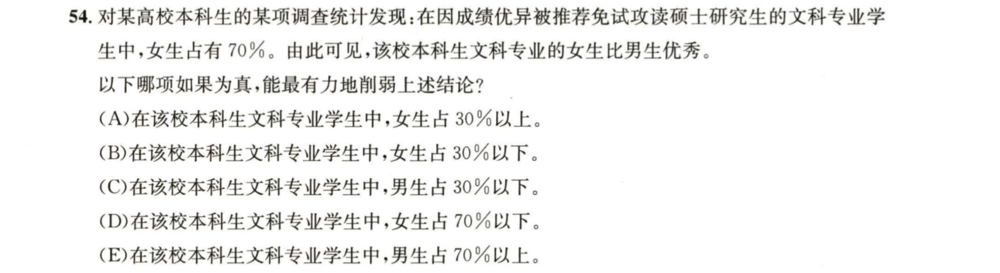

### 第 55 题

某中药配方有如下要求：

（1）如果有甲药材，那么也要有乙药材。

（2）如果没有丙药材，那么必须有丁药材。

(3)人参和天麻不能都有。

(4)如果没有甲药材而有丙药材，则需要有人参。

如果含有天麻，则关于该配方的断定哪项为真？

- **A**．含有甲药材。
- **B**．含有丙药材。
- **C**．没有丙药材。
- **D**．没有乙药材和丁药材。
- **E**．含有乙药材或丁药材。

---

## 四、写作（第 56-57 题，共 65 分）

### 第 56 题 · 论证有效性分析 (30 分)

**分析下述论证中存在的缺陷与漏洞，选择若干要点，写一篇 600 字左右的文章，对该论证的有效性进行分析和评论。**（论证有效性分析的一般要点是：概念特别是核心概念的界定和使用是否准确并前后一致，有无各种明显的逻辑错误，论证的论据是否成立并支持结论，结论成立的条件是否充分等。）

> 美国学者弗里德曼的《世界是平的》一书认为，全球化对当代人类社会的思想、经济、政治和文化等领域产生了深刻影响。全球化抹去了各国的疆界，使世界从立体变成了平面，也就是说，世界各国之间的社会发展差距正在日益缩小。
>
> “世界是平的”的观点，是基于近几十年信息传播技术迅速发展的状况而提出的。互联网的普及、软件的创新使海量信息迅速扩散到世界各地。由于世界是平的，穷国可以和富国一样在同一平台上接收同样的最新信息，这样就大大促进了各国的经济发展，从而改善了它们的国际地位。
>
> 事实也是如此。所谓“金砖四国”国际声望的上升，无不得益于它们的经济成就，无不得益于互联网技术的发展。同时也可作为“世界是平的”这一观点的有力佐证。
>
> 毋庸置疑，信息传播技术革命还远未结束，互联网技术将会有更大的发展，人类社会将会有更惊人的变化。可以预言，由于信息技术的迅猛发展，世界的经济格局与政治格局将会发生巨大的变化，世界最不发达国家和最发达国家之间再也不会让人有天壤之别的感觉，非洲大陆将会变成另一个北美。同样也可以预言，由于中国的信息技术发展迅猛，中国和世界一样，也会从立体变为平面，中国东西部之间的经济鸿沟将被填平，中国西部的雄起指日可待。

### 第 57 题 · 论说文 (35 分)

**根据下述材料，写一篇 700 字左右的论说文，题目自拟。**

> 一个真正的学者，其崇高使命是追求真理。学者个人的名利乃至生命与之相比都微不足道，但因为其献身于真理就会变得无限伟大。一些著名大学的校训中都含有追求真理的内容。然而，近年学术界的一些状况与追求真理这一使命相去甚远，部分学者的功利化倾向越来越严重，抄袭剽窃、学术造假、自我炒作、沽名钓誉等现象时有所闻。

