# 2011 年全国硕士研究生招生考试管理类专业学位联考综合能力试题 (199)

## 一、问题求解：第 1-15 小题，每小题 3 分，共 45 分。下列每题给出的 A、B、C、D、E 五个选项中，只有一项是符合试题要求的。请在答题卡上将所选的字母涂黑。

### 第 1 题

已知船在静水中的速度为 28 千米/小时，河水的流速为 2 千米/小时，则此船在相距 78 千米的两地间往返一次所需时间是（ ）小时。

- **A**．5.9
- **B**．5.6
- **C**．5.4
- **D**．4.4
- **E**．4

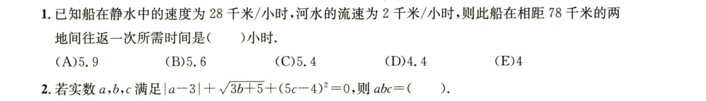

### 第 2 题

若实数 $a, b, c$ 满足 $|a-3| + \sqrt{3b+5} + (5c-4)^2 = 0$，则 $abc = $（ ）。

- **A**．$-4$
- **B**．$-\dfrac{5}{3}$
- **C**．$-\dfrac{4}{3}$
- **D**．$\dfrac{4}{5}$
- **E**．$3$

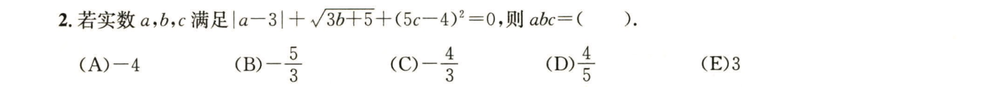

### 第 3 题

某年级 60 名学生中，有 30 人参加合唱团，45 人参加运动队，其中参加合唱团而未参加运动队的有 8 人，则参加运动队而未参加合唱团的有（ ）。

- **A**．15 人
- **B**．22 人
- **C**．23 人
- **D**．30 人
- **E**．37 人

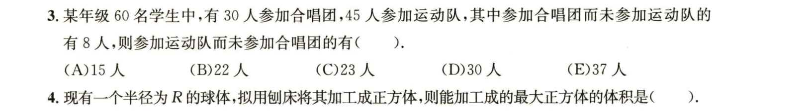

### 第 4 题

现有一个半径为 $R$ 的球体，拟用刨床将其加工成正方体，则能加工成的最大正方体的体积是（ ）。

- **A**．$\dfrac{8}{3}R^3$
- **B**．$\dfrac{8\sqrt{3}}{9}R^3$
- **C**．$\dfrac{4}{3}R^3$
- **D**．$\dfrac{1}{3}R^3$
- **E**．$\dfrac{\sqrt{3}}{9}R^3$

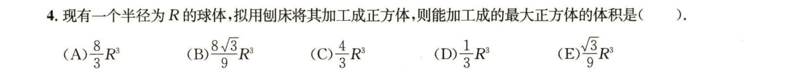

### 第 5 题

2007 年，某市的全年研究与试验发展（R&D）经费支出 300 亿元，比 2006 年增长 20%，该市的 GDP 为 10000 亿元，比 2006 年增长 10%。2006 年该市的 R&D 经费支出占当年 GDP 的（ ）。

- **A**．1.75%
- **B**．2%
- **C**．2.5%
- **D**．2.75%
- **E**．3%

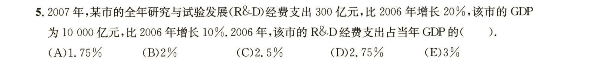

### 第 6 题

现从 5 名管理专业、4 名经济专业和 1 名财会专业的学生中，随机派出一个 3 人小组，则该小组中 3 个专业各有 1 名学生的概率为（ ）。

- **A**．$\dfrac{1}{2}$
- **B**．$\dfrac{1}{3}$
- **C**．$\dfrac{1}{4}$
- **D**．$\dfrac{1}{5}$
- **E**．$\dfrac{1}{6}$

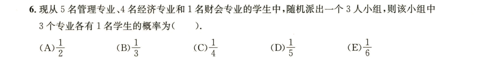

### 第 7 题

一所四年制大学每年的毕业生 7 月份离校，新生 9 月份入学。该校 2001 年招生 2000 名，之后每年比上一年多招 200 名，则该校 2007 年 9 月底的在校学生有（ ）。

- **A**．14000 名
- **B**．11600 名
- **C**．9000 名
- **D**．6200 名
- **E**．3200 名

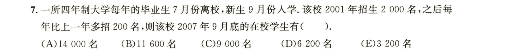

### 第 8 题

将 2 个红球与 1 个白球随机地放入甲、乙、丙三个盒子中，则乙盒中至少有 1 个红球的概率为（ ）。

- **A**．$\dfrac{1}{9}$
- **B**．$\dfrac{8}{27}$
- **C**．$\dfrac{4}{9}$
- **D**．$\dfrac{5}{9}$
- **E**．$\dfrac{17}{27}$

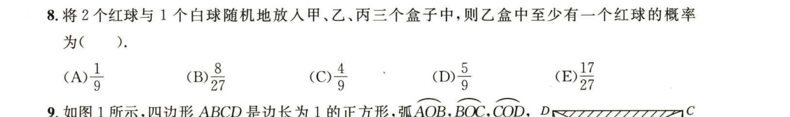

### 第 9 题

如图 1 所示，四边形 $ABCD$ 是边长为 1 的正方形，弧 $AOB$、$BOC$、$COD$、$DOA$ 均为半圆，则阴影部分的面积为（ ）。

- **A**．$\dfrac{1}{2}$
- **B**．$\dfrac{\pi}{2}$
- **C**．$1 - \dfrac{\pi}{4}$
- **D**．$\dfrac{\pi}{2} - 1$
- **E**．$2 - \dfrac{\pi}{2}$

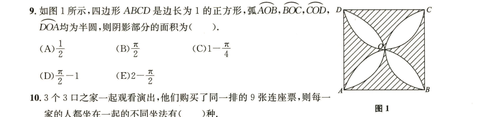

### 第 10 题

3 个 3 口之家一起观看演出，他们购买了同一排的 9 张连座票，则每一家的人都坐在一起的不同坐法有（ ）种。

- **A**．$(3!)^2$
- **B**．$(3!)^3$
- **C**．$3(3!)^3$
- **D**．$(3!)^4$
- **E**．$9!$

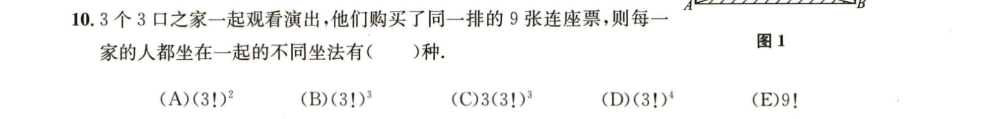

### 第 11 题

设 $P$ 是圆 $x^2 + y^2 = 2$ 上的一点，该圆在点 $P$ 的切线平行于直线 $x+y+2=0$，则点 $P$ 的坐标为（ ）。

- **A**．(-1, 1)
- **B**．(1, -1)
- **C**．$(0, \sqrt{2})$
- **D**．$(\sqrt{2}, 0)$
- **E**．(1, 1)

### 第 12 题

设 $a, b, c$ 是小于 12 的三个不同的质数（素数），且 $|a-b| + |b-c| + |c-a| = 8$，则 $a+b+c = $（ ）。

- **A**．10
- **B**．12
- **C**．14
- **D**．15
- **E**．19

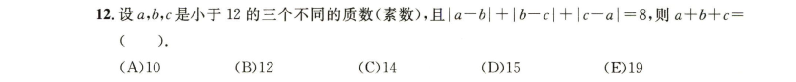

### 第 13 题

在年底的献爱心活动中，某单位共有 100 人参加捐款，经统计，捐款总额是 19000 元，个人捐款数额有 100 元、500 元和 2000 元三种，该单位捐款 500 元的人数为（ ）。

- **A**．13
- **B**．18
- **C**．25
- **D**．30
- **E**．38

### 第 14 题

某施工队承担了开凿一条长为 2400 米隧道的工程，在掘进了 400 米后，由于改进了施工工艺，每天比原计划多掘进 2 米，最后提前 50 天完成了施工任务，原计划施工工期是（ ）天。

- **A**．200 天
- **B**．240 天
- **C**．250 天
- **D**．300 天
- **E**．350 天

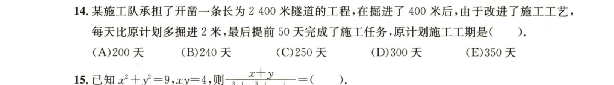

### 第 15 题

已知 $x^2 + y^2 = 9, xy = 4$，则 $\dfrac{x+y}{x^3+y^3+x+y} = $（ ）。

- **A**．$\dfrac{1}{2}$
- **B**．$\dfrac{1}{5}$
- **C**．$\dfrac{1}{6}$
- **D**．$\dfrac{1}{13}$
- **E**．$\dfrac{1}{14}$

## 二、条件充分性判断：第 16～25 小题，每小题 3 分，共 30 分。要求判断每题给出的条件（1）和（2）能否充分支持题干所陈述的结论。A、B、C、D、E 五个选项为判断结果，请选择一项符合试题要求的判断，在答题卡上将所选项涂黑。

### 解题说明：
- **A**．条件（1）充分，但条件（2）不充分
- **B**．条件（2）充分，但条件（1）不充分
- **C**．条件（1）和（2）单独都不充分，但条件（1）和条件（2）联合起来充分
- **D**．条件（1）充分，条件（2）也充分
- **E**．条件（1）和（2）单独都不充分，条件（1）和条件（2）联合起来也不充分

### 第 16 题

实数 $a, b, c$ 成等差数列。

（1）$e^a, e^b, e^c$ 成等比数列。
（2）$\ln a, \ln b, \ln c$ 成等差数列。

### 第 17 题

在一次英语考试中，某班的及格率为 80%。

（1）男生及格率为 70%，女生及格率为 90%。
（2）男生的平均分与女生的平均分相等。

### 第 18 题

如图 2 所示，等腰梯形的上底与腰均为 $x$，下底为 $x+10$。则 $x = 13$。

（1）该梯形的上底与下底之比为 $13:23$。
（2）该梯形的面积为 216。

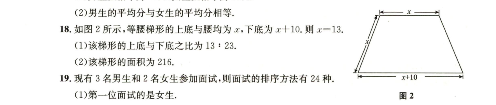

### 第 19 题

现有 3 名男生和 2 名女生参加面试，则面试的排序方法有 24 种。

（1）第一位面试的是女生。
（2）第二位面试的是指定的某位男生。

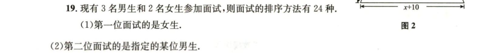

### 第 20 题

已知 $\triangle ABC$ 的三条边分别为 $a, b, c$，则 $\triangle ABC$ 是等腰直角三角形。

（1）$(a-b)(c^2 - a^2 - b^2) = 0$。
（2）$c = \sqrt{2}b$。

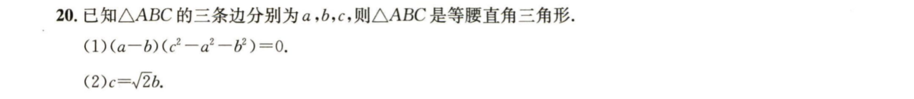

### 第 21 题

直线 $ax + by + 3 = 0$ 被圆 $(x-2)^2 + (y-1)^2 = 4$ 截得的线段长度为 $2\sqrt{3}$。

（1）$a = 0, b = -1$。
（2）$a = -1, b = 0$。

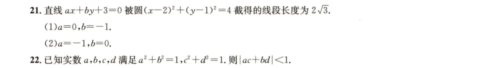

### 第 22 题

已知实数 $a, b, c, d$ 满足 $a^2 + b^2 = 1, c^2 + d^2 = 1$，则 $|ac + bd| < 1$。

（1）直线 $ax + by = 1$ 与 $cx + dy = 1$ 仅有一个交点。
（2）$a \neq c, b \neq d$。

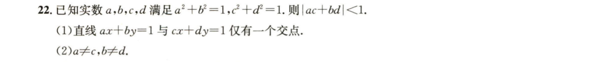

### 第 23 题

某年级共有 8 个班，在一次年级考试中，共有 21 名学生不及格，每班不及格的学生最多有 3 名，则（一）班至少有 1 名学生不及格。

（1）（二）班的不及格人数多于（三）班。
（2）（四）班不及格的学生有 2 名。

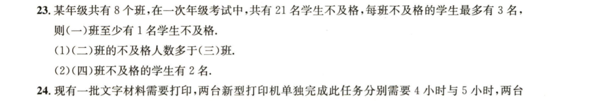

### 第 24 题

现有一批文字材料需要打印，两台新型打印机单独完成此任务分别需要 4 小时与 5 小时，两台旧型打印机单独完成此任务分别需要 9 小时与 11 小时，则能在 2.5 小时内完成任务。

（1）安排两台新型打印机同时打印。
（2）安排一台新型打印机与两台旧型打印机同时打印。

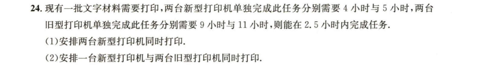

### 第 25 题

已知 $\{a_n\}$ 为等差数列，则该数列的公差为零。

（1）对任何正整数 $n$，都有 $a_1 + a_2 + \dots + a_n \le n$。
（2）$a_2 \ge a_1$。

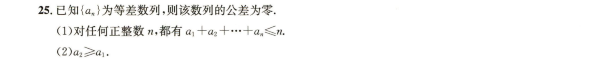

---

## 三、逻辑推理（第 26-55 题，每小题 2 分，共 60 分）

### 第 26 题

巴斯德认为，空气中的微生物浓度与环境状况、气流运动和海拔高度有关。他在山上的不同高度分别打开装着煮过的培养液的瓶子，发现海拔越高，培养液被微生物污染的可能性越小。在山顶上，20 个装了培养液的瓶子，只有 1 个长出了微生物。普歇另用干草浸液做材料重复了巴斯德的实验，却得出不同的结果：即使在海拔很高的地方，所有装了培养液的瓶子都很快长出了微生物。

以下哪项如果为真，最能解释普歇和巴斯德实验所得到的不同结果？

- **A**．只要有氧气的刺激，微生物就会从培养液中自发地生长出来。
- **B**．培养液在加热消毒、密封、冷却的过程中会被外界细菌污染。
- **C**．普歇和巴斯德的实验设计都不够严密。
- **D**．干草浸液中含有一种耐高温的枯草杆菌，培养液一旦冷却，枯草杆菌的孢子就会复活，迅速繁殖。
- **E**．普歇和巴斯德都认为，虽然他们用的实验材料不同，但是经过煮沸，细菌都能被有效地杀灭。

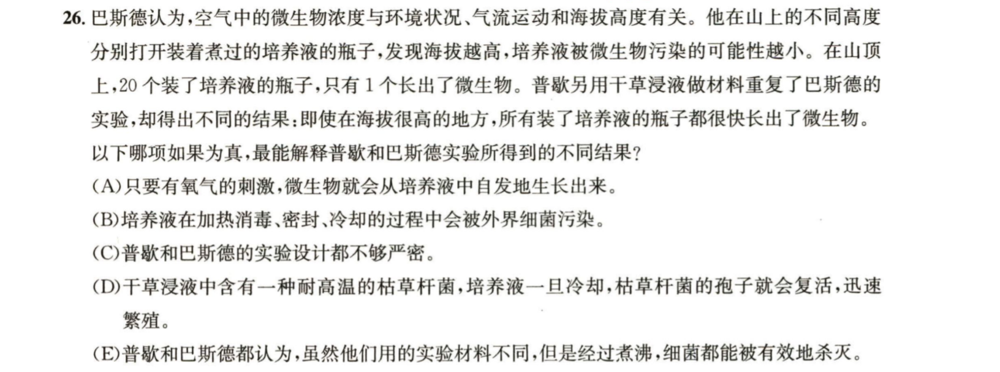

### 第 27 题

张教授的所有初中同学都不是博士；通过张教授而认识其哲学研究所同事的都是博士；张教授的一个初中同学通过张教授认识了王研究员。

以下哪项能作为结论从上述断定中推出？

- **A**．王研究员是张教授的哲学研究所同事。
- **B**．王研究员不是张教授的哲学研究所同事。
- **C**．王研究员是博士。
- **D**．王研究员不是博士。
- **E**．王研究员不是张教授的初中同学。

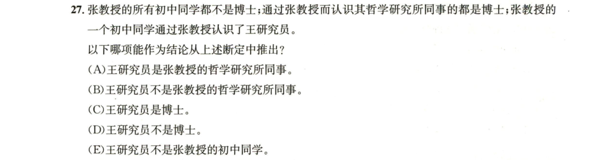

### 第 28 题

一般将缅甸所产的经过风化或经河水搬运至河谷、河床中的翡翠大砾石，称为“老坑玉”。老坑玉的特点是“水头好”、质坚、透明度高，其上品透明如玻璃，故称“玻璃种”或“冰种”。同为老坑玉，其质量相对也有高低之分，有的透明度高一些，有的透明度稍差些，所以价值也有差别。在其他条件都相同的情况下，透明度高的老坑玉比透明度较其低的单位价值高，但是开采的实践告诉人们，没有单位价值最高的老坑玉。

以上陈述如果为真，可以得出以下哪项结论？

- **A**．没有透明度最高的老坑玉。
- **B**．透明度高的老坑玉未必“水头好”。
- **C**．“新坑玉”中也有质量很好的翡翠。
- **D**．老坑玉的单位价值还决定于其加工的质量。
- **E**．随着年代的增加，老坑玉的单位价值会越来越高。

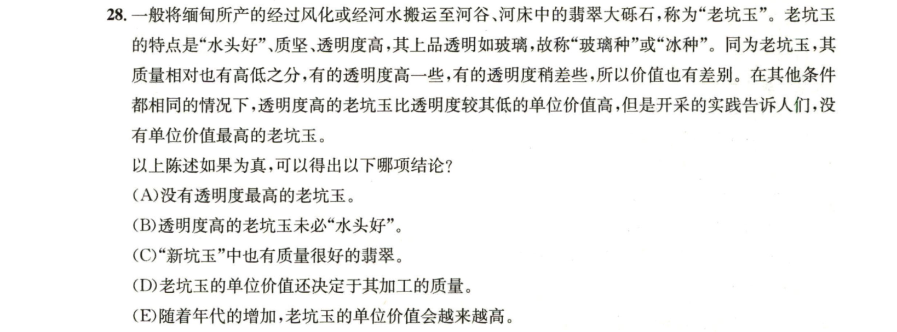

### 第 29 题

某教育专家认为：“男孩危机”是指男孩调皮捣蛋、胆小怕事、学习成绩不如女孩好等现象。近些年，这种现象已经成为儿童教育专家关注的一个重要问题。这位专家在列出一系列统计数据后，提出了“今日男孩为什么从小学、中学到大学全面落后于同年龄段的女孩”的疑问，这无疑加剧了无数男生家长的焦虑。该专家通过分析指出，恰恰是家庭和学校不适当的教育方法导致了“男孩危机”现象。

以下哪项如果为真，最能对该专家的观点提出质疑？

- **A**．家庭对独生子女的过度呵护，在很大程度上限制了男孩发散思维的拓展和冒险性格的养成。
- **B**．现在的男孩比以前的男孩在女孩面前更喜欢表现出“绅士”的一面。
- **C**．男孩在发展潜能方面要优于女孩，大学毕业后他们更容易在事业上有所成就。
- **D**．在家庭、学校教育中，女性充当了主要角色。
- **E**．现代社会游戏泛滥，男孩天性比女孩更喜欢游戏，这耗去了他们大量的精力。

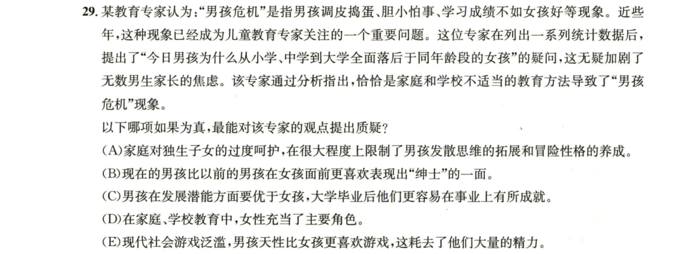

### 第 30 题

抚仙湖虫是泥盆纪澄江动物群中的一种，属于真节肢动物中比较原始的类型，成虫体长 10 厘米，有 31 个体节，外骨骼分为头、胸、腹三部分，它的背、腹分节数目不一致。泥盆纪直虾是现代昆虫的祖先，抚仙湖虫化石与直虾类化石类似，这间接表明了抚仙湖虫是昆虫的远祖。研究者还发现，抚仙湖虫的消化道充满泥沙，这表明它是食泥的动物。

以下除哪项外，均能支持上述论证？

- **A**．昆虫的远祖也有不是食泥的生物。
- **B**．泥盆纪直虾的外骨骼分为头、胸、腹三部分。
- **C**．凡是与泥盆纪直虾类似的生物都是昆虫的远祖。
- **D**．昆虫是由真节肢动物中比较原始的生物进化而来的。
- **E**．抚仙湖虫消化道中的泥沙不是在化石形成过程中由外界渗透进去的。

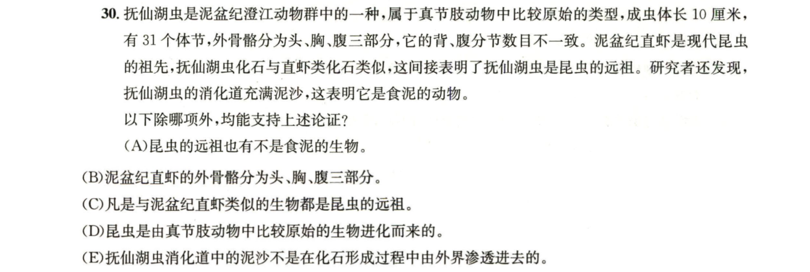

### 第 31 题

2010 年某省物价总水平仅上涨 2.4%，涨势比较温和，涨幅甚至比 2009 年回落了 0.6 个百分点。可是，普通民众觉得物价涨幅较高，一些统计数据也表明，民众的感觉有据可依。2010 年某月的统计报告显示，该月禽蛋类商品价格涨幅达 12.3%，某些反季节蔬菜涨幅甚至超过 20%。

以下哪项如果为真，最能解释上述看似矛盾的现象？

- **A**．人们对数据的认识存在偏差，不同来源的统计数据会产生不同的结果。
- **B**．影响居民消费品价格总水平变动的各种因素互相交织。
- **C**．虽然部分日常消费品涨幅很小，但居民感觉很明显。
- **D**．在物价指数体系中占相当权重的工业消费品价格持续走低。
- **E**．不同的家庭，其收入水平、消费偏好、消费结构都有很大的差异。

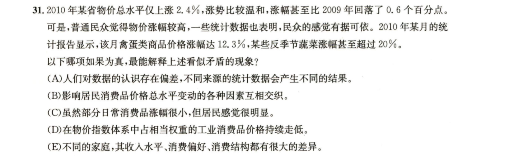

### 第 32 题

随着互联网的发展，人们的购物方式有了新的选择。很多年轻人喜欢在网络上选择自己满意的商品，通过快递送上门，购物足不出户，非常便捷。刘教授据此认为，那些实体商场的竞争力会受到互联网的冲击，在不远的将来，会有更多的网络商店取代实体商店。

以下哪项如果为真，最能削弱刘教授的观点？

- **A**．网络购物虽然有某些便利，但容易导致个人信息被不法分子利用。
- **B**．有些高档品牌的专卖店，只愿意采取街面实体商店的销售方式。
- **C**．网络商店与快递公司在货物丢失或损坏的赔偿方面经常互相推诿。
- **D**．购买黄金珠宝等贵重物品，往往需要现场挑选，且不适宜网络支付。
- **E**．通常情况下，网络商店只有在其实体商店的支撑下才能生存。

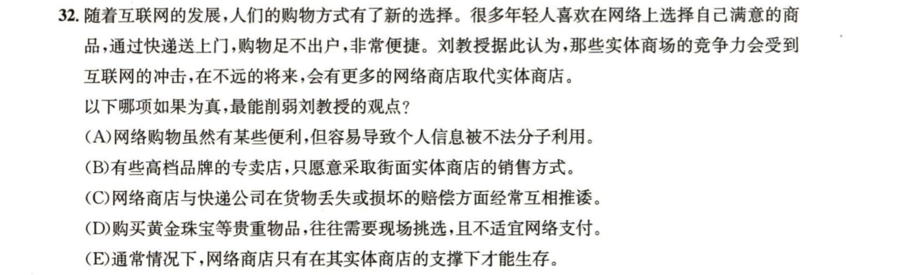

### 第 33 题

受多元文化和价值观的冲击，甲国居民的离婚率明显上升。最近一项调查表明，甲国的平均婚姻存续时间为 8 年。张先生为此感慨，现在像钻石婚、金婚、白头偕老这样的美丽故事已经很难得了，人们淳朴的爱情婚姻观一去不复返了。

以下哪项如果为真，最可能表明张先生的理解不确切？

- **A**．现在有不少闪婚一族，他们经常在很短的时间里结婚又离婚。
- **B**．婚姻存续时间长并不意味着婚姻的质量高。
- **C**．过去的婚姻主要由父母包办，现在主要是自由恋爱。
- **D**．尽管婚姻存续时间短，但年轻人谈恋爱的时间比以前增加很多。
- **E**．婚姻是爱情的坟墓，美丽感人的故事更多体现在恋爱中。

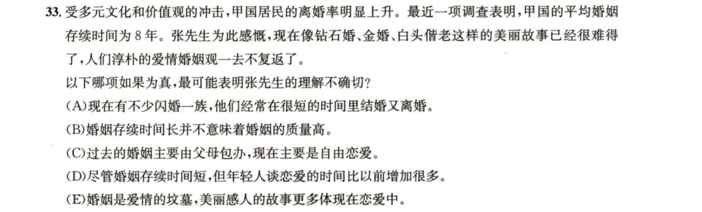

### 第 34 题

某集团公司有四个部门，分别生产冰箱、彩电、电脑和手机。根据前三个季度的数据统计，四个部门经理对 2010 年全年的赢利情况作了如下预测：
冰箱部门经理：今年手机部门会赢利。
彩电部门经理：如果冰箱部门今年赢利，那么彩电部门就不会赢利。
电脑部门经理：如果手机部门今年没赢利，那么电脑部门也没赢利。
手机部门经理：今年冰箱和彩电部门都会赢利。
全年数据统计完成后，发现上述四个预测只有一个符合事实。
关于该公司各部门的全年赢利情况，以下除哪项外，均可能为真？

- **A**．彩电部门赢利，冰箱部门没赢利。
- **B**．冰箱部门赢利，电脑部门没赢利。
- **C**．电脑部门赢利，彩电部门没赢利。
- **D**．冰箱部门和彩电部门都没赢利。
- **E**．冰箱部门和电脑部门都赢利。

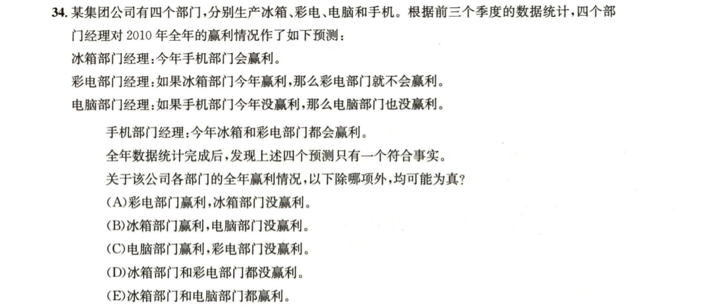

### 第 35 题

随着数字技术的发展，音频、视频的播放形式出现了革命性转变。人们很快接受了一些新形式，比如 MP3、CD、DVD 等。但是对于电子图书的接受并没有达到专家所预期的程度，现在仍有很多大部分读者喜欢捧着纸质出版物。纸质书籍在出版业中依然占据重要地位。因此有人说，书籍可能是数字技术需要攻破的最后一个堡垒。

以下哪项最不能对上述现象提供解释？

- **A**．人们固执地迷恋着阅读纸质书籍时的舒适体验，喜欢纸张的质感。
- **B**．在显示器上阅读，无论是笨重的阴极射线管显示器还是轻薄的液晶显示器，都会让人无端地心浮气躁。
- **C**．现在仍有一些怀旧爱好者喜欢收藏经典图书。
- **D**．电子书显示设备技术不够完善，图像显示速度较慢。
- **E**．电子书和纸质书籍的柔软沉静相比，显得面目可憎。

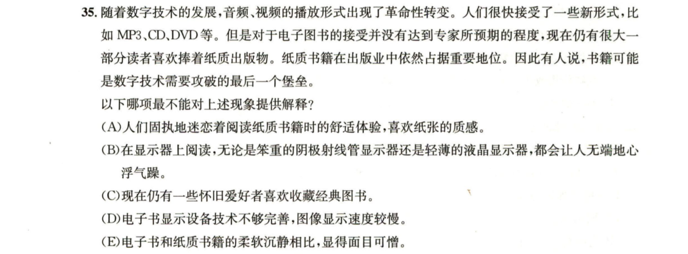

### 第 36 题

在一次围棋比赛中，参赛选手陈华不时地挤捏指关节，发出的声响干扰了对手的思考。在比赛封盘间歇时，裁判警告陈华：如果再次在比赛中挤捏指关节并发出声响，将判其违规。对此，陈华反驳说，他挤捏指关节是习惯性动作，并不是故意的，因此，不应被判违规。

以下哪项如果成立，最能支持陈华对裁判的反驳？

- **A**．在此次比赛中，对手不时打开、合拢折扇，发出的声响干扰了陈华的思考。
- **B**．在围棋比赛中，只有选手的故意行为，才能成为判罚的根据。
- **C**．在此次比赛中，对手本人并没有对陈华的干扰提出抗议。
- **D**．陈华一向恃才傲物，该裁判对其早有不满。
- **E**．如果陈华为人诚实、从不说谎，那么他就不应该被判违规。

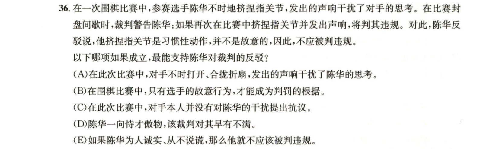

### 第 37 题

3D 立体技术代表了当前电影技术的尖端水准，由于使电影实现了高度可信的空间感，它可能成为未来电影的主流。3D 立体电影中的银幕角色虽然由计算机生成，但是那些包括动作和表情的电脑角色的“表演”，都以真实演员的“表演”为基础，就像数码时代的化妆技术一样。这也引起了某些演员的担心：随着计算机技术的发展，未来计算机生成的图像和动画会替代真人表演。

以下哪项如果为真，最能减弱上述演员的担心？

- **A**．所有电影的导演只能和真人交流，而不是和电脑交流。
- **B**．任何电影的拍摄都取决于制片人的选择，演员可以跟上时代的发展。
- **C**．3D 立体电影目前的高票房只是人们一时图新鲜的结果，未来尚不可知。
- **D**．掌握 3D 立体技术的动画专业人员不喜欢去电影院看 3D 电影。
- **E**．电影故事只能用演员的心灵、情感来表现，其表现形式与导演的喜好无关。

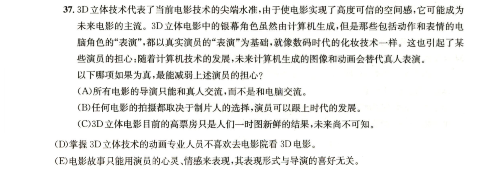

### 第 38 题

公达律师事务所以为刑事案件的被告进行有效辩护而著称，成功率达 90% 以上。老余是一位以专门为离婚案件的当事人成功辩护而著称的律师。因此，老余不可能是公达律师事务所的成员。

以下哪项最为确切地指出了上述论证的漏洞？

- **A**．公达律师事务所具有的特征，其成员不一定具有。
- **B**．没有确切指出老余为离婚案件的当事人辩护的成功率。
- **C**．没有确切指出老余为刑事案件的当事人辩护的成功率。
- **D**．没有提供公达律师事务所统计数据的来源。
- **E**．老余具有的特征，其所在工作单位不一定具有。

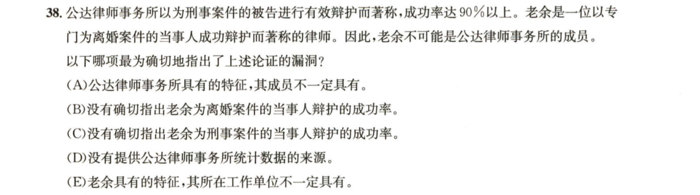

### 第 39 题

科学研究中使用的形式语言和日常生活中使用的自然语言有很大的不同。形式语言看起来像天书，远离大众，只有一些专业人士才能理解和运用。但其实这是一种误解，自然语言和形式语言的关系就像肉眼与显微镜的关系。肉眼的视域广阔，可以从整体上把握事物的信息；显微镜可以帮助人们看到事物的细节和精微之处，尽管用它看到的范围小。所以，形式语言和自然语言都是人们交流和理解信息的重要工具，把它们结合起来使用，具有强大的力量。

以下哪项如果为真，最能支持上述结论？

- **A**．通过显微镜看到的内容可能成为新的“风景”，说明形式语言可以丰富自然语言的表达，我们应重视形式语言。
- **B**．正如显微镜下显示的信息最终还是要通过肉眼观察一样，形式语言表述的内容最终也要通过自然语言来实现，说明自然语言更基础。
- **C**．科学理论如果仅用形式语言表达，很难被普通民众理解；同样，如果仅用自然语言表达，有可能变得冗长且很难表达准确。
- **D**．科学的发展很大程度上改善了普通民众的日常生活，但人们并没有意识到科学表达的基础形式语言的重要性。
- **E**．采用哪种语言其实不重要，关键在于是否表达了真正想表达的思想内容。

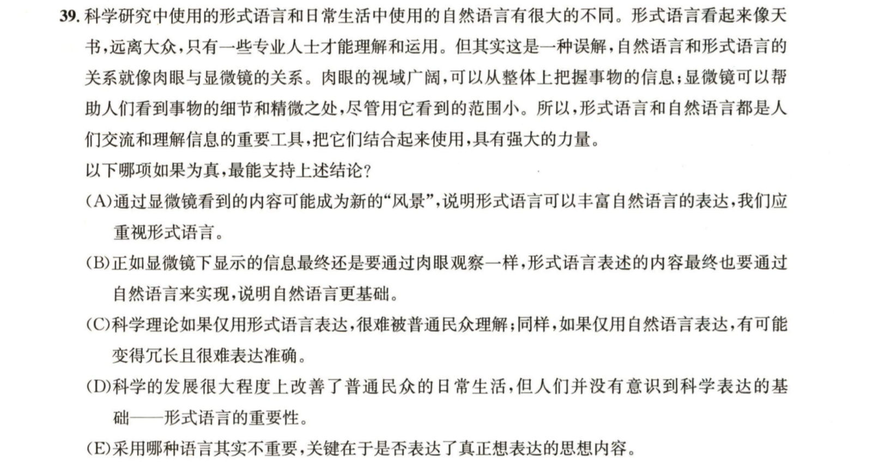

### 第 40 题

一艘远洋帆船载着 5 位中国人和几位外国人由中国开往欧洲。途中，除 5 位中国人外，全患上了败血症。同乘一艘船，同样是风餐露宿，漂洋过海，为什么中国人和外国人如此不同呢？原来这 5 位中国人都有喝茶的习惯，而外国人却没有。于是得出结论：喝茶是这 5 位中国人未得败血症的原因。

以下哪项和题干中得出结论的方法最为相似？

- **A**．警察锁定了犯罪嫌疑人，但是从目前掌握的事实看，都不足以证明他犯罪。专案组由此得出结论，必有一种未知的因素潜藏在犯罪嫌疑人身后。
- **B**．在两块土壤情况基本相同的麦地上，对其中一块施氮肥和钾肥，另一块只施钾肥。结果施氮肥和钾肥的那块麦地的产量远高于另一块。可见，施氮肥是麦地产量较高的原因。
- **C**．孙悟空：“如果打白骨精，师父会念紧箍咒；如果不打，师父就会被妖精吃掉。”孙悟空无奈得出结论：“我还是回花果山算了。”
- **D**．天文学家观测到天王星的运行轨道有特征 a、b、c，已知特征 a、b 分别是由两颗行星甲、乙的吸引所造成的，于是猜想还有一颗未知行星造成天王星的轨道特征 c。
- **E**．一定压力下的一定量气体，温度升高，体积增大；温度降低，体积缩小。气体体积与温度之间存在一定的相关性，说明气体温度的改变是其体积改变的原因。

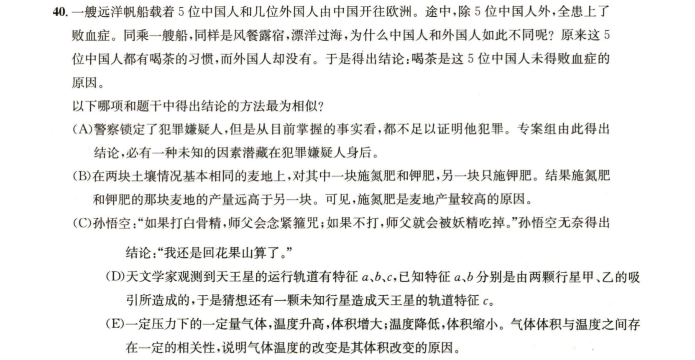

### 第 41 题

所有重点大学的学生都是聪明的学生，有些聪明的学生喜欢逃学，小杨不喜欢逃学，所以，小杨不是重点大学的学生。

以下除哪项外，均与上述推理的形式类似？

- **A**．所有经济学家都懂经济学，有些懂经济学的爱投资企业，你不爱投资企业，所以，你不是经济学家。
- **B**．所有的鹅都吃青菜，有些吃青菜的也吃鱼，兔子不吃鱼，所以，兔子不是鹅。
- **C**．所有的人都是爱美的，有些爱美的还研究科学，亚里士多德不是普通人，所以，亚里士多德不研究科学。
- **D**．所有被高校录取的学生都是超过录取分数线的，有些超过录取分数线的是大龄考生，小张不是大龄考生，所以，小张没有被高校录取。
- **E**．所有想当外交官的都需要学外语，有些学外语的重视人际交往，小王不重视人际交往，所以，小王不想当外交官。

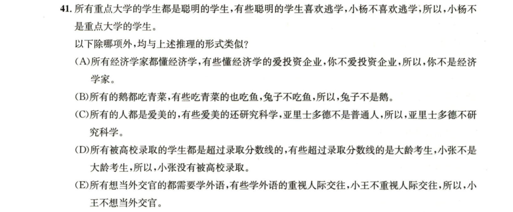

### 第 42 题

按照联合国开发计划署 2007 年的统计，挪威是世界上居民生活质量最高的国家，欧美和日本等发达国家也名列前茅。如果统计 1990 年以来生活质量改善最快的国家，发达国家则落后了。至少在联合国开发计划署统计的 116 个国家中，17 年来，非洲东南部国家莫桑比克的生活质量提高最快，2007 年其生活质量指数比 1990 年提高了 50%。很多非洲国家取得了和莫桑比克类似的成就。作为世界上最受瞩目的发展中国家，中国的生活质量指数在过去 17 年中也提高了 27%。

以下哪项可以从联合国开发计划署的统计中得出？

- **A**．2007 年，发展中国家的生活质量指数都低于西方国家。
- **B**．2007 年，莫桑比克的生活质量指数不高于中国。
- **C**．2006 年，日本的生活质量指数不高于中国。
- **D**．2006 年，莫桑比克的生活质量的改善快于非洲其他各国。
- **E**．2007 年，挪威的生活质量指数高于非洲各国。

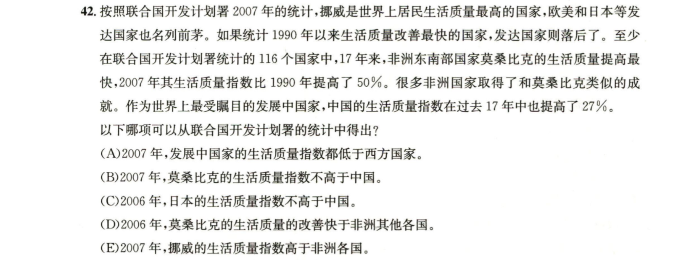

### 第 43 题

某次认知能力测试，刘强得了 118 分，蒋明的得分比王丽高，张华和刘强的得分之和大于蒋明和王丽的得分之和，刘强的得分比周梅高。此次测试 120 分以上为优秀，五人之中有两人没有达到优秀。

根据以上信息，以下哪项是上述五人在此次测试中得分由高到低的排列？

- **A**．张华、王丽、周梅、蒋明、刘强。
- **B**．张华、蒋明、王丽、刘强、周梅。
- **C**．张华、蒋明、刘强、王丽、周梅。
- **D**．蒋明、张华、王丽、刘强、周梅。
- **E**．蒋明、王丽、张华、刘强、周梅。

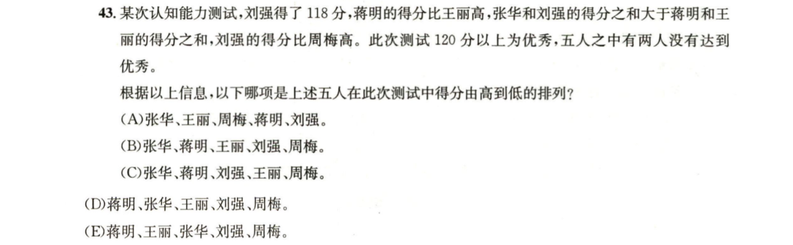

### 第 44 题

近日，某集团高层领导研究了发展方向问题。
王总经理认为：既要发展纳米技术，也要发展生物医药技术。
赵副总经理认为：只有发展智能技术，才能发展生物医药技术。
李副总经理认为：如果发展纳米技术和生物医药技术，那么也要发展智能技术。
最后经过董事会研究，只有其中一位的意见被采纳。

根据以上陈述，以下哪项符合董事会的研究决定？

- **A**．发展纳米技术和智能技术，但是不发展生物医药技术。
- **B**．发展生物医药技术和纳米技术，但是不发展智能技术。
- **C**．发展智能技术和生物医药技术，但是不发展纳米技术。
- **D**．发展智能技术，但是不发展纳米技术和生物医药技术。
- **E**．发展生物医药技术、智能技术和纳米技术。

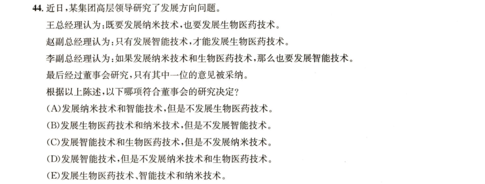

### 第 45 题

国外某教授最近指出，长着一张娃娃脸的人意味着他将享有更长的寿命，因为人们的生活状况很容易反映在脸上。从 1990 年春季开始，该教授领导的研究小组对 1826 对 70 岁以上的双胞胎进行了体能和认知测试，并拍了他们的面部照片。在不知道他们确切年龄的情况下，三名研究助手先对不同年龄组的双胞胎进行年龄评估。结果发现，即使是双胞胎，被猜出的年龄也相差很大。然后，研究小组用若干年时间对这些双胞胎的晚年生活进行了跟踪调查，直至他们去世。调查表明：双胞胎中，外表年龄差异越大，看起来老的那个就越可能先去世。

以下哪项如果为真，最能形成对该教授调查结论的反驳？

- **A**．如果把调查对象扩大到 40 岁以上的双胞胎，结果可能有所不同。
- **B**．三名研究助手比较年轻，从事该项研究的时间不长。
- **C**．外表年龄是每个人生活环境、生活状况和心态的集中体现，与生命老化关系不大。
- **D**．生命老化的原因在于细胞分裂导致染色体末端不断损耗。
- **E**．看起来越老的人，在心理上一般较为成熟，对于生命有更深刻的理解。

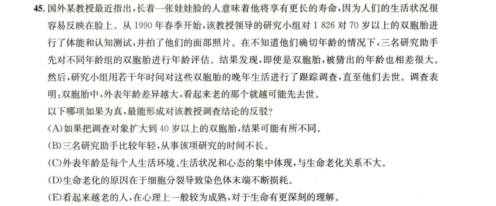

### 第 46 题

由于含糖饮料的卡路里含量高，容易导致肥胖，因此无糖饮料开始流行。经过一段时期的调查，李教授认为：无糖饮料尽管卡路里含量低，但并不意味着它不会导致体重增加。因为无糖饮料可能导致人们对于甜食的高度偏爱，这意味着可能食用更多的含糖类食物。而且无糖饮料几乎没什么营养，喝得过多就限制了其他健康饮品的摄入，比如茶和果汁等。

以下哪项如果为真，最能支持李教授的观点？

- **A**．茶是中国的传统饮料，长期饮用有益健康。
- **B**．有些瘦子也爱喝无糖饮料。
- **C**．有些胖子爱吃甜食。
- **D**．不少胖子向医生报告他们常喝无糖饮料。
- **E**．喝无糖饮料的人很少进行健身运动。

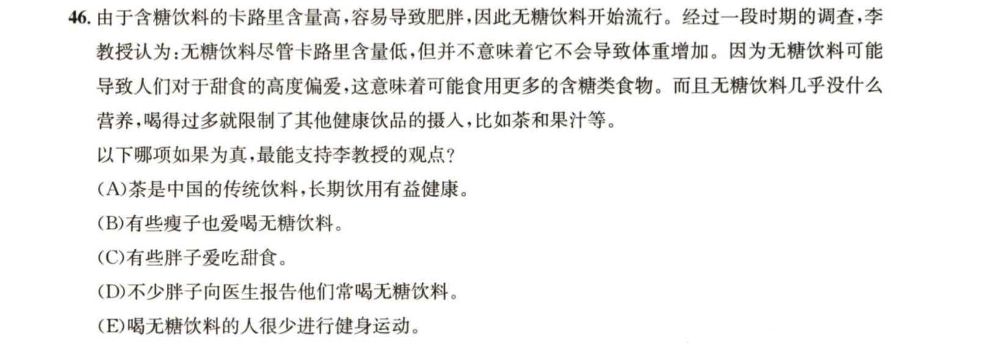

### 第 47 题

只有公司相应部门的所有员工都考评合格了，该部门的员工才能得到年终奖金；财务部有些员工考评合格了；综合部所有员工都得到了年终奖金；行政部的赵强考评合格了。

如果以上陈述为真，则以下哪项可能为真？
I．财务部员工都考评合格了。
II．赵强得到了年终奖金。
III．综合部有些员工没有考评合格。
IV．财务部员工没有得到年终奖金。

- **A**．仅 I 和 II。
- **B**．仅 II 和 III。
- **C**．仅 I、II 和 IV。
- **D**．仅 I、II 和 III。
- **E**．仅 II、III 和 IV。

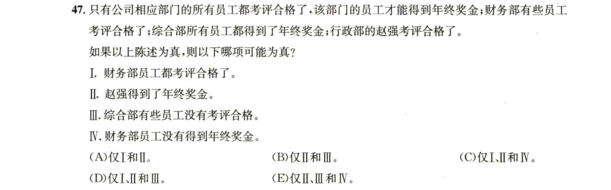

### 第 48 题

随着文化知识越来越重要，人们花在读书上的时间越来越多，文人学子近视患者的比例也越来越高。即便在城里工人、乡镇农民中，也能看到不少人戴近视眼镜。然而，在中国古代很少发现患有近视的文人学子，更别说普通老百姓了。

以下除哪项外，均可以解释上述现象？

- **A**．古时候，只有家庭条件好或者有地位的人才读得起书；即便读书，用在读书上的时间也很少，那种头悬梁、锥刺股的读书人更是凤毛麟角。
- **B**．古时交通工具不发达，出行主要靠步行、骑马，足量的运动对于预防近视有一定的作用。
- **C**．古人生活节奏慢，不用担心交通安全，所以即使患了近视，其危害也非常小。
- **D**．古代自然科学不发达，那时学生读的书很少，主要是四书五经，一本《论语》要读好几年。
- **E**．古人书写用的是毛笔，眼睛和字的距离比较远，写的字也相对大些。

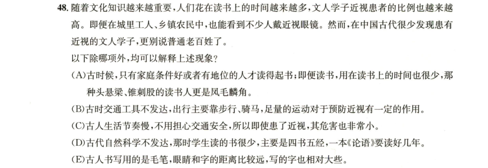

### 49~50 题基于以下题干

> 某家长认为，有想象力才能进行创造性劳动，但想象力和知识是天敌。人在获得知识的过程中，想象力会消失。因为知识符合逻辑，而想象力无章可循。换句话说，知识的本质是科学，想象力的特征是荒诞。人的大脑一山不容二虎：学龄前，想象力独占鳌头，脑子被想象力占据；上学后，大多数人的想象力被知识驱逐出境，他们成为知识的附庸，但丧失了想象力，终身只能重复前人的发现。

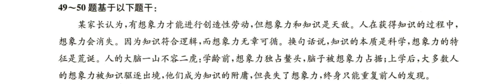

### 第 49 题

以下哪项是该家长论证所依赖的假设？
I．科学是不可能荒诞的，荒诞的就不是科学。
II．想象力和逻辑水火不相容。
III．大脑被知识占据后很难重新恢复想象力。

- **A**．仅 I。
- **B**．仅 II。
- **C**．仅 I 和 II。
- **D**．仅 II 和 III。
- **E**．I、II 和 III。

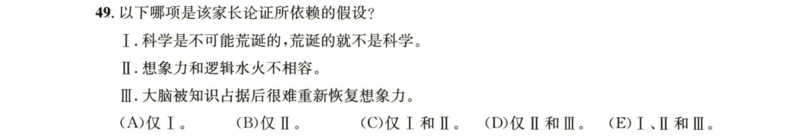

### 第 50 题

以下哪项与该家长的上述观点矛盾？

- **A**．如果希望孩子能够进行创造性劳动，就不要送他们上学。
- **B**．如果获得了足够知识，就不能进行创造性劳动。
- **C**．发现知识的人是有一定想象力的。
- **D**．有些人没有想象力，但能进行创造性劳动。
- **E**．想象力被知识驱逐出境是一个逐渐的过程。

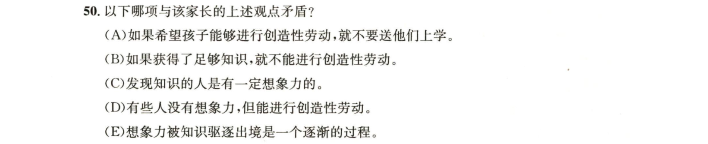

### 第 51 题

某公司总裁曾经说过：“当前任总裁批评我时，我不喜欢那感觉，因此，我不会批评我的继任者。”

以下哪项最有可能是该总裁上述言论的假设？

- **A**．当遇到该总裁的批评时，他的继任者和他的感觉不完全一致。
- **B**．只有该总裁的继任者喜欢被批评的感觉，他才会批评继任者。
- **C**．如果该总裁喜欢被批评，那么前任总裁的批评也不例外。
- **D**．该总裁不喜欢批评他的继任者，但喜欢批评其他人。
- **E**．该总裁不喜欢被前任总裁批评，但喜欢被其他人批评。

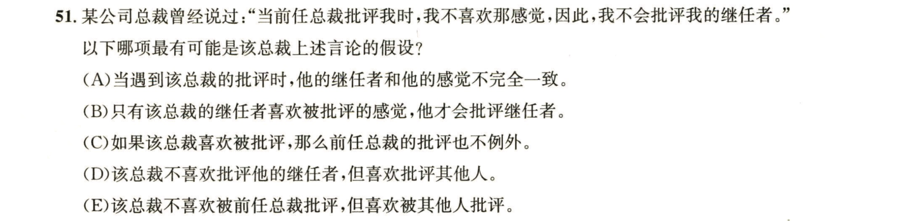

### 第 52 题

在恐龙灭绝 6500 万年后的今天，地球正面临着又一次物种大规模灭绝的危机。截至 20 世纪末，全球大约有 20% 的物种灭绝。现在，大熊猫、西伯利亚虎、北美玟瑁、巴西红木等许多珍稀物种面临着灭绝的危险。有三位学者对此作了预测：
学者一：如果大熊猫灭绝，则西伯利亚虎也将灭绝。
学者二：如果北美玟瑁灭绝，则巴西红木不会灭绝。
学者三：或者北美玟瑁灭绝，或者西伯利亚虎不会灭绝。
如果三位学者的预测都为真，则以下哪项一定为假？

- **A**．大熊猫和北美玟瑁都将灭绝。
- **B**．巴西红木将灭绝，西伯利亚虎不会灭绝。
- **C**．大熊猫和巴西红木都将灭绝。
- **D**．大熊猫将灭绝，巴西红木不会灭绝。
- **E**．巴西红木将灭绝，大熊猫不会灭绝。

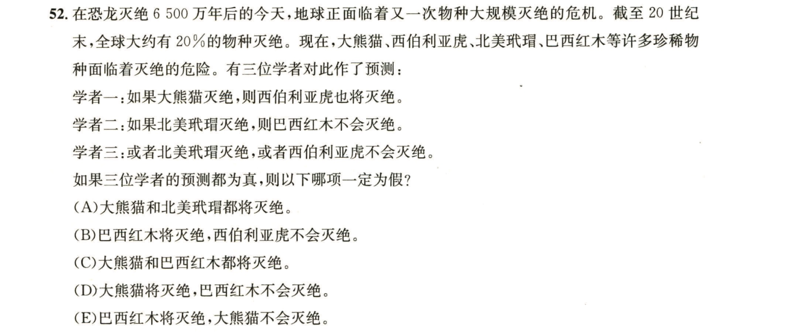

### 第 53 题

一些城市，由于作息时间比较统一，加上机动车太多，很容易形成交通早高峰和晚高峰，市民们在高峰时间上下班很不容易。为了缓解人们上下班的交通压力，某政府顾问提议采取不同时间段上下班制度，即不同单位可以在不同的时间段上下班。

以下哪项如果为真，最可能使该顾问的提议无法取得预期效果？

- **A**．有些上班时间段与员工的用餐时间冲突，会影响他们生活的乐趣，从而影响他们的工作积极性。
- **B**．许多上班时间段与员工的正常作息时间不协调，他们需要较长一段时间来调整适应，这段时间的工作效率难以保证。
- **C**．许多单位的大部分工作通常需要员工们在一起讨论，集体合作才能完成。
- **D**．该市的机动车数量持续增加，即使不在早晚高峰期，交通拥堵也时有发生。
- **E**．有些单位员工的住处与单位很近，步行即可上下班。

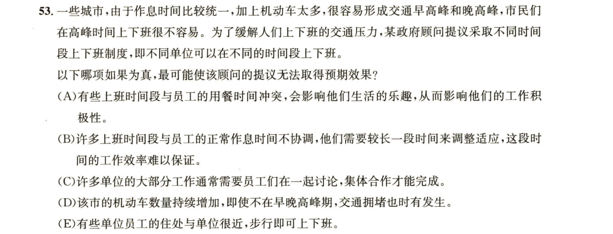

### 第 54 题

统计数字表明，近年来，民用航空飞机的安全性有很大提高。例如，某国 2008 年每飞行 100 万次发生恶性事故的次数为 0.2 次，而 1989 年为 1.4 次。从这些年的统计数字看，民用航空恶性事故发生率总体呈下降趋势。由此看出，乘飞机出行越来越安全。

以下哪项不能加强上述结论？

- **A**．近年来，飞机事故中“死里逃生”的概率比以前提高了。
- **B**．各大航空公司越来越注意对机组人员的安全培训。
- **C**．民用航空公司的空中交通控制系统更加完善。
- **D**．避免“机鸟互撞”的技术与措施日臻完善。
- **E**．虽然飞机坠毁很可怕，但从统计数字上讲，驾车仍然要危险得多。

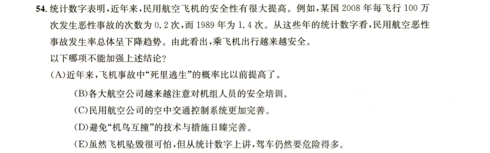

### 第 55 题

有医学研究显示，行为痴呆症患者大脑组织中往往含有过量的铝。同时有化学研究表明，一种硅化合物可以吸收铝。陈医生据此认为，可以用这种硅化合物治疗行为痴呆症。

以下哪项是陈医生最可能依赖的假设？

- **A**．行为痴呆症患者大脑组织的含铝量通常过高，但具体数量不会变化。
- **B**．该硅化合物在吸收铝的过程中不会产生副作用。
- **C**．用来吸收铝的硅化合物的具体数量与行为痴呆症患者的年龄有关。
- **D**．过量的铝是导致行为痴呆症的原因，患者脑组织中的铝不是痴呆症引起的结果。
- **E**．行为痴呆症患者脑组织中的铝含量与病情的严重程度有关。

---

## 四、写作（第 56-57 题，共 65 分）

### 第 56 题 · 论证有效性分析 (30 分)

**分析下述论证中存在的缺陷与漏洞，选择若干要点，写一篇 600 字左右的文章，对该论证的有效性进行分析和评论。**（论证有效性分析的一般要点是：概念特别是核心概念的界定和使用是否准确并前后一致，有无各种明显的逻辑错误，论证的论据是否成立并支持结论，结论成立的条件是否充分，等等。）

> 如果你要从股市中赚钱，就必须低价买进股票，高价卖出股票，这是人人都明白的基本道理。但是，问题的关键在于如何判断股价的高低。只有正确地判断股价的高低，上述的基本道理才有意义，否则，就毫无实用价值。
>
> 股价的高低是一个相对的概念，只有通过比较才能显现。一般来说，要正确判断某一股票的价格高低，唯一的途径就是看它的历史表现。但是，有人在判断当前某一股价的高低时，不注重股票的历史表现，而只注重股票今后的走势，这是一种危险的行为。因为股票的历史表现是一种客观事实，客观事实具有无可争辩的确定性；股票的今后走势只是一种主观预测，主观预测具有极大的不确定性，我们怎么可以只凭主观预测而不顾客观事实呢？
>
> 再说，股价的未来走势充满各种变数，它的涨和跌不是必然的，而是或然的。我们只能借助概率进行预测。假如宏观经济、市场态势和个股表现均好，它的上涨概率就大；假如宏观经济、市场态势和个股表现均不好，它的上涨概率就小；假如宏观经济、市场态势和个股表现不一致，它的上涨概率就需要酌情而定。
>
> 由此可见，要从股市中获取利益，第一是要掌握股价涨跌的概率，第二还是要掌握股价涨跌的概率，第三也还是要掌握股价涨跌的概率。掌握了股价涨跌的概率，你就能赚钱；否则，你就会赔钱。

### 第 57 题 · 论说文 (35 分)

**根据下述材料，写一篇 700 字左右的论说文，题目自拟。**

> 众所周知，人才是立国、富国、强国之本，如何使人才尽快地脱颖而出，是一个亟待解决的问题。人才的出现有多种途径，其中有“拔尖”，有“冒尖”。“拔尖”是指被提拔而成为尖子，“冒尖”是指通过奋斗、取得成就而得到社会的公认。有人认为我国当今某些领域的管理人才，“拔尖”的多而“冒尖”的少。

