# 2012 年全国硕士研究生招生考试管理类专业学位联考综合能力试题 (199)

## 一、问题求解：第 1-15 小题，每小题 3 分，共 45 分。下列每题给出的 A、B、C、D、E 五个选项中，只有一项是符合试题要求的。请在答题卡上将所选的字母涂黑。

### 第 1 题

某商品的定价为 200 元，受金融危机的影响，连续两次降价 20% 后的售价为（ ）。

- **A**．114 元
- **B**．120 元
- **C**．128 元
- **D**．144 元
- **E**．160 元

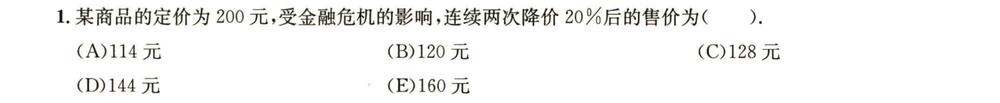

### 第 2 题

如图 1 所示，$\triangle ABC$ 是直角三角形，$S_1, S_2, S_3$ 为正方形，已知 $a, b, c$ 分别是 $S_1, S_2, S_3$ 的边长，则（ ）。

<svg xmlns="http://www.w3.org/2000/svg" viewBox="0 0 250 215" width="250" height="215" style="background: white; font-family: sans-serif;">
  <polygon points="40,160 220,160 40,60" fill="none" stroke="#0f172a" stroke-width="2"/>
  <rect x="40" y="96" width="64" height="64" fill="none" stroke="#0f172a" stroke-width="1.8"/>
  <rect x="104" y="119" width="41" height="41" fill="none" stroke="#0f172a" stroke-width="1.8"/>
  <rect x="40" y="73" width="23" height="23" fill="none" stroke="#0f172a" stroke-width="1.8"/>
  <text x="66" y="134" font-size="14" font-style="italic" fill="#0f172a">S<tspan font-size="10" dy="4">1</tspan></text>
  <text x="118" y="144" font-size="14" font-style="italic" fill="#0f172a">S<tspan font-size="10" dy="4">2</tspan></text>
  <text x="47" y="89" font-size="14" font-style="italic" fill="#0f172a">S<tspan font-size="10" dy="4">3</tspan></text>
  <text x="26" y="165" font-size="14" font-style="italic" fill="#0f172a">A</text>
  <text x="225" y="165" font-size="14" font-style="italic" fill="#0f172a">B</text>
  <text x="32" y="54" font-size="14" font-style="italic" fill="#0f172a">C</text>
  <text x="110" y="195" font-size="13" font-weight="bold" fill="#0f172a">图 1</text>
</svg>

- **A**．$a = b + c$
- **B**．$a^2 = b^2 + c^2$
- **C**．$a^2 = 2b^2 + 2c^2$
- **D**．$a^3 = b^3 + c^3$
- **E**．$a^3 = 2b^3 + 2c^3$

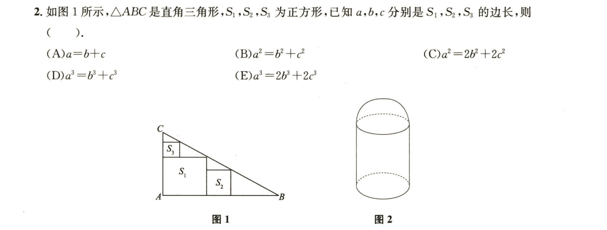

### 第 3 题

如图 2 所示，一个储物罐的下半部分是底面直径与高均为 20 米的圆柱形，上半部分（顶部）是半球形，已知底面与顶部的造价是 400 元/平方米，侧面的造价是 300 元/平方米，该储物罐的造价是（ ）（$\pi \approx 3.14$）。

<svg xmlns="http://www.w3.org/2000/svg" viewBox="0 0 200 220" width="200" height="220" style="background: white; font-family: sans-serif;">
  <path d="M 60 80 A 40 40 0 0 1 140 80" fill="none" stroke="#0f172a" stroke-width="2"/>
  <line x1="60" y1="80" x2="60" y2="160" stroke="#0f172a" stroke-width="2"/>
  <line x1="140" y1="80" x2="140" y2="160" stroke="#0f172a" stroke-width="2"/>
  <ellipse cx="100" cy="80" rx="40" ry="14" fill="none" stroke="#0f172a" stroke-width="1.8"/>
  <path d="M 60 160 A 40 14 0 0 0 140 160" fill="none" stroke="#0f172a" stroke-width="1.8"/>
  <path d="M 60 160 A 40 14 0 0 1 140 160" fill="none" stroke="#0f172a" stroke-width="1.8" stroke-dasharray="4,4"/>
  <text x="86" y="202" font-size="13" font-weight="bold" fill="#0f172a">图 2</text>
</svg>

- **A**．56.52 万元
- **B**．62.8 万元
- **C**．75.36 万元
- **D**．87.92 万元
- **E**．100.48 万元

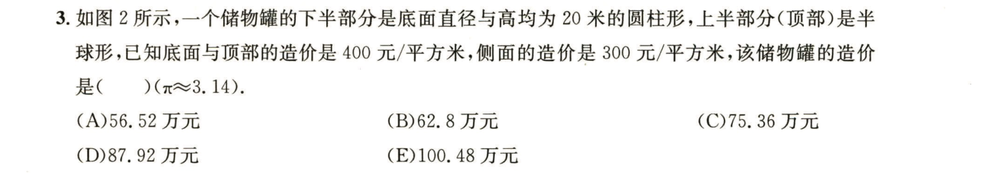

### 第 4 题

在一次商品促销活动中，主持人出示一个 9 位数，让顾客猜测商品的价格，商品的价格是该 9 位数中从左到右相邻的 3 个数字组成的 3 位数，若主持人出示的是 513535319，则顾客一次猜中价格的概率是（ ）。

- **A**．$\dfrac{1}{7}$
- **B**．$\dfrac{1}{6}$
- **C**．$\dfrac{1}{5}$
- **D**．$\dfrac{2}{7}$
- **E**．$\dfrac{1}{3}$

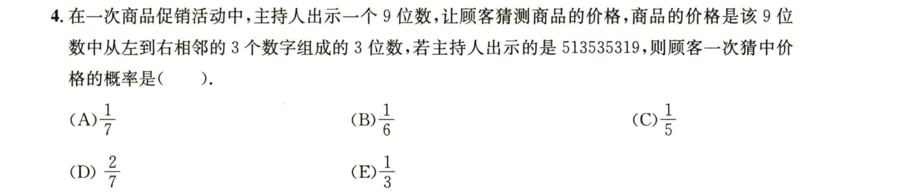

### 第 5 题

某商店经营 15 种商品，每次在橱窗内陈列 5 种，若每两次陈列的商品不完全相同，则最多可陈列（ ）次。

- **A**．3000
- **B**．3003
- **C**．4000
- **D**．4003
- **E**．4300

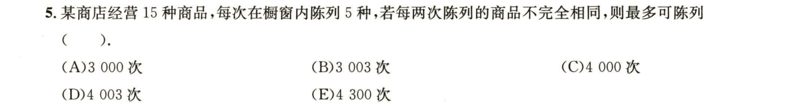

### 第 6 题

甲、乙、丙三个地区的公务员参加一次测评，其人数和考分情况如表1所示：

表1

| 人数/分数 | 6 | 7 | 8 | 9 |
| :---: | :---: | :---: | :---: | :---: |
| 甲 | 10 | 10 | 10 | 10 |
| 乙 | 15 | 15 | 10 | 20 |
| 丙 | 10 | 10 | 15 | 15 |

三个地区按平均分由高到低的排名顺序为（ ）。

- **A**．乙、丙、甲
- **B**．乙、甲、丙
- **C**．甲、丙、乙
- **D**．丙、甲、乙
- **E**．丙、乙、甲

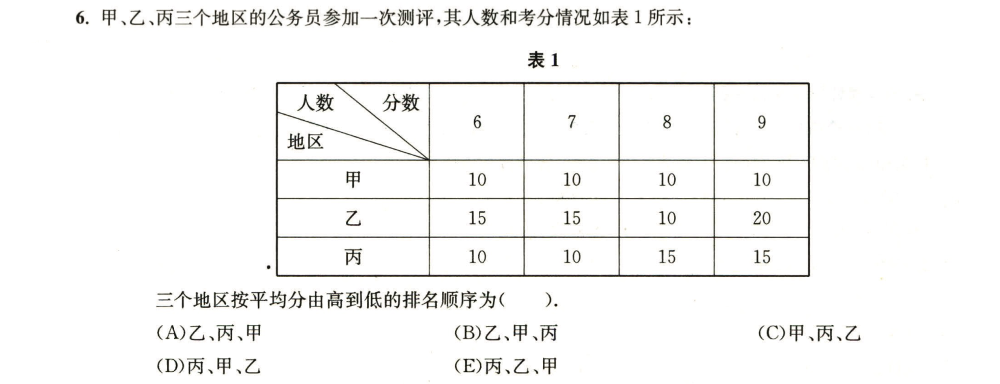

### 第 7 题

经统计，某机场的一个安检口每天中午办理安检手续的乘客人数及相应的概率如表2所示：

表2

| 乘客人数 | 0~5 | 6~10 | 11~15 | 16~20 | 21~25 | 25 以上 |
| :---: | :---: | :---: | :---: | :---: | :---: | :---: |
| 概率 | 0.1 | 0.2 | 0.2 | 0.25 | 0.2 | 0.05 |

该安检口 2 天中至少有 1 天中午办理安检手续的乘客人数超过 15 的概率是（ ）。

- **A**．0.2
- **B**．0.25
- **C**．0.4
- **D**．0.5
- **E**．0.75

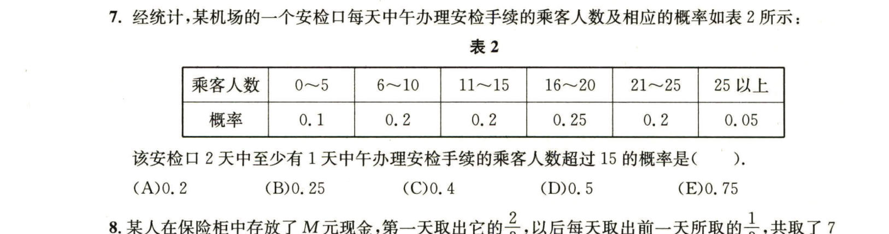

### 第 8 题

某人在保险柜中存放了 $M$ 元现金，第一天取出它的 $\dfrac{2}{3}$，以后每天取出前一天所取的 $\dfrac{1}{3}$，共取了 7 天，保险柜中剩余的现金为（ ）。

- **A**．$\dfrac{M}{3^7}$ 元
- **B**．$\dfrac{M}{3^6}$ 元
- **C**．$\dfrac{2M}{3^6}$ 元
- **D**．$[1 - (\dfrac{2}{3})^7]M$ 元
- **E**．$[1 - 7 \times (\dfrac{2}{3})^7]M$ 元

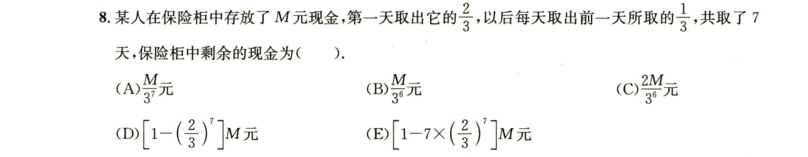

### 第 9 题

在直角坐标系中，若平面区域 $D$ 中所有点的坐标 $(x, y)$ 均满足：$0 \le x \le 6$，$0 \le y \le 6$，$|y-x| \le 3$，$x^2 + y^2 \ge 9$，则 $D$ 的面积是（ ）。

- **A**．$\dfrac{9}{4}(1 + 4\pi)$
- **B**．$9(4 - \dfrac{\pi}{4})$
- **C**．$9(3 - \dfrac{\pi}{4})$
- **D**．$\dfrac{9}{4}(2 + \pi)$
- **E**．$\dfrac{9}{4}(1 + \pi)$

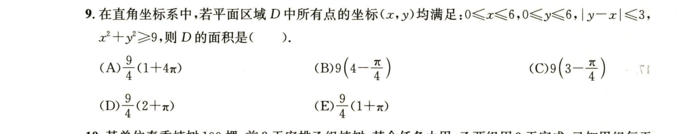

### 第 10 题

某单位春季植树 100 棵，前 2 天安排乙组植树，其余任务由甲、乙两组用 3 天完成，已知甲组每天比乙组多植树 4 棵，则甲组每天植树（ ）棵。

- **A**．11
- **B**．12
- **C**．13
- **D**．15
- **E**．17

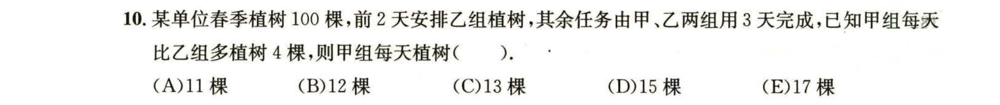

### 第 11 题

在两队进行的羽毛球对抗赛中，每队派出 3 男、2 女共 5 名运动员进行 5 局单打比赛，如果女子比赛安排在第二和第四局进行，则每队队员的不同出场顺序有（ ）。

- **A**．12 种
- **B**．10 种
- **C**．8 种
- **D**．6 种
- **E**．4 种

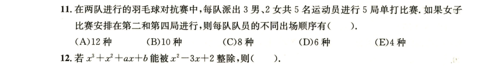

### 第 12 题

若 $x^3 + x^2 + ax + b$ 能被 $x^2 - 3x + 2$ 整除，则（ ）。

- **A**．$a = 4, b = 4$
- **B**．$a = -4, b = -4$
- **C**．$a = 10, b = -8$
- **D**．$a = -10, b = 8$
- **E**．$a = -2, b = 0$

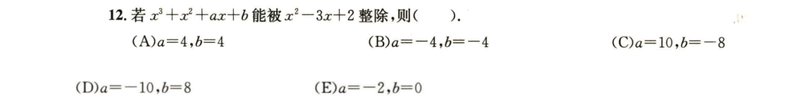

### 第 13 题

某公司计划运送 180 台电视机和 110 台洗衣机下乡，现有两种货车，甲种货车每辆最多可载 40 台电视机和 10 台洗衣机，乙种货车每辆最多可载 20 台电视机和 20 台洗衣机，已知甲、乙两种货车的租金分别是每辆 400 元和 360 元，则最少的运费是（ ）。

- **A**．2560 元
- **B**．2600 元
- **C**．2640 元
- **D**．2680 元
- **E**．2720 元

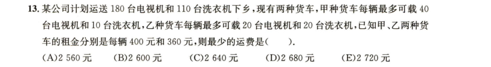

### 第 14 题

如图 3 所示，三个边长为 1 的正方形重叠放置，则覆盖区域（实线所围）的面积为（ ）。

<svg xmlns="http://www.w3.org/2000/svg" viewBox="0 0 200 210" width="200" height="210" style="background: white; font-family: sans-serif;">
  <line x1="65" y1="50" x2="135" y2="50" stroke="#0f172a" stroke-width="2"/>
  <line x1="65" y1="50" x2="65" y2="79" stroke="#0f172a" stroke-width="2"/>
  <line x1="135" y1="50" x2="135" y2="79" stroke="#0f172a" stroke-width="2"/>
  <line x1="65" y1="79" x2="65" y2="120" stroke="#0f172a" stroke-width="1.6" stroke-dasharray="3,3"/>
  <line x1="135" y1="79" x2="135" y2="120" stroke="#0f172a" stroke-width="1.6" stroke-dasharray="3,3"/>
  <line x1="65" y1="120" x2="135" y2="120" stroke="#0f172a" stroke-width="1.6" stroke-dasharray="3,3"/>
  <line x1="100" y1="59.4" x2="65" y2="120" stroke="#0f172a" stroke-width="1.6" stroke-dasharray="3,3"/>
  <line x1="100" y1="59.4" x2="135" y2="120" stroke="#0f172a" stroke-width="1.6" stroke-dasharray="3,3"/>
  <line x1="100" y1="59.4" x2="65" y2="79.6" stroke="#0f172a" stroke-width="1.6" stroke-dasharray="3,3"/>
  <line x1="100" y1="59.4" x2="135" y2="79.6" stroke="#0f172a" stroke-width="1.6" stroke-dasharray="3,3"/>
  <line x1="65" y1="120" x2="100" y2="140.6" stroke="#0f172a" stroke-width="1.6" stroke-dasharray="3,3"/>
  <line x1="135" y1="120" x2="100" y2="140.6" stroke="#0f172a" stroke-width="1.6" stroke-dasharray="3,3"/>
  <line x1="65" y1="79.6" x2="45" y2="91.1" stroke="#0f172a" stroke-width="2"/>
  <line x1="45" y1="91.1" x2="76.7" y2="146.1" stroke="#0f172a" stroke-width="2"/>
  <line x1="76.7" y1="146.1" x2="100" y2="132.6" stroke="#0f172a" stroke-width="2"/>
  <line x1="135" y1="79.6" x2="155" y2="91.1" stroke="#0f172a" stroke-width="2"/>
  <line x1="155" y1="91.1" x2="123.3" y2="146.1" stroke="#0f172a" stroke-width="2"/>
  <line x1="123.3" y1="146.1" x2="100" y2="132.6" stroke="#0f172a" stroke-width="2"/>
  <text x="86" y="195" font-size="13" font-weight="bold" fill="#0f172a">图 3</text>
</svg>

- **A**．$3 - \sqrt{2}$
- **B**．$3 - \dfrac{3\sqrt{2}}{4}$
- **C**．$3 - \sqrt{3}$
- **D**．$3 - \dfrac{\sqrt{3}}{2}$
- **E**．$3 - \dfrac{3\sqrt{3}}{4}$

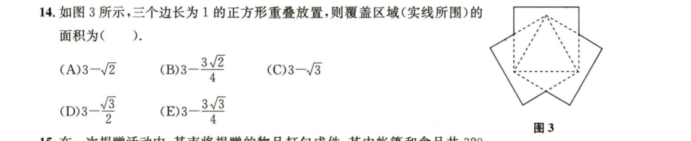

### 第 15 题

在一次捐赠活动中，某市将捐赠的物品打包成件，其中帐篷和食品共 320 件，帐篷比食品多 80 件，则帐篷的件数是（ ）。

- **A**．180
- **B**．200
- **C**．220
- **D**．240
- **E**．260

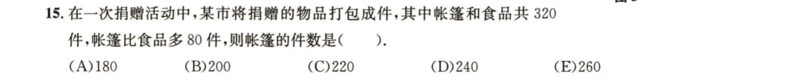

## 二、条件充分性判断：第 16～25 小题，每小题 3 分，共 30 分。要求判断每题给出的条件（1）和（2）能否充分支持题干所陈述的结论。A、B、C、D、E 五个选项为判断结果，请选择一项符合试题要求的判断，在答题卡上将所选项涂黑。

### 解题说明：
- **A**．条件（1）充分，但条件（2）不充分
- **B**．条件（2）充分，但条件（1）不充分
- **C**．条件（1）和（2）单独都不充分，但条件（1）和条件（2）联合起来充分
- **D**．条件（1）充分，条件（2）也充分
- **E**．条件（1）和（2）单独都不充分，条件（1）和条件（2）联合起来也不充分

### 第 16 题

一元二次方程 $x^2 + bx + 1 = 0$ 有两个不同实根。

（1）$b < -2$。
（2）$b > 2$。

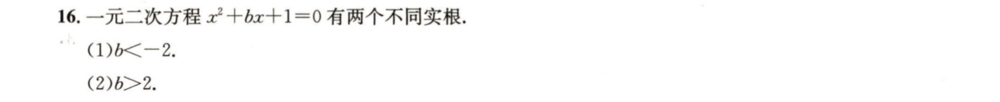

### 第 17 题

已知 $\{a_n\}, \{b_n\}$ 分别为等比数列与等差数列，$a_1 = b_1 = 1$，则 $b_2 \ge a_2$。

（1）$a_2 > 0$。
（2）$a_{10} = b_{10}$。

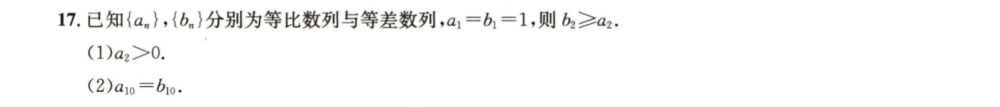

### 第 18 题

直线 $y = ax + b$ 过第二象限。

（1）$a = -1, b = 1$。
（2）$a = 1, b = -1$。

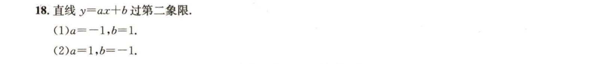

### 第 19 题

某产品由两道独立工序加工完成，则该产品是合格品的概率大于 0.8。

（1）每道工序的合格率为 0.81。
（2）每道工序的合格率为 0.9。

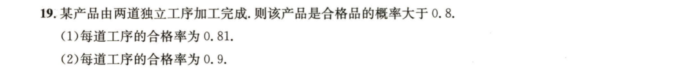

### 第 20 题

已知 $m, n$ 是正整数，则 $m$ 是偶数。

（1）$3m + 2n$ 是偶数。
（2）$3m^2 + 2n^2$ 是偶数。

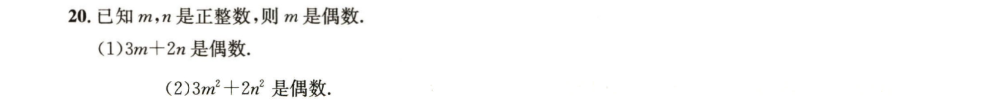

### 第 21 题

已知 $a, b$ 是实数，则 $a > b$。

（1）$a^2 > b^2$。
（2）$a^2 > b$。

### 第 22 题

在某次考试中，3 道题中答对 2 道题即为及格。假设某人答对各题的概率相同，则此人及格的概率是 $\dfrac{20}{27}$。

（1）答对各题的概率为 $\dfrac{2}{3}$。
（2）3 道题全部答错的概率为 $\dfrac{1}{27}$。

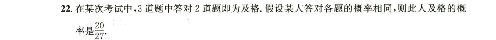

### 第 23 题

已知三种水果的平均价格为 10 元/千克，则每种水果的价格均不超过 18 元/千克。

（1）三种水果中价格最低的为 6 元/千克。
（2）购买重量分别是 1 千克、1 千克和 2 千克的三种水果共用了 46 元。

### 第 24 题

某户要建一个长方形的羊栏，则羊栏的面积大于 500 平方米。

（1）羊栏的周长为 120 米。
（2）羊栏对角线的长不超过 50 米。

### 第 25 题

直线 $y = x + b$ 是抛物线 $y = x^2 + a$ 的切线。

（1）$y = x + b$ 与 $y = x^2 + a$ 有且仅有一个交点。
（2）$x^2 - x \ge b - a$（$x \in \mathbb{R}$）。

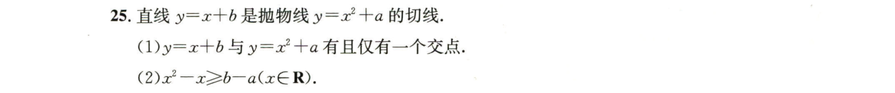

---

## 三、逻辑推理（第 26-55 题，每小题 2 分，共 60 分）

### 第 26 题

1991 年 6 月 15 日，菲律宾吕宋岛上的皮纳图博火山突然大爆发，2000 万吨二氧化硫气体冲入平流层，形成的霾像毯子一样盖在地球上空，把部分要照射到地球的阳光反射回太空。几年之后，气象学家发现这层霾使得当时地球表面的温度累计下降了 0.5°C。而皮纳图博火山爆发前的一个世纪，因人类活动而造成的温室效应已经使地球表面温度升高了 1°C。某位持“人工气候改造论”的科学家据此认为，可以用火箭弹等方式将二氧化硫充入大气层，阻挡部分阳光，达到给地球表面降温的目的。

以下哪项如果为真，最能对该科学家提议的有效性构成质疑？

- **A**．如果利用火箭弹将二氧化硫充入大气层，会导致航空乘客呼吸不适。
- **B**．如果在大气层上空放置反光物，就可以避免地球表面受到强烈阳光的照射。
- **C**．可以把大气中的碳提取出来存储到地下，减少大气层中的碳含量。
- **D**．不论任何方式，“人工气候改造”都将破坏地球的大气层结构。
- **E**．火山喷发形成的降温效应只是暂时的，经过一段时间温度将再次回升。

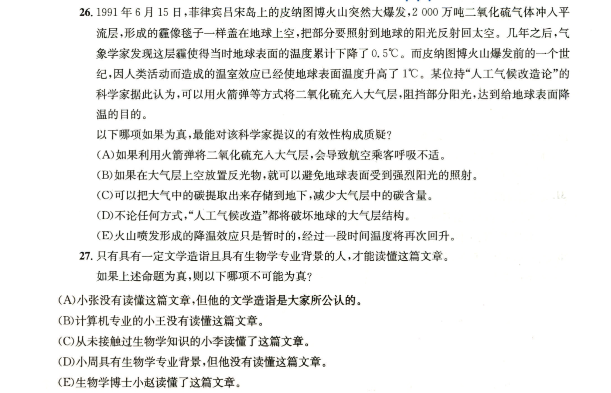

### 第 27 题

只有具有一定文学造诣且具有生物学专业背景的人，才能读懂这篇文章。

如果上述命题为真，则以下哪项不可能为真？

- **A**．小张没有读懂这篇文章，但他的文学造诣是大家所公认的。
- **B**．计算机专业的小王没有读懂这篇文章。
- **C**．从未接触过生物学知识的小李读懂了这篇文章。
- **D**．小周具有生物学专业背景，但他没有读懂这篇文章。
- **E**．生物学博士小赵读懂了这篇文章。

### 第 28 题

经过反复核查，质检员小李向厂长汇报说：“726 车间生产的产品都是合格的，所以不合格的产品都不是 726 车间生产的。”

以下哪项和小李的推理结构最为相似？

- **A**．所有入场的考生都经过了体温测试，所以没能入场的考生都没有经过体温测试。
- **B**．所有出厂设备都是合格的，所以检测合格的设备都已出厂。
- **C**．所有已发表的文章都是认真校对过的，所以认真校对过的文章都已发表。
- **D**．所有真理都是不怕批评的，所以怕批评的都不是真理。
- **E**．所有不及格的学生都没有好好复习，所以没好好复习的学生都不及格。

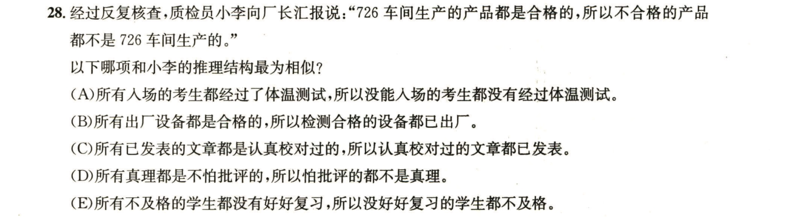

### 第 29 题

王涛和周波是理科(1)班的同学，他们是无话不说的好朋友。他们发现班里每一个人或者喜欢物理或者喜欢化学。王涛喜欢物理，周波不喜欢化学。

根据以上陈述，以下哪项一定为真？

I．周波喜欢物理。
II．王涛不喜欢化学。
III．理科(1)班不喜欢物理的人喜欢化学。
IV．理科(1)班一半人喜欢物理，一半人喜欢化学。

- **A**．仅I。
- **B**．仅III。
- **C**．仅I和II。
- **D**．仅I和III。
- **E**．仅II、III和IV。

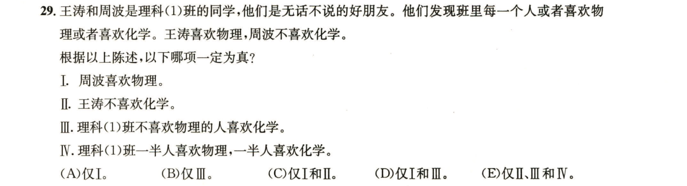

### 第 30 题

李明、王兵、马云三位股民对股票A和股票B分别作了如下预测：

李明：只有股票A不上涨，股票B才不上涨。
王兵：股票A和股票B至少有一个不上涨。
马云：股票A上涨当且仅当股票B上涨。

若三人的预测都为真，则以下哪项符合他们的预测？

- **A**．股票A上涨，股票B不上涨。
- **B**．股票A不上涨，股票B上涨。
- **C**．股票A和股票B均上涨。
- **D**．股票A和股票B均不上涨。
- **E**．只有股票A上涨，股票B才不上涨。

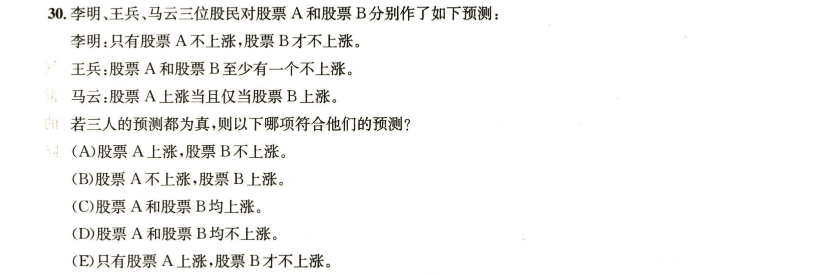

### 第 31 题

临江市地处东部沿海，下辖临东、临西、江南、江北四个区。近年来，文化旅游产业成为该市新的经济增长点。

2010 年，该市一共吸引了全国数十万人次游客前来参观旅游。12 月底，关于该市四个区当年吸引游客人次多少的排名，各位旅游局局长作了如下预测：

临东区旅游局局长：如果临西区第三，那么江北区第四。
临西区旅游局局长：只有临西区不是第一，江南区才是第二。
江南区旅游局局长：江南区不是第二。
江北区旅游局局长：江北区第四。

最终的统计表明，只有一位局长的预测符合事实，则临东区当年吸引游客人次的排名是：

- **A**．第一。
- **B**．第二。
- **C**．第三。
- **D**．第四。
- **E**．在江北区之前。

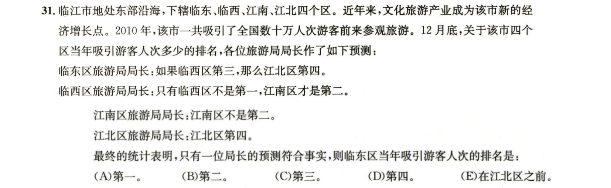

### 第 32 题

小张是某公司营销部的员工。公司经理对他说：“如果你争取到这个项目，我就奖励你一台笔记本电脑或者给你项目提成。”

以下哪项如果为真，说明该经理没有兑现承诺？

- **A**．小张没争取到这个项目，该经理没给他项目提成，但送了他一台笔记本电脑。
- **B**．小张没争取到这个项目，该经理没奖励他笔记本电脑，也没给他项目提成。
- **C**．小张争取到这个项目，该经理给他项目提成，但并未奖励他笔记本电脑。
- **D**．小张争取到这个项目，该经理奖励他一台笔记本电脑并且给他三天假期。
- **E**．小张争取到这个项目，该经理未给他项目提成，但奖励了他一台台式电脑。

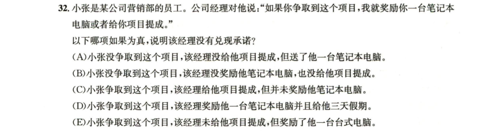

### 第 33 题

《文化新报》记者小白周四去某市采访陈教授与王研究员。次日，其同事小李问小白：“昨天你采访到那两位学者了吗？”小白说：“不，没那么顺利。”小李又问：“那么，你一个都没采访到？”小白说：“也不是。”

以下哪项最可能是小白周四采访所发生的情况？

- **A**．小白采访到了两位学者。
- **B**．小白采访了李教授，但没有采访王研究员。
- **C**．小白根本没有去采访两位学者。
- **D**．两位采访对象都没有接受采访。
- **E**．小白采访到了一位，但没有采访到另一位。

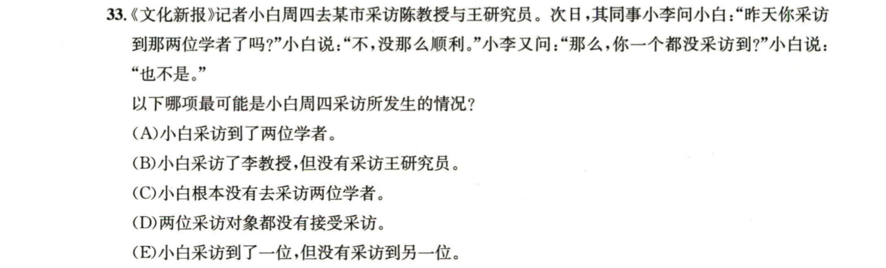

### 第 34 题

只有通过身份认证的人才允许上公司内网，如果没有良好的业绩就不可能通过身份认证，张辉有良好的业绩而王维没有良好的业绩。

如果上述断定为真，则以下哪项一定为真？

- **A**．允许张辉上公司内网。
- **B**．不允许王维上公司内网。
- **C**．张辉通过身份认证。
- **D**．有良好的业绩就允许上公司内网。
- **E**．没有通过身份认证，就说明没有良好的业绩。

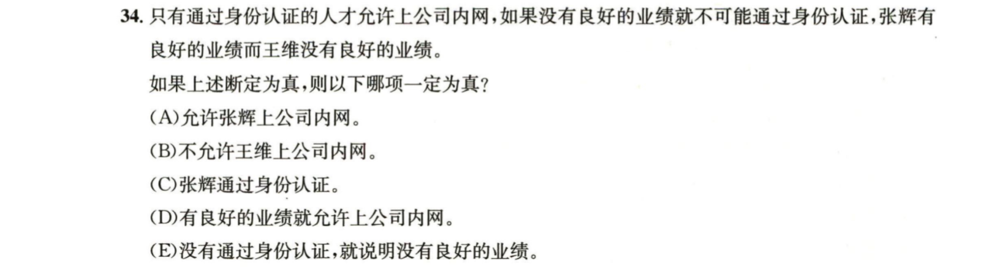

### 第 35 题

比较文字学学者张教授认为，在不同的民族语言中，字形与字义的关系有不同的表现。他提出，汉字是象形文字，其中大部分是形声字，这些字的字形与字义相互关联；而英语是拼音文字，其字形与字义往往关联不大，需要某种抽象的理解。

以下哪项如果为真，最不符合张教授的观点？

- **A**．汉语中的“日”“月”是象形字，从字形可以看出其所指的对象；而英语中的 sun 与 moon 则感觉不到这种形义结合。
- **B**．汉语中的“日”与“木”结合，可以组成“柬”“杲”“杳”等不同的字，并可以猜测其语义；而英语中则不存在与此类似的 sun 与 wood 的结合。
- **C**．英语中也有与汉语类似的象形文字，如，eye 是人的眼睛的象形，两个 e 代表眼睛，y 代表中间的鼻子；bed 是床的象形，b 和 d 代表床的两端。
- **D**．英语中的 sunlight 与汉语中的“阳光”相对应，而英语的 sun 与 light 和汉语中的“阳”与“光”相对应。
- **E**．汉语中的“星期三”与英语中的 Wednesday 和德语中的 Mittwoch 意思相同。

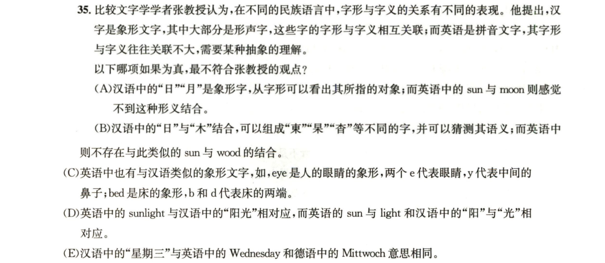

### 第 36 题

乘客使用手机及便携式电脑等电子设备会通过电磁波谱频繁传输信号，机场的无线电话和导航网络等也会使用电磁波谱，但电信委员会已根据不同用途把电磁波谱分成几大块。因此，用手机打电话不会对专供飞机通信系统或全球定位系统使用的波段造成干扰。尽管如此，各大航空公司仍然规定，禁止机上乘客使用手机等电子设备。

以下哪项如果为真，能解释上述现象？

I．乘客在空中使用手机等电子设备可能对地面导航网络造成干扰。
II．乘客在起飞和降落时使用手机等电子设备，可能影响机组人员工作。
III．便携式电脑或者游戏设备可能导致自动驾驶仪出现断路或仪器显示发生故障。

- **A**．仅I。
- **B**．仅II。
- **C**．I和II。
- **D**．仅II和III。
- **E**．I、II和III。

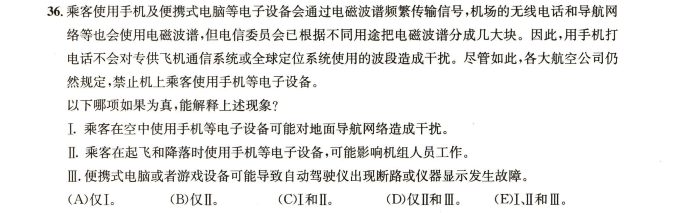

### 第 37 题

2010 年上海世博会盛况空前，200 多个国家场馆和企业主题馆让人目不暇接，大学生王刚决定在学校放暑假的第二天前往世博会参观。前一天晚上，他特别上网查看了各位网友对相关热门场馆选择的建议，其中最吸引王刚的有三条：

（1） 如果参观沙特馆，就不参观石油馆。
（2） 石油馆和中国国家馆择一参观。
(3) 中国国家馆和石油馆不都参观。

实际上，第二天王刚的世博会行程非常紧凑，他没有接受上述三条建议中的任何一条。

关于王刚所参观的热门场馆，以下哪项描述正确？

- **A**．参观沙特馆、石油馆，没有参观中国国家馆。
- **B**．沙特馆、石油馆、中国国家馆都参观了。
- **C**．沙特馆、石油馆、中国国家馆都没有参观。
- **D**．没有参观沙特馆，参观石油馆和中国国家馆。
- **E**．没有参观石油馆，参观沙特馆和中国国家馆。

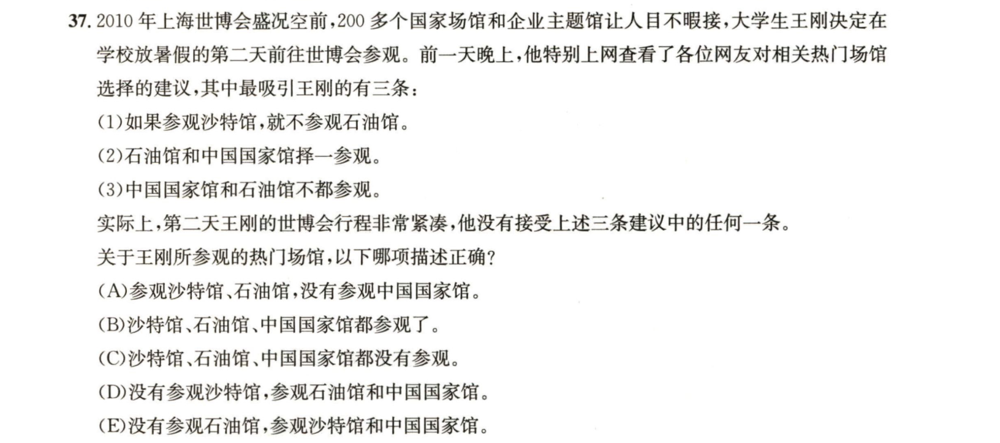

### 第 38 题

经理说：“有了自信不一定赢。”董事长回应说：“但是没有自信一定会输。”

以下哪项与董事长的意思最为接近？

- **A**．不输即赢，不赢即输。
- **B**．如果自信，则一定会赢。
- **C**．只有自信，才可能不输。
- **D**．除非自信，否则不可能输。
- **E**．只有赢了，才可能更自信。

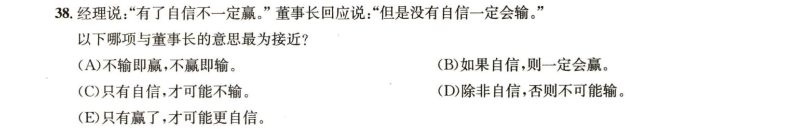

### 第 39 题

在家电产品“三下乡”活动中，某销售公司的产品受到了农村居民的广泛欢迎。该公司总经理在介绍经验时表示：只有用最流行畅销的明星产品面对农村居民，才能获得他们的青睐。

以下哪项如果为真，最能质疑总经理的论述？

- **A**．某品牌电视由于其较强的防潮能力，尽管不是明星产品，仍然获得了农村居民的青睐。
- **B**．流行畅销的明星产品由于价格偏高，没有赢得农村居民的青睐。
- **C**．流行畅销的明星产品只有质量过硬，才能获得农村居民的青睐。
- **D**．有少数娱乐明星为某些流行畅销的产品做虚假广告。
- **E**．流行畅销的明星产品最适合城市中的白领使用。

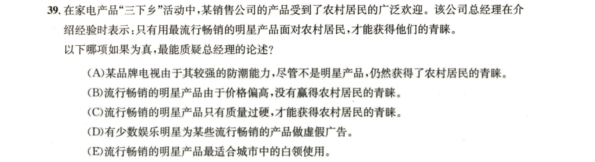

### 第 40 题

居民苏女士在菜市场看到某摊位出售的鹌鹑蛋色泽新鲜、形态圆润，且价格便宜，于是买了一箱。回家后发现有些鹌鹑蛋打不破，甚至丢到地上也摔不坏，再细闻已经打破的鹌鹑蛋，有一股刺鼻的消毒液味道。她投诉至菜市场管理部门，结果一位工作人员声称：鹌鹑蛋目前还没有国家质量标准，无法判定它有质量问题，所以他坚持这箱鹌鹑蛋没有质量问题。

以下哪项与该工作人员得出结论的方式最为相似？

- **A**．不能证明宇宙是没有边际的，所以宇宙是有边际的。
- **B**．“驴友论坛”还没有论坛规范，所以管理人员没有权力删除帖子。
- **C**．小偷在逃跑途中跳入 2 米深的河中，事主认为没有责任，因此不予施救。
- **D**．并非外星人不存在，所以外星人存在。
- **E**．慈善晚会上的假唱行为不属于商业管理的范围，因此相关部门无法对此进行处罚。

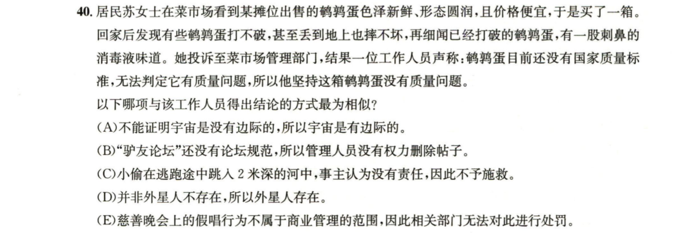

### 第 41 题

概念A和概念B之间有交叉关系，当且仅当：

（1） 存在对象 x，x 既属于A又属于B；
（2） 存在对象 y，y 属于A但是不属于B；
(3) 存在对象 z，z 属于B但是不属于A。

根据上述定义，以下哪项中加横线的两个概念之间有交叉关系？

- **A**．国画按题材分主要有人物画、花鸟画、山水画等，按技法分主要有工笔画和写意画等。
- **B**．《盗梦空间》除了是最佳影片的有力争夺者外，它在技术类奖项的争夺中也将有所斩获。
- **C**．洛邑小学 30 岁的食堂总经理为了改善伙食，在食堂放了几个意见本，征求学生们的意见。
- **D**．在微波炉清洁剂中加入漂白剂，就会释放出氯气。
- **E**．高校教师包括教授、副教授、讲师和助教等。

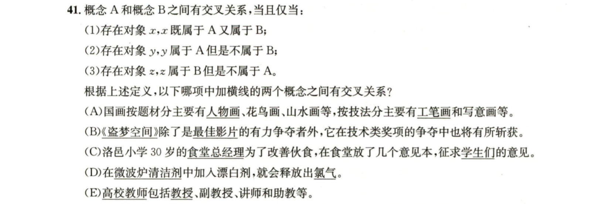

### 第 42 题

小李将自家护栏边的绿地毁坏，种上了黄瓜。小区物业管理人员发现后，提醒小李：护栏边的绿地是公共绿地，属于小区的所有人。物业为此下发了整改通知书，要求小李限期恢复绿地。小李对此辩称：“我难道不是小区的人吗？护栏边的绿地既然属于小区的所有人，当然也属于我。因此，我有权在自己的土地上种黄瓜。”

以下哪项论证和小李的错误最为相似？

- **A**．所有人都要对他的错误行为负责，小梁没有对他的这次行为负责，所以小梁的这次行为没有错误。
- **B**．所有参展的兰花在这次博览会上被订购一空，李阳花大价钱买了一盆花。由此可见，李阳买的必定是兰花。
- **C**．没有人能够一天读完大仲马的所有作品，没有人能够一天读完《三个火枪手》，因此，《三个火枪手》是大仲马的作品之一。
- **D**．所有莫尔碧骑士组成的军队在当时的欧洲是不可战胜的，翼雅王是莫尔碧骑士之一，所以翼雅王在当时的欧洲是不可战胜的。
- **E**．任何一个人都不可能掌握当今世界的所有知识，“地心说”不是当今世界的知识，因此，有些人可以掌握“地心说”。

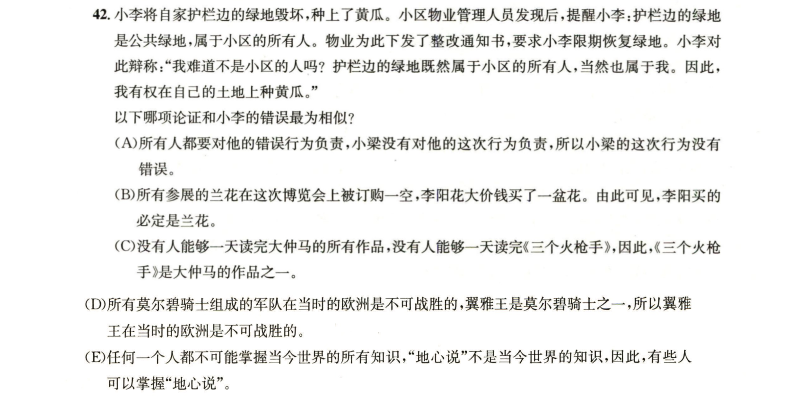

### 第 43 题

我国著名的地质学家李四光，在对东北的地质结构进行了长期、深入的调查研究后发现，松辽平原的地质结构与中亚细亚极其相似。他推断，既然中亚细亚蕴藏大量的石油，那么松辽平原很可能也蕴藏着大量的石油。后来，大庆油田的开发证明了李四光的推断是正确的。

以下哪项与李四光的推理方式最为相似？

- **A**．他山之石，可以攻玉。
- **B**．邻居买彩票中了大奖，小张受此启发，也去买了体育彩票，结果没有中奖。
- **C**．某乡镇领导在考察了荷兰等国的花卉市场后认为要大力发展规模经济，回来后组织全乡镇种大葱，结果导致大葱严重滞销。
- **D**．每到炎热的夏季，许多商店会腾出一大块地方卖羊毛衫、长袖衬衣、冬靴等冬令商品，进行反季节销售，结果都很有市场。小王受此启发，决定在冬季种植西瓜。
- **E**．乌兹别克地区盛产长绒棉。新疆塔里木河流域和乌兹别克地区在日照情况、霜期长短、气温高低、降雨量等方面均相似，科研人员受此启发，将长绒棉移植到塔里木河流域，果然获得了成功。

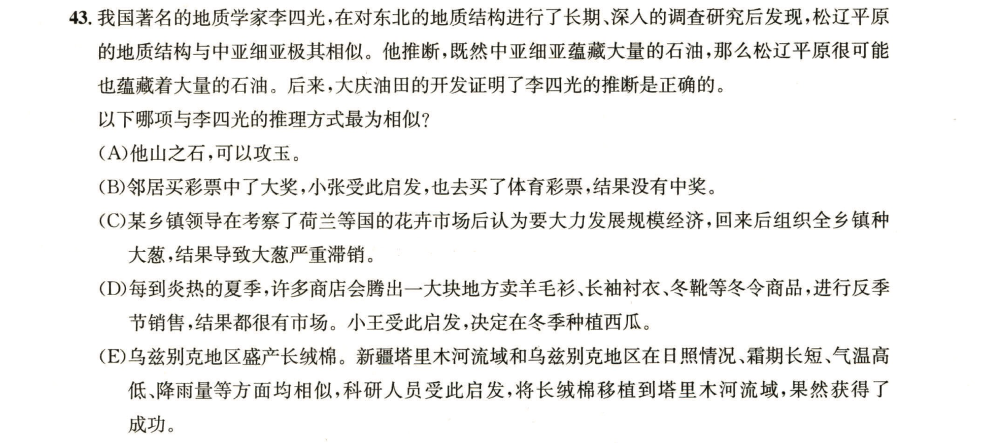

### 第 44 题

如果他勇于承担责任，那么他就一定会直面媒体，而不是选择逃避；如果他没有责任，那么他就一定会聘请律师，捍卫自己的尊严。可是事实上，他不仅没有聘请律师，现在逃得连人影都不见。

根据以上陈述，可以得出以下哪项结论？

- **A**．即使他没有责任，也不应该选择逃避。
- **B**．虽然选择了逃避，但是他可能没有责任。
- **C**．如果他有责任，那么他应该勇于承担责任。
- **D**．如果他不敢承担责任，那么说明他责任很大。
- **E**．他不仅有责任，而且他没有勇气承担责任。

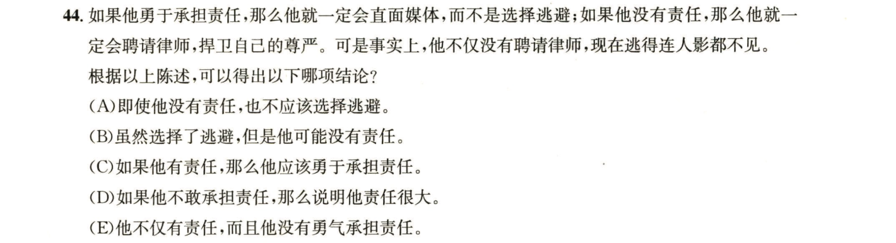

### 第 45 题

有些通信网络的维护涉及个人信息安全，因而，不是所有通信网络的维护都可以外包。

以下哪项可以使上述论证成立？

- **A**．所有涉及个人信息安全的都不可以外包。
- **B**．有些涉及个人信息安全的不可以外包。
- **C**．有些涉及个人信息安全的可以外包。
- **D**．所有涉及国家信息安全的都不可以外包。
- **E**．有些通信网络的维护涉及国家信息安全。

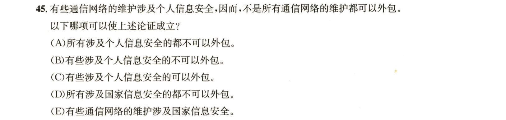

### 第 46 题

葡萄酒中含有白黎芦醇和类黄酮等对心脏有益的抗氧化剂。一项新研究表明白黎芦醇能防止骨质疏松和肌肉萎缩。由此，有关研究人员推断，那些长时间在国际空间站或宇宙飞船上的宇航员或许可以补充一下白黎芦醇。

以下哪项如果为真，最能支持上述研究人员的推断？

- **A**．研究人员发现由于残疾或者其他因素而很少活动的人会比经常活动的人更容易出现骨质疏松和肌肉萎缩等症状，如果能喝点葡萄酒，则可以获益。
- **B**．研究人员模拟失重状态，对老鼠进行试验，一个对照组未接受任何特殊处理，另一组则每天服用白黎芦醇。结果对照组的老鼠骨头和肌肉的密度都降低了，而服用白黎芦醇的一组则没有出现这些症状。
- **C**．研究人员发现由于残疾或者其他因素而很少活动的人，如果每天服用一定量的白黎芦醇，则可以改善骨质疏松和肌肉萎缩等症状。
- **D**．研究人员发现，葡萄酒能对抗失重所造成的负面影响。
- **E**．某医学博士认为，白黎芦醇或许不能代替锻炼，但它能减缓人体某些机能的退化。

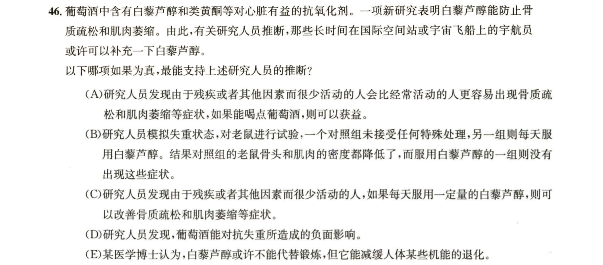

### 第 47 题

一般商品只有在多次流通过程中才能不断增值，但艺术品作为一种特殊商品却体现出了与一般商品不同的特性。在拍卖市场上，有些古玩、字画的成交价有很大的随机性，往往会直接受到拍卖现场气氛、竞价激烈程度、买家心理变化等偶然因素的影响，成交价有时会高于底价几十倍乃至数百倍，使得艺术品在一次“流通”中实现大幅度增值。

以下哪项最无助于解释上述现象？

- **A**．艺术品的不可再造性决定了其交换价格有可能超过其自身价值。
- **B**．不少买家喜好收藏，抬高了艺术品的交易价格。
- **C**．有些买家就是为了炒作艺术品，以期获得高额利润。
- **D**．虽然大量赝品充斥市场，但对艺术品的交易价格没有什么影响。
- **E**．国外资金进入艺术品拍卖市场，对价格攀升起到了拉动作用。

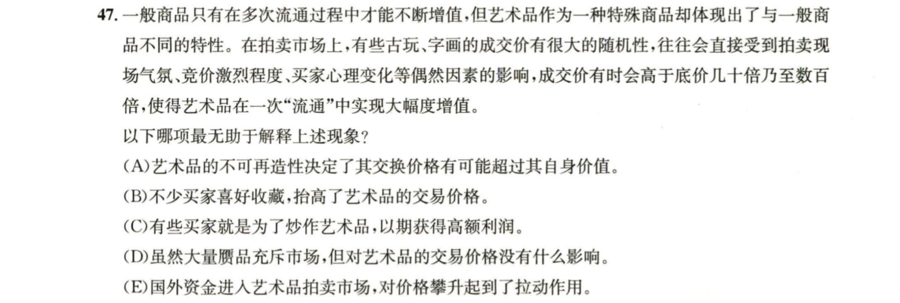

### 第 48 题

近期国际金融危机对毕业生的就业影响非常大，某高校就业中心的陈老师希望广大考生能够调整自己的心态和预期。他在一次就业指导会上提到，有些同学对自己的职业定位还不够准确。

如果陈老师的陈述为真，则以下哪项不一定为真？

I．不是所有人对自己的职业定位都准确。
II．不是所有人对自己的职业定位都不够准确。
III．有些人对自己的职业定位准确。
IV．所有人对自己的职业定位都不够准确。

- **A**．仅II和IV。
- **B**．仅III和IV。
- **C**．仅II和III。
- **D**．仅I、II和III。
- **E**．仅II、III和IV。

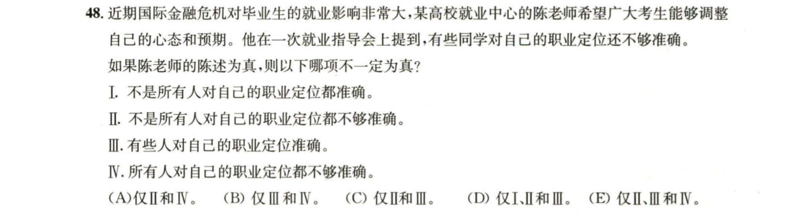

### 第 49 题

一位房地产信息员通过对某地的调查发现：护城河两岸房屋的租金都比较廉价，廉租房都坐落在凤凰山北麓，东向的房屋都是别墅，非廉租房不可能具有廉价的租金；有些单室套的两限房建在凤凰山南麓，别墅也都建在凤凰山南麓。

根据该房地产信息员的调查，以下哪项不可能存在？

- **A**．东向的护城河两岸的房屋。
- **B**．凤凰山北麓的两限房。
- **C**．单室套的廉租房。
- **D**．护城河两岸的单室套。
- **E**．南向的廉租房。

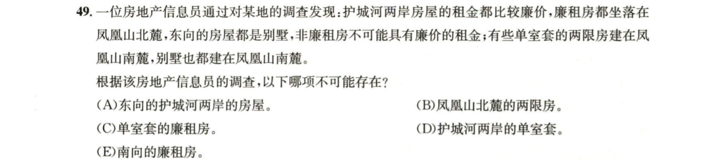

### 第 50 题

探望病人通常会送上一束鲜花，但某国曾有报道说，医院花瓶养花的水可能含有很多细菌，鲜花会在夜间与病人争夺氧气，还可能影响病房里电子设备的工作。这引起了人们对鲜花的恐慌，该国一些医院甚至禁止病房内摆放鲜花。尽管后来证实鲜花并未导致更多的病人受感染，并且权威部门也澄清，未见任何感染病例与病房里的植物有关，但这并未减轻医院对鲜花的反感。

以下除哪项外，都能减轻医院对鲜花的担心？

- **A**．鲜花并不比病人身边的餐具、饮料和食物带有更多可能危害病人健康的细菌。
- **B**．在病房里放置鲜花让病人感到心情愉悦、精神舒畅，有助于病人康复。
- **C**．给鲜花换水、修剪需要一定的人工，如果花瓶倒了还会导致危险发生。
- **D**．已有研究证明，鲜花对病房空气的影响微乎其微，可以忽略不计。
- **E**．探望病人所送的鲜花大都花束小、需水量少、花粉少，不会影响电子设备的工作。

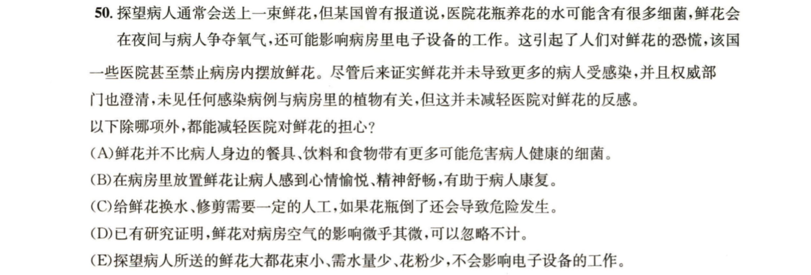

### 第 51 题

某公司规定，在一个月内，除非每个工作日都出勤，否则任何员工都不可能既获得当月的绩效工资，又获得奖励工资。

以下哪项与上述规定的意思最为接近？

- **A**．在一个月内，任何员工如果所有工作日不缺勤，必然既获得当月的绩效工资，又获得奖励工资。
- **B**．在一个月内，任何员工如果所有工作日不缺勤，都有可能既获得当月的绩效工资，又获得奖励工资。
- **C**．在一个月内，任何员工如果有某个工作日缺勤，仍有可能获得当月的绩效工资，或者获得奖励工资。
- **D**．在一个月内，任何员工如果有某个工作日缺勤，必然或者得不到当月的绩效工资，或者得不到奖励工资。
- **E**．在一个月内，任何员工如果所有工作日不缺勤，必然既得不到当月的绩效工资，又得不到奖励工资。

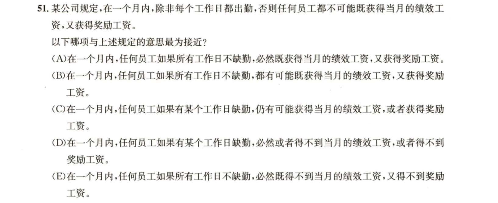

### 第 52 题

近期流感肆虐，一般流感患者可采用抗病毒药物治疗。虽然并不是所有流感患者均需接受达菲等抗病毒药物的治疗，但不少医生仍强烈建议老人、儿童等易出现严重症状的患者用药。

如果以上陈述为真，则以下哪项不可能为真？

I．有些流感患者需接受达菲等抗病毒药物的治疗。
II．并非有的流感患者不需接受抗病毒药物的治疗。
III．老人、儿童等易出现严重症状的患者不需要用药。

- **A**．仅I。
- **B**．仅II。
- **C**．仅III。
- **D**．仅II和III。
- **E**．I、II和III。

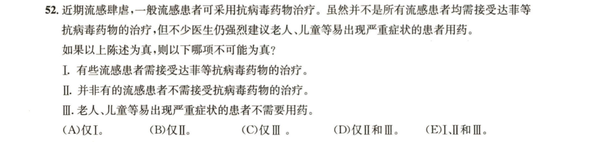

### 53~55 题基于以下题干

> 东宁大学公开招聘 3 个教师职位，哲学学院、管理学院和经济学院各一个，每个职位都有分别来自南山大学、西京大学、北清大学的候选人，有位“聪明”人士李先生对招聘结果做出了如下预测：
> 如果哲学学院录用北清大学的候选人，那么管理学院录用西京大学的候选人；
> 如果管理学院录用南山大学的候选人，那么哲学学院也录用南山大学的候选人；
> 如果经济学院录用北清大学或者西京大学的候选人，那么管理学院录用北清大学的候选人。

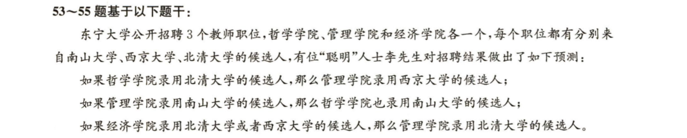

### 第 53 题

如果哲学学院、管理学院和经济学院最终录用的候选人的大学归属信息依次如下，则哪项符合李先生的预测？

- **A**．南山大学、南山大学、西京大学。
- **B**．北清大学、南山大学、南山大学。
- **C**．北清大学、北清大学、南山大学。
- **D**．西京大学、北清大学、南山大学。
- **E**．西京大学、西京大学、西京大学。

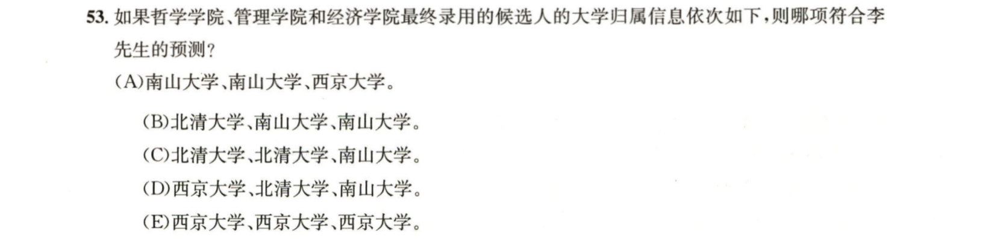

### 第 54 题

若哲学学院最终录用西京大学的候选人，则以下哪项表明李先生的预测错误？

- **A**．管理学院录用北清大学候选人。
- **B**．管理学院录用南山大学候选人。
- **C**．经济学院录用南山大学候选人。
- **D**．经济学院录用北清大学候选人。
- **E**．经济学院录用西京大学候选人。

### 第 55 题

如果三个学院最终录用的候选人来自不同的大学，则以下哪项符合李先生的预测？

- **A**．哲学学院录用西京大学候选人，经济学院录用北清大学候选人。
- **B**．哲学学院录用南山大学候选人，管理学院录用北清大学候选人。
- **C**．哲学学院录用北清大学候选人，经济学院录用西京大学候选人。
- **D**．哲学学院录用西京大学候选人，管理学院录用南山大学候选人。
- **E**．哲学学院录用南山大学候选人，管理学院录用西京大学候选人。

---

## 四、写作（第 56-57 题，共 65 分）

### 第 56 题 · 论证有效性分析 (30 分)

**分析下述论证中存在的缺陷与漏洞，选择若干要点，写一篇 600 字左右的文章，对该论证的有效性进行分析和评论。**（论证有效性分析的一般要点是：概念特别是核心概念的界定和使用是否准确并前后一致，有无各种明显的逻辑错误，论证的论据是否成立并支持结论，结论成立的条件是否充分等。）

> 地球的气候变化已经成为当代世界的热点，这一问题看似复杂，其实简单，只要我们运用科学原理——如爱因斯坦的相对论——去对待，也许就会找到解决这一问题的方法。
>
> 众所周知，爱因斯坦提出的相对论颠覆了人类关于宇宙和自然的常识性观念，不管是狭义相对论还是广义相对论，都揭示了宇宙间事物运动中普遍存在的相对性。既然宇宙万物的运动都是相对的，那么我们观察问题时也应该采用相对的方法，如变换视角等。
>
> 假如我们变换视角去看一些问题，也许会得出和一般常识完全不同的观点。例如，我们称为灾害的那些自然现象，包括海啸、台风、暴雨，等等，其实也是大自然本身的一般现象而已，从大自然的视角来看，无所谓灾害不灾害，只是当它损害了人类利益、危及了人类生存的时候，从人类的视角来看，我们才称之为灾害。
>
> 再变换一下视角，从一个更广泛的范围来看，我们人类自己也是大自然的一部分。既然我们的祖先是类人猿，而类人猿正像大熊猫、华南虎、藏羚羊、扬子鳄乃至银杏、水杉等一样，是整个自然生态中的有机组成部分，那为什么我们自己就不是了呢？
>
> 由此可见，人类的问题就是大自然的问题，即使人类在某一时间部分地改变了气候，也还是整个大自然系统中的一个自然问题，自然问题自然会解决，人类不必过多干预。

### 第 57 题 · 论说文 (35 分)

**根据下述材料，写一篇 700 字左右的论说文，题目自拟。**

> 中国现代著名哲学家熊十力先生在《十力语要》（卷一）中说：“吾国学人，总好追逐风气，一时之所尚，则群起而趋其途，如海上逐臭之夫，莫名所以。曾无一刹那，风气或变，而逐臭者复如故，此等逐臭之习，有两大病：一、各人无牢固与永久不改之业，遇事无从深入，徒养成浮动性。二、大家共趋于世所矜尚之一途，到其余千途万途，一切废弃，无人过问。此二大病，都是中国学人死症。”

