# 2013 年全国硕士研究生招生考试管理类专业学位联考综合能力试题 (199)

## 一、问题求解：第 1-15 小题，每小题 3 分，共 45 分。下列每题给出的 A、B、C、D、E 五个选项中，只有一项是符合试题要求的。请在答题卡上将所选的字母涂黑。

### 第 1 题

某工厂生产一批零件，计划 10 天完成任务，实际提前 2 天完成，则每天的产量比计划平均提高了（ ）。

- **A**．15%
- **B**．20%
- **C**．25%
- **D**．30%
- **E**．35%

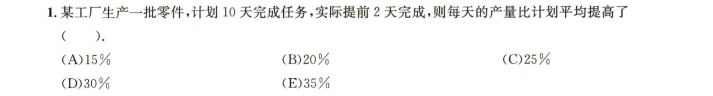

### 第 2 题

甲、乙两人同时从 A 点出发，沿 400 米跑道同向匀速行走，25 分钟后乙比甲少走了一圈，若乙行走一圈需要 8 分钟，则甲的速度是（ ）（单位：米/分钟）。

- **A**．62
- **B**．65
- **C**．66
- **D**．67
- **E**．69

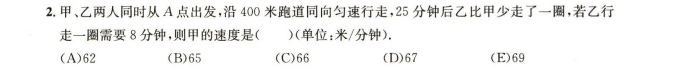

### 第 3 题

甲班共有 30 名学生，在一次满分为 100 分的考试中，全班的平均成绩为 90 分，则成绩低于 60 分的学生至多有（ ）名。

- **A**．8
- **B**．7
- **C**．6
- **D**．5
- **E**．4

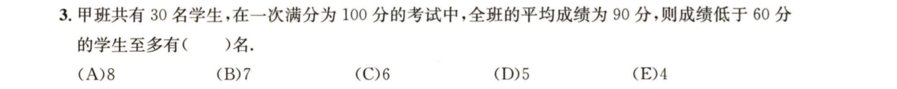

### 第 4 题

某工程由甲公司承包需要 60 天完成，由甲、乙两公司共同承包需要 28 天完成，由乙、丙两公司共同承包需要 35 天完成，则由丙公司承包完成该工程需要的天数为（ ）天。

- **A**．85
- **B**．90
- **C**．95
- **D**．100
- **E**．105

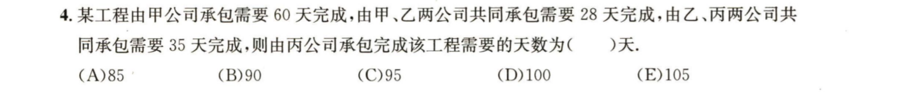

### 第 5 题

已知 $f(x) = \dfrac{1}{(x+1)(x+2)} + \dfrac{1}{(x+2)(x+3)} + \cdots + \dfrac{1}{(x+9)(x+10)}$，则 $f(8) = $（ ）。

- **A**．$\dfrac{1}{9}$
- **B**．$\dfrac{1}{10}$
- **C**．$\dfrac{1}{16}$
- **D**．$\dfrac{1}{17}$
- **E**．$\dfrac{1}{18}$

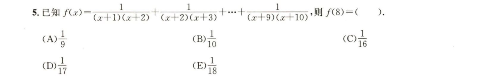

### 第 6 题

甲、乙两商店同时购进了一批某品牌电视机，当甲店售出 15 台时乙店售出了 10 台，此时两店的库存比为 $8:7$，库存差为 5，甲、乙两店总进货量为（ ）台。

- **A**．75
- **B**．80
- **C**．85
- **D**．100
- **E**．125

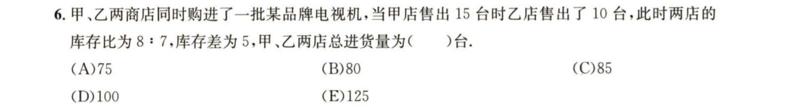

### 第 7 题

如图 1 所示，在直角三角形 $ABC$ 中，$AC = 4$，$BC = 3$，$DE \parallel BC$，已知梯形 $BCED$ 的面积为 3，则 $DE$ 的长为（ ）。

<svg xmlns="http://www.w3.org/2000/svg" viewBox="0 0 190 205" width="190" height="205" style="background: white; font-family: sans-serif;">
  <polygon points="50,150 140,150 50,30" fill="none" stroke="#0f172a" stroke-width="2"/>
  <line x1="50" y1="115" x2="114" y2="115" stroke="#0f172a" stroke-width="2"/>
  <text x="38" y="28" font-size="14" font-style="italic" fill="#0f172a">A</text>
  <text x="38" y="162" font-size="14" font-style="italic" fill="#0f172a">C</text>
  <text x="146" y="155" font-size="14" font-style="italic" fill="#0f172a">B</text>
  <text x="36" y="119" font-size="14" font-style="italic" fill="#0f172a">E</text>
  <text x="120" y="119" font-size="14" font-style="italic" fill="#0f172a">D</text>
  <text x="85" y="192" font-size="13" font-weight="bold" fill="#0f172a">图 1</text>
</svg>

- **A**．$\sqrt{3}$
- **B**．$\sqrt{3}+1$
- **C**．$4\sqrt{3}-4$
- **D**．$\dfrac{3\sqrt{2}}{2}$
- **E**．$\sqrt{2}+1$

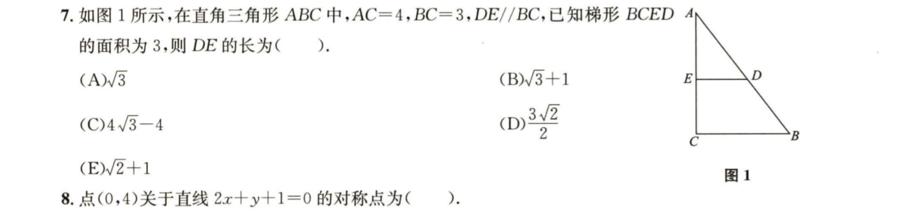

### 第 8 题

点 $(0, 4)$ 关于直线 $2x + y + 1 = 0$ 的对称点为（ ）。

- **A**．(2, 0)
- **B**．(-3, 0)
- **C**．(-6, 1)
- **D**．(4, 2)
- **E**．(-4, 2)

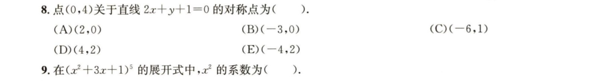

### 第 9 题

在 $(x^2 + 3x + 1)^5$ 的展开式中，$x^2$ 的系数为（ ）。

- **A**．5
- **B**．10
- **C**．45
- **D**．90
- **E**．95

### 第 10 题

将体积为 $4\pi$ 立方厘米和 $32\pi$ 立方厘米的两个实心金属球熔化后铸成一个实心大球，则大球的表面积为（ ）平方厘米。

- **A**．$32\pi$
- **B**．$36\pi$
- **C**．$38\pi$
- **D**．$40\pi$
- **E**．$42\pi$

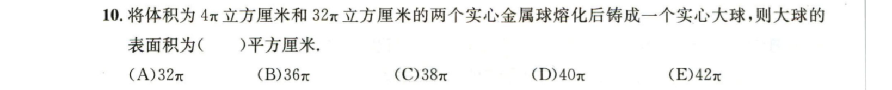

### 第 11 题

有一批水果要装箱，一名熟练工单独装箱需要 10 天，每天报酬为 200 元；一名普通工单独装箱需要 15 天，每天报酬为 120 元。由于场地限制，最多可同时安排 12 人装箱，若要求在一天内完成装箱任务，则支付的最少报酬为（ ）。

- **A**．1800 元
- **B**．1840 元
- **C**．1920 元
- **D**．1960 元
- **E**．2000 元

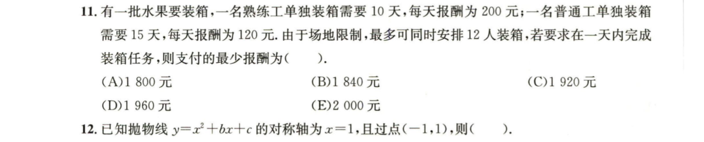

### 第 12 题

已知抛物线 $y = x^2 + bx + c$ 的对称轴为 $x = 1$，且过点 $(-1, 1)$，则（ ）。

- **A**．$b = -2, c = -2$
- **B**．$b = 2, c = 2$
- **C**．$b = -2, c = 2$
- **D**．$b = -1, c = -1$
- **E**．$b = 1, c = 1$

### 第 13 题

已知 $\{a_n\}$ 为等差数列，若 $a_2$ 和 $a_{10}$ 是方程 $x^2 - 10x - 9 = 0$ 的两个根，则 $a_5 + a_7 = $（ ）。

- **A**．-10
- **B**．-9
- **C**．9
- **D**．10
- **E**．12

### 第 14 题

已知 10 件产品中有 4 件一等品，从中任取 2 件，则至少有 1 件一等品的概率为（ ）。

- **A**．$\dfrac{1}{3}$
- **B**．$\dfrac{2}{3}$
- **C**．$\dfrac{2}{15}$
- **D**．$\dfrac{8}{15}$
- **E**．$\dfrac{13}{15}$

### 第 15 题

确定两人从 $A$ 地出发经过 $B, C$，沿逆时针方向行走一圈回到 $A$ 地的方案如图 2 所示。若从 $A$ 地出发时每人均可选大路或山道，经过 $B, C$ 时，至多有 1 人可以更改道路，则不同的方案有（ ）。

<svg xmlns="http://www.w3.org/2000/svg" viewBox="0 0 240 260" width="240" height="260" style="background: white; font-family: sans-serif;">
  <defs>
    <marker id="arrow" viewBox="0 0 10 10" refX="5" refY="5" markerWidth="6" markerHeight="6" orient="auto-start-reverse">
      <path d="M 0 1.5 L 8 5 L 0 8.5 z" fill="#0f172a"/>
    </marker>
  </defs>
  <path d="M 46 158 L 126 158" fill="none" stroke="#0f172a" stroke-width="1.8" marker-end="url(#arrow)"/>
  <line x1="120" y1="158" x2="194" y2="158" stroke="#0f172a" stroke-width="1.8"/>
  <path d="M 194 158 L 153 87" fill="none" stroke="#0f172a" stroke-width="1.8" marker-end="url(#arrow)"/>
  <line x1="157" y1="94" x2="120" y2="30" stroke="#0f172a" stroke-width="1.8"/>
  <path d="M 120 30 L 79 101" fill="none" stroke="#0f172a" stroke-width="1.8" marker-end="url(#arrow)"/>
  <line x1="83" y1="94" x2="46" y2="158" stroke="#0f172a" stroke-width="1.8"/>
  <path d="M 46 158 A 85 85 0 0 0 126 200" fill="none" stroke="#0f172a" stroke-width="1.8" marker-end="url(#arrow)"/>
  <path d="M 120 200 A 85 85 0 0 0 194 158" fill="none" stroke="#0f172a" stroke-width="1.8"/>
  <path d="M 194 158 A 85 85 0 0 0 197 90" fill="none" stroke="#0f172a" stroke-width="1.8" marker-end="url(#arrow)"/>
  <path d="M 196 98 A 85 85 0 0 0 120 30" fill="none" stroke="#0f172a" stroke-width="1.8"/>
  <path d="M 120 30 A 85 85 0 0 0 43 140" fill="none" stroke="#0f172a" stroke-width="1.8" marker-end="url(#arrow)"/>
  <path d="M 44 132 A 85 85 0 0 0 46 158" fill="none" stroke="#0f172a" stroke-width="1.8"/>
  <text x="32" y="168" font-size="14" font-style="italic" fill="#0f172a">A</text>
  <text x="200" y="168" font-size="14" font-style="italic" fill="#0f172a">B</text>
  <text x="116" y="22" font-size="14" font-style="italic" fill="#0f172a">C</text>
  <text x="108" y="148" font-size="13" fill="#0f172a">山道</text>
  <text x="108" y="222" font-size="13" fill="#0f172a">大路</text>
  <text x="106" y="250" font-size="13" font-weight="bold" fill="#0f172a">图 2</text>
</svg>

- **A**．16 种
- **B**．24 种
- **C**．36 种
- **D**．48 种
- **E**．64 种

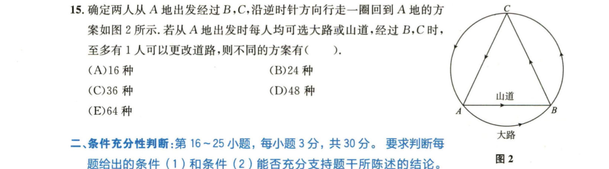

## 二、条件充分性判断：第 16～25 小题，每小题 3 分，共 30 分。要求判断每题给出的条件（1）和（2）能否充分支持题干所陈述的结论。A、B、C、D、E 五个选项为判断结果，请选择一项符合试题要求的判断，在答题卡上将所选项涂黑。

### 解题说明：
- **A**．条件（1）充分，但条件（2）不充分
- **B**．条件（2）充分，但条件（1）不充分
- **C**．条件（1）和（2）单独都不充分，但条件（1）和条件（2）联合起来充分
- **D**．条件（1）充分，条件（2）也充分
- **E**．条件（1）和（2）单独都不充分，条件（1）和条件（2）联合起来也不充分

### 第 16 题

已知平面区域 $D_1 = \{(x, y) \mid x^2 + y^2 \le 9\}$，$D_2 = \{(x, y) \mid (x-x_0)^2 + (y-y_0)^2 \le 9\}$，则 $D_1, D_2$ 覆盖区域的边界长度为 $8\pi$。

（1）$x_0^2 + y_0^2 = 9$。
（2）$x_0 + y_0 = 3$。

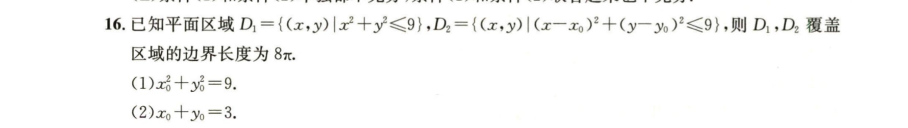

### 第 17 题

$p = mq + 1$ 为质数。

（1）$m$ 为正整数，$q$ 为质数。
（2）$m, q$ 均为质数。

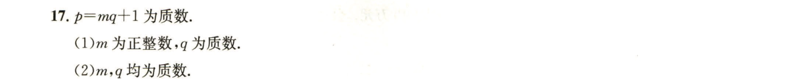

### 第 18 题

$\triangle ABC$ 的边长分别为 $a, b, c$，则 $\triangle ABC$ 为直角三角形。

（1）$(c^2 - a^2 - b^2)(a^2 - b^2) = 0$。
（2）$\triangle ABC$ 的面积为 $\dfrac{1}{2}ab$。

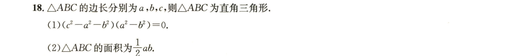

### 第 19 题

已知二次函数 $f(x) = ax^2 + bx + c$，则方程 $f(x) = 0$ 有两个不同实根。

（1）$a + c = 0$。
（2）$a + b + c = 0$。

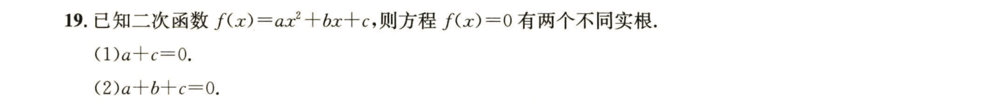

### 第 20 题

档案馆在一个库房中安装了 $n$ 个烟火感应报警器，每个报警器遇到烟火成功报警的概率为 $p$。该库房遇烟火发出警报的概率达到 0.999。

（1）$n = 3$，$p = 0.9$。
（2）$n = 2$，$p = 0.97$。

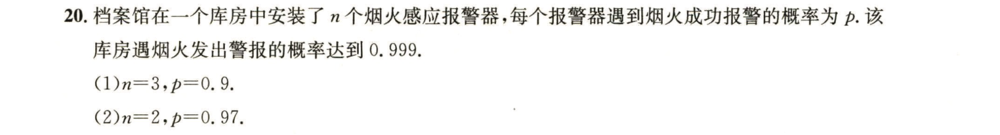

### 第 21 题

已知 $a, b$ 是实数，则 $|a| \le 1$，$|b| \le 1$。

（1）$|a+b| \le 1$。
（2）$|a-b| \le 1$。

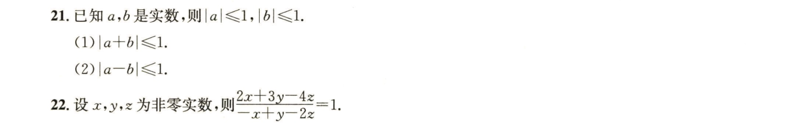

### 第 22 题

设 $x, y, z$ 为非零实数，则 $\dfrac{2x+3y-4z}{x+y-2z} = 1$。

（1）$3x - 2y = 0$。
（2）$2y - z = 0$。

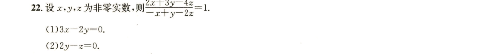

### 第 23 题

某单位年终共发了 100 万元奖金，奖金金额分别是一等奖 1.5 万元、二等奖 1 万元、三等奖 0.5 万元，则该单位至少有 100 人。

（1）得二等奖的人数最多。
（2）得三等奖的人数最多。

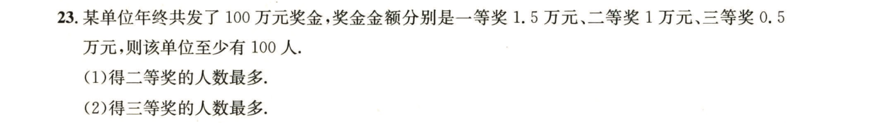

### 第 24 题

三个科室的人数分别为 6、3 和 2，因工作需要，每晚需要排 3 人值班，则在两个月中可使每晚的值班人员不完全相同。

（1）值班人员不能来自同一科室。
（2）值班人员来自三个不同科室。

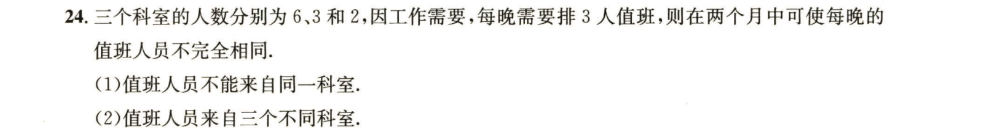

### 第 25 题

设 $a_1 = 1, a_2 = k, \dots, a_{n+1} = |a_n - a_{n-1}|$ ($n \ge 2$)，则 $a_{100} + a_{101} + a_{102} = 2$。

（1）$k = 2$。
（2）$k$ 为小于 20 的正整数。

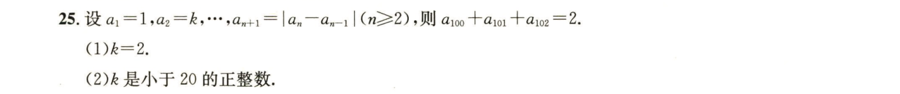

---

## 三、逻辑推理（第 26-55 题，每小题 2 分，共 60 分）

### 第 26 题

某公司去年初开始实施一项“办公用品节俭计划”，每位员工每月只能免费领用限量的纸笔等各类办公用品。年末统计时发现，公司用于各类办公用品的支出较上年度下降了 30%。在未实施该计划的过去 5 年间，公司年均消耗办公用品 10 万元。公司总经理由此得出：该计划去年已经为公司节约了不少经费。

以下哪项如果为真，最能构成对总经理推论的质疑？

- **A**．另一家与该公司规模及其他基本情况均类似的公司，未实施类似的节俭计划，在过去的 5 年间办公用品年均消耗也为 10 万元。
- **B**．在过去的 5 年间，该公司大力推广无纸化办公，并且取得很大成效。
- **C**．“办公用品节俭计划”是控制支出的重要手段，但说该计划为公司“一年内节约不少经费”，没有严谨的数据分析。
- **D**．另一家与该公司规模及其他基本情况均类似的公司，未实施类似的节俭计划，但在过去的 5 年间办公用品人均消耗额越来越低。
- **E**．去年，该公司在员工困难补助、交通津贴等方面的开支增加了 3 万元。

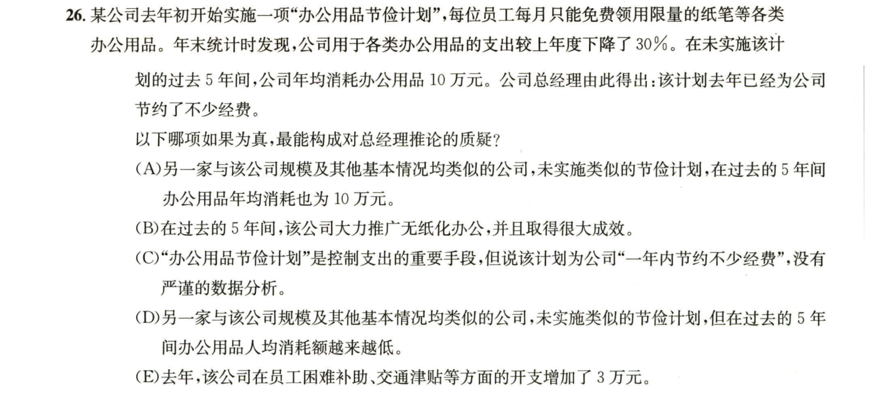

### 第 27 题

公司经理：我们招聘人才时最看重的是综合素质和能力，而不是分数。人才招聘中，高分低能者并不鲜见，我们显然不希望招到这样的“人才”。从你的成绩单可以看出，你的学业分数很高，因此，我们有点怀疑你的能力和综合素质。

以下哪项和经理得出结论的方式最为类似？

- **A**．公司管理者并非都是聪明人，陈然不是公司管理者，所以陈然可能是聪明人。
- **B**．猫都爱吃鱼，没有猫患近视，所以吃鱼可以预防近视。
- **C**．人的一生中健康开心最重要，名利都是浮云，张立名利双收，所以可能张立并不开心。
- **D**．有些歌手是演员，所有的演员都很富有，所以有些歌手可能不是很富有。
- **E**．闪光的物体并非都是金子，考古队挖到了闪闪发光的物体，所以考古队挖到的可能不是金子。

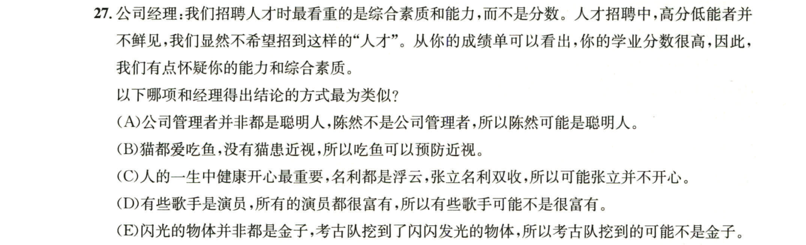

### 第 28 题

某省大力发展旅游产业，目前已经形成东湖、西岛、南山三个著名景点，每处景点都有二日游、三日游、四日游三种路线。李明、王刚、张波拟赴上述三地进行 9 日游，每个人都设计了各自的旅游计划。后来发现，每处景点他们三人都选择了不同的路线：李明赴东湖的计划天数与王刚赴西岛的计划天数相同，李明赴南山的计划是三日游，王刚赴南山的计划是四日游。

根据以上陈述，可以得出以下哪项？

- **A**．李明计划东湖二日游，王刚计划西岛二日游。
- **B**．王刚计划东湖三日游，张波计划西岛四日游。
- **C**．张波计划东湖四日游，王刚计划西岛三日游。
- **D**．张波计划东湖三日游，李明计划西岛四日游。
- **E**．李明计划东湖二日游，王刚计划西岛三日游。

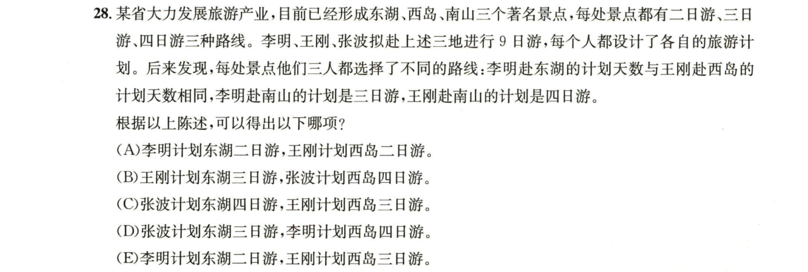

### 第 29 题

国际足联一直坚称，世界杯冠军队所获得的“大力神”杯是实心的纯金奖杯。某教授经过精密测量和计算认为，世界杯冠军奖杯——实心的“大力神”杯不可能是纯金制成的，否则球员根本不可能将它举过头顶并随意挥舞。

以下哪项与这位教授的意思最为接近？

- **A**．若球员能够将“大力神”杯举过头顶并随意挥舞，则它很可能是空心的纯金杯。
- **B**．只有“大力神”杯是实心的，它才可能是纯金的。
- **C**．若“大力神”杯是实心的纯金杯，则球员不可能将它举过头顶并随意挥舞。
- **D**．只有球员能够将“大力神”杯举过头顶并随意挥舞，它才是由纯金制成，并且不是实心的。
- **E**．若“大力神”杯是由纯金制成，则它肯定是空心的。

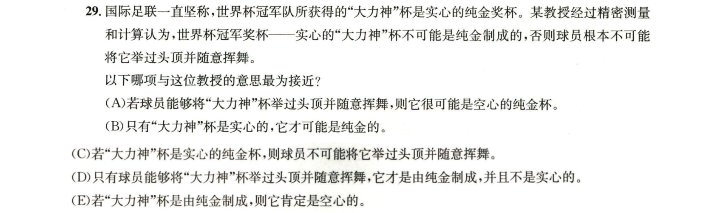

### 第 30 题

根据学习在动机形成和发展中所起的作用，人的动机可分为原始动机和习得动机两种。原始动机是与生俱来的动机，它是以人的本能需要为基础的；习得动机是指后天获得的各种动机，即经过学习产生和发展起来的各种动机。

根据以上陈述，以下哪项最可能属于原始动机？

- **A**．尊敬老人，孝敬父母。
- **B**．尊师重教，崇文尚武。
- **C**．不入虎穴，焉得虎子。
- **D**．窈窕淑女，君子好逑。
- **E**．宁可食无肉，不可居无竹。

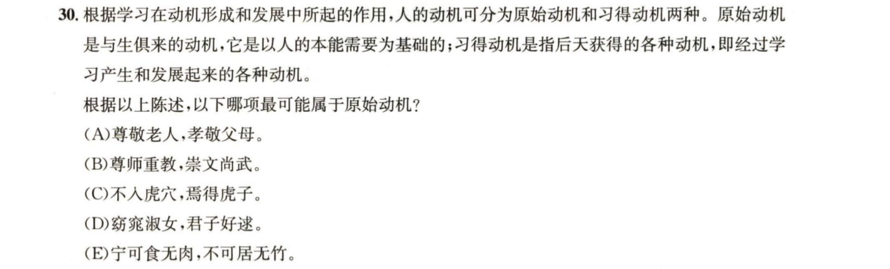

### 31~32 题基于以下题干

> 互联网好比一个复杂多样的虚拟世界，每台联网主机上的信息又构成一个微观虚拟世界。若在某主机上可以访问本主机的信息，则称该主机相通于自身；若主机 $x$ 能通过互联网访问主机 $y$ 的信息，则称 $x$ 相通于 $y$。已知代号分别为甲、乙、丙、丁的四台互联网主机有如下信息：
> （1） 甲主机相通于任一不相通于丙的主机。
> （2） 丁主机不相通于丙。
> (3) 丙主机相通于任一相通于甲的主机。

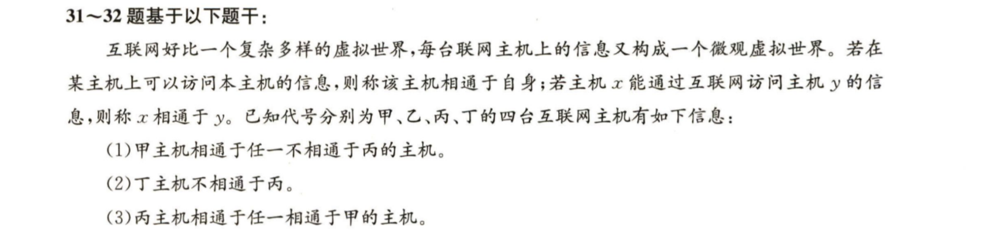

### 第 31 题

若丙主机不相通于自身，则以下哪项一定为真？

- **A**．甲主机相通于乙，乙主机相通于丙。
- **B**．若丁主机相通于乙，则乙主机相通于甲。
- **C**．只有甲主机不相通于丙，丁主机才相通于乙。
- **D**．丙主机不相通于丁，但相通于乙。
- **E**．甲主机相通于丁，也相通于丙。

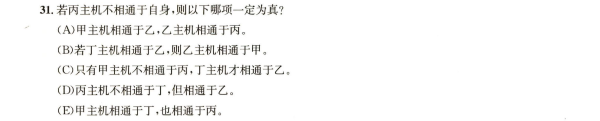

### 第 32 题

若丙主机不相通于任何主机，则以下哪项一定为假？

- **A**．丁主机不相通于甲。
- **B**．若丁主机相通于甲，则乙主机相通于甲。
- **C**．若丁主机不相通于甲，则乙主机相通于甲。
- **D**．甲主机相通于乙。
- **E**．乙主机相通于自身。

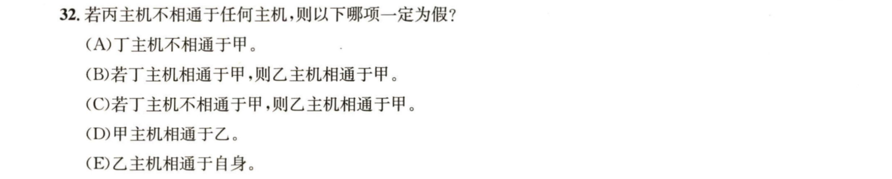

### 第 33 题

某科研机构对市民所反映的一种奇异现象进行研究，该现象无法用已有的科学理论进行解释。助理研究员小王由此断言：该现象是错觉。

以下哪项如果为真，最可能使小王的断言不成立？

- **A**．所有错觉都不能用已有的科学理论进行解释。
- **B**．有些错觉可以用已有的科学理论进行解释。
- **C**．有些错觉不能用已有的科学理论进行解释。
- **D**．错觉都可以用已有的科学理论进行解释。
- **E**．已有的科学理论尚不能完全解释错觉是如何形成的。

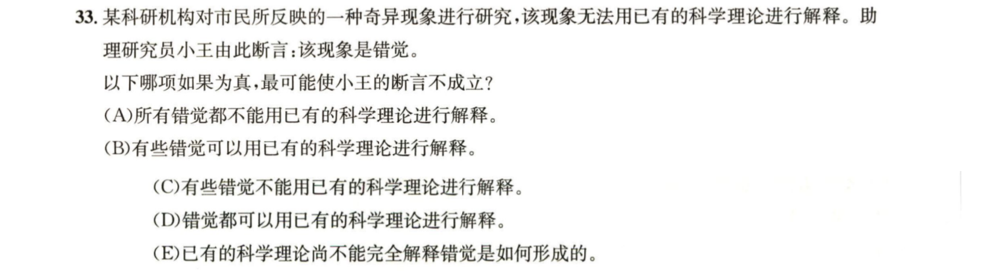

### 第 34 题

人们知道鸟类能感觉到地球磁场，并利用它们导航。最近某国科学家发现，鸟类其实是利用右眼“查看”地球磁场的。为检验该理论，当鸟类开始迁徙的时候，该国科学家把若干知更鸟放进一个漏斗形状的庞大的笼子里，并给其中部分知更鸟的一只眼睛戴上一种可屏蔽地球磁场的特殊金属眼罩。笼壁上涂着标记性物质，鸟要通过笼子细口才能飞出去。如果鸟碰到笼壁，就会黏上标记性物质，以此来判断鸟能否找到方向。

以下哪项如果为真，最能支持研究人员的上述发现？

- **A**．戴眼罩的鸟，不论左眼还是右眼，顺利从笼中飞了出去；没戴眼罩的鸟朝哪个方向飞的都有。
- **B**．没戴眼罩的鸟和左眼戴眼罩的鸟顺利从笼中飞了出去，右眼戴眼罩的鸟朝哪个方向飞的都有。
- **C**．没戴眼罩的鸟和右眼戴眼罩的鸟顺利从笼中飞了出去，左眼戴眼罩的鸟朝哪个方向飞的都有。
- **D**．没戴眼罩的鸟顺利从笼中飞了出去；戴眼罩的鸟，不论左眼还是右眼，朝哪个方向飞的都有。
- **E**．没戴眼罩的鸟和左眼戴眼罩的鸟朝哪个方向飞的都有，右眼戴眼罩的鸟顺利从笼中飞了出去。

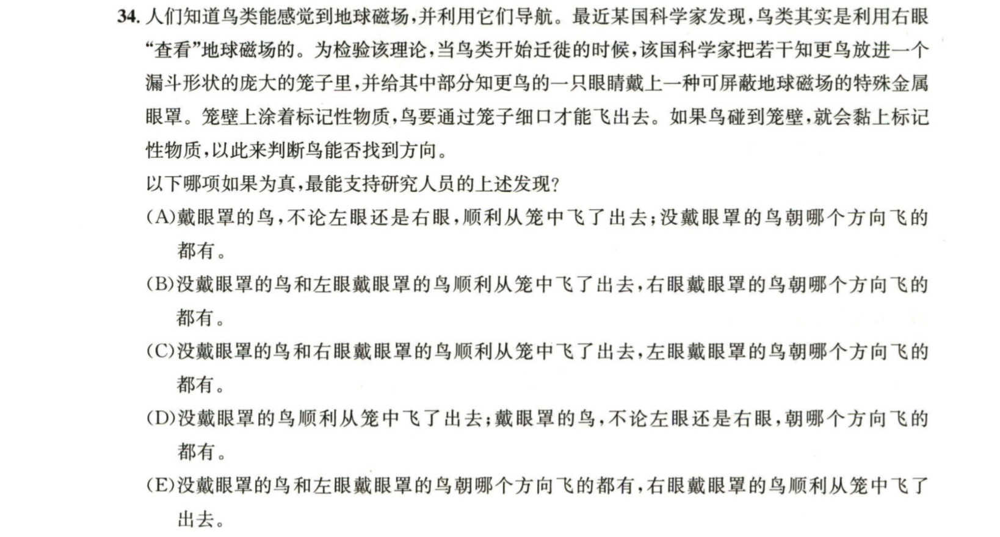

### 35~36 题基于以下题干

> 年初，为激励员工努力工作，某公司决定根据每月的工作绩效评选“月度之星”。王某在当年前 10 个月恰好只在连续的 4 个月中当选“月度之星”，他的另外三个同事郑某、吴某、周某也做到了这一点。关于这四人当选“月度之星”的月份，已知：
> （1） 王某和郑某仅有三个月同时当选。
> （2） 郑某和吴某仅有三个月同时当选。
> (3) 王某和周某不曾在同一个月当选。
> (4) 仅有 2 人在 7 月同时当选。
> (5) 至少有 1 人在 1 月当选。

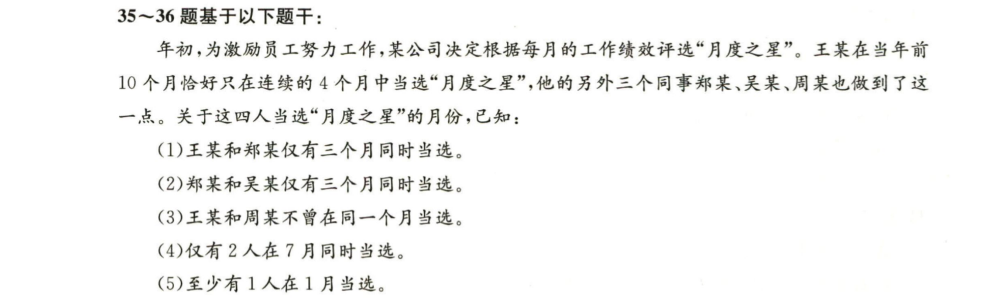

### 第 35 题

根据以上信息，有 3 人同时当选“月度之星”的月份是：

- **A**．1-3 月。
- **B**．2-4 月。
- **C**．3-5 月。
- **D**．4-6 月。
- **E**．5-7 月。

### 第 36 题

根据以上信息，王某当选“月度之星”的月份是：

- **A**．1-4 月。
- **B**．3-6 月。
- **C**．4-7 月。
- **D**．5-8 月。
- **E**．7-10 月。

### 第 37 题

若成为白领的可能性无性别差异，按正常男女出生率 102:100 计算，当这批人中的白领谈婚论嫁时，女性与男性数量应当大致相等。但实际上，某市妇联近几年举办的历次大型白领相亲活动中，报名的男女比例约为 3:7，有时甚至达到 2:8。这说明，文化越高的女性越难嫁，文化低的反而好嫁；男性则正好相反。

以下除哪项外，都有助于解释上述分析与实际情况的不一致？

- **A**．与男性白领不同，女性白领要求高，往往只找比自己更优秀的男性。
- **B**．与本地女性竞争的外地优秀女性多于与本地男性竞争的外地优秀男性。
- **C**．大学毕业后出国的精英分子中，男性多于女性。
- **D**．一般来说，男性参加大型相亲会的积极性不如女性。
- **E**．男性因长相身高、家庭条件等被女性淘汰者多于女性因长相身高、家庭条件等被男性淘汰者。

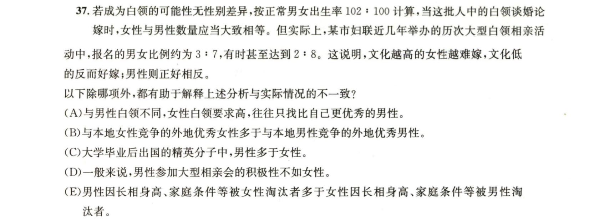

### 第 38 题

张霞、李丽、陈露、邓强和王硕一起坐火车去旅游，他们正好坐在同一车厢相对两排的五个座位上，每人各坐一个位置。第一排的座位按顺序分别记作 1 号和 2 号，第二排的座位按顺序记为 3、4、5 号。座位 1 和座位 3 直接相对，座位 2 和座位 4 直接相对，座位 5 不和上述任何座位直接相对。李丽坐在 4 号位置；陈露所坐的位置不与李丽相邻，也不与邓强相邻（相邻是指同一排上紧挨着）；张霞不坐在与陈露直接相对的位置上。

根据以上信息，张霞所坐位置有多少种可能的选择？

- **A**．1 种。
- **B**．2 种。
- **C**．3 种。
- **D**．4 种。
- **E**．5 种。

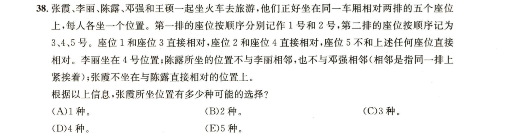

### 第 39 题

某大学的哲学学院和管理学院今年招聘新教师，招聘结束后受到了女权主义代表的批评，因为他们在 12 名女性应聘者中录用了 6 名，但在 12 名男性应聘者中却录用了 7 名。该大学对此解释说，今年招聘新教师的两个学院中，女性应聘者的录用率都高于男性的录用率。具体的情况是：哲学学院在 8 名女性应聘者中录用了 3 名，而在 3 名男性应聘者中录用了 1 名；管理学院在 4 名女性应聘者中录用了 3 名，而在 9 名男性应聘者中录用了 6 名。

以下哪项最有助于解释女权主义代表和该大学之间的分歧？

- **A**．各个局部都具有的性质在整体上未必具有。
- **B**．人们往往从整体角度考虑问题，不管局部如何，最终的整体结果才是最重要的。
- **C**．有些数学规则不能解释社会现象。
- **D**．现代社会提倡男女平等，但实际执行中还是有一定难度。
- **E**．整体并不是局部的简单相加。

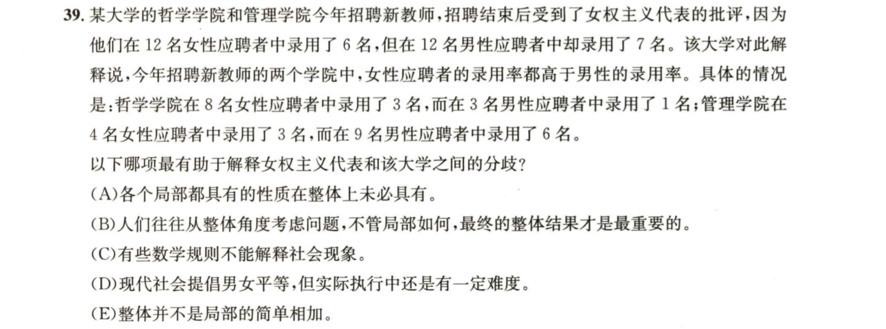

### 第 40 题

教育专家李教授指出：每个人在自己的一生中，都要不断地努力，否则就会像龟兔赛跑的故事一样，一时跑得快并不能保证一直领先。如果你本来基础好又能不断努力，那你肯定能比别人更早取得成功。

如果李教授的陈述为真，则以下哪项一定为假？

- **A**．不论是谁，只有不断努力，才可能取得成功。
- **B**．只要不断努力，任何人都可能取得成功。
- **C**．小王本来基础好并且能不断努力，但也可能比别人更晚取得成功。
- **D**．人的成功是有衡量标准的。
- **E**．一时不成功并不意味着一直不成功。

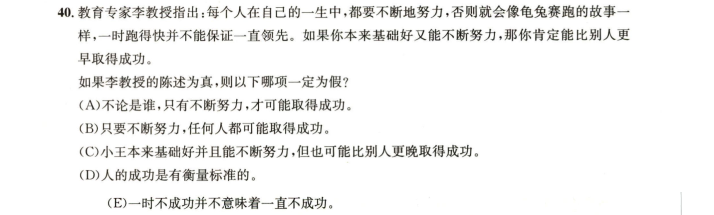

### 第 41 题

新近一项研究发现，海水颜色能够让飓风改变方向，也就是说，如果海水变色，飓风的移动路径也会变向。这也就意味着科学家可以根据海水的“脸色”判断哪些地区将被飓风袭击，哪些地区会幸免于难。值得关注的是，全球气候变暖可能已经让海水变色。

以下哪项最可能是科学家作出判断所依赖的前提？

- **A**．海水温度变化会导致海水改变颜色。
- **B**．海水颜色与飓风移动路径之间存在着某种相对确定的联系。
- **C**．海水温度升高会导致生成的飓风数量增加。
- **D**．海水温度变化与海水颜色变化之间的联系尚不明朗。
- **E**．全球气候变暖是最近几年飓风频发的重要原因之一。

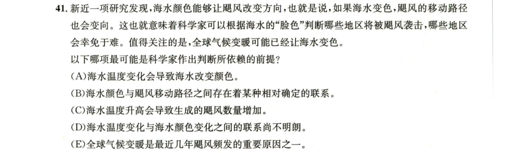

### 第 42 题

某金库发生了失窃案，公安机关侦查确定，这是一起典型的内盗案，可以断定金库管理员甲、乙、丙、丁中至少有一人是作案者。办案人员对四人进行了询问，四人的回答如下：

甲：“如果乙不是窃贼，我也不是窃贼。”
乙：“我不是窃贼，丙是窃贼。”
丙：“甲或者乙是窃贼。”
丁：“乙或者丙是窃贼。”

后来事实表明，他们四人中只有一人说了真话。

根据以上陈述，以下哪项一定为假？

- **A**．丙说的是假话。
- **B**．丙不是窃贼。
- **C**．乙不是窃贼。
- **D**．丁说的是真话。
- **E**．甲说的是真话。

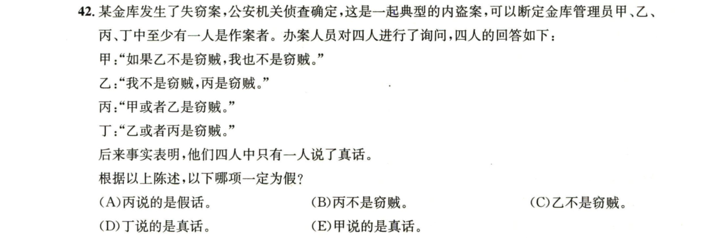

### 第 43 题

所有参加此次运动会的选手都是身体强壮的运动员，所有身体强壮的运动员都是极少生病的，但有一些身体不适的运动员参加了此次运动会。

以下哪项不能从上述前提中得出？

- **A**．有些身体不适的选手是极少生病的。
- **B**．有些极少生病的选手感到身体不适。
- **C**．极少生病的选手都参加了此次运动会。
- **D**．参加此次运动会的选手极少生病。
- **E**．有些身体强壮的运动员感到身体不适。

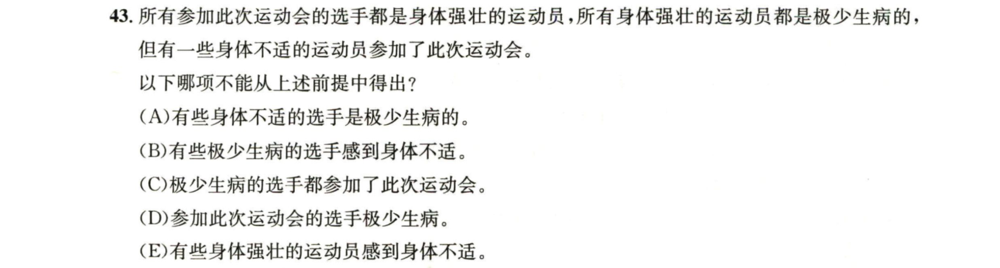

### 第 44 题

足球是一项集体运动，若想不断取得胜利，每个强队都必须有一位核心队员，他总能在关键场次带领全队赢得比赛。友南是某国甲级联赛强队西海队队员，据某记者统计，在上赛季参加的所有比赛中，有友南参赛的场次，西海队胜率高达 75.5%，另有 16.3% 的平局，8.2% 的场次输球；而在友南缺阵的情况下，西海队的胜率只有 58.9%，输球的比率高达 23.5%。该记者由此得出结论：友南是上赛季西海队的核心队员。

以下哪项如果为真，最能质疑该记者的结论？

- **A**．西海队教练表示：“球队是一个整体，不存在有友南的西海队和没有友南的西海队。”
- **B**．上赛季友南缺席且西海队输球的比赛都是小组赛中西海队已经确定出线后的比赛。
- **C**．西海队队长表示：“没有友南我们将失去很多东西，但我们会找到解决办法。”
- **D**．上赛季友南上场且西海队输球的比赛，都是西海队与传统强队对阵的关键场次。
- **E**．本赛季开始以来，在友南上阵的情况下，西海队胜率暴跌 20%。

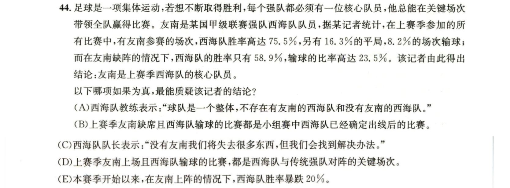

### 第 45 题

只要每个司法环节都能坚守程序正义，切实履行监督制约职能，结案率就会大幅度提高。去年某国结案率比上一年提高了 70%，所以，该国去年每个司法环节都能坚守程序正义，切实履行监督制约职能。

以下哪项与上述论证方式最为相似？

- **A**．只有在校期间品学兼优，才可以获得奖学金。李明获得了奖学金，所以他在校期间一定品学兼优。
- **B**．在校期间品学兼优，就可以获得奖学金。李明获得了奖学金，所以他在校期间一定品学兼优。
- **C**．在校期间品学兼优，就可以获得奖学金。李明没有获得奖学金，所以他在校期间一定不是品学兼优。
- **D**．在校期间品学兼优，就可以获得奖学金。李明在校期间不是品学兼优，所以他不可能获得奖学金。
- **E**．李明在校期间品学兼优，但是他没有获得奖学金。所以，在校期间品学兼优，不一定可以获得奖学金。

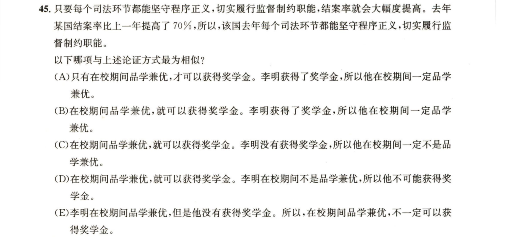

### 第 46 题

在东海大学研究生会举办的一次中国象棋比赛中，来自经济学院、管理学院、哲学学院、数学学院和化学学院的 5 名研究生（每个学院 1 名）相遇在一起，有关甲、乙、丙、丁、戊 5 名研究生之间的比赛信息满足以下条件：

（1） 甲与 2 名选手比赛过。
（2） 化学学院选手与 3 名选手比赛过。
(3) 乙不是管理学院的选手，也没有和管理学院的选手对阵过。
(4) 哲学学院选手和丙比赛过。
(5) 管理学院、哲学学院、数学学院的选手都相互交过手。
(6) 丁与 1 名选手比赛过。

根据以上条件，丙来自哪个学院？

- **A**．经济学院。
- **B**．管理学院。
- **C**．数学学院。
- **D**．哲学学院。
- **E**．化学学院。

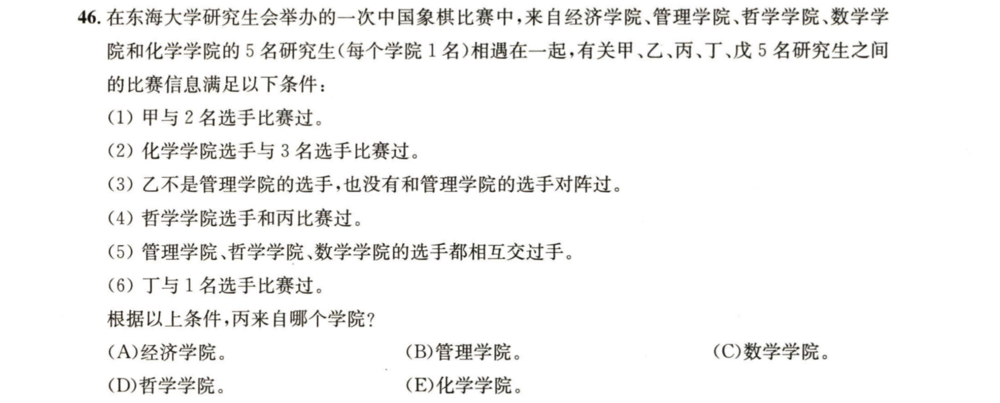

### 第 47 题

据统计，去年在某校参加高考的 385 名文、理科考生中，女生有 189 人，文科男生有 41 人，非应届男生有 28 人，应届理科考生有 256 人。

由此可见，去年在该校参加高考的考生中：

- **A**．非应届文科男生多于 20 人。
- **B**．应届理科女生少于 130 人。
- **C**．非应届文科男生少于 20 人。
- **D**．应届理科女生多于 130 人。
- **E**．应届理科男生多于 129 人。

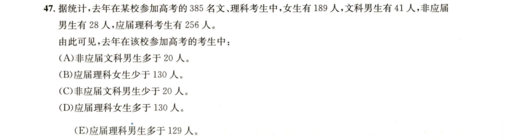

### 第 48 题

某公司人力资源管理部人士指出：由于本公司招聘职位有限，在本次招聘考试中不可能所有的应聘者都被录用。

基于以下哪项可以得出该人士的上述结论？

- **A**．在本次招聘考试中必然有应聘者被录用。
- **B**．在本次招聘考试中可能有应聘者被录用。
- **C**．在本次招聘考试中可能有应聘者不被录用。
- **D**．在本次招聘考试中必然有应聘者不被录用。
- **E**．在本次招聘考试中可能有应聘者被录用，可能有应聘者不被录用。

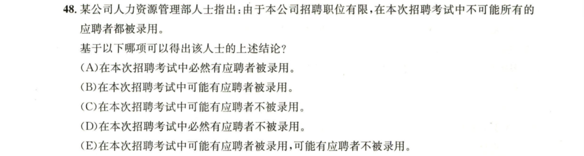

### 第 49 题

在某次综合性学术年会上，物理学会作学术报告的人都来自高校。化学学会作学术报告的有些来自高校，但是大部分来自中学，其他作学术报告的人均来自科学院。来自高校的学术报告者都具有副教授以上职称，来自中学的学术报告者都具有中教高级以上职称。李默、张嘉参加了这次综合性学术年会，李默并非来自中学，张嘉并非来自高校。

以上陈述如果为真，可以得出以下哪项结论？

- **A**．张嘉不是物理学会的。
- **B**．李默不是化学学会的。
- **C**．张嘉不具有副教授以上职称。
- **D**．李默如果作了学术报告，那么他不是化学学会的。
- **E**．张嘉如果作了学术报告，那么他不是物理学会的。

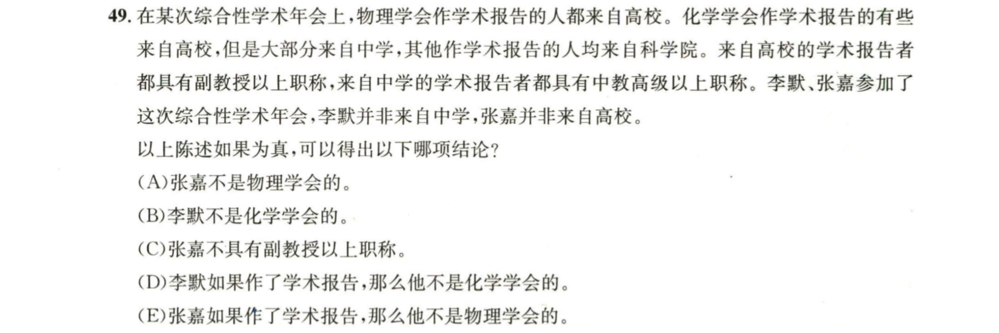

### 第 50 题

根据某位国际问题专家的调查统计可知：有的国家希望与某些国家结盟，有三个以上的国家不希望与某些国家结盟；至少有两个国家希望与每个国家建交，有的国家不希望与任一国家结盟。

根据上述统计可以得出以下哪项？

- **A**．每个国家都有一些国家希望与之建交。
- **B**．每个国家都有一些国家希望与之结盟。
- **C**．有些国家之间希望建交，但是不希望结盟。
- **D**．至少有一个国家，既有国家希望与之结盟，也有国家不希望与之结盟。
- **E**．至少有一个国家，既有国家希望与之建交，也有国家不希望与之建交。

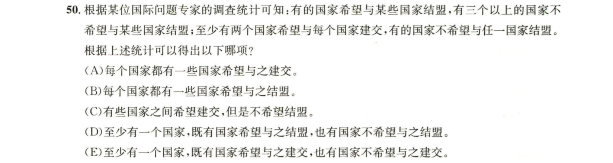

### 第 51 题

翠竹的大学同学都在某德资企业工作。溪兰是翠竹的大学同学，涧松是该德资企业的部门经理。该德资企业的员工有些来自淮安。该德资企业的员工都曾到德国研修，他们都会说德语。

以下哪项可以从以上陈述中得出？

- **A**．涧松来自淮安。
- **B**．溪兰会说德语。
- **C**．翠竹与涧松是大学同学。
- **D**．涧松与溪兰是大学同学。
- **E**．翠竹的大学同学有些是部门经理。

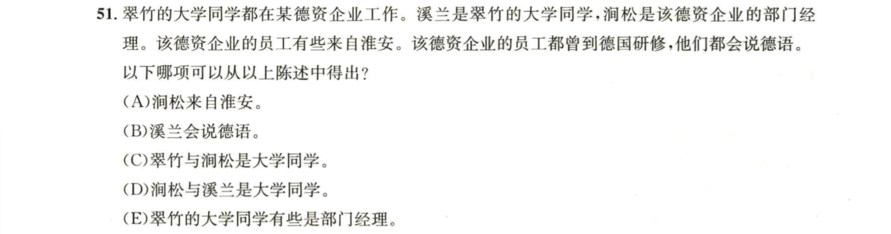

### 第 52 题

某组研究人员报告说：与心跳速度每分钟低于 58 次的人相比，心跳速度每分钟超过 78 次者心脏病发作或者发生其他心血管问题的概率高出 39%，死于这类疾病的风险高出 77%，其整体死亡率高出 65%。研究人员指出，长期心跳过速导致了心血管疾病。

以下哪项如果为真，最能对该研究人员的观点提出质疑？

- **A**．各种心血管疾病影响身体的血液循环机能，导致心跳过速。
- **B**．在老年人中，长期心跳过速的不到 39%。
- **C**．在老年人中，长期心跳过速的超过 39%。
- **D**．野外奔跑的兔子心跳很快，但是很少发现它们患心血管疾病。
- **E**．相对老年人，年轻人生命力旺盛，心跳较快。

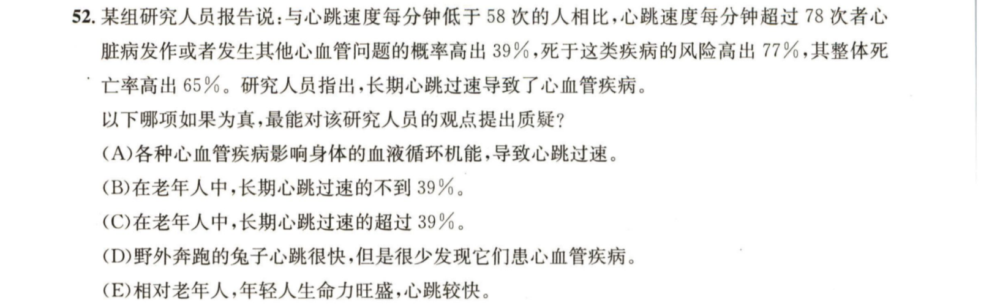

### 第 53 题

专业人士预测：如果粮食价格保持稳定，那么蔬菜价格也保持稳定；如果食用油价格不稳，那么蔬菜价格也将出现波动。老李由此断定：粮食价格保持稳定，但是肉类食品价格将上涨。

根据上述专业人士的预测，以下哪项如果为真，最能对老李的观点提出质疑？

- **A**．如果食用油价格稳定，那么肉类食品价格会上涨。
- **B**．如果食用油价格稳定，那么肉类食品价格不会上涨。
- **C**．如果肉类食品价格不上涨，那么食用油价格将会上涨。
- **D**．如果食用油价格出现波动，那么肉类食品价格不会上涨。
- **E**．只有食用油价格稳定，肉类食品价格才不会上涨。

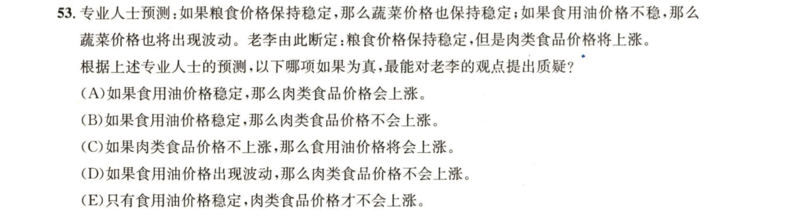

### 54~55 题基于以下题干

> 晨曦公园拟在园内东、南、西、北四个区域种植四种不同的特色树木，每个区域只种植一种。选定的特色树种为：水杉、银杏、乌柏和龙柏。布局的基本要求是：
> （1） 如果在东区或者南区种植银杏，那么在北区不能种植龙柏或乌柏。
> （2） 北区或东区要种植水杉或者银杏之一。

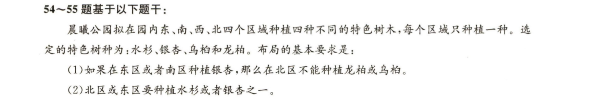

### 第 54 题

根据上述种植要求，如果北区种植龙柏，则以下哪项一定为真？

- **A**．西区种植水杉。
- **B**．南区种植乌柏。
- **C**．南区种植水杉。
- **D**．西区种植乌柏。
- **E**．东区种植乌柏。

### 第 55 题

根据上述种植要求，如果水杉必须种植于西区或南区，则以下哪项一定为真？

- **A**．南区种植水杉。
- **B**．西区种植水杉。
- **C**．东区种植银杏。
- **D**．北区种植银杏。
- **E**．南区种植乌柏。

---

## 四、写作（第 56-57 题，共 65 分）

### 第 56 题 · 论证有效性分析 (30 分)

**分析下述论证中存在的缺陷与漏洞，选择若干要点，写一篇 600 字左右的文章，对该论证的有效性进行分析和评论。**（论证有效性分析的一般要点是：概念特别是核心概念的界定和使用是否准确并前后一致，有无各种明显的逻辑错误，论证的论据是否成立并支持结论，结论成立的条件是否充分等。）

> 一个国家的文化在国际上的影响力是该国软实力的重要组成部分。由于软实力是评判一个国家国际地位的要素之一，所以如何增强软实力就成了各国政府高度关注的重大问题。
>
> 其实，这一问题不难解决。既然一个国家的文化在国际上的影响力是该国软实力的重要组成部分，那么，要增强软实力，只需搞好本国的文化建设并向世人展示就可以了。
>
> 文化有两个特性，一个是普同性，一个是特异性。所谓普同性，是指不同背景的文化具有相似的伦理道德和价值观念，如东方文化和西方文化都肯定善行，否定恶行；所谓特异性，是指不同背景的文化具有不同的思想意识和行为方式，如西方文化崇尚个人价值，东方文化固守集体意识。正因为文化具有普同性，所以一国文化就一定会被他国所接受；正因为文化具有特异性，所以一国文化就一定会被他国所关注。无论是接受还是关注，都体现了该国文化影响力的扩大，也即表明了该国软实力的增强。
>
> 文艺作品当然也具有文化的本质属性。一篇小说、一出歌剧、一部电影，等等，虽然一般以故事情节、人物形象、语言特色等艺术要素取胜，但在这些作品中，也往往肯定了一种生活方式，宣扬了一种价值观念。这种生活方式和价值观念不管是普同的还是特异的，都会被他国所接受或关注，都能产生文化影响力。由此可见，只要创作更多的具有本国文化特色的文艺作品，那么文化影响力的扩大就是毫无疑义的，而国家的软实力也必将同步增强。

### 第 57 题 · 论说文 (35 分)

**根据下述材料，写一篇 700 字左右的论说文，题目自拟。**

> 20 世纪中叶，美国的波音和麦道两家公司几乎垄断了世界民用飞机的市场，欧洲的飞机制造商深感忧虑。虽然欧洲各国之间的竞争也相当激烈，但还是采取了合作的途径，法国、德国、英国和西班牙等决定共同研制大型宽体飞机，于是“空中客车”便应运而生。面对新的市场竞争态势，波音公司和麦道公司于 1997 年一致决定组成新的波音公司，以抗衡来自欧洲的挑战。

