# 2014 年全国硕士研究生招生考试管理类专业学位联考综合能力试题 (199)

## 一、问题求解：第 1-15 小题，每小题 3 分，共 45 分。下列每题给出的 A、B、C、D、E 五个选项中，只有一项是符合试题要求的。请在答题卡上将所选的字母涂黑。

### 第 1 题

某部门在一次联欢活动中共设了 26 个奖，奖品均价为 280 元，其中一等奖单价为 400 元，其他奖品均价为 270 元，一等奖的个数为（ ）。

- **A**．6
- **B**．5
- **C**．4
- **D**．3
- **E**．2

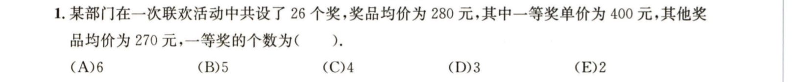

### 第 2 题

某单位进行办公室装修，若甲、乙两个装修公司合作，需 10 周完成，工时费为 100 万元；甲公司单独做 6 周后由乙公司接着做 18 周完成，工时费为 96 万元。甲公司每周的工时费为（ ）。

- **A**．7.5 万元
- **B**．7 万元
- **C**．6.5 万元
- **D**．6 万元
- **E**．5.5 万元

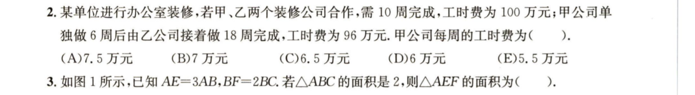

### 第 3 题

如图 1 所示，已知 $AE = 3AB, BF = 2BC$。若 $\triangle ABC$ 的面积是 2，则 $\triangle AEF$ 的面积为（ ）。

<svg xmlns="http://www.w3.org/2000/svg" viewBox="0 0 260 205" width="260" height="205" style="background: white; font-family: sans-serif;">
  <line x1="40" y1="150" x2="220" y2="150" stroke="#0f172a" stroke-width="2"/>
  <line x1="100" y1="150" x2="100" y2="40" stroke="#0f172a" stroke-width="2"/>
  <line x1="40" y1="150" x2="100" y2="95" stroke="#0f172a" stroke-width="2"/>
  <line x1="40" y1="150" x2="100" y2="40" stroke="#0f172a" stroke-width="2"/>
  <line x1="100" y1="40" x2="220" y2="150" stroke="#0f172a" stroke-width="2"/>
  <text x="28" y="156" font-size="14" font-style="italic" fill="#0f172a">A</text>
  <text x="96" y="168" font-size="14" font-style="italic" fill="#0f172a">B</text>
  <text x="226" y="156" font-size="14" font-style="italic" fill="#0f172a">E</text>
  <text x="108" y="98" font-size="14" font-style="italic" fill="#0f172a">C</text>
  <text x="95" y="30" font-size="14" font-style="italic" fill="#0f172a">F</text>
  <text x="116" y="195" font-size="13" font-weight="bold" fill="#0f172a">图 1</text>
</svg>

- **A**．14
- **B**．12
- **C**．10
- **D**．8
- **E**．6

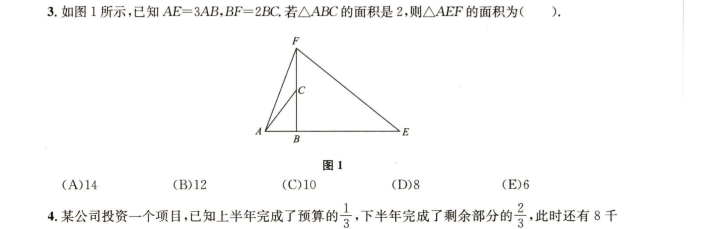

### 第 4 题

某公司投资一个项目，已知上半年完成了预算的 $\dfrac{1}{3}$，下半年完成了剩余部分的 $\dfrac{2}{3}$，此时还有 8 千万元投资未完成，则该项目的预算为（ ）。

- **A**．3 亿元
- **B**．3.6 亿元
- **C**．3.9 亿元
- **D**．4.5 亿元
- **E**．5.1 亿元

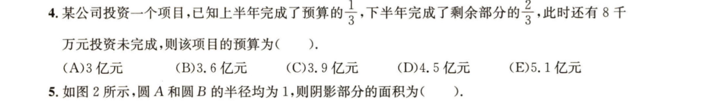

### 第 5 题

如图 2 所示，圆 $A$ 和圆 $B$ 的半径均为 1，则阴影部分的面积为（ ）。

<svg xmlns="http://www.w3.org/2000/svg" viewBox="0 0 260 190" width="260" height="190" style="background: white; font-family: sans-serif;">
  <path d="M 130 28 A 60 60 0 0 1 130 132 A 60 60 0 0 1 130 28 Z" fill="#cbd5e1" stroke="#0f172a" stroke-width="2"/>
  <circle cx="100" cy="80" r="60" fill="none" stroke="#0f172a" stroke-width="2"/>
  <circle cx="160" cy="80" r="60" fill="none" stroke="#0f172a" stroke-width="2"/>
  <text x="88" y="85" font-size="14" font-style="italic" fill="#0f172a">A</text>
  <text x="165" y="85" font-size="14" font-style="italic" fill="#0f172a">B</text>
  <text x="116" y="178" font-size="13" font-weight="bold" fill="#0f172a">图 2</text>
</svg>

- **A**．$\dfrac{2}{3}\pi$
- **B**．$\dfrac{\sqrt{3}}{2}$
- **C**．$\dfrac{\pi}{3} - \dfrac{\sqrt{3}}{4}$
- **D**．$\dfrac{2\pi}{3} - \dfrac{\sqrt{3}}{4}$
- **E**．$\dfrac{2\pi}{3} - \dfrac{\sqrt{3}}{2}$

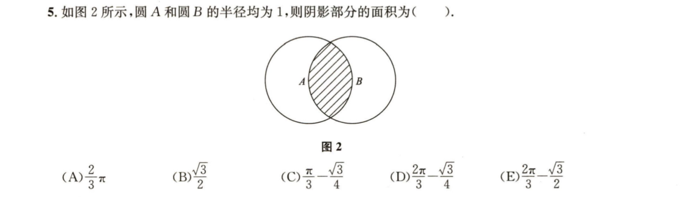

### 第 6 题

某容器中装满了浓度为 90% 的酒精，倒出 1 升后用水将容器注满，搅拌均匀后又倒出 1 升，再用水将容器注满，已知此时的酒精浓度为 40%，则该容器的容积是（ ）。

- **A**．2.5 升
- **B**．3 升
- **C**．3.5 升
- **D**．4 升
- **E**．4.5 升

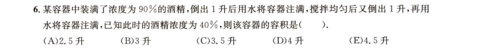

### 第 7 题

已知 $\{a_n\}$ 为等差数列，且 $a_2 - a_5 + a_8 = 9$，则 $a_1 + a_2 + \dots + a_9 = $（ ）。

- **A**．27
- **B**．45
- **C**．54
- **D**．81
- **E**．162

### 第 8 题

甲、乙两人上午 8:00 分别自 $A, B$ 出发相向而行，9:00 第一次相遇，之后速度均提高了 1.5 公里/小时，甲到 $B$、乙到 $A$ 后都立刻沿原路返回。若两人在 10:30 第二次相遇，则 $A, B$ 两地的距离为（ ）。

- **A**．5.6 公里
- **B**．7 公里
- **C**．8 公里
- **D**．9 公里
- **E**．9.5 公里

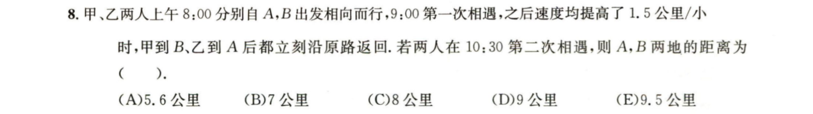

### 第 9 题

掷一枚均匀的硬币若干次，当正面向上次数大于反面向上次数时停止，则在 4 次之内停止的概率为（ ）。

- **A**．$\dfrac{1}{8}$
- **B**．$\dfrac{3}{8}$
- **C**．$\dfrac{5}{8}$
- **D**．$\dfrac{3}{16}$
- **E**．$\dfrac{5}{16}$

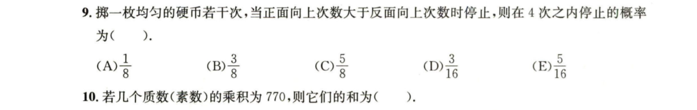

### 第 10 题

若几个质数（素数）的乘积为 770，则它们的和为（ ）。

- **A**．85
- **B**．84
- **C**．28
- **D**．26
- **E**．25

### 第 11 题

已知直线 $l$ 是圆 $x^2 + y^2 = 5$ 在点 $(1, 2)$ 处的切线，则 $l$ 在 $y$ 轴上的截距为（ ）。

- **A**．$\dfrac{2}{5}$
- **B**．$\dfrac{2}{3}$
- **C**．$\dfrac{3}{2}$
- **D**．$\dfrac{5}{2}$
- **E**．5

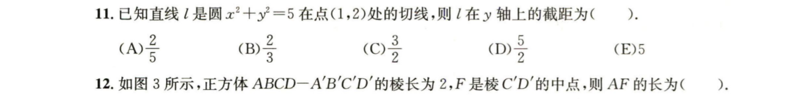

### 第 12 题

如图 3 所示，正方体 $ABCD-A'B'C'D'$ 的棱长为 2，$F$ 是棱 $C'D'$ 的中点，则 $AF$ 的长为（ ）。

<svg xmlns="http://www.w3.org/2000/svg" viewBox="0 0 250 220" width="250" height="220" style="background: white; font-family: sans-serif;">
  <polygon points="50,170 160,170 160,60 50,60" fill="none" stroke="#0f172a" stroke-width="2"/>
  <polygon points="50,60 100,25 210,25 160,60" fill="none" stroke="#0f172a" stroke-width="2"/>
  <polygon points="160,60 210,25 210,135 160,170" fill="none" stroke="#0f172a" stroke-width="2"/>
  <line x1="50" y1="170" x2="100" y2="135" stroke="#0f172a" stroke-width="1.8" stroke-dasharray="4,4"/>
  <line x1="100" y1="135" x2="210" y2="135" stroke="#0f172a" stroke-width="1.8" stroke-dasharray="4,4"/>
  <line x1="100" y1="135" x2="100" y2="25" stroke="#0f172a" stroke-width="1.8" stroke-dasharray="4,4"/>
  <line x1="50" y1="170" x2="155" y2="25" stroke="#0f172a" stroke-width="2" stroke-dasharray="4,4"/>
  <text x="35" y="180" font-size="14" font-style="italic" fill="#0f172a">A</text>
  <text x="165" y="182" font-size="14" font-style="italic" fill="#0f172a">B</text>
  <text x="216" y="142" font-size="14" font-style="italic" fill="#0f172a">C</text>
  <text x="106" y="150" font-size="14" font-style="italic" fill="#0f172a">D</text>
  <text x="30" y="62" font-size="14" font-style="italic" fill="#0f172a">A&apos;</text>
  <text x="168" y="65" font-size="14" font-style="italic" fill="#0f172a">B&apos;</text>
  <text x="215" y="24" font-size="14" font-style="italic" fill="#0f172a">C&apos;</text>
  <text x="90" y="18" font-size="14" font-style="italic" fill="#0f172a">D&apos;</text>
  <text x="152" y="18" font-size="14" font-style="italic" fill="#0f172a">F</text>
  <text x="110" y="208" font-size="13" font-weight="bold" fill="#0f172a">图 3</text>
</svg>

- **A**．3
- **B**．5
- **C**．$\sqrt{5}$
- **D**．$2\sqrt{2}$
- **E**．$2\sqrt{3}$

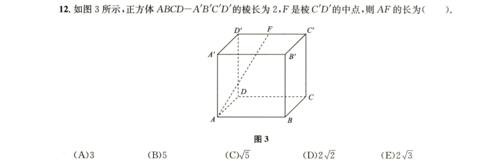

### 第 13 题

在某项活动中，将 3 男 3 女 6 名志愿者随机地分成甲、乙、丙三组，每组 2 人，则每组志愿者都是异性的概率为（ ）。

- **A**．$\dfrac{1}{90}$
- **B**．$\dfrac{1}{15}$
- **C**．$\dfrac{1}{10}$
- **D**．$\dfrac{1}{5}$
- **E**．$\dfrac{2}{5}$

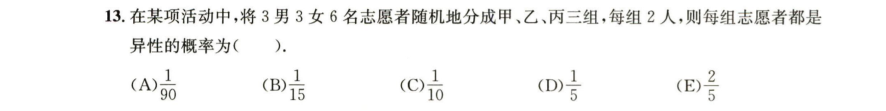

### 第 14 题

某工厂在半径为 5 厘米的球形工艺品上镀一层装饰金属，厚度为 0.01 厘米，已知装饰金属的原材料是棱长为 20 厘米的正方体锭子，则加工 10 000 个该工艺品需要的锭子数最少为（ ）个（不考虑加工损耗，$\pi \approx 3.14$）。

- **A**．2
- **B**．3
- **C**．4
- **D**．5
- **E**．20

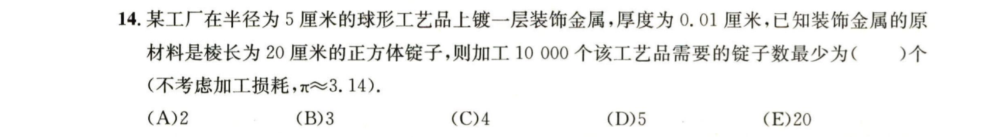

### 第 15 题

某单位决定对 4 个部门的经理进行轮岗，要求每位经理必须轮换到 4 个部门中的其他部门任职，则不同的方案有（ ）。

- **A**．3 种
- **B**．6 种
- **C**．8 种
- **D**．9 种
- **E**．10 种

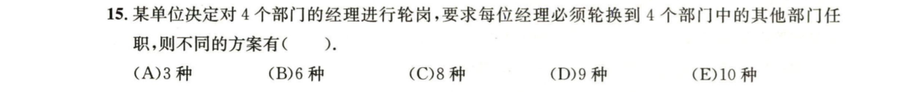

## 二、条件充分性判断：第 16～25 小题，每小题 3 分，共 30 分。要求判断每题给出的条件（1）和（2）能否充分支持题干所陈述的结论。A、B、C、D、E 五个选项为判断结果，请选择一项符合试题要求的判断，在答题卡上将所选项涂黑。

### 解题说明：
- **A**．条件（1）充分，但条件（2）不充分
- **B**．条件（2）充分，但条件（1）不充分
- **C**．条件（1）和（2）单独都不充分，但条件（1）和条件（2）联合起来充分
- **D**．条件（1）充分，条件（2）也充分
- **E**．条件（1）和（2）单独都不充分，条件（1）和条件（2）联合起来也不充分

### 第 16 题

已知曲线 $l: y = a + bx - 6x^2 + x^3$，则 $(a+b-5)(a-b-5) = 0$。

（1）曲线 $l$ 过点 $(1, 0)$。
（2）曲线 $l$ 过点 $(-1, 0)$。

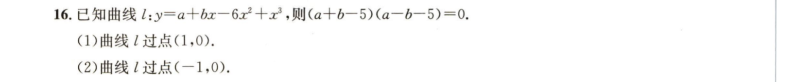

### 第 17 题

不等式 $|x^2 + 2x + a| \le 1$ 的解集为空集。

（1）$a < 0$。
（2）$a > 2$。

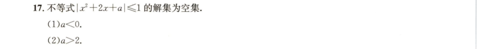

### 第 18 题

甲、乙、丙三人的年龄相同。

（1）甲、乙、丙的年龄成等差数列。
（2）甲、乙、丙的年龄成等比数列。

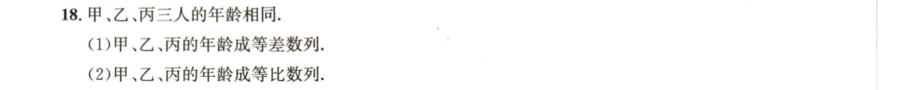

### 第 19 题

设 $x$ 是非零实数，则 $\dfrac{1}{x^3} + x^3 = 18$。

（1）$\dfrac{1}{x} + x = 3$。
（2）$\dfrac{1}{x^2} + x^2 = 7$。

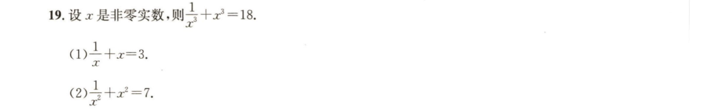

### 第 20 题

如图 4 所示，$O$ 是半圆的圆心，$C$ 是半圆上的一点，$OD \perp AC$，则能确定 $OD$ 的长。

<svg xmlns="http://www.w3.org/2000/svg" viewBox="0 0 230 170" width="230" height="170" style="background: white; font-family: sans-serif;">
  <path d="M 30 120 A 80 80 0 0 1 190 120" fill="none" stroke="#0f172a" stroke-width="2"/>
  <line x1="30" y1="120" x2="190" y2="120" stroke="#0f172a" stroke-width="2"/>
  <line x1="30" y1="120" x2="156" y2="55" stroke="#0f172a" stroke-width="2"/>
  <line x1="190" y1="120" x2="156" y2="55" stroke="#0f172a" stroke-width="2"/>
  <line x1="110" y1="120" x2="93" y2="87" stroke="#0f172a" stroke-width="2"/>
  <circle cx="30" cy="120" r="3" fill="#0f172a"/>
  <circle cx="110" cy="120" r="3" fill="#0f172a"/>
  <circle cx="190" cy="120" r="3" fill="#0f172a"/>
  <circle cx="156" cy="55" r="3" fill="#0f172a"/>
  <circle cx="93" cy="87" r="3" fill="#0f172a"/>
  <text x="16" y="125" font-size="14" font-style="italic" fill="#0f172a">A</text>
  <text x="115" y="115" font-size="14" font-style="italic" fill="#0f172a">O</text>
  <text x="196" y="125" font-size="14" font-style="italic" fill="#0f172a">B</text>
  <text x="158" y="46" font-size="14" font-style="italic" fill="#0f172a">C</text>
  <text x="86" y="76" font-size="14" font-style="italic" fill="#0f172a">D</text>
  <text x="100" y="156" font-size="13" font-weight="bold" fill="#0f172a">图 4</text>
</svg>

（1）已知 $BC$ 的长。
（2）已知 $AO$ 的长。

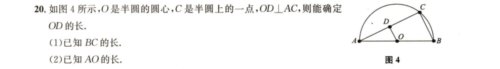

### 第 21 题

方程 $x^2 + 2(a+b)x + c^2 = 0$ 有实根。

（1）$a, b, c$ 是一个三角形的三边长。
（2）实数 $a, c, b$ 成等差数列。

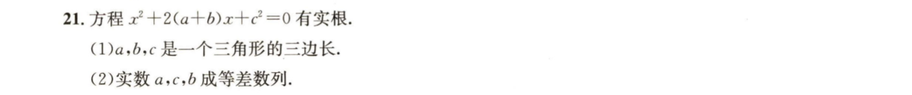

### 第 22 题

已知二次函数 $f(x) = ax^2 + bx + c$，则能确定 $a, b, c$ 的值。

（1）曲线 $y = f(x)$ 经过点 $(0, 0)$ 和点 $(1, 1)$。
（2）曲线 $y = f(x)$ 与直线 $y = a + b$ 相切。

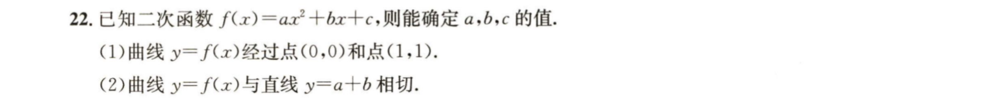

### 第 23 题

已知袋中装有红、黑、白三种颜色的球若干个，则红球最多。

（1）随机取出的一球是白球的概率为 $\dfrac{2}{5}$。
（2）随机取出的两球中至少有一个黑球的概率小于 $\dfrac{1}{5}$。

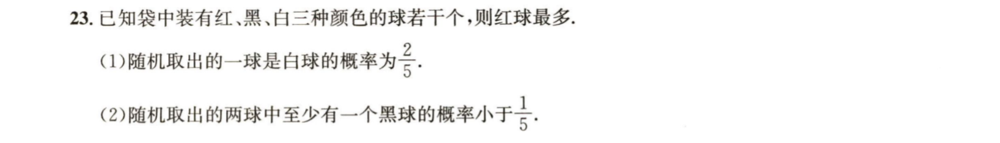

### 第 24 题

已知 $M = \{a, b, c, d, e\}$ 是一个整数集合，则能确定集合 $M$。

（1）$a, b, c, d, e$ 的平均值为 10。
（2）$a, b, c, d, e$ 的方差为 2。

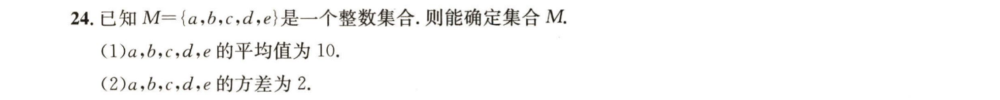

### 第 25 题

已知 $x, y$ 为实数，则 $x^2 + y^2 \ge 1$。

（1）$4y - 3x \ge 5$。
（2）$(x-1)^2 + (y-1)^2 \ge 5$。

---

## 三、逻辑推理（第 26-55 题，每小题 2 分，共 60 分）

### 第 26 题

随着光纤网络带来的网速大幅度提高，高速下载电影、在线看大片等都不再是困扰我们的问题。即使在社会生产力发展水平较低的国家，人们也可以通过网络随时随地获得最快的信息、最贴心的服务和最佳体验。有专家据此认为：光纤网络将大幅度提高人们的生活质量。
以下哪项如果为真，最能质疑该专家的观点？

- **A**．网络上所获得的贴心服务和美妙体验有时是虚幻的。
- **B**．即使没有光纤网络，同样可以创造高品质的生活。
- **C**．随着高速网络的普及，相关上网费用也随之增加。
- **D**．人们生活质量的提高仅决定于社会生产力的发展水平。
- **E**．快捷的网络服务可能使人们将大量时间消耗在娱乐上。

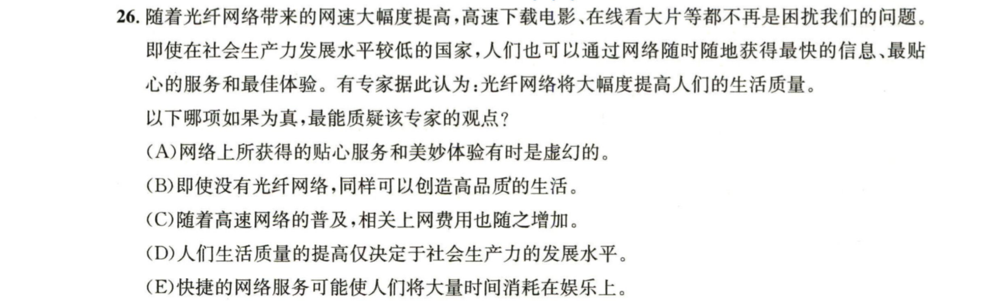

### 第 27 题

李栋善于辩论，也喜欢诡辩。有一次他论证道：“郑强知道数字 87654321，陈梅家的电话号码正好是 87654321，所以郑强知道陈梅家的电话号码。”
以下哪项与李栋论证中所犯的错误最为类似？

- **A**．中国人是勤劳勇敢的，李岚是中国人，所以李岚是勤劳勇敢的。
- **B**．金砖是由原子组成的，原子不是肉眼可见的，所以金砖不是肉眼可见的。
- **C**．黄兵相信晨星在早晨出现，而晨星其实就是暮星，所以黄兵相信暮星在早晨出现。
- **D**．张冉知道如果 1:0 的比分保持到终场，他们的队伍就会出线，现在张冉听到了比赛结束的哨声，所以张冉知道他们的队伍出线了。
- **E**．所有蚂蚁都是动物，所以所有大蚂蚁都是大动物。

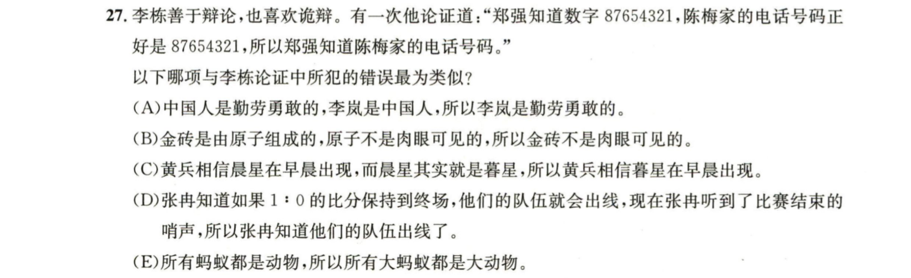

### 第 28 题

陈先生在鼓励他孩子时说道：“不要害怕暂时的困难和挫折，不经历风雨怎么见彩虹？”他孩子不服气地说：“您说的不对。我经历了那么多风雨，怎么就没见到彩虹呢？”
陈先生孩子的回答最适宜用来反驳以下哪项？

- **A**．如果想见到彩虹，就必须经历风雨。
- **B**．只要经历了风雨，就可以见到彩虹。
- **C**．只有经历风雨，才能见到彩虹。
- **D**．即使经历了风雨，也可能见不到彩虹。
- **E**．即使见到了彩虹，也不是因为经历了风雨。

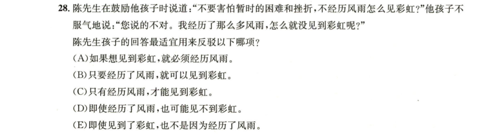

### 第 29 题

在某次考试中，有 3 个关于北京旅游景点的问题，要求考生每题选择某个景点的名称作为唯一答案。其中 6 位考生关于上述 3 个问题的答案依次如下：
第一位考生：天坛、天坛、天安门；
第二位考生：天安门、天安门、天坛；
第三位考生：故宫、故宫、天坛；
第四位考生：天坛、天安门、故宫；
第五位考生：天安门、故宫、天安门；
第六位考生：故宫、天安门、故宫；
考试结果表明每位考生都至少答对其中 1 道题。
根据以上陈述，可知这 3 个问题的答案依次是：

- **A**．天坛、故宫、天坛。
- **B**．故宫、天安门、天安门。
- **C**．天安门、故宫、天坛。
- **D**．天坛、天坛、故宫。
- **E**．故宫、故宫、天坛。

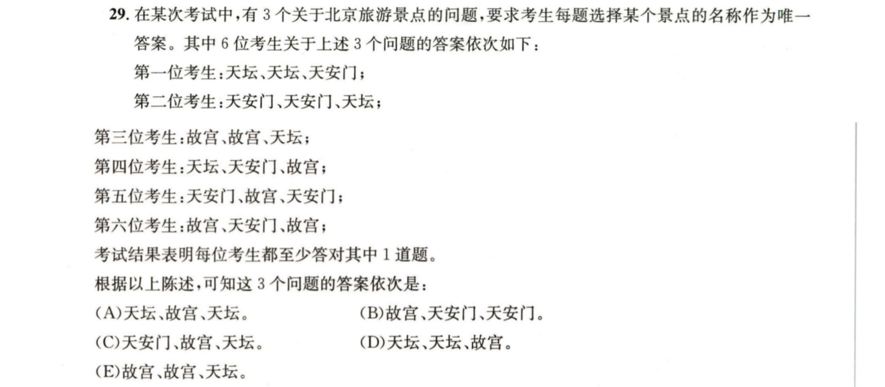

### 第 30 题

人们普遍认为适量的体育运动能够有效降低中风的发生率，但科学家还注意到有些化学物质也有降低中风风险的效用。番茄红素是一种让番茄、辣椒、西瓜和番木瓜等蔬果呈现红色的化学物质。研究人员选取一千余名年龄在 46~55 岁之间的人，进行了长达 12 年的跟踪调查，发现其中番茄红素水平最高的四分之一的人中有 11 人中风，番茄红素水平最低的四分之一的人中有 25 人中风。他们由此得出结论：番茄红素能降低中风的发生率。
以下哪项如果为真，最能对上述研究结论提出质疑？

- **A**．番茄红素水平较低的中风者中有三分之一的人病情较轻。
- **B**．吸烟、高血压和糖尿病等会诱发中风。
- **C**．如果调查 56~65 岁之间的人，情况也许不同。
- **D**．番茄红素水平高的人中约有四分之一喜爱进行适量的体育运动。
- **E**．被跟踪的另一半人中有 50 人中风。

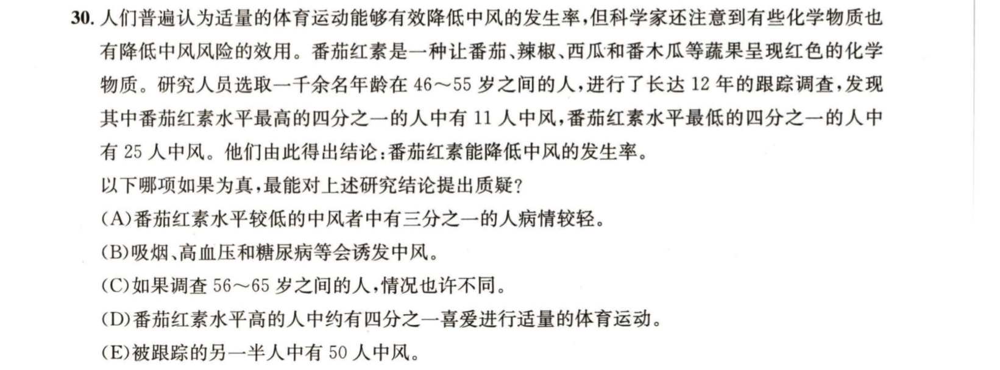

### 第 31 题

最新研究发现，恐龙腿骨化石都有一定的弯曲度，这意味着恐龙其实并没有人们想象的那么重。以前根据其腿骨为圆柱形的假定计算动物体重时，会使得计算结果比实际体重高出 1.42 倍。科学家由此认为，过去那种计算方式高估了恐龙腿部所能承受的最大身体重量。
以下哪项如果为真，最能支持上述科学家的观点？

- **A**．恐龙腿骨所能承受的重量比之前人们所认为的要大。
- **B**．恐龙身体越重，其腿部骨骼也越粗壮。
- **C**．圆柱形腿骨能承受的重量比弯曲的腿骨大。
- **D**．恐龙腿部的肌肉对于支撑其体重作用不大。
- **E**．与陆地上的恐龙相比，翼龙的腿骨更接近圆柱形。

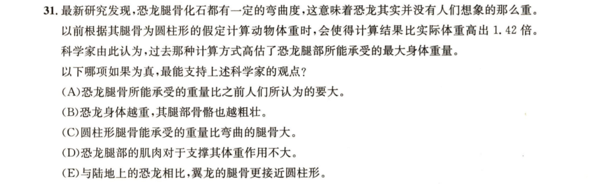

### 第 32 题

已知某班共有 25 位同学，女生中身高最高者与最低者相差 10 厘米，男生中身高最高者与最低者相差 15 厘米。小明认为，根据已知信息，只要再知道男生、女生最高者的具体身高，或者再知道男生、女生的平均身高，均可确定全班同学中身高最高者与最低者之间的差距。
以下哪项如果为真，最能构成对小明观点的反驳？

- **A**．根据已知信息，如果不能确定全班同学中身高最高者与最低者之间的差距，则也不能确定男生、女生身高最高者的具体身高。
- **B**．根据已知信息，即使确定了全班同学中身高最高者与最低者之间的差距，也不能确定男生、女生的平均身高。
- **C**．根据已知信息，如果不能确定全班同学中身高最高者与最低者之间的差距，则既不能确定男生、女生身高最高者的具体身高，也不能确定男生、女生的平均身高。
- **D**．根据已知信息，尽管再知道男生、女生的平均身高，也不能确定全班同学中身高最高者与最低者之间的差距。
- **E**．根据已知信息，仅仅再知道男生、女生最高者的具体身高，就能确定全班同学中身高最高者与最低者之间的差距。

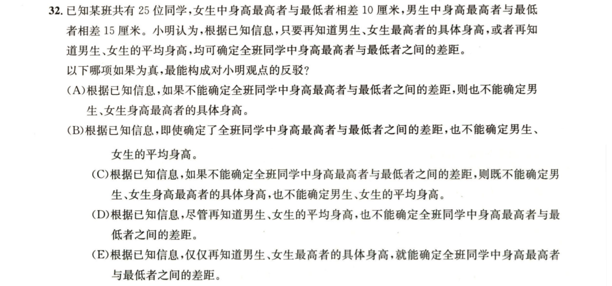

### 第 33 题

近 10 年来，某电脑公司的个人笔记本电脑的销量持续增长，但其增长率低于该公司所有产品总销量的增长率。
以下哪项关于该公司的陈述与上述信息相冲突？

- **A**．近 10 年来，该公司个人笔记本电脑的销量每年略有增长。
- **B**．个人笔记本电脑的销量占该公司产品总销量的比例近 10 年来由 68% 上升到 72%。
- **C**．近 10 年来，该公司产品总销量增长率与个人笔记本电脑的销量增长率每年同时增长。
- **D**．近 10 年来，该公司个人笔记本电脑的销量占该公司产品总销量的比例逐年下降。
- **E**．个人笔记本电脑的销量占该公司产品总销量的比例近 10 年来由 64% 下降到 49%。

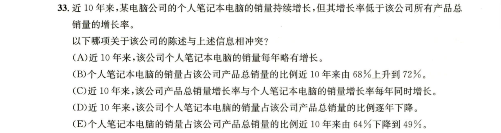

### 第 34 题

学者张某说：“问题本身并不神秘，因与果不仅是哲学家的事。每个凡夫俗子一生之中都将面临许多问题，但分析问题的方法与技巧却很少有人掌握，无怪乎华尔街的分析大师们趾高气扬、身价百倍。”
以下哪项如果为真，最能反驳张某的观点？

- **A**．有些凡夫俗子可能不需要掌握分析问题的方法与技巧。
- **B**．有些凡夫俗子一生之中将要面临的问题并不多。
- **C**．凡夫俗子之中很少有人掌握分析问题的方法与技巧。
- **D**．掌握分析问题的方法与技巧对多数人来说很重要。
- **E**．华尔街的分析大师们大都掌握分析问题的方法与技巧。

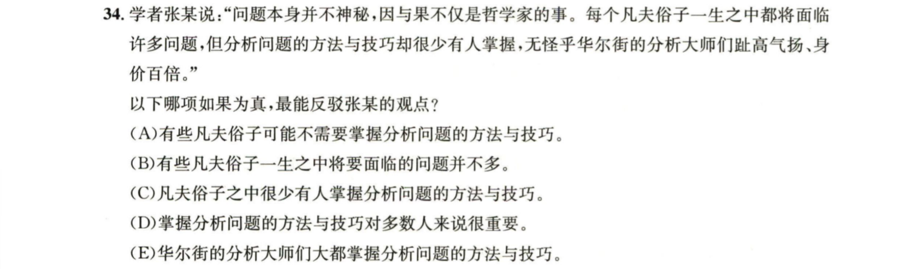

### 第 35 题

实验发现，孕妇适当补充维生素 D 可降低新生儿感染呼吸道合胞病毒的风险。科研人员检测了 156 名新生儿脐带血中维生素 D 的含量，其中 54% 的新生儿被诊断为维生素 D 缺乏，这当中有 12% 的孩子在出生后一年内感染了呼吸道合胞病毒，这一比例远高于维生素 D 正常的孩子。
以下哪项如果为真，最能对科研人员的上述发现提供支持？

- **A**．上述实验中，54% 的新生儿维生素 D 缺乏是由于他们的母亲在妊娠期间没有补充足够的维生素 D 造成的。
- **B**．孕妇适当补充维生素 D 可降低新生儿感染流感病毒的风险，特别是在妊娠后期补充维生素 D，预防效果会更好。
- **C**．上述实验中，46% 补充维生素 D 的孕妇所生的新生儿也有一些在出生一年内感染呼吸道合胞病毒。
- **D**．科研人员实验时所选的新生儿在其他方面跟一般新生儿的相似性没有得到明确验证。
- **E**．维生素 D 具有多种防病健体功能，其中包括提高免疫系统功能、促进新生儿呼吸系统发育、预防新生儿呼吸道病毒感染等。

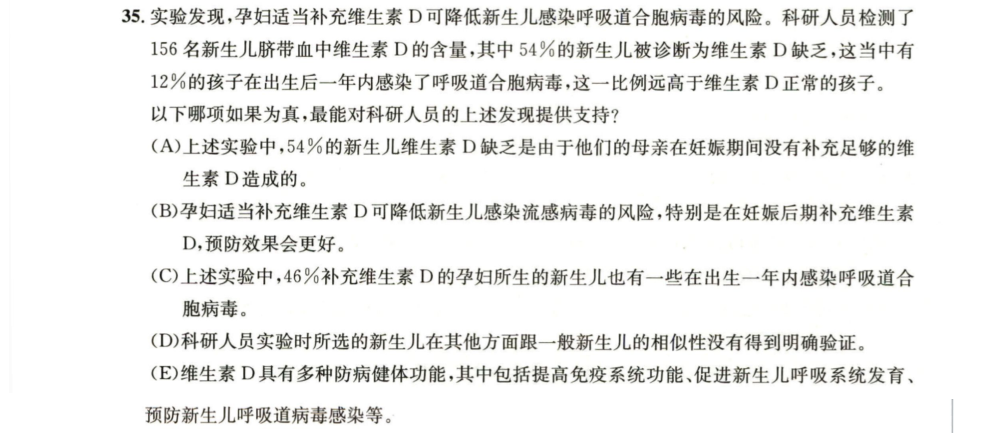

### 第 36 题

英国有家小酒馆采取客人吃饭付费“随便给”的做法，即让顾客享用葡萄酒、蟹柳及三文鱼等美食后，自己决定付账金额。大多数顾客均以公平或慷慨的态度结账，实际金额比那些酒水、菜肴本来的价格高出 20%。该酒馆老板另有 4 家酒馆，而这 4 家酒馆每周的利润与付账“随便给”的酒馆相比少 5%。这位老板因此认为，“随便给”的营销策略很成功。
以下哪项如果为真，最能解释老板营销策略的成功？

- **A**．部分顾客希望自己看上去有教养，愿意掏足够甚至更多的钱。
- **B**．如果客人支付低于成本价格，就会受到提醒而补足差价。
- **C**．另外 4 家酒馆的位置不如这家“随便给”酒馆。
- **D**．客人常常不知道酒水、菜肴的实际价格，不知道该付多少钱。
- **E**．对于过分吝啬的顾客，酒馆老板常常也无可奈何。

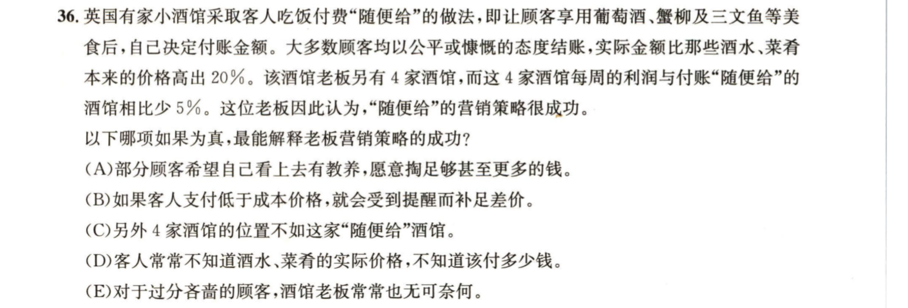

### 37~38 题基于以下题干

> 某公司年度审计期间，审计人员发现一张发票，上面有赵义、钱仁礼、孙智、李信 4 个签名，签名者的身份各不相同，是经办人、复核、出纳或审批领导之中的一个，且每个签名都是本人所签。询问四位相关人员，得到以下答案：
> 赵义：“审批领导的签名不是钱仁礼。”
> 钱仁礼：“复核的签名不是李信。”
> 孙智：“出纳的签名不是赵义。”
> 李信：“复核的签名不是钱仁礼。”
> 已知上述每个回答中，如果提到的人是经办人，则该回答为假；如果提到的人不是经办人，则为真。

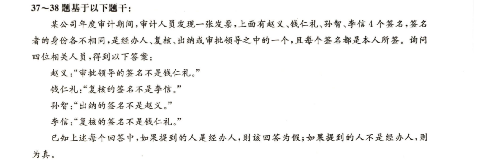

### 第 37 题

根据以上信息，可以得出经办人是：

- **A**．赵义。
- **B**．钱仁礼。
- **C**．孙智。
- **D**．李信。
- **E**．无法确定。

### 第 38 题

根据以上信息，该公司的复核与出纳分别是：

- **A**．李信、赵义。
- **B**．孙智、赵义。
- **C**．钱仁礼、李信。
- **D**．赵义、钱仁礼。
- **E**．孙智、李信。

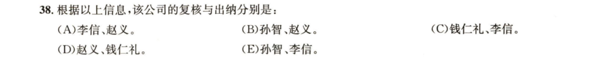

### 第 39 题

长期以来，人们认为地球是已知唯一能支持生命存在的星球，不过这一情况开始出现改观。科学家近期指出，在其他恒星周围，可能还存在着更加宜居的行星，他们尝试用崭新的方法开展地外生命搜索，即搜寻放射性元素钍和铀。行星内部含有这些元素越多，其内部温度就会越高，这在一定程度上有助于行星的板块运动，而板块运动有助于维系行星表面的水体，因此，板块运动可被视为行星存在宜居环境的标志之一。
以下哪项最可能是科学家的假设？

- **A**．行星如能维系水体，就可能存在生命。
- **B**．行星板块运动都是由放射性元素钍和铀驱动的。
- **C**．行星内部温度越高，越有助于它的板块运动。
- **D**．没有水的行星也可能存在生命。
- **E**．虽然尚未证实，但地外生命一定存在。

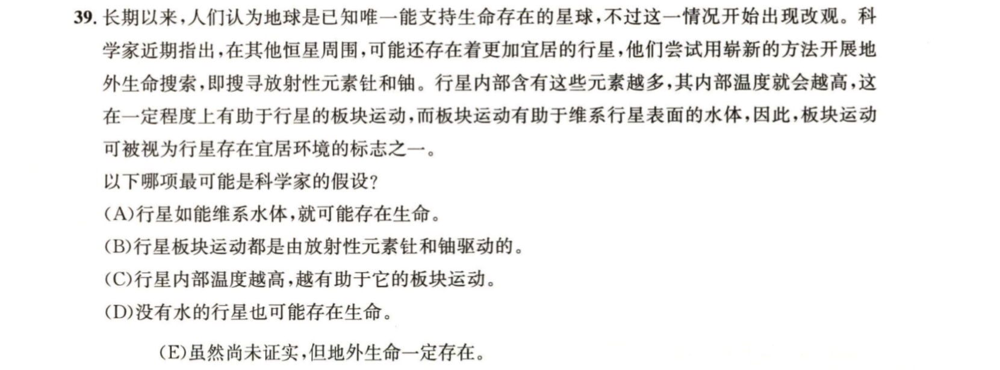

### 第 40 题

为了加强学习型机关建设，某机关党委开展了菜单式学习活动，拟开设课程有“行政学”“管理学”“科学前沿”“逻辑”和“国际政治”5 门课程，要求其下属的 4 个支部各选择其中两门课程进行学习。
已知：第一支部没有选择“管理学”“逻辑”，第二支部没有选择“行政学”“国际政治”，只有第三支部选择了“科学前沿”。任意两个支部所选课程均不完全相同。
根据上述信息，关于第四支部的选课情况可以得出以下哪项？

- **A**．如果没有选择“行政学”，那么选择了“管理学”。
- **B**．如果没有选择“管理学”，那么选择了“国际政治”。
- **C**．如果没有选择“行政学”，那么选择了“逻辑”。
- **D**．如果没有选择“管理学”，那么选择了“逻辑”。
- **E**．如果没有选择“国际政治”，那么选择了“逻辑”。

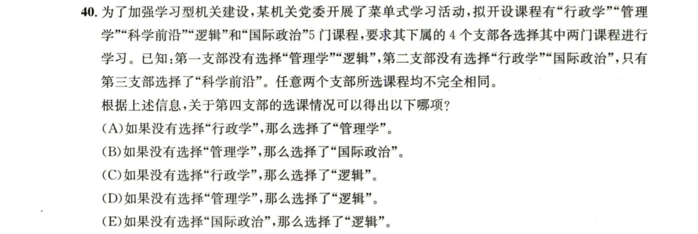

### 第 41 题

有气象专家指出，全球变暖已经成为人类发展最严重的问题之一，南北极地区的冰川由于全球变暖而加速融化，已导致海平面上升；如果这一趋势不变，今后势必淹没很多地区。但近几年来，北半球许多地区的民众在冬季感到相当寒冷，一些地区甚至出现了超强降雪和超低气温，人们觉得对近期气候的确切描述似乎更应该是“全球变冷”。
以下哪项如果为真，最能解释上述现象？

- **A**．除了南极洲，南半球近几年冬季的平均温度接近常年。
- **B**．近几年来，全球夏季的平均气温比常年偏高。
- **C**．近几年来，由于两极附近海水温度升高导致原来洋流中断或者减弱，而北半球经历严寒冬季的地区正是原来暖流影响的主要区域。
- **D**．近几年来，由于赤道附近海水温度升高导致了原来洋流增强，而北半球经历严寒冬季的地区不是原来寒流影响的主要区域。
- **E**．北半球主要是大陆性气候，冬季和夏季的温差通常比较大，近年来冬季极地寒流南侵比较频繁。

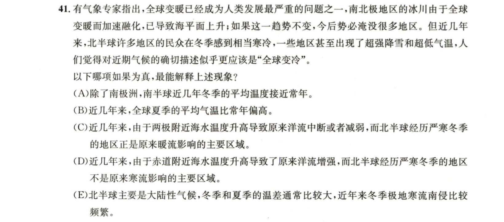

### 第 42 题

这两个《通知》或者属于规章或者属于规范性文件，任何人均无权依据这两个《通知》将本来属于当事人选择公证的事项规定为强制公证的事项。
根据以上信息，可以得出以下哪项？

- **A**．规章或者规范性文件既不是法律，也不是行政法规。
- **B**．规章或规范性文件或者不是法律，或者不是行政法规。
- **C**．这两个《通知》如果一个属于规章，那么另一个属于规范性文件。
- **D**．这两个《通知》如果都不属于规范性文件，那么就属于规章。
- **E**．将本来属于当事人选择公证的事项规定为强制公证的事项属于违法行为。

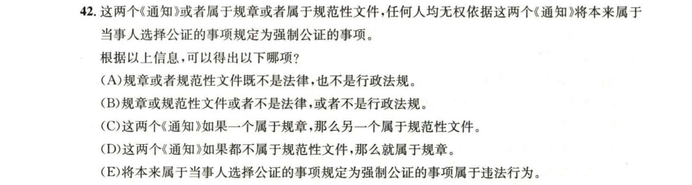

### 第 43 题

若一个管理者是某领域优秀的专家学者，则他一定会管理好公司的基本事务；一位品行端正的管理者可以得到下属的尊重；但是对所有领域都一知半解的人一定不会得到下属的尊重。浩瀚公司董事会只会解除那些没有管理好公司基本事务者的职务。
根据以上信息，可以得出以下哪项？

- **A**．浩瀚公司董事会不可能解除品行端正的管理者的职务。
- **B**．浩瀚公司董事会解除了某些管理者的职务。
- **C**．浩瀚公司董事会不可能解除受下属尊重的管理者的职务。
- **D**．作为某领域优秀专家学者的管理者，不可能被浩瀚公司董事会解除职务。
- **E**．对所有领域都一知半解的管理者，一定会被浩瀚公司董事会解除职务。

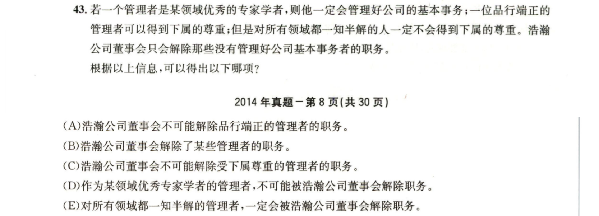

### 第 44 题

某国大选在即，国际政治专家陈研究员预测：选举结果或者是甲党控制政府，或者是乙党控制政府。如果甲党赢得对政府的控制权，该国将出现经济问题；如果乙党赢得对政府的控制权，该国将陷入军事危机。
根据陈研究员的上述预测，可以得出以下哪项？

- **A**．该国可能不会出现经济问题，也不会陷入军事危机。
- **B**．如果该国出现经济问题，那么甲党赢得了对政府的控制权。
- **C**．该国将出现经济问题，或者将陷入军事危机。
- **D**．如果该国陷入了军事危机，那么乙党赢得了对政府的控制权。
- **E**．如果该国出现了经济问题并且陷入了军事危机，那么甲党与乙党均赢得了对政府的控制权。

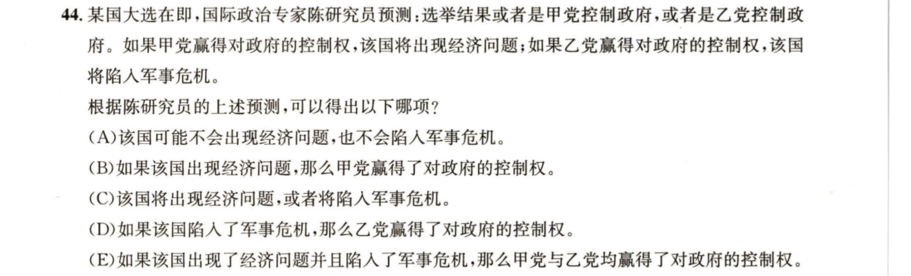

### 第 45 题

某大学顾老师在回答有关招生问题时强调：“我们学校招收一部分免费师范生，也招收一部分一般师范生。一般师范生不同于免费师范生。没有免费师范生毕业时可以留在大城市工作，而一般师范生毕业时都可以选择留在大城市工作，任何非免费师范生毕业时都需要自谋职业，没有免费师范生毕业时需要自谋职业。”
根据顾老师的陈述，可以得出以下哪项？

- **A**．该校需要自谋职业的大学生都可以选择留在大城市工作。
- **B**．不是一般师范生的该校大学生都是免费师范生。
- **C**．该校需要自谋职业的大学生都是一般师范生。
- **D**．该校所有一般师范生都需要自谋职业。
- **E**．该校可以选择留在大城市工作的唯一一类毕业生是一般师范生。

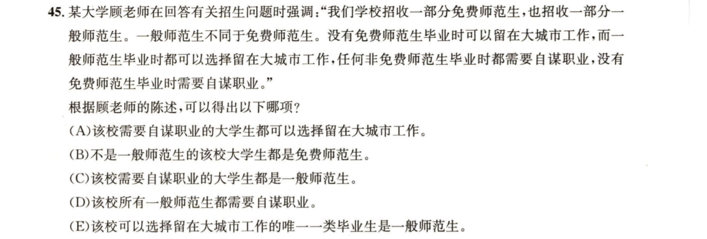

### 第 46 题

某单位有负责网络、文秘以及后勤的三名办公人员：文珊、孔瑞和姚薇，为了培养年轻干部，领导决定她们三人在这三个岗位之间实行轮岗，并将她们原来的工作间 110 室、111 室和 112 室也进行了轮换。结果，原本负责后勤的文珊接替了孔瑞的文秘工作，由 110 室调到了 111 室。
根据以上信息，可以得出以下哪项？

- **A**．姚薇接替孔瑞的工作。
- **B**．孔瑞接替文珊的工作。
- **C**．孔瑞被调到了 110 室。
- **D**．孔瑞被调到了 112 室。
- **E**．姚薇被调到了 112 室。

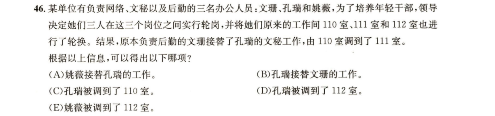

### 第 47 题

某小区业主委员会的 4 名成员晨晟、建国、向明和嘉媛坐在一张方桌前（每边各坐一人）讨论小区大门旁的绿化方案。4 人的职业各不相同，分别是高校教师、软件工程师、园艺师或邮递员中的一种。已知：晨晟是软件工程师，他坐在建国的左手边；向明坐在高校教师的右手边；坐在建国对面的嘉媛不是邮递员。
根据以上信息，可以得出以下哪项？

- **A**．嘉媛是高校教师，向明是园艺师。
- **B**．向明是邮递员，嘉媛是园艺师。
- **C**．建国是邮递员，嘉媛是园艺师。
- **D**．建国是高校教师，向明是园艺师。
- **E**．嘉媛是园艺师，向明是高校教师。

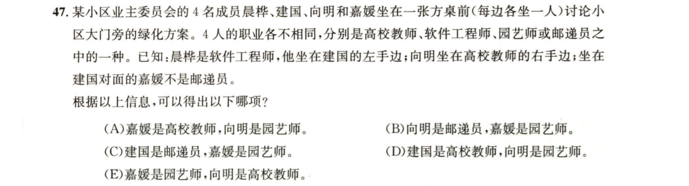

### 第 48 题

兰教授认为，不善于思考的人不可能成为一名优秀的管理者，没有一个谦逊的智者学习占星术，占星家均学习占星术，但是有些占星家却是优秀的管理者。
以下哪项如果为真，最能反驳兰教授的上述观点？

- **A**．有些占星家不是优秀的管理者。
- **B**．有些善于思考的人不是谦逊的智者。
- **C**．所有谦逊的智者都是善于思考的人。
- **D**．谦逊的智者都不是善于思考的人。
- **E**．善于思考的人都是谦逊的智者。

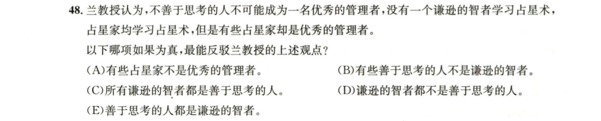

### 第 49 题

不仅人上了年纪会难以集中注意力，就连蜘蛛也有类似的情况。年轻蜘蛛结的网整齐均匀，角度完美；年老蜘蛛结的网可能出现缺口，形状怪异。蜘蛛越老，结的网就越没有章法。科学家由此认为，随着时间的流逝，这种动物的大脑也会像人脑一样退化。
以下哪项如果为真，最能质疑科学家的上述论证？

- **A**．优美的蛛网更容易受到异性蜘蛛的青睐。
- **B**．年老蜘蛛的大脑较之年轻蜘蛛，其脑容量明显偏小。
- **C**．运动器官的老化会导致年老蜘蛛结网能力下降。
- **D**．蜘蛛结网只是一种本能的行为，并不受大脑控制。
- **E**．形状怪异的蛛网较之整齐均匀的蛛网，其功能没有大的差别。

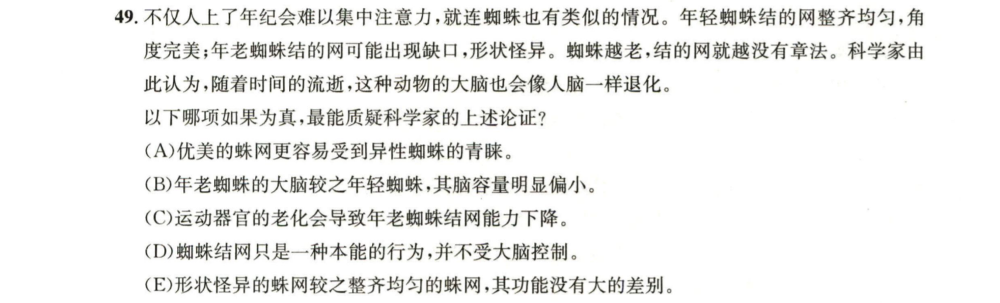

### 第 50 题

某研究中心通过实验对健康男性和女性听觉的空间定位能力进行了研究。起初，每次只发出一种声音，要求被试者说出声源的准确位置，男性和女性都非常轻松地完成了任务；后来多种声音同时发出，要求被试者只关注一种声音并对声源进行定位，与男性相比女性完成这项任务要困难得多，有时她们甚至认为声音是从声源相反方向传来的。研究人员由此得出：在嘈杂环境中准确找出声音来源的能力，男性要胜过女性。
以下哪项如果为真，最能支持研究者的结论？

- **A**．在实验使用的嘈杂环境中，有些声音是女性熟悉的声音。
- **B**．在实验使用的嘈杂环境中，有些声音是男性不熟悉的声音。
- **C**．在安静的环境中，女性注意力更易集中。
- **D**．在嘈杂的环境中，男性注意力更易集中。
- **E**．在安静的环境中，人的注意力容易分散；在嘈杂的环境中，人的注意力容易集中。

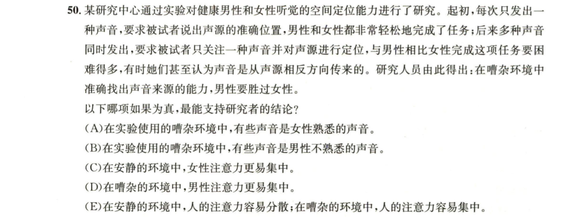

### 第 51 题

孙先生的所有朋友都声称，他们知道某人每天抽烟至少两盒，而且持续了 40 年，但身体一直不错，不过可以确信的是，孙先生并不知道有这样的人，在他的朋友中也有像孙先生这样不知情的。
根据以上信息，最可能得出以下哪项？

- **A**．抽烟的多少和身体健康与否无直接关系。
- **B**．朋友之间的交流可能会夸张，但没有人想故意说谎。
- **C**．孙先生的每位朋友知道的烟民一定不是同一个人。
- **D**．孙先生的朋友中有人没有说真话。
- **E**．孙先生的大多数朋友没有说真话。

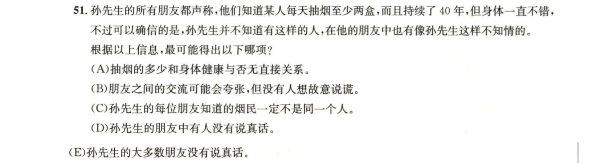

### 第 52 题

现有甲、乙两所学校，根据上年度的经费实际投入统计，若仅仅比较在校本科生的学生人均经费投入，甲校等于乙校的 86%；但若比较所有学生（本科生加上研究生）的人均经费投入，甲校是乙校的 118%。各校研究生的人均经费投入均高于本科生。
根据以上信息，最可能得出以下哪项？

- **A**．上年度，甲校学生总数多于乙校。
- **B**．上年度，甲校研究生人数少于乙校。
- **C**．上年度，甲校研究生占该校学生的比例高于乙校。
- **D**．上年度，甲校研究生人均经费投入高于乙校。
- **E**．上年度，甲校研究生占该校学生的比例高于乙校，或者甲校研究生人均经费投入高于乙校。

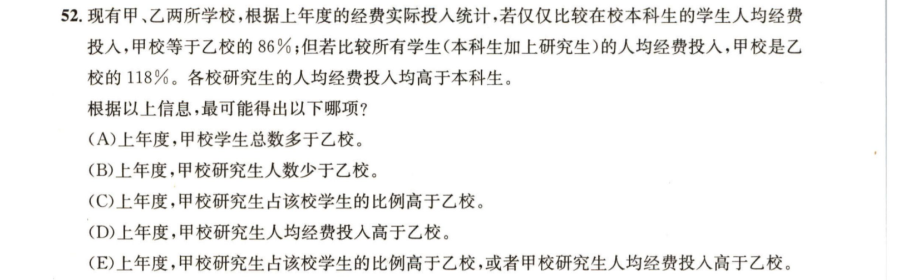

### 53~55 题基于以下题干

> 孔智、孟睿、荀慧、庄聪、墨灵、韩敏等 6 人组成一个代表队参加某次棋类大赛，其中两人参加围棋比赛，两人参加中国象棋比赛，还有两人参加国际象棋比赛。有关他们具体参加比赛项目的情况还需满足以下条件：
> （1） 每位选手只能参加一个比赛项目。
> （2） 孔智参加围棋比赛，当且仅当，庄聪和孟睿都参加中国象棋比赛。
> (3) 如果韩敏不参加国际象棋比赛，那么墨灵参加中国象棋比赛。
> (4) 如果荀慧参加中国象棋比赛，那么庄聪不参加中国象棋比赛。
> (5) 荀慧和墨灵至少有一人不参加中国象棋比赛。

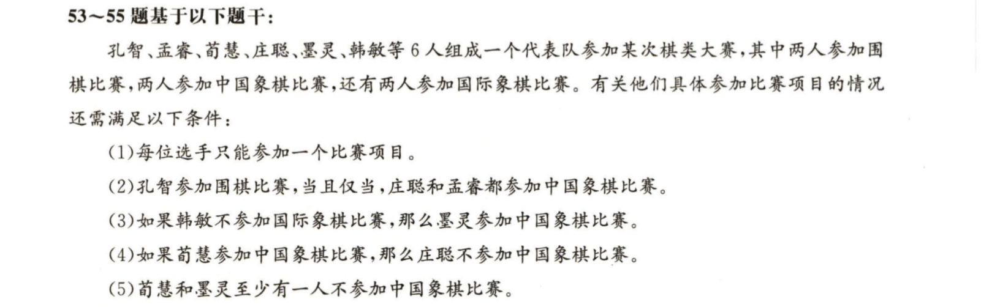

### 第 53 题

如果荀慧参加中国象棋比赛，那么可以得出以下哪项？

- **A**．庄聪和墨灵都参加围棋比赛。
- **B**．孟睿参加围棋比赛。
- **C**．孟睿参加国际象棋比赛。
- **D**．墨灵参加国际象棋比赛。
- **E**．韩敏参加国际象棋比赛。

### 第 54 题

如果庄聪和孔智参加相同的比赛项目，且孟睿参加中国象棋比赛，那么可以得出以下哪项？

- **A**．墨灵参加国际象棋比赛。
- **B**．庄聪参加中国象棋比赛。
- **C**．孔智参加围棋比赛。
- **D**．荀慧参加围棋比赛。
- **E**．韩敏参加中国象棋比赛。

### 第 55 题

根据题干信息，以下哪项可能为真？

- **A**．庄聪和韩敏参加中国象棋比赛。
- **B**．韩敏和荀慧参加中国象棋比赛。
- **C**．孔智和孟睿参加围棋比赛。
- **D**．墨灵和孟睿参加围棋比赛。
- **E**．韩敏和孔智参加围棋比赛。

---

## 四、写作（第 56-57 题，共 65 分）

### 第 56 题 · 论证有效性分析 (30 分)

**论证有效性分析：分析下述论证中存在的缺陷与漏洞，选择若干要点，写一篇 600 字左右的文章，对该论证的有效性进行分析和评论。**（论证有效性分析的一般要点是：概念特别是核心概念的界定和使用是否准确并前后一致，有无各种明显的逻辑错误，论证的论据是否成立并支持结论，结论成立的条件是否充分等。）

> 现代企业管理制度的设计所要遵循的重要原则是权力的制衡与监督。只要有了制衡与监督，企业的成功就有了保证。
>
> 所谓制衡，指对企业的管理权进行分解，然后使被分解的权力相互制约以达到平衡，它可以使任何人不能滥用权力；至于监督，指对企业管理进行严密观察，使企业运营处于可控范围之内。既然任何人都不能滥用权力，而且所有环节都在可控范围之内，那么企业的运营就不可能产生失误。
>
> 同时，以制衡与监督为原则所设计的企业管理制度还有一个固有特点，即能保证其实施的有效性，因为环环相扣的监督机制能确保企业内部各级管理者无法敷衍塞责。万一有人敷衍塞责，也会受到这一机制的制约而得到纠正。
>
> 再者，由于制衡原则的核心是权力的平衡，而企业管理的权力又是企业运营的动力与起点，因此，权力的平衡就可以使整个企业运营保持平衡。
>
> 另外，从本质上来说，权力平衡就是权力平等，因此，这一制度本身蕴含着平等观念。平等观念一旦成为企业的管理理念，必将促进企业内部的和谐与稳定。
>
> 由此可见，如果权力的制衡与监督这一管理原则付诸实践，就可以使企业的运营避免失误，确保其管理制度的有效性、日常运营的平衡以及内部的和谐与稳定，这样的企业一定能够成功。

### 第 57 题 · 论说文 (35 分)

**论说文：根据下述材料，写一篇 700 字左右的论说文，题目自拟。**

> 生物学家发现，雌孔雀往往选择尾巴大而艳丽的雄孔雀作为配偶，因为雄孔雀尾巴越大越艳丽，表明它越有生命活力，其后代的健康越能得到保证。但是，这种选择也产生了问题：孔雀尾巴越大越艳丽，就越容易被天敌发现和猎获，其生存反而会受到威胁。

