# 2015 年全国硕士研究生招生考试管理类专业学位联考综合能力试题 (199)

## 一、问题求解：第 1-15 小题，每小题 3 分，共 45 分。下列每题给出的 A、B、C、D、E 五个选项中，只有一项是符合试题要求的。请在答题卡上将所选的字母涂黑。

### 第 1 题

若实数 $a, b, c$ 满足 $a:b:c = 1:2:5$，且 $a+b+c = 24$，则 $a^2 + b^2 + c^2 = $（ ）。

- **A**．30
- **B**．90
- **C**．120
- **D**．240
- **E**．270

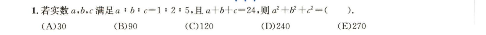

### 第 2 题

某公司共有甲、乙两个部门，如果从甲部门调 10 人到乙部门，那么乙部门人数是甲部门的 2 倍；如果把乙部门员工的 $\dfrac{1}{5}$ 调到甲部门，那么两个部门的人数相等。该公司的总人数为（ ）。

- **A**．150
- **B**．180
- **C**．200
- **D**．240
- **E**．250

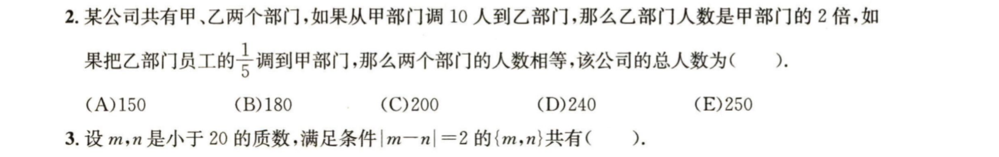

### 第 3 题

设 $m, n$ 是小于 20 的质数，满足条件 $|m - n| = 2$ 的 $\{m, n\}$ 共有（ ）。

- **A**．2 组
- **B**．3 组
- **C**．4 组
- **D**．5 组
- **E**．6 组

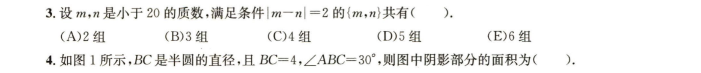

### 第 4 题

如图 1 所示，$BC$ 是半圆的直径，且 $BC = 4, \angle ABC = 30^\circ$，则图中阴影部分的面积为（ ）。

- **A**．$\dfrac{4\pi}{3} - \sqrt{3}$
- **B**．$\dfrac{4\pi}{3} - 2\sqrt{3}$
- **C**．$\dfrac{2\pi}{3} + \sqrt{3}$
- **D**．$\dfrac{2\pi}{3} + 2\sqrt{3}$
- **E**．$2\pi - 2\sqrt{3}$

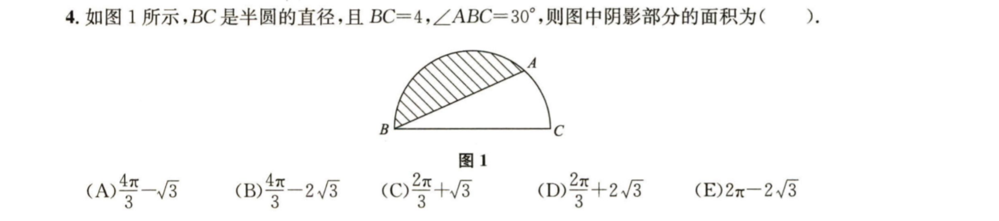

### 第 5 题

有一根圆柱形铁管，管壁厚度为 0.1 米，内径为 1.8 米，长度为 2 米。若将该铁管熔化后浇铸成长方体，则该长方体的体积为（ ）（单位：立方米，$\pi \approx 3.14$）。

- **A**．0.38
- **B**．0.59
- **C**．1.19
- **D**．5.09
- **E**．6.28

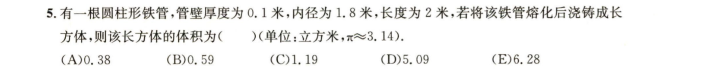

### 第 6 题

某人驾车从 A 地赶往 B 地，前一半路程比计划多用时 45 分钟，平均速度只有计划的 80%；若后一半路程的平均速度为 120 千米/小时，此人还能按原定时间到达 B 地，则 A、B 两地的距离为（ ）千米。

- **A**．450
- **B**．480
- **C**．520
- **D**．540
- **E**．600

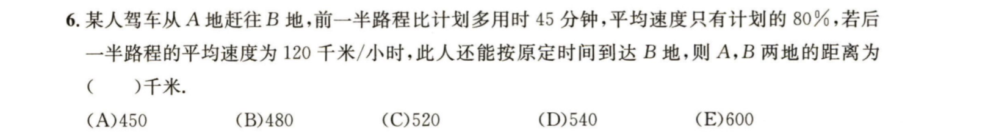

### 第 7 题

在某次考试中，甲、乙、丙三个班的平均成绩分别为 80、81 和 81.5，三个班的学生得分之和为 6952，则三个班共有学生（ ）人。

- **A**．85
- **B**．86
- **C**．87
- **D**．88
- **E**．89

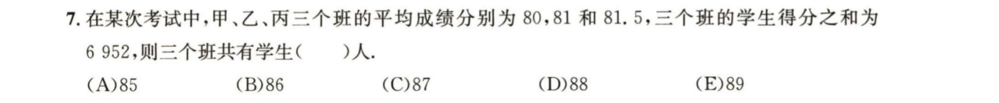

### 第 8 题

如图 2 所示，梯形 $ABCD$ 的上底与下底分别为 5、7，$E$ 为 $AC$ 和 $BD$ 的交点，$MN$ 过点 $E$ 且平行于 $AD$，则 $MN = $（ ）。

- **A**．$\dfrac{26}{5}$
- **B**．$\dfrac{11}{2}$
- **C**．$\dfrac{35}{6}$
- **D**．$\dfrac{36}{7}$
- **E**．$\dfrac{40}{7}$

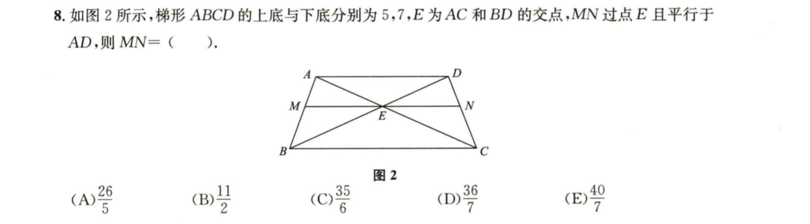

### 第 9 题

一项工作，甲、乙合作需要 2 天，人工费 2900 元；乙、丙合作需要 4 天，人工费 2600 元；甲、丙合作 2 天完成了全部工作量的 $\dfrac{5}{6}$，人工费 2400 元。甲单独做该工作需要的时间和人工费分别为（ ）。

- **A**．3 天，3000 元
- **B**．3 天，2850 元
- **C**．3 天，2700 元
- **D**．4 天，3000 元
- **E**．4 天，2900 元

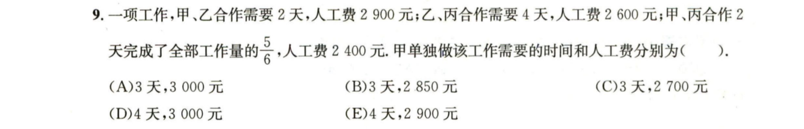

### 第 10 题

已知 $x_1, x_2$ 是 $x^2 + ax - 1 = 0$ 的两个实根，则 $x_1^2 + x_2^2 = $（ ）。

- **A**．$a^2 + 2$
- **B**．$a^2 + 1$
- **C**．$a^2 - 1$
- **D**．$a^2 - 2$
- **E**．$a + 2$

### 第 11 题

某新兴产业在 2005 年年末至 2009 年年末产值的年平均增长率为 $q$，在 2009 年年末至 2013 年年末产值的年平均增长率比前四年下降了 40%，2013 年的产值约为 2005 年产值的 $14.46 (\approx 1.95^4)$ 倍，则 $q$ 约为（ ）。

- **A**．30%
- **B**．35%
- **C**．40%
- **D**．45%
- **E**．50%

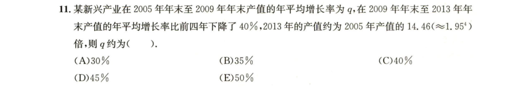

### 第 12 题

若直线 $y = ax$ 与圆 $(x-a)^2 + y^2 = 1$ 相切，则 $a^2 = $（ ）。

- **A**．$\dfrac{1+\sqrt{3}}{2}$
- **B**．$1 + \dfrac{\sqrt{3}}{2}$
- **C**．$\dfrac{\sqrt{5}}{2}$
- **D**．$1 + \dfrac{\sqrt{5}}{3}$
- **E**．$\dfrac{1+\sqrt{5}}{2}$

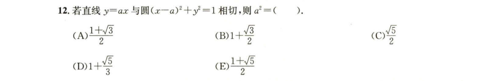

### 第 13 题

设点 $A(0,2)$ 和 $B(1,0)$，在线段 $AB$ 上取一点 $M(x,y) (0 < x < 1)$，则以 $x, y$ 为两边长的矩形面积的最大值为（ ）。

- **A**．$\dfrac{5}{8}$
- **B**．$\dfrac{1}{2}$
- **C**．$\dfrac{3}{8}$
- **D**．$\dfrac{1}{4}$
- **E**．$\dfrac{1}{8}$

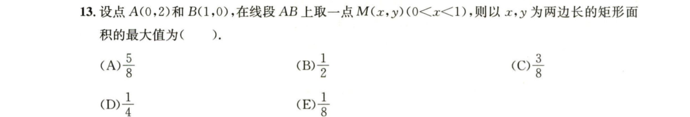

### 第 14 题

某次网球比赛的四强对阵为甲对乙、丙对丁，两场比赛的胜者将争夺冠军，选手之间相互获胜的概率如表 1 所示：

| | 甲 | 乙 | 丙 | 丁 |
| :--- | :--- | :--- | :--- | :--- |
| **甲获胜概率** | \ | 0.3 | 0.3 | 0.8 |
| **乙获胜概率** | 0.7 | \ | 0.6 | 0.3 |
| **丙获胜概率** | 0.7 | 0.4 | \ | 0.5 |
| **丁获胜概率** | 0.2 | 0.7 | 0.5 | \ |

则甲获得冠军的概率为（ ）。

- **A**．0.165
- **B**．0.245
- **C**．0.275
- **D**．0.315
- **E**．0.330

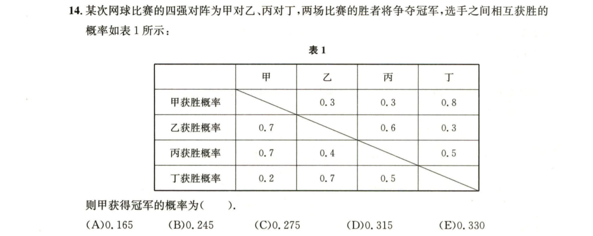

### 第 15 题

平面上有 5 条平行直线与另一组 $n$ 条平行直线垂直，若两组平行直线共构成 280 个矩形，则 $n = $（ ）。

- **A**．5
- **B**．6
- **C**．7
- **D**．8
- **E**．9

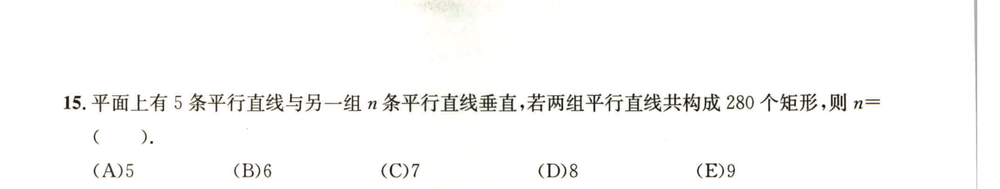

## 二、条件充分性判断：第 16～25 小题，每小题 3 分，共 30 分。要求判断每题给出的条件（1）和（2）能否充分支持题干所陈述的结论。A、B、C、D、E 五个选项为判断结果，请选择一项符合试题要求的判断，在答题卡上将所选项涂黑。

### 解题说明：
- **A**．条件（1）充分，但条件（2）不充分
- **B**．条件（2）充分，但条件（1）不充分
- **C**．条件（1）和（2）单独都不充分，但条件（1）和条件（2）联合起来充分
- **D**．条件（1）充分，条件（2）也充分
- **E**．条件（1）和（2）单独都不充分，条件（1）和条件（2）联合起来也不充分

### 第 16 题

信封中装有 10 张奖券，只有 1 张有奖。从信封中同时抽取 2 张，中奖概率为 $P$；从信封中每次抽取 1 张奖券后放回，如此重复抽取 $n$ 次，中奖概率为 $Q$，则 $P < Q$。

（1）$n = 2$。
（2）$n = 3$。

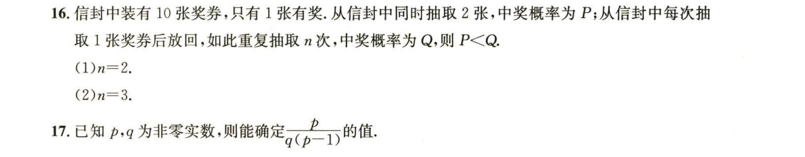

### 第 17 题

已知 $p, q$ 为非零实数，则能确定 $\dfrac{p}{q(p-1)}$ 的值。

（1）$p + q = 1$。
（2）$\dfrac{1}{p} + \dfrac{1}{q} = 1$。

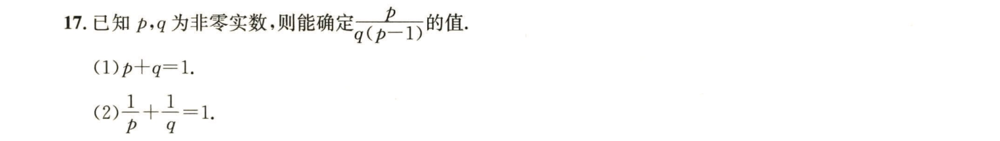

### 第 18 题

已知 $a, b$ 为实数，则 $a \ge 2$ 或 $b \ge 2$。

（1）$a + b \ge 4$。
（2）$ab \ge 4$。

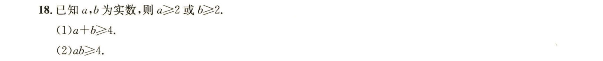

### 第 19 题

圆盘 $x^2 + y^2 \le 2(x+y)$ 被直线 $L$ 分成面积相等的两部分。

（1）$L: x + y = 2$。
（2）$L: 2x - y = 1$。

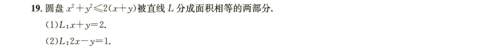

### 第 20 题

已知 $\{a_n\}$ 是公差大于零的等差数列，$S_n$ 是 $\{a_n\}$ 的前 $n$ 项和，则 $S_n \ge S_{10}, n=1, 2, \dots$。

（1）$a_{10} = 0$。
（2）$a_{11} a_{10} < 0$。

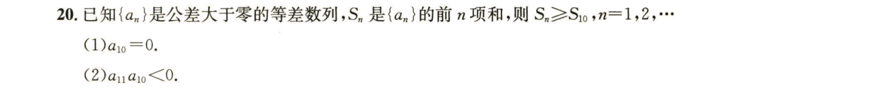

### 第 21 题

几个朋友外出游玩，购买了一些瓶装水，则能确定购买的瓶装水数量。

（1）若每人分 3 瓶，则剩余 30 瓶。
（2）若每人分 10 瓶，则只有 1 人不够。

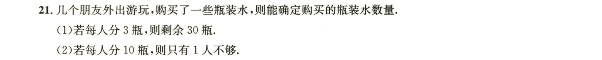

### 第 22 题

已知 $M = (a_1 + a_2 + \dots + a_{n-1})(a_2 + a_3 + \dots + a_n)$，$N = (a_1 + a_2 + \dots + a_n)(a_2 + a_3 + \dots + a_{n-1})$，则 $M > N$。

（1）$a_1 > 0$。
（2）$a_1 a_n > 0$。

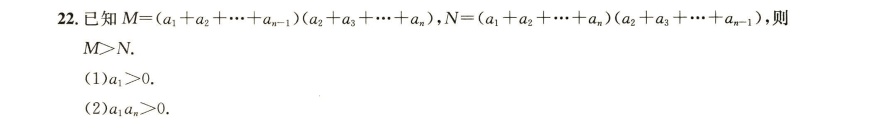

### 第 23 题

设 $\{a_n\}$ 是等差数列，则能确定数列 $\{a_n\}$。

（1）$a_1 + a_6 = 0$。
（2）$a_1 a_6 = -1$。

### 第 24 题

已知 $x_1, x_2, x_3$ 都是实数，$\bar{x}$ 为 $x_1, x_2, x_3$ 的平均数，则 $|x_k - \bar{x}| \le 1, k=1, 2, 3$。

（1）$|x_k| \le 1, k=1, 2, 3$。
（2）$x_1 = 0$。

### 第 25 题

底面半径为 $r$，高为 $h$ 的圆柱体表面积记为 $S_1$，半径为 $R$ 的球体表面积记为 $S_2$，则 $S_1 \le S_2$。

（1）$R \ge \dfrac{r+h}{2}$。
（2）$R \le \dfrac{2h+r}{3}$。

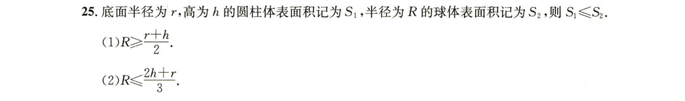

---

## 三、逻辑推理（第 26-55 题，每小题 2 分，共 60 分）

### 第 26 题

晴朗的夜晚我们可以看到满天星斗，其中有些是自身发光的恒星，有些是自身不发光但可以反射附近恒星光的行星。恒星尽管遥远，但是有些可以被现有的光学望远镜“看到”。和恒星不同，由于行星本身不发光，而且体积远小于恒星，所以，太阳系外的行星大多无法用现有的光学望远镜“看到”。以下哪项如果为真，最能解释上述现象？

- **A**．现有的光学望远镜只能“看到”自身发光或者反射光的天体。
- **B**．有些恒星没有被现有的光学望远镜“看到”。
- **C**．如果行星的体积够大，现有的光学望远镜就能够“看到”。
- **D**．太阳系外的行星因距离遥远，很少能将恒星光反射到地球上。
- **E**．太阳系内的行星大多可以用现有的光学望远镜“看到”。

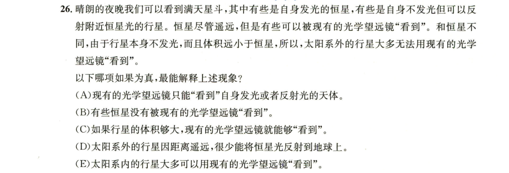

### 第 27 题

长期以来，手机产生的电磁辐射是否威胁人体健康一直是极具争议的话题。一项长达 10 年的研究显示，每天使用移动电话通话 30 分钟以上的人患神经胶质癌的风险比从未使用者要高出 40%。由此某专家建议，在获得进一步证据之前，人们应该采取更加安全的措施，如尽量使用固定电话通话或使用短信进行沟通。以下哪项如果为真，最能表明该专家的建议不切实际？

- **A**．大多数手机产生的电磁辐射强度符合国家规定的安全标准。
- **B**．现在人类生活空间中的电磁辐射强度已经超过手机通话产生的电磁辐射强度。
- **C**．经过较长一段时间，人的身体能够逐渐适应强电磁辐射的环境。
- **D**．在上述实验期间，有些人每天使用移动电话通话超过 40 分钟，但他们很健康。
- **E**．即使以手机短信进行沟通，发送和接收信息的瞬间也会产生较强的电磁辐射。

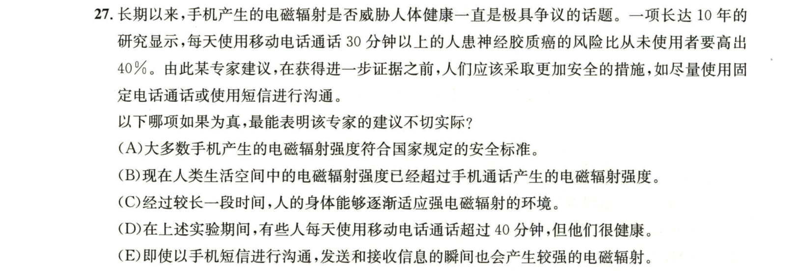

### 第 28 题

甲、乙、丙、丁、戊和己 6 人围坐在一张正六边形的小桌前，每边各坐一人。已知：
（1） 甲与乙正面相对。
（2） 丙与丁不相邻，也不正面相对。如果己与乙不相邻，则以下哪项一定为真？

- **A**．如果甲与戊相邻，则丁与己正面相对。
- **B**．甲与丁相邻。
- **C**．戊与己相邻。
- **D**．如果丙与戊不相邻，则丙与己相邻。
- **E**．己与乙正面相对。

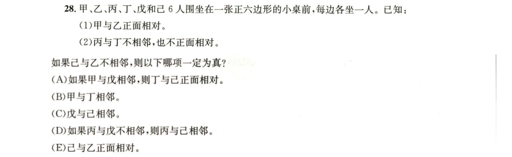

### 第 29 题

人类经历了上百万年的自然进化，产生了直觉、多层次抽象等独特智能。尽管现代计算机已经具备了一定的学习能力，但这种能力还需要人类的指导，完全的自我学习能力还有待进一步发展。因此，计算机要达到甚至超过人类的智能水平是不可能的。以下哪项最可能是上述论证的预设？

- **A**．计算机很难真正懂得人类的语言，更不可能理解人类的感情。
- **B**．理解人类复杂的社会关系需要自我学习能力。
- **C**．计算机如果具备完全的自我学习能力，就能形成直觉、多层次抽象等智能。
- **D**．计算机可以形成自然进化能力。
- **E**．直觉、多层次抽象等这些人类的独特智能无法通过学习获得。

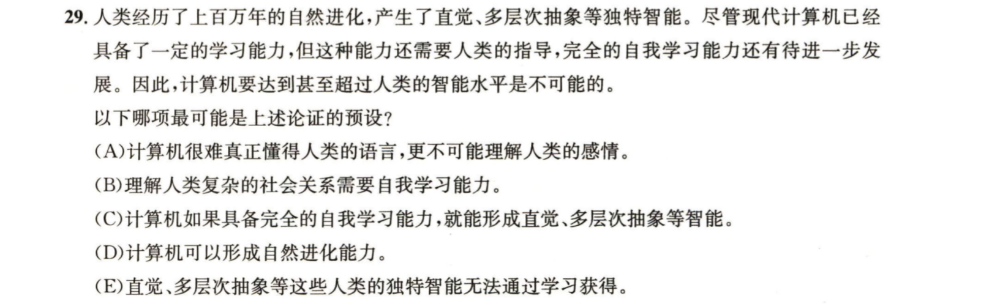

### 第 30 题

为进一步加强对不遵守交通信号等违法行为的执法管理，规范执法程序，确保执法公正，某市交警支队要求：凡属交通信号指示不一致、有证据证明救助危难等情形，一律不得录入道路交通违法信息系统；对已录入信息系统的交通违法记录，必须完善异议受理、核查、处理等工作规范，最大限度地减少执法争议。根据上述交警支队的要求，可以得出以下哪项？

- **A**．有些因救助危难而违法的情形，如果仅有当事人说辞但缺乏当时现场的录音录像证明，就应录入道路交通违法信息系统。
- **B**．对已录入系统的交通违法记录，只有倾听群众异议，加强群众监督，才能最大限度地减少执法争议。
- **C**．如果汽车使用了行车记录仪，就可以提供现场实时证据，大大减少被录入道路交通违法信息系统的可能性。
- **D**．因信号灯相位设置和配时不合理等造成交通信号不一致而引发的交通违法情形，可以不录入道路交通违法信息系统。
- **E**．只要对已录入系统的交通违法记录进行异议受理、核查和处理，就能最大限度地减少执法争议。

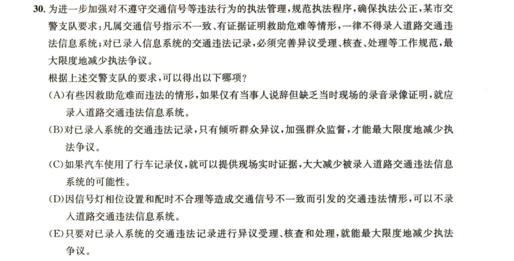

### 31~32 题基于以下题干

> 某次讨论会共有 18 名参会者。已知：
> （1） 至少有 5 名青年教师是女性。
> （2） 至少有 6 名女教师已过中年。
> (3) 至少有 7 名女青年是教师。

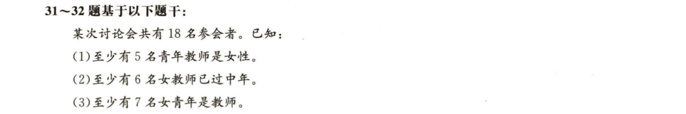

### 第 31 题

根据上述信息，关于参会人员可以得出以下哪项？

- **A**．有些青年教师不是女性。
- **B**．有些女青年不是教师。
- **C**．青年教师至少有 11 名。
- **D**．女青年至多有 11 名。
- **E**．女教师至少有 13 名。

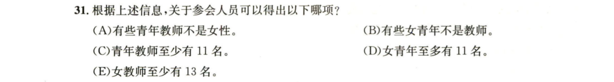

### 第 32 题

如果上述三句话两真一假，那么关于参会人员可以得出以下哪项？

- **A**．青年教师至少有 5 名。
- **B**．男教师至多有 10 名。
- **C**．女青年都是教师。
- **D**．女青年至少有 7 名。
- **E**．青年教师都是女性。

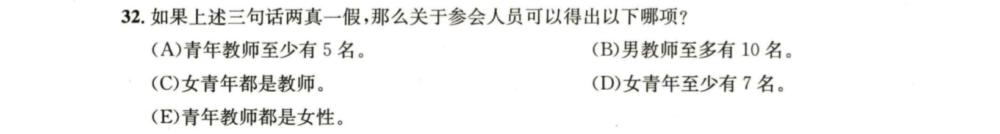

### 第 33 题

当企业处于蓬勃上升时期，往往紧张而忙碌，没有时间和精力去设计和修建“琼楼玉宇”；当企业所有的重要工作都已经完成，其时间和精力就开始集中在修建办公大楼上。所以，如果一个企业的办公大楼设计得越完美，装饰得越豪华，则该企业离解体的时间就越近；当某个企业的大楼设计和建造趋向完美之际，它的存在就逐渐失去意义。这就是所谓的“办公大楼法则”。以下哪项如果为真，最能质疑上述观点？

- **A**．某企业的办公大楼修建得美轮美奂，入住后该企业的事业蒸蒸日上。
- **B**．一个企业如果将时间和精力都耗费在修建办公大楼上，则对其他重要工作就投入不足了。
- **C**．建造豪华的办公大楼，往往会加大企业的运营成本，损害其实际利益。
- **D**．企业办公大楼越破旧，该企业就越有活力和生机。
- **E**．建造豪华的办公大楼并不需要企业投入太多的时间和精力。

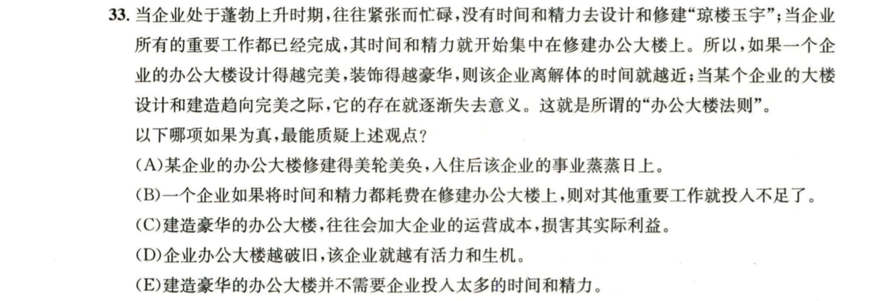

### 第 34 题

张云、李华、王涛都收到了明年二月初赴北京开会的通知。他们可以选择乘坐飞机、高铁与大巴等交通工具进京。他们对这次进京方式有如下考虑：
（1） 张云不喜欢坐飞机，如果有李华同行，他就选择乘坐大巴。
（2） 李华不计较方式，如果高铁比飞机便宜，他就选择乘坐高铁。
(3) 王涛不在乎价格，除非预报二月初北京有雨雪天气，否则他就选择乘坐飞机。
(4) 李华和王涛家住得较近，如果航班时间合适，他们将一同乘飞机出行。如果上述 3 人的考虑都得到满足，则可以得出以下哪项？

- **A**．如果李华没有选择乘坐高铁或飞机，则他肯定和张云一起乘坐大巴进京。
- **B**．如果张云和王涛乘坐高铁进京，则二月初北京有雨雪天气。
- **C**．如果三人都乘坐飞机进京，则飞机票价比高铁便宜。
- **D**．如果王涛和李华乘坐飞机进京，则二月初北京没有雨雪天气。
- **E**．如果三人都乘坐大巴进京，则预报二月初北京有雨雪天气。

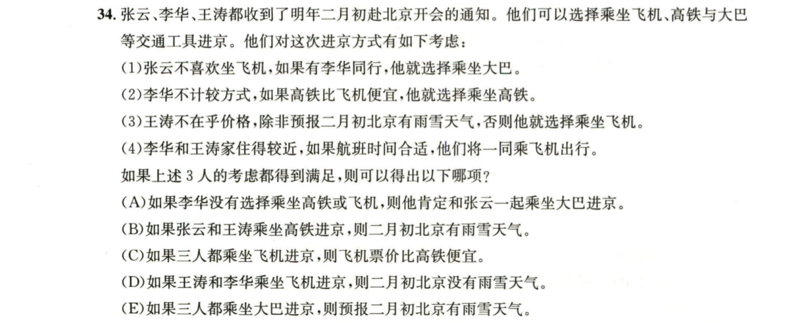

### 第 35 题

某市推出一项月度社会公益活动，市民报名踊跃。由于活动规模有限，主办方决定通过摇号抽签的方式选择参与者。第一个月中签率为 1:20；随后连创新低，到下半年的 10 月份已达 1:70。大多数市民屡摇不中，但从今年 7 月至 10 月，“李祥”这个名字连续 4 个月中签。不少市民据此认为，有人在抽签过程中作弊，并对主办方提出质疑。以下哪项如果为真，最能消除上述市民的质疑？

- **A**．摇号抽签全过程是在有关部门监督下进行的。
- **B**．在报名的市民中，名叫“李祥”的近 300 人。
- **C**．已经中签的申请者中，叫“张磊”的有 7 人。
- **D**．曾有一段时间，家长给孩子取名不回避重名。
- **E**．在摇号系统中，每一位申请人都被随机赋予一个不重复的编码。

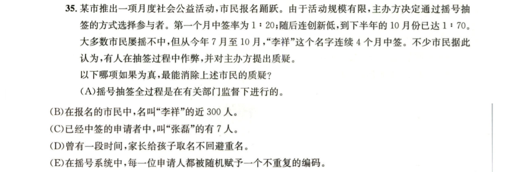

### 第 36 题

美国扁桃仁于 20 世纪 70 年代出口到我国，当时被误译成“美国大杏仁”。这种误译导致大多数消费者根本不知道扁桃仁、杏仁是两种完全不同的产品。对此，尽管我国林果专家一再努力澄清，但学界的声音很难传达到相关企业和普通大众中。因此，必须制定林果的统一行业标准，这样才能还相关产品以本来面目。以下哪项最可能是上述论证的假设？

- **A**．美国扁桃仁和中国大杏仁的外形很相似。
- **B**．进口商品名称的误译会扰乱我国企业正常的对外贸易活动。
- **C**．“美国大杏仁”在中国市场上销量超过中国杏仁。
- **D**．我国相关企业和普通大众并不认可我国林果专家的意见。
- **E**．长期以来，我国没有关于林果的统一行业标准。

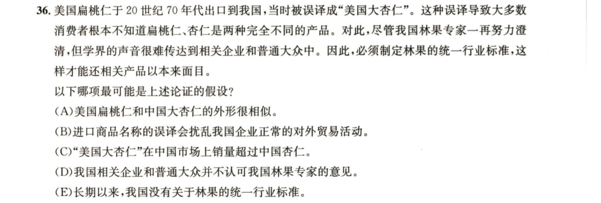

### 第 37 题

10 月 6 日晚上，张强要么去电影院看了电影，要么拜访了他的朋友秦玲。如果那天晚上张强开车回家，他就没去电影院看电影。只有张强事先与秦玲约定，张强才能去拜访她。事实上，张强不可能事先与秦玲约定。根据以上陈述，可以得出以下哪项？

- **A**．那天晚上张强与秦玲一起去电影院看电影。
- **B**．那天晚上张强拜访了他的朋友秦玲。
- **C**．那天晚上张强没有开车回家。
- **D**．那天晚上张强没有去电影院看电影。
- **E**．那天晚上张强开车去电影院看电影。

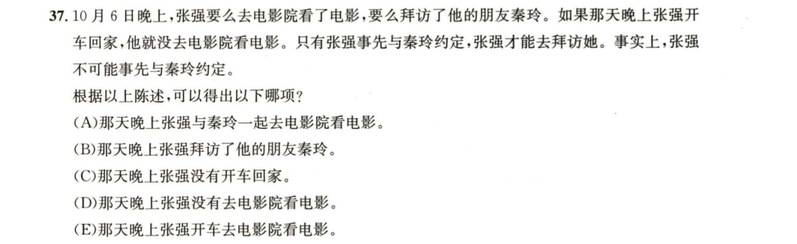

### 38~39 题基于以下题干

> 天南大学准备选派两名研究生、三名本科生到山村小学支教。经过个人报名和民主评议，最终人选将在研究生赵婷、唐玲、殷倩 3 人和本科生周艳、李环、文琴、徐昂、朱敏 5 人中产生。按规定，同一学院或者同一社团至多选派一人。已知：
> （1） 唐玲和朱敏均来自数学学院。
> （2） 周艳和徐昂均来自文学院。
> (3) 李环和朱敏均来自辩论协会。

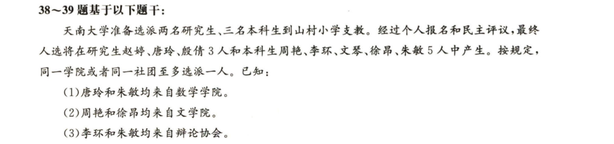

### 第 38 题

根据上述条件，以下必定入选的是：

- **A**．唐玲。
- **B**．赵婷。
- **C**．周艳。
- **D**．殷倩。
- **E**．文琴。

### 第 39 题

如果唐玲入选，那么以下必定入选的是：

- **A**．李环。
- **B**．徐昂。
- **C**．周艳。
- **D**．赵婷。
- **E**．殷倩。

### 第 40 题

有些阔叶树是常绿植物，因此，所有阔叶树都不生长在寒带地区。以下哪项如果为真，最能反驳上述结论？

- **A**．常绿植物不都是阔叶树。
- **B**．寒带的某些地区不生长阔叶树。
- **C**．有些阔叶树不生长在寒带地区。
- **D**．常绿植物都不生长在寒带地区。
- **E**．常绿植物都生长在寒带地区。

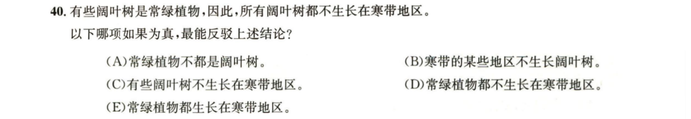

### 41~42 题基于以下题干

> 某大学运动会即将召开，经管学院拟组建一支 12 人的代表队参赛，参赛队员将从该院 4 个年级的学生中选拔。学校规定：每个年级都须在长跑、短跑、跳高、跳远、铅球 5 个项目中选择 1~2 项参加比赛，其余项目可任意选择；一个年级如果选择长跑，就不能选择短跑或跳高；一个年级如果选择跳远，就不能选择长跑或铅球；每名队员只参加 1 项比赛。已知该院：
> （1） 每个年级均有队员被选拔进入代表队。
> （2） 每个年级被选拔进入代表队的人数各不相同。
> (3) 有两个年级的队员人数相乘等于另一个年级的队员人数。

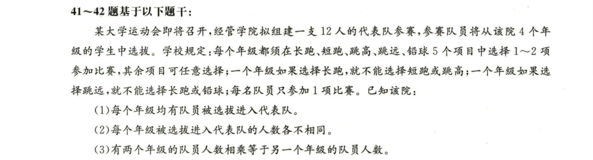

### 第 41 题

根据以上信息，一个年级最多可选拔多少人？

- **A**．8 人。
- **B**．7 人。
- **C**．6 人。
- **D**．5 人。
- **E**．4 人。

### 第 42 题

如果某年级队员人数不是最少的，且选择了长跑，那么对于该年级来说，以下哪项是不可能的？

- **A**．选择短跑或铅球。
- **B**．选择短跑或跳远。
- **C**．选择铅球或跳高。
- **D**．选择长跑或跳高。
- **E**．选择铅球或跳远。

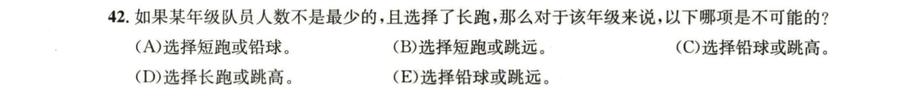

### 第 43 题

为防御电脑受到病毒侵袭，研究人员开发了防御病毒和查杀病毒的程序。前者启动后能使程序运行免受病毒侵袭，后者启动后能迅速查杀电脑中可能存在的病毒。某台电脑上现装有甲、乙、丙三种程序，已知：
（1） 甲程序能查杀目前已知的所有病毒。
（2） 若乙程序不能防御已知的一号病毒，则丙程序也不能查杀该病毒。
(3) 只有丙程序能防御已知的一号病毒，电脑才能查杀目前已知的所有病毒。
(4) 只有启动甲程序，才能启动丙程序。根据上述信息，可以得出以下哪项？

- **A**．如果启动了丙程序，就能防御并查杀一号病毒。
- **B**．如果启动了乙程序，那么不必启动丙程序也能查杀一号病毒。
- **C**．只有启动乙程序，才能防御并查杀一号病毒。
- **D**．只有启动丙程序，才能防御并查杀一号病毒。
- **E**．如果启动了甲程序，那么不必启动乙程序也能查杀所有病毒。

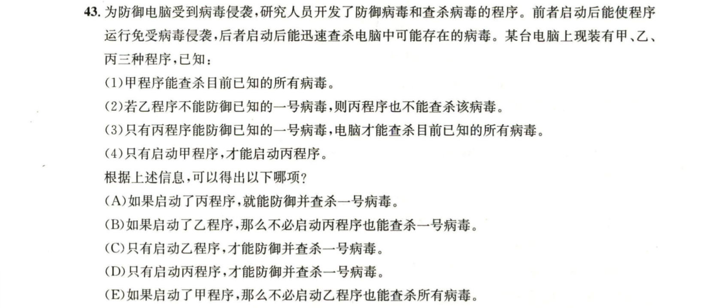

### 第 44 题

研究人员将角膜感觉神经断裂的兔子分为两组：实验组和对照组。他们给实验组兔子注射一种从土壤霉菌中提取的化合物。3 周后检查发现，实验组兔子的角膜感觉神经已经复合；而对照组兔子未注射这种化合物，其角膜感觉神经没有复合。研究人员由此得出结论：该化合物可以使兔子断裂的角膜感觉神经复合。以下哪项与上述研究人员得出结论的方式最为类似？

- **A**．科学家在北极冰川地区的黄雪中发现了细菌，而该地区的寒冷气候与木卫二的冰冷环境有着惊人的相似。所以，木卫二可能存在生命。
- **B**．绿色植物在光照充足的环境下能茁壮成长，而在光照不足的环境下只能缓慢生长。所以，光照有助于绿色植物的生长。
- **C**．一个整数或者是偶数，或者是奇数。0 不是奇数，所以，0 是偶数。
- **D**．昆虫都有三对足，蜘蛛并非三对足。所以，蜘蛛不是昆虫。
- **E**．年逾花甲的老王戴上老花眼镜可以读书看报，不戴则视力模糊。所以，年龄大的人都要戴老花眼镜。

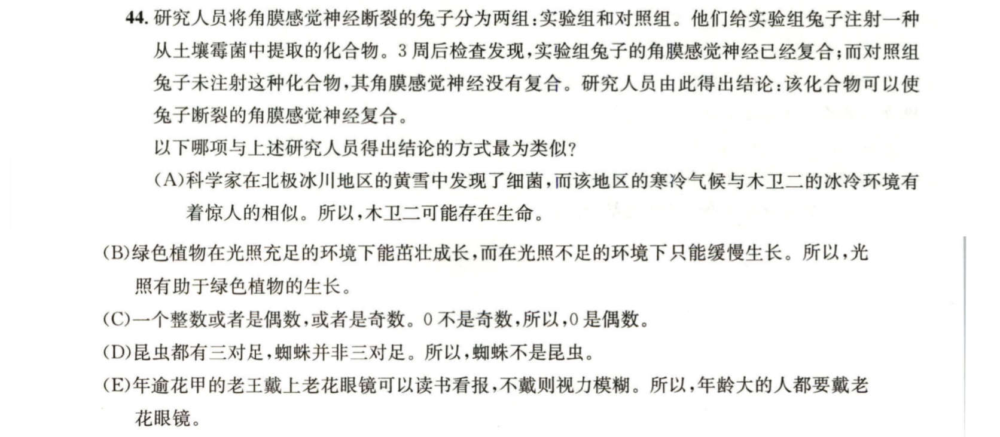

### 第 45 题

张教授指出，明清时期科举考试分为四级，即院试、乡试、会试、殿试。院试在县府举行，考中者称为“生员”；乡试每三年在各省省城举行一次，生员才有资格参加，考中者称为“举人”，举人第一名称为“解元”；会试于乡试后第二年在京城礼部举行，举人才有资格参加，考中者称为“贡士”，贡士第一名称为“会元”；殿试在会试当年举行，由皇帝主持，贡士才有资格参加，录取分为三甲，一甲三名，二甲、三甲各若干名，统称为“进士”，一甲第一名称为“状元”。根据张教授的陈述，以下哪项是不可能的？

- **A**．未中解元者，不曾中会元。
- **B**．中举者，不曾中进士。
- **C**．中状元者曾为生员和举人。
- **D**．中会元者，不曾中举。
- **E**．可有连中三元者（解元、会元、状元）。

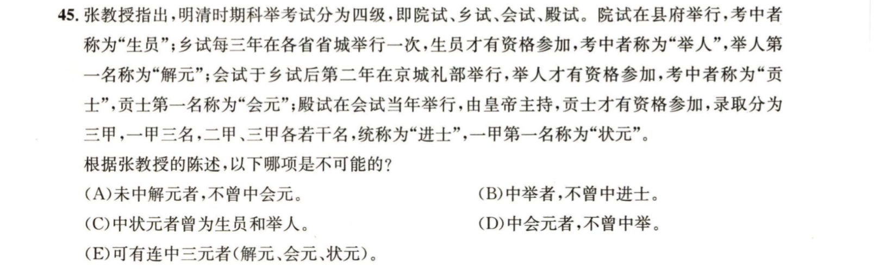

### 第 46 题

有人认为，任何一个机构都包括不同的职位等级或层级，每个人都隶属于其中的一个层级。如果某人在原来的级别岗位上干得出色，就会被提拔。而被提拔者得到重用后却碌碌无为，这会造成机构效率低下，人浮于事。以下哪项如果为真，最能质疑上述观点？

- **A**．不同岗位的工作方法是不同的，对新岗位要有一个适应过程。
- **B**．部门经理王先生业绩出众，被提拔为公司总经理后工作依然出色。
- **C**．个人晋升常常在一定程度上影响所在机构的发展。
- **D**．李明的体育运动成绩并不理想，但他进入管理层后却干得得心应手。
- **E**．王副教授教学和科研能力都很强，而晋升为正教授后却表现平平。

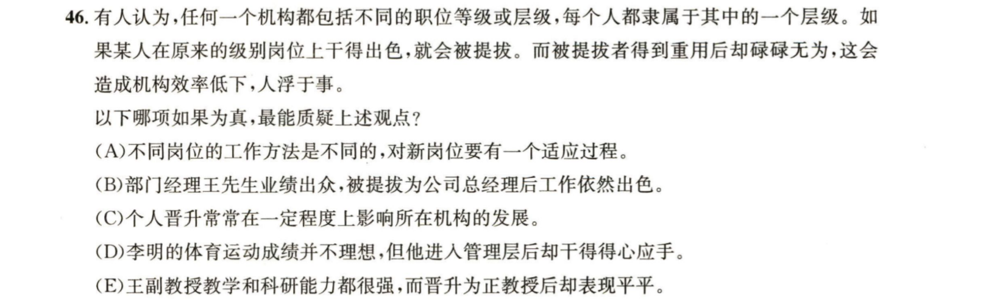

### 第 47 题

如果把一杯酒倒进一桶污水中，你得到的是一桶污水；如果把一杯污水倒进一桶酒中，你得到的仍然是一桶污水。在任何组织中，都可能存在几个难缠人物，他们存在的目的似乎就是把事情搞砸。如果一个组织不加强内部管理，一个正直能干的人进入某低效的部门就会被吞没，而一个无德无才者很快就能将一个高效的部门变成一盘散沙。根据以上信息，可以得出以下哪项？

- **A**．如果组织中存在几个难缠人物，很快就会把组织变成一盘散沙。
- **B**．如果不将一杯污水倒进一桶酒中，你就不会得到一桶污水。
- **C**．如果一个正直能干的人在低效部门没有被吞没，则该部门加强了内部管理。
- **D**．如果一个正直能干的人进入组织，就会使组织变得更为高效。
- **E**．如果一个无德无才的人把组织变成一盘散沙，则该组织没有加强内部管理。

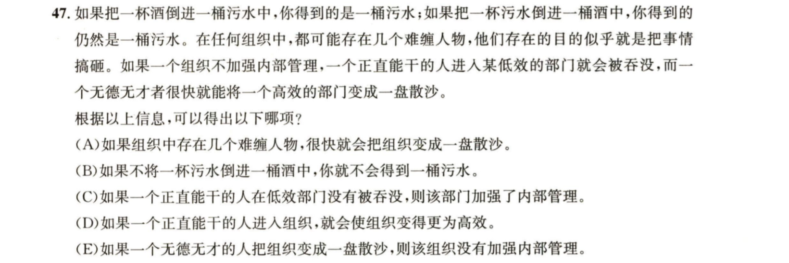

### 第 48 题

自闭症会影响社会交往、语言交流和兴趣爱好等方面的行为。研究人员发现，实验鼠体内神经连接蛋白的蛋白质如果合成过多，就会导致自闭症。由此他们认为，自闭症与神经连接蛋白的蛋白质合成量具有重要关联。以下哪项如果为真，最能支持上述观点？

- **A**．生活在群体之中的实验鼠较之独处的实验鼠患自闭症的比例要小。
- **B**．雄性实验鼠患自闭症的比例是雌性实验鼠的 5 倍。
- **C**．抑制神经连接蛋白的蛋白质合成可缓解实验鼠的自闭症状。
- **D**．如果将实验鼠控制蛋白合成的关键基因去除，其体内的神经连接蛋白就会增加。
- **E**．神经连接蛋白正常的老年实验鼠患自闭症的比例很低。

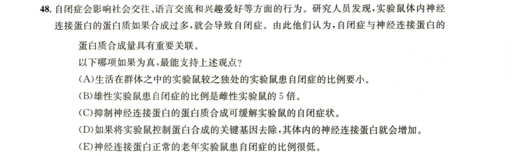

### 第 49 题

张教授指出，生物燃料是指利用生物资源生产的燃料乙醇或生物柴油，它们可以替代由石油制取的汽油和柴油，是可再生能源开发利用的重要方向。受世界石油资源短缺、环保和全球气候变化的影响，20 世纪 70 年代以来，许多国家日益重视生物燃料的发展，并取得显著成效。所以，应该大力开发和利用生物燃料。以下哪项最可能是张教授论证的预设？

- **A**．发展生物燃料可有效降低人类对石油等化石燃料的消耗。
- **B**．发展生物燃料会减少粮食供应，而当今世界有数以百万计的人食不果腹。
- **C**．生物柴油和燃料乙醇是现代社会能源供给体系的适当补充。
- **D**．生物燃料在生产与运输的过程中需要消耗大量的水、电和石油等。
- **E**．目前我国生物燃料的开发和利用已经取得很大的成绩。

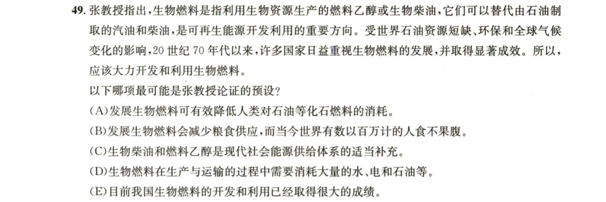

### 第 50 题

有关数据显示，2011 年全球新增 870 万结核病患者，同时有 140 万患者死亡。因为结核病对抗生素有耐药性，所以对结核病的治疗一直都进展缓慢。如果不能在近几年消除结核病，那么还会有数百万人死于结核病。如果要控制这种流行病，就要有安全、廉价的疫苗。目前有 12 种新疫苗正在测试之中。根据以上信息，可以得出以下哪项？

- **A**．2011 年结核病患者死亡率已达 16.1%。
- **B**．有了安全、廉价的疫苗，我们就能控制结核病。
- **C**．如果解决了抗生素的耐药性问题，结核病治疗将会获得突破性进展。
- **D**．只有在近几年消除结核病，才能避免数百万人死于这种疾病。
- **E**．新疫苗一旦应用于临床，将有效控制结核病的传播。

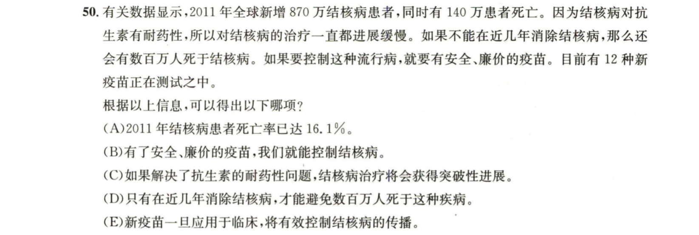

### 第 51 题

一个人如果没有崇高的信仰，就不可能守住道德的底线；而一个人只有不断地加强理论学习，才能始终保持崇高的信仰。根据以上信息，可以得出以下哪项？

- **A**．一个人没能守住道德的底线，是因为他首先丧失了崇高的信仰。
- **B**．一个人只要有崇高的信仰，就能守住道德的底线。
- **C**．一个人只有不断加强理论学习，才能守住道德的底线。
- **D**．一个人如果不能守住道德的底线，就不可能保持崇高的信仰。
- **E**．一个人只要不断加强理论学习，就能守住道德的底线。

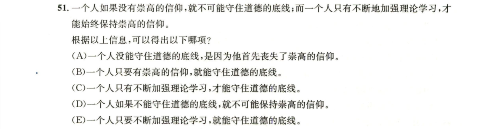

### 第 52 题

研究人员安排了一次实验，将 100 名受试者分为两组：喝一小杯红酒的实验组和不喝酒的对照组。随后，让两组受试者计算某段视频中篮球队员相互传球的次数。结果发现，对照组的受试者都计算准确，而实验组中只有 18% 的人计算准确。经测试，实验组受试者的血液中酒精浓度只有酒驾法定值的一半。由此专家指出，这项研究结果或许应该让立法者重新界定酒驾法定值。以下哪项如果为真，最能支持上述专家的观点？

- **A**．酒驾法定值设置过低，可能会把许多未饮酒者界定为酒驾。
- **B**．即使血液中酒精浓度只有酒驾法定值的一半，也会影响视力和反应速度。
- **C**．饮酒过量不仅损害身体健康，而且影响驾车安全。
- **D**．只要血液中酒精浓度不超过酒驾法定值，就可以驾车上路。
- **E**．即使酒驾法定值设置较高，也不会将少量饮酒的驾车者排除在酒驾范围之外。

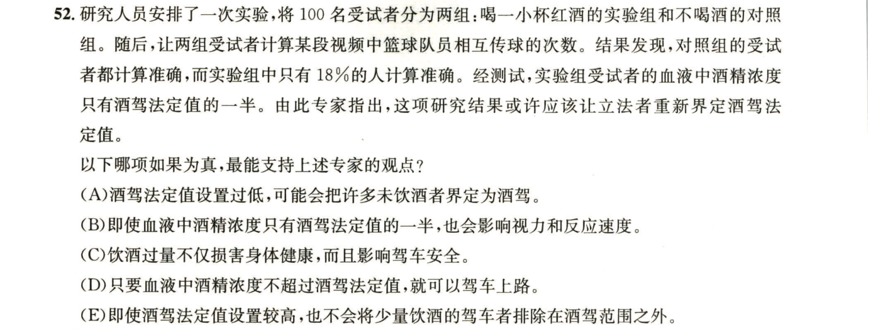

### 第 53 题

某研究人员在 2004 年对一些 12~16 岁的学生进行了智商测试，测试得分为 77~135 分，4 年之后再次测试，这些学生的智商得分为 87~143 分。仪器扫描显示，那些得分提高的学生，其脑部比此前呈现更多的灰质（灰质是一种神经组织，是中枢神经的重要组成部分）。这一测试表明，个体的智商变化确实存在，那些早期在学校表现并不突出的学生未来仍有可能成为佼佼者。以下除哪项外，都能支持上述实验结论？

- **A**．随着年龄的增长，青少年脑部区域的灰质通常也会增加。
- **B**．有些天才少年长大后智力并不出众。
- **C**．学生的非言语智力表现与他们大脑结构的变化明显相关。
- **D**．部分学生早期在学校表现不突出与其智商有关。
- **E**．言语智商的提高伴随着大脑左半球运动皮层灰质的增多。

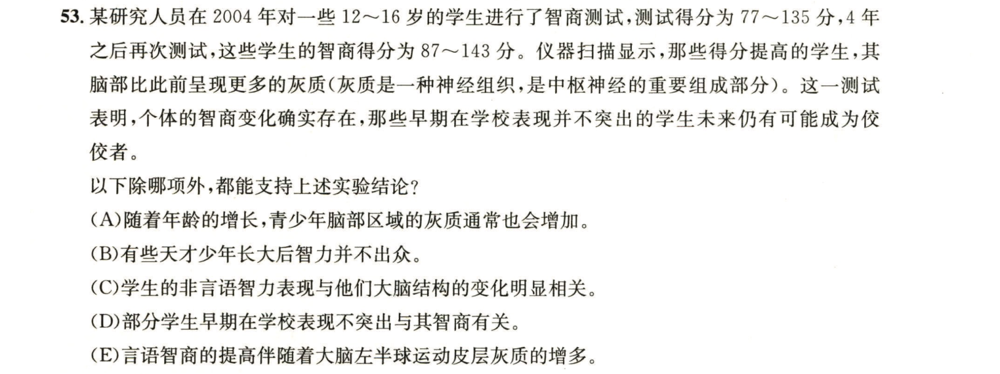

### 54~55 题基于以下题干

> 某高校有数学、物理、化学、管理、文秘、法学等 6 个专业毕业生需要就业，现有风云、怡和、宏宇三家公司前来学校招聘。已知，每家公司只招聘该校上述 2 至 3 个专业的若干毕业生，且需要满足以下条件：
> （1） 招聘化学专业的公司也招聘数学专业。
> （2） 怡和公司招聘的专业，风云公司也招聘。
> (3) 只有一家公司招聘文秘专业，且该公司没有招聘物理专业。
> (4) 如果怡和公司招聘管理专业，那么也招聘文秘专业。
> (5) 如果宏宇公司没有招聘文秘专业，那么怡和公司招聘文秘专业。

### 第 54 题

如果只有一家公司招聘物理专业，那么可以得出以下哪项？

- **A**．宏宇公司招聘数学专业。
- **B**．怡和公司招聘管理专业。
- **C**．怡和公司招聘物理专业。
- **D**．风云公司招聘化学专业。
- **E**．风云公司招聘物理专业。

### 第 55 题

如果三家公司都招聘 3 个专业的若干毕业生，那么可以得出以下哪项？

- **A**．风云公司招聘数学专业。
- **B**．怡和公司招聘物理专业。
- **C**．宏宇公司招聘化学专业。
- **D**．风云公司招聘化学专业。
- **E**．怡和公司招聘法学专业。

---

## 四、写作（第 56-57 题，共 65 分）

### 第 56 题 · 论证有效性分析 (30 分)

**分析下述论证中存在的缺陷与漏洞，选择若干要点，写一篇 600 字左右的文章，对该论证的有效性进行分析和评论。**（论证有效性分析的一般要点是：概念特别是核心概念的界定和使用是否准确并前后一致，有无各种明显的逻辑错误，论证的论据是否成立并支持结论，结论成立的条件是否充分等。）

> 有一段时期，我国部分行业出现了生产过剩现象。一些经济学家对此忧心忡忡，建议政府采取措施加以应对，以免造成资源浪费，影响国民经济正常运行。这种建议看似有理，其实未必正确。
> 
> 首先，我国部分行业出现的生产过剩并不是真正的生产过剩。道理很简单，在市场经济条件下，生产过剩实际上只是一种假象。只要生产企业开拓市场、刺激需求，就能扩大销售，生产过剩马上就可以化解。退一步说，即使出现了真正的生产过剩，市场本身也会进行自动调节。
> 
> 其次，经济运行是一个动态变化的过程，产品的供求不可能达到绝对的平衡状态，因而生产过剩是市场经济的常见现象。既然如此，那么生产过剩也就是经济运行的客观规律。因此，如果让政府采取措施进行干预，那就违背了经济运行的客观规律。
> 
> 再次，生产过剩总比生产不足好。如果政府的干预使生产过剩变成了生产不足，问题就会更大。因为生产过剩未必会造成浪费，反而可以因此增加物资储备以应对不时之需。如果生产不足，就势必造成供不应求的现象，让人们重新去过缺衣少食的日子，那就会影响社会的和谐与稳定。
> 
> 总之，我们应该合理定位政府在经济运行中的作用。政府要有所为，有所不为。政府应该管好民生问题。至于生产过剩或生产不足，应该让市场自动调节，政府不必干预。

### 第 57 题 · 论说文 (35 分)

**根据下述材料，写一篇 700 字左右的论说文，题目自拟。**

> 孟子曾引用阳虎的话：“为富，不仁矣；为仁，不富矣。”（《孟子·滕文公上》）这段话表明了古人对当时社会上“为富”“为仁”现象的一种态度，以及对两者之间关系的一种思考。

