# 2016 年全国硕士研究生招生考试管理类专业学位联考综合能力试题 (199)

## 一、问题求解：第 1-15 小题，每小题 3 分，共 45 分。下列每题给出的 A、B、C、D、E 五个选项中，只有一项是符合试题要求的。请在答题卡上将所选的字母涂黑。

### 第 1 题

某家庭在一年支出中，子女教育支出与生活资料支出的比为 $3:8$，文化娱乐支出与子女教育支出的比为 $1:2$。已知文化娱乐支出占家庭总支出的 $10.5\%$，则生活资料支出占家庭总支出的（ ）。

- **A**．40%
- **B**．42%
- **C**．48%
- **D**．56%
- **E**．64%

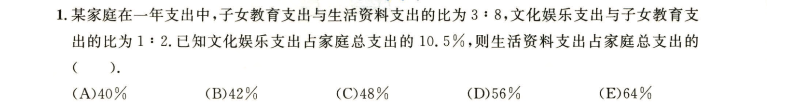

### 第 2 题

有一批同规格的正方形瓷砖，用它们铺满某个正方形区域时剩余 180 块，将此正方形区域的边长增加一块瓷砖的长度时，还需要增加 21 块瓷砖才能铺满。该批瓷砖共有（ ）。

- **A**．9981 块
- **B**．10000 块
- **C**．10180 块
- **D**．10201 块
- **E**．10222 块

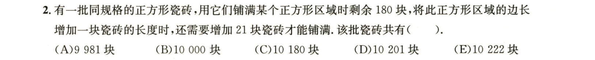

### 第 3 题

上午 9 时一辆货车从甲地出发前往乙地，同时一辆客车从乙地出发前往甲地，中午 12 时两车相遇。已知货车和客车的速度分别是 90 千米/小时、100 千米/小时。则当客车到达甲地时，货车距乙地的距离为（ ）。

- **A**．30 千米
- **B**．43 千米
- **C**．45 千米
- **D**．50 千米
- **E**．57 千米

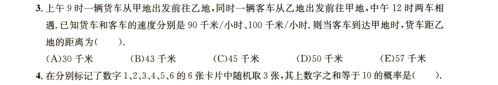

### 第 4 题

在分别标记了数字 1、2、3、4、5、6 的 6 张卡片中随机取 3 张，其上数字之和等于 10 的概率是（ ）。

- **A**．0.05
- **B**．0.1
- **C**．0.15
- **D**．0.2
- **E**．0.25

### 第 5 题

某商场将每台进价为 2000 元的冰箱以 2400 元销售时，每天销售 8 台。调研表明，这种冰箱的售价每降低 50 元，每天就能多销售 4 台。若要每天销售利润最大，则该冰箱的定价应为（ ）元。

- **A**．2200
- **B**．2250
- **C**．2300
- **D**．2350
- **E**．2400

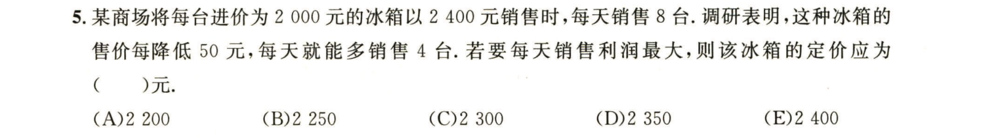

### 第 6 题

某委员会由三个不同的专业队伍组成，三个专业队伍的人数分别为 2、3、4，从中选派 2 位不同专业的委员外出调研，则不同的选派方式有（ ）。

- **A**．36 种
- **B**．26 种
- **C**．12 种
- **D**．8 种
- **E**．6 种

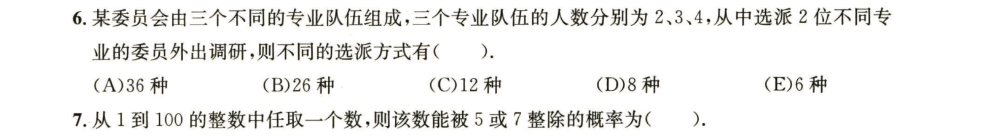

### 第 7 题

从 1 到 100 的整数中任取一个数，则该数能被 5 或 7 整除的概率为（ ）。

- **A**．0.02
- **B**．0.14
- **C**．0.2
- **D**．0.32
- **E**．0.34

### 第 8 题

如图 1 所示，在四边形 $ABCD$ 中，$AB \parallel CD$，$AB$ 与 $CD$ 的边长分别为 4 和 8，若 $\triangle ABE$ 的面积为 4，则四边形 $ABCD$ 的面积为（ ）。

- **A**．24
- **B**．30
- **C**．32
- **D**．36
- **E**．40

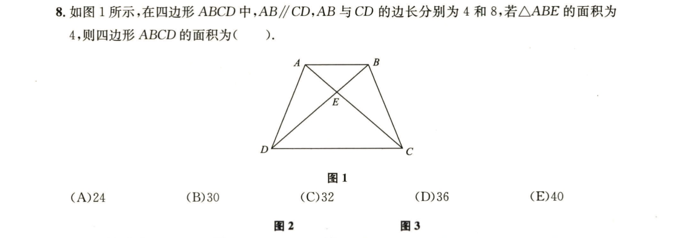

### 第 9 题

现有长方形木板 340 张，正方形木板 160 张（如图 2 所示），这些木板恰好可以装配成若干竖式和横式的无盖箱子（如图 3 所示）。装配成的竖式和横式箱子的个数分别为（ ）。

- **A**．25, 80
- **B**．60, 50
- **C**．20, 70
- **D**．60, 40
- **E**．40, 60

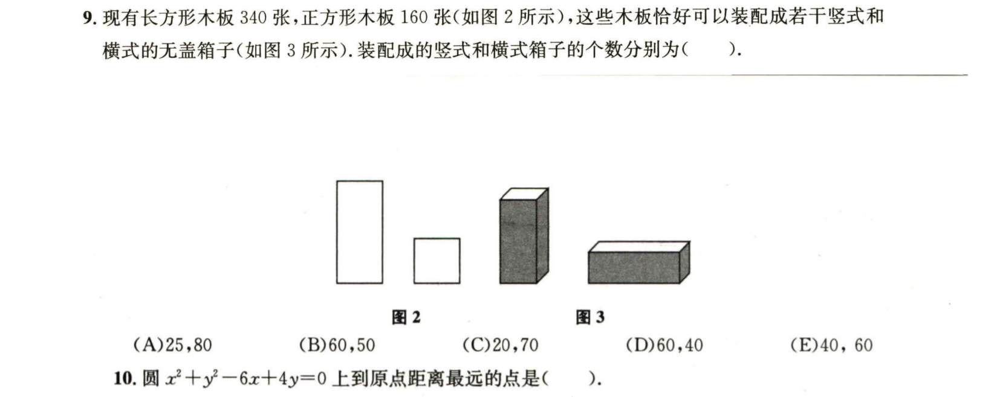

### 第 10 题

圆 $x^2 + y^2 - 6x + 4y = 0$ 上到原点距离最远的点是（ ）。

- **A**．(-3, 2)
- **B**．(3, -2)
- **C**．(6, 4)
- **D**．(-6, 4)
- **E**．(6, -4)

### 第 11 题

如图 4 所示，点 $A, B, O$ 的坐标分别为 $(4,0), (0,3), (0,0)$，若 $(x, y)$ 是 $\triangle AOB$ 中的点，则 $2x + 3y$ 的最大值为（ ）。

- **A**．6
- **B**．7
- **C**．8
- **D**．9
- **E**．12

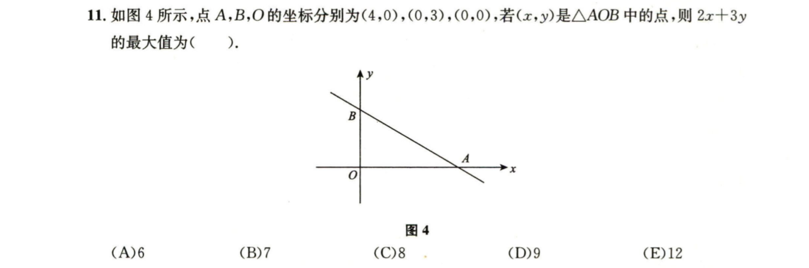

### 第 12 题

设抛物线 $y = x^2 + 2ax + b$ 与 $x$ 轴相交于 $A, B$ 两点，点 $C$ 坐标为 $(0,2)$，若 $\triangle ABC$ 的面积等于 6，则（ ）。

- **A**．$a^2 - b = 9$
- **B**．$a^2 + b = 9$
- **C**．$a^2 - b = 36$
- **D**．$a^2 + b = 36$
- **E**．$a^2 - 4b = 9$

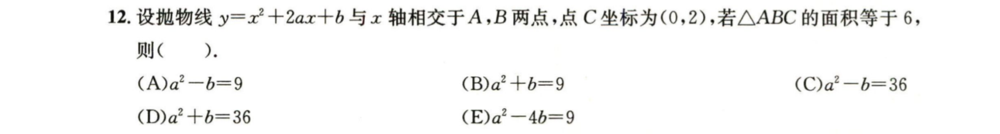

### 第 13 题

某公司以分期付款方式购买一套定价 1100 万元的设备，首期付款 100 万元，之后每月付款 50 万元，并支付上期余额的利息，月利率 $1\%$，该公司为此设备支付了（ ）。

- **A**．1195 万元
- **B**．1200 万元
- **C**．1205 万元
- **D**．1215 万元
- **E**．1300 万元

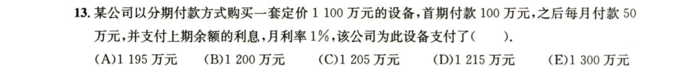

### 第 14 题

某学生要在 4 门不同课程中选修 2 门课程，这 4 门课程中的 2 门各开设一个班，另外 2 门各开设两个班，该学生不同的选课方式共有（ ）。

- **A**．6 种
- **B**．8 种
- **C**．10 种
- **D**．13 种
- **E**．15 种

### 第 15 题

如图 5 所示，在半径为 10 厘米的球体上开一个底面半径是 6 厘米的圆柱形洞，则洞的内壁面积为（ ）平方厘米。

- **A**．$48\pi$
- **B**．$288\pi$
- **C**．$96\pi$
- **D**．$576\pi$
- **E**．$192\pi$

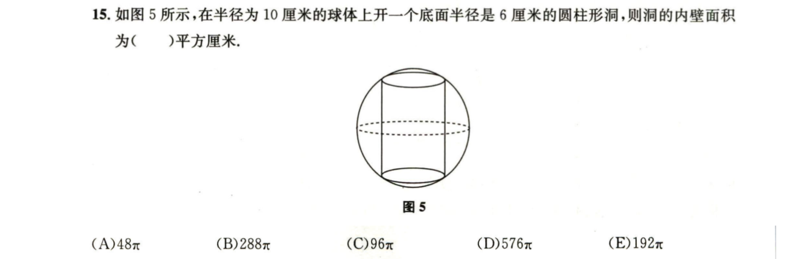

## 二、条件充分性判断：第 16～25 小题，每小题 3 分，共 30 分。要求判断每题给出的条件（1）和（2）能否充分支持题干所陈述的结论。A、B、C、D、E 五个选项为判断结果，请选择一项符合试题要求的判断，在答题卡上将所选项涂黑。

### 解题说明：
- **A**．条件（1）充分，但条件（2）不充分
- **B**．条件（2）充分，但条件（1）不充分
- **C**．条件（1）和（2）单独都不充分，但条件（1）和条件（2）联合起来充分
- **D**．条件（1）充分，条件（2）也充分
- **E**．条件（1）和（2）单独都不充分，条件（1）和条件（2）联合起来也不充分

### 第 16 题

已知某公司男员工的平均年龄和女员工的平均年龄，则能确定该公司员工的平均年龄。

（1）已知该公司的员工人数。
（2）已知该公司男、女员工的人数之比。

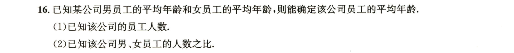

### 第 17 题

如图 6 所示，正方形 $ABCD$ 由四个相同的长方形和一个小正方形拼成，则能确定小正方形的面积。

（1）已知正方形 $ABCD$ 的面积。
（2）已知长方形的长与宽之比。

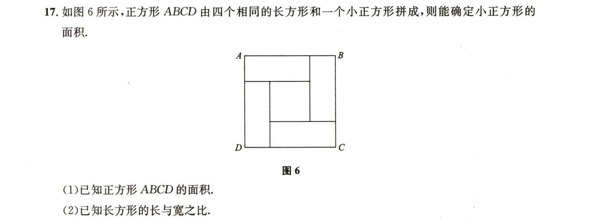

### 第 18 题

利用长度为 $a$ 和 $b$ 的两种管材能连接成长度为 37 的管道（单位：米）。

（1）$a = 3$，$b = 5$。
（2）$a = 4$，$b = 6$。

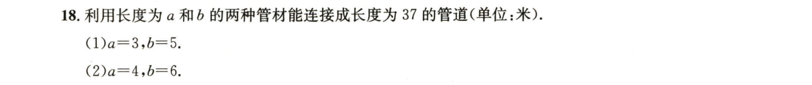

### 第 19 题

设 $x, y$ 是实数，则 $x \le 6, y \le 4$。

（1）$x \le y + 2$。
（2）$2y \le x + 2$。

### 第 20 题

将 2 升甲酒精和 1 升乙酒精混合得到丙酒精，则能确定甲、乙两种酒精的浓度。

（1）1 升甲酒精和 5 升乙酒精混合后的浓度是丙酒精浓度的 $\dfrac{1}{2}$ 倍。
（2）1 升甲酒精和 2 升乙酒精混合后的浓度是丙酒精浓度的 $\dfrac{2}{3}$ 倍。

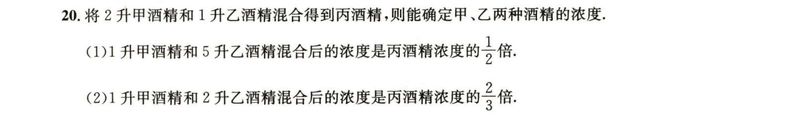

### 第 21 题

设有两组数据 $S_1: 3, 4, 5, 6, 7$ 和 $S_2: 4, 5, 6, 7, a$，则能确定 $a$ 的值。

（1）$S_1$ 与 $S_2$ 的均值相等。
（2）$S_1$ 与 $S_2$ 的方差相等。

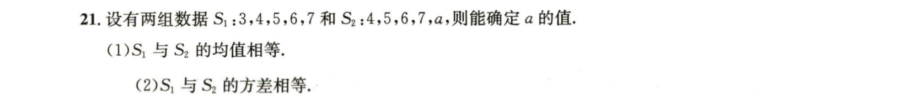

### 第 22 题

已知 $M$ 是一个平面有限点集，则平面上存在到 $M$ 中各点距离相等的点。

（1）$M$ 中只有三个点。
（2）$M$ 中的任意三点都不共线。

### 第 23 题

设 $x, y$ 是实数，则可以确定 $x^3 + y^3$ 的最小值。

（1）$xy = 1$。
（2）$x + y = 2$。

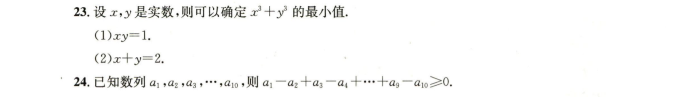

### 第 24 题

已知数列 $a_1, a_2, a_3, \dots, a_{10}$，则 $a_1 - a_2 + a_3 - a_4 + \dots + a_9 - a_{10} \ge 0$。

（1）$a_n \ge a_{n+1}, n = 1, 2, 3, \dots, 9$。
（2）$a_n^2 \ge a_{n+1}^2, n = 1, 2, 3, \dots, 9$。

### 第 25 题

已知 $f(x) = x^2 + ax + b$，则 $0 \le f(1) \le 1$。

（1）$f(x)$ 在区间 $[0,1]$ 中有两个零点。
（2）$f(x)$ 在区间 $[1,2]$ 中有两个零点。

---

## 三、逻辑推理（第 26-55 题，每小题 2 分，共 60 分）

### 第 26 题

企业要建设科技创新中心，就要推进与高校、科研院所的合作，这样才能激发自主创新的活力。
一个企业只有搭建服务科技创新发展战略的平台、科技创新与经济发展对接的平台以及聚集创新人才的平台，才能催生重大科技成果。

根据上述信息，可以得出以下哪项？

- **A**．如果企业搭建科技创新与经济发展对接的平台，就能激发其自主创新的活力。
- **B**．如果企业搭建了服务科技创新发展战略的平台，就能催生重大科技成果。
- **C**．能否推进与高校、科研院所的合作决定企业是否具有自主创新的活力。
- **D**．如果企业没有搭建聚集创新人才的平台，就无法催生重大科技成果。
- **E**．如果企业推进与高校、科研院所的合作，就能激发其自主创新的活力。

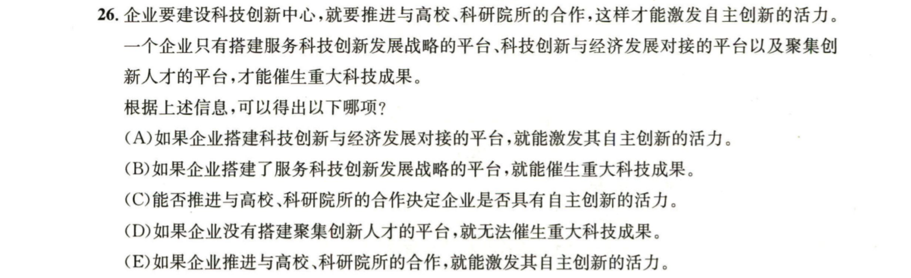

### 第 27 题

生态文明建设事关社会发展方式和人民福祉。只有实行最严格的制度、最严密的法治，才能为生态文明建设提供可靠保障；如果要实行最严格的制度、最严密的法治，就要建立责任追究制度，对那些不顾生态环境盲目决策并造成严重后果者，追究其相应的责任。

根据上述信息，可以得出以下哪项？

- **A**．如果对那些不顾生态环境盲目决策并造成严重后果者追究相应责任，就能为生态文明建设提供可靠保障。
- **B**．实行最严格的制度和最严密的法治是生态文明建设的重要目标。
- **C**．如果不建立责任追究制度，就不能为生态文明建设提供可靠保障。
- **D**．只有筑牢生态环境的制度防护墙，才能造福于民。
- **E**．如果要建立责任追究制度，就要实行最严格的制度和最严密的法治。

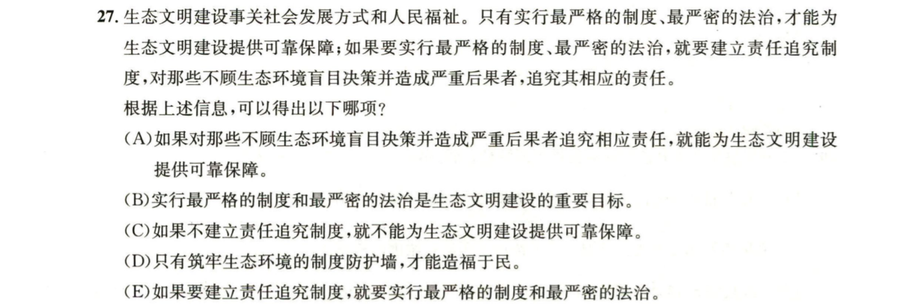

### 第 28 题

注重对孩子的自然教育，让孩子亲身感受大自然的神奇与美妙，可促进孩子释放天性，激发自身潜能；而缺乏这方面教育的孩子容易变得孤独，道德、情感与认知能力的发展都会受到一定的影响。

以下哪项与以上陈述方式最为类似？

- **A**．脱离环境保护搞经济发展是“竭泽而渔”，离开经济发展抓环境保护是“缘木求鱼”。
- **B**．只说一种语言的人，首次被诊断出患阿尔茨海默症的平均年龄约为 71 岁；说双语的人，首次被诊断出患阿尔茨海默症的平均年龄约为 76 岁；说三种语言的人，首次被诊断出患阿尔茨海默症的平均年龄约为 78 岁。
- **C**．老百姓过去“盼温饱”，现在“盼环保”；过去“求生存”，现在“求生态”。
- **D**．注重调查研究，可以让我们掌握第一手资料；闭门造车，只能让我们脱离实际。
- **E**．如果孩子完全依赖电子设备来进行学习和生活，将会对环境越来越漠视。

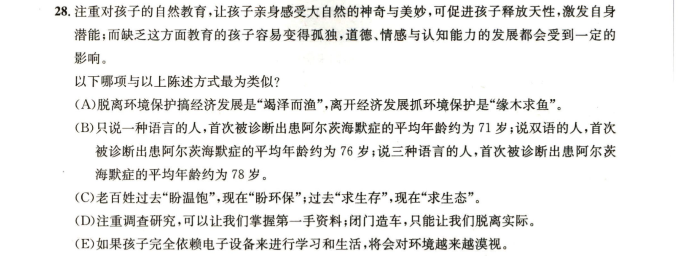

### 第 29 题

古人以干支纪年。甲乙丙丁戊己庚辛壬癸为十干，也称天干。子丑寅卯辰巳午未申酉戌亥为十二支，也称地支。顺次以天干配地支，如甲子、乙丑、丙寅、……、癸酉、甲戌、乙亥、丙子等，六十年重复一次，俗称六十花甲子。根据干支纪年，公元 2014 年为甲午年，公元 2015 年为乙未年。

根据以上陈述，可以得出以下哪项？

- **A**．现代人已不用干支纪年。
- **B**．21 世纪会有甲丑年。
- **C**．干支纪年有利于农事。
- **D**．根据干支纪年，公元 2024 年为甲寅年。
- **E**．根据干支纪年，公元 2087 年为丁未年。

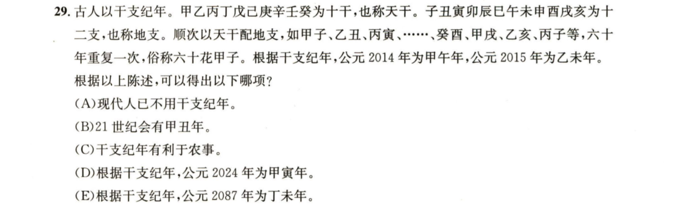

### 第 30 题

赵明与王洪都是某高校辩论协会成员，在为今年华语辩论赛招募新队员的问题上，两人发生了争执。
赵明：我们一定要选拔喜爱辩论的人。因为一个人只有喜爱辩论，才能投入精力和时间研究辩论并参加辩论赛。
王洪：我们招募的不是辩论爱好者，而是能打硬仗的辩手，无论是谁，只要能在辩论赛中发挥应有的作用，他就是我们理想的人选。

以下哪项最可能是两人争论的焦点？

- **A**．招募的标准是从现实出发还是从理想出发。
- **B**．招募的目的是研究辩论规律还是培养实战能力。
- **C**．招募的目的是为了培养新人还是赢得比赛。
- **D**．招募的标准是对辩论的爱好还是辩论的能力。
- **E**．招募的目的是为了集体荣誉还是满足个人爱好。

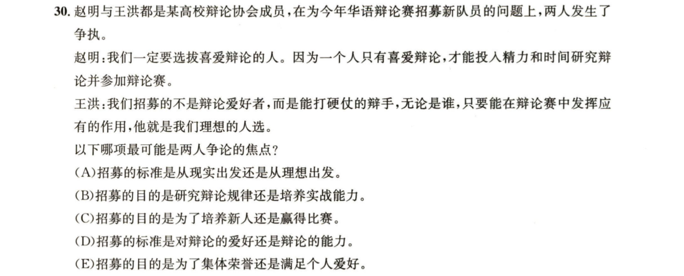

### 第 31 题

在某届洲际杯足球大赛中，第一阶段某小组单循环赛共有 4 支队伍参加，每支队伍需要在这一阶段比赛三场。甲国足球队在该小组的前两轮比赛中一平一负。在第三轮比赛之前，甲国足球队教练在新闻发布会上表示：“只有我们在下一场比赛中取得胜利并且本组的另外一场比赛打成平局，我们才有可能从这个小组出线。”

如果甲国足球队教练的陈述为真，则以下哪项是不可能的？

- **A**．第三轮比赛该小组两场比赛都分出了胜负，甲国足球队从小组出线。
- **B**．甲国足球队第三场比赛取得了胜利，但他们未能从小组出线。
- **C**．第三轮比赛甲国足球队取得了胜利，该小组另一场比赛打成平局，甲国足球队未能从小组出线。
- **D**．第三轮比赛该小组另外一场比赛打成平局，甲国足球队从小组出线。
- **E**．第三轮比赛该小组两场比赛都打成了平局，甲国足球队未能从小组出线。

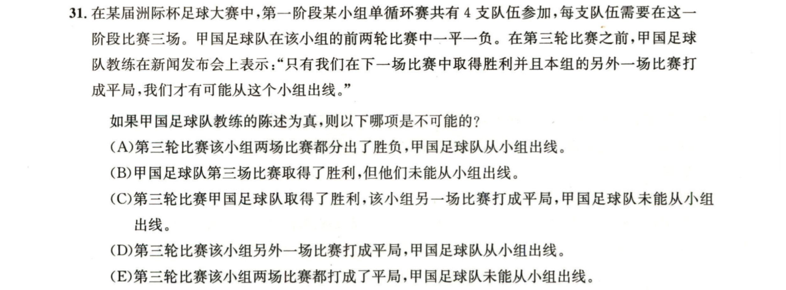

### 第 32 题

考古学家发现，那件仰韶文化晚期的土坯砖边缘整齐，并且没有切割的痕迹，由此他们推测，这件土坯砖应当是使用木质模具压制成型的，而其他 5 件由土坯砖经过烧制而成的烧结砖，经检测其当时的烧制温度为 850℃~900℃。由此考古学家进一步推测，当时的砖是先使用模具将黏土做成土坯，然后再经过高温烧制而成的。

以下哪项如果为真，最能支持上述考古学家的推测？

- **A**．仰韶文化晚期的年代约为公元前 3500 年—公元前 3000 年。
- **B**．仰韶文化晚期，人们已经掌握了高温冶炼技术。
- **C**．出土的 5 件烧结砖距今已有 5000 年，确实属于仰韶文化晚期的物品。
- **D**．没有采用模具而成型的土坯砖，其边缘或者不整齐，或者有切割痕迹。
- **E**．早在西周时期，中原地区的人就可以烧制铺地砖和空心砖。

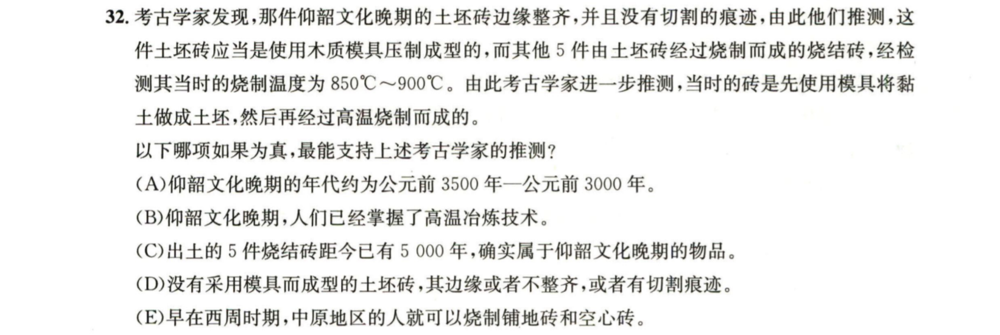

### 第 33 题

研究人员发现，人类存在 3 种核苷酸基因类型：AA 型、AG 型以及 GG 型。一个人有 36% 的概率是 AA 型，有 48% 的概率是 AG 型，有 16% 的概率是 GG 型。在 1200 名参与实验的老年人中，拥有 AA 型和 AG 型基因类型的人都在上午 11 时之前去世，而拥有 GG 型基因类型的人几乎都在下午 6 时左右去世。研究人员据此认为：GG 型基因类型的人会比其他人平均晚死 7 个小时。

以下哪项如果为真，最能质疑上述研究人员的观点？

- **A**．拥有 GG 型基因类型的实验对象容易患上心血管疾病。
- **B**．当死亡临近的时候，人体会还原到一种更加自然的生理节律感应阶段。
- **C**．有些人是因为疾病或者意外事故等其他因素而死亡的。
- **D**．对人死亡时间的比较，比一天中的哪一时刻更重要的是哪一年、哪一天。
- **E**．平均寿命的计算依据应是实验对象的生命存续长度，而不是实验对象的死亡时间。

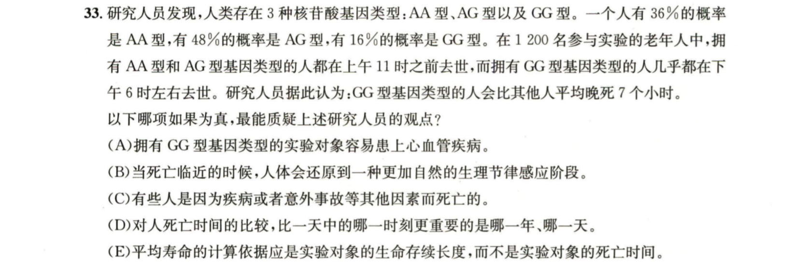

### 第 34 题

某市消费者权益保护条例明确规定，消费者对其所购买商品可以“7 天内无理由退货”，但这项规定出台后并未得到顺利执行，众多消费者在 7 天内“无理由”退货时，常常遭遇商家的阻挠，他们以商品已做特价处理、商品已经开封或使用等为理由拒绝退货。

以下哪项如果为真，最能质疑商家阻挠退货的理由？

- **A**．开封验货后，如果商品规格、质量等问题来自消费者本人，他们应为此承担责任。
- **B**．那些做特价处理的商品，本来质量就没有保证。
- **C**．如果不开封验货，就不能知道商品是否存在质量问题。
- **D**．政府总偏向消费者，这对于商家来说是不公平的。
- **E**．商品一旦开封或使用了，即使不存在问题，消费者也可以选择退货。

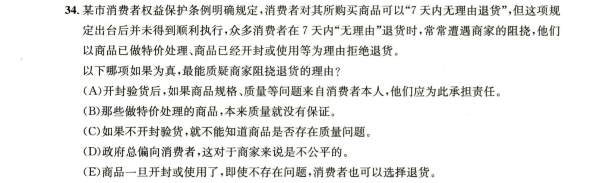

### 第 35 题

某县县委关于下周一几位领导的工作安排如下：
（1） 如果李副书记在县城值班，那么他就要参加宣传工作例会。
（2） 如果张副书记在县城值班，那么他就要做信访接待工作。
(3) 如果王书记下乡调研，那么张副书记或李副书记就需在县城值班。
(4) 只有参加宣传工作例会或做信访接待工作，王书记才不下乡调研。
(5) 宣传工作例会只需分管宣传的副书记参加，信访接待工作也只需一名副书记参加。

根据上述工作安排，可以得出以下哪项？

- **A**．张副书记做信访接待工作。
- **B**．王书记下乡调研。
- **C**．李副书记参加宣传工作例会。
- **D**．李副书记做信访接待工作。
- **E**．张副书记参加宣传工作例会。

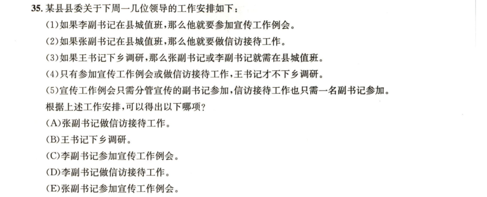

### 第 36 题

近年来，越来越多的机器人被用于在战场上执行侦察、运输、拆弹等任务，甚至将来冲锋陷阵的都不再是人，而是形形色色的机器人。人类战争正在经历自核武器诞生以来最深刻的革命。有专家据此分析指出，机器人战争技术的出现可以使人类远离危险，更安全、更有效率地实现战争目标。

以下哪项如果为真，最能质疑上述专家的观点？

- **A**．现代人类掌控机器人，但未来机器人可能会掌控人类。
- **B**．因不同国家之间军事科技实力的差距，机器人战争技术只会让部分国家远离危险。
- **C**．机器人战争技术有助于摆脱以往大规模杀戮的血腥模式，从而让现代战争变得更为人道。
- **D**．掌握机器人战争技术的国家为数不多，将来战争的发生更为频繁也更为血腥。
- **E**．全球化时代的机器人战争技术要消耗更多资源，破坏生态环境。

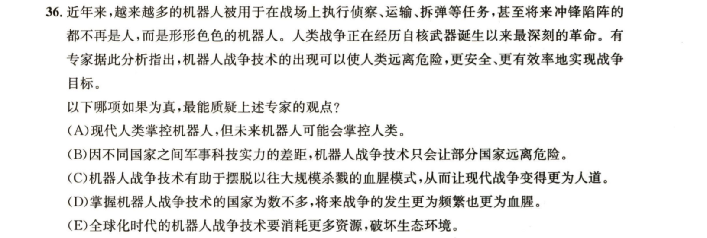

### 第 37 题

郝大爷过马路时不幸摔倒昏迷，所幸有小伙子及时将他送往医院救治。郝大爷病情稳定后，有 4 位陌生的小伙子陈安、李康、张幸、汪福来医院看望他。郝大爷问他们究竟是谁送他来医院的，他们的回答如下：
陈安：我们 4 人都没有送您来医院。
李康：我们 4 人中有人送您来医院。
张幸：李康和汪福至少有一人没有送您来医院。
汪福：送您来医院的人不是我。
后来证实上述 4 人中有两人说真话，有两人说假话。

根据上述信息，可以得出以下哪项？

- **A**．说真话的是李康和张幸。
- **B**．说真话的是陈安和张幸。
- **C**．说真话的是李康和汪福。
- **D**．说真话的是张幸和汪福。
- **E**．说真话的是陈安和汪福。

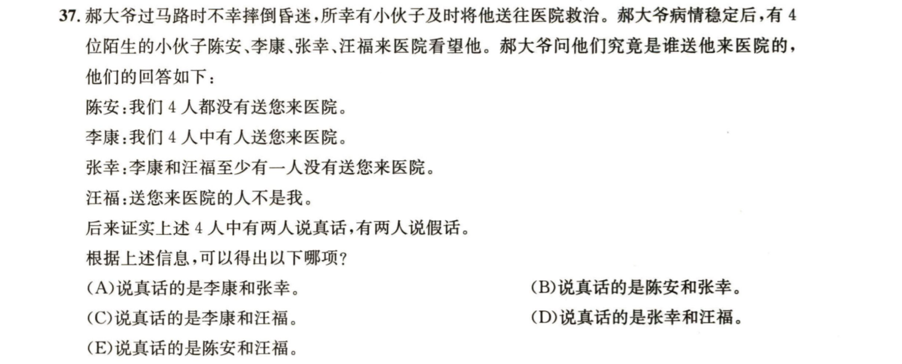

### 第 38 题

开车上路，一个人不仅需要有良好的守法意识，也需要有特别的“理性计算”：在拥堵的车流中，只要有“加塞”的，你开的车就一定要让着它；你开着车在路上正常直行，有车不打方向灯在你近旁突然横过来要撞上你，原来它想要变道，这时你也得让着它。

以下除哪项外，均能质疑上述“理性计算”的观点？

- **A**．有理的让着没理的，只会助长歪风邪气，有悖于社会的法律和道德。
- **B**．“理性计算”其实就是胆小怕事，总觉得凡事能躲则躲，但有的事很难躲过。
- **C**．一味退让也会给行车带来极大的危险，不但可能伤及自己，而且也可能伤及无辜。
- **D**．即使碰上也不可怕，碰上之后如果立即报警，警方一般会有公正的裁决。
- **E**．如果不让，就会碰上；碰上之后，即使自己有理，也会有许多麻烦。

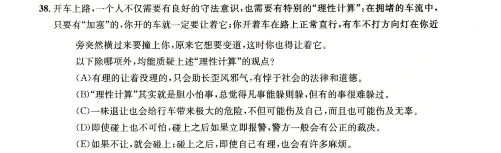

### 第 39 题

有专家指出，我国城市规划缺少必要的气象论证，城市的高楼建得高耸而密集，阻碍了城市的通风循环。有关资料显示，近几年国内许多城市的平均风速已下降 10%。风速下降，意味着大气扩散能力减弱，导致大气污染物滞留时间延长，易形成雾霾天气和热岛效应。为此，有专家提出建立“城市风道”的设想，即在城市里制造几条通畅的通风走廊，让风在城市中更加自由地进出，促进城市空气的更新循环。

以下哪项如果为真，最能支持上述建立“城市风道”的设想？

- **A**．城市风道形成的“穿街风”，对建筑物的安全影响不大。
- **B**．风从八方来，“城市风道”的设想过于主观和随意。
- **C**．有风道但没有风，就会让城市风道成为无用的摆设。
- **D**．有些城市已拥有建立“城市风道”的天然基础。
- **E**．城市风道不仅有利于“驱霾”，还有利于散热。

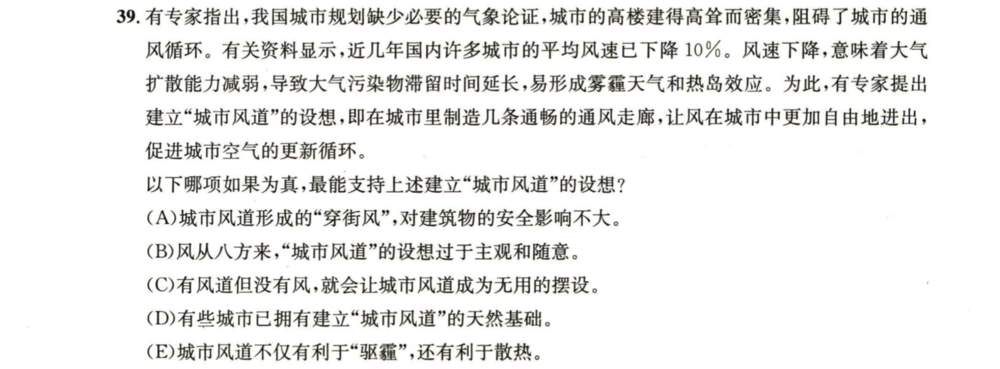

### 第 40 题

2014 年，为迎接 APEC 会议的召开，北京、天津、河北等地实施“APEC 治理模式”，采取了有史以来最严格的减排措施。果然，令人心醉的“APEC 蓝”出现了。然而，随着会议的结束，“APEC 蓝”也渐渐消失了。对此，有些人士表示困惑，既然政府能在短期内实施“APEC 治理模式”取得良好效果，为什么不将这一模式长期坚持下去呢？

以下除哪项外，均能解释人们的困惑？

- **A**．最严格的减排措施在落实过程中已产生很多难以解决的实际困难。
- **B**．如果近期将“APEC 治理模式”常态化，将会严重影响地方经济和社会发展。
- **C**．任何环境治理都需要付出代价，关键在于付出的代价是否超出收益。
- **D**．短期严格的减排措施只能是权宜之计，大气污染治理仍需从长计议。
- **E**．如果 APEC 会议期间北京雾霾频发，就会影响我们国家的形象。

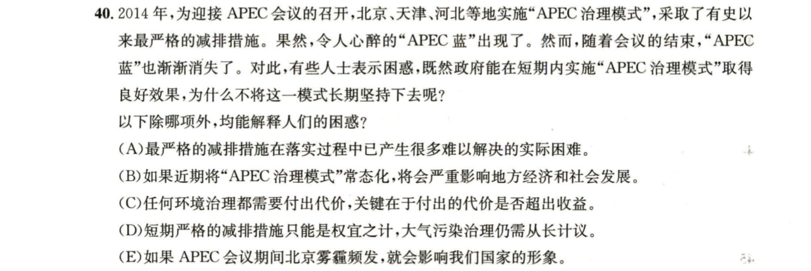

### 第 41 题

根据现有的物理学定律，任何物质的运动速度都不能超过光速，但是最近一次天文观测结果向这条定律发起了挑战。距离地球遥远的 IC310 星系拥有一个活跃的黑洞，掉入黑洞的物质产生了伽马射线冲击波。有些天文学家发现，这束伽马射线的速度超过了光速，因为它只用了 4.8 分钟就穿越了黑洞边界，而光需要 25 分钟才能走完这段距离。由此，这些天文学家提出，光速不变定律需要修改了。

以下哪项如果为真，最能质疑上述天文学家所做的结论？

- **A**．或者光速不变定律已经过时，或者天文学家的观测有误。
- **B**．如果天文学家的观测没有问题，光速不变定律就需要修改。
- **C**．要么天文学家的观测有误，要么有人篡改了天文观测数据。
- **D**．天文观测数据可能存在偏差，毕竟 IC310 星系离地球很远。
- **E**．光速不变定律已历经过去多次实践检验，没有出现反例。

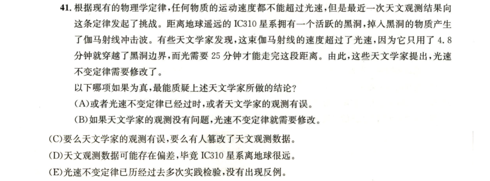

### 第 42 题

某公司办公室茶水间提供自助式收费饮料。职员拿完饮料后，自己把钱放到特设的收款箱中。研究者为了判断职员在无人监督时，其自律水平会受哪些因素的影响，特地在收款箱上方贴了一张装饰图片，每周一换。装饰图片有时是一些花朵，有时是一双眼睛。一个有趣的现象出现了：贴着“眼睛”的那一周，收款箱里的钱远远超过贴其他图片的情形。

以下哪项如果为真，最能解释上述实验现象？

- **A**．该公司职员看到“眼睛”图片时，就能联想到背后可能有人看着他们。
- **B**．在该公司工作的职员，其自律能力超过社会中的其他人。
- **C**．该公司职员看着“花朵”图片时，心情容易变得愉快。
- **D**．眼睛是心灵的窗口，该公司职员看到“眼睛”图片时会有一种莫名的感动。
- **E**．在无人监督的情况下，大部分人缺乏自律能力。

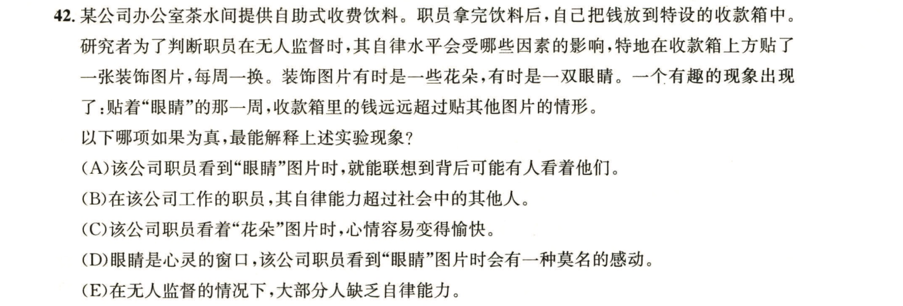

### 43~44 题基于以下题干

> 某皇家园林依中轴线布局，从前到后依次排列着七个庭院。这七个庭院分别以汉字“日”“月”“金”“木”“水”“火”“土”来命名。已知：
> （1） “日”字庭院不是最前面的那个庭院。
> （2） “火”字庭院和“土”字庭院相邻。
> (3) “金”“月”两庭院间隔的庭院数与“木”“水”两庭院间隔的庭院数相同。

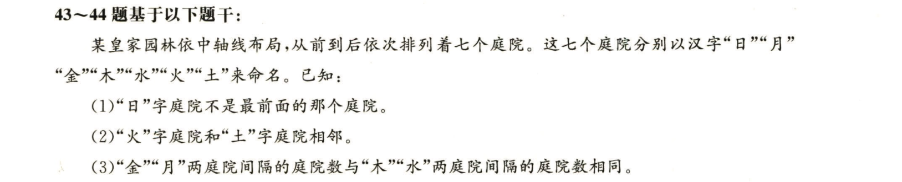

### 第 43 题

根据上述信息，下列哪个庭院可能是“日”字庭院？

- **A**．第一个庭院。
- **B**．第二个庭院。
- **C**．第四个庭院。
- **D**．第五个庭院。
- **E**．第六个庭院。

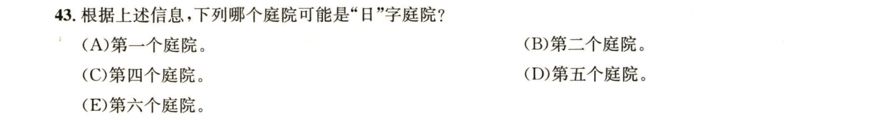

### 第 44 题

如果第二个庭院是“土”字庭院，可以得出以下哪项？

- **A**．第七个庭院是“水”字庭院。
- **B**．第五个庭院是“木”字庭院。
- **C**．第四个庭院是“金”字庭院。
- **D**．第三个庭院是“月”字庭院。
- **E**．第一个庭院是“火”字庭院。

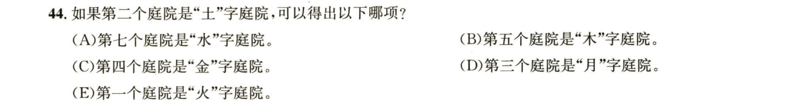

### 第 45 题

在一项关于“社会关系如何影响人的死亡率”的课题研究中，研究人员惊奇地发现：不论种族、收入、体育锻炼等因素，一个乐于助人、和他人相处融洽的人，其平均寿命长于一般人，在男性中尤其如此；相反，心怀恶意、损人利己、和他人相处不融洽的人 70 岁之前的死亡率比正常人高出 1.5~2 倍。

以下哪项如果为真，最能解释上述发现？

- **A**．身心健康的人容易和他人相处融洽，而心理有问题的人与他人很难相处。
- **B**．男性通常比同年龄段的女性对他人有更强的“敌视情绪”，多数国家男性的平均寿命也因此低于女性。
- **C**．与人为善带来轻松愉悦的情绪，有益身体健康；损人利己则带来紧张的情绪，有损身体健康。
- **D**．心存善念、思想豁达的人大多精神愉悦、身体健康。
- **E**．那些自我优越感比较强的人通常“敌视情绪”也比较强，他们长时间处于紧张状态。

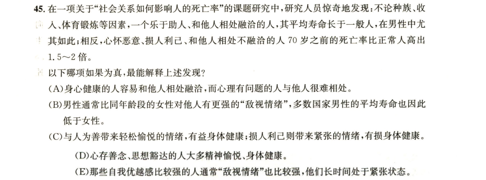

### 第 46 题

超市中销售的苹果常常留有一定的油脂痕迹，表面显得油光滑亮。牛师傅认为，这是残留在苹果上的农药所致，水果在收摘之前都喷洒了农药，因此，消费者在超市购买水果后，一定要清洗干净方能食用。

以下哪项最可能是牛师傅的看法所依赖的假设？

- **A**．除了苹果，其他许多水果运至超市时也留有一定的油脂痕迹。
- **B**．超市里销售的水果并未得到彻底清洗。
- **C**．只有那些在水果上能留下油脂痕迹的农药才可能被清洗掉。
- **D**．许多消费者并不在意超市销售的水果是否清洗过。
- **E**．在水果收摘之前喷洒的农药大多数会在水果上留下油脂痕迹。

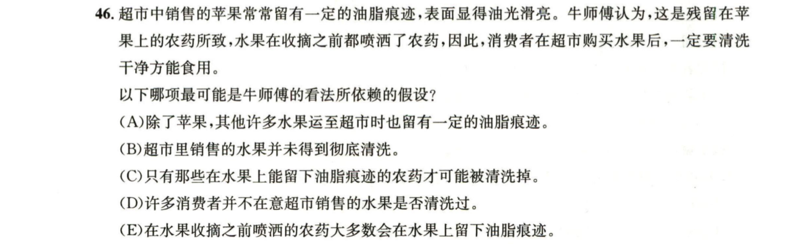

### 第 47 题

许多人不仅不理解别人，而且也不理解自己，尽管他们可能曾经试图理解别人，但这样的努力注定会失败，因为不理解自己的人是不可能理解别人的。可见，那些缺乏自我理解的人是不会理解别人的。

以下哪项最能说明上述论证的缺陷？

- **A**．使用了“自我理解”的概念，但并未给出定义。
- **B**．没有考虑“有些人不愿意理解自己”这样的可能性。
- **C**．没有正确把握理解别人和理解自己之间的关系。
- **D**．结论仅仅是对其论证前提的简单重复。
- **E**．间接指责人们不能换位思考，不能相互理解。

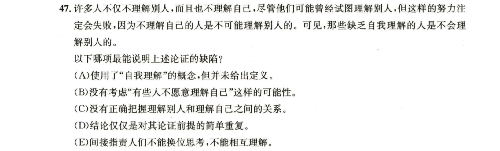

### 第 48 题

在编号 1、2、3、4 的 4 个盒子中装有绿茶、红茶、花茶和白茶四种茶。每个盒子中只装一种茶，每种茶只装在一个盒子中。已知：
（1） 装绿茶和红茶的盒子在 1、2、3 号范围之内。
（2） 装红茶和花茶的盒子在 2、3、4 号范围之内。
(3) 装白茶的盒子在 1、3 号范围之内。

根据上述信息，可以得出以下哪项？

- **A**．绿茶装在 3 号盒子中。
- **B**．花茶装在 4 号盒子中。
- **C**．白茶装在 3 号盒子中。
- **D**．红茶装在 2 号盒子中。
- **E**．绿茶装在 1 号盒子中。

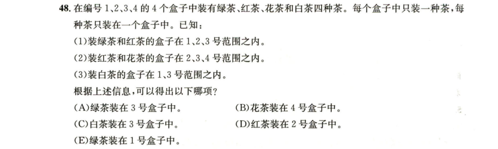

### 第 49 题

在某项目招标过程中，赵嘉、钱宜、孙斌、李汀、周武、吴纪 6 人作为各自公司代表参与投标，有且只有一人中标。关于究竟谁是中标者，招标小组中有 3 位成员各自谈了自己的看法：
（1） 中标者不是赵嘉就是钱宜。
（2） 中标者不是孙斌。
(3) 周武和吴纪都没有中标。
经过深入调查，发现上述 3 人中只有一人的看法是正确的。

根据以上信息，以下哪项中的 3 人都可以确定没有中标？

- **A**．赵嘉、孙斌、李汀。
- **B**．赵嘉、钱宜、李汀。
- **C**．孙斌、周武、吴纪。
- **D**．赵嘉、周武、吴纪。
- **E**．钱宜、孙斌、周武。

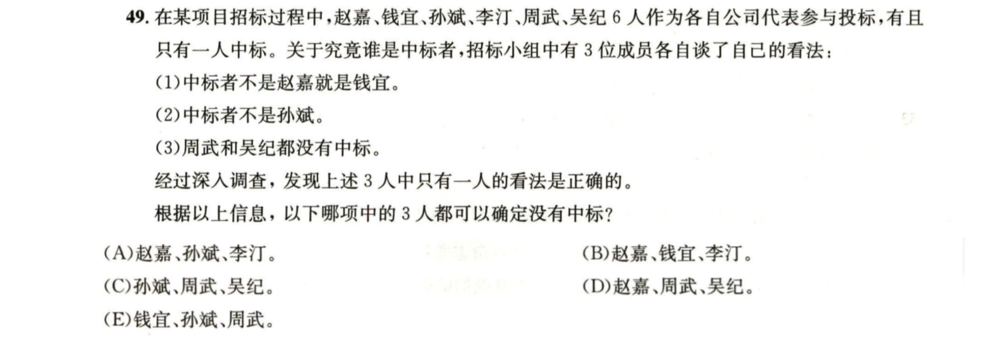

### 第 50 题

如今，电子学习机已全面进入儿童的生活。电子学习机将文字与图像、声音结合起来，既生动形象，又富有趣味性，使儿童独立阅读成为可能。但是，一些儿童教育专家却对此发出警告，电子学习机可能不利于儿童成长。他们认为，父母应该抽时间陪孩子一起阅读纸质图书。陪孩子一起阅读纸质图书，并不是简单地让孩子读书识字，而是在交流中促进其心灵的成长。

以下哪项如果为真，最能支持上述专家的观点？

- **A**．电子学习机最大的问题是让父母从孩子的阅读行为中走开，减少了父母与孩子的日常交流。
- **B**．接触电子产品越早，就越容易上瘾，长期使用电子学习机会形成“电子瘾”。
- **C**．在使用电子学习机时，孩子往往更多关注其使用功能而非学习内容。
- **D**．纸质图书有利于保护儿童视力，有利于父母引导儿童形成良好的阅读习惯。
- **E**．现代生活中年轻父母工作压力较大，很少有时间能与孩子一起阅读。

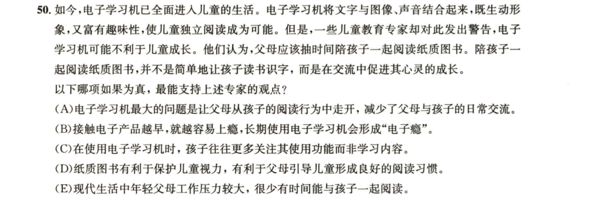

### 第 51 题

田先生认为，绝大部分笔记本电脑运行速度慢的原因不是 CPU 性能太差，也不是内存容量太小，而是硬盘速度太慢，给老旧的笔记本电脑换装固态硬盘可以大幅提升使用者的游戏体验。

以下哪项如果为真，最能质疑田先生的观点？

- **A**．一些笔记本电脑使用者的使用习惯不好，使得许多运行程序占据大量内存，导致电脑运行速度缓慢。
- **B**．销售固态硬盘的利润远高于销售传统的笔记本电脑硬盘。
- **C**．固态硬盘很贵，给老旧笔记本换装硬盘费用不低。
- **D**．使用者的游戏体验很大程度上取决于笔记本电脑的显卡，而老旧笔记本电脑显卡较差。
- **E**．少部分老旧笔记本电脑的 CPU 性能很差，内存也小。

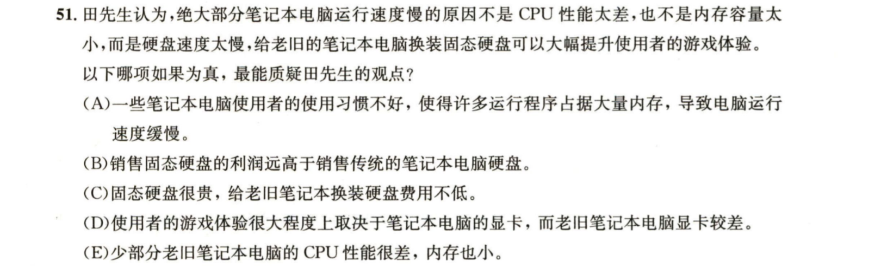

### 52~53 题基于以下题干

> 钟医生：“通常，医学研究的重要成果在杂志上发表之前需要经过匿名评审，这需要耗费不少时间。如果研究者能放弃这段等待时间而事先公开其成果，我们的公共卫生水平就可以伴随着医学发现更快获得提高。因为新医学信息的及时公布将允许人们利用这些信息提高他们的健康水平。”

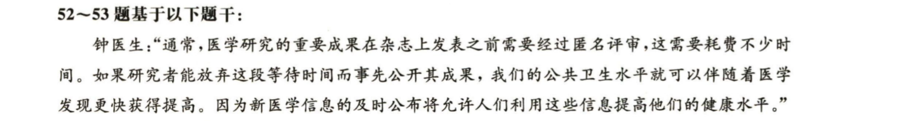

### 第 52 题

以下哪项最可能是钟医生论证所依赖的假设？

- **A**．即使医学论文还没有在杂志上发表，人们还是会使用已公开的相关新信息。
- **B**．因为工作繁忙，许多医学研究者不愿成为论文评审者。
- **C**．首次发表于匿名评审杂志上的新医学信息一般无法引起公众的注意。
- **D**．许多医学杂志的论文评审者本身并不是医学研究专家。
- **E**．部分医学研究者愿意放弃在杂志上发表，而选择事先公开其成果。

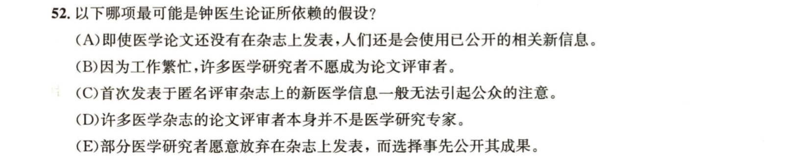

### 第 53 题

以下哪项如果为真，最能削弱钟医生的论证？

- **A**．大部分医学杂志不愿意放弃匿名评审制度。
- **B**．社会公共卫生水平的提高还取决于其他因素，并不完全依赖于医学新发现。
- **C**．匿名评审常常能阻止那些含有错误结论的文章发表。
- **D**．有些媒体常常会提前报道那些匿名评审杂志准备发表的医学研究成果。
- **E**．人们常常根据新发表的医学信息来调整他们的生活方式。

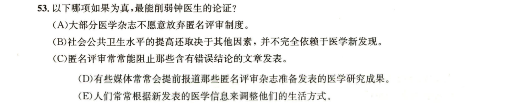

### 54~55 题基于以下题干

> 江海大学的校园美食节开幕了，某女生宿舍有 5 人积极报名参加此次活动，她们的姓名分别为金粲、木心、水仙、火珊、土润。举办方要求，每位报名者只做一道菜品参加评比，但需自备食材。限于条件，该宿舍所备食材仅有 5 种：金针菇、木耳、水蜜桃、火腿和土豆，要求每种食材只能有 2 人选用，每人又只能选用 2 种食材，并且每人所选食材名称的第一个字与自己的姓氏均不相同。已知：
> （1） 如果金粲选水蜜桃，则水仙不选金针菇。
> （2） 如果木心选金针菇或土豆，则她也须选木耳。
> (3) 如果火珊选水蜜桃，则她也须选木耳和土豆。
> (4) 如果木心选火腿，则火珊不选金针菇。

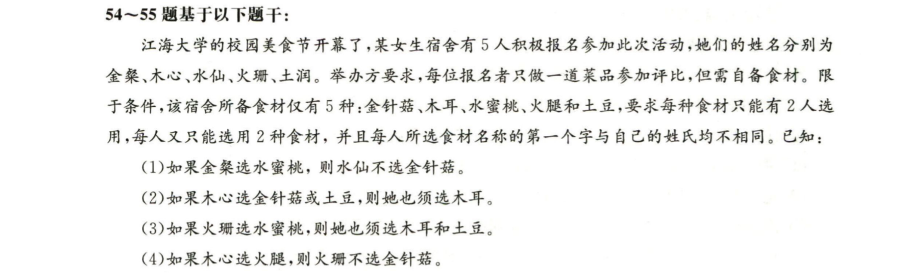

### 第 54 题

根据上述信息，可以得出以下哪项？

- **A**．木心选用水蜜桃、土豆。
- **B**．水仙选用金针菇、火腿。
- **C**．土润选用金针菇、水蜜桃。
- **D**．火珊选用木耳、水蜜桃。
- **E**．金粲选用木耳、土豆。

### 第 55 题

如果水仙选用土豆，则可以得出以下哪项？

- **A**．木心选用金针菇、水蜜桃。
- **B**．金粲选用木耳、火腿。
- **C**．火珊选用金针菇、土豆。
- **D**．水仙选用木耳、土豆。
- **E**．土润选用水蜜桃、火腿。

---

## 四、写作（第 56-57 题，共 65 分）

### 第 56 题 · 论证有效性分析 (30 分)

**分析下述论证中存在的缺陷与漏洞，选择若干要点，写一篇 600 字左右的文章，对该论证的有效性进行分析和评论。**（论证有效性分析的一般要点是：概念特别是核心概念的界定和使用是否准确并前后一致，有无各种明显的逻辑错误，论证的论据是否成立并支持结论，结论成立的条件是否充分等。）

> 现在人们常在谈论大学毕业生就业难的问题，其实大学生的就业并不难。
>
> 据国家统计局数据，2012 年我国劳动年龄人口比 2011 年减少了 345 万，这说明我国劳动力的供应从过剩变成了短缺。据报道，近年长三角等地区频频出现“用工荒”现象，2015 年第二季度我国岗位空缺与求职人数的比率约为 1.06，表明劳动力市场需求大于供给。因此，我国的大学生毕业生其实是供不应求的。
>
> 还有，一个人受教育程度越高，他的整体素质也就越高，适应能力就越强，当然也就越容易就业。大学生显然比其他社会群体更容易就业，再说大学生就业难就没有道理了。
>
> 实际上，一部分大学生就业难，是因为其所学专业与市场需求不相适应，或对就业岗位的要求过高。因此，只要根据市场需求调整高校专业设置，对大学生进行就业教育以改变他们的就业观念，鼓励大学生自主创业，那么大学生就业难问题将不复存在。
>
> 总之，大学生的就业并不是什么问题，我们大可不必为此顾虑重重。

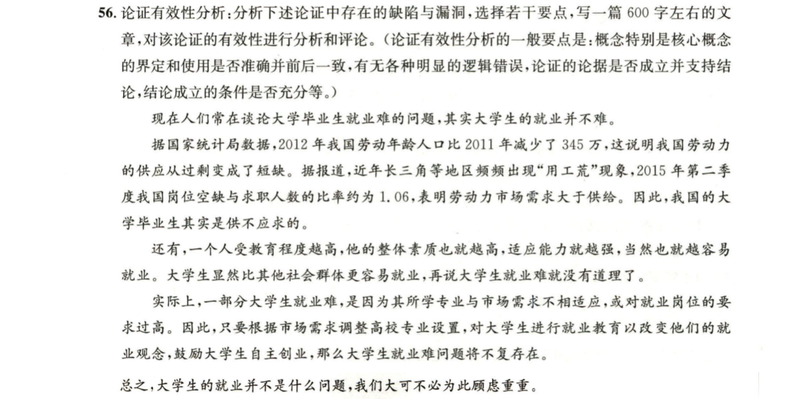

### 第 57 题 · 论说文 (35 分)

**根据下述材料，写一篇 700 字左右的论说文，题目自拟。**

> 亚里士多德说：“城邦的本质在于多样性，而不在于一致性。……无论是家庭还是城邦，它们的内部都有着一定的一致性。不然的话，它们是不可能组建起来的。但这种一致性是有一定限度的。……同一种声音无法实现和谐，同一个音阶也无法组成旋律。城邦也是如此，它是一个多面体。人们只能通过教育使存在着各种差异的公民统一起来组成一个共同体。”

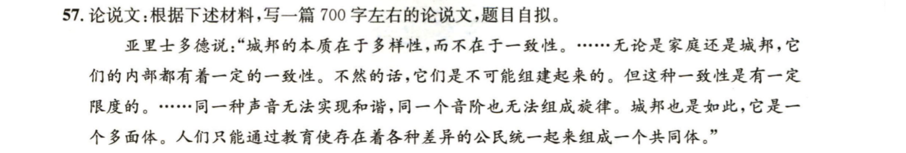
