# 2018 年全国硕士研究生招生考试管理类专业学位联考综合能力试题 (199)

## 一、问题求解：第 1-15 小题，每小题 3 分，共 45 分。下列每题给出的 A、B、C、D、E 五个选项中，只有一项是符合试题要求的。请在答题卡上将所选的字母涂黑。

### 第 1 题

学科竞赛设一等奖、二等奖和三等奖，比例为 $1:3:8$，获奖率为 $30\%$。已知 10 人获得一等奖，则参加竞赛的人数为（ ）人。

- **A**．300
- **B**．400
- **C**．500
- **D**．550
- **E**．600

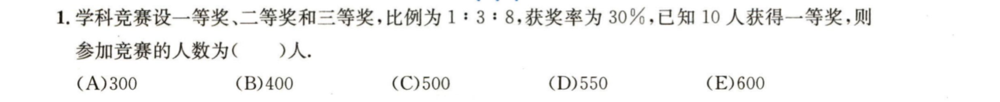

### 第 2 题

为了解某公司员工的年龄结构，按男、女人数的比例进行了随机抽样，结果如表 1 所示：

| 男员工年龄（岁） | 23 | 26 | 28 | 30 | 32 | 34 | 36 | 38 | 41 |
| :--- | :--- | :--- | :--- | :--- | :--- | :--- | :--- | :--- | :--- |
| 女员工年龄（岁） | 23 | 25 | 27 | 27 | 29 | 31 | | | |

根据表中数据统计，该公司男员工的平均年龄与全体员工的平均年龄分别是（ ）（单位：岁）。

- **A**．32, 30
- **B**．32, 29.5
- **C**．32, 27
- **D**．30, 27
- **E**．29.5, 27

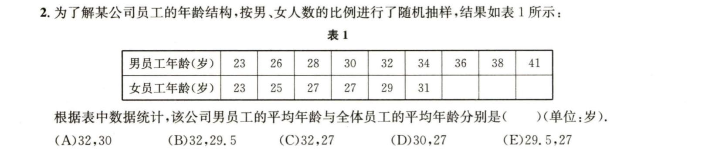

### 第 3 题

单位采取分段收费的方式收取网络流量（单位：GB）费用：每月流量 20（含）以内免费，流量 20 到 30（含）的每 GB 收费 1 元，流量 30 到 40（含）的每 GB 收费 3 元，流量 40 以上的每 GB 收费 5 元。小王这个月用了 45GB 的流量，则他应该交费（ ）。

- **A**．45
- **B**．65
- **C**．75
- **D**．85
- **E**．135

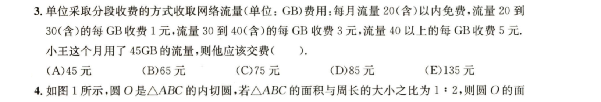

### 第 4 题

如图 1 所示，圆 $O$ 是 $\triangle ABC$ 的内切圆，若 $\triangle ABC$ 的面积与周长的大小之比为 $1:2$，则圆 $O$ 的面积为（ ）。

- **A**．$\pi$
- **B**．$2\pi$
- **C**．$3\pi$
- **D**．$4\pi$
- **E**．$5\pi$

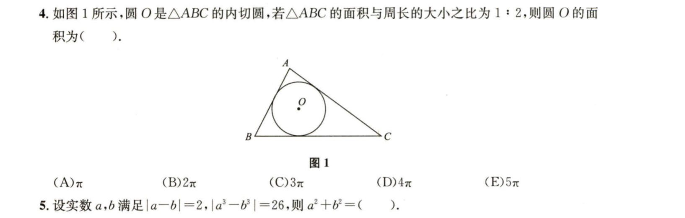

### 第 5 题

设实数 $a, b$ 满足 $|a - b| = 2, |a^3 - b^3| = 26$，则 $a^2 + b^2 = $（ ）。

- **A**．30
- **B**．22
- **C**．15
- **D**．13
- **E**．10

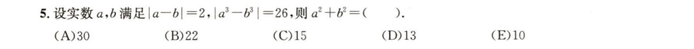

### 第 6 题

有 96 位顾客至少购买了甲、乙、丙三种商品中的一种，经调查：同时购买了甲、乙两种商品的有 8 位，同时购买了甲、丙两种商品的有 12 位，同时购买了乙、丙两种商品的有 6 位，同时购买了三种商品的有 2 位。则仅购买一种商品的顾客有（ ）。

- **A**．70
- **B**．72
- **C**．74
- **D**．76
- **E**．82

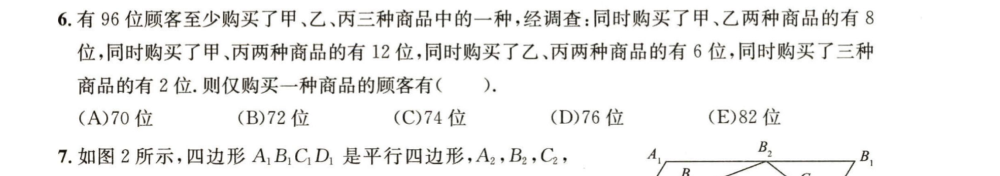

### 第 7 题

如图 2 所示，四边形 $A_1 B_1 C_1 D_1$ 是平行四边形，$A_2, B_2, C_2, D_2$ 分别是 $A_1 B_1 C_1 D_1$ 四边的中点，$A_3, B_3, C_3, D_3$ 分别是四边形 $A_2 B_2 C_2 D_2$ 四边的中点，依次下去，得到四边形序列 $A_n B_n C_n D_n (n=1,2,3,\dots)$。设 $A_n B_n C_n D_n$ 的面积为 $S_n$，且 $S_1 = 12$，则 $S_1 + S_2 + S_3 + \dots = $（ ）。

- **A**．16
- **B**．20
- **C**．24
- **D**．28
- **E**．30

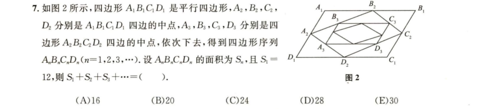

### 第 8 题

将 6 张不同的卡片 2 张一组分别装入甲、乙、丙 3 个袋中，若指定的两张卡片要在同一组，则不同的装法有（ ）。

- **A**．12
- **B**．18
- **C**．24
- **D**．30
- **E**．36

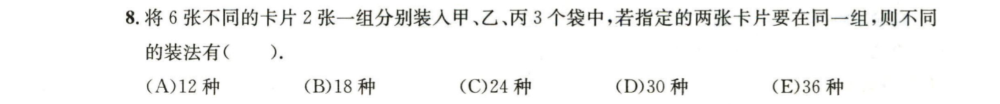

### 第 9 题

甲、乙两人进行围棋比赛，约定先胜 2 盘者赢得比赛。已知每盘棋甲获胜的概率是 0.6，乙获胜的概率是 0.4。若乙在第一盘获胜，则甲赢得比赛的概率为（ ）。

- **A**．0.144
- **B**．0.288
- **C**．0.36
- **D**．0.4
- **E**．0.6

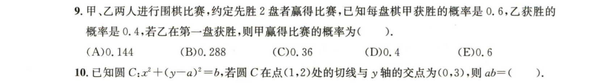

### 第 10 题

已知圆 $C: x^2 + (y-a)^2 = b$，若圆 $C$ 在点 $(1,2)$ 处的切线与 $y$ 轴的交点为 $(0,3)$，则 $ab = $（ ）。

- **A**．-2
- **B**．-1
- **C**．0
- **D**．1
- **E**．2

### 第 11 题

羽毛球队有 4 名男运动员和 3 名女运动员，从中选出两对参加混双比赛，则不同的选派方式有（ ）。

- **A**．9
- **B**．18
- **C**．24
- **D**．36
- **E**．72

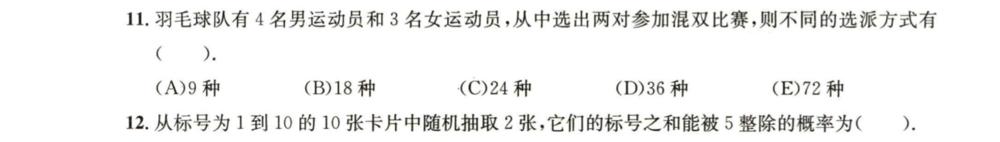

### 第 12 题

从标号为 1 到 10 的 10 张卡片中随机抽取 2 张，它们的标号之和能被 5 整除的概率为（ ）。

- **A**．$\dfrac{1}{5}$
- **B**．$\dfrac{1}{9}$
- **C**．$\dfrac{2}{9}$
- **D**．$\dfrac{2}{15}$
- **E**．$\dfrac{7}{45}$

### 第 13 题

某单位为检查 3 个部门的工作，由这 3 个部门的主任和外聘的 3 名人员组成检查组，分 2 人一组检查工作，每组有 1 名外聘成员。规定本部门主任不能检查本部门，则不同的安排方式有（ ）。

- **A**．6
- **B**．8
- **C**．12
- **D**．18
- **E**．36

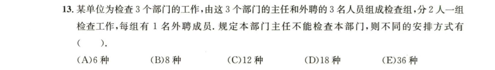

### 第 14 题

如图 3 所示，圆柱体的底面半径为 2，高为 3，垂直于底面的平面截圆柱体所得截面为矩形 $ABCD$。若弦 $AB$ 所对的圆心角是 $\dfrac{\pi}{3}$，则截掉部分（较小部分）的体积为（ ）。

- **A**．$\pi - 3$
- **B**．$2\pi - 6$
- **C**．$\pi - \dfrac{3\sqrt{3}}{2}$
- **D**．$2\pi - 3\sqrt{3}$
- **E**．$\pi - \sqrt{3}$

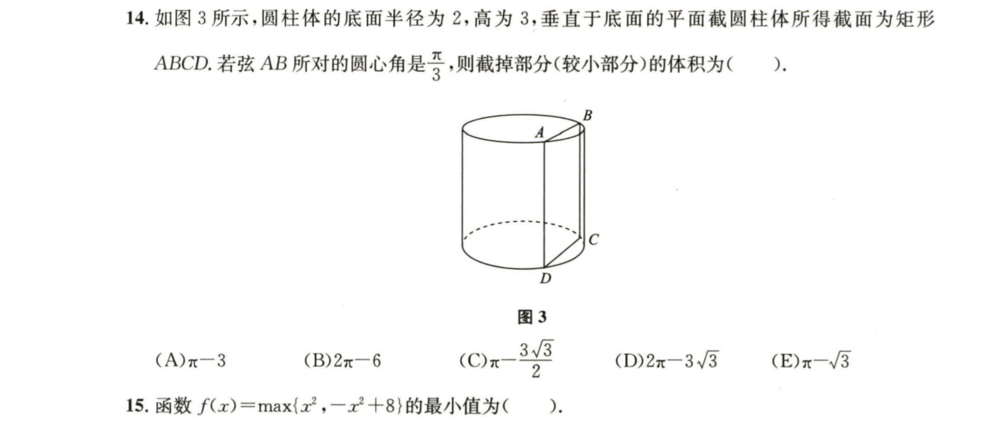

### 第 15 题

函数 $f(x) = \max\{x^2, -x^2 + 8\}$ 的最小值为（ ）。

- **A**．8
- **B**．7
- **C**．6
- **D**．5
- **E**．4

## 二、条件充分性判断：第 16～25 小题，每小题 3 分，共 30 分。要求判断每题给出的条件（1）和（2）能否充分支持题干所陈述的结论。A、B、C、D、E 五个选项为判断结果，请选择一项符合试题要求的判断，在答题卡上将所选项涂黑。

### 解题说明：
- **A**．条件（1）充分，但条件（2）不充分
- **B**．条件（2）充分，但条件（1）不充分
- **C**．条件（1）和（2）单独都不充分，但条件（1）和条件（2）联合起来充分
- **D**．条件（1）充分，条件（2）也充分
- **E**．条件（1）和（2）单独都不充分，条件（1）和条件（2）联合起来也不充分

### 第 16 题

设 $x, y$ 为实数，则 $|x+y| \le 2$。

（1）$x^2 + y^2 \le 2$。
（2）$xy \le 1$。

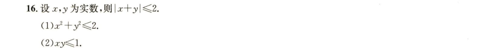

### 第 17 题

设 $\{a_n\}$ 为等差数列，则能确定 $a_1 + a_2 + \dots + a_9$ 的值。

（1）已知 $a_1$ 的值。
（2）已知 $a_5$ 的值。

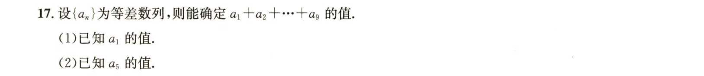

### 第 18 题

设 $m, n$ 是正整数，则能确定 $m+n$ 的值。

（1）$\dfrac{1}{m} + \dfrac{3}{n} = 1$。
（2）$\dfrac{1}{m} + \dfrac{2}{n} = 1$。

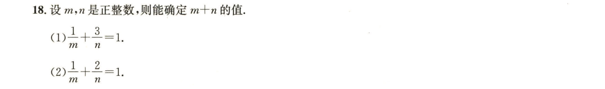

### 第 19 题

甲、乙、丙三人的年收入成等比数列，则能确定乙的年收入的最大值。

（1）已知甲、丙两人的年收入之和。
（2）已知甲、丙两人的年收入之积。

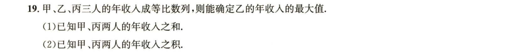

### 第 20 题

如图 4 所示，在矩形 $ABCD$ 中，$AE = FC$，则三角形 $AED$ 与四边形 $BCFE$ 能拼接成一个直角三角形。

（1）$EB = 2FC$。
（2）$ED = EF$。

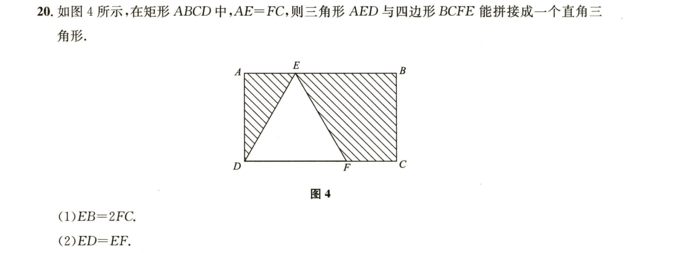

### 第 21 题

甲购买了若干件 A 玩具、乙购买了若干件 B 玩具送给幼儿园，甲比乙少花了 100 元。则能确定甲购买的玩具件数。

（1）甲与乙共购买了 50 件玩具。
（2）A 玩具的价格是 B 玩具的 2 倍。

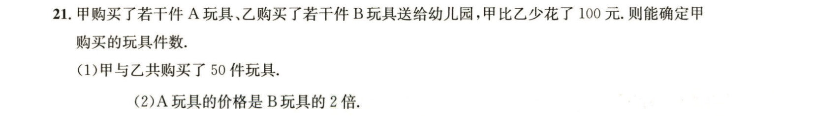

### 第 22 题

已知点 $P(m, 0), A(1, 3), B(2, 1)$，点 $(x, y)$ 在三角形 $PAB$ 上，则 $x-y$ 的最小值与最大值分别为 -2 和 1。

（1）$m \le 1$。
（2）$m \ge -2$。

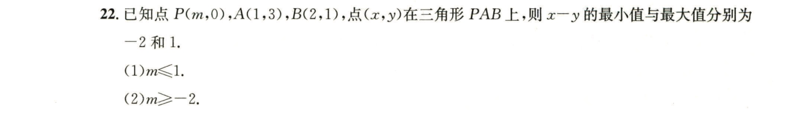

### 第 23 题

如果甲公司的年终奖总额增加 $25\%$，乙公司的年终奖总额减少 $10\%$，两者相等，则能确定两公司的员工人数之比。

（1）甲公司的人均年终奖与乙公司的相同。
（2）两公司的员工人数之比与两公司的年终奖总额之比相等。

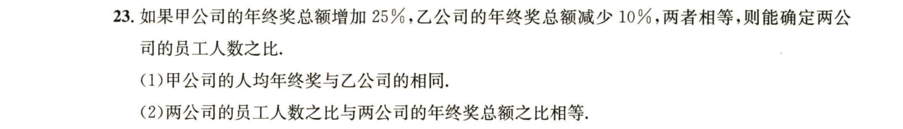

### 第 24 题

设 $a, b$ 为实数，则圆 $x^2 + y^2 = 2y$ 与直线 $x + ay = b$ 不相交。

（1）$|a-b| > \sqrt{1+a^2}$。
（2）$|a+b| > \sqrt{1+a^2}$。

### 第 25 题

设函数 $f(x) = x^2 + ax$，则 $f(x)$ 的最小值与 $f[f(x)]$ 的最小值相等。

（1）$a \ge 2$。
（2）$a \le 0$。

---

## 三、逻辑推理（第 26-55 题，每小题 2 分，共 60 分）

### 第 26 题

人民既是历史的创造者，也是历史的见证者；既是历史的“剧中人”，又是历史的“剧作者”。离开人民，文艺就会变成无根的浮萍、无病的呻吟、无魂的躯壳。关注人民的生活、命运、情感，表达人民的心愿、心情、心声，我们的作品才会在人民中传之久远。

根据以上陈述，可以得出以下哪项？

- **A**．只有不离开人民，文艺才不会变成无根的浮萍、无病的呻吟、无魂的躯壳。
- **B**．历史的创造者都不是历史的“剧中人”。
- **C**．历史的创造者都是历史的见证者。
- **D**．历史的“剧中人”都是历史的“剧作者”。
- **E**．我们的作品只要表达人民的心愿、心情、心声，就会在人民中传之久远。

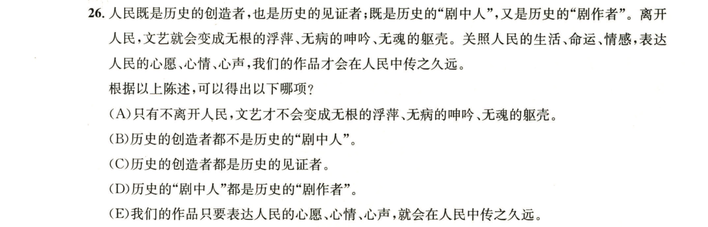

### 第 27 题

盛夏时节的某一天，某市早报刊载了由该市专业气象台提供的全国部分城市当天的天气预报，择其内容如表 2 所示：

| 天津 | 阴 | 上海 | 雷阵雨 | 昆明 | 小雨 |
| :--- | :--- | :--- | :--- | :--- | :--- |
| 呼和浩特 | 阵雨 | 哈尔滨 | 少云 | 乌鲁木齐 | 晴 |
| 西安 | 中雨 | 南昌 | 大雨 | 香港 | 多云 |
| 南京 | 雷阵雨 | 拉萨 | 阵雨 | 福州 | 阴 |

根据上述信息，以下哪项作出的论断最为准确？

- **A**．由于所列城市盛夏天气变化频繁，所以上面所列的 9 类天气一定就是所有的天气类型。
- **B**．由于所列城市并非我国的所有城市，所以上面所列的 9 类天气一定不是所有的天气类型。
- **C**．由于所列城市在同一天不一定展示所有的天气类型，所以上面所列的 9 类天气可能不是所有的天气类型。
- **D**．由于所列城市在同一天可能展示所有的天气类型，所以上面所列的 9 类天气一定是所有的天气类型。
- **E**．由于所列城市分处我国的东南西北中，所以上面所列的 9 类天气一定就是所有的天气类型。

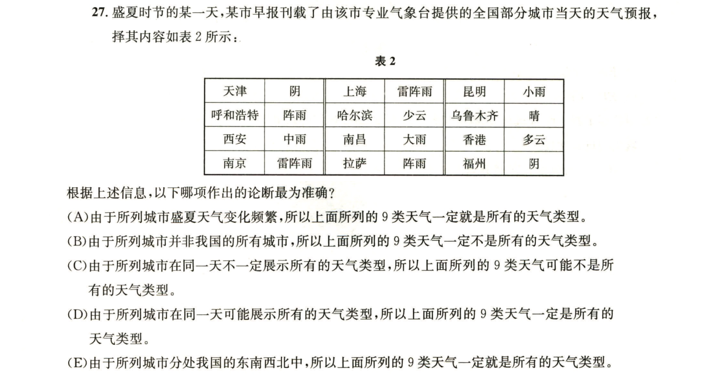

### 第 28 题

现在许多人很少在深夜 11 点以前安然入睡，他们未必都在熬夜用功，大多是在玩手机或看电视，其结果就是晚睡，第二天就会头昏脑涨、哈欠连天。不少人常常对此感到后悔，但一到晚上他们多半还会这么做。有专家就此指出，人们似乎从晚睡中得到了快乐，但这种快乐其实隐藏着某种烦恼。以下哪项如果为真，最能支持上述专家的结论？

- **A**．晨昏交替，生活周而复始，安然入睡是对当天生活的满足和对明天生活的期待，而晚睡者只想活在当下，活出精彩。
- **B**．晚睡者具有积极的人生态度。他们认为，当天的事须当天完成，哪怕晚睡也在所不惜。
- **C**．大多数习惯晚睡的人白天无精打采，但一到深夜就感觉自己精力充沛，不做点有意义的事情就觉得十分可惜。
- **D**．晚睡其实是一种表面难以察觉的、对“正常生活”的抵抗，它提醒人们现在的“正常生活”存在着某种令人不满的问题。
- **E**．晚睡者内心并不愿意睡得晚，也不觉得手机或电视有趣，甚至都不记得玩过或看过什么，但他们总在睡觉前花较长时间磨蹭。

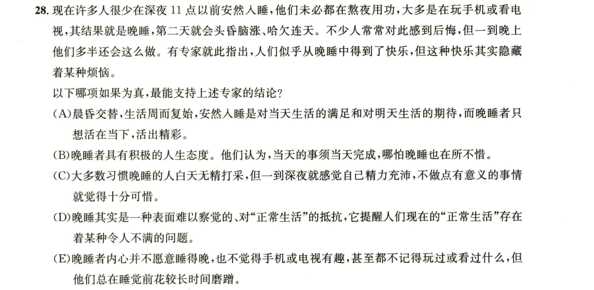

### 第 29 题

分心驾驶是指驾驶人为满足自己的身体舒适、心情愉悦等需求而没有将注意力全部集中于驾驶过程的驾驶行为，常见的分心行为有抽烟、饮水、进食、聊天、刮胡子、使用手机、照顾小孩等。某专家指出，分心驾驶已成为我国道路交通事故的罪魁祸首。以下哪项如果为真，最能支持上述专家的观点？

- **A**．一项统计研究表明，相对于酒驾、药驾、超速驾驶、疲劳驾驶等情形，我国由分心驾驶导致的交通事故占比最高。
- **B**．驾驶人正常驾驶时反应时间为 0.3~1.0 秒，使用手机时反应时间则延迟 3 倍左右。
- **C**．开车使用手机会导致驾驶人注意力下降 20%；如果驾驶人边开车边发短信，则发生车祸的概率是其正常驾驶时的 23 倍。
- **D**．近来使用手机已成为我国驾驶人分心驾驶的主要表现形式，59% 的人开车过程中看微信，31% 的人玩自拍，36% 的人刷微博、微信朋友圈。
- **E**．一项研究显示，在美国超过 1/4 的车祸是由驾驶人使用手机引起的。

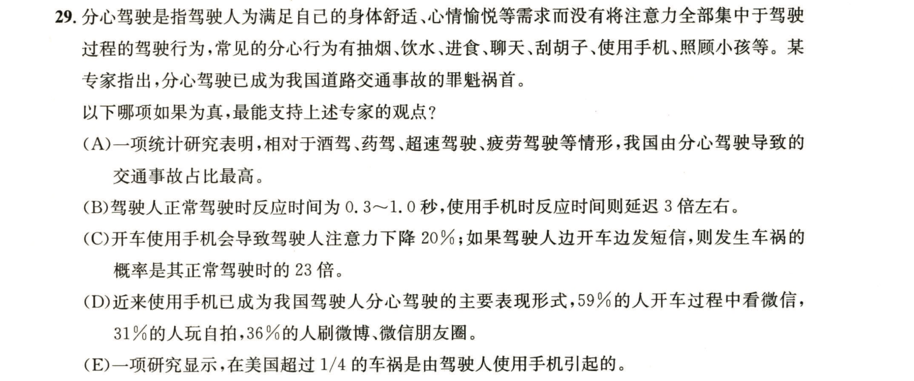

### 30~31 题基于以下题干

> 某工厂有一员工宿舍住了甲、乙、丙、丁、戊、己、庚 7 人，每人每周需轮流值日一天，且每天仅安排一人值日，他们值日的安排还需满足以下条件：
> （1） 乙周二或周六值日。
> （2） 如果甲周一值日，那么丙周三值日且戊周五值日。
> (3) 如果甲周一不值日，那么己周四值日且庚周五值日。
> (4) 如果乙周二值日，那么己周六值日。

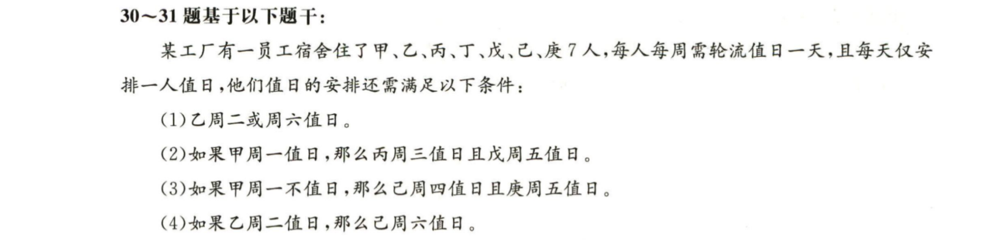

### 第 30 题

根据以上条件，如果丙周日值日，则可以得出以下哪项？

- **A**．甲周日值日。
- **B**．乙周六值日。
- **C**．丁周二值日。
- **D**．戊周二值日。
- **E**．己周五值日。

### 第 31 题

如果庚周四值日，那么以下哪项一定为假？

- **A**．甲周一值日。
- **B**．乙周六值日。
- **C**．丙周三值日。
- **D**．戊周日值日。
- **E**．己周二值日。

### 第 32 题

唐代韩愈在《师说》中指出：“孔子曰：三人行，则必有我师。是故弟子不必不如师，师不必贤于弟子，闻道有先后，术业有专攻，如是而已。”根据上述韩愈的观点，可以得出以下哪项？

- **A**．有的弟子必然不如师。
- **B**．有的弟子可能不如师。
- **C**．有的师不可能贤于弟子。
- **D**．有的弟子可能不贤于师。
- **E**．有的师可能不贤于弟子。

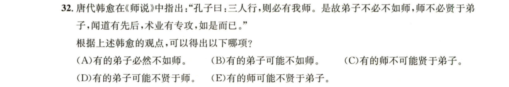

### 第 33 题

“二十四节气”是我国在农耕社会生产生活的时间活动指南，反映了从春到冬一年四季的气温、降水、物候的周期性变化规律。已知各节气的名称具有如下特点：
（1） 凡含“春”“夏”“秋”“冬”字的节气各属春、夏、秋、冬季。
（2） 凡含“雨”“露”“雪”字的节气各属春、秋、冬季。
(3) 如果“清明”不在春季，则“霜降”不在秋季。
(4) 如果“雨水”在春季，则“霜降”在秋季。

根据以上信息，如果从春至冬每季仅列两个节气，则以下哪项是不可能的？

- **A**．雨水、惊蛰、夏至、小暑、白露、霜降、大雪、冬至。
- **B**．惊蛰、春分、立夏、小满、白露、寒露、立冬、小雪。
- **C**．清明、谷雨、芒种、夏至、立秋、寒露、小雪、大寒。
- **D**．立春、清明、立夏、夏至、立秋、寒露、小雪、大寒。
- **E**．立春、谷雨、清明、夏至、处暑、白露、立冬、小雪。

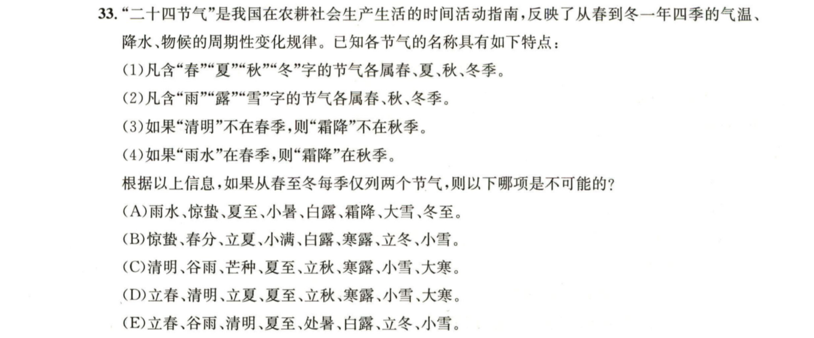

### 第 34 题

刀不磨要生锈，人不学要落后。所以，如果不想落后，就应该多磨刀。以下哪项与上述论证方式最为相似？

- **A**．妆未梳成不见客，不到火候不揭锅。所以，如果揭了锅，就应该是到了火候。
- **B**．兵在精而不在多，将在谋而不在勇。所以，如果想获胜，就应该兵精将勇。
- **C**．马无夜草不肥，人无横财不富。所以，如果你想富，就应该让马多吃夜草。
- **D**．金无足赤，人无完人。所以，如果你想做完人，就应该有真金。
- **E**．有志不在年高，无志空活百岁。所以，如果你不想空活百岁，就应该立志。

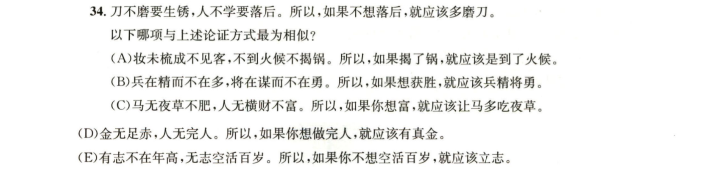

### 第 35 题

某市已开通运营一、二、三、四号地铁线路，各条地铁线每一站运行加停靠所需时间均彼此相同。小张、小王、小李三人是同一单位的职工，单位附近有北口地铁站。某天早晨，3 人同时都在常青站乘一号线上班，但三人关于乘车路线的想法不尽相同。已知：
（1） 如果一号线拥挤，小张就坐 2 站后转三号线，再坐 3 站到北口站；如果一号线不拥挤，小张就坐 3 站后转二号线，再坐 4 站到北口站。
（2） 只有一号线拥挤，小王才坐 2 站后转三号线，再坐 3 站到北口站。
(3) 如果一号线不拥挤，小李就坐 4 站后转四号线，坐 3 站之后再转三号线，坐 1 站到达北口站。
(4) 该天早晨地铁一号线不拥挤。

假定三人换乘及步行总时间相同，则以下哪项最可能与上述信息不一致？

- **A**．小王和小李同时到达单位。
- **B**．小张和小王同时到达单位。
- **C**．小王比小李先到达单位。
- **D**．小李比小张先到达单位。
- **E**．小张比小王先到达单位。

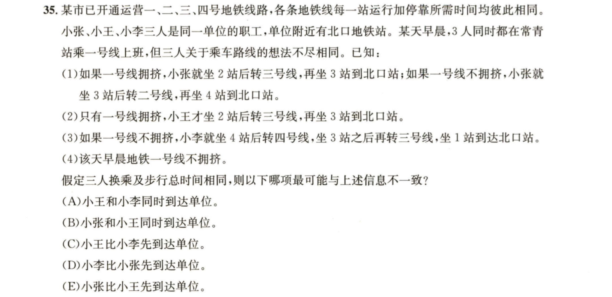

### 第 36 题

最近一项调研发现，某国 30 岁至 45 岁人群中，去医院治疗冠心病、骨质疏松等病症的人越来越多，而原来患有这些病症的大多是老年人。调研员由此认为，该国年轻人中“老年病”发病率有不断增加的趋势。以下哪项如果为真，最能质疑上述调研结论？

- **A**．由于国家医疗保障水平的提高，相比以往，该国民众更有条件关注自己的身体健康。
- **B**．“老年人”的最低年龄比以前提高了，“老年病”的患者范围也有所变化。
- **C**．近年来，由于大量移民涌入，该国 45 岁以下年轻人的数量急剧增加。
- **D**．尽管冠心病、骨质疏松等病症是常见的“老年病”，老年人患的病未必都是“老年病”。
- **E**．近几十年来，该国人口老龄化严重，但健康老龄人口的比重在不断增大。

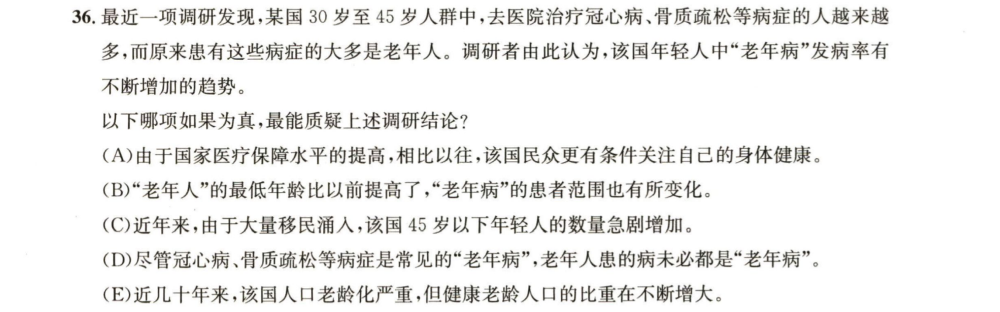

### 第 37 题

张教授：利益并非只是物质利益，应该把信用、声誉、情感甚至某种喜好等都归入利益的范畴。根据这种对“利益”的广义理解，如果每一个体在不损害他人利益的前提下，尽可能满足其自身的利益需求，那么由这些个体组成的社会就是一个良善的社会。根据张教授的观点，可以得出以下哪项？

- **A**．如果一个社会不是良善的，那么其中肯定存在个体损害他人利益或自身利益需求没有尽可能得到满足的情况。
- **B**．尽可能满足每一个体的利益需求，就会损害社会的整体利益。
- **C**．只有尽可能满足每一个体的利益需求，社会才可能是良善的。
- **D**．如果有些个体通过损害他人利益来满足自身的利益需求，那么社会就不是良善的。
- **E**．如果某些个体的利益需求没有尽可能得到满足，那么社会就不是良善的。

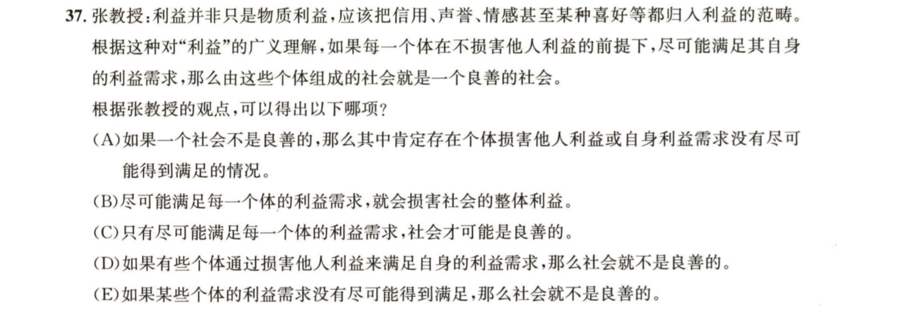

### 第 38 题

某学期学校新开设 4 门课程：“《诗经》鉴赏”“老子研究”“唐诗鉴赏”“宋词选读”。李晓明、陈文静、赵珊珊和庄志达 4 人各选修了其中一门课程。已知：
（1） 他们 4 人选修的课程各不相同。
（2） 喜爱诗词的赵珊珊选修的是诗词类课程。
(3) 李晓明选修的不是“《诗经》鉴赏”就是“唐诗鉴赏”。

以下哪项如果为真，就能确定赵珊珊选修的是“宋词选读”？

- **A**．庄志达选修的不是“宋词选读”。
- **B**．庄志达选修的是“老子研究”。
- **C**．庄志达选修的不是“老子研究”。
- **D**．庄志达选修的是“《诗经》鉴赏”。
- **E**．庄志达选修的不是“《诗经》鉴赏”。

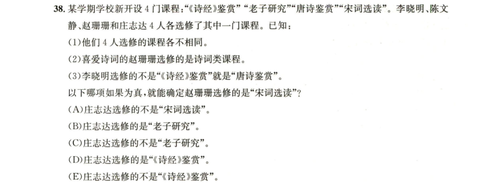

### 第 39 题

我国中原地区如果降水量比往年偏低，该地区的河流水位会下降，流速会减缓。这有利于河流中的水草生长，河流中的水草总量通常也会随之而增加。不过，去年该地区在经历了一次极端干旱之后，尽管该地区某河流的流速十分缓慢，但其中的水草总量并未随之而增加，只是处于一个很低的水平。以下哪项如果为真，最能解释上述看似矛盾的现象？

- **A**．经过极端干旱之后，该河流中以水草为食物的水生动物数量大量减少。
- **B**．我国中原地区多平原，海拔差异小，其地表河水流速比较缓慢。
- **C**．该河流在经历了去年极端干旱之后干涸了一段时间，导致大批水生物死亡。
- **D**．河流流速越慢，其水温变化就越小，这有利于水草的生长和繁殖。
- **E**．如果河中水草数量达到一定的程度，就会对周边其他物种的生存产生危害。

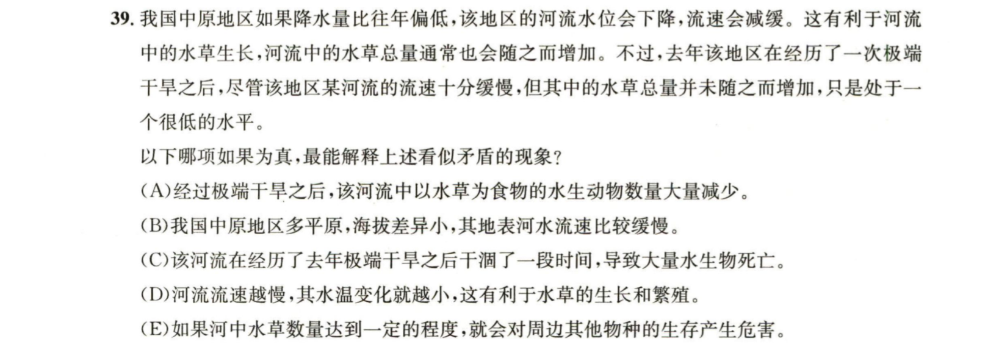

### 40~41 题基于以下题干

> 某海军部队有甲、乙、丙、丁、戊、己、庚 7 艘舰艇，拟组成两个编队出航，第一编队编列 3 艘舰艇，第二编队编列 4 艘舰艇。编列需满足以下条件：
> （1） 航母己必须编列在第二编队。
> （2） 戊和丙至多有一艘编列在第一编队。
> (3) 甲和丙不在同一编队。
> (4) 如果乙编列在第一编队，则丁也必须编列在第一编队。

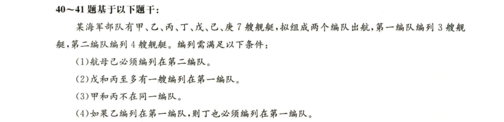

### 第 40 题

如果甲在第二编队，则下列哪项中的舰艇一定也在第二编队？

- **A**．乙。
- **B**．丙。
- **C**．丁。
- **D**．戊。
- **E**．庚。

### 第 41 题

如果丁和庚在同一编队，则可以得出以下哪项？

- **A**．甲在第一编队。
- **B**．乙在第一编队。
- **C**．丙在第一编队。
- **D**．戊在第二编队。
- **E**．庚在第二编队。

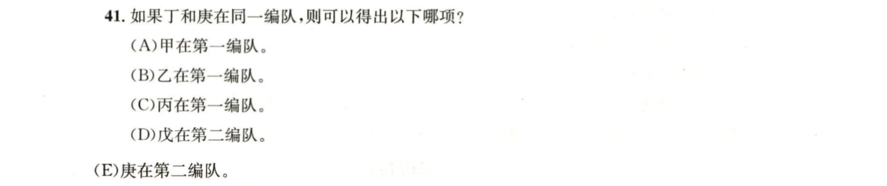

### 第 42 题

甲：读书最重要的目的是增长知识、开阔视野。乙：你只见其一，不见其二，读书最重要的是陶冶性情、提升境界。没有陶冶性情、提升境界，就不能达到读书的真正目的。以下哪项与上述反驳方式最为相似？

- **A**．甲：文学创作最重要的是阅读优秀文学作品。乙：你只见现象，不见本质，文学创作最重要的是观察生活、体验生活。任何优秀的文学作品都来源于火热的社会生活。
- **B**．甲：做人最重要的是要讲信用。乙：你说得不全面，做人最重要的是要遵纪守法。如果不遵纪守法，就没法讲信用。
- **C**．甲：作为一部优秀的电视剧，最重要的是能得到广大观众的喜爱。乙：你只见其表，不见其里，作为一部优秀的电视剧最重要的是具有深刻寓意与艺术魅力。没有深刻寓意与艺术魅力，就不能成为优秀的电视剧。
- **D**．甲：科学研究最重要的是研究内容的创新。乙：你只见内容，不见方法，科学研究最重要的是研究方法的创新。只有实现研究方法的创新，才能真正实现研究内容的创新。
- **E**．甲：一年中最重要的季节是收获的秋天。乙：你只看结果，不问原因，一年中最重要的季节是播种的春天。没有春天的播种，哪来秋天的收获？

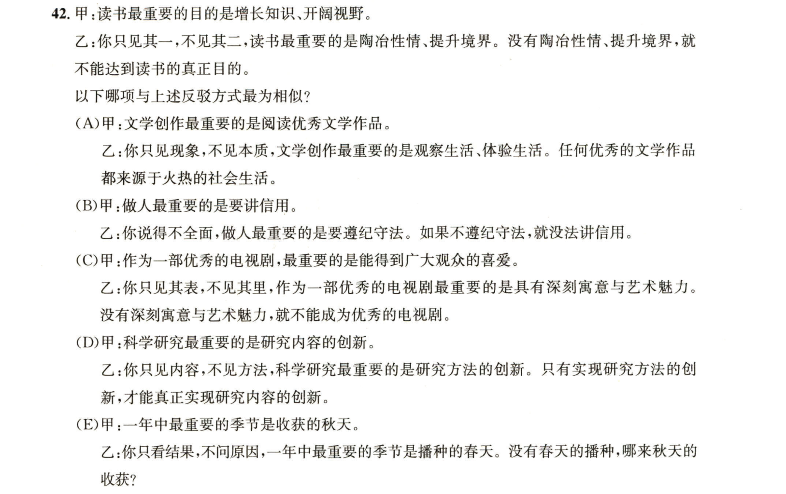

### 第 43 题

若要人不知，除非己莫为；若要人不闻，除非己莫言。为之而欲人不知，言之而欲人不闻，此犹捕雀而掩目，盗钟而掩耳者。根据以上陈述，可以得出以下哪项结论？

- **A**．若己不言，则人不闻。
- **B**．若己为，则人会知；若己言，则人会闻。
- **C**．若能做到盗钟而掩耳，则可言之而人不闻。
- **D**．若己不为，则人不知。
- **E**．若能做到捕雀而掩目，则可为之而人不知。

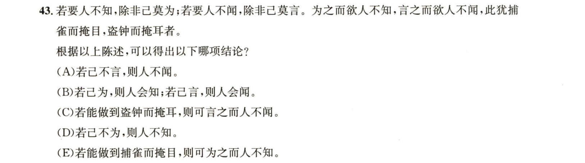

### 第 44 题

中国是全球最大的卷烟生产国和消费国，但近年来政府通过出台禁烟令、提高卷烟消费税等一系列公共政策努力改变这一形象。一项权威调查数据显示，在 2004 年同比上升 2.4% 之后，中国卷烟消费量在 2015 年同比下降了 2.4%，这是 1995 年以来首次下降，尽管如此，2015 年中国卷烟消费量仍占全球的 45%，但这一下降对全球卷烟总消费量产生巨大影响，使其同比下降了 2.1%。根据以上信息，可以得出以下哪项？

- **A**．2015 年发达国家卷烟消费量同比下降比率高于发展中国家。
- **B**．2015 年世界其他国家卷烟消费量同比下降比率低于中国。
- **C**．2015 年世界其他国家卷烟消费量同比下降比率高于中国。
- **D**．2015 年中国卷烟消费量大于 2013 年。
- **E**．2015 年中国卷烟消费量恰好等于 2013 年。

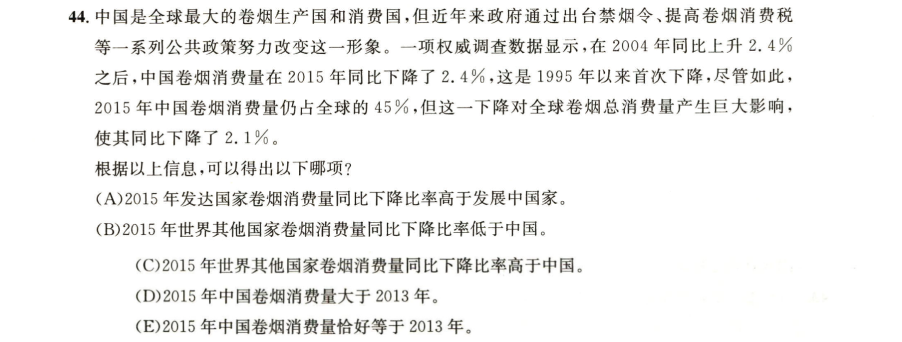

### 第 45 题

某校图书馆新购一批文科图书，为方便读者查阅，管理人员对这批图书在文科新书阅览室中的摆放位置做出如下提示：
（1） 前 3 排书橱均放有哲学类新书。
（2） 法学类新书都放在第 5 排书橱，这排书橱的左侧也放有经济类新书。
(3) 管理类新书放在最后一排书橱。

事实上，所有的图书都按照上述提示放置。根据提示，徐莉顺利找到了她想查阅的新书。根据上述信息，以下哪项是不可能的？

- **A**．徐莉在第 2 排书橱中找到了哲学类新书。
- **B**．徐莉在第 3 排书橱中找到了经济类新书。
- **C**．徐莉在第 4 排书橱中找到了哲学类新书。
- **D**．徐莉在第 6 排书橱中找到了法学类新书。
- **E**．徐莉在第 7 排书橱中找到了管理类新书。

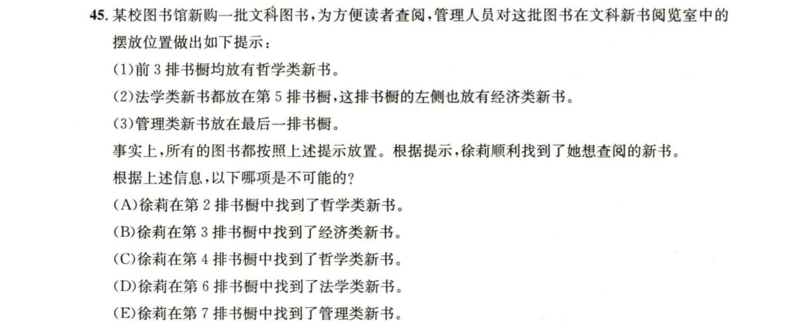

### 第 46 题

某次学术会议的主办方发出会议通知：只有论文通过审核才能收到会议主办方发出的邀请函，本次学术会议只欢迎持有主办方邀请函的科研院所的学者参加。根据以上通知，可以得出以下哪项？

- **A**．本次学术会议不欢迎论文没有通过审核的学者参加。
- **B**．论文通过审核的学者都可以参加本次学术会议。
- **C**．论文通过审核并持有主办方邀请函的学者，本次学术会议都欢迎其参加。
- **D**．有些论文通过审核但未持有主办方邀请函的学者，本次学术会议欢迎其参加。
- **E**．论文通过审核的学者有些不能参加本次学术会议。

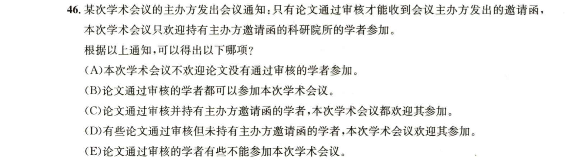

### 47~48 题基于以下题干

> 一江南园林拟建松、竹、梅、兰、菊 5 个园子。该园林拟设东、南、北 3 个门，分别位于其中的 3 个园子。这 5 个园子的布局满足如下条件：
> （1） 如果东门位于松园或菊园，那么南门不位于竹园。
> （2） 如果南门不位于竹园，那么北门不位于兰园。
> (3) 如果菊园在园林的中心，那么它与兰园不相邻。
> (4) 兰园与菊园相邻，中间连着一座美丽的廊桥。

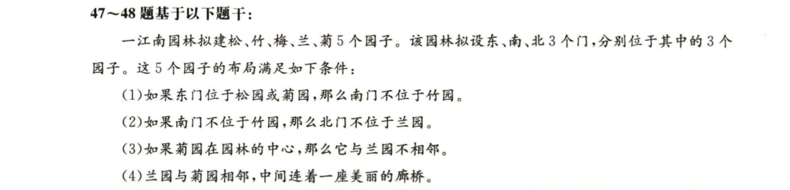

### 第 47 题

根据以上信息，可以得出以下哪项？

- **A**．兰园不在园林的中心。
- **B**．菊园不在园林的中心。
- **C**．兰园在园林的中心。
- **D**．菊园在园林的中心。
- **E**．梅园不在园林的中心。

### 第 48 题

如果北门位于兰园，则可以得出以下哪项？

- **A**．南门位于菊园。
- **B**．东门位于竹园。
- **C**．东门位于梅园。
- **D**．东门位于松园。
- **E**．南门位于梅园。

### 第 49 题

有研究发现，冬季在公路上撒盐除冰，会让本来要成为雌性的青蛙变成雄性，这是因为这些路盐中的钠元素会影响青蛙受体细胞并改变原可能成为雌性青蛙的性别。有专家据此认为，这会导致相关区域青蛙数量的下降。以下哪项如果为真，最能支持上述专家的观点？

- **A**．大量的路盐流入池塘可能会给其他水生物造成危害，破坏青蛙的食物链。
- **B**．如果一个物种以雄性为主，该物种的个体数量就可能受到影响。
- **C**．在多个盐含量不同的水池中饲养青蛙，随着水池中盐含量的增加，雌性青蛙的数量不断减少。
- **D**．如果每年冬季在公路上撒很多盐，盐水流入池塘，就会影响青蛙的生长发育过程。
- **E**．雌雄比例会影响一个动物种群的规模，雌性数量的充足对物种的繁衍生息至关重要。

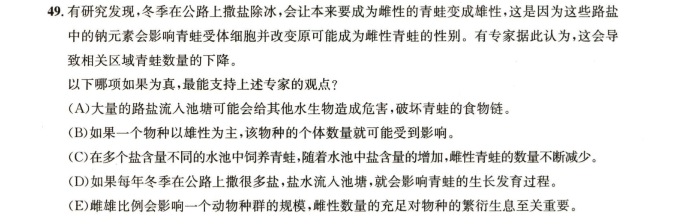

### 第 50 题

最终审定的项目或者意义重大或者关注度高，凡意义重大的项目均涉及民生问题。但是有些最终审定的项目并不涉及民生问题。根据以上陈述，可以得出以下哪项？

- **A**．意义重大的项目可以引起关注。
- **B**．有些项目意义重大但是关注度不高。
- **C**．涉及民生问题的项目有些没有引起关注。
- **D**．有些项目尽管关注度高但并非意义重大。
- **E**．有些不涉及民生问题的项目意义也非常重大。

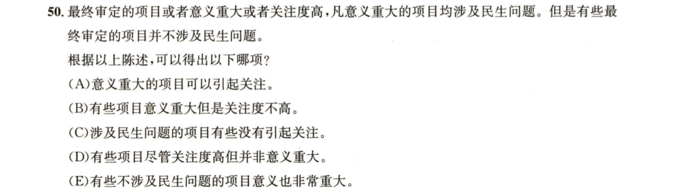

### 第 51 题

甲：知难行易，知然后行。乙：不对。知易行难，行然后知。以下哪项与上述对话方式最为相似？

- **A**．甲：知人者智，自知者明。乙：不对。知人不易，知己更难。
- **B**．甲：不破不立，先破后立。乙：不对。不立不破，先立后破。
- **C**．甲：想想容易做起来难，做比想更重要。乙：不对。想到就能做到，想比做更重要。
- **D**．甲：批评他人易，批评自己难；先批评他人，后批评自己。乙：不对。批评自己易，批评他人难；先批评自己，后批评他人。
- **E**．甲：做人难做事易，先做人再做事。乙：不对。做人易做事难，先做事再做人。

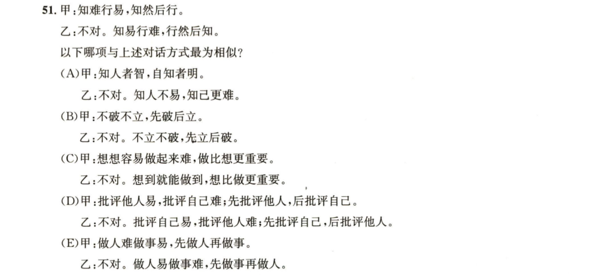

### 第 52 题

所有值得拥有专利的产品或设计方案都是创新，但并不是每一项创新都值得拥有专利；所有的模仿都不是创新，但并非每一个模仿者都应该受到惩罚。根据以上陈述，以下哪项是不可能的？

- **A**．有些创新者可能受到惩罚。
- **B**．有些值得拥有专利的创新产品并没有申请专利。
- **C**．有些值得拥有专利的产品是模仿。
- **D**．没有模仿值得拥有专利。
- **E**．所有的模仿者都受到了惩罚。

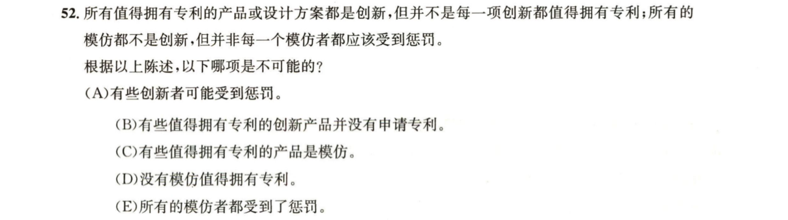

### 第 53 题

某国拟在甲、乙、丙、丁、戊、己 6 种农作物中进口几种，用于该国庞大的动物饲料产业。考虑到一些农作物可能含有违禁成分，以及它们之间存在的互补或可替代等因素，该国对进口这些农作物有如下要求：
（1） 它们当中不含违禁成分的都进口。
（2） 如果甲或乙有违禁成分，就进口戊和己。
(3) 如果丙含有违禁成分，那么丁就不进口了；如果进口戊，就进口乙和丁。
(4) 如果不进口丁，就进口丙；如果进口丙，就不进口丁。

根据上述要求，以下哪项所列的农作物是该国可以进口的？

- **A**．甲、乙、丙。
- **B**．乙、丙、丁。
- **C**．甲、戊、己。
- **D**．甲、丁、己。
- **E**．丙、戊、己。

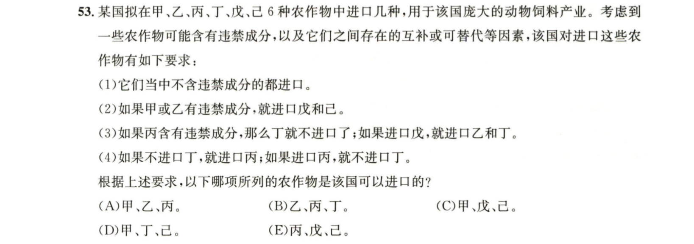

### 54~55 题基于以下题干

> 某校四位女生施琳、张芳、王玉、杨虹与四位男生范勇、吕伟、赵虎、李龙进行中国象棋比赛。他们被安排在四张桌上，每桌一男一女对弈，四张桌从左到右分别记为 1、2、3、4 号，每对选手需要进行四局比赛。比赛规定：选手每胜一局得 2 分，和一局得 1 分，负一局得 0 分。前三局结束时，按分差大小排列，四对选手的总积分分别是 6：0、5：1、4：2、3：3。已知：
> （1） 张芳跟吕伟对弈，杨虹在 4 号桌比赛，王玉的比赛桌在李龙比赛桌的右边。
> （2） 1 号桌的比赛至少有一局是和局，4 号桌双方的总积分不是 4：2。
> (3) 赵虎前三局总积分并不领先他的对手，他们也没有下成过和局。
> (4) 李龙已连续输三局，范勇在前三局总积分上领先他的对手。

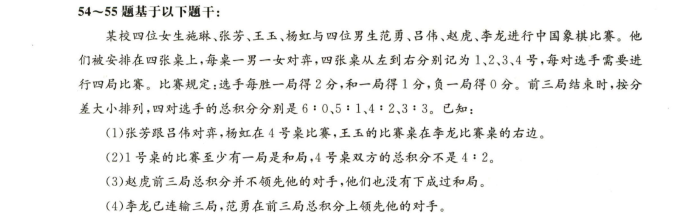

### 第 54 题

根据上述信息，前三局比赛结束时谁的总积分最高？

- **A**．杨虹。
- **B**．施琳。
- **C**．范勇。
- **D**．王玉。
- **E**．张芳。

### 第 55 题

如果下列有位选手前三局均与对手下成和局，那么他（她）是谁？

- **A**．施琳。
- **B**．杨虹。
- **C**．张芳。
- **D**．范勇。
- **E**．王玉。

---

## 四、写作（第 56-57 题，共 65 分）

### 第 56 题 · 论证有效性分析 (30 分)

**分析下述论证中存在的缺陷与漏洞，选择若干要点，写一篇 600 字左右的文章，对该论证的有效性进行分析和评论。**（论证有效性分析的一般要点是：概念特别是核心概念的界定和使用是否准确并前后一致，有无各种明显的逻辑错误，论证的论据是否成立并支持结论，结论成立的条件是否充分等。）

> 哈佛大学教授本杰明·史华慈 (Benjamin I. Schwartz) 在二十世纪末指出，开始席卷一切的物质主义潮流将极大地冲击人类社会固有的价值观念，造成人类精神世界的空虚。这一论点值得商榷。
>
> 首先，按照唯物主义物质决定精神的基本原理，精神是物质在人类头脑中的反映。因此，物质丰富只会充实精神世界，物质主义潮流不可能造成人类精神世界的空虚。
>
> 其次，后物质主义理论认为：个人基本的物质生活条件一旦得到满足，就会把注意点转移到非物质方面。物质生活丰裕的人，往往会更注重精神生活，追求社会公平、个人尊严，等等。
>
> 还有，最近一项对某高校大学生的抽样调查表明，有 69% 的人认为物质生活丰富可以丰富人的精神生活，有 22% 的人认为物质生活和精神生活没有什么关系，只有 9% 的人认为物质生活丰富反而会降低人的精神追求。
>
> 总之，物质决定精神，社会物质生活水平的提高会促进人类精神世界的发展。担心物质生活的丰富会冲击人类的精神世界，只是杞人忧天罢了。

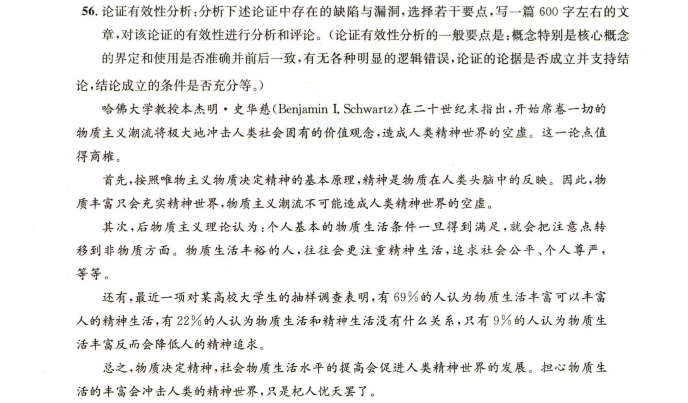

### 第 57 题 · 论说文 (35 分)

**根据下述材料，写一篇 700 字左右的论说文，题目自拟。**

> 有人说，机器人的使命，应该是帮助人类做那些人类做不了的事，而不是代替人类。技术变革会夺取一些人低端烦琐的工作岗位，最终也会创造更高端、更人性化的就业机会。例如，历史上铁路的出现抢去了很多挑夫的工作，但又增加了千万的铁路工人。人工智能也是一种技术变革，人工智能也将促进未来人类社会的发展。有人则不以为然。

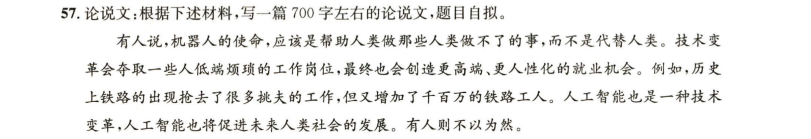
