# 2019 年全国硕士研究生招生考试管理类专业学位联考综合能力试题 (199)

## 一、问题求解：第 1-15 小题，每小题 3 分，共 45 分。下列每题给出的 A、B、C、D、E 五个选项中，只有一项是符合试题要求的。请在答题卡上将所选的字母涂黑。

### 第 1 题

某车间计划 10 天完成一项任务，工作 3 天后因故停工 2 天。若仍要按原计划完成任务，则工作效率需要提高（ ）。

- **A**．20%
- **B**．30%
- **C**．40%
- **D**．50%
- **E**．60%

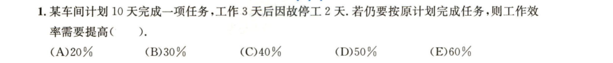

### 第 2 题

设函数 $f(x) = 2x + \dfrac{a}{x^2} (a > 0)$ 在 $(0, +\infty)$ 内的最小值为 $f(x_0) = 12$，则 $x_0 = $（ ）。

- **A**．5
- **B**．4
- **C**．3
- **D**．2
- **E**．1

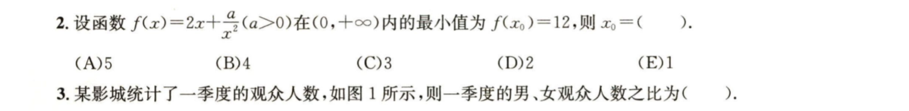

### 第 3 题

某影城统计了一季度的观众人数，如图 1 所示，则一季度的男、女观众人数之比为（ ）。

<svg xmlns="http://www.w3.org/2000/svg" viewBox="0 0 380 250" width="380" height="250" style="background: white; font-family: sans-serif;">
  <defs>
    <marker id="arrow3" viewBox="0 0 10 10" refX="6" refY="5" markerWidth="6" markerHeight="6" orient="auto-start-reverse">
      <path d="M 0 1.5 L 8 5 L 0 8.5 z" fill="#0f172a"/>
    </marker>
  </defs>
  <line x1="65" y1="200" x2="270" y2="200" stroke="#0f172a" stroke-width="1.5" marker-end="url(#arrow3)"/>
  <line x1="65" y1="200" x2="65" y2="25" stroke="#0f172a" stroke-width="1.5" marker-end="url(#arrow3)"/>
  <text x="50" y="40" font-size="11" text-anchor="middle" fill="#0f172a">女<tspan x="50" dy="13">性</tspan><tspan x="50" dy="13">观</tspan><tspan x="50" dy="13">众</tspan><tspan x="50" dy="13">人</tspan><tspan x="50" dy="13">数</tspan><tspan x="50" dy="13">／</tspan><tspan x="50" dy="13">万</tspan><tspan x="50" dy="13">人</tspan></text>
  <text x="278" y="204" font-size="12" fill="#0f172a" dominant-baseline="middle">男性观众人数／万人</text>
  <text x="55" y="214" font-size="12" fill="#0f172a">0</text>
  <line x1="97" y1="200" x2="97" y2="205" stroke="#0f172a" stroke-width="1.5"/>
  <text x="97" y="218" font-size="12" text-anchor="middle" fill="#0f172a">1</text>
  <line x1="129" y1="200" x2="129" y2="205" stroke="#0f172a" stroke-width="1.5"/>
  <line x1="161" y1="200" x2="161" y2="205" stroke="#0f172a" stroke-width="1.5"/>
  <line x1="193" y1="200" x2="193" y2="205" stroke="#0f172a" stroke-width="1.5"/>
  <line x1="225" y1="200" x2="225" y2="205" stroke="#0f172a" stroke-width="1.5"/>
  <line x1="60" y1="175" x2="65" y2="175" stroke="#0f172a" stroke-width="1.5"/>
  <text x="56" y="179" font-size="12" text-anchor="end" fill="#0f172a">1</text>
  <line x1="60" y1="150" x2="65" y2="150" stroke="#0f172a" stroke-width="1.5"/>
  <line x1="60" y1="125" x2="65" y2="125" stroke="#0f172a" stroke-width="1.5"/>
  <line x1="60" y1="100" x2="65" y2="100" stroke="#0f172a" stroke-width="1.5"/>
  <line x1="60" y1="50" x2="65" y2="50" stroke="#0f172a" stroke-width="1.5"/>
  <line x1="65" y1="50" x2="225" y2="50" stroke="#0f172a" stroke-width="1.2" stroke-dasharray="4,4"/>
  <line x1="225" y1="50" x2="225" y2="200" stroke="#0f172a" stroke-width="1.2" stroke-dasharray="4,4"/>
  <text x="230" y="45" font-size="12" fill="#0f172a">1月份</text>
  <line x1="65" y1="125" x2="193" y2="125" stroke="#0f172a" stroke-width="1.2" stroke-dasharray="4,4"/>
  <line x1="193" y1="125" x2="193" y2="200" stroke="#0f172a" stroke-width="1.2" stroke-dasharray="4,4"/>
  <text x="198" y="120" font-size="12" fill="#0f172a">2月份</text>
  <line x1="65" y1="100" x2="161" y2="100" stroke="#0f172a" stroke-width="1.2" stroke-dasharray="4,4"/>
  <line x1="161" y1="100" x2="161" y2="200" stroke="#0f172a" stroke-width="1.2" stroke-dasharray="4,4"/>
  <text x="161" y="92" font-size="12" text-anchor="middle" fill="#0f172a">3月份</text>
  <text x="160" y="240" font-size="14" font-weight="bold" text-anchor="middle" fill="#0f172a">图 1</text>
</svg>

- **A**．3:4
- **B**．5:6
- **C**．12:13
- **D**．13:12
- **E**．4:3

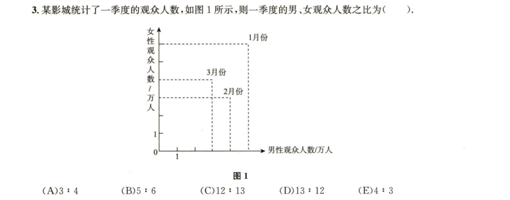

### 第 4 题

设实数 $a, b$ 满足 $ab = 6$，$|a+b| + |a-b| = 6$，则 $a^2 + b^2 = $（ ）。

- **A**．10
- **B**．11
- **C**．12
- **D**．13
- **E**．14

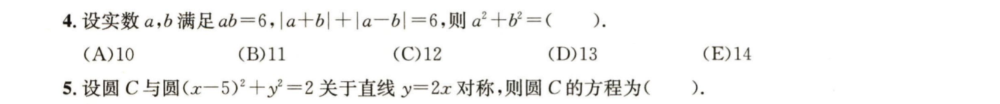

### 第 5 题

设圆 $C$ 与圆 $(x-5)^2 + y^2 = 2$ 关于直线 $y = 2x$ 对称，则圆 $C$ 的方程为（ ）。

- **A**．$(x-3)^2 + (y-4)^2 = 2$
- **B**．$(x+4)^2 + (y-3)^2 = 2$
- **C**．$(x-3)^2 + (y+4)^2 = 2$
- **D**．$(x+3)^2 + (y+4)^2 = 2$
- **E**．$(x+3)^2 + (y-4)^2 = 2$

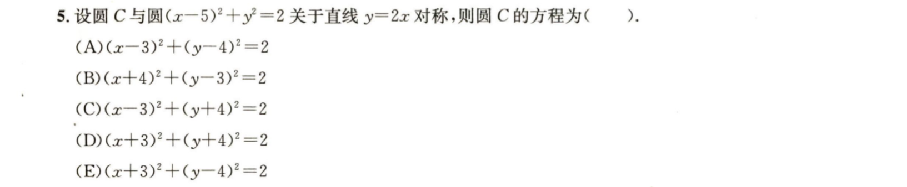

### 第 6 题

将一批树苗种在一个正方形花园的边上，四角都种。如果每隔 3 米种一棵，那么剩余 10 棵树苗；如果每隔 2 米种一棵，那么恰好种满正方形的 3 条边，则这批树苗有（ ）棵。

- **A**．54
- **B**．60
- **C**．70
- **D**．82
- **E**．94

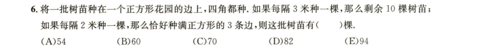

### 第 7 题

在分别标记了数字 1, 2, 3, 4, 5, 6 的 6 张卡片中，甲随机抽取 1 张后，乙从余下的卡片中再随机抽取 2 张，乙的卡片数字之和大于甲的卡片数字的概率为（ ）。

- **A**．$\dfrac{11}{60}$
- **B**．$\dfrac{13}{60}$
- **C**．$\dfrac{43}{60}$
- **D**．$\dfrac{47}{60}$
- **E**．$\dfrac{49}{60}$

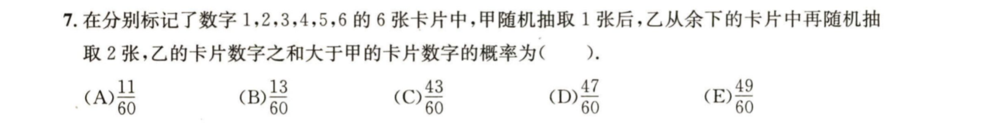

### 第 8 题

10 名同学的语文和数学成绩如表 1 所示：

|  |  |  |  |  |  |  |  |  |  |  |
| :--- | :---: | :---: | :---: | :---: | :---: | :---: | :---: | :---: | :---: | :---: |
| **语文成绩** | 90 | 92 | 94 | 88 | 86 | 95 | 87 | 89 | 91 | 93 |
| **数学成绩** | 94 | 88 | 96 | 93 | 90 | 85 | 84 | 80 | 82 | 98 |

语文和数学成绩的均值分别记为 $E_1$ 和 $E_2$，标准差分别记为 $\sigma_1$ 和 $\sigma_2$，则（ ）。

- **A**．$E_1 > E_2, \sigma_1 > \sigma_2$
- **B**．$E_1 > E_2, \sigma_1 < \sigma_2$
- **C**．$E_1 > E_2, \sigma_1 = \sigma_2$
- **D**．$E_1 < E_2, \sigma_1 > \sigma_2$
- **E**．$E_1 < E_2, \sigma_1 < \sigma_2$

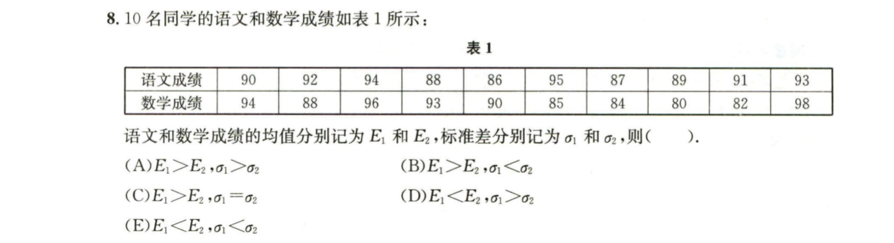

### 第 9 题

如图 2 所示，正方体位于半径为 3 的球内，且一面位于球的大圆上，则正方体表面积最大为（ ）。

<svg xmlns="http://www.w3.org/2000/svg" viewBox="0 0 220 220" width="220" height="220" style="background: white; font-family: sans-serif;">
  <circle cx="110" cy="100" r="75" fill="none" stroke="#0f172a" stroke-width="1.8"/>
  <path d="M 35 100 A 75 20 0 0 1 185 100" fill="none" stroke="#0f172a" stroke-width="1.5" stroke-dasharray="4,3"/>
  <path d="M 185 100 A 75 20 0 0 1 35 100" fill="none" stroke="#0f172a" stroke-width="1.8"/>
  <line x1="82" y1="110" x2="102" y2="92" stroke="#0f172a" stroke-width="1.5" stroke-dasharray="4,3"/>
  <line x1="102" y1="92" x2="147" y2="92" stroke="#0f172a" stroke-width="1.5" stroke-dasharray="4,3"/>
  <line x1="102" y1="92" x2="102" y2="47" stroke="#0f172a" stroke-width="1.5" stroke-dasharray="4,3"/>
  <line x1="82" y1="110" x2="127" y2="110" stroke="#0f172a" stroke-width="1.8"/>
  <line x1="127" y1="110" x2="147" y2="92" stroke="#0f172a" stroke-width="1.8"/>
  <line x1="82" y1="110" x2="82" y2="65" stroke="#0f172a" stroke-width="1.8"/>
  <line x1="127" y1="110" x2="127" y2="65" stroke="#0f172a" stroke-width="1.8"/>
  <line x1="147" y1="92" x2="147" y2="47" stroke="#0f172a" stroke-width="1.8"/>
  <polygon points="82,65 127,65 147,47 102,47" fill="none" stroke="#0f172a" stroke-width="1.8"/>
  <text x="110" y="205" font-size="14" font-weight="bold" text-anchor="middle" fill="#0f172a">图 2</text>
</svg>

- **A**．12
- **B**．18
- **C**．24
- **D**．30
- **E**．36

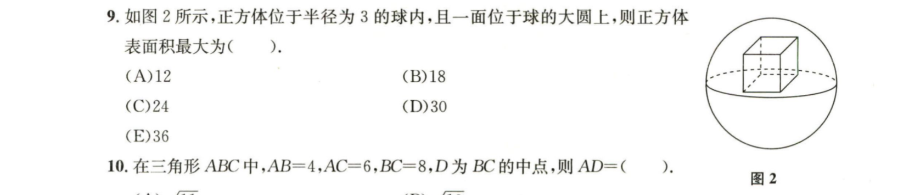

### 第 10 题

在三角形 $ABC$ 中，$AB = 4, AC = 6, BC = 8, D$ 为 $BC$ 的中点，则 $AD = $（ ）。

- **A**．$\sqrt{11}$
- **B**．$\sqrt{10}$
- **C**．3
- **D**．$2\sqrt{2}$
- **E**．$\sqrt{7}$

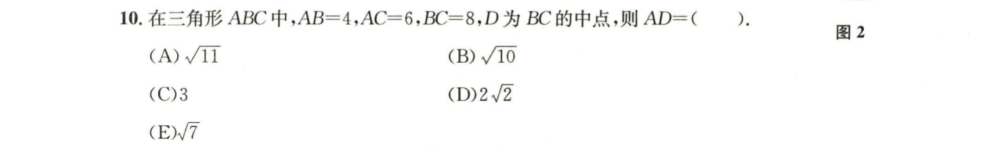

### 第 11 题

某单位要铺设草坪，若甲、乙两公司合作需要 6 天完成，工时费共计 2.4 万元；若甲公司单独做 4 天后由乙公司接着做 9 天完成，工时费共计 2.35 万元。若由甲公司单独完成该项目，则工时费共计（ ）万元。

- **A**．2.25
- **B**．2.35
- **C**．2.4
- **D**．2.45
- **E**．2.5

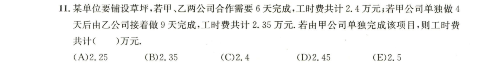

### 第 12 题

如图 3 所示，六边形 $ABCDEF$ 是平面与棱长为 2 的正方体所截得到的，若 $A, B, D, E$ 分别为相应棱的中点，则六边形 $ABCDEF$ 的面积为（ ）。

<svg xmlns="http://www.w3.org/2000/svg" viewBox="0 0 220 220" width="220" height="220" style="background: white; font-family: sans-serif;">
  <!-- Hidden cube edges meeting at back-bottom-left (75, 125) -->
  <line x1="40" y1="160" x2="75" y2="125" stroke="#0f172a" stroke-width="1.5" stroke-dasharray="4,4"/>
  <line x1="75" y1="125" x2="155" y2="125" stroke="#0f172a" stroke-width="1.5" stroke-dasharray="4,4"/>
  <line x1="75" y1="125" x2="75" y2="45" stroke="#0f172a" stroke-width="1.5" stroke-dasharray="4,4"/>
  <!-- Shaded hexagon ABCDEF -->
  <polygon points="80,160 57.5,142.5 75,85 115,45 137.5,62.5 120,120" fill="#cbd5e1" stroke="#0f172a" stroke-width="2"/>
  <!-- Visible cube edges -->
  <rect x="40" y="80" width="80" height="80" fill="none" stroke="#0f172a" stroke-width="1.8"/>
  <polygon points="40,80 75,45 155,45 120,80" fill="none" stroke="#0f172a" stroke-width="1.8"/>
  <line x1="155" y1="45" x2="155" y2="125" stroke="#0f172a" stroke-width="1.8"/>
  <line x1="120" y1="160" x2="155" y2="125" stroke="#0f172a" stroke-width="1.8"/>
  <!-- Re-outline hexagon front edges -->
  <polyline points="75,85 115,45 137.5,62.5 120,120 80,160 57.5,142.5" fill="none" stroke="#0f172a" stroke-width="2"/>
  <!-- Labels -->
  <text x="80" y="176" font-size="14" font-style="italic" font-weight="bold" text-anchor="middle" fill="#0f172a">A</text>
  <text x="47" y="147" font-size="14" font-style="italic" font-weight="bold" fill="#0f172a">B</text>
  <text x="67" y="88" font-size="14" font-style="italic" font-weight="bold" fill="#0f172a">C</text>
  <text x="115" y="38" font-size="14" font-style="italic" font-weight="bold" text-anchor="middle" fill="#0f172a">D</text>
  <text x="144" y="65" font-size="14" font-style="italic" font-weight="bold" fill="#0f172a">E</text>
  <text x="127" y="125" font-size="14" font-style="italic" font-weight="bold" fill="#0f172a">F</text>
  <text x="110" y="202" font-size="14" font-weight="bold" text-anchor="middle" fill="#0f172a">图 3</text>
</svg>

- **A**．$\dfrac{\sqrt{3}}{2}$
- **B**．$\sqrt{3}$
- **C**．$2\sqrt{3}$
- **D**．$3\sqrt{3}$
- **E**．$4\sqrt{3}$

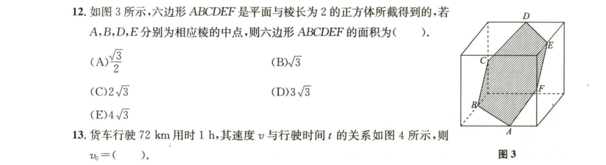

### 第 13 题

货车行驶 72 km 用时 1 h，其速度 $v$ 与行驶时间 $t$ 的关系如图 4 所示，则 $v_0 = $（ ）。

<svg xmlns="http://www.w3.org/2000/svg" viewBox="0 0 280 200" width="280" height="200" style="background: white; font-family: sans-serif;">
  <defs>
    <marker id="arrow13" viewBox="0 0 10 10" refX="6" refY="5" markerWidth="6" markerHeight="6" orient="auto-start-reverse">
      <path d="M 0 1.5 L 8 5 L 0 8.5 z" fill="#0f172a"/>
    </marker>
  </defs>
  <line x1="50" y1="140" x2="230" y2="140" stroke="#0f172a" stroke-width="1.5" marker-end="url(#arrow13)"/>
  <line x1="50" y1="140" x2="50" y2="25" stroke="#0f172a" stroke-width="1.5" marker-end="url(#arrow13)"/>
  <text x="40" y="20" font-size="12" fill="#0f172a">v / km·h<tspan dy="-5" font-size="9">-1</tspan></text>
  <text x="235" y="144" font-size="12" fill="#0f172a" dominant-baseline="middle">t / h</text>
  <text x="42" y="153" font-size="12" font-style="italic" fill="#0f172a">O</text>
  <polyline points="50,140 80,50 170,50 200,140" fill="none" stroke="#0f172a" stroke-width="2"/>
  <line x1="50" y1="50" x2="80" y2="50" stroke="#0f172a" stroke-width="1.2" stroke-dasharray="4,3"/>
  <line x1="80" y1="50" x2="80" y2="140" stroke="#0f172a" stroke-width="1.2" stroke-dasharray="4,3"/>
  <line x1="170" y1="50" x2="170" y2="140" stroke="#0f172a" stroke-width="1.2" stroke-dasharray="4,3"/>
  <text x="42" y="54" font-size="12" font-style="italic" text-anchor="end" fill="#0f172a">v<tspan dy="3" font-size="9">0</tspan></text>
  <text x="80" y="155" font-size="12" text-anchor="middle" fill="#0f172a">0.2</text>
  <text x="170" y="155" font-size="12" text-anchor="middle" fill="#0f172a">0.8</text>
  <text x="200" y="155" font-size="12" text-anchor="middle" fill="#0f172a">1</text>
  <text x="135" y="185" font-size="14" font-weight="bold" text-anchor="middle" fill="#0f172a">图 4</text>
</svg>

- **A**．72
- **B**．80
- **C**．90
- **D**．95
- **E**．100

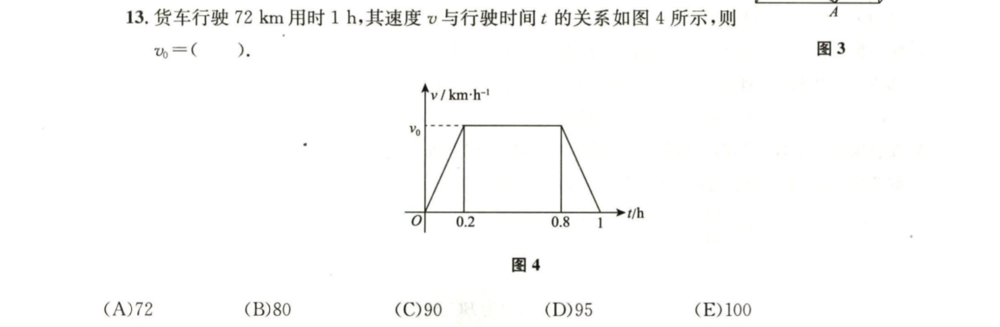

### 第 14 题

某中学的 5 个学科各推荐 2 名教师作为支教候选人，若从中选派来自不同学科的 2 人参加支教工作，则不同的选派方式有（ ）种。

- **A**．20
- **B**．24
- **C**．30
- **D**．40
- **E**．45

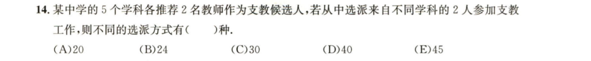

### 第 15 题

设数列 $\{a_n\}$ 满足 $a_1 = 0, a_{n+1} - 2a_n = 1$，则 $a_{100} = $（ ）。

- **A**．$2^{99} - 1$
- **B**．$2^{99}$
- **C**．$2^{99} + 1$
- **D**．$2^{100} - 1$
- **E**．$2^{100} + 1$

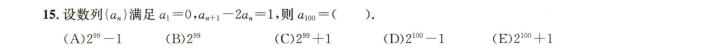

## 二、条件充分性判断：第 16～25 小题，每小题 3 分，共 30 分。要求判断每题给出的条件（1）和（2）能否充分支持题干所陈述的结论。A、B、C、D、E 五个选项为判断结果，请选择一项符合试题要求的判断，在答题卡上将所选项涂黑。

### 解题说明：
- **A**．条件（1）充分，但条件（2）不充分
- **B**．条件（2）充分，但条件（1）不充分
- **C**．条件（1）和条件（2）单独都不充分，但条件（1）和条件（2）联合起来充分
- **D**．条件（1）充分，条件（2）也充分
- **E**．条件（1）和条件（2）单独都不充分，条件（1）和条件（2）联合起来也不充分

### 第 16 题

甲、乙、丙三人各自拥有不超过 10 本图书，甲再购入 2 本图书后，他们拥有的图书数量能构成等比数列，则能确定甲拥有图书的数量。

（1）已知乙拥有的图书数量。
（2）已知丙拥有的图书数量。

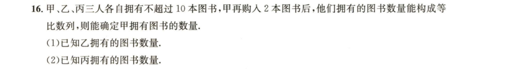

### 第 17 题

有甲、乙两袋奖券，获奖率分别是 $p$ 和 $q$。某人从两袋中各随机抽取 1 张奖券，则此人获奖的概率不小于 $\dfrac{3}{4}$。

（1）已知 $p + q = 1$。
（2）已知 $pq = \dfrac{1}{4}$。

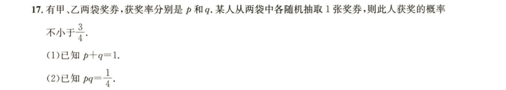

### 第 18 题

直线 $y = kx$ 与圆 $x^2 + y^2 - 4x + 3 = 0$ 有两个交点。

（1）$-\dfrac{\sqrt{3}}{3} < k < 0$。
（2）$0 < k < \dfrac{\sqrt{2}}{2}$。

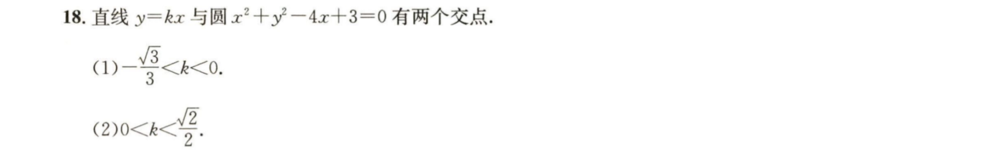

### 第 19 题

能确定小明的年龄。

（1）小明的年龄是完全平方数。
（2）20 年后小明的年龄是完全平方数。

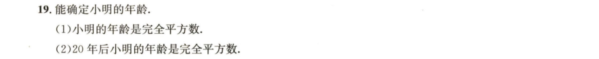

### 第 20 题

关于 $x$ 的方程 $x^2 + ax + b - 1 = 0$ 有实根。

（1）$a + b = 0$。
（2）$a - b = 0$。

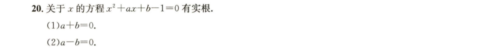

### 第 21 题

如图 5 所示，已知正方形 $ABCD$ 的面积，$O$ 为 $BC$ 上一点，$P$ 为 $AO$ 的中点，$Q$ 为 $DO$ 上一点，则能确定三角形 $PQD$ 的面积。

<svg xmlns="http://www.w3.org/2000/svg" viewBox="0 0 220 220" width="220" height="220" style="background: white; font-family: sans-serif;">
  <rect x="40" y="30" width="130" height="130" fill="none" stroke="#0f172a" stroke-width="2"/>
  <line x1="40" y1="30" x2="125" y2="160" stroke="#0f172a" stroke-width="1.8"/>
  <line x1="170" y1="30" x2="125" y2="160" stroke="#0f172a" stroke-width="1.8"/>
  <polygon points="82.5,95 155,73.3 170,30" fill="#f1f5f9" stroke="#0f172a" stroke-width="1.8"/>
  <text x="32" y="28" font-size="15" font-style="italic" font-weight="bold" fill="#0f172a">A</text>
  <text x="175" y="28" font-size="15" font-style="italic" font-weight="bold" fill="#0f172a">D</text>
  <text x="32" y="172" font-size="15" font-style="italic" font-weight="bold" fill="#0f172a">B</text>
  <text x="175" y="172" font-size="15" font-style="italic" font-weight="bold" fill="#0f172a">C</text>
  <text x="125" y="175" font-size="15" font-style="italic" font-weight="bold" text-anchor="middle" fill="#0f172a">O</text>
  <text x="72" y="99" font-size="15" font-style="italic" font-weight="bold" fill="#0f172a">P</text>
  <text x="160" y="88" font-size="15" font-style="italic" font-weight="bold" fill="#0f172a">Q</text>
  <text x="110" y="200" font-size="14" font-weight="bold" text-anchor="middle" fill="#0f172a">图 5</text>
</svg>

（1）$O$ 为 $BC$ 的三等分点。
（2）$Q$ 为 $DO$ 的三等分点。

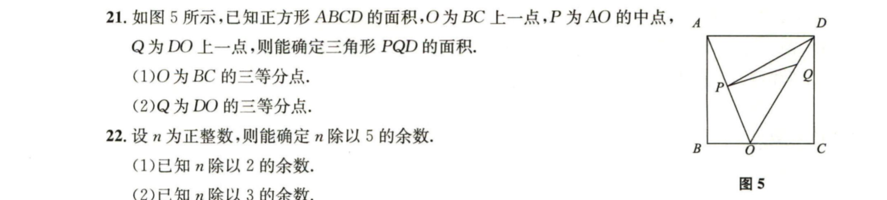

### 第 22 题

设 $n$ 为正整数，则能确定 $n$ 除以 5 的余数。

（1）已知 $n$ 除以 2 的余数。
（2）已知 $n$ 除以 3 的余数。

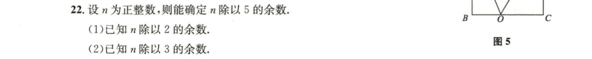

### 第 23 题

某校理学院五个系每年的录取人数如表 2 所示：

| 系别 | 数学系 | 物理系 | 化学系 | 生物系 | 地学系 |
| :--- | :---: | :---: | :---: | :---: | :---: |
| **录取人数** | 60 | 120 | 90 | 60 | 30 |

今年与去年相比，物理系的录取平均分没变，则理学院的录取平均分升高了。

（1）数学系的录取平均分升高了 3 分，生物系的录取平均分降低了 2 分。
（2）化学系的录取平均分升高了 1 分，地学系的录取平均分降低了 4 分。

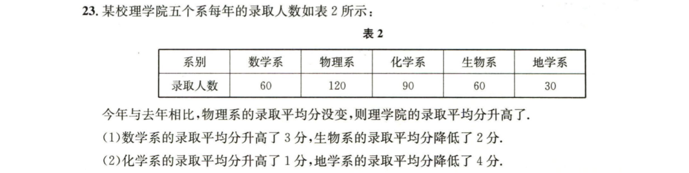

### 第 24 题

设三角区域 $D$ 由直线 $x + 8y - 56 = 0, x - 6y + 42 = 0$ 与 $kx - y + 8 - 6k = 0 (k < 0)$ 围成，则对任意的 $(x, y) \in D$，有 $\lg(x^2 + y^2) \le 2$。

（1）$k \in (-\infty, -1]$。
（2）$k \in [-1, -\dfrac{1}{8})$。

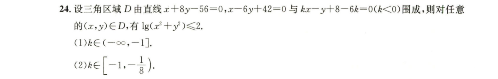

### 第 25 题

设数列 $\{a_n\}$ 的前 $n$ 项和为 $S_n$，则数列 $\{a_n\}$ 是等差数列。

（1）$S_n = n^2 + 2n, n = 1, 2, 3, \cdots$。
（2）$S_n = n^2 + 2n + 1, n = 1, 2, 3, \cdots$。

---

## 三、逻辑推理（第 26-55 题，每小题 2 分，共 60 分）

### 第 26 题

新常态下，消费需求发生深刻变化，消费拉开档次，个性化、多样化消费渐成主流，在相当一部分消费者那里，对产品质量的追求压倒了对价格的考虑。供给侧结构性改革，说到底是满足需求。低质量的产能必然会过剩，而顺应市场需求不断更新换代的产能不会过剩。

根据以上陈述，可以得出以下哪项？

- **A**．只有质优价高的产品才能满足需求。
- **B**．顺应市场需求不断更新换代的产能不是低质量的产能。
- **C**．低质量的产能不能满足个性化需求。
- **D**．只有不断更新换代的产品才能满足个性化、多样化消费的需求。
- **E**．新常态下，必须进行供给侧结构性改革。

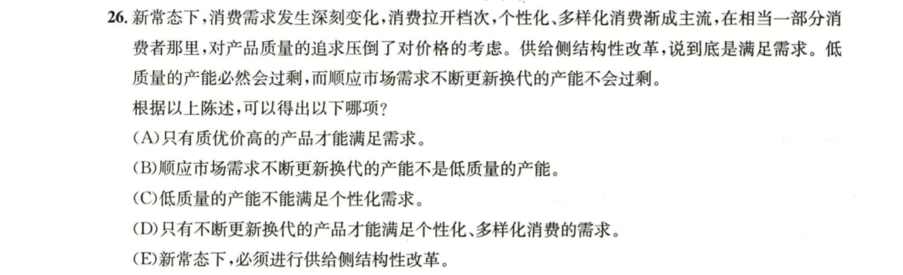

### 第 27 题

据碳－14 检测，卡皮瓦拉山岩画的创作时间最早可追溯到 3 万年前。在文字尚未出现的时代，岩画是人类沟通交流、传递信息、记录日常生活的主要方式。于是今天的我们可以在这些岩画中看到：一位母亲将孩子举起嬉戏，一家人在仰望并试图碰触头上的星空……动物是岩画的另一个主角，比如巨型犰狳、马鹿、螃蟹等。在许多画面中，人们手持长矛，追逐着前方的猎物。由此可以推断，此时的人类已经居于食物链的顶端。

以下哪项如果为真，最能支持上述推断？

- **A**．岩画中出现的动物一般是当时人类捕猎的对象。
- **B**．3 万年前，人类需要避免自己被虎、豹等大型食肉动物猎杀。
- **C**．能够使用工具使得人类可以猎杀其他动物，而不是相反。
- **D**．有了岩画，人类可以将生活经验保留下来供后代学习，这极大地提高了人类的生存能力。
- **E**．对星空的敬畏是人类脱离动物、产生宗教的动因之一。

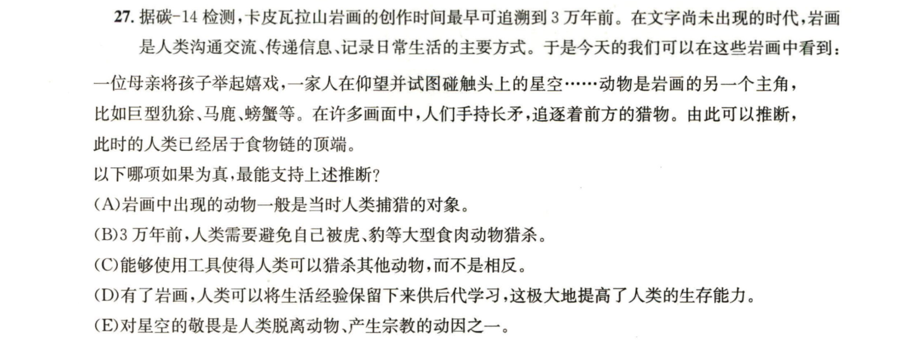

### 第 28 题

李诗、王悦、杜舒、刘默是唐诗宋词的爱好者，在唐朝诗人李白、杜甫、王维、刘禹锡 4 人中各喜爱其中一位，且每人喜爱的唐诗作者不与自己同姓。关于他们 4 人，已知：
（1） 如果爱好王维的诗，那么也爱好辛弃疾的词。
（2） 如果爱好刘禹锡的诗，那么也爱好岳飞的词。
(3) 如果爱好杜甫的诗，那么也爱好苏轼的词。

如果李诗不爱好苏轼和辛弃疾的词，则可以得出以下哪项？

- **A**．杜舒爱好辛弃疾的词。
- **B**．王悦爱好苏轼的词。
- **C**．刘默爱好苏轼的词。
- **D**．李诗爱好岳飞的词。
- **E**．杜舒爱好岳飞的词。

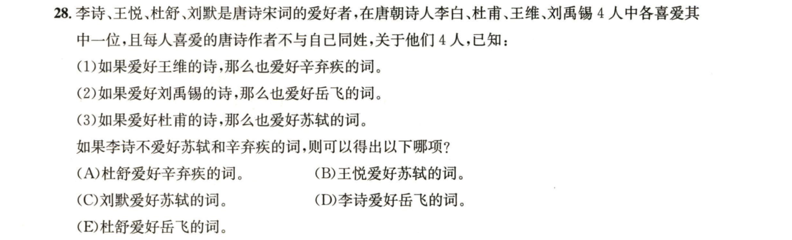

### 第 29 题

人们一直在争论猫与狗谁更聪明。最近，有些科学家不仅研究了动物脑容量的大小，还研究了其大脑皮层神经细胞的数量，发现猫平常似乎总摆出一副智力占优的神态，但猫的大脑皮层神经细胞的数量只有普通金毛犬的一半。由此，他们得出结论：狗比猫更聪明。

以下哪项最可能是上述科学家得出结论的假设？

- **A**．狗善于与人类合作，可以充当导盲犬、陪护犬、搜救犬、警犬等，就对人类的贡献而言，狗能做的似乎比猫多。
- **B**．狗可能继承了狼结群捕猎的特点，为了互相配合，它们需要做出一些复杂行为。
- **C**．动物大脑皮层神经细胞的数量与动物的聪明程度呈正相关。
- **D**．猫的脑神经细胞数量比狗少，是因为猫不像狗那样“爱交际”。
- **E**．棕熊的脑容量是金毛犬的 3 倍，但其脑神经细胞的数量却少于金毛犬，与猫很接近，而棕熊的脑容量却是猫的 10 倍。

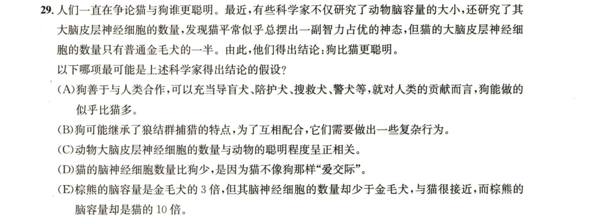

### 30~31 题基于以下题干

> 某单位拟派遣 3 名德才兼备的干部到西部山区进行精准扶贫。报名者踊跃，经过考察，最终确定了陈甲、傅乙、赵丙、邓丁、刘戊、张已 6 名候选人。根据工作需要，派遣还需要满足以下条件：
> （1） 若派遣陈甲，则派遣邓丁但不派遣张已。
> （2） 若傅乙、赵丙至少派遣 1 人，则不派遣刘戊。

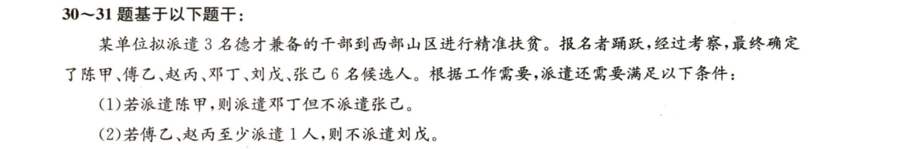

### 第 30 题

以下哪项的派遣人选和上述条件不矛盾？

- **A**．赵丙、邓丁、刘戊。
- **B**．陈甲、傅乙、赵丙。
- **C**．傅乙、邓丁、刘戊。
- **D**．邓丁、刘戊、张已。
- **E**．陈甲、赵丙、刘戊。

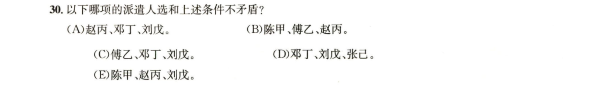

### 第 31 题

如果陈甲、刘戊至少派遣 1 人，则可以得出以下哪项？

- **A**．派遣刘戊。
- **B**．派遣赵丙。
- **C**．派遣陈甲。
- **D**．派遣傅乙。
- **E**．派遣邓丁。

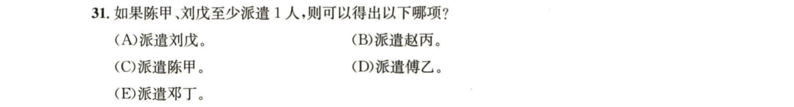

### 第 32 题

近年来，手机、电脑的使用导致工作与生活界限日益模糊，人们的平均睡眠时间一直在减少，熬夜已成为现代人生活的常态。科学研究表明，熬夜有损身体健康，睡眠不足不仅仅是多打几个哈欠那么简单。有科学家据此建议，人们应该遵守作息规律。

以下哪项如果为真，最能支持上述科学家所作的建议？

- **A**．长期睡眠不足会导致高血压、糖尿病、肥胖症、抑郁症等多种疾病，严重时还会造成意外伤害或死亡。
- **B**．缺乏睡眠会降低体内脂肪调节瘦素激素的水平，同时增加饥饿激素，容易导致暴饮暴食、体重增加。
- **C**．熬夜会让人的反应变慢、认知退步、思维能力下降，还会引发情绪失控，影响与他人的交流。
- **D**．所有的生命形式都需要休息与睡眠。在人类进化过程中，睡眠这个让人短暂失去自我意识、变得极其脆弱的过程并未被大自然淘汰。
- **E**．睡眠是身体的自然美容师，与那些睡眠充足的人相比，睡眠不足的人看上去面容憔悴，缺乏魅力。

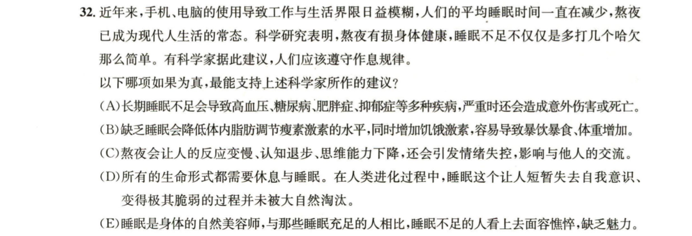

### 第 33 题

有一论证（相关语句用序号表示）如下：
①今天，我们仍然要提倡勤俭节约。
②节约可以增加社会保障资源。
③我国尚有不少地区的人民生活贫困，亟需更多社会保障资源，但也有一些人浪费严重。
④节约可以减少资源消耗。
⑤因为被浪费的任何粮食或者物品都是消耗一定的资源得来的。

如果用“甲→乙”表示甲支持（或证明）乙，则以下哪项对上述论证基本结构的表示最为准确？

<svg xmlns="http://www.w3.org/2000/svg" viewBox="0 0 450 230" width="450" height="230" style="background: white; font-family: sans-serif;">
  <defs>
    <marker id="arr33" viewBox="0 0 10 10" refX="5" refY="5" markerWidth="6" markerHeight="6" orient="auto-start-reverse">
      <path d="M 0 1.5 L 8 5 L 0 8.5 z" fill="#0f172a"/>
    </marker>
  </defs>
  <circle cx="45" cy="10" r="8" fill="white" stroke="#0f172a" stroke-width="1.4"/>
  <text x="45" y="14" font-size="11" text-anchor="middle" fill="#0f172a">①</text>
  <circle cx="45" cy="40" r="8" fill="white" stroke="#0f172a" stroke-width="1.4"/>
  <text x="45" y="44" font-size="11" text-anchor="middle" fill="#0f172a">②</text>
  <circle cx="105" cy="10" r="8" fill="white" stroke="#0f172a" stroke-width="1.4"/>
  <text x="105" y="14" font-size="11" text-anchor="middle" fill="#0f172a">③</text>
  <circle cx="105" cy="40" r="8" fill="white" stroke="#0f172a" stroke-width="1.4"/>
  <text x="105" y="44" font-size="11" text-anchor="middle" fill="#0f172a">④</text>
  <circle cx="75" cy="73" r="8" fill="white" stroke="#0f172a" stroke-width="1.4"/>
  <text x="75" y="77" font-size="11" text-anchor="middle" fill="#0f172a">⑤</text>
  <line x1="45" y1="18" x2="45" y2="32" stroke="#0f172a" stroke-width="1.4" marker-end="url(#arr33)"/>
  <line x1="105" y1="18" x2="105" y2="32" stroke="#0f172a" stroke-width="1.4" marker-end="url(#arr33)"/>
  <line x1="51" y1="46" x2="69" y2="66" stroke="#0f172a" stroke-width="1.4" marker-end="url(#arr33)"/>
  <line x1="99" y1="46" x2="81" y2="66" stroke="#0f172a" stroke-width="1.4" marker-end="url(#arr33)"/>
  <text x="75" y="105" font-size="13" font-weight="bold" text-anchor="middle" fill="#0f172a">(A)</text>
  <circle cx="195" cy="10" r="8" fill="white" stroke="#0f172a" stroke-width="1.4"/>
  <text x="195" y="14" font-size="11" text-anchor="middle" fill="#0f172a">②</text>
  <circle cx="195" cy="40" r="8" fill="white" stroke="#0f172a" stroke-width="1.4"/>
  <text x="195" y="44" font-size="11" text-anchor="middle" fill="#0f172a">③</text>
  <circle cx="255" cy="10" r="8" fill="white" stroke="#0f172a" stroke-width="1.4"/>
  <text x="255" y="14" font-size="11" text-anchor="middle" fill="#0f172a">⑤</text>
  <circle cx="255" cy="40" r="8" fill="white" stroke="#0f172a" stroke-width="1.4"/>
  <text x="255" y="44" font-size="11" text-anchor="middle" fill="#0f172a">④</text>
  <circle cx="225" cy="73" r="8" fill="white" stroke="#0f172a" stroke-width="1.4"/>
  <text x="225" y="77" font-size="11" text-anchor="middle" fill="#0f172a">①</text>
  <line x1="195" y1="18" x2="195" y2="32" stroke="#0f172a" stroke-width="1.4" marker-end="url(#arr33)"/>
  <line x1="255" y1="18" x2="255" y2="32" stroke="#0f172a" stroke-width="1.4" marker-end="url(#arr33)"/>
  <line x1="201" y1="46" x2="219" y2="66" stroke="#0f172a" stroke-width="1.4" marker-end="url(#arr33)"/>
  <line x1="249" y1="46" x2="231" y2="66" stroke="#0f172a" stroke-width="1.4" marker-end="url(#arr33)"/>
  <text x="225" y="105" font-size="13" font-weight="bold" text-anchor="middle" fill="#0f172a">(B)</text>
  <circle cx="345" cy="10" r="8" fill="white" stroke="#0f172a" stroke-width="1.4"/>
  <text x="345" y="14" font-size="11" text-anchor="middle" fill="#0f172a">④</text>
  <circle cx="345" cy="40" r="8" fill="white" stroke="#0f172a" stroke-width="1.4"/>
  <text x="345" y="44" font-size="11" text-anchor="middle" fill="#0f172a">⑤</text>
  <circle cx="405" cy="10" r="8" fill="white" stroke="#0f172a" stroke-width="1.4"/>
  <text x="405" y="14" font-size="11" text-anchor="middle" fill="#0f172a">②</text>
  <circle cx="405" cy="40" r="8" fill="white" stroke="#0f172a" stroke-width="1.4"/>
  <text x="405" y="44" font-size="11" text-anchor="middle" fill="#0f172a">③</text>
  <circle cx="375" cy="73" r="8" fill="white" stroke="#0f172a" stroke-width="1.4"/>
  <text x="375" y="77" font-size="11" text-anchor="middle" fill="#0f172a">①</text>
  <line x1="345" y1="32" x2="345" y2="18" stroke="#0f172a" stroke-width="1.4" marker-end="url(#arr33)"/>
  <line x1="405" y1="18" x2="405" y2="32" stroke="#0f172a" stroke-width="1.4" marker-end="url(#arr33)"/>
  <line x1="351" y1="46" x2="369" y2="66" stroke="#0f172a" stroke-width="1.4" marker-end="url(#arr33)"/>
  <line x1="399" y1="46" x2="381" y2="66" stroke="#0f172a" stroke-width="1.4" marker-end="url(#arr33)"/>
  <text x="375" y="105" font-size="13" font-weight="bold" text-anchor="middle" fill="#0f172a">(C)</text>
  <circle cx="120" cy="120" r="8" fill="white" stroke="#0f172a" stroke-width="1.4"/>
  <text x="120" y="124" font-size="11" text-anchor="middle" fill="#0f172a">③</text>
  <circle cx="120" cy="150" r="8" fill="white" stroke="#0f172a" stroke-width="1.4"/>
  <text x="120" y="154" font-size="11" text-anchor="middle" fill="#0f172a">②</text>
  <circle cx="180" cy="120" r="8" fill="white" stroke="#0f172a" stroke-width="1.4"/>
  <text x="180" y="124" font-size="11" text-anchor="middle" fill="#0f172a">⑤</text>
  <circle cx="180" cy="150" r="8" fill="white" stroke="#0f172a" stroke-width="1.4"/>
  <text x="180" y="154" font-size="11" text-anchor="middle" fill="#0f172a">④</text>
  <circle cx="150" cy="183" r="8" fill="white" stroke="#0f172a" stroke-width="1.4"/>
  <text x="150" y="187" font-size="11" text-anchor="middle" fill="#0f172a">①</text>
  <line x1="120" y1="128" x2="120" y2="142" stroke="#0f172a" stroke-width="1.4" marker-end="url(#arr33)"/>
  <line x1="180" y1="128" x2="180" y2="142" stroke="#0f172a" stroke-width="1.4" marker-end="url(#arr33)"/>
  <line x1="126" y1="156" x2="144" y2="176" stroke="#0f172a" stroke-width="1.4" marker-end="url(#arr33)"/>
  <line x1="174" y1="156" x2="156" y2="176" stroke="#0f172a" stroke-width="1.4" marker-end="url(#arr33)"/>
  <text x="150" y="215" font-size="13" font-weight="bold" text-anchor="middle" fill="#0f172a">(D)</text>
  <circle cx="270" cy="120" r="8" fill="white" stroke="#0f172a" stroke-width="1.4"/>
  <text x="270" y="124" font-size="11" text-anchor="middle" fill="#0f172a">④</text>
  <circle cx="270" cy="150" r="8" fill="white" stroke="#0f172a" stroke-width="1.4"/>
  <text x="270" y="154" font-size="11" text-anchor="middle" fill="#0f172a">⑤</text>
  <circle cx="330" cy="120" r="8" fill="white" stroke="#0f172a" stroke-width="1.4"/>
  <text x="330" y="124" font-size="11" text-anchor="middle" fill="#0f172a">③</text>
  <circle cx="330" cy="150" r="8" fill="white" stroke="#0f172a" stroke-width="1.4"/>
  <text x="330" y="154" font-size="11" text-anchor="middle" fill="#0f172a">②</text>
  <circle cx="300" cy="183" r="8" fill="white" stroke="#0f172a" stroke-width="1.4"/>
  <text x="300" y="187" font-size="11" text-anchor="middle" fill="#0f172a">①</text>
  <line x1="270" y1="142" x2="270" y2="128" stroke="#0f172a" stroke-width="1.4" marker-end="url(#arr33)"/>
  <line x1="330" y1="128" x2="330" y2="142" stroke="#0f172a" stroke-width="1.4" marker-end="url(#arr33)"/>
  <line x1="276" y1="156" x2="294" y2="176" stroke="#0f172a" stroke-width="1.4" marker-end="url(#arr33)"/>
  <line x1="324" y1="156" x2="306" y2="176" stroke="#0f172a" stroke-width="1.4" marker-end="url(#arr33)"/>
  <text x="300" y="215" font-size="13" font-weight="bold" text-anchor="middle" fill="#0f172a">(E)</text>
</svg>

- **A**．结构如图 (A) 所示
- **B**．结构如图 (B) 所示
- **C**．结构如图 (C) 所示
- **D**．结构如图 (D) 所示
- **E**．结构如图 (E) 所示

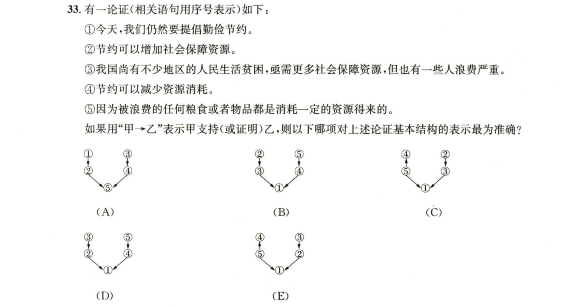

### 第 34 题

研究人员使用脑电图技术研究了母亲给婴儿唱童谣时两人的大脑活动，发现当母亲与婴儿对视时，双方的脑电波趋于同步，此时婴儿也会发出更多的声音尝试与母亲沟通。他们据此认为，母亲与婴儿对视有助于婴儿的学习与交流。

以下哪项如果为真，最能支持上述研究人员的观点？

- **A**．在两个成年人交流时，如果他们的脑电波同步，交流就会更顺畅。
- **B**．当父母与孩子互动时，双方的情绪与心率可能也会同步。
- **C**．当部分学生对某学科感兴趣时，他们的脑电波会渐趋同步，学习效果也随之提升。
- **D**．当母亲与婴儿对视时，他们都在发出信号，表明自己可以且愿意与对方交流。
- **E**．脑电波趋于同步可优化双方的对话状态，使交流更加默契，增进彼此了解。

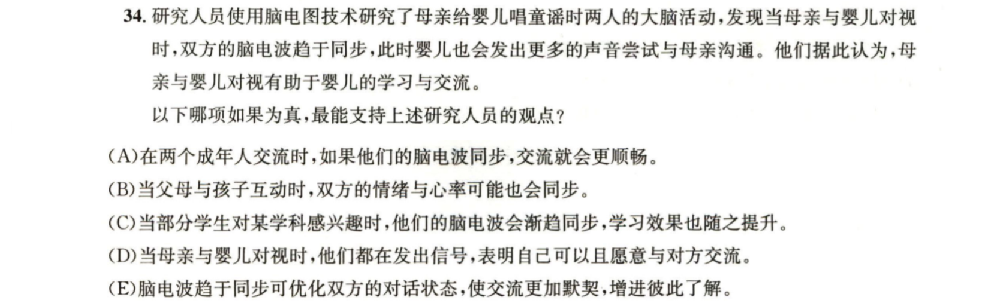

### 第 35 题

本保险柜所有密码都是 4 个阿拉伯数字和 4 个英文字母的组合，已知：
（1） 若 4 个英文字母不连续排列，则密码组合中的数字之和大于 15。
（2） 若 4 个英文字母连续排列，则密码组合中的数字之和等于 15。
(3) 密码组合中的数字之和或者等于 18，或者小于 15。

根据上述信息，以下哪项是可能的密码组合？

- **A**．ladbe356。
- **B**．37ab26dc。
- **C**．2acgf716。
- **D**．58bcde32。
- **E**．18ac42de。

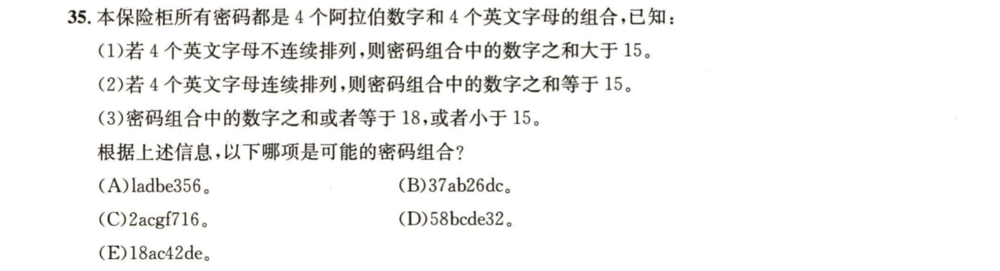

### 第 36 题

有一 6×6 的方阵，如图 6 所示，它所含的每个小方格中可填入一个汉字，已有部分汉字填入。现要求该方阵中的每行每列均含有礼、乐、射、御、书、数 6 个汉字，不能重复也不能遗漏。

<svg xmlns="http://www.w3.org/2000/svg" viewBox="0 0 260 275" width="260" height="275" style="background: white; font-family: sans-serif;">
  <rect x="25" y="20" width="210" height="210" fill="none" stroke="#0f172a" stroke-width="2"/>
  <line x1="60" y1="20" x2="60" y2="230" stroke="#0f172a" stroke-width="1"/>
  <line x1="95" y1="20" x2="95" y2="230" stroke="#0f172a" stroke-width="1"/>
  <line x1="130" y1="20" x2="130" y2="230" stroke="#0f172a" stroke-width="1"/>
  <line x1="165" y1="20" x2="165" y2="230" stroke="#0f172a" stroke-width="1"/>
  <line x1="200" y1="20" x2="200" y2="230" stroke="#0f172a" stroke-width="1"/>
  <line x1="25" y1="55" x2="235" y2="55" stroke="#0f172a" stroke-width="1"/>
  <line x1="25" y1="90" x2="235" y2="90" stroke="#0f172a" stroke-width="1"/>
  <line x1="25" y1="125" x2="235" y2="125" stroke="#0f172a" stroke-width="1"/>
  <line x1="25" y1="160" x2="235" y2="160" stroke="#0f172a" stroke-width="1"/>
  <line x1="25" y1="195" x2="235" y2="195" stroke="#0f172a" stroke-width="1"/>
  <text x="77.5" y="42" font-size="16" text-anchor="middle" dominant-baseline="middle" fill="#0f172a">乐</text>
  <text x="147.5" y="42" font-size="16" text-anchor="middle" dominant-baseline="middle" fill="#0f172a">御</text>
  <text x="182.5" y="42" font-size="16" text-anchor="middle" dominant-baseline="middle" fill="#0f172a">书</text>
  <text x="147.5" y="77" font-size="16" text-anchor="middle" dominant-baseline="middle" fill="#0f172a">乐</text>
  <text x="42.5" y="112" font-size="16" text-anchor="middle" dominant-baseline="middle" fill="#0f172a">射</text>
  <text x="77.5" y="112" font-size="16" text-anchor="middle" dominant-baseline="middle" fill="#0f172a">御</text>
  <text x="112.5" y="112" font-size="16" text-anchor="middle" dominant-baseline="middle" fill="#0f172a">书</text>
  <text x="182.5" y="112" font-size="16" text-anchor="middle" dominant-baseline="middle" fill="#0f172a">礼</text>
  <text x="77.5" y="147" font-size="16" text-anchor="middle" dominant-baseline="middle" fill="#0f172a">射</text>
  <text x="182.5" y="147" font-size="16" text-anchor="middle" dominant-baseline="middle" fill="#0f172a">数</text>
  <text x="217.5" y="147" font-size="16" text-anchor="middle" dominant-baseline="middle" fill="#0f172a">礼</text>
  <text x="42.5" y="182" font-size="16" text-anchor="middle" dominant-baseline="middle" fill="#0f172a">御</text>
  <text x="112.5" y="182" font-size="16" text-anchor="middle" dominant-baseline="middle" fill="#0f172a">数</text>
  <text x="217.5" y="182" font-size="16" text-anchor="middle" dominant-baseline="middle" fill="#0f172a">射</text>
  <text x="217.5" y="217" font-size="16" text-anchor="middle" dominant-baseline="middle" fill="#0f172a">书</text>
  <text x="130" y="258" font-size="14" font-weight="bold" text-anchor="middle" fill="#0f172a">图 6</text>
</svg>

|  | 乐 |  | 御 | 书 |  |
| :---: | :---: | :---: | :---: | :---: | :---: |
|  |  |  | 乐 |  |  |
| 射 | 御 | 书 |  | 礼 |  |
|  | 射 |  |  | 数 | 礼 |
| 御 |  | 数 |  |  | 射 |
|  |  |  |  |  | 书 |

根据上述要求，以下哪项是方阵底行 5 个空格中从左至右依次应填入的汉字？

- **A**．数、礼、乐、射、御。
- **B**．乐、数、御、射、礼。
- **C**．数、礼、乐、御、射。
- **D**．乐、礼、射、数、御。
- **E**．数、御、乐、射、礼。

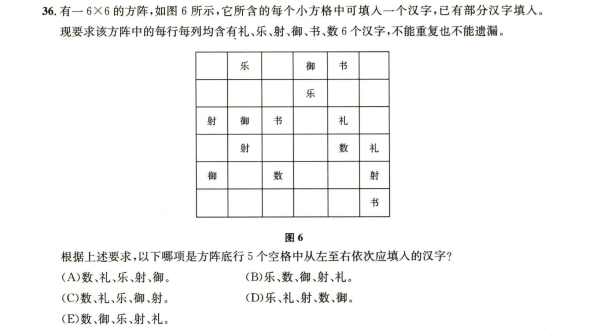

### 第 37 题

某市音乐节设立了流行、民谣、摇滚、民族、电音、说唱、爵士这 7 大类的奖项评选。在入围提名中，已知：
（1） 至少有 6 类入围。
（2） 流行、民谣、摇滚中至多有 2 类入围。
(3) 如果摇滚和民族类都入围，则电音和说唱中至少有 1 类没有入围。

根据上述信息，可以得出以下哪项？

- **A**．流行类没有入围。
- **B**．民谣类没有入围。
- **C**．摇滚类没有入围。
- **D**．爵士类没有入围。
- **E**．电音类没有入围。

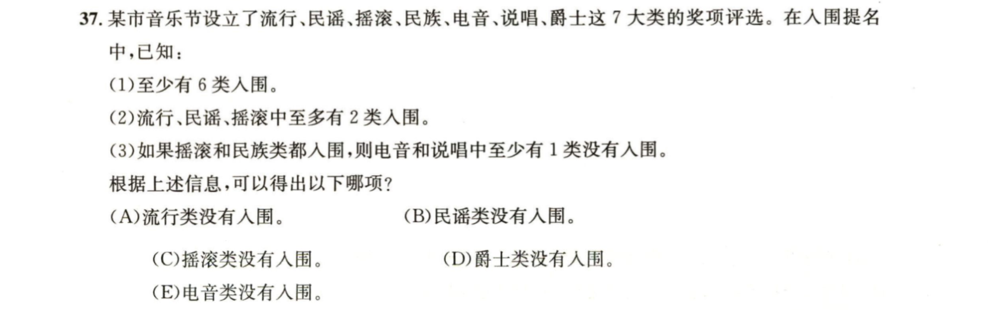

### 第 38 题

某大学有位女教师默默资助一偏远山区的贫困家庭长达 15 年。记者多方打听，发现做好事者是该大学传媒学院甲、乙、丙、丁、戊 5 位教师中的一位。在接受记者采访时，5 位教师都很谦虚，他们是这么对记者说的：

甲：“这件事是乙做的。”
乙：“我没有做，是丙做了这件事。”
丙：“我并没有做这件事。”
丁：“我也没有做这件事，是甲做的。”
戊：“如果甲没有做，则丁也不会做。”

记者后来得知，上述 5 位教师中只有一人说的话符合真实情况。根据以上信息，可以得出做这件好事的人是：

- **A**．甲。
- **B**．乙。
- **C**．丙。
- **D**．丁。
- **E**．戊。

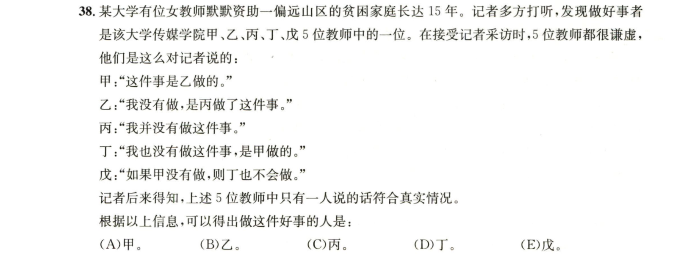

### 第 39 题

作为一名环保爱好者，赵博士提倡低碳生活，积极宣传节能减排。但我不赞同他的做法，因为作为一名大学老师，他这样做，占用了大量的科研时间，到现在连副教授都没评上，他的观点怎么能令人信服呢？

以下哪项论证中的错误和上述最为相似？

- **A**．张某提出要同工同酬，主张在质量相同的情况下，不分年龄、级别一律按件计酬。她这样说不就是因为她年轻、级别低吗？其实她是在为自己谋利益。
- **B**．公司的绩效奖励制度是为了充分调动广大员工的积极性，它对所有员工都是公平的。如果有人对此有不同的意见，则说明他反对公平。
- **C**．最近听说你对单位的管理制度提了不少意见，这真令人难以置信！单位领导对你差吗？你这样做，分明是和单位领导过不去。
- **D**．单位任命李某担任信息科科长，听说你对此有意见。大家都没有提意见，只有你一个人有意见，看来你的意见是有问题的。
- **E**．有一种观点认为，只有直接看到的事物才能确信其存在。但是没有人可以看到质子、电子，而这些都被科学证明是客观存在的。所以，该观点是错误的。

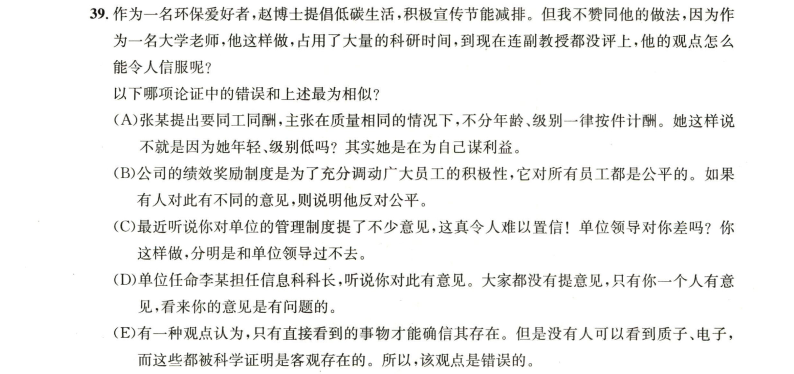

### 第 40 题

下面 6 张卡片，如图 7 所示，一面印的是汉字（动物或者花卉），一面印的是数字（奇数或者偶数）。

<svg xmlns="http://www.w3.org/2000/svg" viewBox="0 0 380 110" width="380" height="110" style="background: white; font-family: sans-serif;">
  <rect x="25" y="15" width="45" height="50" fill="white" stroke="#0f172a" stroke-width="1.8"/>
  <text x="47.5" y="44" font-size="18" text-anchor="middle" dominant-baseline="middle" fill="#0f172a">虎</text>
  <rect x="80" y="15" width="45" height="50" fill="white" stroke="#0f172a" stroke-width="1.8"/>
  <text x="102.5" y="44" font-size="18" text-anchor="middle" dominant-baseline="middle" fill="#0f172a">6</text>
  <rect x="135" y="15" width="45" height="50" fill="white" stroke="#0f172a" stroke-width="1.8"/>
  <text x="157.5" y="44" font-size="18" text-anchor="middle" dominant-baseline="middle" fill="#0f172a">菊</text>
  <rect x="190" y="15" width="45" height="50" fill="white" stroke="#0f172a" stroke-width="1.8"/>
  <text x="212.5" y="44" font-size="18" text-anchor="middle" dominant-baseline="middle" fill="#0f172a">7</text>
  <rect x="245" y="15" width="45" height="50" fill="white" stroke="#0f172a" stroke-width="1.8"/>
  <text x="267.5" y="44" font-size="18" text-anchor="middle" dominant-baseline="middle" fill="#0f172a">鹰</text>
  <rect x="300" y="15" width="45" height="50" fill="white" stroke="#0f172a" stroke-width="1.8"/>
  <text x="322.5" y="44" font-size="18" text-anchor="middle" dominant-baseline="middle" fill="#0f172a">8</text>
  <text x="185" y="95" font-size="14" font-weight="bold" text-anchor="middle" fill="#0f172a">图 7</text>
</svg>

对于上述 6 张卡片，如果要验证“每张至少有一面印的是偶数或者花卉”，至少需要翻看几张卡片？

- **A**．2。
- **B**．3。
- **C**．4。
- **D**．5。
- **E**．6。

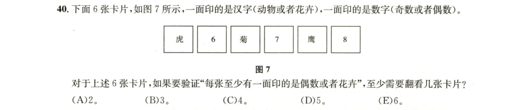

### 第 41 题

某地人才市场招聘保洁、物业、网管、销售 4 种岗位的从业者，有甲、乙、丙、丁 4 位年轻人前来应聘。事后得知，每人只选择一种岗位应聘，且每种岗位都有其中一人应聘。另外，还知道：
（1） 如果丁应聘网管，那么甲应聘物业。
（2） 如果乙不应聘保洁，那么甲应聘保洁且丙应聘销售。
(3) 如果乙应聘保洁，那么丙应聘销售，丁也应聘保洁。

根据以上陈述，可以得出以下哪项？

- **A**．甲应聘网管岗位。
- **B**．丙应聘保洁岗位。
- **C**．甲应聘物业岗位。
- **D**．乙应聘网管岗位。
- **E**．丁应聘销售岗位。

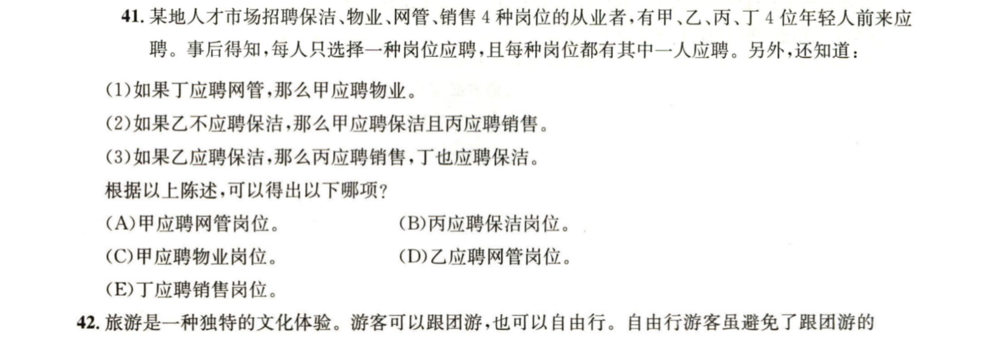

### 第 42 题

旅游是一种独特的文化体验。游客可以跟团游，也可以自由行。自由行游客虽避免了跟团游的集体束缚，但也放弃了人工导游的全程讲解，而近年来他们了解旅游景点的文化需求却有增无减。为适应这一市场需求，基于手机平台的多款智能导游 App 被开发出来。它们可定位用户位置，自动提供景点讲解、游览问答等功能。有专家就此指出，未来智能导游必然会取代人工导游，传统的导游职业将消亡。

以下哪项如果为真，最能质疑上述专家的论断？

- **A**．至少有 95% 的国外景点所配备的导游讲解器没有中文语音，中国出境游客因为语言和文化上的差异，对智能导游 App 的需求比较强烈。
- **B**．旅行中才会使用的智能导游 App，如何保持用户黏性、未来又如何取得商业价值等都是待解问题。
- **C**．好的人工导游可以根据游客需求进行不同类型的讲解，不仅关注景点，还可表达观点，个性化很强，这是智能导游 App 难以企及的。
- **D**．目前发展较好的智能导游 App 用户量在百万级左右，这与当前中国旅游人数总量相比还只是一个很小的比例，市场还没有培养出用户的普遍消费习惯。
- **E**．国内景区配备的人工导游需要收费，大部分导游讲解的内容都是事先背好的标准化内容。但是，即便人工导游没有特色，其退出市场也需要一定的时间。

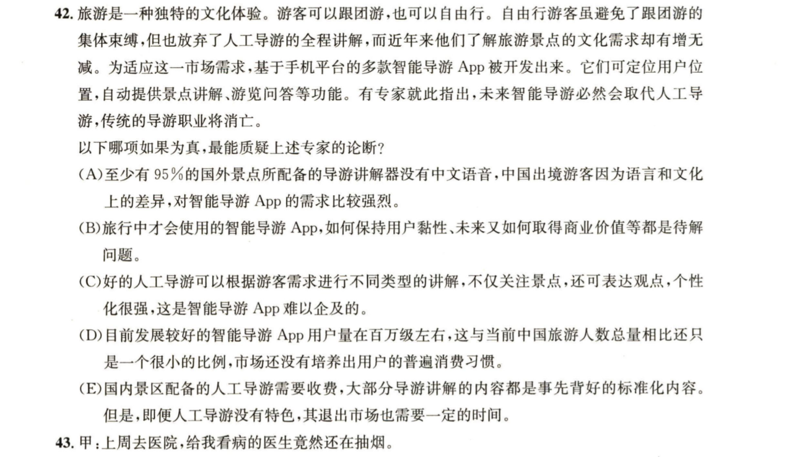

### 第 43 题

甲：上周去医院，给我看病的医生竟然还在抽烟。
乙：所有抽烟的医生都不关心自己的健康，而不关心自己健康的人也不会关心他人的健康。
甲：是的，不关心他人健康的医生没有医德，我今后再也不会让没有医德的医生给我看病了。

根据上述信息，以下除了哪项，其余各项均可得出？

- **A**．甲认为他不会再找抽烟的医生看病。
- **B**．乙认为上周给甲看病的医生不会关心乙的健康。
- **C**．甲认为上周给他看病的医生不关心医生自己的健康。
- **D**．甲认为上周给他看病的医生不会关心甲的健康。
- **E**．乙认为上周给甲看病的医生没有医德。

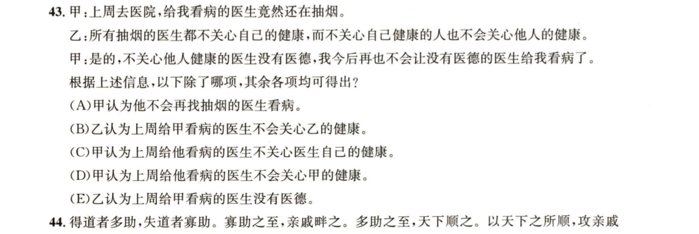

### 第 44 题

得道者多助，失道者寡助。寡助之至，亲戚畔之。多助之至，天下顺之。以天下之所顺，攻亲戚之所畔，故君子有不战，战必胜矣。

以下哪项是上述论证所隐含的前提？

- **A**．得道者多，则天下太平。
- **B**．君子是得道者。
- **C**．得道者必胜失道者。
- **D**．失道者必定得不到帮助。
- **E**．失道者亲戚畔之。

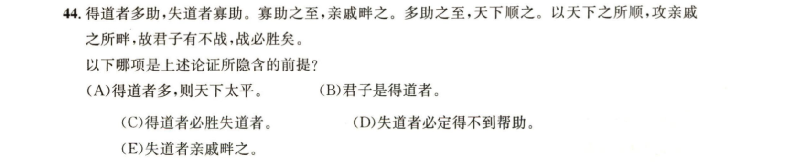

### 第 45 题

如今，孩子写作业不仅仅是他们自己的事，大多数中小学生的家长都要面临陪孩子写作业的任务，包括给孩子听写、检查作业、签字等。据一项针对 3000 余名家长进行的调查显示，84% 的家长每天都会陪孩子写作业，而 67% 的受访家长会因陪孩子写作业而烦恼。有专家对此指出，家长陪孩子写作业，相当于充当学校老师的助理，让家庭成为课堂的延伸，会对孩子的成长产生不利影响。

以下哪项如果为真，最能支持上述专家的论断？

- **A**．家长是最好的老师，家长辅导孩子获得各种知识本来就是家庭教育的应有之义，对于中低年级的孩子，学习过程中的父母陪伴尤为重要。
- **B**．家长通常有自己的本职工作，有的晚上要加班，有的即使晚上回家也需要研究工作、操持家务，一般难有精力认真完成学校老师布置的“家长作业”。
- **C**．家长陪孩子写作业，会使得孩子在学习中缺乏独立性和主动性，整天处于老师和家长的双重压力下，既难生发学习兴趣，更难养成独立人格。
- **D**．大多数家长在孩子教育上并不是行家，他们或者早已遗忘了自己曾经学过的知识，或者根本不知道如何将自己拥有的知识传授给孩子。
- **E**．家长辅导孩子，不应围绕老师布置的作业，而应着重激发孩子的学习兴趣，培养孩子良好的学习习惯，让孩子在成长中感到新奇、快乐。

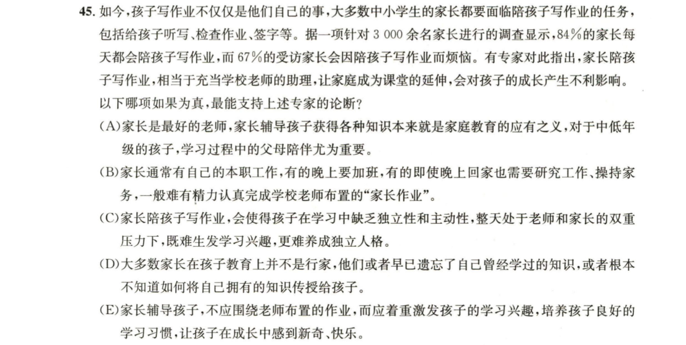

### 第 46 题

我国天山是垂直地带性的典范，已知天山的植被形态分布具有如下特点：
（1） 从低到高有荒漠、森林带、冰雪带等。
（2） 只有经过山地草原，荒漠才能演变成森林带。
(3) 如果不经过森林带，山地草原就不会过渡到山地草甸。
(4) 山地草甸的海拔不比山地草甸草原的低，也不比高寒草甸高。

根据以上信息，关于天山植被形态，按照由低到高排列，以下哪项是不可能的？

- **A**．荒漠、山地草原、山地草甸草原、森林带、山地草甸、高寒草甸、冰雪带。
- **B**．荒漠、山地草原、山地草甸草原、高寒草甸、森林带、山地草甸、冰雪带。
- **C**．荒漠、山地草甸草原、山地草原、森林带、山地草甸、高寒草甸、冰雪带。
- **D**．荒漠、山地草原、山地草甸草原、森林带、山地草甸、冰雪带、高寒草甸。
- **E**．荒漠、山地草原、森林带、山地草甸草原、山地草甸、高寒草甸、冰雪带。

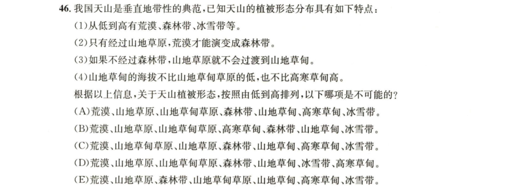

### 第 47 题

某大学读书会开展“一月一书”活动。读书会成员甲、乙、丙、丁、戊 5 人在《论语》《史记》《唐诗三百首》《奥德赛》《资本论》中各选一种阅读，互不重复。已知：
（1） 甲爱读历史，会在《史记》和《奥德赛》中选一本。
（2） 乙和丁只爱中国古代经典，但现在都没有读诗的心情。
(3) 如果乙选《论语》，则戊选《史记》。

事实上，每个人都选了自己喜爱的书目。根据上述信息，可以得出以下哪项？

- **A**．甲选《史记》。
- **B**．乙选《奥德赛》。
- **C**．丙选《唐诗三百首》。
- **D**．丁选《论语》。
- **E**．戊选《资本论》。

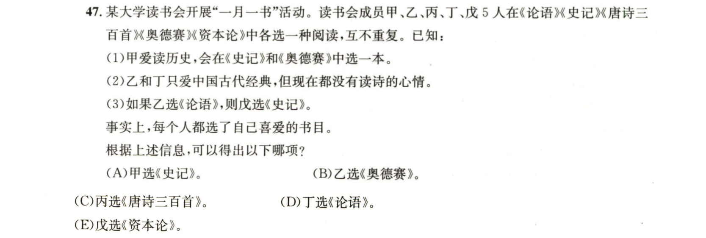

### 第 48 题

如果一个人只为自己劳动，他也许能够成为著名学者、大哲人、卓越诗人，然而他永远不能成为完美无瑕的伟大人物。如果我们选择了最能为人类福利而劳动的职业，那么重担就不能把我们压倒，因为这是为大家而献身。那时我们所感到的就不是可怜的、有限的、自私的乐趣，我们的幸福将属于千万人，我们的事业将默默地、但是永恒发挥作用地存在下去，而面对我们的骨灰，高尚的人们将洒下热泪。

根据以上陈述，可以得出以下哪项结论？

- **A**．如果一个人只为自己劳动，不是为大家而献身，那么重担就能将他压倒。
- **B**．如果我们为大家而献身，我们的幸福将属于千万人，面对我们的骨灰，高尚的人们将洒下热泪。
- **C**．如果我们没有选择最能为人类福利而劳动的职业，我们所感到的就是可怜的、有限的、自私的乐趣。
- **D**．如果选择了最能为人类福利而劳动的职业，我们就不但能够成为著名学者、大哲人、卓越诗人，而且还能够成为完美无瑕的伟大人物。
- **E**．如果我们只为自己劳动，我们的事业就不会默默地、但是永恒发挥作用地存在下去。

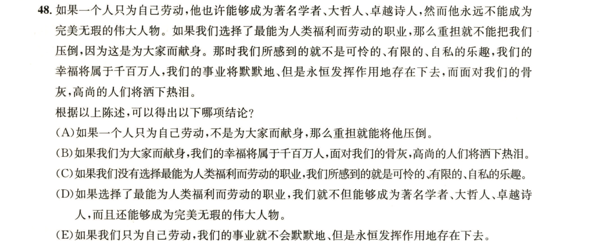

### 49~50 题基于以下题干

> 某食堂采购 4 类（各种蔬菜名称的后一个字相同，即为一类）共 12 种蔬菜：芹菜、菠菜、韭菜、青椒、红椒、黄椒、黄瓜、冬瓜、丝瓜、扁豆、毛豆、豇豆，并根据若干条件将其分成 3 组，准备在早、中、晚三餐中分别使用。已知条件如下：
> （1） 同一类别的蔬菜不在一组。
> （2） 芹菜不能在黄椒那一组，冬瓜不能在扁豆那一组。
> (3) 毛豆必须与红椒或韭菜在同一组。
> (4) 黄椒必须与豇豆在同一组。

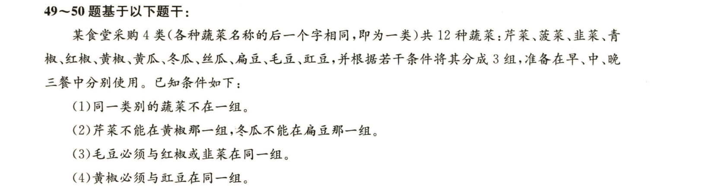

### 第 49 题

根据以上信息，可以得出以下哪项？

- **A**．芹菜与豇豆不在同一组。
- **B**．芹菜与毛豆不在同一组。
- **C**．菠菜与扁豆不在同一组。
- **D**．冬瓜与青椒不在同一组。
- **E**．丝瓜与韭菜不在同一组。

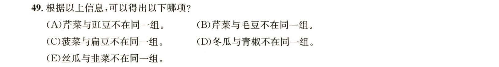

### 第 50 题

如果韭菜、青椒与黄瓜在同一组，则可得出以下哪项？

- **A**．芹菜、红椒与扁豆在同一组。
- **B**．菠菜、黄椒与豇豆在同一组。
- **C**．韭菜、黄瓜与毛豆在同一组。
- **D**．菠菜、冬瓜与豇豆在同一组。
- **E**．芹菜、红椒与丝瓜在同一组。

### 第 51 题

《淮南子·齐俗训》中有曰：“今屠牛而烹其肉，或以为酸，或以为甘，煎熬燎炙，齐味万方，其本一牛之体。”其中的“熬”便是熬牛肉制汤的意思。这是考证牛肉汤做法的最早的文献资料。某民俗专家由此推测，牛肉汤的起源不会晚于春秋战国时期。

以下哪项如果为真，最能支持上述推测？

- **A**．《淮南子·齐俗训》完成于西汉时期。
- **B**．早在春秋战国时期，我国已经开始使用耕牛。
- **C**．《淮南子》的作者中有来自齐国故地的人。
- **D**．春秋战国时期我国已经有熬汤的鼎器。
- **E**．《淮南子·齐俗训》记述的是春秋战国时期齐国的风俗习惯。

### 第 52 题

某研究机构以约 2 万名 65 岁以上的老人为对象，调查了笑的频率与健康状态的关系。结果显示，在不苟言笑的老人中，认为自身现在的健康状态“不怎么好”和“不好”的比例分别是几乎每天都笑的老人的 1.5 倍和 1.8 倍。爱笑的老人对自我健康状态的评价往往较高。他们由此认为，爱笑的老人更健康。

以下哪项如果为真，最能质疑上述调查者的观点？

- **A**．乐观的老人比悲观的老人更长寿。
- **B**．病痛的折磨使得部分老人对自我健康状态的评价不高。
- **C**．身体健康的老人中，女性爱笑的比例比男性高 10 个百分点。
- **D**．良好的家庭氛围使得老年人生活更乐观、身体更健康。
- **E**．老年人的自我健康评价往往和他们实际的健康状况之间存在一定的差距。

### 第 53 题

阔叶树的降尘优势明显，吸附 PM2.5 的效果最好，一棵阔叶树一年的平均滞尘量达 3.16 公斤。针叶树叶面积小，吸附 PM2.5 的功效较弱。全年平均下来，阔叶林的吸尘效果要比针叶林强不少，阔叶树也比灌木和草的吸尘效果好得多。以北京常见的阔叶树国槐为例，成片的国槐林吸尘效果比同等面积普通草地约高 30%。有些人据此认为，为了降尘北京应大力推广阔叶树，并尽量减少针叶林面积。

以下哪项如果为真，最能削弱上述有关人员的观点？

- **A**．阔叶树与针叶树比例失调，不仅极易暴发病虫害、火灾等，还会影响林木的生长和健康。
- **B**．针叶树冬天虽然不落叶，但基本处于“休眠”状态，生物活性差。
- **C**．植树造林既要治理 PM2.5，也要治理其他污染物，需要合理布局。
- **D**．阔叶树冬天落叶，在寒冷的冬季，其养护成本远高于针叶树。
- **E**．建造通风走廊，能把城市和郊区的森林连接起来，让清新的空气吹入，降低城区的 PM2.5。

### 54~55 题基于以下题干

> 某园艺公司打算在如下形状的花圃中栽种玫瑰、兰花和菊花三个品种的花卉。该花圃的形状如图 8 所示：
>
> <svg xmlns="http://www.w3.org/2000/svg" viewBox="0 0 220 185" width="220" height="185" style="background: white; font-family: sans-serif;">
>   <polygon points="110.0,16.0 130.8,28.0 130.8,52.0 110.0,64.0 89.2,52.0 89.2,28.0" fill="none" stroke="#0f172a" stroke-width="1.8"/>
>   <polygon points="89.2,52.0 110.0,64.0 110.0,88.0 89.2,100.0 68.4,88.0 68.4,64.0" fill="none" stroke="#0f172a" stroke-width="1.8"/>
>   <polygon points="130.8,52.0 151.6,64.0 151.6,88.0 130.8,100.0 110.0,88.0 110.0,64.0" fill="none" stroke="#0f172a" stroke-width="1.8"/>
>   <polygon points="68.4,88.0 89.2,100.0 89.2,124.0 68.4,136.0 47.6,124.0 47.6,100.0" fill="none" stroke="#0f172a" stroke-width="1.8"/>
>   <polygon points="110.0,88.0 130.8,100.0 130.8,124.0 110.0,136.0 89.2,124.0 89.2,100.0" fill="none" stroke="#0f172a" stroke-width="1.8"/>
>   <polygon points="151.6,88.0 172.4,100.0 172.4,124.0 151.6,136.0 130.8,124.0 130.8,100.0" fill="none" stroke="#0f172a" stroke-width="1.8"/>
>   <text x="110" y="45" font-size="15" text-anchor="middle" fill="#0f172a">1</text>
>   <text x="89" y="81" font-size="15" text-anchor="middle" fill="#0f172a">2</text>
>   <text x="131" y="81" font-size="15" text-anchor="middle" fill="#0f172a">3</text>
>   <text x="68" y="117" font-size="15" text-anchor="middle" fill="#0f172a">4</text>
>   <text x="110" y="117" font-size="15" text-anchor="middle" fill="#0f172a">5</text>
>   <text x="152" y="117" font-size="15" text-anchor="middle" fill="#0f172a">6</text>
>   <text x="110" y="165" font-size="13" font-weight="bold" text-anchor="middle" fill="#0f172a">图 8</text>
> </svg>
>
> 拟栽种的玫瑰有紫、红、白 3 种颜色，兰花有红、白、黄 3 种颜色，菊花有白、黄、蓝 3 种颜色。栽种需满足如下要求：
> （1） 每个六边形格子中仅栽种一个品种、一种颜色的花。
> （2） 每个品种只栽种两种颜色的花。
> (3) 相邻格子中的花，其品种与颜色均不相同。

### 第 54 题

若格子 5 中是红色的花，则以下哪项是不可能的？

- **A**．格子 2 中是紫色的玫瑰。
- **B**．格子 1 中是白色的兰花。
- **C**．格子 1 中是白色的菊花。
- **D**．格子 4 中是白色的兰花。
- **E**．格子 6 中是蓝色的菊花。

### 第 55 题

若格子 5 中是红色的玫瑰，且格子 3 中是黄色的花，则可以得出以下哪项？

- **A**．格子 1 中是紫色的玫瑰。
- **B**．格子 4 中是白色的菊花。
- **C**．格子 2 中是白色的菊花。
- **D**．格子 4 中是白色的兰花。
- **E**．格子 6 中是蓝色的菊花。

---

## 四、写作（第 56-57 题，共 65 分）

### 第 56 题 · 论证有效性分析 (30 分)

**分析下述论证中存在的缺陷与漏洞，选择若干要点，写一篇 600 字左右的文章，对该论证的有效性进行分析和评论。（论证有效性分析的一般要点是：概念特别是核心概念的界定和使用是否准确并前后一致，有无各种明显的逻辑错误，论证的论据是否成立并支持结论，结论成立的条件是否充分等。）**

> 有人认为选择越多越快乐，其理由是：人的选择越多就越自由，其自主性就越高，就越感到幸福和满足，所以就越快乐。其实，选择越多可能会越痛苦。
>
> 常言道：“知足常乐。”一个人知足了才会感到快乐，世界上的事物是无穷的，所以选择也是无穷的。所谓“选择越多越快乐”，意味着只有无穷的选择才能使人感到最快乐。而追求无穷的选择就是不知足，不知足者就不会感到快乐，那就只会感到痛苦。
>
> 再说，在做出每一个选择时，首先需要我们对各个选项进行考察分析，然后再进行判断决策。选择越多，我们在考察分析选项时势必付出更多的精力，也就势必带来更多的烦恼和痛苦。事实也正是如此。我们在做考卷中的选择题时，选项越多选择起来就越麻烦，也就越感到痛苦。
>
> 还有，选择越多，选择时产生失误的概率就越高，由于选择失误而产生的后悔就越多，因而产生的痛苦也就越多。有人因为飞机晚点而后悔没选坐高铁，就是因为可选交通工具多样而造成的。如果没有高铁可选，就不会有这种后悔和痛苦。
>
> 退一步说，即使其选择没有绝对的对错之分，也肯定有优劣之分。人们做出某一选择后，可能会觉得自己的选择并非最优而产生懊悔，从这种意义上说，选择越多，懊悔的概率就越大，也就越痛苦。很多股民懊悔自己没有选好股票而未赚到更多的钱，从而痛苦不已，无疑是因为可选购的股票太多造成的。

### 第 57 题 · 论说文 (35 分)

**根据下述材料，写一篇 700 字左右的论说文，题目自拟。**

> 知识的真理性只有经过检验才能得到证明。论辩是纠正错误的重要途径之一，不同观点的冲突会暴露错误而发现真理。

