# 2021年全国硕士研究生招生考试管理类专业学位联考综合能力试题 (科目代码: 199)

## 一、问题求解：第1～15小题，每小题3分，共45分。下列每题给出的A、B、C、D、E五个选项中，只有一项是符合试题要求的。

### 第1题

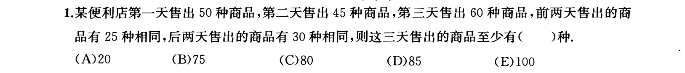

某便利店第一天售出 50 种商品，第二天售出 45 种商品，第三天售出 60 种商品，前两天售出的商品有 25 种相同，后两天售出的商品有 30 种相同，则这三天售出的商品至少有（ ）种。

- **A**．20
- **B**．75
- **C**．80
- **D**．85
- **E**．100

### 第2题

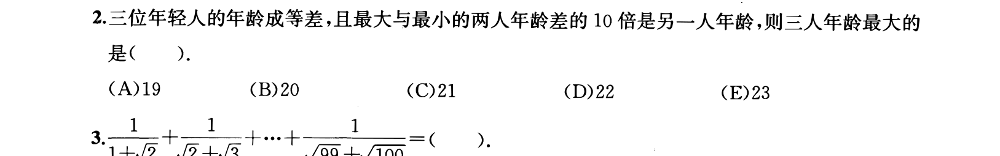

三位年轻人的年龄成等差，且最大与最小的两人年龄差的 10 倍是另一人年龄，则三人年龄最大的是（ ）。

- **A**．19
- **B**．20
- **C**．21
- **D**．22
- **E**．23

### 第3题

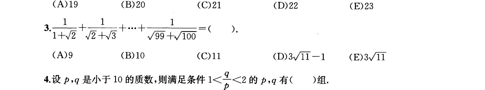

$\frac{1}{1+\sqrt{2}} + \frac{1}{\sqrt{2}+\sqrt{3}} + \cdots + \frac{1}{\sqrt{99}+\sqrt{100}} = $（ ）。

- **A**．9
- **B**．10
- **C**．11
- **D**．$3\sqrt{11}-1$
- **E**．$3\sqrt{11}$

### 第4题

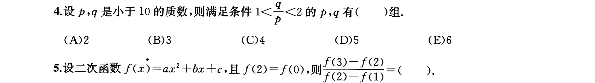

设 $p, q$ 是小于 10 的质数，则满足条件 $1 < \frac{q}{p} < 2$ 的 $p, q$ 有（ ）组。

- **A**．2
- **B**．3
- **C**．4
- **D**．5
- **E**．6

### 第5题

设二次函数 $f(x) = ax^2 + bx + c$，且 $f(2) = f(0)$，则 $\frac{f(3) - f(2)}{f(2) - f(1)} = $（ ）。

- **A**．2
- **B**．3
- **C**．4
- **D**．5
- **E**．6

### 第6题

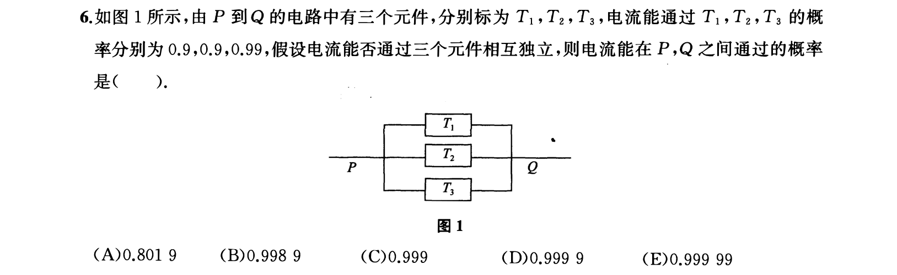

如图 1 所示，由 $P$ 到 $Q$ 的电路中有三个元件，分别标为 $T_1, T_2, T_3$，电流能通过 $T_1, T_2, T_3$ 的概率分别为 0.9, 0.9, 0.99，假设电流能否通过三个元件相互独立，则电流能在 $P, Q$ 之间通过的概率是（ ）。

- **A**．0.801 99
- **B**．0.998 9
- **C**．0.999
- **D**．0.999 9
- **E**．0.999 99

### 第7题

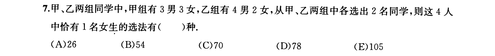

甲、乙两组同学中，甲组有 3 男 3 女，乙组有 4 男 2 女，从甲、乙两组中各选出 2 名同学，则这 4 人中恰有 1 名女生的选法有（ ）种。

- **A**．26
- **B**．54
- **C**．70
- **D**．78
- **E**．105

### 第8题

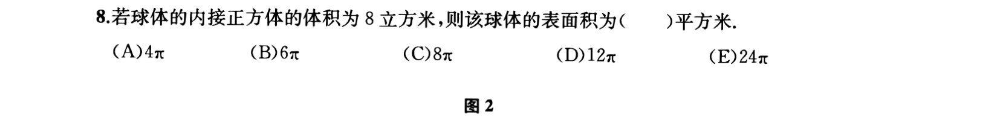

若球体的内接正方体的体积为 8 立方米，则该球体的表面积为（ ）平方米。

- **A**．$4\pi$
- **B**．$6\pi$
- **C**．$8\pi$
- **D**．$12\pi$
- **E**．$24\pi$

### 第9题

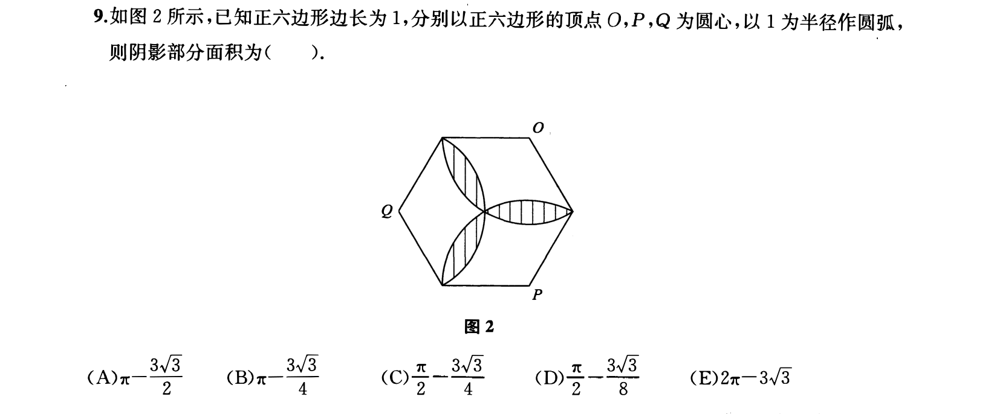

如图 2 所示，已知正六边形边长为 1，分别以正六边形的顶点 $O, P, Q$ 为圆心，以 1 为半径作圆弧，则阴影部分面积为（ ）。

- **A**．$\pi - \frac{3\sqrt{3}}{2}$
- **B**．$\pi - \frac{3\sqrt{3}}{4}$
- **C**．$\frac{\pi}{2} - \frac{3\sqrt{3}}{4}$
- **D**．$\frac{\pi}{2} - \frac{3\sqrt{3}}{8}$
- **E**．$2\pi - 3\sqrt{3}$

### 第10题

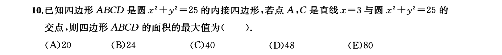

已知四边形 $ABCD$ 是圆 $x^2 + y^2 = 25$ 的内接四边形，若点 $A, C$ 是直线 $x = 3$ 与圆 $x^2 + y^2 = 25$ 的交点，则四边形 $ABCD$ 的面积的最大值为（ ）。

- **A**．20
- **B**．24
- **C**．40
- **D**．48
- **E**．80

### 第11题

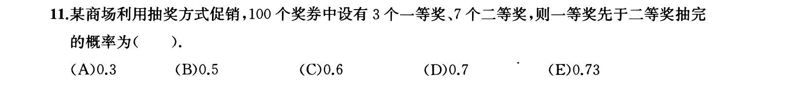

某商场利用抽奖方式促销，100 个奖券中设有 3 个一等奖、7 个二等奖，则一等奖先于二等奖抽完的概率为（ ）。

- **A**．0.3
- **B**．0.5
- **C**．0.6
- **D**．0.7
- **E**．0.73

### 第12题

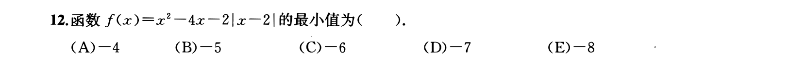

函数 $f(x) = x^2 - 4x - 2|x - 2|$ 的最小值为（ ）。

- **A**．-4
- **B**．-5
- **C**．-6
- **D**．-7
- **E**．-8

### 第13题

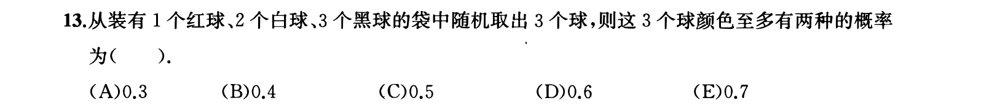

从装有 1 个红球、2 个白球、3 个黑球的袋中随机取出 3 个球，则这 3 个球颜色至多有两种的概率为（ ）。

- **A**．0.3
- **B**．0.4
- **C**．0.5
- **D**．0.6
- **E**．0.7

### 第14题

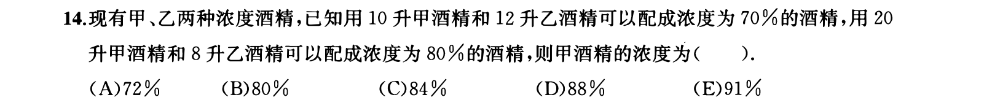

现有甲、乙两种浓度酒精，已知用 10 升甲酒精和 12 升乙酒精可以配成浓度为 70% 的酒精，用 20 升甲酒精和 8 升乙酒精可以配成浓度为 80% 的酒精，则甲酒精的浓度为（ ）。

- **A**．72%
- **B**．80%
- **C**．84%
- **D**．88%
- **E**．91%

### 第15题

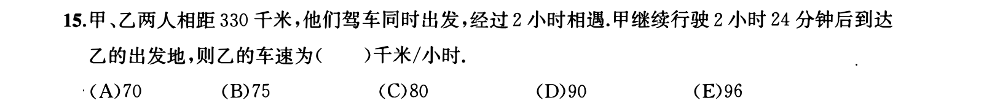

甲、乙两人相距 330 千米，他们驾车同时出发，经过 2 小时相遇。甲继续行驶 2 小时 24 分钟后到达乙的出发地，则乙的车速为（ ）千米/小时。

- **A**．70
- **B**．75
- **C**．80
- **D**．90
- **E**．96

## 二、条件充分性判断：第16～25小题，每小题3分，共30分。要求判断每题给出的条件（1）和条件（2）能否充分支持题干所陈述的结论。A、B、C、D、E五个选项为判断结果，请选择一项符合试题要求的判断。

> **A**．条件（1）充分，但条件（2）不充分
> **B**．条件（2）充分，但条件（1）不充分
> **C**．条件（1）和条件（2）单独都不充分，但条件（1）和条件（2）联合起来充分
> **D**．条件（1）充分，条件（2）也充分
> **E**．条件（1）和条件（2）单独都不充分，条件（1）和条件（2）联合起来也不充分

### 第16题

某班增加两名同学，则该班同学的平均身高增加了。
（1）增加的两名同学的平均身高与原来男同学的平均身高相同。
（2）原来男同学的平均身高大于女同学的平均身高。

- **A**．条件（1）充分，但条件（2）不充分
- **B**．条件（2）充分，但条件（1）不充分
- **C**．条件（1）和条件（2）单独都不充分，但条件（1）和条件（2）联合起来充分
- **D**．条件（1）充分，条件（2）也充分
- **E**．条件（1）和条件（2）单独都不充分，条件（1）和条件（2）联合起来也不充分

### 第17题

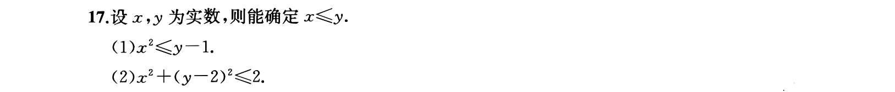

设 $x, y$ 为实数，则能确定 $x \le y$。
（1）$x^2 \le y - 1$。
（2）$x^2 + (y - 2)^2 \le 2$。

- **A**．条件（1）充分，但条件（2）不充分
- **B**．条件（2）充分，但条件（1）不充分
- **C**．条件（1）和条件（2）单独都不充分，但条件（1）和条件（2）联合起来充分
- **D**．条件（1）充分，条件（2）也充分
- **E**．条件（1）和条件（2）单独都不充分，条件（1）和条件（2）联合起来也不充分

### 第18题

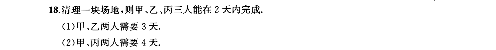

清理一块场地，则甲、乙、丙三人能在 2 天内完成。
（1）甲、乙两人需要 3 天。
（2）甲、丙两人需要 4 天。

- **A**．条件（1）充分，但条件（2）不充分
- **B**．条件（2）充分，但条件（1）不充分
- **C**．条件（1）和条件（2）单独都不充分，但条件（1）和条件（2）联合起来充分
- **D**．条件（1）充分，条件（2）也充分
- **E**．条件（1）和条件（2）单独都不充分，条件（1）和条件（2）联合起来也不充分

### 第19题

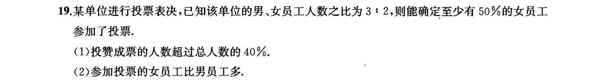

某单位进行投票表决，已知该单位的男、女员工人数之比为 $3 : 2$，则能确定至少有 50% 的女员工参加了投票。
（1）投赞成票的人数超过总人数的 40%。
（2）参加投票的女员工比男员工多。

- **A**．条件（1）充分，但条件（2）不充分
- **B**．条件（2）充分，但条件（1）不充分
- **C**．条件（1）和条件（2）单独都不充分，但条件（1）和条件（2）联合起来充分
- **D**．条件（1）充分，条件（2）也充分
- **E**．条件（1）和条件（2）单独都不充分，条件（1）和条件（2）联合起来也不充分

### 第20题

设 $a, b$ 为实数，则能确定 $|a| + |b|$ 的值。
（1）已知 $|a + b|$ 的值。
（2）已知 $|a - b|$ 的值。

- **A**．条件（1）充分，但条件（2）不充分
- **B**．条件（2）充分，但条件（1）不充分
- **C**．条件（1）和条件（2）单独都不充分，但条件（1）和条件（2）联合起来充分
- **D**．条件（1）充分，条件（2）也充分
- **E**．条件（1）和条件（2）单独都不充分，条件（1）和条件（2）联合起来也不充分

### 第21题

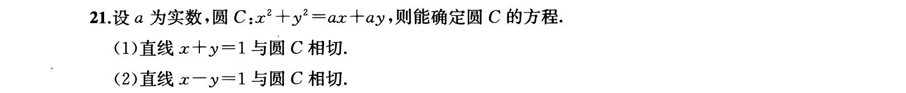

设 $a$ 为实数，圆 $C: x^2 + y^2 = ax + ay$，则能确定圆 $C$ 的方程。
（1）直线 $x + y = 1$ 与圆 $C$ 相切。
（2）直线 $x - y = 1$ 与圆 $C$ 相切。

- **A**．条件（1）充分，但条件（2）不充分
- **B**．条件（2）充分，但条件（1）不充分
- **C**．条件（1）和条件（2）单独都不充分，但条件（1）和条件（2）联合起来充分
- **D**．条件（1）充分，条件（2）也充分
- **E**．条件（1）和条件（2）单独都不充分，条件（1）和条件（2）联合起来也不充分

### 第22题

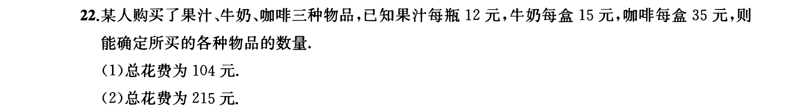

某人购买了果汁、牛奶、咖啡三种物品，已知果汁每瓶 12 元，牛奶每盒 15 元，咖啡每盒 35 元，则能确定所买的各种物品的数量。
（1）总花费为 104 元。
（2）总花费为 215 元。

- **A**．条件（1）充分，但条件（2）不充分
- **B**．条件（2）充分，但条件（1）不充分
- **C**．条件（1）和条件（2）单独都不充分，但条件（1）和条件（2）联合起来充分
- **D**．条件（1）充分，条件（2）也充分
- **E**．条件（1）和条件（2）单独都不充分，条件（1）和条件（2）联合起来也不充分

### 第23题

某人开车去上班，有一段路因维修限速通行，则可算出此人上班的距离。
（1）路上比平时多用了半小时。
（2）已知维修路段的通行速度。

- **A**．条件（1）充分，但条件（2）不充分
- **B**．条件（2）充分，但条件（1）不充分
- **C**．条件（1）和条件（2）单独都不充分，但条件（1）和条件（2）联合起来充分
- **D**．条件（1）充分，条件（2）也充分
- **E**．条件（1）和条件（2）单独都不充分，条件（1）和条件（2）联合起来也不充分

### 第24题

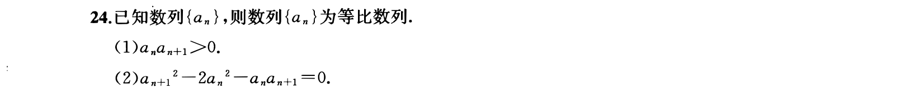

已知数列 $\{a_n\}$，则数列 $\{a_n\}$ 为等比数列。
（1）$a_n a_{n+1} > 0$。
（2）$a_{n+1}^2 - 2a_n^2 - a_n a_{n+1} = 0$。

- **A**．条件（1）充分，但条件（2）不充分
- **B**．条件（2）充分，但条件（1）不充分
- **C**．条件（1）和条件（2）单独都不充分，但条件（1）和条件（2）联合起来充分
- **D**．条件（1）充分，条件（2）也充分
- **E**．条件（1）和条件（2）单独都不充分，条件（1）和条件（2）联合起来也不充分

### 第25题

给定两个直角三角形，则这两个直角三角形相似。
（1）每个直角三角形边长成等比数列。
（2）每个直角三角形边长成等差数列。

- **A**．条件（1）充分，但条件（2）不充分
- **B**．条件（2）充分，但条件（1）不充分
- **C**．条件（1）和条件（2）单独都不充分，但条件（1）和条件（2）联合起来充分
- **D**．条件（1）充分，条件（2）也充分
- **E**．条件（1）和条件（2）单独都不充分，条件（1）和条件（2）联合起来也不充分

## 三、逻辑推理：第26～55小题，每小题2分，共60分。下列每题给出的A、B、C、D、E五个选项中，只有一项是符合试题要求的。

### 第26题

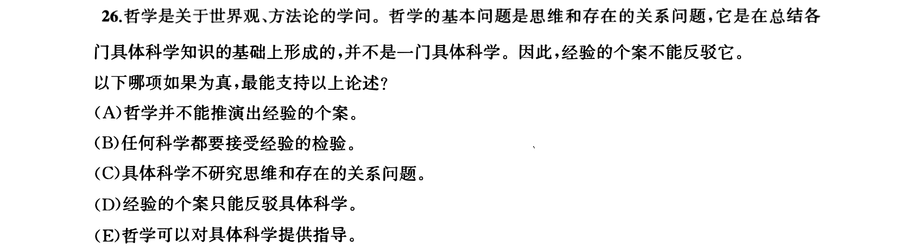

哲学是关于世界观、方法论的学问。哲学的基本问题是思维和存在的关系问题，它是在总结各 2021年真题一第 3页（共31页） 门具体科学知识的基础上形成的，并不是一门具体科学。因此，经验的个案不能反驳它。 以下哪项如果为真，最能支持以上论述?

- **A**．哲学并不能推演出经验的个案。
- **B**．任何科学都要接受经验的检验。
- **C**．具体科学不研究思维和存在的关系问题。
- **D**．经验的个案只能反驳具体科学。
- **E**．哲学可以对具体科学提供指导。

### 第27题

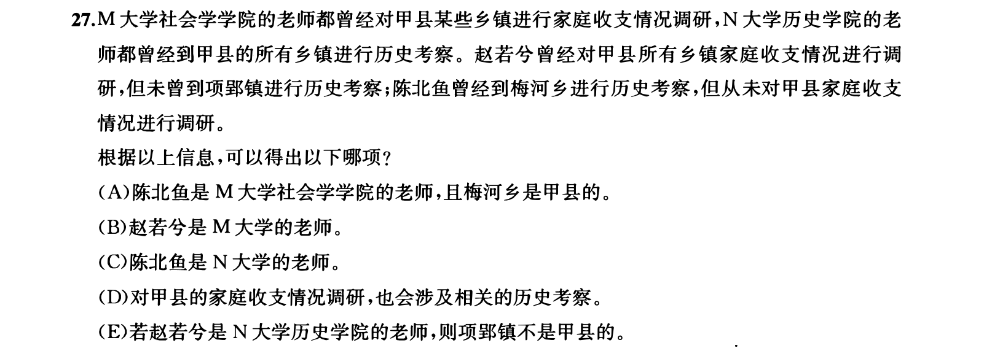

M大学社会学学院的老师都曾经对甲县某些乡镇进行家庭收支情况调研，N 大学历史学院的老 师都曾经到甲县的所有乡镇进行历史考察。赵若兮曾经对甲县所有乡镇家庭收支情况进行调 研，但未曾到项郢镇进行历史考察;陈北鱼曾经到梅河乡进行历史考察，但从未对甲县家庭收支 情况进行调研。 根据以上信息，可以得出以下哪项?

- **A**．陈北鱼是 M大学社会学学院的老师，且梅河乡是甲县的。
- **B**．赵若兮是 M大学的老师。
- **C**．陈北鱼是N大学的老师。
- **D**．对甲县的家庭收支情况调研，也会涉及相关的历史考察。
- **E**．若赵若兮是N大学历史学院的老师，则项郢镇不是甲县的。

### 第28题

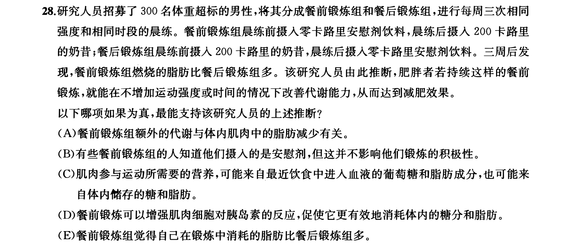

研究人员招募了300名体重超标的男性，将其分成餐前锻炼组和餐后锻炼组，进行每周三次相同 强度和相同时段的晨练。餐前锻炼组晨练前摄入零卡路里安慰剂饮料，，晨练后摄入 200卡路里 的奶昔;餐后锻炼组晨练前摄入 200 卡路里的奶昔，晨练后摄入零卡路里安慰剂饮料。三周后发 现，餐前锻炼组燃烧的脂肪比餐后锻炼组多。该研究人员由此推断，肥胖者若持续这样的餐前 锻炼，就能在不增加运动强度或时间的情况下改善代谢能力，从而达到减肥效果。 以下哪项如果为真，最能支持该研究人员的上述推断?

- **A**．餐前锻炼组额外的代谢与体内肌肉中的脂肪减少有关。
- **B**．有些餐前锻炼组的人知道他们摄入的是安慰剂，但这并不影响他们锻炼的积极性。
- **C**．肌肉参与运动所需要的营养，可能来自最近饮食中进入血液的葡萄糖和脂肪成分，也可能来 自体内储存的糖和脂肪。
- **D**．餐前锻炼可以增强肌肉细胞对胰岛素的反应，促使它更有效地消耗体内的糖分和脂肪。
- **E**．餐前锻炼组觉得自己在锻炼中消耗的脂肪比餐后锻炼组多。

### 第29题

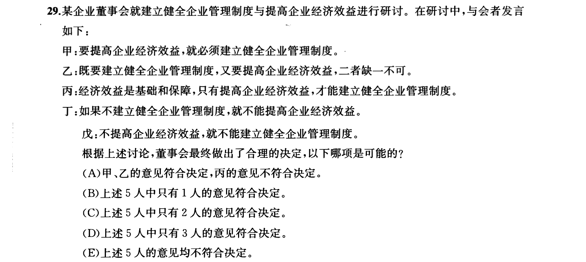

某企业董事会就建立健全企业管理制度与提高企业经济效益进行研讨。在研讨中，与会者发言 如下∶ 甲∶要提高企业经济效益，就必须建立健全企业管理制度。. 乙∶既要建立健全企业管理制度，又要提高企业经济效益，二者缺一不可。 丙∶经济效益是基础和保障，只有提高企业经济效益，才能建立健全企业管理制度。 丁∶如果不建立健全企业管理制度，就不能提高企业经济效益。 2021年真题一第4页（共31页） 戊∶不提高企业经济效益，就不能建立健全企业管理制度。 根据上述讨论，董事会最终做出了合理的决定，以下哪项是可能的?

- **A**．甲、乙的意见符合决定，丙的意见不符合决定。
- **B**．上述5人中只有1人的意见符合决定。
- **C**．上述5人中只有2人的意见符合决定。
- **D**．上述5人中只有3人的意见符合决定。
- **E**．上述5人的意见均不符合决定。

### 第30题

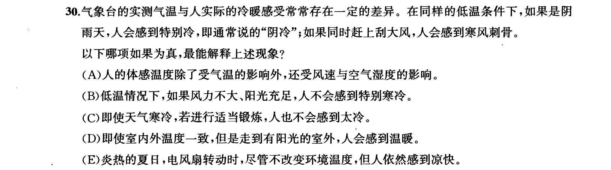

气象台的实测气温与人实际的冷暖感受常常存在一定的差异。在同样的低温条件下，如果是阴 雨天，人会感到特别冷，即通常说的"阴冷";如果同时赶上刮大风，人会感到寒风刺骨。 以下哪项如果为真，最能解释上述现象?

- **A**．人的体感温度除了受气温的影响外，还受风速与空气湿度的影响。
- **B**．低温情况下，如果风力不大、阳光充足，人不会感到特别寒冷。
- **C**．即使天气寒冷，若进行适当锻炼，人也不会感到太冷。
- **D**．即使室内外温度一致，但是走到有阳光的室外，人会感到温暖。
- **E**．炎热的夏日，电风扇转动时，尽管不改变环境温度，但人依然感到凉快。

### 第31题

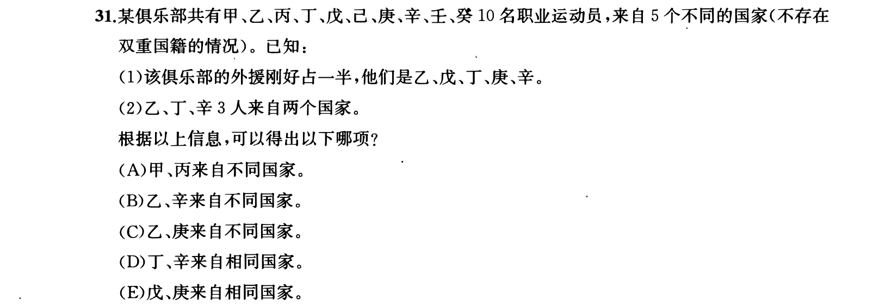

某俱乐部共有甲、乙、丙、丁、戊、已、庚、辛、壬、癸10名职业运动员，来自5个不同的国家（不存在 双重国籍的情况）。已知∶ （1）该俱乐部的外援刚好占一半，他们是乙、戊、丁、庚、辛。 （2）乙、丁、辛3人来自两个国家。 根据以上信息，可以得出以下哪项?

- **A**．甲、丙来自不同国家。
- **B**．乙、辛来自不同国家。
- **C**．乙、庚来自不同国家。
- **D**．丁、辛来自相同国家。
- **E**．戊、庚来自相同国家。

### 第32题

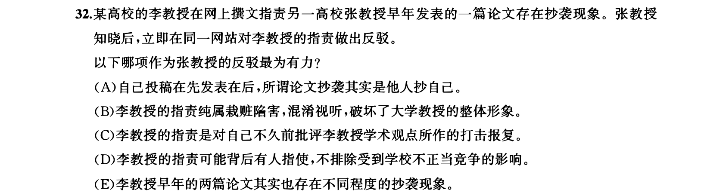

某高校的李教授在网上撰文指责另一高校张教授早年发表的一篇论文存在抄袭现象。张教授 知晓后，立即在同一网站对李教授的指责做出反驳。 以下哪项作为张教授的反驳最为有力?

- **A**．自己投稿在先发表在后，所谓论文抄袭其实是他人抄自己。
- **B**．李教授的指责纯属栽赃陷害，混淆视听，破坏了大学教授的整体形象。
- **C**．李教授的指责是对自己不久前批评李教授学术观点所作的打击报复。
- **D**．李教授的指责可能背后有人指使，不排除受到学校不正当竞争的影响。
- **E**．李教授早年的两篇论文其实也存在不同程度的抄袭现象。

### 第33题

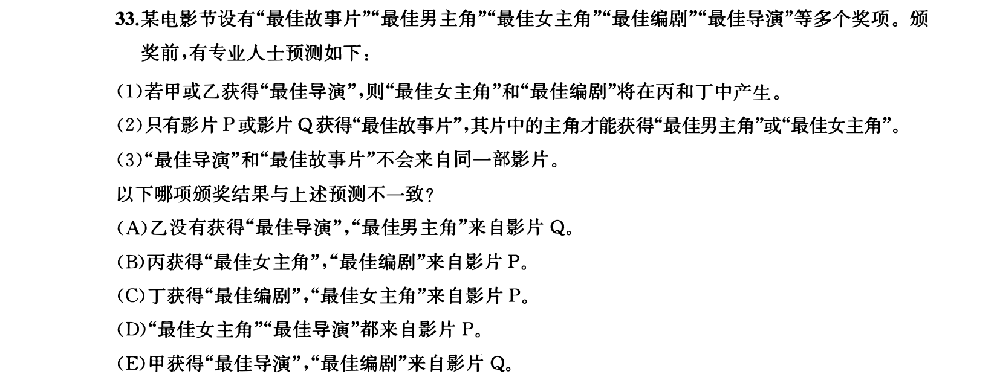

某电影节设有"最佳故事片""最佳男主角""最佳女主角""最佳编剧""最佳导演"等多个奖项。颁 奖前，有专业人士预测如下∶ 2021年真题一第5页（共31页） （1）若甲或乙获得"最佳导演"，则"最佳女主角"和"最佳编剧"将在丙和丁中产生。 （2）只有影片P或影片 Q获得"最佳故事片"，其片中的主角才能获得"最佳男主角"或"最佳女主角".， （3）"最佳导演"和"最佳故事片"不会来自同一部影片。 以下哪项颁奖结果与上述预测不一致?

- **A**．乙没有获得"最佳导演"，"最佳男主角"来自影片Q。
- **B**．丙获得"最佳女主角"，"最佳编剧"来自影片P。
- **C**．丁获得"最佳编剧"，"最佳女主角"来自影片P。
- **D**．"最佳女主角""最佳导演"都来自影片P。
- **E**．甲获得"最佳导演"，"最佳编剧"来自影片Q。

### 第34题

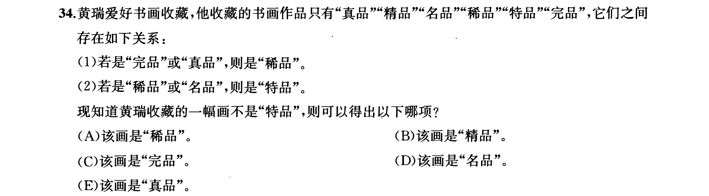

黄瑞爱好书画收藏，他收藏的书画作品只有"真品""精品""名品""稀品""特品""完品"，它们之间 存在如下关系∶ （1）若是"完品"或"真品"，则是"稀品"。 （2）若是"稀品"或"名品"，则是"特品"。 现知道黄瑞收藏的一幅画不是"特品"，则可以得出以下哪项?

- **A**．该画是"稀品"。
- **B**．该画是"精品"。
- **C**．该画是"完品"。
- **D**．该画是"名品"。
- **E**．该画是"真品"。

### 第35题

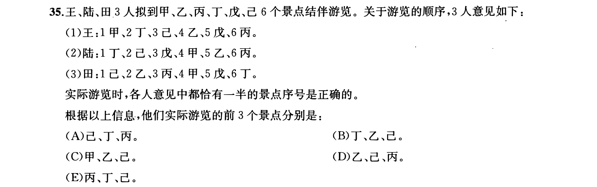

王、陆、田3人拟到甲、乙、丙、丁、戊、己6个景点结伴游览。关于游览的顺序，3人意见如下∶ （1）王∶1甲、2丁、3己、4乙、5戊、6丙。 （2）陆∶1丁、2己、3戊、4甲、5乙、6丙。 （3）田∶1己、2乙、3丙、4甲、5戊、6丁。 实际游览时，各人意见中都恰有一半的景点序号是正确的。 根据以上信息，他们实际游览的前3个景点分别是;

- **A**．己、丁、丙。
- **B**．丁、乙、已。
- **C**．甲、乙、己。
- **D**．乙、已、丙。
- **E**．丙、丁、已。

### 第36题

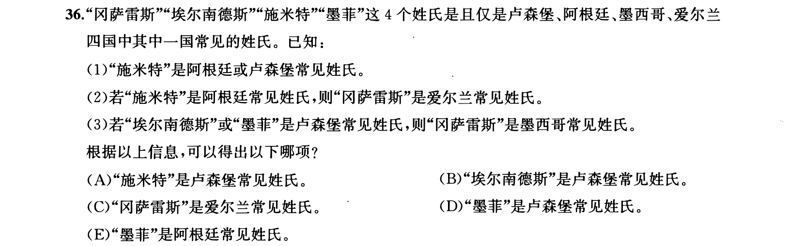

"冈萨雷斯""埃尔南德斯""施米特""墨菲"这 4个姓氏是且仅是卢森堡、阿根廷、墨西哥、爱尔兰 四国中其中一国常见的姓氏。已知∶ （1）"施米特"是阿根廷或卢森堡常见姓氏。 （2）若"施米特"是阿根廷常见姓氏，则"冈萨雷斯"是爱尔兰常见姓氏。 （3）若"埃尔南德斯"或"墨菲"是卢森堡常见姓氏，则"冈萨雷斯"是墨西哥常见姓氏。 根据以上信息，可以得出以下哪项?

- **A**．"施米特"是卢森堡常见姓氏。
- **B**．"埃尔南德斯"是卢森堡常见姓氏。
- **C**．"冈萨雷斯"是爱尔兰常见姓氏。
- **D**．"墨菲"是卢森堡常见姓氏。
- **E**．"墨菲"是阿根廷常见姓氏。 2021年真题一第6页（共31页）

### 第37题

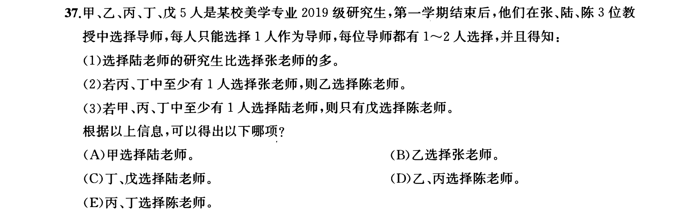

甲、乙、丙、丁、戊5人是某校美学专业2019级研究生，第一学期结束后，他们在张、陆、陈3位教 授中选择导师，每人只能选择1人作为导师，每位导师都有1～2 人选择，并日得知. （1）选择陆老师的研究生比选择张老师的多。 （2）若丙、丁中至少有1人选择张老师，则乙选择陈老师。 （3）若甲、丙、丁中至少有1人选择陆老师，则只有戊选择陈老师。 根据以上信息，可以得出以下哪项?

- **A**．甲选择陆老师。
- **B**．乙选择张老师。
- **C**．丁、戊选择陆老师。
- **D**．乙、丙选择陈老师。
- **E**．丙、丁选择陈老师。

### 第38题

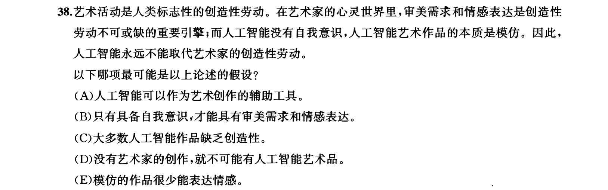

艺术活动是人类标志性的创造性劳动。在艺术家的心灵世界里，审美需求和情感表达是创造性 劳动不可或缺的重要引擎;而人工智能没有自我意识，人工智能艺术作品的本质是模仿。因此， 人工智能永远不能取代艺术家的创造性劳动。 以下哪项最可能是以上论述的假设?

- **A**．人工智能可以作为艺术创作的辅助工具。
- **B**．只有具备自我意识，才能具有审美需求和情感表达。
- **C**．大多数人工智能作品缺乏创造性。
- **D**．没有艺术家的创作，就不可能有人工智能艺术品。
- **E**．模仿的作品很少能表达情感。

### 第39题

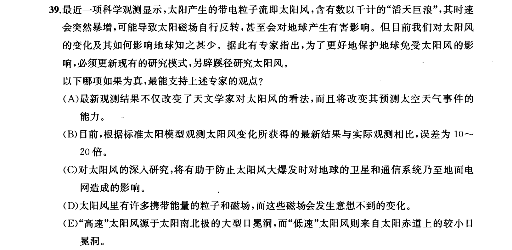

最近一项科学观测显示，太阳产生的带电粒子流即太阳风，含有数以千计的"滔天巨浪"，其时速 会突然暴增，可能导致太阳磁场自行反转，甚至会对地球产生有害影响。但目前我们对太阳风 的变化及其如何影响地球知之甚少。据此有专家指出，为了更好地保护地球免受太阳风的影 响，必须更新现有的研究模式，另辟蹊径研究太阳风。 以下哪项如果为真，最能支持上述专家的观点?

- **A**．最新观测结果不仅改变了天文学家对太阳风的看法，而且将改变其预测太空天气事件的 能力。
- **B**．目前，根据标准太阳模型观测太阳风变化所获得的最新结果与实际观测相比，误差为10~～ 20倍。
- **C**．对太阳风的深入研究，将有助于防止太阳风大爆发时对地球的卫星和通信系统乃至地面电 网造成的影响。
- **D**．太阳风里有许多携带能量的粒子和磁场，而这些磁场会发生意想不到的变化。
- **E**．"高速"太阳风源于太阳南北极的大型日冕洞，而"低速"太阳风则来自太阳赤道上的较小日 冕洞。

### 第40题

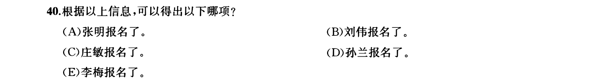

40～41 题基于以下题干：
冬奥组委会官网开通全球招募系统，正式招募冬奥会志愿者。张明、刘伟、庄敏、孙兰、李梅 5 人在一起讨论报名事宜。他们商量的结果如下：
（1）如果张明报名，则刘伟也报名。
（2）如果庄敏报名，则孙兰也报名。
（3）只要刘伟和孙兰两人中至少有 1 人报名，则李梅也报名。
后来得知，他们 5 人中恰有 3 人报名了。

根据以上信息，可以得出以下哪项?

- **A**．张明报名了。
- **B**．刘伟报名了。
- **C**．庄敏报名了。
- **D**．孙兰报名了。
- **E**．李梅报名了。

### 第41题

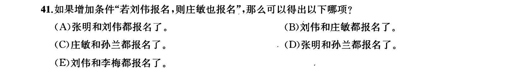

如果增加条件"若刘伟报名，则庄敏也报名"，那么可以得出以下哪项?

- **A**．张明和刘伟都报名了。
- **B**．刘伟和庄敏都报名了。 .
- **C**．庄敏和孙兰都报名了。
- **D**．张明和孙兰都报名了。
- **E**．刘伟和李梅都报名了。

### 第42题

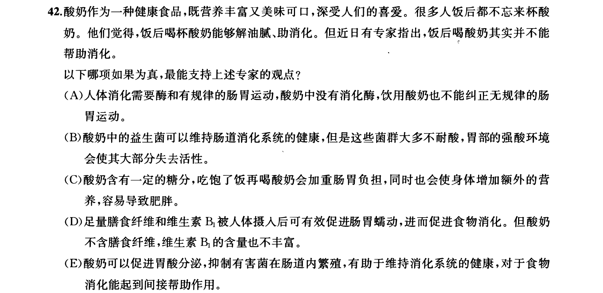

酸奶作为一种健康食品，既营养丰富又美味可口，深受人们的喜爱。很多人饭后都不忘来杯酸 奶。他们觉得，饭后喝杯酸奶能够解油腻、助消化。但近日有专家指出，饭后喝酸奶其实并不能 帮助消化。 以下哪项如果为真，最能支持上述专家的观点?

- **A**．人体消化需要酶和有规律的肠胃运动，酸奶中没有消化酶，饮用酸奶也不能纠正无规律的肠 胃运动。
- **B**．酸奶中的益生菌可以维持肠道消化系统的健康，但是这些菌群大多不耐酸，胃部的强酸环境 会使其大部分失去活性。
- **C**．酸奶含有一定的糖分，吃饱了饭再喝酸奶会加重肠胃负，同时也会使身体增加额外的营 养，容易导致肥胖。
- **D**．足量膳食纤维和维生素 B，被人体摄入后可有效促进肠胃蠕动，进而促进食物消化。但酸奶 不含膳食纤维，维生素 B，的含量也不丰富。
- **E**．酸奶可以促进胃酸分泌，抑制有害菌在肠道内繁殖，有助于维持消化系统的健康，对于食物 消化能起到间接帮助作用。

### 第43题

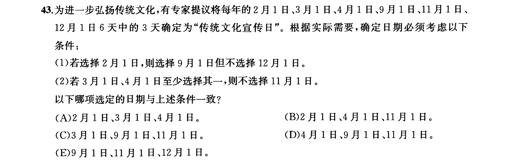

为进一步弘扬传统文化，有专家提议将每年的2月1日、3月1日、4月1日、9月1日、11月1日、 12月1日6天中的3天确定为"传统文化宣传日"。根据实际需要，确定日期必须考虑以下 条件∶ （1）若选择2月1日，则选择9月1日但不选择12月1 日。 （2）若3月1日、4月1日至少选择其一，则不选择11月1日。 以下哪项选定的日期与上述条件一致?

- **A**．2月1日、3月1日、4月1日。
- **B**．2月1日、4月1日、11月1日。
- **C**．3月1日、9月1日、11月1日。
- **D**．4月1日、9月1日、11月1日。
- **E**．9月1日、11月1日、12月1日。 2021年真题一第8页（共31页）

### 第44题

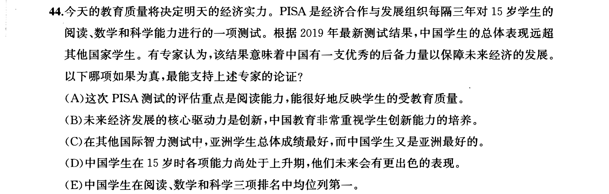

今天的教育质量将决定明天的经济实力。PISA是经济合作与发展组织每隔三年对15岁学生的 阅读、数学和科学能力进行的一项测试。根据2019年最新测试结果，中国学生的总体表现远超 其他国家学生。有专家认为，该结果意味着中国有一支优秀的后备力量以保障未来经济的发展。 以下哪项如果为真，最能支持上述专家的论证?

- **A**．这次 PISA测试的评估重点是阅读能力，能很好地反映学生的受教育质量。
- **B**．未来经济发展的核心驱动力是创新，中国教育非常重视学生创新能力的培养。
- **C**．在其他国际智力测试中，亚洲学生总体成绩最好，而中国学生又是亚洲最好的。
- **D**．中国学生在 15岁时各项能力尚处于上升期，他们未来会有更出色的表现。
- **E**．中国学生在阅读、数学和科学三项排名中均位列第一。

### 第45题

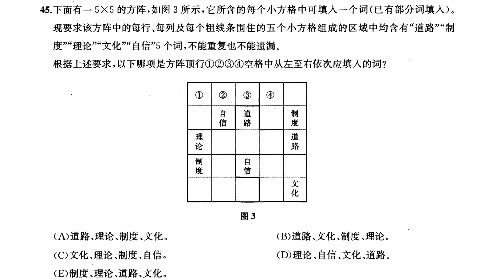

下面有一5×5的方阵，如图3所示，它所含的每个小方格中可填入一个词（已有部分词填入）。 现要求该方阵中的每行、每列及每个粗线条围住的五个小方格组成的区域中均含有"道路""制 度""理论""文化""自信"5个词，不能重复也不能遗漏。 根据上述要求，以下哪项是方阵顶行①②③④空格中从左至右依次应填入的词? (④) ③ ② ① 制度 道路 自值 理论 道路 制度 自值 文化 图3

- **A**．道路、理论、制度、文化。
- **B**．道路、文化、制度、理论。
- **C**．文化、理论、制度、自信。
- **D**．理论、自信、文化、道路。
- **E**．制度、理论、道路、文化。

### 第46题

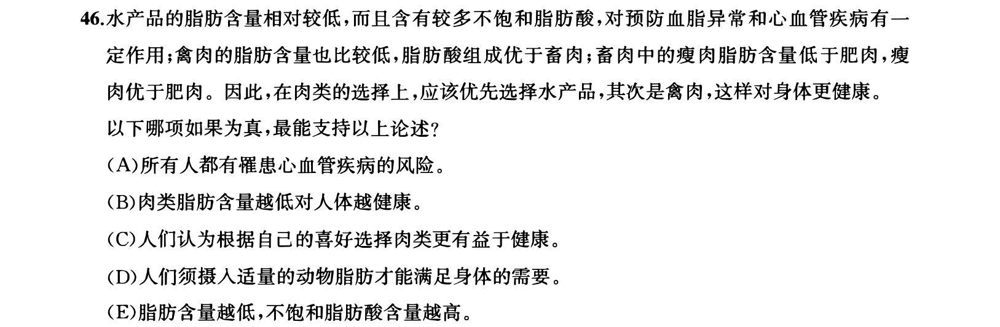

水产品的脂肪含量相对较低，而且含有较多不饱和脂肪酸，对预防血脂异常和心血管疾病有一 定作用;禽肉的脂肪含量也比较低，脂肪酸组成优于畜肉;畜肉中的瘦肉脂肪含量低于肥肉，瘦 肉优于肥肉。因此，在肉类的选择上，应该优先选择水产品，其次是禽肉，这样对身体更健康。 以下哪项如果为真，最能支持以上论述?

- **A**．所有人都有罹患心血管疾病的风险。
- **B**．肉类脂肪含量越低对人体越健康。
- **C**．人们认为根据自己的喜好选择肉类更有益于健康。
- **D**．人们须摄入适量的动物脂肪才能满足身体的需要。
- **E**．脂肪含量越低，不饱和脂肪酸含量越高。 2021年真题一第 9页（共31页）

### 第47题

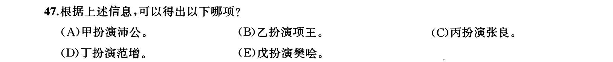

47～48 题基于以下题干：
某剧团拟将历史故事“鸿门宴”搬上舞台，该剧有项王、沛公、项伯、张良、项庄、樊哙、范增 7 个主要角色，甲、乙、丙、丁、戊、己、庚 7 名演员每人只能扮演其中一个角色，且每个角色只能由其中一人扮演。根据各演员的特点，角色安排如下：
（1）如果甲不扮演沛公，则乙扮演项王。
（2）如果丙或己扮演张良，则丁扮演范增。
（3）如果乙不扮演项王，则丙扮演张良。
（4）如果丁不扮演樊哙，则庚或戊扮演沛公。

根据上述信息，可以得出以下哪项?

- **A**．甲扮演沛公。
- **B**．乙扮演项王。
- **C**．丙扮演张良。
- **D**．丁扮演范增。
- **E**．戊扮演樊哙。

### 第48题

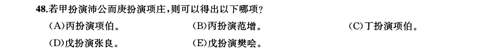

若甲扮演沛公而庚扮演项庄，则可以得出以下哪项?

- **A**．丙扮演项伯。
- **B**．丙扮演范增。
- **C**．丁扮演项伯。
- **D**．戊扮演张良。
- **E**．戊扮演樊哙。

### 第49题

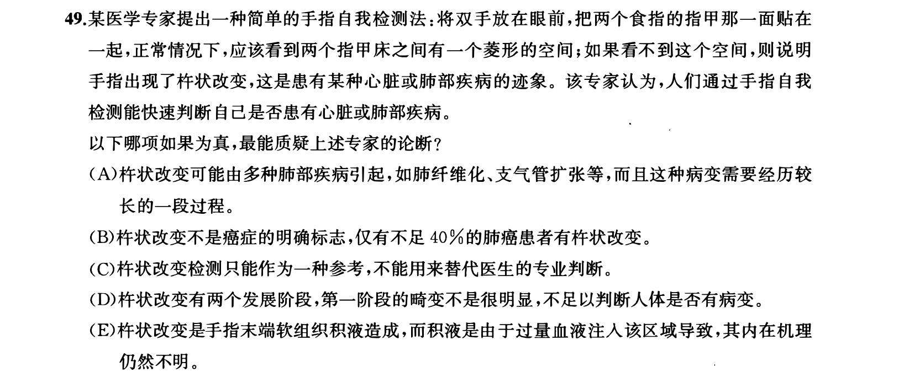

某医学专家提出一种简单的手指自我检测法;将双手放在眼前，把两个食指的指甲那一面贴在 一起，正常情况下，应该看到两个指甲床之间有一个菱形的空间;如果看不到这个空间则说明 手指出现了杵状改变，这是患有某种心脏或肺部疾病的迹象。该专家认为，人们通过手指自我 检测能快速判断自己是否患有心脏或肺部疾病。 以下哪项如果为真，最能质疑上述专家的论断?

- **A**．杵状改变可能由多种肺部疾病引起，如肺纤维化、支气管扩张等，而目这种病变需要经历较 长的一段过程。
- **B**．杵状改变不是癌症的明确标志，仅有不足 40??肺癌患者有杵状改变。
- **C**．杵状改变检测只能作为一种参考，不能用来替代医生的专业判断。
- **D**．杵状改变有两个发展阶段，第一阶段的畸变不是很明显，不足以判断人体是否有病变。
- **E**．杵状改变是手指末端软组织积液造成，而积液是由于过量血液注人该区域导致，其内在机理 仍然不明。

### 第50题

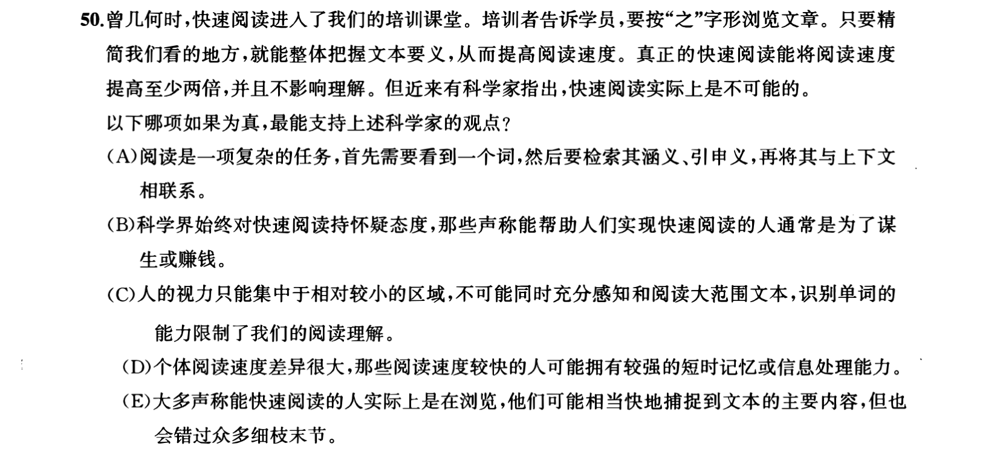

曾几何时，快速阅读进入了我们的培训课堂。培训者告诉学员，要按"之"字形浏览文章。只要精 简我们看的地方，就能整体把握文本要义，从而提高阅读速度。真正的快速阅读能将阅读速度 提高至少两倍，并且不影响理解。但近来有科学家指出，快速阅读实际上是不可能的。 以下哪项如果为真，最能支持上述科学家的观点?

- **A**．阅读是一项复杂的任务，首先需要看到一个词，然后要检索其涵义、引申义，再将其与上下文 相联系。
- **B**．科学界始终对快速阅读持怀疑态度，那些声称能帮助人们实现快速阅读的人通常是为了谋 生或赚钱。
- **C**．人的视力只能集中于相对较小的区域，不可能同时充分感知和阅读大范围文本，识别单词的 2021年真题-第10页（共31页） 能力限制了我们的阅读理解。
- **D**．个体阅读速度差异很大，那些阅读速度较快的人可能拥有较强的短时记忆或信息处理能力。
- **E**．大多声称能快速阅读的人实际上是在浏览，他们可能相当快地捕捉到文本的主要内容，但也 会错过众多细枝末节。

### 第51题

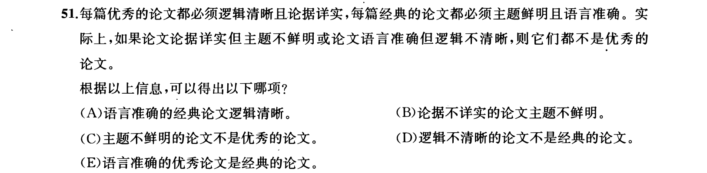

每篇优秀的论文都必须逻辑清晰且论据详实，每篇经典的论文都必须主题鲜明且语言准确。实 际上，如果论文论据详实但主题不鲜明或论文语言准确但逻辑不清晰，则它们都不是优秀的 论文。 根据以上信息，可以得出以下哪项?

- **A**．语言准确的经典论文逻辑清晰。
- **B**．论据不详实的论文主题不鲜明。
- **C**．主题不鲜明的论文不是优秀的论文。
- **D**．逻辑不清晰的论文不是经典的论文。
- **E**．语言准确的优秀论文是经典的论文。

### 第52题

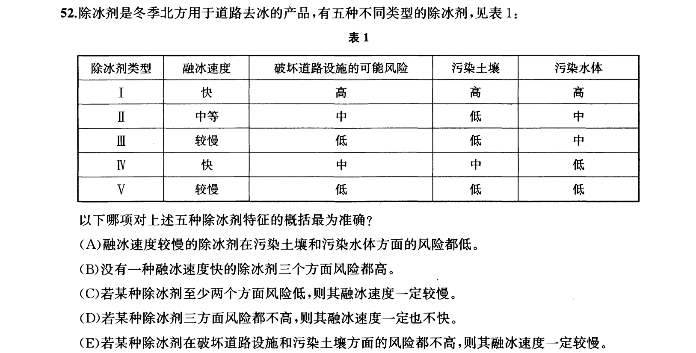

除冰剂是冬季北方用于道路去冰的产品，有五种不同类型的除冰剂，见表 1：

表 1
| 除冰剂类型 | 融冰速度 | 破坏道路设施的可能风险 | 污染土壤 | 污染水体 |
| :---: | :---: | :---: | :---: | :---: |
| Ⅰ | 快 | 高 | 高 | 高 |
| Ⅱ | 中等 | 中 | 低 | 中 |
| Ⅲ | 较慢 | 低 | 低 | 中 |
| Ⅳ | 快 | 中 | 中 | 低 |
| Ⅴ | 较慢 | 低 | 低 | 低 | 表1 污染水体 污染土壤 融冰速度 除冰剂类型 破坏道路设施的可能风险 高 高 高 快 一 低 中 Ⅱ 中 中等 中 Ⅲ 较慢 京 低 低 中 中 习 快 低 低 低 较慢 V 以下哪项对上述五种除冰剂特征的概括最为准确?

- **A**．融冰速度较慢的除冰剂在污染土壤和污染水体方面的风险都低。
- **B**．没有一种融冰速度快的除冰剂三个方面风险都高。
- **C**．若某种除冰剂至少两个方面风险低，则其融冰速度一定较慢。
- **D**．若某种除冰剂三方面风险都不高，则其融冰速度一定也不快。
- **E**．若某种除冰剂在破坏道路设施和污染土壤方面的风险都不高，则其融冰速度一定较慢。

### 第53题

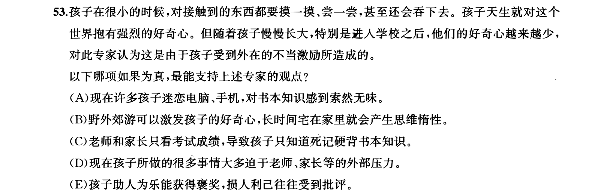

孩子在很小的时候，对接触到的东西都要摸一摸、尝一尝，甚至还会吞下去。孩子天生就对这个 世界抱有强烈的好奇心。但随着孩子慢慢长大，特别是进入学校之后，他们的好奇心越来越少， 对此专家认为这是由于孩子受到外在的不当激励所造成的。 以下哪项如果为真，最能支持上述专家的观点?

- **A**．现在许多孩子迷恋电脑、手机，对书本知识感到索然无味。
- **B**．野外郊游可以激发孩子的好奇心，长时间宅在家里就会产生思维惰性。
- **C**．老师和家长只看考试成绩，导致孩子只知道死记硬背书本知识。
- **D**．现在孩子所做的很多事情大多迫于老师、家长等的外部压力。
- **E**．孩子助人为乐能获得褒奖，损人利己往往受到批评。 2021年真题一第11页（共31页）

### 第54题

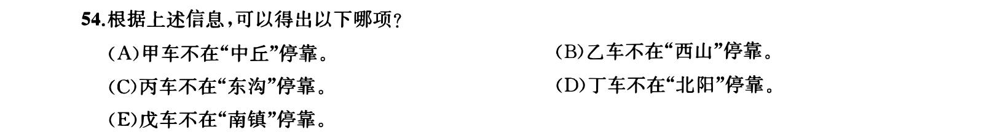

54～55 题基于以下题干：
某高铁线路设有“东沟”“西山”“南镇”“北阳”“中丘”5 座高铁站。该线路有甲、乙、丙、丁、戊 5 趟车运行。这 5 座高铁站中，每站恰好有 3 趟车停靠，且甲车和乙车停靠的站均不相同。已知：
（1）若乙车或丙车至少有一车在“北阳”停靠，则它们均在“东沟”停靠。
（2）若丁车在“北阳”停靠，则丙、丁和戊车均在“中丘”停靠。
（3）若甲、乙和丙车中至少有 2 趟车在“东沟”停靠，则这 3 趟车均在“西山”停靠。

根据上述信息，可以得出以下哪项?

- **A**．甲车不在"中丘"停靠。
- **B**．乙车不在"西山"停靠。
- **C**．丙车不在"东沟"停靠。
- **D**．丁车不在"北阳"停靠。
- **E**．戊车不在"南镇"停靠。

### 第55题

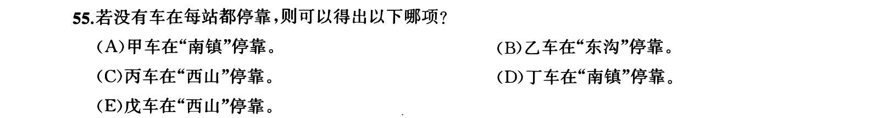

若没有车在每站都停靠，则可以得出以下哪项?

- **A**．甲车在"南镇"停靠。
- **B**．乙车在"东沟"停靠。
- **C**．丙车在"西山"停靠。
- **D**．丁车在"南镇"停靠。
- **E**．戊车在"西山"停靠。

## 四、写作：第56～57小题，共65分。其中论证有效性分析30分，论说文35分。

### 第56题

56．论证有效性分析：分析下述论证中存在的缺陷与漏洞，选择若干要点，写一篇 600 字左右的文章，对该论证的有效性进行分析和评论。（论证有效性分析的一般要点是：概念特别是核心概念的界定和使用是否准确并前后一致，有无各种明显的逻辑错误，论证的论据是否成立并支持结论，结论成立的条件是否充分等。）

常言道：“耳听为虚，眼见为实。”但实际“眼见未必为实”。从哲学上讲，事物表相不等于事物真相。我们亲眼看到的显然不是事物真相。只有将表相加以分析，透过现象看本质才能看到真相。换言之，我们看到的未必是真实情况，即“所见未必为实”。

举例来说，人们都看到了旭日东升、夕阳西下，也就是说，太阳绕地球转，但是，这只是人们站在地球上看到的表象而已，其实这是地球自转造成的。由此可见，眼见者未必实。

我国古代哲学家老子早就看到了这一点。他说过，人们只看到了房子的“有”（有形的结构），但人们没有看到“无”（房子中无形的空间）才有实际效用。这也说明眼所见者未必实，未见者为实。

老子还说，讲究表面的礼节是“忠信之薄”的表现。韩非解释时举例说，父母和子女因为感情深厚而不讲究礼节，可见讲究礼节是感情不深的表现。现在人们把那种客气的行为称作“见外”，也是这个道理。这其实也是一种“眼所见者未必实”的现象。因此，如果你看到有人对你很客气，就认为他对你好，那就错了。

### 第57题

57．论说文：根据下述材料，写一篇 700 字左右的论说文，题目自拟。

我国著名实业家穆藕初在《实业与教育之关系》中指出，教育之重点在道德教育（如责任心和公共心之养成、机械心之拔除）和科学教育（如观察力、推论力、判断力之养成）。完全受此两种教育，实业界中坚人物可成。

