# 2022年全国硕士研究生招生考试管理类综合能力真题（199）

## 一、问题求解：第 1～15 小题，每小题 3 分，共 45 分。下列每题给出的 A、B、C、D、E 五个选项中，只有一项是符合试题要求的。

### 第 1 题

一项工程施工 3 天后，因故障停工 2 天，之后工程队提高工作效率 20%，仍能按原计划完成，则原计划工期为（ ）。

- **A**．9 天
- **B**．10 天
- **C**．12 天
- **D**．15 天
- **E**．18 天

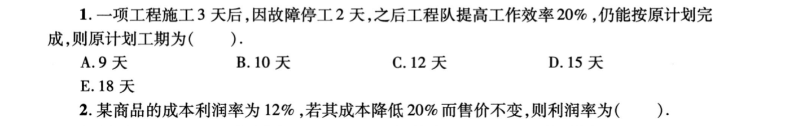

### 第 2 题

某商品的成本利润率为 12%，若其成本降低 20% 而售价不变，则利润率为（ ）。

- **A**．32%
- **B**．35%
- **C**．40%
- **D**．45%
- **E**．48%

### 第 3 题

设 $x, y$ 为实数，则 $f(x, y) = x^2 + 4xy + 5y^2 - 2y + 2$ 的最小值为（ ）。

- **A**．1
- **B**．$\frac{1}{2}$
- **C**．2
- **D**．$\frac{3}{2}$
- **E**．3

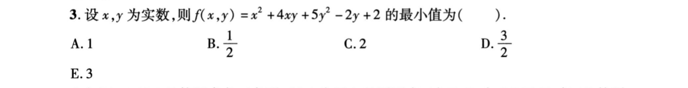

### 第 4 题

如图，$\Delta ABC$ 是等腰直角三角形，以 $A$ 为圆心的圆弧交 $AC$ 于 $D$，交 $BC$ 于 $E$，交 $AB$ 的延长线于 $F$。若曲边三角形 $CDE$ 与 $BEF$ 的面积相等，则 $\frac{AD}{AC} =$（ ）。

<svg viewBox="0 0 180 190" width="180" height="190" xmlns="http://www.w3.org/2000/svg" style="display:block;margin:12px auto;background:#fff;">
  <polygon points="140,30 20,150 140,150" fill="none" stroke="#000" stroke-width="1.5" />
  <line x1="140" y1="150" x2="140" y2="170" stroke="#000" stroke-width="1.5" />
  <path d="M 41 129 A 140 140 0 0 0 140 170" fill="none" stroke="#000" stroke-width="1.5" />
  <text x="136" y="22" font-family="serif" font-size="16" font-style="italic">A</text>
  <text x="146" y="152" font-family="serif" font-size="16" font-style="italic">B</text>
  <text x="8" y="155" font-family="serif" font-size="16" font-style="italic">C</text>
  <text x="30" y="122" font-family="serif" font-size="16" font-style="italic">D</text>
  <text x="74" y="144" font-family="serif" font-size="16" font-style="italic">E</text>
  <text x="146" y="174" font-family="serif" font-size="16" font-style="italic">F</text>
</svg>

- **A**．$\frac{\sqrt{3}}{2}$
- **B**．$\frac{2}{\sqrt{5}}$
- **C**．$\sqrt{\frac{3}{\pi}}$
- **D**．$\frac{\sqrt{\pi}}{2}$
- **E**．$\sqrt{\frac{2}{\pi}}$

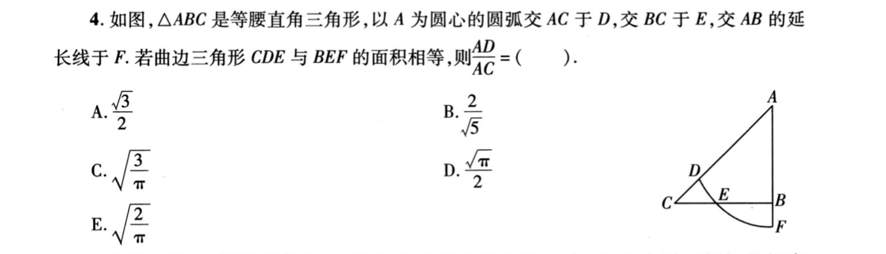

### 第 5 题

如图，已知相邻的圆都相切，从这 6 个圆中随机取 2 个，这 2 个圆不相切的概率为（ ）。

<svg viewBox="0 0 170 120" width="170" height="120" xmlns="http://www.w3.org/2000/svg" style="display:block;margin:12px auto;background:#fff;">
  <rect x="10" y="10" width="150" height="100" fill="none" stroke="#000" stroke-width="1.5" />
  <circle cx="35" cy="35" r="25" fill="none" stroke="#000" stroke-width="1.5" />
  <circle cx="85" cy="35" r="25" fill="none" stroke="#000" stroke-width="1.5" />
  <circle cx="135" cy="35" r="25" fill="none" stroke="#000" stroke-width="1.5" />
  <circle cx="35" cy="85" r="25" fill="none" stroke="#000" stroke-width="1.5" />
  <circle cx="85" cy="85" r="25" fill="none" stroke="#000" stroke-width="1.5" />
  <circle cx="135" cy="85" r="25" fill="none" stroke="#000" stroke-width="1.5" />
</svg>

- **A**．$\frac{8}{15}$
- **B**．$\frac{7}{15}$
- **C**．$\frac{3}{5}$
- **D**．$\frac{2}{5}$
- **E**．$\frac{2}{3}$

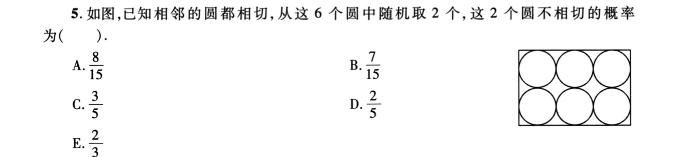

### 第 6 题

如图，在棱长为 2 的正方体中，$A$、$B$ 是顶点，$C$、$D$ 是所在棱的中点，则四边形 $ABCD$ 的面积为（ ）。

<svg viewBox="0 0 230 190" width="230" height="190" xmlns="http://www.w3.org/2000/svg" style="display:block;margin:12px auto;background:#fff;">
  <polygon points="40.0,160.0 192.8,117.2 137.8,7.2 61.4,28.6" fill="#cbd5e1" stroke="#000" stroke-width="1.5" />
  <polygon points="40.0,50.0 150.0,50.0 150.0,160.0 40.0,160.0" fill="none" stroke="#000" stroke-width="1.5" />
  <polygon points="40.0,50.0 82.8,7.2 192.8,7.2 150.0,50.0" fill="none" stroke="#000" stroke-width="1.5" />
  <polygon points="150.0,50.0 192.8,7.2 192.8,117.2 150.0,160.0" fill="none" stroke="#000" stroke-width="1.5" />
  <line x1="82.8" y1="7.2" x2="82.8" y2="117.2" stroke="#000" stroke-width="1.2" stroke-dasharray="4,3" />
  <line x1="82.8" y1="117.2" x2="192.8" y2="117.2" stroke="#000" stroke-width="1.2" stroke-dasharray="4,3" />
  <line x1="40.0" y1="160.0" x2="82.8" y2="117.2" stroke="#000" stroke-width="1.2" stroke-dasharray="4,3" />
  <text x="26" y="172" font-family="serif" font-size="16" font-style="italic">A</text>
  <text x="198" y="127" font-family="serif" font-size="16" font-style="italic">B</text>
  <text x="142" y="18" font-family="serif" font-size="16" font-style="italic">C</text>
  <text x="47" y="30" font-family="serif" font-size="16" font-style="italic">D</text>
</svg>

- **A**．$\frac{9}{2}$
- **B**．$\frac{7}{2}$
- **C**．$\frac{3\sqrt{2}}{2}$
- **D**．$2\sqrt{5}$
- **E**．$3\sqrt{2}$

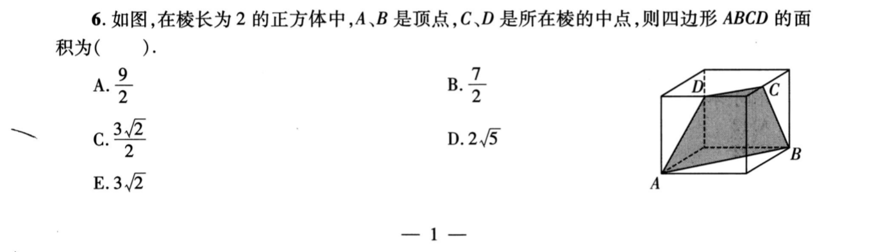

### 第 7 题

桌面上方有 8 只杯子，将其中 3 只杯子翻转（杯口朝上与杯口朝下互换）作为一次操作。8 只口朝上的杯子，经 $n$ 次操作后，杯子口全朝下，则 $n$ 的最小值（ ）。

- **A**．3
- **B**．4
- **C**．5
- **D**．6
- **E**．8

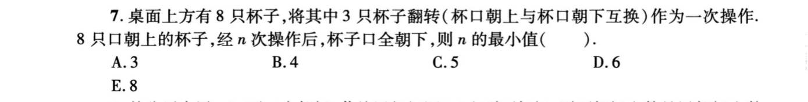

### 第 8 题

某公司有甲、乙、丙三个部门，若从甲部门调 26 人到丙部门，则丙部门人数是甲部门人数的 6 倍，若从乙部门调 5 人到丙部门，则丙部门人数与乙部门人数相等。甲、乙两部门人数差除以 5 余数为（ ）。

- **A**．0
- **B**．1
- **C**．2
- **D**．3
- **E**．4

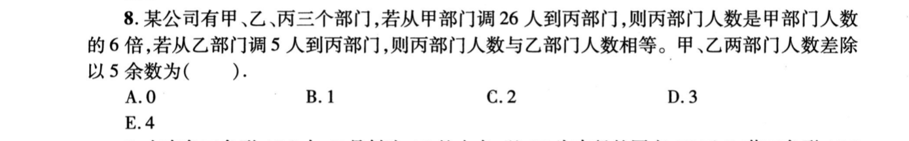

### 第 9 题

在直角三角形 $ABC$ 中，$D$ 是斜边 $AC$ 的中点，以 $AD$ 为直径的圆交 $AB$ 于 $E$，若三角形 $ABC$ 的面积为 8，则三角形 $AED$ 的面积为（ ）。

<svg viewBox="0 0 200 185" width="200" height="185" xmlns="http://www.w3.org/2000/svg" style="display:block;margin:12px auto;background:#fff;">
  <polygon points="60,30 60,160 170,160" fill="none" stroke="#000" stroke-width="1.5" />
  <circle cx="87.5" cy="62.5" r="42.57" fill="none" stroke="#000" stroke-width="1.5" />
  <line x1="60" y1="95" x2="115" y2="95" stroke="#000" stroke-width="1.5" />
  <text x="46" y="28" font-family="serif" font-size="16" font-style="italic">A</text>
  <text x="46" y="168" font-family="serif" font-size="16" font-style="italic">B</text>
  <text x="176" y="168" font-family="serif" font-size="16" font-style="italic">C</text>
  <text x="122" y="98" font-family="serif" font-size="16" font-style="italic">D</text>
  <text x="46" y="99" font-family="serif" font-size="16" font-style="italic">E</text>
</svg>

- **A**．1
- **B**．2
- **C**．3
- **D**．4
- **E**．5

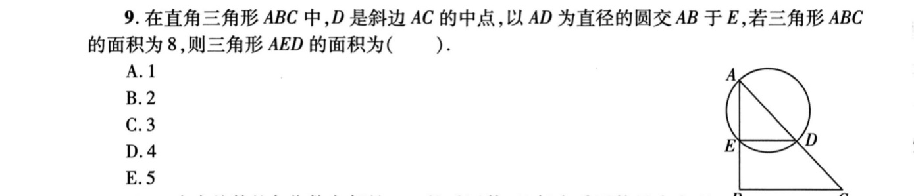

### 第 10 题

一个自然数的各位数字都是 105 的质因数，且每个质因数最多出现一次，这样的自然数有（ ）个。

- **A**．6
- **B**．9
- **C**．12
- **D**．15
- **E**．27

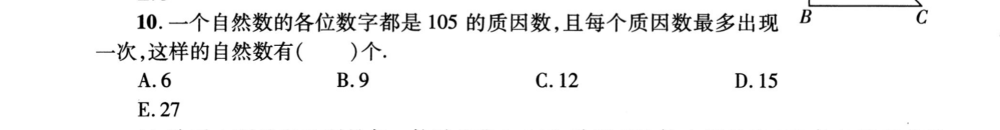

### 第 11 题

购买 A 玩具和 B 玩具各一件需花费 1.4 元，购买 200 件 A 玩具和 150 件 B 玩具花费 250 元，A 玩具单价为（ ）元。

- **A**．0.5
- **B**．0.6
- **C**．0.7
- **D**．0.8
- **E**．0.9

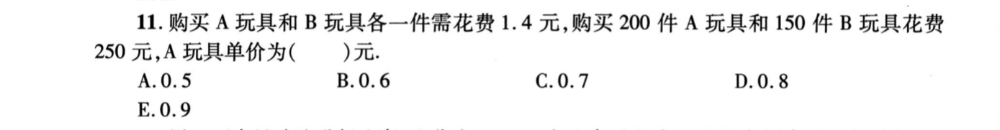

### 第 12 题

甲乙两支足球队进行比赛，比分为 $4:2$，且在比赛过程中乙队没有领先过，则不同的进球顺序有（ ）种。

- **A**．6
- **B**．8
- **C**．9
- **D**．10
- **E**．12

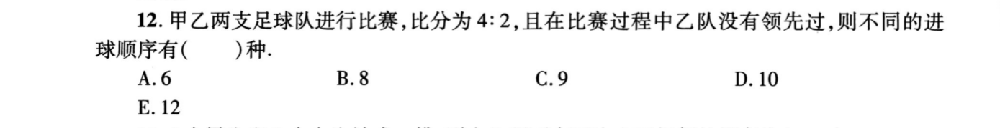

### 第 13 题

4 个男生和 2 个女生站成一排，则女生既不在两边也不相邻的概率为（ ）。

- **A**．$\frac{1}{2}$
- **B**．$\frac{5}{12}$
- **C**．$\frac{3}{8}$
- **D**．$\frac{1}{3}$
- **E**．$\frac{1}{5}$

### 第 14 题

已知 AB 两地相距 208 千米，甲、乙从 A 出发，丙从 B 出发，相向而行，甲速度 60 千米/小时，乙速度 80 千米/小时，丙速度 90 千米/小时，则（ ）分钟以后，甲丙距离和乙丙距离相等。

- **A**．70
- **B**．75
- **C**．78
- **D**．80
- **E**．86

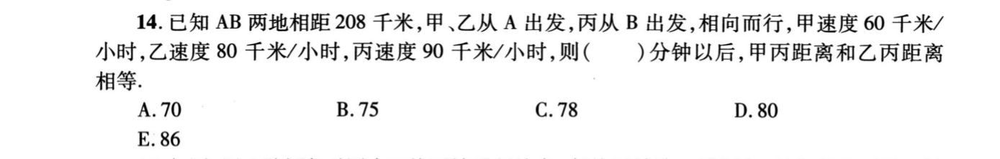

### 第 15 题

如图，用 4 种颜色对图中五块区域进行涂色，每块区域涂一种颜色，且相邻的两块区域颜色不同，不同的涂色方法有（ ）种？

<svg viewBox="0 0 240 170" width="240" height="170" xmlns="http://www.w3.org/2000/svg" style="display:block;margin:12px auto;background:#fff;">
  <rect x="20" y="20" width="200" height="130" fill="none" stroke="#000" stroke-width="1.8" />
  <path d="M 20 75 Q 50 82 85 60" fill="none" stroke="#000" stroke-width="1.5" />
  <path d="M 105 20 Q 100 45 85 60" fill="none" stroke="#000" stroke-width="1.5" />
  <path d="M 85 60 Q 76 105 80 150" fill="none" stroke="#000" stroke-width="1.5" />
  <path d="M 85 60 Q 115 80 145 95" fill="none" stroke="#000" stroke-width="1.5" />
  <path d="M 175 20 Q 155 55 145 95" fill="none" stroke="#000" stroke-width="1.5" />
  <path d="M 145 95 Q 185 105 220 105" fill="none" stroke="#000" stroke-width="1.5" />
</svg>

- **A**．12
- **B**．24
- **C**．32
- **D**．48
- **E**．96

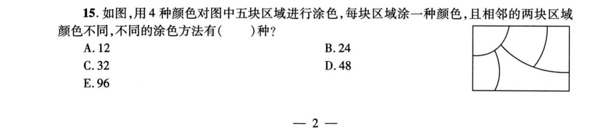

## 二、条件充分性判断：第 16～25 小题，每小题 3 分，共 30 分。要求判断每题给出的条件（1）和条件（2）能否充分支持题干所陈述的结论。A、B、C、D、E 五个选项为判断结果，请选择一项符合试题要求的判断。

- **A**．条件（1）充分，但条件（2）不充分
- **B**．条件（2）充分，但条件（1）不充分
- **C**．条件（1）和条件（2）单独都不充分，但条件（1）和条件（2）联合起来充分
- **D**．条件（1）充分，条件（2）也充分
- **E**．条件（1）和条件（2）单独都不充分，条件（1）和条件（2）联合起来也不充分

### 第 16 题

如图，$AD$ 与圆相切于点 $D$，$AC$ 与圆相交于点 $B$。则能确定 $\Delta ABD$ 与 $\Delta BDC$ 的面积之比。

<svg viewBox="0 0 210 150" width="210" height="150" xmlns="http://www.w3.org/2000/svg" style="display:block;margin:12px auto;background:#fff;">
  <circle cx="140" cy="75" r="45" fill="none" stroke="#000" stroke-width="1.5" />
  <line x1="40" y1="120" x2="140" y2="120" stroke="#000" stroke-width="1.5" />
  <line x1="40" y1="120" x2="181" y2="56.5" stroke="#000" stroke-width="1.5" />
  <line x1="99" y1="93.5" x2="140" y2="120" stroke="#000" stroke-width="1.5" />
  <line x1="181" y1="56.5" x2="140" y2="120" stroke="#000" stroke-width="1.5" />
  <text x="22" y="125" font-family="serif" font-size="16" font-style="italic">A</text>
  <text x="136" y="138" font-family="serif" font-size="16" font-style="italic">D</text>
  <text x="80" y="85" font-family="serif" font-size="16" font-style="italic">B</text>
  <text x="184" y="52" font-family="serif" font-size="16" font-style="italic">C</text>
</svg>

(1) 已知 $\frac{AD}{CD}$。
(2) 已知 $\frac{BD}{CD}$。

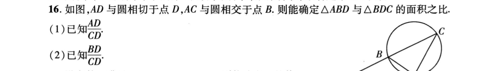

### 第 17 题

设实数 $x$ 满足 $|x-2| - |x-3| = a$，则能确定 $x$ 的值。
(1) $0 < a \le \frac{1}{2}$。
(2) $\frac{1}{2} < a \le 1$。

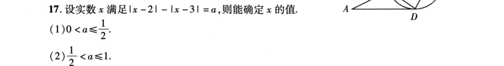

### 第 18 题

两个人数不等的班数学测验的平均分不相等，则能确定人数多的班。
(1) 已知两个班的平均分。
(2) 已知两个班的总平均分。

### 第 19 题

在 $\Delta ABC$ 中，$D$ 为 $BC$ 边上的点，$BD$、$AB$、$BC$ 成等比数列，则 $\angle BAC = 90^\circ$。
(1) $BD = DC$。
(2) $AD$ 垂直于 $BC$。

### 第 20 题

将 75 名学生分成 25 组，每组 3 人，则能确定女生人数。
(1) 已知全男生的组和全女生的组。
(2) 只有 1 个男生的组和只有 1 个女生的组数相等。

### 第 21 题

某直角三角形的边长 $a, b, c$ 成等比数列，则能确定公比的值。
(1) $a$ 是直角边长。
(2) $c$ 是斜边边长。

### 第 22 题

已知 $x$ 为正实数，则能确定 $x - \frac{1}{x}$ 的值。
(1) 已知 $\sqrt{x} + \frac{1}{\sqrt{x}}$ 的值。
(2) 已知 $x^2 - \frac{1}{x^2}$ 的值。

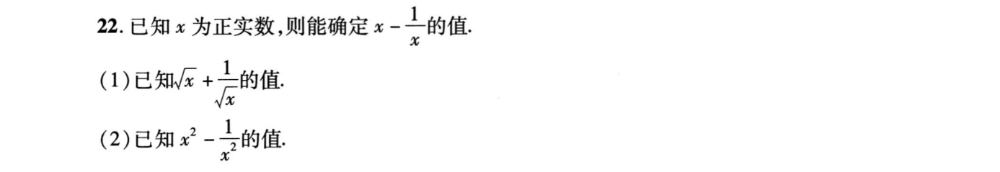

### 第 23 题

已知 $a, b$ 为实数，则能确定 $\frac{a}{b}$ 的值。
(1) $a, b, (a+b)$ 为等比数列。
(2) $a(a+b) > 0$。

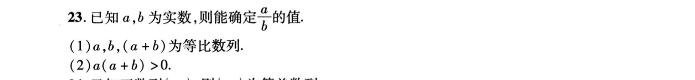

### 第 24 题

已知正数列 $\{a_n\}$，则 $\{a_n\}$ 为等差数列。
(1) $a_{n+1}^2 - a_n^2 = 2n, n = 1, 2, \cdots$。
(2) $a_1 + a_3 = 2a_2$。

### 第 25 题

设实数 $a, b$ 满足 $|a-2b| \le 1$，则 $|a| > |b|$。
(1) $|b| > 1$。
(2) $|b| < 1$。

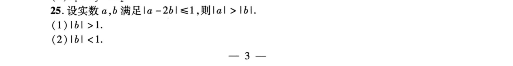

## 三、逻辑推理：第 26～55 小题，每小题 2 分，共 60 分。下列每题给出的 A、B、C、D、E 五个选项中，只有一项是符合试题要求的。

### 第 26 题

百年党史充分揭示了中国共产党为什么能、马克思主义为什么行、中国特色社会主义为什么好的历史逻辑、理论逻辑、实践逻辑。面对百年未有之大变局，如果信念不坚定，就会陷入停滞彷徨的思想迷雾，就无法面对前进道路上的各种挑战风险。只有坚持中国特色社会主义道路自信、理论自信、制度自信、文化自信，才能把中国的事情办好，把中国特色社会主义事业发展好。
根据以上陈述可以得出以下哪项？

- **A**．如果坚持“四个自信”就能把中国的事情办好。
- **B**．只要信念坚定，就不会陷入停滞彷徨的思想迷雾。
- **C**．只有信念坚定，才能应对前进道路上的各种挑战风险。
- **D**．只有充分理解百年党史揭示的理论逻辑，才能将中国特色社会主义事业发展好。
- **E**．如果不能理解百年党史揭示的理论逻辑，就无法遵循百年党史揭示的实践逻辑。

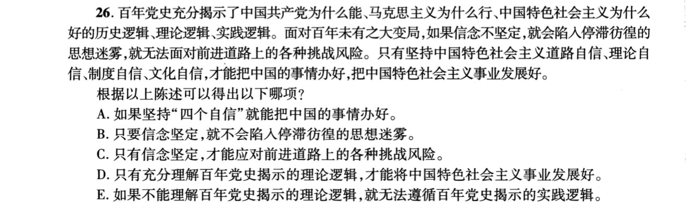

### 第 27 题

“君问归期未有期，巴山夜雨涨秋池。何当共剪西窗烛，却话巴山夜雨时。”这首《夜雨寄北》是晚唐诗人李商隐的名作。一般认为这是一封“家书”，当时诗人身处巴蜀，妻子在长安，所以说“寄北”。但有学者提出，这首诗实际上是寄给友人的。
以下哪项如果为真，最能支持以上学者的观点？

- **A**．李商隐之妻王氏卒于大中五年，而该诗作于大中七年。
- **B**．明清小说戏曲中经常将家庭塾师或官员幕客称为“西席”“西宾”。
- **C**．唐代温庭筠的《舞衣曲》中有诗句“回颦笑语西窗客，星斗寥寥波脉脉”。
- **D**．该诗另一题为《夜雨寄内》，“寄内”即寄怀妻子。此说得到了许多人的认同。
- **E**．“西窗”在古代专指客房、客厅，起自尊客于西的先秦古礼，并被后世习察日用。

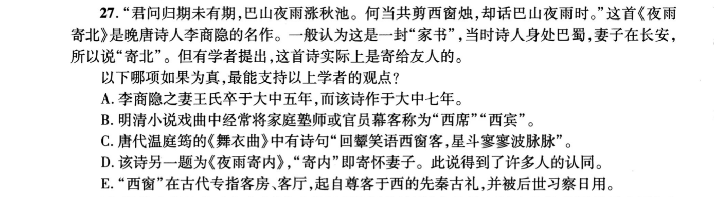

### 第 28 题

退休在家的老王今晚在“焦点访谈”“国家记忆”“自然传奇”“人物故事”“纵横中国”这 5 个节目中选择了 3 个节目观看。老王对观看的节目有如下要求：
（1）如果观看“焦点访谈”，就不观看“人物故事”；
（2）如果观看“国家记忆”，就不观看“自然传奇”。
根据上述信息，老王一定观看了如下哪个节目？

- **A**．“纵横中国”
- **B**．“国家记忆”
- **C**．“自然传奇”
- **D**．“人物故事”
- **E**．“焦点访谈”

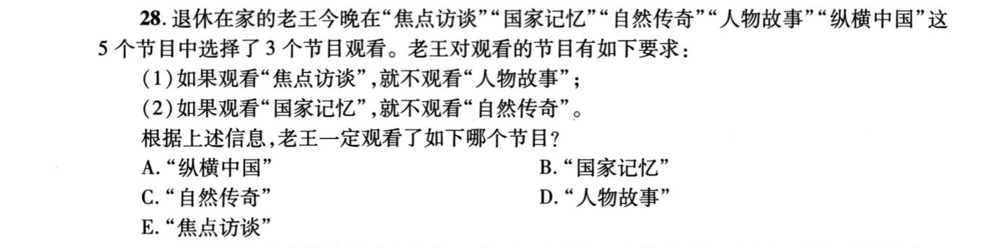

### 第 29 题

2020 年全球碳排放量减少大约 24 亿吨，远远大于之前的创纪录降幅，例如二战结束时下降 9 亿吨，2009 年金融危机最严重时下降 5 亿吨。非政府组织全球碳计划（GCP）在其年度评估报告中说：由于各国在新冠肺炎疫情期间采取了封锁和限制措施，汽车使用量下降了一半左右，2020 年的碳排放量同比下降了创纪录的 7%。
以下哪项如果为真，最能支持 GCP 的观点？

- **A**．2020 年碳排放量下降最明显的国家或地区是美国和欧盟。
- **B**．延缓气候变化的办法不是停止经济活动，而是加速向低碳能源过渡。
- **C**．根据气候变化《巴黎协定》，2015 年之后的 10 年全球每年需减排约 10～20 亿吨。
- **D**．2020 年在全球各行业减少的碳排放总量中，交通运输业所占比例最大。
- **E**．随着世界经济的持续复苏，2021 年全球碳排放量同比下降可能不超过 5%。

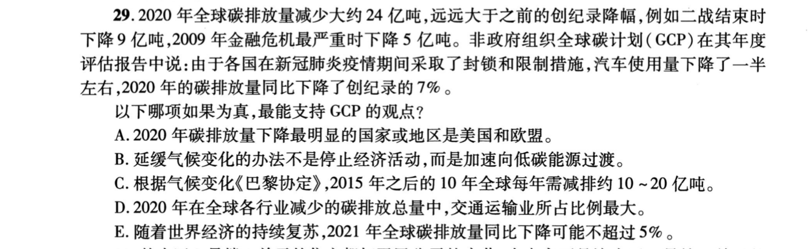

### 第 30 题

某小区 2 号楼 1 单元的住户都打了甲公司的疫苗，小李家不是该小区 2 号楼 1 单元的住户，小赵家都打了甲公司的疫苗，而小陈家都没有打甲公司的疫苗。
根据以上陈述，可以得出以下哪项？

- **A**．小李家都没有打甲公司的疫苗。
- **B**．小赵家是该小区 2 号楼 1 单元的住户。
- **C**．小陈家是该小区的住户，但不是 2 号楼 1 单元的。
- **D**．小赵家是该小区 2 号楼的住户，但未必是 1 单元的。
- **E**．小陈家若是该小区 2 号楼的住户，则不是 1 单元的。

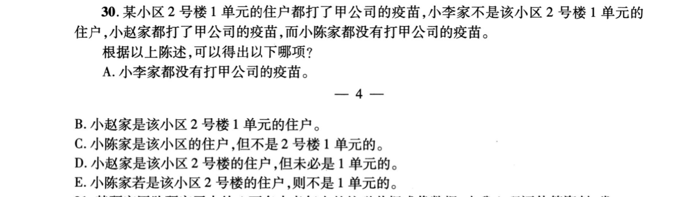

### 第 31 题

某研究团队研究了大约 4 万名中老年人的核磁共振成像数据、自我心理评估等资料，发现经常有孤独感的研究对象和没有孤独感的研究对象在大脑的默认网络区域存在显著差异。默认网络是一组参与内心思考的大脑区域，这些内心思考包括回忆旧事、规划未来、想象等。孤独者大脑的默认网络联结更为紧密，其灰质容积更大。研究人员由此认为，大脑默认网络的结构和功能与孤独感存在正相关。
以下哪项如果为真，最能支持上述研究人员的观点？

- **A**．人们在回忆过去、假设当下或预想未来时会使用默认网络。
- **B**．有孤独感的人更多地使用想象、回忆过去和憧憬未来以克服社交隔离。
- **C**．感觉孤独的老年人出现认知衰退和患上痴呆症的风险更高，进而导致部分脑区萎缩。
- **D**．了解孤独感对大脑的影响，拓展我们在该领域的认知，有助于减少当今社会的孤独现象。
- **E**．穹窿是把信号从海马体输送到默认网络的神经纤维束，在研究对象的大脑中，这种纤维束得到较好的保护。

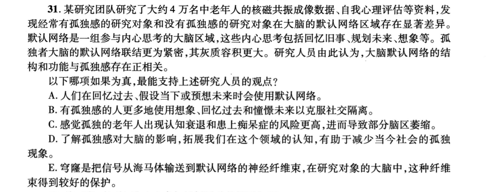

### 第 32 题

关于张、李、宋、孔 4 人参加植树活动的情况如下：
（1）张、李、孔至少有 2 人参加；
（2）李、宋、孔至多有 2 人参加；
（3）如果李参加，那么张、宋两人要么都参加，要么都不参加。
根据以上陈述，以下哪项是不可能的？

- **A**．宋、孔都参加。
- **B**．宋、孔都不参加。
- **C**．李、宋都参加。
- **D**．李、宋都不参加。
- **E**．李参加，宋不参加。

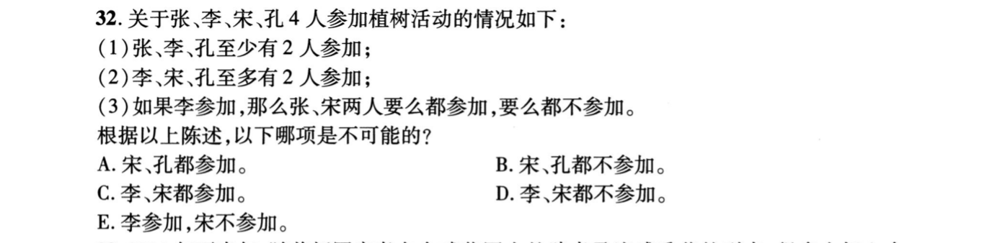

### 第 33 题

2020 年下半年，随着新冠病毒在全球范围内的肆虐及流感季节的到来，很多人担心会出现大范围流感和新冠疫情同时爆发的情况。但是有病毒学家发现，2009 年甲型 H1N1 流感毒株出现时，自 1977 年以来一直传播的另一种甲型流感毒株消失了。由此他推测，人体同时感染新冠病毒和流感病毒的可能性应该低于预期。
以下哪项如果为真，最能支持该病毒学家的推测？

- **A**．如果人们继续接种流感疫苗，仍能降低同时感染这两种病毒的几率。
- **B**．一项分析显示，新冠肺炎患者中大约只有 3% 的人同时感染另一种病毒。
- **C**．人体感染一种病毒后的几周内，其先天免疫系统的防御能力会逐步增强。
- **D**．为避免感染新冠病毒，人们会减少室内聚集、继续佩戴口罩、保持社交距离和手部卫生。
- **E**．新冠病毒的感染会增加参与干扰素反应的基因的活性，从而防止流感病毒在细胞内进行复制。

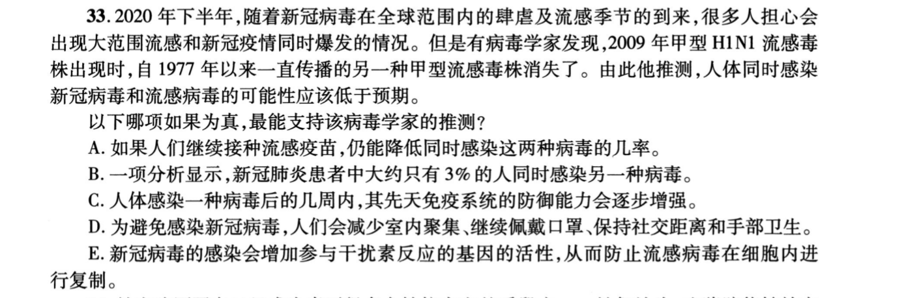

### 第 34 题

补充胶原蛋白已经成为当下很多女性抗衰老的手段之一。她们认为：吃猪蹄能够补充胶原蛋白，为了美容养颜，最好多吃些猪蹄。近日有些专家对此表示质疑，他们认为多吃猪蹄其实并不能补充胶原蛋白。
以下哪项如果为真，最能质疑上述专家的观点？

- **A**．猪蹄中的胶原蛋白会被人体的消化系统分解，不会直接以胶原蛋白的形态补充到皮肤中。
- **B**．人们在日常生活中摄入的优质蛋白和水果、蔬菜中的营养物质，足以提供人体所需的胶原蛋白。
- **C**．猪蹄中胶原蛋白的含量并不多，但胆固醇含量高、脂肪多，食用过多会引起肥胖，还会增加患高血压的风险。
- **D**．猪蹄中的胶原蛋白经过人体消化后会被分解成氨基酸等物质，氨基酸参与人体生理活动，再合成人体必需的胶原蛋白等多种蛋白质。
- **E**．胶原蛋白是人体皮肤、骨骼和肌腱中的主要结构蛋白，它填充在真皮之间，撑起皮肤组织，增加皮肤紧密度，使皮肤水润而富有弹性。

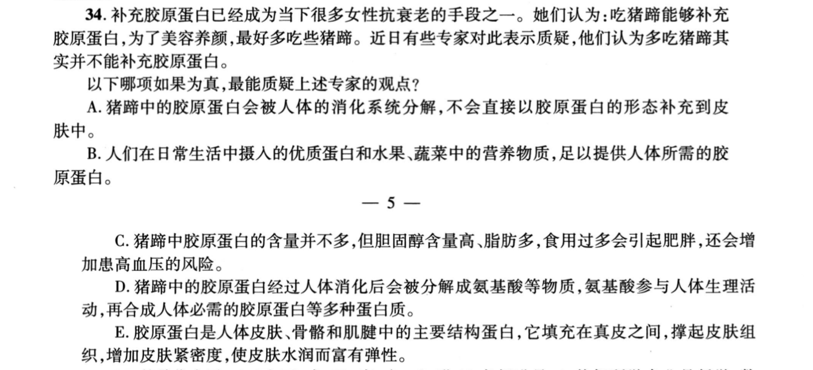

### 第 35 题

某单位有甲、乙、丙、丁、戊、己、庚、辛、壬、癸 10 名新进员工，他们所学专业是哲学、数学、化学、金融和会计 5 个专业之一，每人只学其中一个专业。已知：
（1）若甲、丙、壬、癸中至多有 3 人是数学专业，则丁、庚、辛 3 人都是化学专业；
（2）若乙、戊、己中至多有 2 人是哲学专业，则甲、丙、庚、辛 4 人专业各不相同。
根据上述信息，所学专业相同的新员工是

- **A**．乙、戊、己
- **B**．甲、壬、癸
- **C**．丙、丁、癸
- **D**．丙、戊、己
- **E**．丁、庚、辛

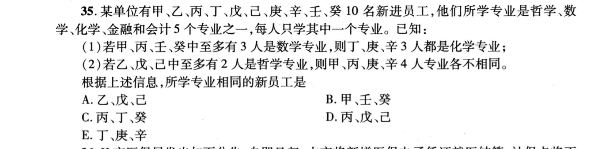

### 第 36 题

H 市医保局发出如下公告：自即日起，本市将新增医保电子凭证就医结算，社保卡将不再作为就医结算的唯一凭证。本市所有定点医疗机构均已实现医保电子凭证的实时结算；本市参保人员可凭医保电子凭证就医结算，但只有将医保电子凭证激活后才能扫码使用。
以下哪项最符合上述 H 市医保局的公告内容？

- **A**．H 市非定点医疗机构没有实现医保电子凭证的实时结算。
- **B**．可使用医保电子凭证结算的医院不一定都是 H 市的定点医疗机构。
- **C**．凡持有社保卡的外地参保人员，均可在 H 市定点医疗机构就医结算。
- **D**．凡已激活医保电子凭证的外地参保人员，均可在 H 市定点医疗机构使用医保电子凭证扫码就医。
- **E**．凡未激活医保电子凭证的本地参保人员，均不能在 H 市定点医疗机构使用医保电子凭证扫码结算。

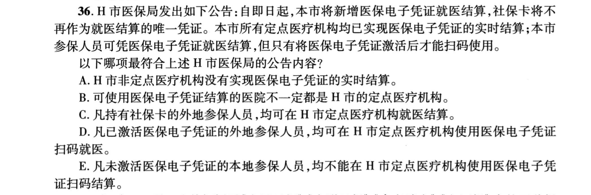

### 第 37 题

宋、李、王、吴 4 人均订阅了《人民日报》《光明日报》《参考消息》《文汇报》中的两种报纸，每种报纸均有两人订阅，且各人订阅的均不完全相同。另外，还知道：
（1）如果吴至少订阅了《光明日报》《参考消息》中的一种，则李订阅了《人民日报》而王未订阅《光明日报》；
（2）如果李、王两人中至多有一人订阅了《文汇报》，则宋、吴均订阅了《人民日报》。
如果李订阅了《人民日报》，则可以得出以下哪项？

- **A**．宋订阅了《文汇报》。
- **B**．宋订阅了《人民日报》。
- **C**．王订阅了《参考消息》。
- **D**．吴订阅了《参考消息》。
- **E**．吴订阅了《人民日报》。

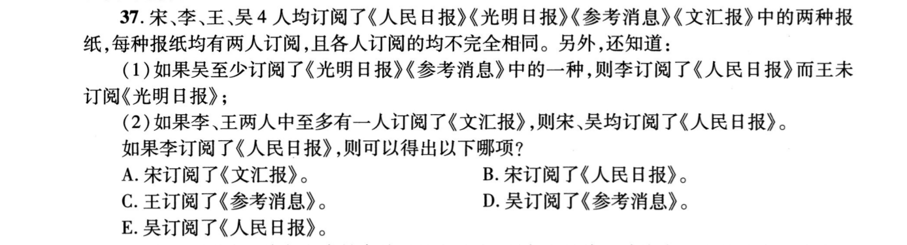

### 第 38 题

在一项噪声污染与鱼类健康关系的实验中，研究人员将已感染寄生虫的孔雀鱼分成短期噪声组、长期噪声组和对照组。短期噪声组在噪声环境中连续暴露 24 小时，长期噪声组在同样的噪声中暴露 7 天，对照组则被置于一个安静环境中。在 17 天的监测期内，该研究人员发现，长期噪声组的鱼在第 12 天开始死亡，其他两组鱼则在第 14 天开始死亡。
以下哪项如果为真，最能解释上述实验结果？

- **A**．噪声污染不仅危害鱼类，也危害两栖动物、鸟类和爬行动物等。
- **B**．长期噪声污染会加速寄生虫对宿主鱼类的侵害，导致鱼类过早死亡。
- **C**．相比于天然环境，在充斥各种噪声的养殖场中，鱼更容易感染寄生虫。
- **D**．噪声污染使鱼类既要应对寄生虫的感染又要排除噪声干扰，增加鱼类健康风险。
- **E**．短期噪声组所受的噪声可能引起了鱼类的紧张情绪，但不至于损害它们的免疫系统。

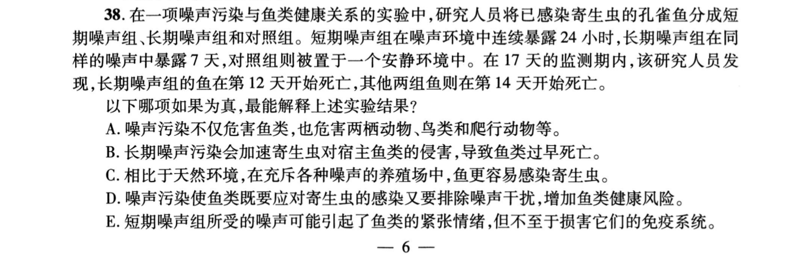

### 第 39 题

节日将至，某单位拟为职工发放福利品，每人可在甲到庚 7 种商品中选择其中的 4 种进行组合，且每种组合还需满足如下要求：
（1）若选甲，则丁、戊、庚 3 种中至多选其一；
（2）若丙、己 2 种至少选一种，则必选乙但不能选戊。
以下哪组选项符合上述要求？

- **A**．甲、丁、戊、己
- **B**．乙、丙、丁、戊
- **C**．甲、乙、戊、庚
- **D**．乙、丁、戊、庚
- **E**．甲、丙、丁、己

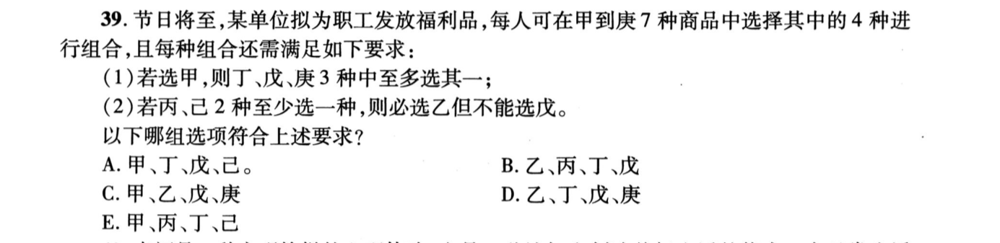

### 第 40 题

幸福是一种主观愉悦的心理体验，也是一种认知和创造美好生活的能力。在日常生活中，每个人如果既能发现当下不足，也能确立前进的目标，并通过实际行动改进不足和实现目标，就能始终保持对生活的乐观精神。而有了对生活的乐观精神，就会拥有幸福感。生活中大多数人都拥有幸福感；遗憾的是，也有一些人能发现当下的不足，并通过实际行动去改进，但他们却没有幸福感。
根据以上陈述，可以得出以下哪项？

- **A**．生活中大多数人都有对生活的乐观精神。
- **B**．个体的生理体验也是个体的一种行为能力。
- **C**．如果能发现当下的不足并努力改进，就能拥有幸福感。
- **D**．那些没有幸福感的人即使发现当下的不足，也不愿通过行为去改变。
- **E**．确立前进的目标并通过实际行动实现目标，生活中有些人没有做到这一点。

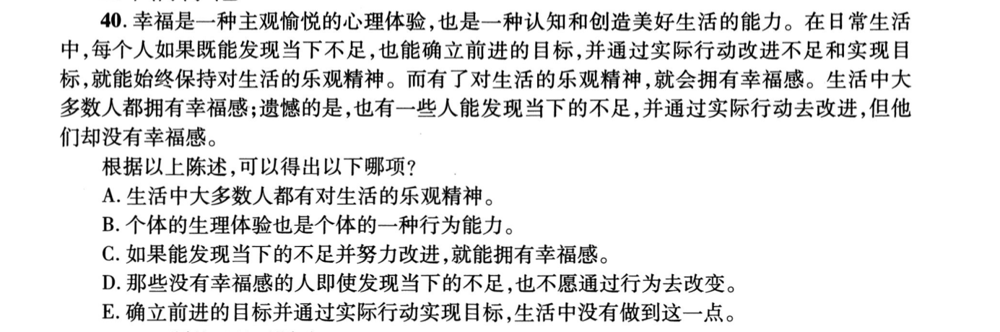

### 41～42 题基于以下题干：

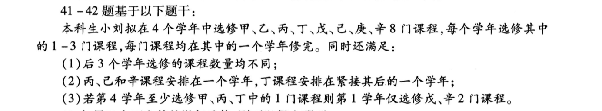

本科生小刘拟在 4 个学年中选修甲、乙、丙、丁、戊、己、庚、辛 8 门课程，每个学年选修其中的 1～3 门课程，每门课程均在其中的一个学年修完。同时还满足：
（1）后 3 个学年选修的课程数量均不同；
（2）丙、己和辛课程安排在一个学年，丁课程安排在紧接其后的一个学年；
（3）若第 4 学年至少选修甲、丙、丁中的 1 门课程则第 1 学年仅选修戊、辛 2 门课程。

### 第 41 题

如果乙在丁之前的学年选修，则可以得出哪项？

- **A**．乙在第 1 学年选修。
- **B**．乙在第 2 学年选修。
- **C**．丁在第 2 学年选修。
- **D**．丁在第 4 学年选修。
- **E**．戊在第 1 学年选修。

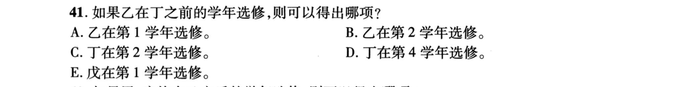

### 第 42 题

如果甲、庚均在乙之后的学年选修，则可以得出哪项？

- **A**．戊在第 1 学年选修。
- **B**．戊在第 3 学年选修。
- **C**．庚在甲之前的学年选修。
- **D**．甲在戊之前的学年选修。
- **E**．庚在戊之前的学年选修。

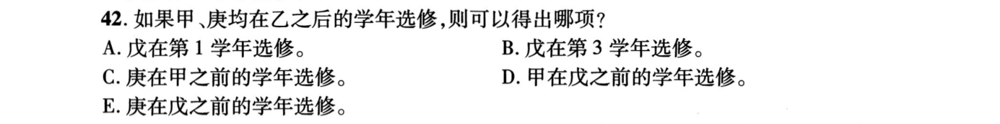

### 第 43 题

习俗因传承而深入人心，文化因延续而繁荣兴盛。传统节日带给人们的不只是快乐和喜庆，还塑造着影响至深的文化自信。不忘历史才能开辟未来，善于继承才能善于创新。传统节日只有不断融入现代生活，其中的文化才能得以延续而繁荣兴盛，才能为人们提供更多心灵滋养与精神力量。
根据以上信息，可以得出以下哪项？

- **A**．只有为人们提供更多心灵滋养与精神力量，传统文化才能得以延续而繁荣兴盛。
- **B**．若传统节日更好地融入现代生活，就能为人们提供更多心灵滋养与精神力量。
- **C**．有些带给人们欢乐和喜庆的节日塑造着人们的文化自信。
- **D**．带有厚重历史文化的传统将引领人们开辟未来。
- **E**．深入人心的习俗将在不断创新中被传承。

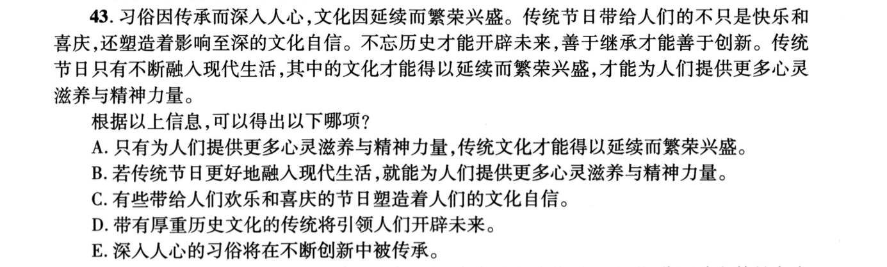

### 第 44 题

当前，不少教育题材影视剧贴近社会现实，直击子女升学、出国留学、代际冲突等教育痛点，引发社会广泛关注。电视剧一阵风，剧外人急红眼，很多家长触“剧”生情，过度代入，焦虑情绪不断增加，引得家庭“鸡飞狗跳”，家庭与学校的关系不断紧张。有专家由此指出，这类教育影视剧只能贩卖焦虑，进一步激化社会冲突，对实现教育公平于事无补。
以下哪项如果为真，最能质疑上述专家的主张？

- **A**．当代社会教育资源客观上总是有限且分配不平衡，教育竞争不可避免。
- **B**．父母过度焦虑则导致孩子间暗自攀比，重则影响亲子关系，家庭和睦。
- **C**．教育影视剧一旦引发广泛关注，就会对国家教育政策走向产生重要影响。
- **D**．教育影视剧提醒学校应明确职责，不能对义务教育实行“家长承包制”。
- **E**．家长不应成为教育焦虑的“剧中人”，而应该用爱包容孩子的不完美。

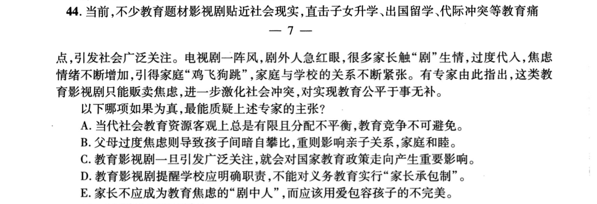

### 45～46 题基于以下题干：

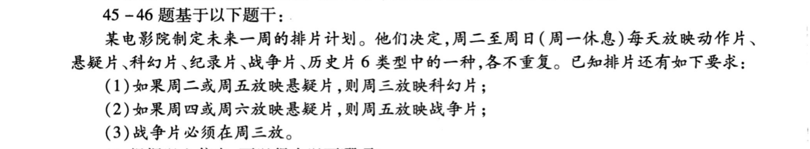

某电影院制定未来一周的排片计划。他们决定，周二至周日（周一休息）每天放映动作片、悬疑片、科幻片、纪录片、战争片、历史片 6 类型中的一种，各不重复。已知排片还有如下要求：
（1）如果周二或周五放映悬疑片，则周三放映科幻片；
（2）如果周四或周六放映悬疑片，则周五放映战争片；
（3）战争片必须在周三放。

### 第 45 题

根据以上信息，可以得出以下哪项？

- **A**．周六放科幻片
- **B**．周日放悬疑片
- **C**．周五放动作片
- **D**．周二放纪录片
- **E**．周四放历史片

### 第 46 题

如果历史片的放映日期，既与纪录片相邻，又与科幻片相邻，则可得出以下哪项？

- **A**．周二放纪录片
- **B**．周四放纪录片
- **C**．周二放动作片
- **D**．周四放科幻片
- **E**．周五放动作片

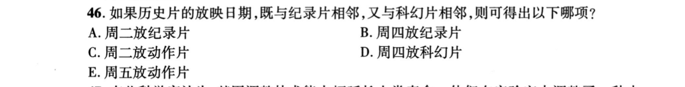

### 第 47 题

有些科学家认为，基因调整技术能大幅延长人类寿命。他们在实验室中调整了一种小型土壤线虫的两组基因序列，成功将这种生物的寿命延长了 5 倍。他们据此声称，如果将延长线虫寿命的科学方法应用于人类，人活到 500 岁就会成为可能。
以下最能质疑上述科学家的观点？

- **A**．基因调整技术可能会导致下一代中一定比例的个体失去繁殖能力。
- **B**．即使将基因调整技术成功应用于人类，也只会有极少的人活到 500 岁。
- **C**．将延长线虫寿命的科学方法应用于人类，还需要经历较长一段时间。
- **D**．人类的生活方式复杂而多样，不良的生活习惯和心理压力，会影响身心健康。
- **E**．人类寿命的提高幅度不会像线虫那样简单倍增，200 岁以后寿命再延长基本不可能。

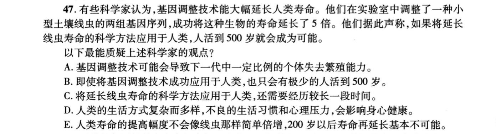

### 第 48 题

贾某的邻居易某在自家阳台侧面安装了空调外机，空调一开，外机就向贾家窗户方向吹热风，贾某对此叫苦不迭，于是找到易某协商此事。易某回答说：“现在哪家没装空调？别人安装就行，偏偏我家就不行？”
对于易某的回答，以下哪项评价最为恰当？

- **A**．易某的行为虽然影响到了贾家的生活，但易某是正常行使自己的权利。
- **B**．易某的行为已经构成对贾家权利的侵害，应该立即停止侵权行为。
- **C**．易某没有将心比心，因为贾家也可以在正对易家卧室窗户处安装空调外机。
- **D**．易某在转移论题，问题不是能不能安装空调，而是安装空调该不该影响邻居。
- **E**．易某空调外机的安装不应正对贾家卧室窗户，不能只顾自己享受而让贾家受罪。

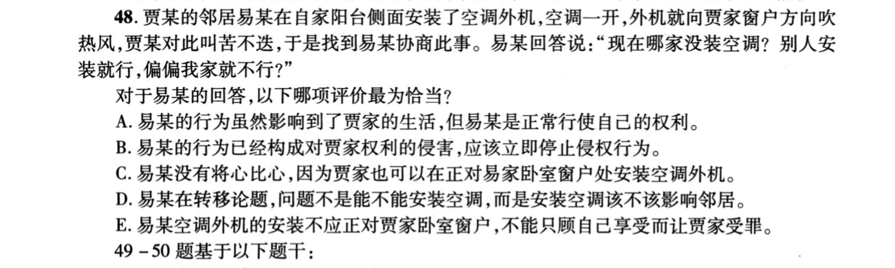

### 49～50 题基于以下题干：

某校文学社王、李、周、丁 4 个人每人只爱好诗歌、散文、戏剧、小说 4 种文学形式中的一种，且各不相同；他们每人只创作了上述 4 种形式中的一种作品，且形式各不相同；他们创作的作品形式与各自的文学爱好均不同。已知：
（1）若王没有创作诗歌，则李爱好小说；
（2）若王没有创作诗歌，则李创作小说；
（3）若王创作诗歌，则李爱好小说且周爱好散文。

### 第 49 题

根据上述信息，可得出以下哪项？

- **A**．王爱好散文
- **B**．李爱好戏剧
- **C**．周爱好小说
- **D**．丁爱好诗歌
- **E**．周爱好戏剧

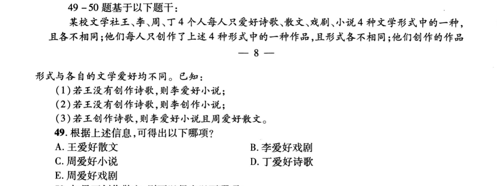

### 第 50 题

如果丁创作散文，则可以得出以下哪项？

- **A**．周创作小说
- **B**．李创作诗歌
- **C**．李创作小说
- **D**．周创作戏剧
- **E**．王创作小说

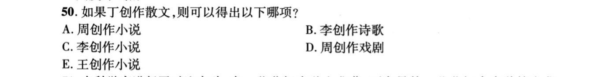

### 第 51 题

有科学家进行了对比实验：在一些花坛中种金盏草，而在另外一些花坛中未种植金盏草。他们发现：种了金盏草的花坛，玫瑰长得很繁茂，而未种金盏草的花坛，玫瑰却呈现病态，很快就枯萎了。
以下哪项如果为真，最能解释上述现象？

- **A**．为了利于玫瑰生长，某园艺公司推荐种金盏草而不是直接喷洒农药。
- **B**．金盏草的根系深度不同于玫瑰，不会与其争夺营养，却可保持土壤湿度。
- **C**．金盏草的根部可分泌出一种杀死土壤中害虫的物质，使玫瑰免受其侵害。
- **D**．玫瑰花花坛中的金盏草常被认为是一种杂草，但它对玫瑰的生长，具有奇特的作用。
- **E**．花匠会对种金盏草和玫瑰花的花坛施肥较多，而对仅种玫瑰花的花坛施肥偏少。

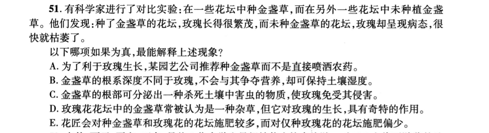

### 第 52 题

李佳、贾元、夏辛、丁东、吴悠 5 位大学生暑假结伴去皖南旅游。对于 5 人将要游览的地点，他们却有不同想法。
李佳：若去龙川，则也去呈坎。
贾元：龙川和徽州古城两个地方至少去一个。
夏辛：若去呈坎，则也去新安江山水画廊。
丁东：若去徽州古城，则也去新安江山水画廊。
吴悠：若去新安江山水画廊，则也去江村。
事后得知，5 人的想法都得到了实现。根据以上信息，上述 5 人游览的地点肯定有：

- **A**．龙川和呈坎
- **B**．江村和新安江山水画廊
- **C**．龙川和徽州古城
- **D**．呈坎和新安江山水画廊
- **E**．呈坎和徽州古城

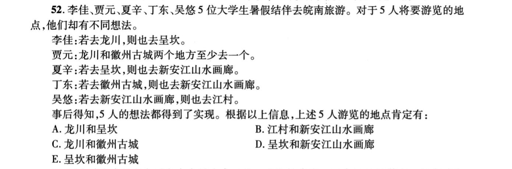

### 第 53 题

胃底腺息肉是所有胃息肉中最为常见的一种良性病变。最常见的是散发型胃底腺息肉，它多发于 50 岁以上人群。研究人员在研究 10 万人的胃镜检查资料后发现，有胃底腺息肉的患者无人患胃癌，而没有胃底腺息肉的患者中有 172 人发现有胃癌。他们由此断定，胃底腺息肉与胃癌呈负相关。
以下哪项为真，最支持上述研究人的断定？

- **A**．有胃底腺息肉的患者绝大多数没有家族癌症史。
- **B**．在研究人员研究的 10 万人中，50 岁以下的占大多数。
- **C**．在研究人员研究的 10 万人中，有胃底腺息肉的人仅占 14%。
- **D**．有胃底腺息肉的患者罹患萎缩性胃炎、胃溃疡的几率显著降低。
- **E**．胃内一旦有胃底腺息肉，往往意味着没有感染致癌物“幽门螺旋杆菌”。

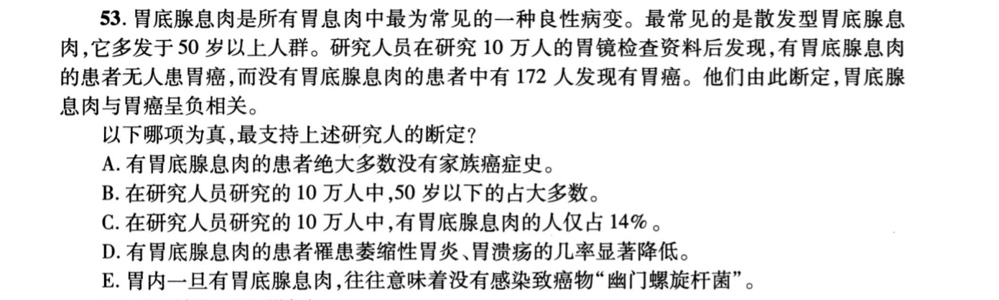

### 54～55 题基于以下题干：

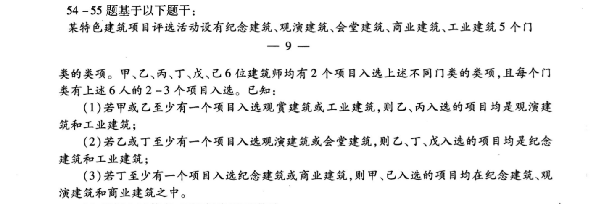

某特色建筑项目评选活动设有纪念建筑、观演建筑、会堂建筑、商业建筑、工业建筑 5 个门类的类项。甲、乙、丙、丁、戊、己 6 位建筑师均有 2 个项目入选上述不同门类的类项，且每个门类有上述 6 人的 2～3 个项目入选。已知：
（1）若甲或乙至少有一个项目入选观演建筑或工业建筑，则乙、丙入选的项目均是观演建筑和工业建筑；
（2）若乙或丁至少有一个项目入选观演建筑或会堂建筑，则乙、丁、戊入选的项目均是纪念建筑和工业建筑；
（3）若丁至少有一个项目入选纪念建筑或商业建筑，则甲、己入选的项目均在纪念建筑、观演建筑和商业建筑之中。

### 第 54 题

根据上述信息，可以得出以下哪项？

- **A**．甲有项目入选观演建筑
- **B**．丙有项目入选工业建筑
- **C**．丁有项目入选商业建筑
- **D**．戊有项目入选会堂建筑
- **E**．己有项目入选纪念建筑

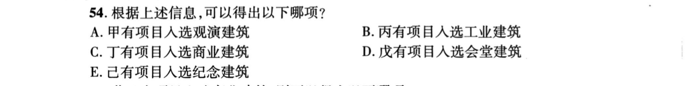

### 第 55 题

若己有项目入选商业建筑，则可以得出以下哪项？

- **A**．己有项目入选观演建筑
- **B**．戊有项目入选工业建筑
- **C**．丁有项目入选商业建筑
- **D**．丙有项目入选观演建筑
- **E**．乙有项目入选工业建筑

## 四、写作：第 56～57 小题，共 65 分。其中论证有效性分析 30 分，论说文 35 分。

### 第 56 题

论证有效性分析：分析下述论证中存在的缺陷和漏洞，选择若干要点，写一篇 600 字左右的文章，对该论证的有效性进行分析和评论。（论证有效性分析的一般要点是：概念特别是核心概念的界定和使用是否准确并前后一致，有无各种明显的逻辑错误，论证的论据是否成立并支持结论，结论成立的条件是否充分等。）

默默无闻、无私奉献虽然是人们尊崇的德行，但这种德行其实不可能成为社会的道德精神。

一种德行必须借助大众媒体的传播，让大家受其感染，并化为自觉意识，然后才能成为社会的道德精神。但是，默默无闻、无私奉献的精神所赖以存在的行为特点是不事张扬、不为人知。既然如此，它就得不到传播，也就不可能成为社会的道德精神。

退一步讲，默默无闻、无私奉献的善举经媒体大力宣传以后为更多的人所了解，这就从根本上使这一善举失去了默默无闻的特性。既然如此，这一命题就无从谈起了。

再者，默默无闻的善举一旦被媒体大力宣传，当事人必然会受到社会的肯定与赞赏，而这就是社会对他的回报，既然他从社会得到了回报，怎么还可以说是无私奉献呢？

由此可见，默默无闻、无私奉献的德行注定不可能成为社会的道德精神。

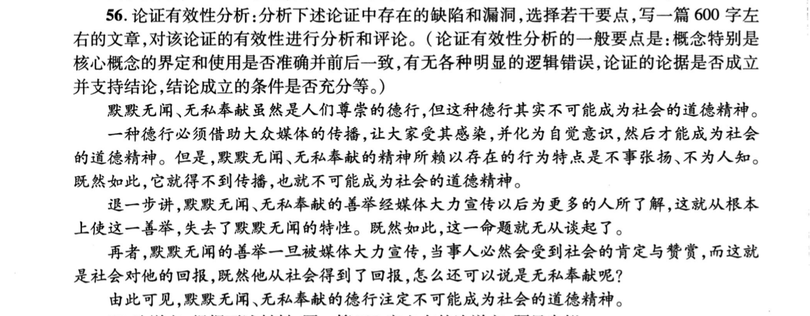

### 第 57 题

论说文：根据下述材料，写一篇 700 字左右的论说文，题目自拟。

鸟类会飞是因为它们在进化中不断优化了其身体结构。飞行是一项特殊的运动，鸟类的躯体进化成了适合飞行的流线型，飞行也是一项需要付出高能量代价的运动，鸟类增强了翅膀、胸肌部位的功能，又改进了呼吸系统，以便给肌肉持续提供氧气，同时，鸟类在进化过程中舍弃了那些沉重的、效率低的身体部位。

