# 2023年全国硕士研究生招生考试管理类综合能力真题（199）

## 一、问题求解：第 1～15 小题，每小题 3 分，共 45 分。下列每题给出的 A、B、C、D、E 五个选项中，只有一项是符合试题要求的。

### 第 1 题

油价上涨 5% 后，加一箱油比原来多花 20 元；一个月后油价下降 4%，则现在加一箱油需要花（ ）元。

- **A**．384
- **B**．401
- **C**．402.8
- **D**．403.2
- **E**．404

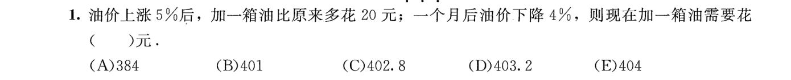

### 第 2 题

已知甲、乙两公司的利润之比为 $3:4$，甲、丙两公司的利润之比为 $1:2$。若乙公司的利润为 3000 万元，则丙公司的利润为（ ）万元。

- **A**．5000
- **B**．4500
- **C**．4000
- **D**．3500
- **E**．2500

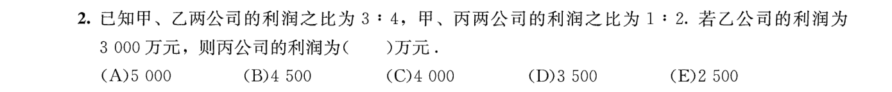

### 第 3 题

一个分数的分母和分子之和为 38，其分子分母都减去 15，约分后得到 $\frac{1}{3}$，则这个分数的分母与分子之差为（ ）。

- **A**．1
- **B**．2
- **C**．3
- **D**．4
- **E**．5

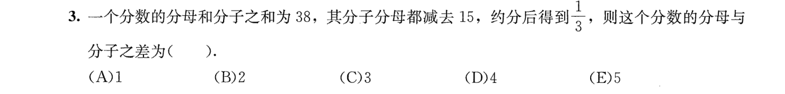

### 第 4 题

$\sqrt{5+2\sqrt{6}} - \sqrt{3} =$（ ）。

- **A**．$\sqrt{2}$
- **B**．$\sqrt{3}$
- **C**．$\sqrt{6}$
- **D**．$2\sqrt{2}$
- **E**．$2\sqrt{3}$

### 第 5 题

某公司财务部有男员工 2 名，女员工 3 名；销售部有男员工 4 名，女员工 1 名。现要从中选出 2 男 1 女组成工作小组，并要求每个部门至少有 1 名员工入选，则工作小组的不同构成方式有（ ）种。

- **A**．24
- **B**．36
- **C**．50
- **D**．51
- **E**．68

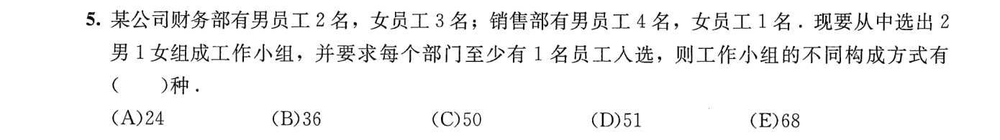

### 第 6 题

甲、乙两人从同一地点出发，甲先出发 10 分钟，若乙跑步追赶甲，则 10 分钟可追上；若乙骑车追赶甲，每分钟比跑步多行 100 米，则 5 分钟可追上，那么甲每分钟走的距离为（ ）米。

- **A**．50
- **B**．75
- **C**．100
- **D**．125
- **E**．150

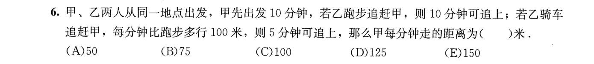

### 第 7 题

如右图所示，已知点 $A(-1, 2), B(3, 4)$，若存在点 $P(m, 0)$ 使得 $|PB| - |PA|$ 最大，则（ ）。

<svg viewBox="0 0 240 200" width="240" height="200" xmlns="http://www.w3.org/2000/svg" style="display:block;margin:12px auto;background:#fff;">
  <line x1="20" y1="160" x2="216" y2="160" stroke="#000" stroke-width="1.5" />
  <polygon points="222,160 214,156 214,164" fill="#000" />
  <line x1="90" y1="185" x2="90" y2="24" stroke="#000" stroke-width="1.5" />
  <polygon points="90,18 86,26 94,26" fill="#000" />
  <text x="222" y="165" font-family="serif" font-size="16" font-style="italic">x</text>
  <text x="75" y="24" font-family="serif" font-size="16" font-style="italic">y</text>
  <text x="74" y="176" font-family="serif" font-size="15" font-style="italic">O</text>
  <line x1="70" y1="120" x2="130" y2="160" stroke="#000" stroke-width="1.5" />
  <line x1="160" y1="75" x2="130" y2="160" stroke="#000" stroke-width="1.5" />
  <text x="48" y="122" font-family="serif" font-size="16" font-style="italic">A</text>
  <text x="163" y="72" font-family="serif" font-size="16" font-style="italic">B</text>
  <text x="124" y="180" font-family="serif" font-size="16" font-style="italic">P</text>
</svg>

- **A**．$m = -5$
- **B**．$m = -3$
- **C**．$m = -1$
- **D**．$m = 1$
- **E**．$m = 3$

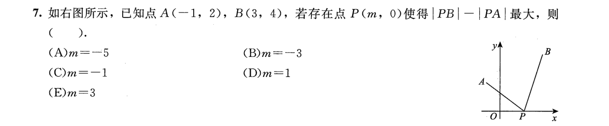

### 第 8 题

由于疫情防控，电影院要求不同家庭之间至少间隔一个座位，同一家庭的成员座位要相连。两个家庭看电影，一家 3 人，一家 2 人，现有一排 7 个相连的座位，则符合要求的坐法有（ ）种。

- **A**．36
- **B**．48
- **C**．72
- **D**．144
- **E**．216

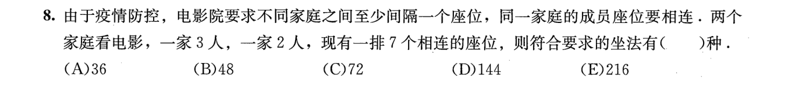

### 第 9 题

方程 $x^2 - 3|x-2| - 4 = 0$ 的所有实根之和为（ ）。

- **A**．-4
- **B**．-3
- **C**．-2
- **D**．-1
- **E**．0

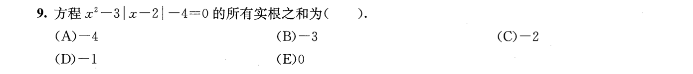

### 第 10 题

如右图所示，从一个棱长为 6 的正方体中截去两个相同的正三棱锥，若正三棱锥的底面边长 $AB = 4\sqrt{2}$，则剩余几何体的表面积为（ ）。

<svg viewBox="0 0 240 180" width="240" height="180" xmlns="http://www.w3.org/2000/svg" style="display:block;margin:12px auto;background:#fff;">
  <line x1="50.0" y1="62.0" x2="146.0" y2="62.0" stroke="#000" stroke-width="1.5" stroke-linejoin="round" />
  <line x1="146.0" y1="62.0" x2="146.0" y2="158.0" stroke="#000" stroke-width="1.5" stroke-linejoin="round" />
  <line x1="146.0" y1="158.0" x2="114.0" y2="158.0" stroke="#000" stroke-width="1.5" stroke-linejoin="round" />
  <line x1="114.0" y1="158.0" x2="50.0" y2="158.0" stroke="#000" stroke-width="1.5" stroke-linejoin="round" />
  <line x1="50.0" y1="158.0" x2="50.0" y2="94.0" stroke="#000" stroke-width="1.5" stroke-linejoin="round" />
  <line x1="50.0" y1="94.0" x2="50.0" y2="62.0" stroke="#000" stroke-width="1.5" stroke-linejoin="round" />
  <line x1="50.0" y1="94.0" x2="114.0" y2="158.0" stroke="#000" stroke-width="1.5" stroke-linejoin="round" />
  <line x1="50.0" y1="62.0" x2="87.3" y2="24.7" stroke="#000" stroke-width="1.5" stroke-linejoin="round" />
  <line x1="87.3" y1="24.7" x2="183.3" y2="24.7" stroke="#000" stroke-width="1.5" stroke-linejoin="round" />
  <line x1="146.0" y1="62.0" x2="183.3" y2="24.7" stroke="#000" stroke-width="1.5" stroke-linejoin="round" />
  <line x1="119.3" y1="24.7" x2="158.4" y2="49.6" stroke="#000" stroke-width="1.5" stroke-linejoin="round" />
  <line x1="146.0" y1="158.0" x2="183.3" y2="120.7" stroke="#000" stroke-width="1.5" stroke-linejoin="round" />
  <line x1="183.3" y1="120.7" x2="183.3" y2="24.7" stroke="#000" stroke-width="1.5" stroke-linejoin="round" />
  <line x1="158.4" y1="49.6" x2="183.3" y2="88.7" stroke="#000" stroke-width="1.5" stroke-linejoin="round" />
  <line x1="87.3" y1="24.7" x2="87.3" y2="120.7" stroke="#000" stroke-width="1.2" stroke-dasharray="4,3" />
  <line x1="87.3" y1="120.7" x2="183.3" y2="120.7" stroke="#000" stroke-width="1.2" stroke-dasharray="4,3" />
  <line x1="87.3" y1="120.7" x2="74.9" y2="133.1" stroke="#000" stroke-width="1.2" stroke-dasharray="4,3" />
  <line x1="50.0" y1="158.0" x2="74.9" y2="133.1" stroke="#000" stroke-width="1.2" stroke-dasharray="4,3" />
  <line x1="50.0" y1="94.0" x2="74.9" y2="133.1" stroke="#000" stroke-width="1.2" stroke-dasharray="4,3" />
  <line x1="114.0" y1="158.0" x2="74.9" y2="133.1" stroke="#000" stroke-width="1.2" stroke-dasharray="4,3" />
  <line x1="119.3" y1="24.7" x2="183.3" y2="88.7" stroke="#000" stroke-width="1.2" stroke-dasharray="4,3" />
  <text x="36" y="99" font-family="serif" font-size="16" font-style="italic">A</text>
  <text x="110" y="174" font-family="serif" font-size="16" font-style="italic">B</text>
</svg>

- **A**．168
- **B**．$168 + 16\sqrt{3}$
- **C**．$168 + 32\sqrt{3}$
- **D**．$112 + 32\sqrt{3}$
- **E**．$124 + 32\sqrt{3}$

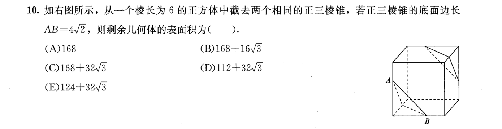

### 第 11 题

如右图所示，在 $\Delta ABC$ 中，$\angle BAC = 60^\circ$，$BD$ 平分 $\angle ABC$，交 $AC$ 于点 $D$，$CE$ 平分 $\angle ACB$，交 $AB$ 于点 $E$，$BD$ 和 $CE$ 交于点 $F$，则 $\angle EFB =$（ ）。

<svg viewBox="0 0 240 200" width="240" height="200" xmlns="http://www.w3.org/2000/svg" style="display:block;margin:12px auto;background:#fff;">
  <polygon points="110,30 50,170 200,170" fill="none" stroke="#000" stroke-width="1.5" />
  <line x1="50" y1="170" x2="155" y2="100" stroke="#000" stroke-width="1.5" />
  <line x1="200" y1="170" x2="78" y2="104" stroke="#000" stroke-width="1.5" />
  <text x="106" y="24" font-family="serif" font-size="16" font-style="italic">A</text>
  <text x="34" y="184" font-family="serif" font-size="16" font-style="italic">B</text>
  <text x="204" y="184" font-family="serif" font-size="16" font-style="italic">C</text>
  <text x="162" y="100" font-family="serif" font-size="16" font-style="italic">D</text>
  <text x="60" y="105" font-family="serif" font-size="16" font-style="italic">E</text>
  <text x="115" y="148" font-family="serif" font-size="16" font-style="italic">F</text>
</svg>

- **A**．$45^\circ$
- **B**．$52.5^\circ$
- **C**．$60^\circ$
- **D**．$67.5^\circ$
- **E**．$75^\circ$

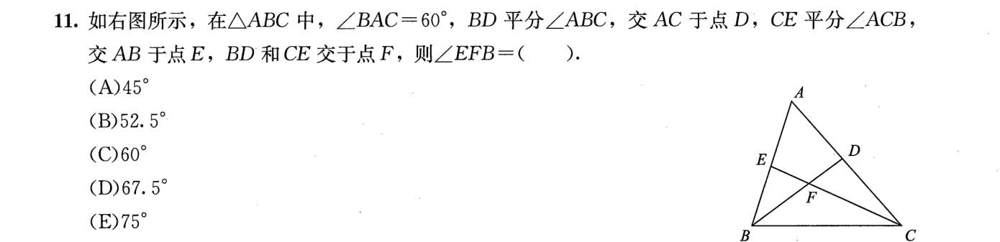

### 第 12 题

跳水比赛中，裁判给某选手的一个动作打分，其平均值为 8.6，方差为 1.1，若去掉一个最高得分 9.7 和一个最低得分 7.3，则剩余得分的（ ）。

- **A**．平均值变小，方差变大
- **B**．平均值变小，方差变小
- **C**．平均值变小，方差不变
- **D**．平均值变大，方差变大
- **E**．平均值变大，方差变小

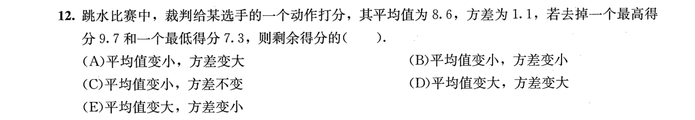

### 第 13 题

设 $x$ 为正实数，则 $\frac{x}{8x^3 + 5x + 2}$ 的最大值为（ ）。

- **A**．$\frac{1}{15}$
- **B**．$\frac{1}{11}$
- **C**．$\frac{1}{9}$
- **D**．$\frac{1}{6}$
- **E**．$\frac{1}{5}$

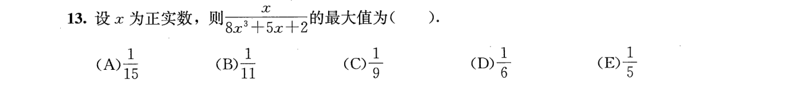

### 第 14 题

如右图所示，在矩形 $ABCD$ 中，$AD = 2AB$，$E$、$F$ 分别为 $AD$、$BC$ 的中点，从 $A$、$B$、$C$、$D$、$E$、$F$ 中任意取 3 个点，则以这 3 个点为顶点可组成直角三角形的概率为（ ）。

<svg viewBox="0 0 240 160" width="240" height="160" xmlns="http://www.w3.org/2000/svg" style="display:block;margin:12px auto;background:#fff;">
  <rect x="30" y="40" width="180" height="90" fill="none" stroke="#000" stroke-width="1.5" />
  <circle cx="120" cy="40" r="2" fill="#000" />
  <circle cx="120" cy="130" r="2" fill="#000" />
  <text x="15" y="38" font-family="serif" font-size="16" font-style="italic">A</text>
  <text x="116" y="32" font-family="serif" font-size="16" font-style="italic">E</text>
  <text x="216" y="38" font-family="serif" font-size="16" font-style="italic">D</text>
  <text x="15" y="142" font-family="serif" font-size="16" font-style="italic">B</text>
  <text x="116" y="152" font-family="serif" font-size="16" font-style="italic">F</text>
  <text x="216" y="142" font-family="serif" font-size="16" font-style="italic">C</text>
</svg>

- **A**．$\frac{1}{2}$
- **B**．$\frac{11}{24}$
- **C**．$\frac{3}{5}$
- **D**．$\frac{13}{20}$
- **E**．$\frac{7}{10}$

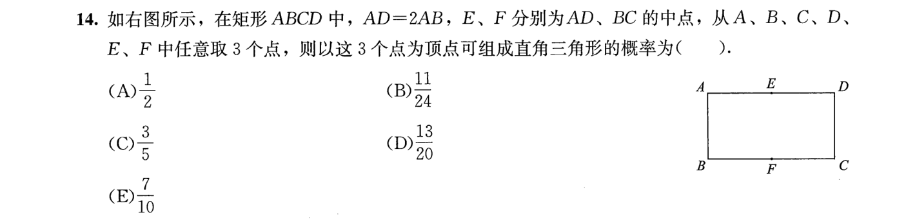

### 第 15 题

快递员收到 3 个同城快递任务，取送地点各不相同，取送件可穿插进行，不同的送件方式有（ ）种。

- **A**．6
- **B**．27
- **C**．36
- **D**．90
- **E**．360

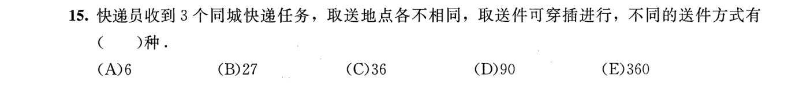

## 二、条件充分性判断：第 16～25 小题，每小题 3 分，共 30 分。要求判断每题给出的条件（1）和条件（2）能否充分支持题干所陈述的结论。A、B、C、D、E 五个选项为判断结果，请选择一项符合试题要求的判断。

- **A**．条件（1）充分，但条件（2）不充分
- **B**．条件（2）充分，但条件（1）不充分
- **C**．条件（1）和条件（2）单独都不充分，但条件（1）和条件（2）联合起来充分
- **D**．条件（1）充分，条件（2）也充分
- **E**．条件（1）和条件（2）单独都不充分，条件（1）和条件（2）联合起来也不充分

### 第 16 题

有体育、美术、音乐、舞蹈 4 个兴趣班，每名同学至少参加 2 个，则至少有 12 名同学参加的兴趣班完全相同。
(1) 参加兴趣班的同学共有 125 人。
(2) 参加 2 个兴趣班的同学有 70 人。

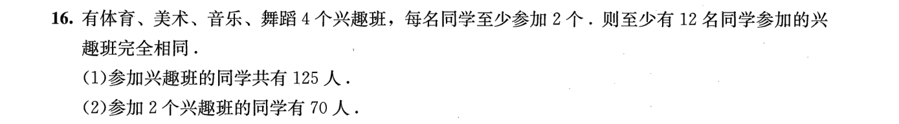

### 第 17 题

关于 $x$ 的方程 $x^2 - px + q = 0$ 有两个实根 $a, b$，则 $p - q > 1$。
(1) $a > 1$。
(2) $b < 1$。

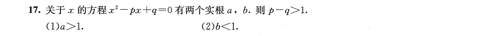

### 第 18 题

已知等比数列 $\{a_n\}$ 的公比大于 1，则 $\{a_n\}$ 为递增数列。
(1) $a_1$ 是方程 $x^2 - x - 2 = 0$ 的根。
(2) $a_1$ 是方程 $x^2 + x - 6 = 0$ 的根。

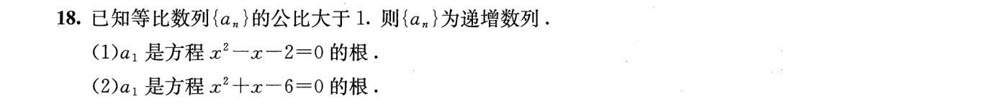

### 第 19 题

设 $x, y$ 是实数，则 $\sqrt{x^2 + y^2}$ 有最小值和最大值。
(1) $(x-1)^2 + (y-1)^2 = 1$。
(2) $y = x + 1$。

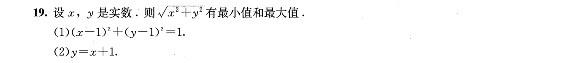

### 第 20 题

设集合 $M = \{(x, y) \mid (x-a)^2 + (y-b)^2 \le 4\}$，$N = \{(x, y) \mid x > 0, y > 0\}$，则 $M \cap N \ne \varnothing$。
(1) $a < -2$。
(2) $b > 2$。

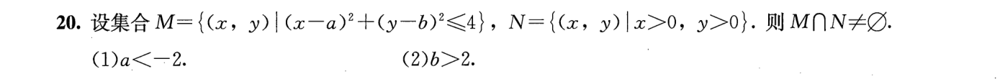

### 第 21 题

甲、乙两辆车分别从 A、B 两地同时出发，相向而行，1 小时后，甲车到达 C 点，乙车到达 D 点（如右图所示）。则能确定 A，B 两地的距离。

<svg viewBox="0 0 310 70" width="310" height="70" xmlns="http://www.w3.org/2000/svg" style="display:block;margin:12px auto;background:#fff;">
  <line x1="30" y1="35" x2="270" y2="35" stroke="#000" stroke-width="1.5" />
  <line x1="30" y1="35" x2="30" y2="28" stroke="#000" stroke-width="1.5" />
  <line x1="110" y1="35" x2="110" y2="28" stroke="#000" stroke-width="1.5" />
  <line x1="190" y1="35" x2="190" y2="28" stroke="#000" stroke-width="1.5" />
  <line x1="270" y1="35" x2="270" y2="28" stroke="#000" stroke-width="1.5" />
  <text x="14" y="41" font-family="serif" font-size="16" font-style="italic">A</text>
  <text x="105" y="58" font-family="serif" font-size="16" font-style="italic">C</text>
  <text x="185" y="58" font-family="serif" font-size="16" font-style="italic">D</text>
  <text x="278" y="41" font-family="serif" font-size="16" font-style="italic">B</text>
</svg>

(1) 已知 C、D 两地的距离。
(2) 已知甲、乙两车的速度比。

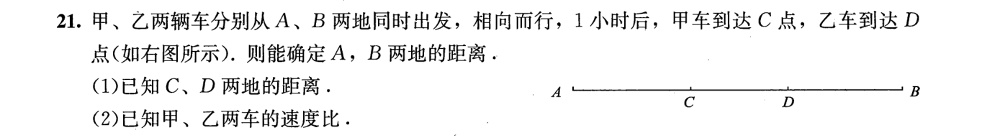

### 第 22 题

已知 $m, n, p$ 为 3 个不同的质数，则能确定 $m, n, p$ 的乘积。
(1) $m + n + p = 16$。
(2) $m + n + p = 20$。

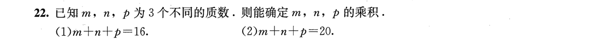

### 第 23 题

八个班参加植树活动，共植树 195 棵，则能确定各班植树棵数的最小值。
(1) 各班植树棵数均不相同。
(2) 各班植树棵数的最大值是 28。

### 第 24 题

设数列 $\{a_n\}$ 的前 $n$ 项和为 $S_n$，则 $a_2, a_3, a_4, \cdots$ 为等比数列。
(1) $S_{n+1} > S_n, n = 1, 2, 3, \cdots$。
(2) $\{S_n\}$ 是等比数列。

### 第 25 题

甲有两张牌 $a, b$，乙有两张牌 $x, y$，甲、乙各自任取出一张牌，则甲取出的牌不小于乙取出的牌的概率不小于 $\frac{1}{2}$。
(1) $a > x$。
(2) $a + b > x + y$。

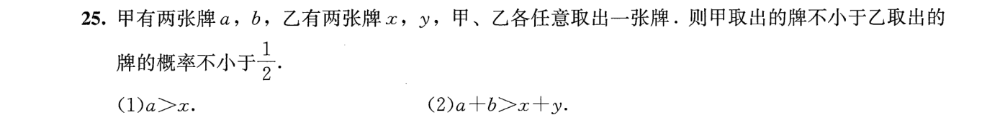

## 三、逻辑推理：第 26～55 小题，每小题 2 分，共 60 分。下列每题给出的 A、B、C、D、E 五个选项中，只有一项是符合试题要求的。

### 第 26 题

爱因斯坦思想深刻、思维创新。他不仅是一位伟大的科学家，还是一位思想家和人道主义者，同时也是一位充满个性的有趣人物。他一生的经历表明，只有拥有诙谐幽默、充满个性的独立人格，才能做到思想深刻、思维创新。
根据以上陈述，可以得出以下哪项？

- **A**．有的思想家不是人道主义者。
- **B**．有些伟大的科学家拥有诙谐幽默、充满个性的独立人格。
- **C**．科学家一旦诙谐幽默、充满个性，就能做到思想深刻、思维创新。
- **D**．有些人道主义者诙谐幽默、充满个性，但做不到思想深刻、思维创新。
- **E**．有的思想家做不到诙谐幽默、充满个性，但能做到思想深刻、思维创新。

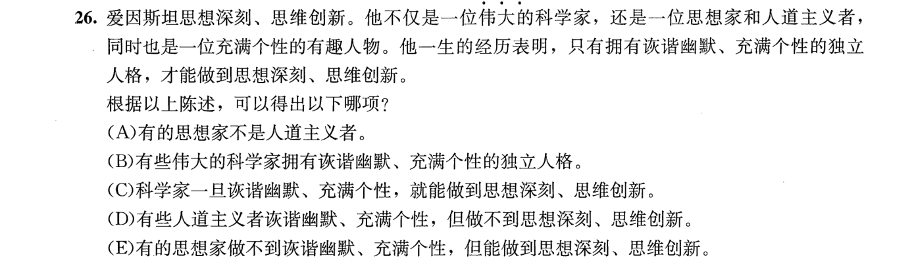

### 第 27 题

处理餐厨垃圾的传统方式主要是厌氧发酵和填埋，前者利用垃圾产生的沼气发电，投资成本高；后者不仅浪费土地，还污染环境。近日，某公司尝试利用蟑螂来处理垃圾。该公司饲养了 3 亿只“美洲大蠊”蟑螂，每天可以吃掉 15 吨餐厨垃圾。有专家据此认为，用“蟑螂吃掉垃圾”这一生物处理方式解决餐厨垃圾，既经济又环保。
以下哪项如果为真，最能质疑上述专家的观点？

- **A**．餐厨垃圾经发酵转化为能源的处理方式已被国际认可，我国这方面的技术也相当成熟。
- **B**．大量人工养殖后，很难保证蟑螂不逃离控制区域，而一旦蟑螂逃离，则会危害周边生态环境。
- **C**．政府前期在工厂土地划拨方面对该项目给予了政策扶持，后期仍需进行公共安全检测和环境评估。
- **D**．我国动物蛋白饲料非常缺乏，1 吨蟑螂及其所产生的卵鞘，可产生 1 吨昆虫蛋白饲料，饲养蟑螂将来盈利十分可观。
- **E**．该公司正在建设新车间，竣工后将能饲养 20 亿只蟑螂，它们虽然能吃掉全区的餐厨垃圾，但全市仍有大量餐厨垃圾需要通过传统方式处理。

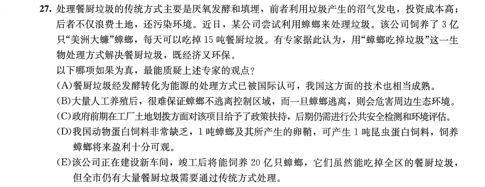

### 第 28 题

记者：贵校是如何培养创新型人才的？
受访者：大学生踊跃创新创业是我校的一个品牌。在相关课程学习中，我们注重激发学生创业的积极性，引导学生想创业；通过实训、体验，让学生能创业；通过学校提供专业化的服务，帮助学生创成业。在高校创业者收益榜中，我们学校名列榜首。
以下哪项最可能是上述对话中受访者论述的假设？

- **A**．不懂创新就不懂创业。
- **B**．创新能力越强，创业收益越高。
- **C**．创新型人才培养主要是创业技能的培训和提升。
- **D**．培养大学生创业能力只是培养创新型人才的任务之一。
- **E**．创新型人才的主要特征是具有不拘陈规、勇于开拓的创新精神。

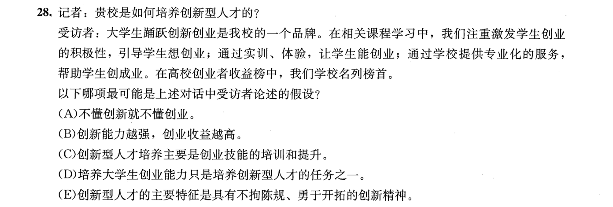

### 第 29 题

某部门抽检了肉制品、白酒、乳制品、干果、蔬菜、水产品、饮料等 7 类商品共 521 种样品，发现其中合格样品 515 种，不合格样品 6 种。已知：
（1）蔬菜、白酒中有 2 种不合格样品。
（2）肉制品、白酒、蔬菜、水产品中有 5 种不合格样品。
（3）蔬菜、乳制品、干果中有 3 种不合格样品。
根据上述信息，可以得出以下哪项？

- **A**．乳制品中没有不合格样品。
- **B**．肉制品中没有不合格样品。
- **C**．蔬菜中没有不合格样品。
- **D**．白酒中没有不合格样品。
- **E**．水产品中没有不合格样品。

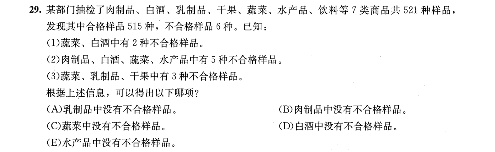

### 第 30 题

时时刻刻总在追求幸福的人不一定能获得最大的幸福，刘某说自己获得了最大的幸福，所以，刘某从未曾追求幸福。
以下哪项与上述论证方式最为相似？

- **A**．年年岁岁总是帮助他人的人不一定能成为名人，李某说自己成了名人，所以，李某从来不曾帮助他人。
- **B**．口口声声不断说喜欢你的人不一定最喜欢你，陈某现在说他最喜欢你，所以，陈某过去从未喜欢过你。
- **C**．冷冷清清空无一人的商场不一定没有利润，某商场今年亏损，所以，该商场总是空无一人。
- **D**．日日夜夜一直躲避死亡的士兵反而最容易在战场上丧命，林某在一次战斗中重伤不治，所以，林某从来没有躲避死亡。
- **E**．分分秒秒每天抢时间工作的人不一定是普通人，宋某看起来很普通，所以，宋某肯定没有每天抢时间工作。

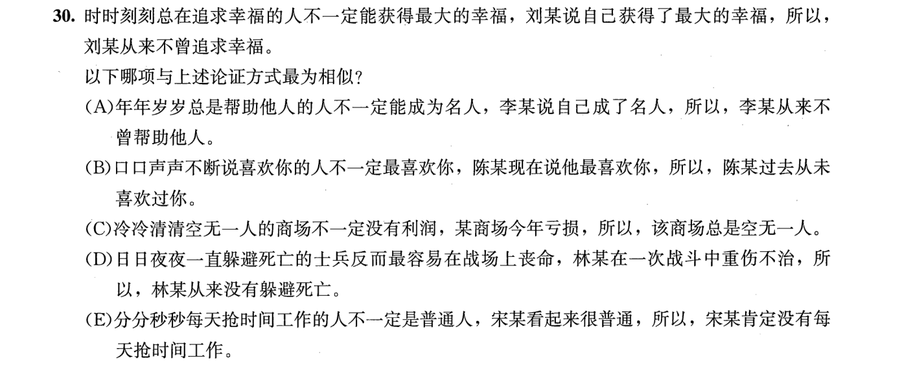

### 31～32 题基于以下题干：

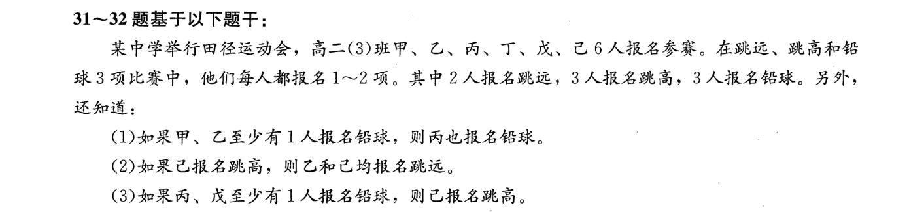

某中学举行田径运动会，高二(3)班甲、乙、丙、丁、戊、己 6 人报名参赛。在跳远、跳高和铅球 3 项比赛中，他们每人都报名 1～2 项。其中 2 人报名跳远，3 人报名跳高，3 人报名铅球。另外，还知道：
（1）如果甲、乙至少有 1 人报名铅球，则丙也报名铅球。
（2）如果己报名跳高，则乙和己均报名跳远。
（3）如果丙、戊至少有 1 人报名铅球，则己报名跳高。

### 第 31 题

根据以上信息，可以得出以下哪项？

- **A**．甲报名铅球，乙报名跳远。
- **B**．乙报名跳远，丙报名铅球。
- **C**．丙报名跳高，丁报名铅球。
- **D**．丁报名跳远，戊报名跳高。
- **E**．戊报名跳远，己报名跳高。

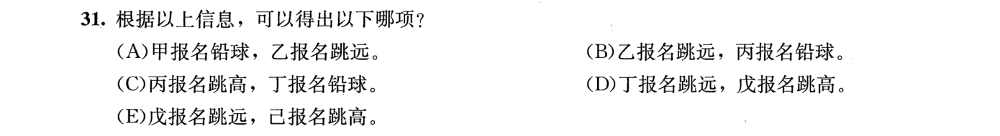

### 第 32 题

如果甲、乙均报名跳高，则可以得出以下哪项？

- **A**．丁、戊均报名铅球。
- **B**．乙、丁均报名铅球。
- **C**．甲、戊均报名铅球。
- **D**．乙、戊均报名铅球。
- **E**．甲、丁均报名铅球。

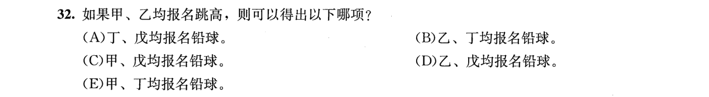

### 第 33 题

进入移动互联网时代，扫码点餐、在线挂号、网购车票、电子支付等智能化生活日益普及，人们的生活越来越便捷。然而，也有很多老年人因为不会使用智能手机等设备，无法进入菜场、超市和公园，也无法上网娱乐与购物，甚至在新冠疫情期间因无法从手机中调出健康码而被拒绝乘坐公共交通。对此，某专家指出，社会正在飞速发展，不可能“慢”下来等老年人，老年人应该加强学习，跟上时代发展。
以下哪项如果为真，最能质疑该专家的观点？

- **A**．老年人也享有获得公共服务的权利，为他们保留老办法，提供传统服务，既是一种社会保障，更是一种社会公德。
- **B**．有些老年人学习能力较强，能够熟练使用多种电子产品，充分感受移动互联网时代的美好。
- **C**．目前中国有 2 亿多老年人，超 4 成的老年人存在智能手机使用障碍，仅会使用手机打电话。
- **D**．社会管理和服务不应只有一种模式，而应更加人性化和多样化，有些合理的生活方式应得到尊重。
- **E**．有些老年人感觉自己被时代抛弃了，内心常常充斥着窘迫与挫败感，这容易导致他们与社会的加速脱离。

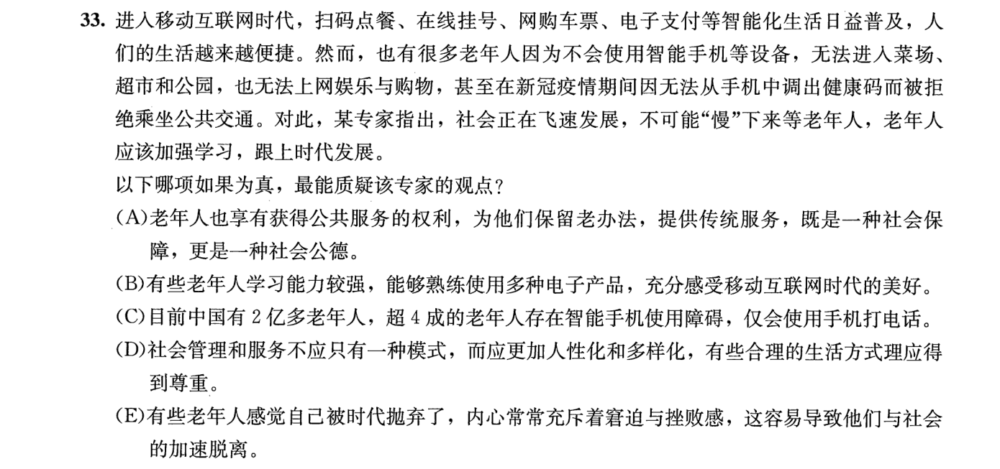

### 第 34 题

某单位采购了一批图书，包括科学和人文两大类。具体情况如下：
（1）哲学类图书都是英文版的。
（2）部分文学类图书不是英文版的。
（3）历史类图书都是中文版的。
（4）没有一本书是中英文双语版的。
（5）科学类图书既有中文版的，也有英文版的。
（6）人文类图书既有哲学类的，也有文学类的，还有历史类的。
根据以上信息，关于该单位采购的这批图书，可以得出以下哪项？

- **A**．有些文学类图书是中文版的。
- **B**．有些历史类图书不属于哲学类。
- **C**．英文版图书比中文版图书数量多。
- **D**．有些图书既属于哲学类也属于科学类。
- **E**．有些图书既属于文学类也属于历史类。

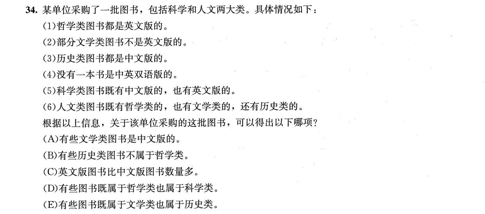

### 第 35 题

曾几何时，“免费服务”是互联网的重要特征之一，如今这一情况正在发生改变。有些人在网上开辟知识付费平台，让寻求知识、学习知识的读者为阅读“买单”，这改变了人们通过互联网免费阅读的习惯。近年来，互联网知识付费市场的规模正以连年翻番的速度增长。但是有专家指出，知识付费市场的发展不可能长久，因为人们大多不愿为网络阅读付费。
以下哪项如果为真，最能质疑上述专家的观点？

- **A**．高强度的生活节奏使人无法长时间、系统性阅读纸质文本，见缝插针、随时呈现式的碎片化、网络化阅读已成为获取知识的常态。
- **B**．日常工作的劳累和焦虑使得人们更喜欢在业余时间玩网络游戏，看有趣视频或与好友进行微信聊天。
- **C**．日益增长的竞争压力促使当代人不断学习新知识，只要知识付费平台做得足够好，他们就愿意为此付费。
- **D**．当前网上知识付费平台竞争激烈，尽管内容丰富，形式多样，但是鱼龙混杂、缺少规范，一些年轻人沉湎其中难以自拔。
- **E**．当前，许多图书资料在互联网上均能免费获得，只要合理用于自身的学习和研究一般不会产生知识产权问题。

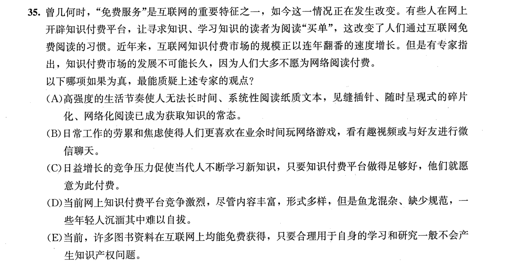

### 第 36 题

甲：如今，独特性正成为中国人的一种生活追求。试想周末我穿一件心仪的衣服走在大街上，突然发现你迎面走来，和我穿得一模一样，“撞衫”的感觉八成会是尴尬之中带着一丝不快，因为自己不再独一无二。
乙：独一无二真的那么重要吗？想想上世纪七十年代满大街的中山装、八十年代遍地的喇叭裤，每个人也活得很精彩。再说“撞衫”总是难免的，再大的明星也有可能“撞衫”，所谓的独特只是一厢情愿，走自己的路，不要管自己是否和别人一样。
以下哪项是对甲、乙对话最恰当的评价？

- **A**．甲认为独一无二是在每个中国人的追求，而乙认为没有人能做到独一无二。
- **B**．甲关心自己是否和别人“撞衫”，而乙不关心自己是否和别人一样。
- **C**．甲认为“撞衫”八成会让自己感到不爽，而乙认为自己想怎么样就怎么样。
- **D**．甲关心的是个人生活的独特性，而乙关心的是个人生活的自我认同。
- **E**．甲认为遇到“撞衫”无所谓，而乙认为别人根本管不着自己穿什么。

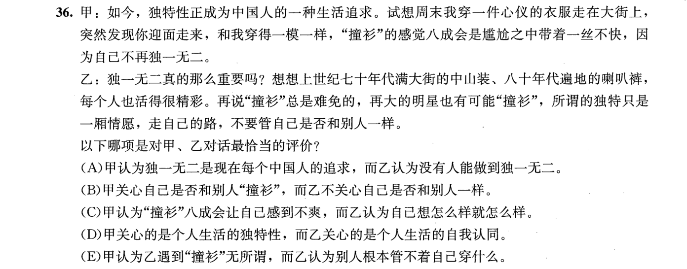

### 37～38 题基于以下题干：

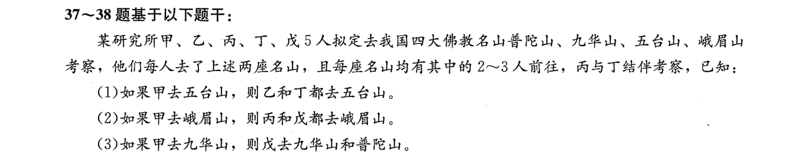

某研究所甲、乙、丙、丁、戊 5 人拟定去我国四大佛教名山普陀山、九华山、五台山、峨眉山考察，他们每人去了上述两座名山，且每座名山均有其中的 2～3 人前往，丙与丁结伴考察，已知：
（1）如果甲去五台山，则乙和丁都去五台山。
（2）如果甲去峨眉山，则丙和戊都去峨眉山。
（3）如果甲去九华山，则戊去九华山和普陀山。

### 第 37 题

根据以上信息，可以得出以下哪项？

- **A**．甲去五台山和普陀山。
- **B**．乙去五台山和峨眉山。
- **C**．丙去九华山和五台山。
- **D**．戊去普陀山和峨眉山。
- **E**．丁去峨眉山和五台山。

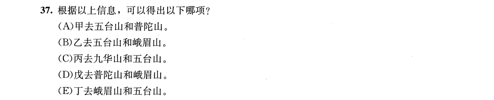

### 第 38 题

如果乙去普陀山和九华山，则 5 人去四大名山（按题干所列顺序）的人次之比是：

- **A**．$3:3:2:2$
- **B**．$2:3:3:2$
- **C**．$2:2:3:3$
- **D**．$3:2:2:3$
- **E**．$3:2:3:2$

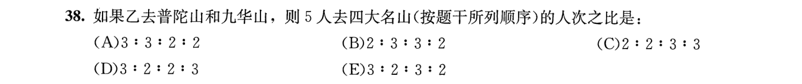

### 第 39 题

水在温度高于 $374^\circ\text{C}$、压力大于 22MPa 的条件下，称为超临界水。超临界水能与有机物完全互溶，同时还可以大量溶解空气中的氧，而无机物特别是盐类在超临界水中的溶解度很低。由此，研究人员认为，利用超临界水作为特殊溶剂，水中的有机物和氧气可以在极短时间内完成氧化反应，把有机物彻底“秒杀”。
以下哪项如果为真，最能支持上述研究人员的观点？

- **A**．有机物在超临界水中通过分离装置可瞬间转化为无毒无害的水、无机盐以及二氧化碳等气体，并最终在生产和生活中得到回收利用。
- **B**．超临界水氧化技术具有污染物去除率高、二次污染小、反应迅速等特征，被认为是废水处理技术中的“杀手锏”，具有广阔的工业应用前景。
- **C**．超临界水只有兼具气体与液体的流动扩散性、高溶解性、高反应活性及低表面张力等优良特性，才能把有机物彻底“秒杀”。
- **D**．超临界水氧化技术对难以降解的农化、石油、制药等有机废水尤为适用。
- **E**．如果超临界水氧化技术成功应用于化工、制药等行业的污水处理，可有效提升流域内重污染行业的控源减排能力。

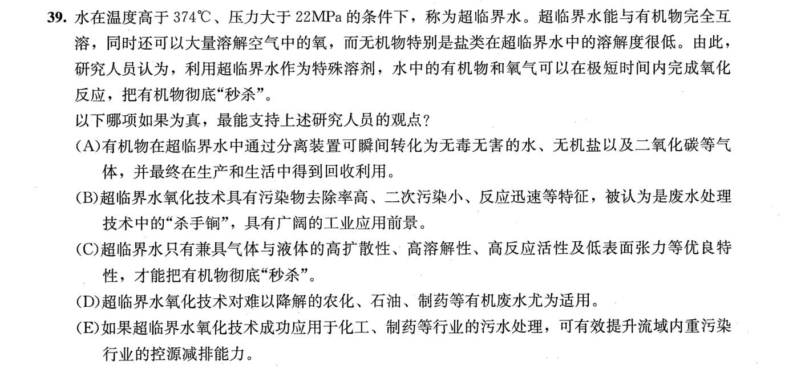

### 第 40 题

小陈与几位朋友商定利用假期到某地旅游。他们在桃花坞、第一山、古生物博物馆、新四军军部旧址、琉璃泉、望江阁 6 个景点中选择了 4 个游览。已知：
（1）如果选择桃花坞，则不选择古生物博物馆而选择望江阁。
（2）如果选择望江阁，则不选择第一山而选择新四军军部旧址。
根据以上信息，可以得出以下哪项？

- **A**．他们选择了桃花坞。
- **B**．他们没有选择望江阁。
- **C**．他们选择了新四军军部旧址。
- **D**．他们没有选择第一山。
- **E**．他们没有选择古生物博物馆。

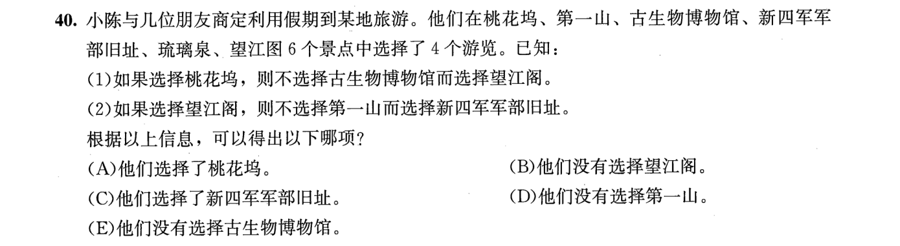

### 第 41 题

张先生欲花 5 万元购置橱柜、卫浴或供暖设备。已知：
（1）如果买橱柜，就不买卫浴，也不买供暖设备。
（2）如果不买橱柜，就买卫浴。
（3）如果卫浴、橱柜至少有一种不买，则购买供暖设备。
根据以上陈述，关于张先生的购买打算，可以得出以下哪项？

- **A**．买橱柜和卫浴。
- **B**．买橱柜和供暖设备。
- **C**．买橱柜，但不买卫浴。
- **D**．买卫浴和供暖设备。
- **E**．买卫浴，但不买供暖设备。

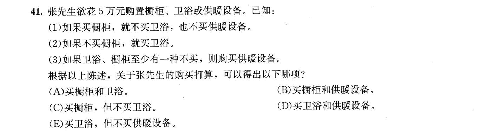

### 第 42 题

某台电脑的登录密码由 0～9 中的 6 个数组成，每个数字最多出现一次，关于该 6 位密码，已知：
（1）741605 中，共有 4 个数字正确，其中 3 个位置正确，1 个位置不正确。
（2）320968 中，恰有 3 个数字正确且位置正确。
（3）417280 中，共有 4 个数字不正确。
根据上述信息，可以得出该登录密码的前两位是：

- **A**．71
- **B**．42
- **C**．72
- **D**．31
- **E**．34

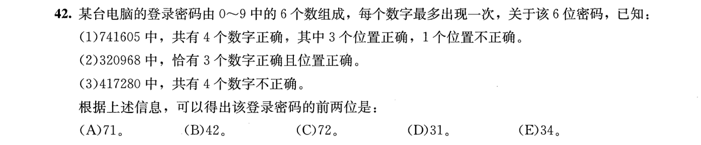

### 第 43 题

研究表明，鱼油中的不饱和脂肪酸能有效降低人体血脂水平并软化血管。因此，鱼油通常被用来预防由高血脂引起的心脏病、动脉粥样硬化和高胆固醇等疾病，降低死亡风险。但有研究人员认为，食用鱼油不一定能够有效控制血脂水平并预防由高血脂引起的各种疾病。
以下哪项如果为真，最能支持上述研究人员的观点？

- **A**．鱼油虽然优于猪油、牛油，但毕竟是脂肪，如果长期食用，容易引起肥胖。
- **B**．鱼油的概念很模糊，它既指鱼体内的脂肪，也包括被做成保健品的鱼油制剂。
- **C**．不饱和脂肪酸很不稳定，只要接触空气、阳光，就会氧化分解。
- **D**．通过长期服用鱼油制品来控制体内血脂的观点始终存在学术争论。
- **E**．人们若要身体健康最好注重膳食平衡，而不仅仅依靠服用浓缩鱼油。

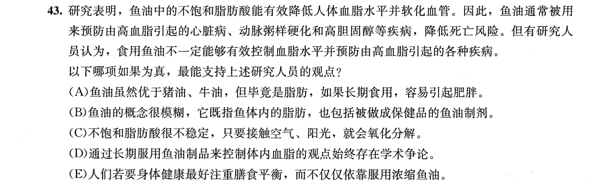

### 第 44 题

近年来，一些地方修改了见义勇为的相关条例，强调对生命的敬畏和尊重，既肯定大义凛然、挺身而出的见义勇为，更鼓励和倡导科学、合法、正当的“见义智为”。有专家由此指出，从鼓励见义勇为到倡导“见义智为”，反映了社会价值观念的进步。
以下各项如果为真，则除了哪项均能支持上述专家的观点？

- **A**．“见义智为”强调以人为本、合理施救，表明了科学理性、互帮互助的社会价值取向。
- **B**．有时见义勇为需要专业技术知识，普通民众如果没有相应的知识，最好不要贸然行事，应及时报警求助。
- **C**．所有的生命都是平等的，救人者与被救者都具有同等的生命价值，救人者的生命同样应得到尊重和爱护。
- **D**．我国中小学正在引导学生树立应对突发危机事件的正确观念，教育学生如何在保证自身安全的情况下“机智”救助他人。
- **E**．倡导“见义智为”容易给一些自私懦弱的人逃避社会责任制造借口，见死不救的惨痛案例可能增多，社会道德水平可能因此而下滑。

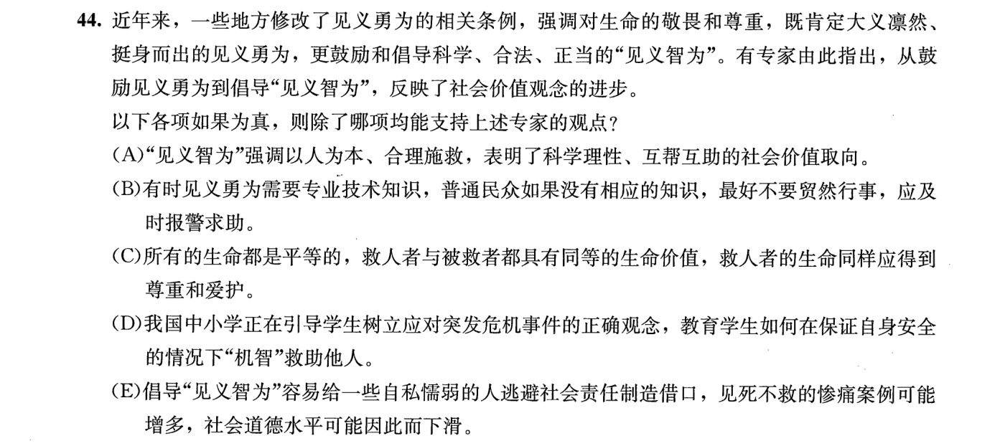

### 第 45 题

近期一项调查数据显示：中国不缺少外科医生，而缺少能做手术的外科医生；中国人均拥有的外科医生数量同其他中高收入国家相当，但中国人均拥有的外科医生所做的手术数量却比那些国家少 40%。
以下哪项如果为真，最能解释上述现象？

- **A**．年轻外科医生一般总要花费数年时间协助资深外科医生手术，然后才有机会亲自上刀主阵，这已成为国内外医疗行业的惯例。
- **B**．近年来，我国能做手术的外科医生的人均手术量已与其他中高收入国家外科医生的人均手术量基本相当。
- **C**．患者在需要外科手术时，都想请经验丰富的外科医生为其主刀，不愿成为年轻医生的练习对象，对此医院一般都会有合理安排。
- **D**．资深外科医生经常收到手术邀请，他们常年奔波在多所医院为年轻医生主刀示范，培养了不少新人。
- **E**．从一名医学院学生成长为能做手术的外科医生，需要经历漫长的学习过程，有些人中途不得不放弃梦想而另谋职业。

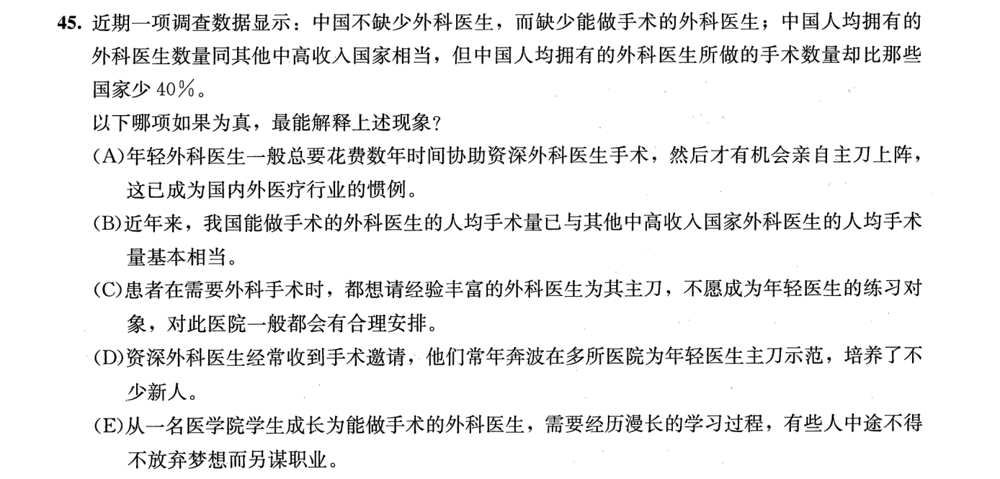

### 46～47 题基于以下题干：

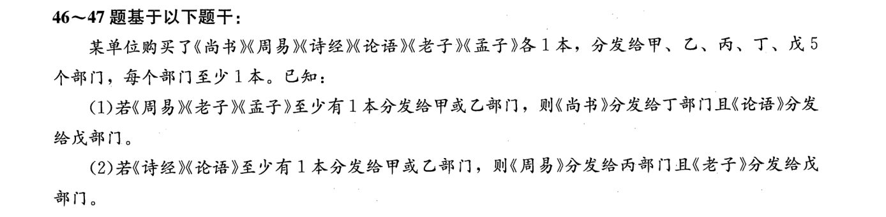

某单位购买了《尚书》《周易》《诗经》《论语》《老子》《孟子》各 1 本，分发给甲、乙、丙、丁、戊 5 个部门，每个部门至少 1 本。已知：
（1）若《周易》《老子》《孟子》至少有 1 本分发给甲或乙部门，则《尚书》分发给丁部门且《论语》分发给戊部门。
（2）若《诗经》《论语》至少有 1 本分发给甲或乙部门，则《周易》分发给丙部门且《老子》分发给戊部门。

### 第 46 题

若《尚书》分发给丙部门，则可以得出以下哪项？

- **A**．《诗经》分发给甲部门。
- **B**．《论语》分发给乙部门。
- **C**．《老子》分发给丙部门。
- **D**．《孟子》分发给丁部门。
- **E**．《周易》分发给戊部门。

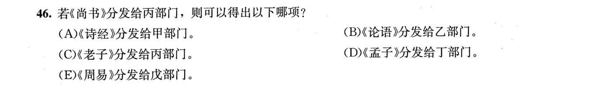

### 第 47 题

若《老子》分发给丁部门，则以下哪项是不可能的？

- **A**．《周易》分发给甲部门。
- **B**．《周易》分发给乙部门。
- **C**．《诗经》分发给丙部门。
- **D**．《尚书》分发给丁部门。
- **E**．《诗经》分发给戊部门。

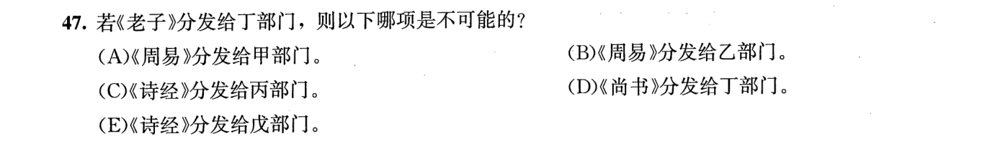

### 第 48 题

“嫦娥”登月、“神舟”巡天，我国不断谱写飞天梦想的新篇章。基于太空失重环境的多重效应，研究人员正在探究植物在微重力环境下生存的可能性。他们设想，如果能够在太空中种植新鲜水果和蔬菜，则不仅有利于航天员的身体健康，而且还可以降低食物的上天成本，同时，可以利用其消耗的二氧化碳产生氧气，为航天员生活与工作提供氧环境。
以下哪项如果为真，则可能成为研究人员实现上述设想的最大难题？

- **A**．为了携带种子、土壤等种植必需品上天，飞船需要减少其他载荷以满足发射要求，这可能影响其他科学实验的安排。
- **B**．有些航天员虽然在地面准备阶段学习掌握了植物栽培技术，但在太空的实际操作中他们可能会遇到意想不到的情况。
- **C**．太空中的失重、宇宙射线等因素会对植物的生长和发育产生不良影响，食用这些植物可能有损航天员的健康。
- **D**．有些航天员将植物带入太空，又成功带回地面，短暂的太空经历对这些植物后来的生长发育可能造成影响。
- **E**．过去很多航天器携带植物上天，因为缺乏生长条件，这些植物都没有存活很长时间。

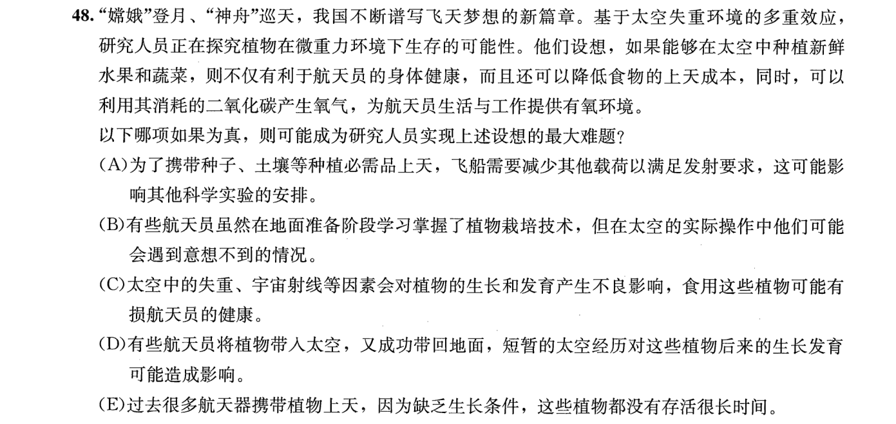

### 第 49 题

十多年前曾有传闻：M 国从不生产一次性筷子，完全依赖进口，而且 M 国 96% 的一次性筷子来自中国。2019 年有媒体报道：“去年 M 国出口的木材中，约有 40% 流向了中国市场，而且今年中国订单的比例还在进一步攀升，中国已成为 M 国木材出口中占比最大的国家。”张先生据此认为，中国和 M 国木材进出口角色的转换，表明中国人的环保意识已经超越 M 国。
以下哪项如果为真，最能削弱张先生的观点？

- **A**．十多年前的传闻不一定反映真实情况，实际情形是中国的一次性筷子比其他国家更便宜。
- **B**．从 2018 年起，中国相关行业快速发展，木材需求急剧增长；而 M 国多年养护的速生林正处于采伐期，出口量逐年递增。
- **C**．近年中国修订相关规范，原来只用于商品外包装的 M 国杉木现也可用于木结构建筑物，导致进口大增。
- **D**．制作一次性筷子的木材主要取自速生杨树或者桦树，这类速生树种只占中国经济林的极小部分。
- **E**．中国和 M 国在木材贸易上的角色转换主要是经济发展导致，环保意识只是因素之一，但不是主要因素。

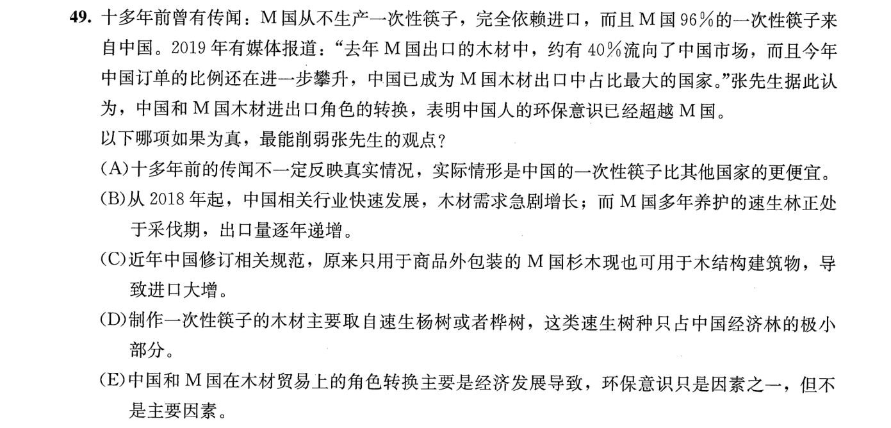

### 第 50 题

某公司为了让员工多运动，近日出台一项规定：每月按照 18 万步的标准对员工进行考核，如果没有完成步行任务，则按照“一步一分钱”的标准扣钱。有专家认为，此举鼓励运动，看似对员工施加压力，实质上能够促进员工的身心健康，引导整个企业积极向上。
以下各项如果为真，则除哪项外均能质疑上述专家的观点？

- **A**．按照我国《劳动法》等相关法律规定，企业规章制度所涉及的员工行为应与工作有关，而步行显然与工作无关。
- **B**．步行有益身体健康，但规定每月必须步行 18 万步，不达标就扣钱，显得有些简单粗暴，这会影响员工对企业的认同感。
- **C**．公司鼓励员工多运动，此举不仅让员工锻炼身体，还可释放工作压力，培养良好品格，改善人际关系。
- **D**．有员工深受该规定的困扰，为了完成考核，他们甚至很晚不得不外出运动，影响了正常休息。
- **E**．该公司老张在网上购买了专门刷步行数据的服务，只花 1 元钱就可轻松购得两万步。

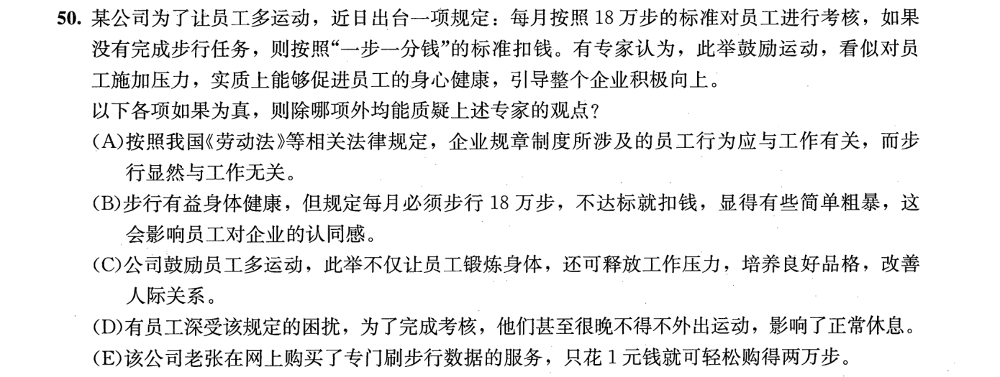

### 第 51 题

通过第三方招聘进入甲公司从事销售工作的职员均具有会计学专业背景。孔某的高中同学均没有会计学专业背景。甲公司销售部经理孟某是孔某的高中同学，而孔某是通过第三方招聘进入甲公司的。
根据以上信息，可以得出以下哪项？

- **A**．孔某具有会计学专业背景。
- **B**．孟某不是通过第三方招聘进入甲公司的。
- **C**．孟某曾经自学了会计学专业知识。
- **D**．孔某在甲公司做销售工作。
- **E**．孔某和孟某在大学阶段不是同学。

### 第 52 题

入冬以来，天气渐渐寒冷。11 月 30 日，某地气象台对未来 5 天的天气预报显示：未来 5 天每天的最高气温从 $4^\circ\text{C}$ 开始逐日下降至 $-1^\circ\text{C}$；每天的最低气温不低于 $-6^\circ\text{C}$；最低气温 $-6^\circ\text{C}$ 只出现在其中一天。预报还包含如下信息：
（1）未来 5 天中的最高气温和最低气温不会出现在同一天，每天的最高气温和最低气温均为整数。
（2）若 5 号的最低气温是未来 5 天中最低的，则 2 号的最低气温比 4 号的高 $4^\circ\text{C}$。
（3）2 号和 4 号每天的最高气温与最低气温之差均为 $5^\circ\text{C}$。
根据以上预报信息，可以得出以下哪项？

- **A**．1 号的最低气温比 2 号的高 $2^\circ\text{C}$。
- **B**．3 号的最高气温比 4 号的高 $1^\circ\text{C}$。
- **C**．4 号的最高气温比 5 号的高 $1^\circ\text{C}$。
- **D**．3 号的最低气温为 $-6^\circ\text{C}$。
- **E**．2 号的最低气温为 $-3^\circ\text{C}$。

### 第 53 题

甲：张某爱出风头，我不喜欢他。
乙：你不喜欢他没关系，他工作一直很努力，成绩很突出。
以下哪项与上述反驳方式最为相似？

- **A**．甲：李某爱慕虚荣，我很反对。
  乙：反对有一定道理，但你也应该体谅一下他，他身边的朋友都是成功人士。
- **B**．甲：贾某整天学习，寡言少语，神情严肃，我很担心他。
  乙：你的担心是多余的。他最近在潜心准备考研，有些紧张是正常的。
- **C**．甲：韩某爱管闲事，我有点讨厌他。
  乙：你的态度有问题，爱管闲事说明他关心别人，乐于助人。
- **D**．甲：钟某爱看足球赛，但自己从来不踢足球，对此我很不理解。
  乙：我对你的想法也不理解，欣赏和参与是两回事啊。
- **E**．甲：邓某爱读书但不求甚解，对此我很有看法。
  乙：你有看法没用。他的文学素养挺高，已经发表了 3 篇小说。

### 54～55 题基于以下题干：

某机关甲、乙、丙、丁 4 人参加本年度综合考评。在德、能、勤、绩、廉 5 个方面的单项考评中，他们之中都恰有 3 人被评为“优秀”，但没有人 5 个单项均被评为“优秀”。已知：
（1）若甲和乙在德方面均被评为“优秀”，则他们在廉方面也均被评为“优秀”。
（2）若乙和丙在德方面均被评为“优秀”，则他们在绩方面也均被评为“优秀”。
（3）若甲在廉方面被评为“优秀”，则甲和丁在绩方面均被评为“优秀”。

### 第 54 题

根据上述信息，可以得出以下哪项？

- **A**．甲在廉方面被评为“优秀”。
- **B**．丙在绩方面被评为“优秀”。
- **C**．丙在能方面被评为“优秀”。
- **D**．丁在勤方面被评为“优秀”。
- **E**．丁在德方面被评为“优秀”。

### 第 55 题

若甲在绩方面未被评为“优秀”且丁在能方面未被评为“优秀”，则可以得出以下哪项？

- **A**．甲在勤方面未被评为“优秀”。
- **B**．甲在能方面未被评为“优秀”。
- **C**．乙在德方面未被评为“优秀”。
- **D**．丙在廉方面未被评为“优秀”。
- **E**．丁在廉方面未被评为“优秀”。

## 四、写作：第 56～57 小题，共 65 分。其中论证有效性分析 30 分，论说文 35 分。

### 第 56 题

论证有效性分析：分析下述论证中存在的缺陷和漏洞，选择若干要点，写一篇 600 字左右的文章，对该论证的有效性进行分析和评论。（论证有效性分析的一般要点是：概念特别是核心概念的界定和使用是否准确并前后一致，有无各种明显的逻辑错误，论证的论据是否成立并支持结论，结论成立的条件是否充分等。）

随着人口的老龄化，大家都在议论老年人还要不要继续工作的话题。我们认为，老年人应该继续工作。

我国《宪法》规定，“中华人民共和国公民有劳动的权利和义务。”由此可见，老年人继续工作是法律赋予他们的权利。

据统计，我国 2019 年人均预期寿命已经达到 77.3 岁，这说明老年人的健康水平大大提高了，所以老年人完全有能力继续工作。

如果老年人不再继续工作而退出劳动力市场，就势必会打破劳动力市场的原有平衡，从而造成社会劳动力的短缺。如果老年人继续工作，就能有效地避免这一问题。

此外，老年人有权利追求更高质量的生活。他们想增加收入、改善生活，就应该继续工作。再说，有规律的生活方式有益于身体健康，而工作实质上是一种有规律的生活方式，所以老年人继续工作还有益于其身体健康。

### 第 57 题

论说文：根据下述材料，写一篇 700 字左右的论说文，题目自拟。

人们常说“领导艺术”，可见领导与艺术之间存在着某种相似点，如领导一个团队完成某项任务和指挥一个乐队演奏某首乐曲一样。

