# 2024 年全国硕士研究生入学统一考试综合能力试题 (199)

## 一、问题求解：第 1-15 小题，每小题 3 分，共 45 分。下列每题给出的 A、B、C、D、E 五个选项中，只有一项是符合试题要求的。请在答题卡上将所选的字母涂黑。

### 第 1 题

甲股票上涨 20% 后价格与乙股票下跌 20% 后的价格相等，则甲、乙股票的原价格之比为（ ）

- **A**．1:1
- **B**．1:2
- **C**．2:1
- **D**．3:2
- **E**．2:3

### 第 2 题

将 3 张写有不同数字的卡片随机地排成一排，数字面朝下。翻开左边和中间的 2 张卡片，如果中间卡片上的数字大，那么取中间的卡片，否则取右边的卡片。则取出的卡片上的数字最大的概率为（ ）

- **A**．5:6
- **B**．2:3
- **C**．1:2
- **D**．1:3
- **E**．1:4

### 第 3 题

甲、乙两人参加健步运动。第一天两人走的步数相同，此后甲每天都比前一天多走 700 步，乙每天走的步数保持不变。若乙前 7 天走的总步数与甲前 6 天走的总步数相同，则甲第 7 天走了（ ）步

- **A**．10500
- **B**．13300
- **C**．14000
- **D**．14700
- **E**．15400

### 第 4 题

函数 $f(x) = \dfrac{x^4 + 5x^2 + 16}{x^2}$ 的最小值为（ ）

- **A**．12
- **B**．13
- **C**．14
- **D**．15
- **E**．16

### 第 5 题

已知点 $O(0,0)$，$A(a,1)$，$B(2,b)$，$C(1,2)$，若四边形 $OABC$ 为平行四边形，则 $a+b = $（ ）

- **A**．3
- **B**．4
- **C**．5
- **D**．6
- **E**．7

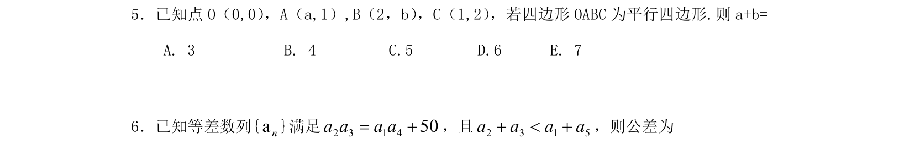

### 第 6 题

已知等差数列 $\{a_n\}$ 满足 $a_2 a_3 = a_1 a_4 + 50$，且 $a_2 + a_3 < a_1 + a_5$，则公差为（ ）

- **A**．2
- **B**．-2
- **C**．5
- **D**．-5
- **E**．10

### 第 7 题

已知 $m, n, k$ 都是正整数，若 $m + n + k = 10$，则 $m, n, k$ 的取值方法有（ ）

- **A**．21 种
- **B**．28 种
- **C**．36 种
- **D**．45 种
- **E**．55 种

### 第 8 题

如图 1，正三角形 $ABC$ 边长为 3，以 $A$ 为圆心，以 2 为半径作圆弧，再分别以 $B, C$ 为圆心，以 1 为半径作圆弧，则阴影面积为（ ）

- **A**．$\dfrac{9}{4}\sqrt{3} - \dfrac{\pi}{2}$
- **B**．$\dfrac{9}{4}\sqrt{3} - \pi$
- **C**．$\dfrac{9}{8}\sqrt{3} - \dfrac{\pi}{2}$
- **D**．$\dfrac{9}{8}\sqrt{3} - \pi$
- **E**．$\dfrac{9}{4}\sqrt{3} - \dfrac{\pi}{3}$

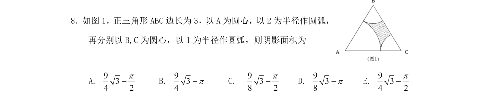

### 第 9 题

在雨季，某水库的蓄水量已达警戒水位，同时上游来水注入水库，需要及时泄洪。若开 4 个泄洪闸则水库的蓄水量到安全水位要 8 天，若开 5 个泄洪闸则水库的蓄水量到安全水位要 6 天，若开 7 个泄洪闸则水库的蓄水量到安全水位要（ ）

- **A**．4.8 天
- **B**．4 天
- **C**．3.6 天
- **D**．3.2 天
- **E**．3 天

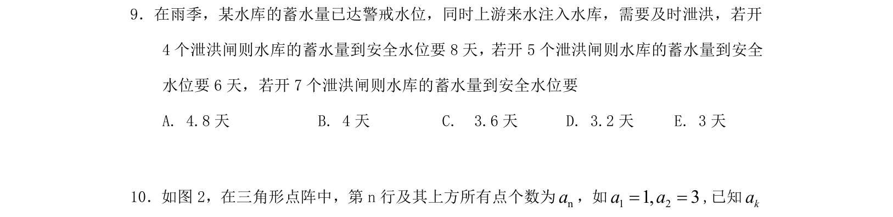

### 第 10 题

如图 2，在三角形点阵中，第 $n$ 行及其上方所有点个数为 $a_n$，如 $a_1 = 1, a_2 = 3$。已知 $a_k$ 是平方数且 $1 < a_k < 100$，则 $a_k = $（ ）

- **A**．16
- **B**．25
- **C**．36
- **D**．49
- **E**．81

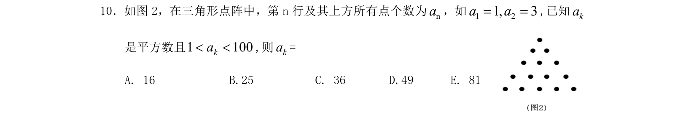

### 第 11 题

如图 3，在边长为 2 的正三角形材料中，裁剪出一个半圆形。已知半圆的直径在三角形的一条边上，则这个半圆的面积最大为（ ）

- **A**．$\dfrac{3}{8}\pi$
- **B**．$\dfrac{3}{5}\pi$
- **C**．$\dfrac{3}{4}\pi$
- **D**．$\dfrac{\pi}{4}$
- **E**．$\dfrac{\pi}{2}$

### 第 12 题

甲、乙两码头相距 100 千米，一艘游轮从甲地顺流而下，到达乙地用了 4 小时，返回时游轮的静水速度增加了 25%，用了 5 小时，则航道的水流速度为（ ）

- **A**．3.5 km/h
- **B**．4 km/h
- **C**．4.5 km/h
- **D**．5 km/h
- **E**．5.5 km/h

### 第 13 题

如图 4，圆柱形容器的底面半径是 $2r$，将半径为 $r$ 的铁球放入容器后，液面的高度为 $r$，液面原来的高度为（ ）

- **A**．$\dfrac{r}{6}$
- **B**．$\dfrac{r}{3}$
- **C**．$\dfrac{r}{2}$
- **D**．$\dfrac{2}{3}r$
- **E**．$\dfrac{5}{6}r$

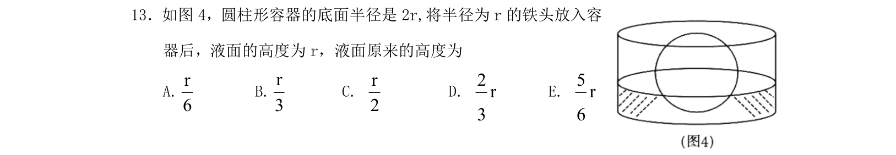

### 第 14 题

有 4 种不同的颜色，甲乙两人各随机选 2 种，则两人颜色完全相同的概率为（ ）

- **A**．$\dfrac{1}{6}$
- **B**．$\dfrac{1}{9}$
- **C**．$\dfrac{1}{12}$
- **D**．$\dfrac{1}{18}$
- **E**．$\dfrac{1}{36}$

### 第 15 题

设非负实数 $x, y$ 满足 $\begin{cases} 2 \le xy \le 8 \\ \dfrac{x}{2} \le y \le 2x \end{cases}$，则 $x + 2y$ 的最大值为（ ）

- **A**．3
- **B**．4
- **C**．5
- **D**．8
- **E**．10

## 二、条件充分性判断：第 16～25 小题，每小题 3 分，共 30 分。要求判断每题给出的条件（1）和（2）能否充分支持题干所陈述的结论。A、B、C、D、E 五个选项为判断结果，请选择一项符合试题要求的判断，在答题卡上将所选项涂黑。

### 解题说明：
- **A**．条件（1）充分，但条件（2）不充分
- **B**．条件（2）充分，但条件（1）不充分
- **C**．条件（1）和（2）单独都不充分，但条件（1）和条件（2）联合起来充分
- **D**．条件（1）充分，条件（2）也充分
- **E**．条件（1）和条件（2）单独都不充分，条件（1）和条件（2）联合起来也不充分

### 第 16 题

袋子中有红白黑三种颜色的球若干，随机取 1 球，则该球为白球的概率不小于 $\dfrac{1}{4}$。

（1）红球最少。
（2）黑球不到 $\dfrac{1}{2}$。

### 第 17 题

$n \in \text{正整数}$，则 $\dfrac{n^2}{3}$ 余数为 1。

（1）$\dfrac{n}{3}$ 余 1。
（2）$\dfrac{n}{3}$ 余 2。

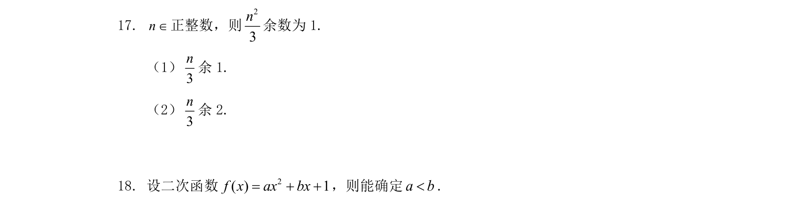

### 第 18 题

设二次函数 $f(x) = ax^2 + bx + 1$，则能确定 $a < b$。

（1）曲线 $y = f(x)$ 关于 $x = 1$ 对称。
（2）$f(x)$ 与 $y = 2$ 相切。

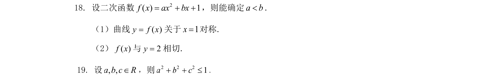

### 第 19 题

设 $a, b, c \in \mathbb{R}$，则 $a^2 + b^2 + c^2 \le 1$。

（1）$|a| + |b| + |c| \le 1$。
（2）$ab + ac + bc = 0$。

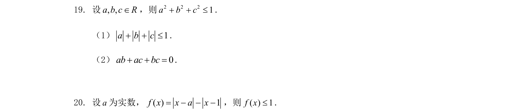

### 第 20 题

设 $a$ 为实数，$f(x) = |x - a| - |x - 1|$，则 $f(x) \le 1$。

（1）$a \ge 0$。
（2）$a \le 2$。

### 第 21 题

设 $a, b$ 为正实数，则能确定 $a \ge b$。

（1）$a + \dfrac{1}{a} \ge b + \dfrac{1}{b}$。
（2）$a^2 + a \ge b^2 + b$。

### 第 22 题

兔窝位于兔子正北 60 米，狼在兔子正西 100 米，兔子和狼同时奔向兔窝，则兔子先到达兔窝。

（1）兔子的速度 = $\dfrac{2}{3}$ 狼的速度。
（2）兔子的速度 = $\dfrac{1}{2}$ 狼的速度。

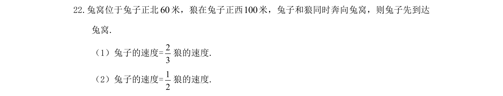

### 第 23 题

设 $x, y$ 为实数，则能确定 $x \ge y$。

（1）$(x - 6)^2 + y^2 = 18$。
（2）$|x - 4| + |y + 1| = 5$。

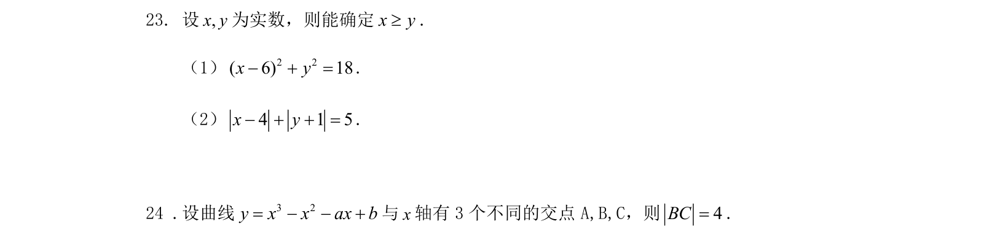

### 第 24 题

设曲线 $y = x^3 - x^2 - ax + b$ 与 $x$ 轴有 3 个不同的交点 $A, B, C$，则 $|BC| = 4$。

（1）点 $A$ 坐标为 $(1, 0)$。
（2）$a = 4$。

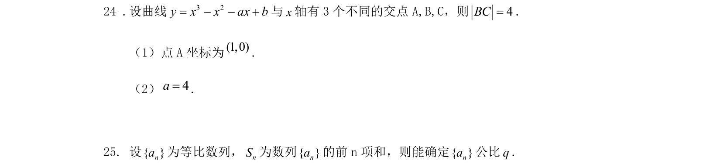

### 第 25 题

设 $\{a_n\}$ 为等比数列，$S_n$ 为数列 $\{a_n\}$ 的前 $n$ 项和，则能确定 $\{a_n\}$ 的公比 $q$。

（1）$S_3 = 2$。
（2）$S_9 = 26$。

---

## 三、逻辑推理（第 26-55 题，每小题 2 分，共 60 分）

### 第 26 题

健康连着千家万户的幸福，关系国家民族的未来。对于个人来说，健康是幸福之源。拥有健康，不一定拥有幸福；但失去健康，必然失去幸福。对于国家来说，人民健康是强盛之基。只有拥有健康的人民，才能拥有高质量发展能力。必须把保障人民健康放在优先发展的战略位置，大力推进健康中国建设。

根据以上陈述，可以得出以下哪项?

- **A**．有的人拥有幸福，但不一定拥有健康。
- **B**．只要人民健康，就能推动国家高质量发展。
- **C**．世界上只有少数国家实现了人民健康、国力强盛。
- **D**．若没有健康的人民，一个国家就不会拥有高质量发展能力。
- **E**．如果把保障人民健康放在优先发展的战略位置，就能实现国家强盛。

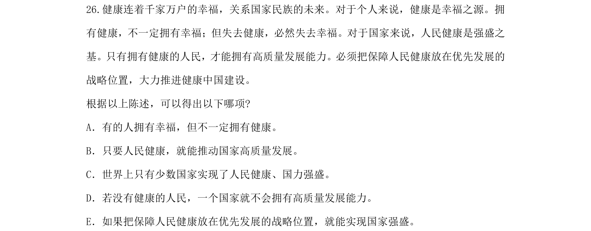

### 第 27 题

某大学管理学院安排甲、乙、丙、丁、戊、己6 位院务会成员暑期值班6 周，每人值班一周。已知:

(1)乙第四周值班
(2)丁和戊的值班时间都早于己
(3)甲值班的时间早于乙，但晚于丙。

根据以上信息，第三周可以安排的值班人员有哪些?

- **A**．仅甲、丁。
- **B**．仅甲、戊。
- **C**．仅丁、戊。
- **D**．仅甲、丁、戊。
- **E**．仅丁、戊、己。

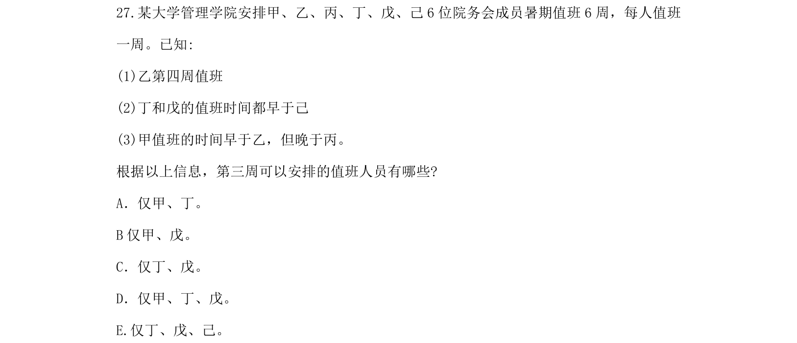

### 第 28 题

随着传播媒介的不断发展，其接收方式越来越多样。声音，作为一种接收门槛相对较低的传播媒介，它的“可听化”比视频的“可视化”受限制条件少，接收方式灵活。近来，各种有声读物、方言乡音等媒介日渐红火，一些听书听剧网站颇受欢迎,这让一些人看到了希望:会说话就行，用“声音”就可以获得财富。有专家就此认为，声媒降低了就业门槛，为人们提供了更多平等就业的机会。

以下哪项如果为真，最能质疑上述专家的观点?

- **A**．传媒接收门槛的降低并不意味着声媒准入门槛的降低。
- **B**．只有切实贯彻公平合理的就业政策，人们平等就业才有实现的可能。
- **C**．一个行业吸纳的就业人员越多，它所能提供的平均薪酬水平往往越低。
- **D**．有人愿意为听书付费，而有人不愿意，靠“声音”获得财富并不容易。
- **E**．有人天生一副好嗓子，而有人的嗓音则需通过训练才能达到播音标准。

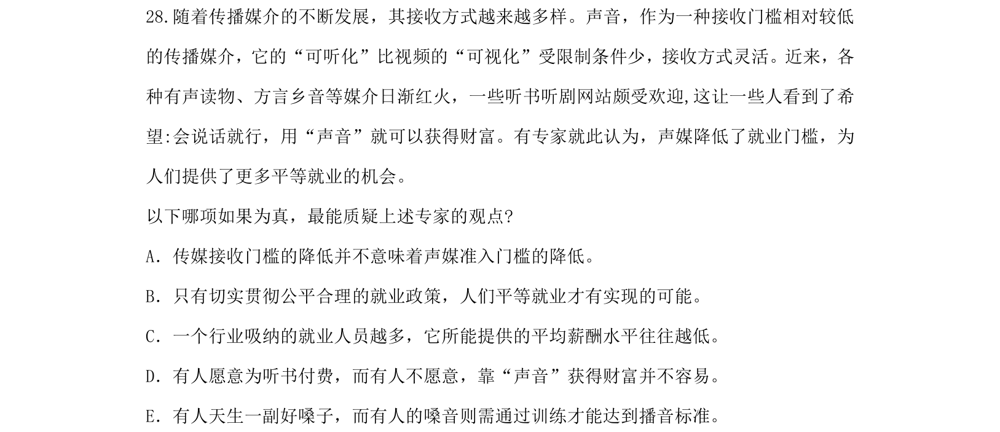

### 第 29 题

某部门拟在甲、乙、丙、丁、戊5 个乡镇中选择3 个进行调研。调研要求如下:

(1)乙、丁至多调研其一;
(2)若选择丙，则选择乙而不选择甲
(3)若甲、戊中至少有一个不选择，则不选择丙。

根据以上信息，可以得出以下哪项?

- **A**．甲、戊均不选。
- **B**．甲戊恰选其一。
- **C**．乙、丙均不选。
- **D**．乙、丙、丁恰选其一。
- **E**．乙、丙、丁恰选其二。

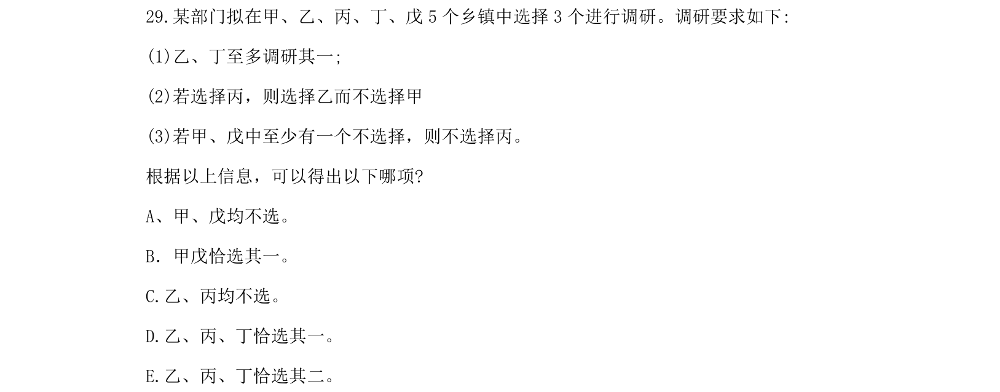

### 第 30 题

当前，越来越多的网路作品将枯燥的文学转化成轻松的视听话言，不时植入段子金句或评论，让年轻人乐此不疲，逐渐失去忍耐枯燥的能力，进入不了深度学习的状态，但是，能真正滋养一个人的著述往往都带着某种枯燥，而要读者投入专注力去穿透抽象。由此有专家建议年轻人读书要克服前30 页的阅读痛苦，这样才能获得知识与快乐。

以下哪项如果为真，最能支持上述专家的观点?

- **A**．读书本身就很枯燥，学习就是学习，娱乐就是娱乐，所谓“娱乐式学习”并不存在。
- **B**．有些人拿起任何一本书都能津津有味地谈下去，即使连续读30 页，也不会感到枯燥乏味。
- **C**．一本书的前30 页往往是该书念术语的首次展现，要想获得阅读的愉悦，就要越过这个门槛。
- **D**．那些让人很舒服、不断点头的轻松阅读，往往只是重复你既有认知的无效阅读哪怕读再多页也无益处
- **E**．有些书即使硬着头皮读了前30 页后面的文字仍不能让人感到快乐并有所收获,读者将其弃置一边也不奇怪。

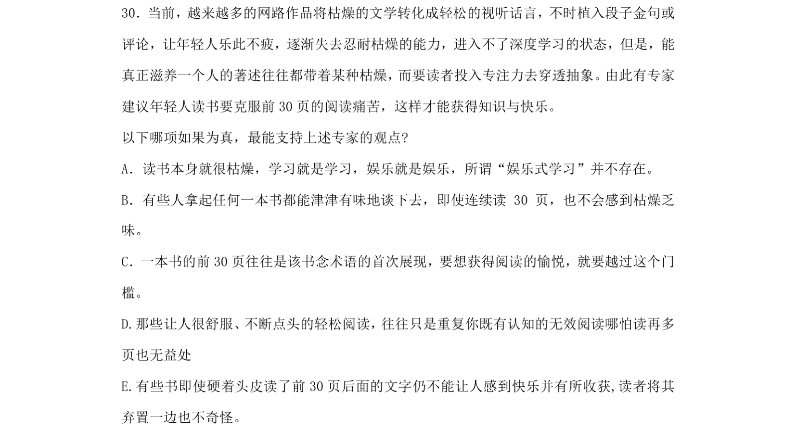

### 第 31 题

纸箱是邮寄快递的主要包装材料之一，初次使用的纸箱大都可重复使用。目前大部分旧纸箱仍被当作生活垃圾处理，不利于资源的利用和环境的保护。其实，我们寄快递时所用的新纸箱快递点一般都要收费。有专家就此认为，即使从自身利益角度出发，快递点对纸箱回收也应具有积极性。

以下哪项如果为真，最能质疑上述专家的观点?

- **A**．有些人在收到快递后习惯将包装纸箱留存，积攒到一定数量后，再送到附近废品收购站卖掉。
- **B**．快递员回收纸箱的意愿并不高，为了赶时间，他们不会等客户拆封后再带走空纸箱。
- **C**．旧纸箱一般是以往客户丢下的，快递点并未花钱回购，在为客户提供旧纸箱时也不会收费。
- **D**．为了“有面子”，有些人在寄快递时宁愿花钱购买新纸箱，也不愿使用旧纸箱,哪怕免费使用也不行。
- **E**．快递点大多设有纸箱回收处，让客户拿到快递后自己决定是否将快递当场拆封并将纸箱留下。

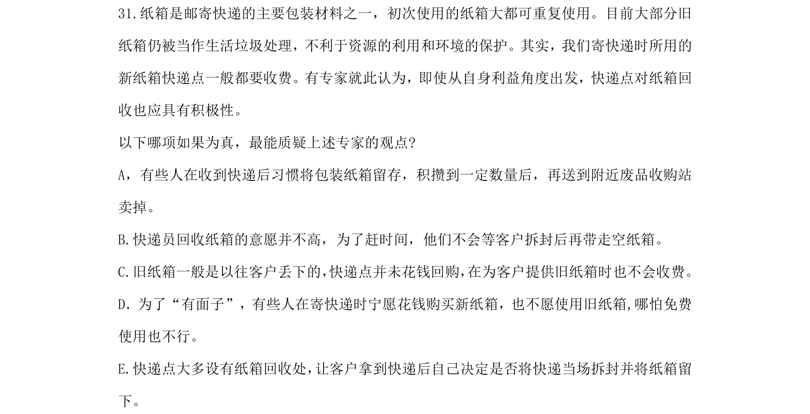

### 第 32 题

近日，其博物馆展出中国古代书画赵、唐、沈、苏4 人的书面,其中展览的《松溪图》《山高图》《雪钓图》《涧石图》是这4 位最具代表性的画作之一。已知：

(1)若《松溪图》不是苏所画，则《山高图》是唐所画；
(2)若《松溪图》是苏或赵所画，则《雪钓图》是沈所画；
(3)《雪钓图》是沈所画或《山高图》是唐所画,则《涧石图》是苏所画或《雪钓图》是唐所画。

根据上述信息，可以得出以下哪项?

- **A**．《雪钓图》是沈所画。
- **B**．《松溪图》是赵所画。
- **C**．《松溪图》是唐所画。
- **D**．《涧石图》是苏所画。
- **E**．《山高图》是沈所画。

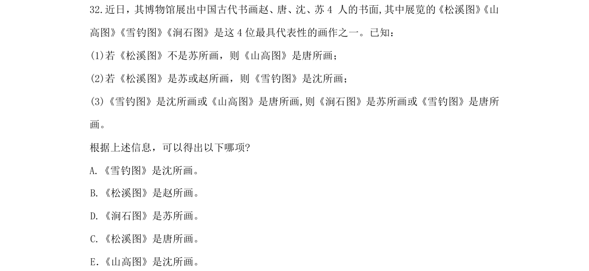

### 第 33 题

人们常常听到这样的说法:“天气凉了，大家要小心着凉感冒。”然而着凉未必意味着感冒。“着凉”仅仅指没有穿够保暖的衣物时体温过低的情况，而感冒的原因是病毒或细菌感染。但有研究人员分析了过去5 年流感疫情监测数据后发现，流感的频繁活动通常发生在当年11 月至次年3 月期间。由此他们断定，寒冷天气确实更容易让人感染流行性感冒。以下各项如果为真，则除哪项外均能支持上述研究人员的观点?

- **A**．各种病毒在低温且干燥的环境中更稳定，而且繁殖得更快。
- **B**．寒冷的天气里，人们更愿意呆在温暖的室内，而不愿进行户外活动。
- **C**．在通风不良的室内供暖环境中，人体抵御细菌感染的机能会有所减弱。
- **D**．温度大幅降低会导致人体温度下降，妨碍呼吸系统和消化系统的正常运转。
- **E**．当人体处于紧张状态比如承受低温时，其代谢系统和免疫系统的正常运转将会受到影响。

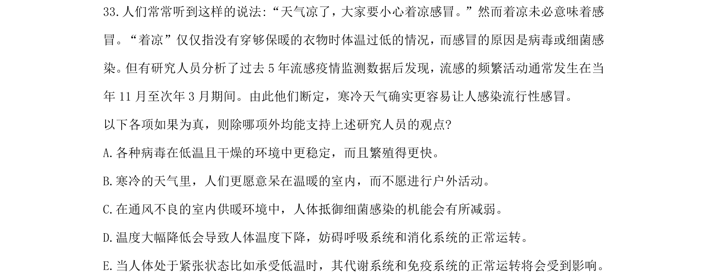

### 第 34 题

位于长江三角洲的良渚古城遗址是中国已知古城中最早建有大型水利工程的城池。大约4300 年前，良渚古城遭到神秘摧毁，良渚文明就此崩溃。研究人员借助良渚古城的地质样本，对该地的古代气候进行评估后断定，良渚古城的摧毁很可能与洪水的暴发存在关联。

以下哪项如果为真，最能支持上述研究人员的观点?

- **A**．到目前为止，研究人员尚未发现人为因素导致良渚文明覆灭的证据。
- **B**．研究人员发现，在保存完好的良古城遗址上覆盖着一层湿润的黏土。
- **C**．良古城外围建有多条水坝，这些距今5000 年左右的水能防御超大洪灾
- **D**．距今4345 年至4324 年期间，长江三角洲曾有一段强降雨时期，之后雨又断断续续下了很长时间。
- **E**．公元前2277 年前的某个夏季,异常的降雨量超出了当时先进的良古城水坝和运河的承受极限。

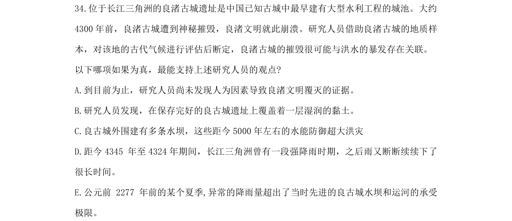

### 35~36 题基于以下题干

> 某大学进行校园形象动物评选，对于喜鹊、松鼠、狐理、刺猬、乌鸦和白鹭6 种动物能否进入初选，有人预测如下;
> (1)上述6 种动物中若至少有4 种入选，则刺猬和松鼠均入选
> (2)若松鼠、狐狸和乌鸦中至少有1 种入选，则喜鹊入选，而刺猬不会入选。
> 评选结果表明，上述预测正确。

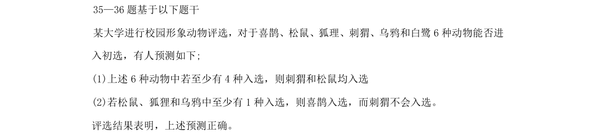

### 第 35 题

根据以上信息，关于上述6 种动物的入选情况，可以得出以下哪项?

- **A**．至多有3 种入选。
- **B**．至少有3 种入选。
- **C**．乌鸦和刺猬均未入选。
- **D**．乌鸦和刺猬至少有1 种入选。
- **E**．白鹭、松鼠和狐狸中至少有1 种入选。

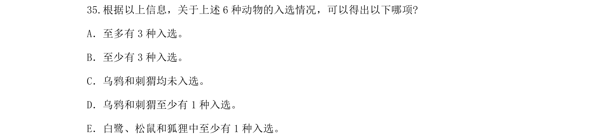

### 第 36 题

若恰好有3 种动物入选，则可以得出以下哪项?

- **A**．刺猬入选
- **B**．狐狸入选。
- **C**．喜鹊入选。
- **D**．松鼠入选。
- **E**．白鹭入选。

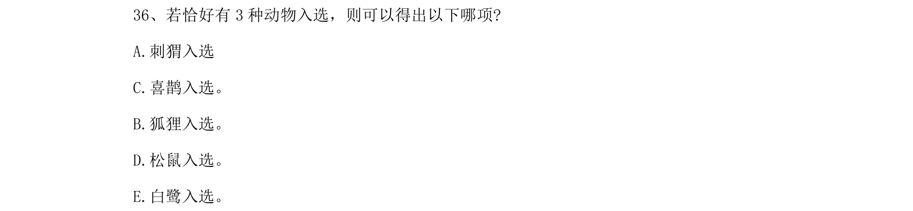

### 第 37 题

脉冲星是银河系中难得的定位点，对导航极为有用。通过测量来自3 颗或更多脉冲星每个脉冲的微小变化，航天器可以利用三角测量法确定自己在银河系中的位置.1972 年，科学家在一台宇宙探测器上安装了刻有14 颗脉冲星的铭牌，这些脉冲星被当作一组特殊的宇宙路标，科学家试图以此引导外星人来到地球。但有专家断言，地球人制作的这一“脉冲星地图”很难实现预想的目标。

以下哪项如果为真，最能支持上述专家的观点?

- **A**．科学家曾向太空发射载有地球信息的无线电波，但至今一无所获。
- **B**．我们并不了解外星人，贸然邀请并指引他们来地球是非常危险的
- **C**．外星人即使获取铭牌，也可能看不懂铭牌，从而发现不了那14 颗脉冲星。
- **D**．任何先进到足以发现并获取“脉冲星地图”的智慧生物，都能看懂这张地图。
- **E**．外星人捕获人类探测器的时间还很遥远，到那时14 颗脉冲星的位置已发生很大变化，他们即使看懂铭牌，也只能“受骗上当”了。

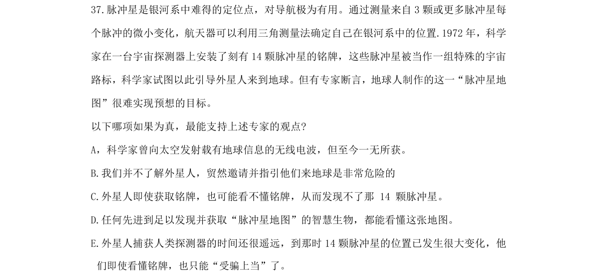

### 第 38 题

瘦肉精是一种牲畜饲料添加剂的统称，现在主要指莱克多巴胺，它通过模拟肾上腺素是功能来种制饲养动物的脂肪的生长，从而增加瘦肉含量。从现实来看，食用瘦肉精含量极低的肉类仍是安全的，但科学还无法证明瘦肉精对人体完全无害。目前全球有160 多个国家禁止在本国销售含有瘦肉精的肉类。有专家就此指出，全球数国家对菜克多巴胺采取零容忍政策，是一项正确合理的决策。

以下哪项如果为真，最能支持上述专家的观点?

- **A**．喂了瘦肉精的动物更容易疲劳、受伤，其死亡的概率也会增加。
- **B**．目前，全球有20 多个国家不允许在饲养中使用瘦肉精，但允许进口含有瘦肉精的肉类。
- **C**．某国食品法典委员会规定，市场销售的肉类中莱克多巴胺的最高残留量不得超过亿分之一。
- **D**．一项科学实验显示，摄入微量莱克多巴胺对人体无害，但该实验仅招募了6 名志愿者，样本量严重不足。
- **E**．如果允许瘦肉精合法使用，无法保证饲养者会严格按照使用指南喂养牲畜，而政府有关部门检查起来技术复杂、成本高昂。

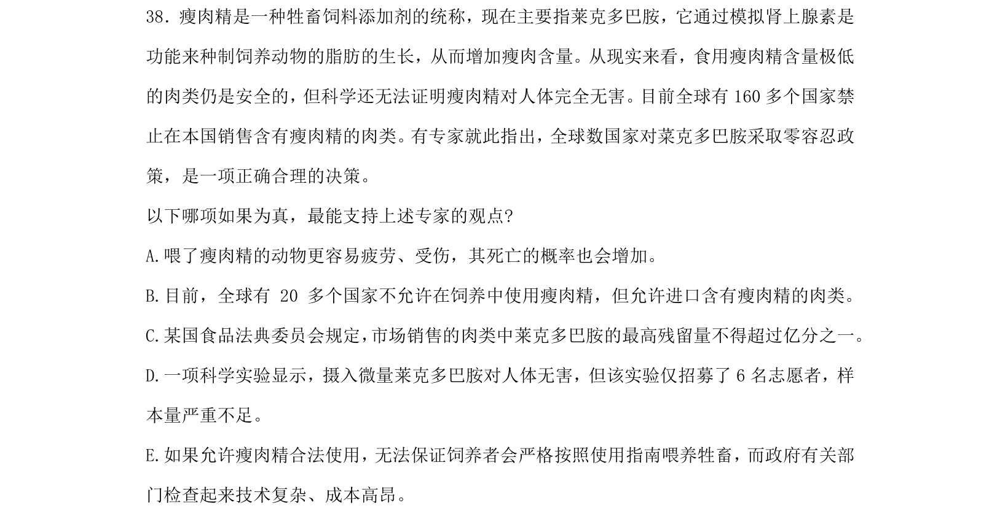

### 第 39 题

老孟、小王、大李3 人为某小区保安。已知:一周7 天每天总有他们3 人中的至少1 人值班，没有人连续3 天值班，任意2 人在同一天休假的情况均不超过1 次。另外，还知道:

(1)老孟周二、周四和周日休假;
(2)小王周四、周六休假，周五值班
(3)大李周六、周日休假，周五值班。

根据以上信息，可以得出以下哪项?

- **A**．老孟周一值班
- **B**．小王周一值班。
- **C**．老孟周五值班。
- **D**．小王周三休假
- **E**．大李周四休假。

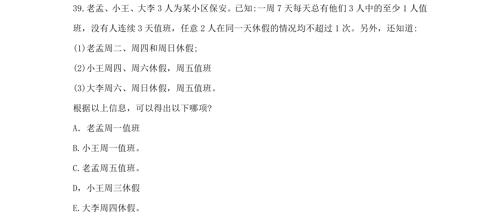

### 第 40 题

某单位举办两轮羽毛球单打表演赛,共有甲、乙、丙、丁、戊、己6 位选手参加。每轮表演赛都按以下组合进行了5 场比赛，甲对乙、甲对丁、丙对戊、丙对丁、戊对己。已知;

(1)每场比赛均决出胜负，
(2)每轮比赛中，各参赛选手均至多输一场:
(3)每轮比赛决出的冠军在该轮比赛中未有败绩，甲在第一轮比赛中获冠军;
(4)只有一组选手在第二轮比赛中的胜负结果与第一轮相同，其余任一组选手的两轮比赛结果均不同。

根据上述信息，可以得出第二轮表演赛的冠军是

- **A**．乙
- **B**．丙
- **C**．丁
- **D**．戊
- **E**．己

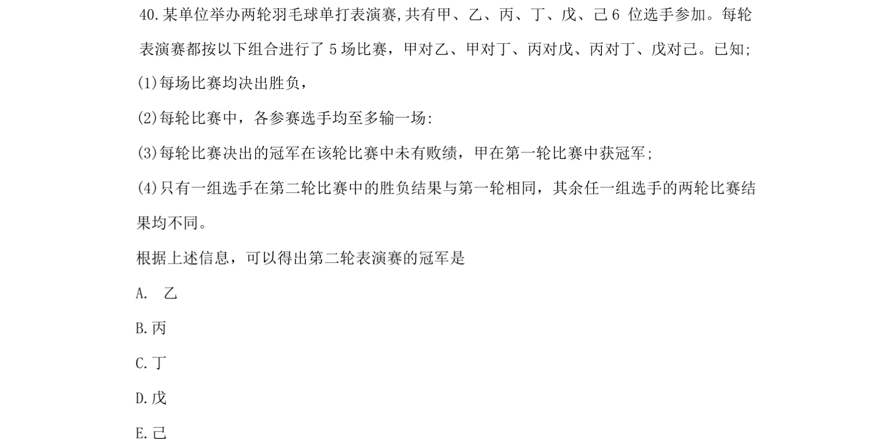

### 第 41 题

我国有些传统村落已有数百年历史，具有较高的历史文化价值。政府相继发布一批中国传统村落名录，对有些传统村落给予了有效的保护。但是，大量未纳入保护范围的传统村落仍处于放任自流的状态，其现状不容乐观。有专家就此指出，随着社会的快速发展和新生活方式的兴起，这些传统村落走向衰亡是一种必然趋势。以下哪项如果为真，最能质疑上述专家的观点?

- **A**．中国拥有高度发达的农耕文明，乡土中国的精神和文化现在仍是我们文化身份民族情感的重要来源。
- **B**．有些城里人自愿来到农村居住，他们养鸡种菜、耕读垂钓，全然不顾想去城市生活的乡邻们异样的眼光。
- **C**．欧洲国家在工业化、城市化进程中，对一些传统村落进行了较好的保护，使其乡村文化、乡村生活方式延续至今。
- **D**．我国有些传统村落虽未纳入保护名录，但也被重新规划、修缮，宜居程度显著提高，美丽乡村既留住了村民，也迎来了游客。
- **E**．基于资源、环境、公共服务等方面的考虑，某些地方开启乡村合并模式，部分传统村落已经消失在合并的过程中

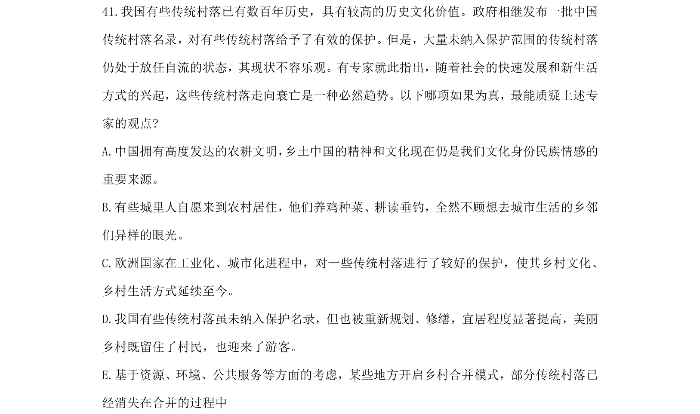

### 第 42 题

某烟花专卖店销售多种烟花。已知:

(1)若不是危险性大的烟花，则它们可降解或没有漂浮物:
(2)若是新型组合烟花或危险性大的烟花，则它们不是环保类烟花。

若该店所销售的某类产品是环保类烟花，则可以推出该类烟花

- **A**．可降解。
- **B**．若不可降解，则没有漂浮物。
- **C**．不可降解。
- **D**．若可降解，则有漂浮物
- **E**．没有漂浮物。

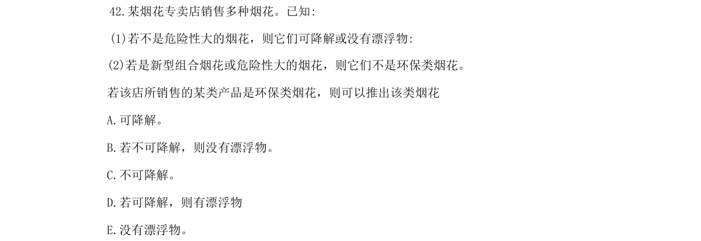

### 第 43 题

曼特洛编码是只能按照如下3 条规则生成的符号串

(1)曼特洛图形只有三个▲、▽、☆;
(2)一对圆括号中若只含有0 个、1 个或者2 个不同的曼特洛图形，则为曼特洛编码。
(3)一对圆括号中若只含有1 个或2 个曼洛编码且不含其他符号，则也为曼特洛编码。

根据上述规定，以下哪项符号串是曼特洛编码?

- **A**．(()▲☆)(☆▽))
- **B**．((▲☆)(☆(▽)))
- **C**．((▲)(☆())(☆▽))
- **D**．((▲)(((☆▽)())))
- **E**．((▲)(☆)(▽())☆)

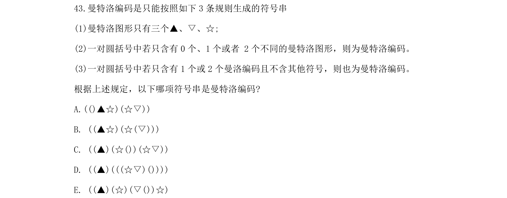

### 第 44 题

为满足持续激增的市场需求，半导体行业的许多工厂竞相增加芯片产能，预计供求平衡将在明年达成，此后可能会出现供应过剩。有分析人士认为，今年随着智能手机和新能源汽车的销售势头放缓，两大行业的产能将会降低，芯片供应的紧张形势有望得到缓解。

以下哪项最可能是上述分析人士的假设?

- **A**．新能源汽车制造商在销售疲软的情况下大幅削减芯片库存
- **B**．智能手机和新能源汽车是半导体行业的两大主要终端用户。
- **C**．智能手机因零部件短缺而更新升级迟缓，今年下半年销量将有所下滑。
- **D**．芯片市场具有很强的周期性，每隔数年就会经历一次从峰值到低谷的循环.
- **E**．市场需求情况将通过产品销售、生产供应等逐步向上游传导，并最终影响相关工厂的产能.

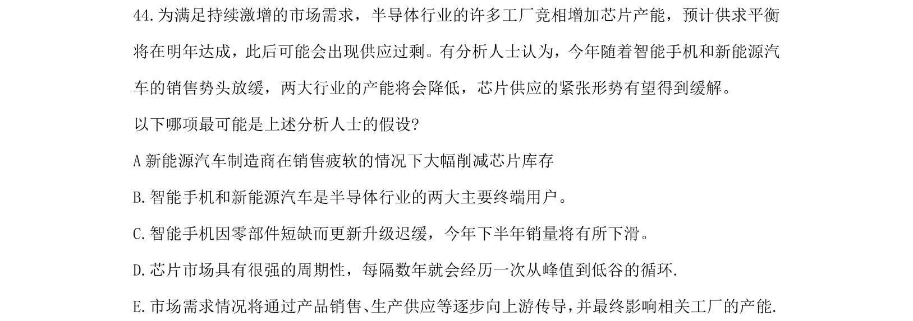

### 第 45 题

下面有一5x5 的方阵，它所含的每个小方格中均可填入“稻”“黍”“稷”“麦”“豆”五谷名称之一，有部分方格已经填入。要求该方阵每行、每列的五个小方格中均含有五谷名称，不能重复也不能遗漏。

根据上述要求，以下哪项是方阵①空格中应填入的五谷名称？

| 稷 | 麦 | | | 黍 |
| :---: | :---: | :---: | :---: | :---: |
| 麦 | 豆 | | | |
| | | | ① | |
| | | 黍 | | 麦 |
| | 稷 | | | 稻 |

- **A**．麦
- **B**．豆
- **C**．稻
- **D**．稷
- **E**．黍

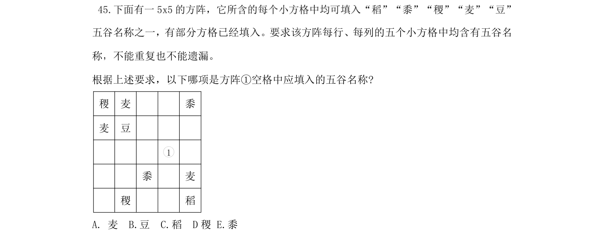

### 第 46 题

马可波罗在《《马可·波罗游记》中对元世祖忽必烈颇有赞词，并称忽必烈寿命“约有八十五岁”。这一说法与《元史》中“在位三十五年，寿八十”的记裁不符。但有学者指出，游记中的说法很可能是正确的，因为拉施都丁在14 世纪初写成的《史集》中称:“忽必烈合罕(即可汗)在位三十五年，并在他的年龄达到八十三之后去世。”

以下哪项如果为真，最能支持上述学者的观点?

- **A**．关于忽必烈寿命的记载，《元史》很可能使用的是中国人惯用的虚岁记法。
- **B**．中国历代皇帝平均寿命不到40 岁，忽必烈则超出一倍多，历史排名第五。
- **C**．《史集》可信度较高，它纪年用的伊斯兰太阳历比《马可·波罗游记》用的突厥太阳历每30 年少1 年
- **D**．《马可·波罗游记》出自鲁斯蒂谦之手，他声称该游记是他在狱中根据马可·波罗生前口述整理而成。
- **E**．《饮膳正要》曾记录忽必烈的生活:“饮食必稽于本草，动静必准乎法度。”他的长寿与其善用医理调理身心有关

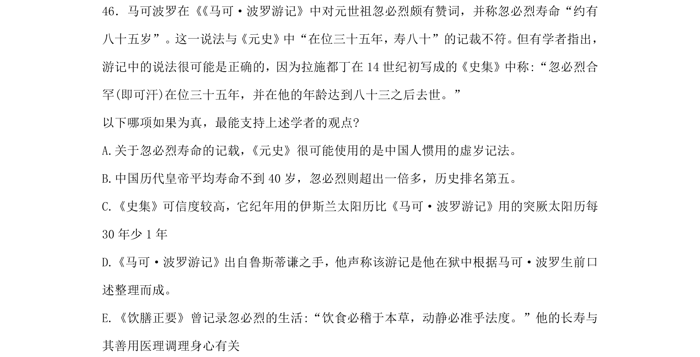

### 第 47 题

某大学从候选人甲、乙、丙、丁、戊、己、庚7 人中选出3 人作为本年度优秀教师。已知;

(1)甲、丙、丁、戊、己中至多有2 人入选；
(2)若戊、己都没有入选，则丁、庚也都没有入选；
(3)若乙、庚中至少有1 人没入选，则甲、丙都入选。

根据上述信息，可以得出以下哪项?

- **A**．甲入选。
- **B**．乙入选。
- **C**．丙入选。
- **D**．戊入选。
- **E**．庚入选。

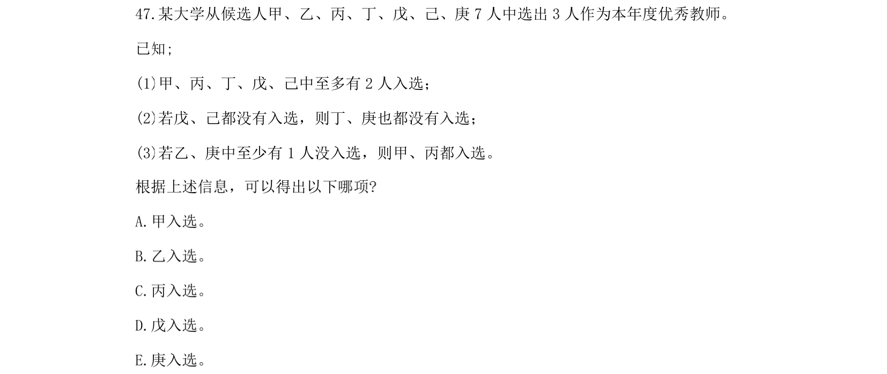

### 第 48 题

近年来，网络美图和短视频热带动不少小众景点升温。然而许多网友发现，他们实地探访所见的小众景点与滤镜照片中的同一景点形成强烈反差，而且其中一些体验项目也不像网络宣传的那样有趣美好、物有所值。有专家就此建议，广大游客应远离小众景点，不给他们宰客的机会。

以下哪项如果为真，最能质疑上述专家的建议?

- **A**．有些专家的建议值得参考，而有些专家的建议则可能存在偏狭之处。
- **B**．旅游业做不了“一锤子买卖”，好口碑才是真正的“流量密码”，靠“照骗”出位无异于饮鸠止渴。
- **C**．一般来说，在拍照片或短视频时相机或手机会自动美化，拍摄对象也是拍摄者主观选取的局部风景。
- **D**．随着互联网全面进入“光影时代”,越来越多的景点通过网络营销模式进行推广和宣传，即使那些著名景点也不例外。
- **E**．如今很多乡村景点虽不出名，但他们尝试农旅结合，推出“住农家屋、采农家菜、吃农家饭”的乡村游项目，让游客在美丽乡村流连忘返。

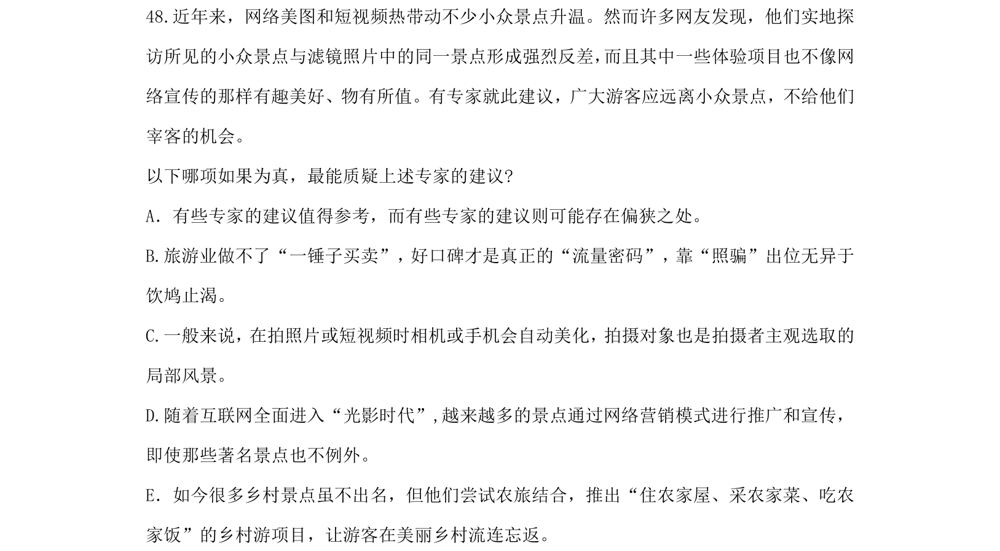

### 第 49 题

某省举办运动会。该省H 市参加的跳水、射箭、体操、篮球和短跑等项目所获金牌情况如下:

(1)跳水、射箭至少有一项获得金牌;
(2)若射箭、短跑至少有一项获得金牌，则体操也获得金牌:
(3)若短跑、篮球至少有一项未获金牌，则跳水也未获金牌.

根据上述信息，可以得出以下哪项?

- **A**．跳水获得金牌。
- **B**．篮球未获金牌。
- **C**．射箭未获金牌
- **D**．体操获得金牌
- **E**．短跑未获金牌

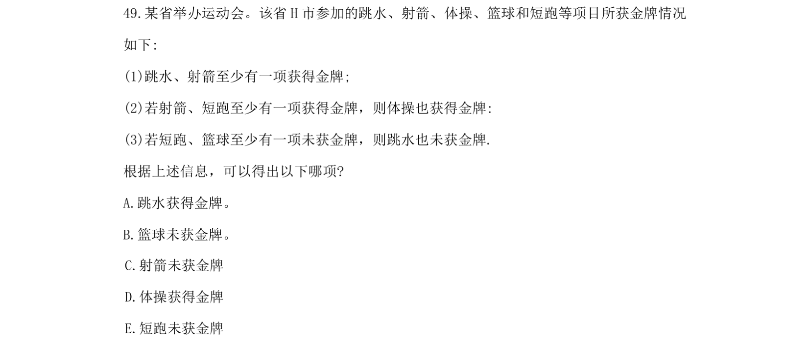

### 第 50 题

甲、乙、丙、丁、戊5 人参加某单位招聘，他们分别应聘市场部、人事部和外联部3 个岗位。已知每人都选择了2 个岗位应聘，其中1 个岗位5 人都选择应聘。另外,还知道:

(1)选择市场部的人数比选择外联部的多1 人
(2)若甲、丙、丁中至少有1 人选择了市场部，则只有甲和戊选择了外联部。

根据以上信息，可以得出以下哪项?

- **A**．甲选择了市场部和外联部。
- **B**．乙选择了市场部和人事部。
- **C**．丙选择了人事部和外联部
- **D**．丁选择了市场部和外联部。
- **E**．戊选择了市场部和人事部

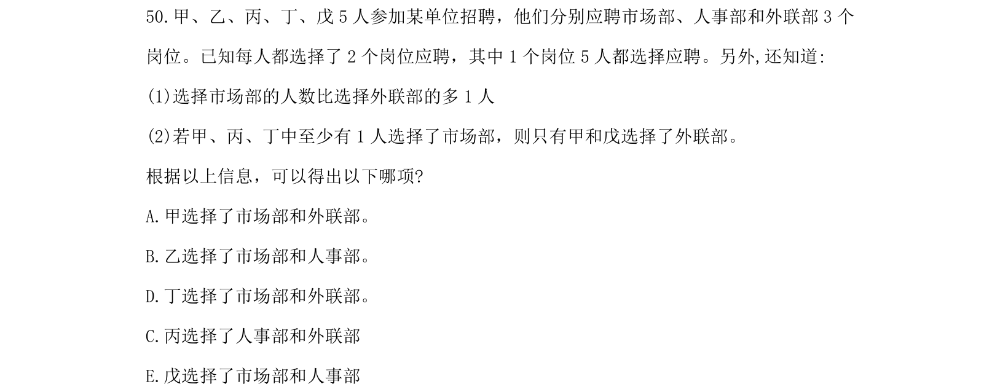

### 第 51 题

在航空公司眼中，旅客大体分为两类:“时间敏感而价格不敏感”且多在工作日出行的群体，“时间不敏感而价格敏感”且多在周末出行的群体。去年，为改善低客流状况，S 航空公司推出了“周末随心飞”特惠产品:用户只需花3000 元即可在本年度的任意周六和周日，不限次数乘少该航空公司除飞往港澳台以外的任意国内航班。据统计,在S 航的大本营H 市,多个航班的“周末随心飞”旅客占比超过90%,且这些旅客大多是从H 市飞往成都、深圳、三亚、昆明等热点城市的。

根据上述信息，可以得出以下哪项?

- **A**．有些“周末随心飞”旅客以往并不曾飞往成都。
- **B**．去年S 航推出的“周未随心飞”产品可以跨年兑换使用。
- **C**．没有“时间不敏感而价格敏感”的旅客会选择工作日出行。
- **D**．有些“时间缴感而价格不敏感”的旅客会乘坐S 航的周末航班。
- **E**．去年乘坐S 航航班飞往香港的旅客，使用的不是“周末随心飞”特惠产品。

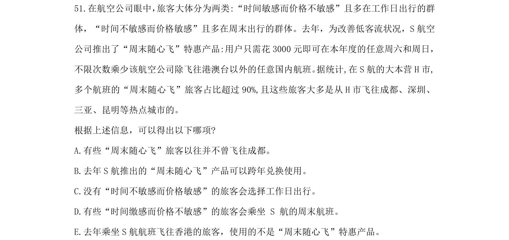

### 第 52 题

为了提高效益，经销商李军拟在花生、甜菜、棉花、百合、黄芪和生姜6 种衣产品中选择3 种经营。他有如下考虑:

(1)若经营百合，则也经营黄芪但不经营甜菜:
(2)若经营花生，则也经营甜菜但不经营棉花
(3)若生姜或者棉花至少经营一种，则同时经营花生和百合。

根据以上信息，以下哪两种农产品是李军拟经营的?

- **A**．花生和甜菜
- **B**．甜菜和棉花
- **C**．百合和黄芪
- **D**．花生和百合
- **E**．棉花和生姜

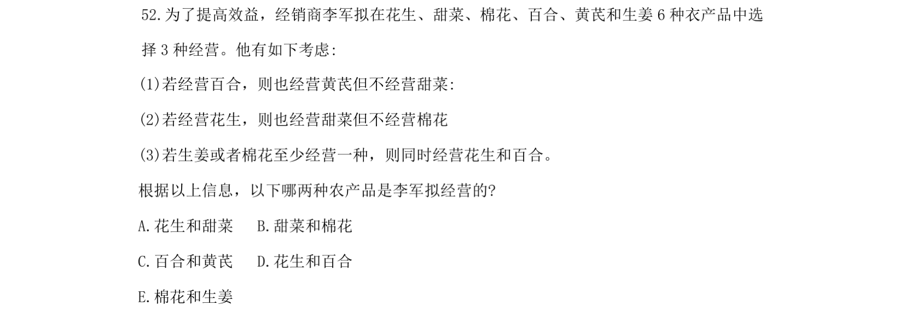

### 第 53 题

很多迹象表明，三星堆文化末期发生过重大变故，比如，三星堆两个器物坑的出土文物就留有不少被砸过和烧过的残损痕迹。关于三星堆王国衰亡的原因，一种说法认为是外敌入侵，但也有学者认为，衰亡很可能是内部权力冲突导致的。他们的理由是，三星堆出土的文物显示，三星堆王国是由笄发的神权贵族和辫发的世俗贵族联合执政:而金沙遗址出土的文物显示，三星堆王国衰亡之后继起的金沙王国仅由三星堆王国中辨发的世俗贵族单独执政。

以下哪项如果为真，最能支持上述学者的观点?

- **A**．三星堆出土的文物并不完整，使得三星堆王国因外敌入侵而衰亡的说法备受质疑。
- **B**．有证据显示，从三星堆文化到金沙文化，金沙王国延续了三星堆王国的主要族群和传统。
- **C**．一个古代王国中不同势力的联合执政意味着政治权力的平衡，这种平衡一旦被打破就会出现内部冲突。
- **D**．根据古蜀国的史料记载，三星堆文化晚期曾出现宗教势力过大、财富大多集中到神权贵族一方的现象。
- **E**．三星堆城池遭到严重破坏很可能是外部入侵在先、内部冲突在后，迫使三星堆人迁都金沙，重建都城。

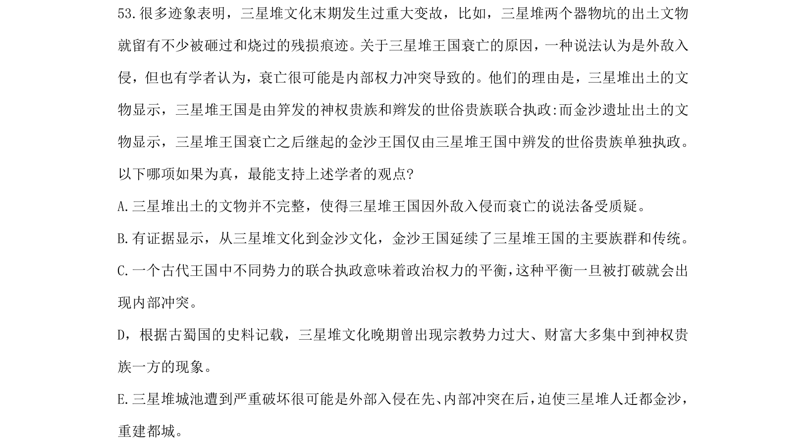

### 54~55 题基于以下题干

> 甲、乙、丙、丁4 位记者对张、陈、王、李4 位市民就民生问题进行了访谈。每次访谈均是1 对1 进行，每个人均进行或接受了至少1 次访谈，访谈共进行了6 次。已知:
> (1)若甲、丙至少有1 人访谈了陈，则乙分别访谈了王、李各2 次；
> (2)着乙、丁至少有1 人访谈了陈，则王只分别接受了丙、丁各1 次访谈。

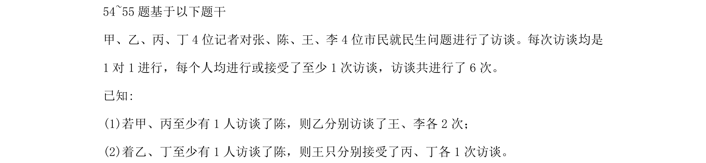

### 第 54 题

根据以上信息，可以得出以下哪项?

- **A**．甲至少访谈了张、李中的1 人。
- **B**．乙至少访谈了陈、李中的1 人。
- **C**．乙至少访谈了张、王中的1 人。
- **D**．丁至少访谈了陈、张中的1 人。
- **E**．丁至少访谈了李、张中的1 人。

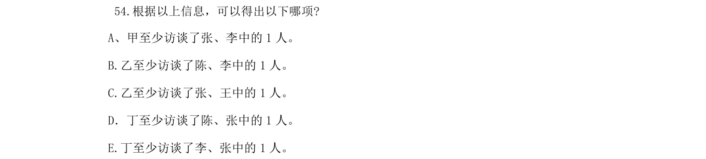

### 第 55 题

若丙访谈了张和李，则可以得出以下哪项?

- **A**．张只接受了1 次访谈。
- **B**．丙只进行了2 次访谈
- **C**．陈只接受了1 次访谈。
- **D**．丁只进行了2 次访谈。
- **E**．李只接受了1 次访谈。

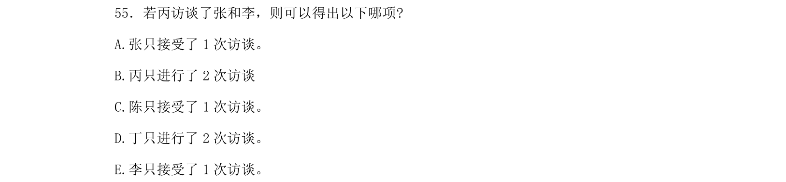

---

## 四、写作（第 56-57 题，共 65 分）

### 第 56 题 · 论证有效性分析 (30 分)

**分析下述论证中存在的缺陷和漏洞，选择若干要点，写一篇 600 字左右的文章，对该论证的有效性进行分析和评论。**（论证有效性分析的一般要点是：概念特别是核心概念的界定和使用是否准确并前后一致，有无各种明显的逻辑谬误，论证的论据是否成立并支持结论，结论成立的条件是否充分，等等。）

> 人才是社会经济发展的重要因素，许多单位都十分注重培养自己需要的人才。其实，人才除了靠自己培养，还应该靠引进。
> 
> 常言道：“十年树木，百年树人。”这说明培养人才需要相当长的时间。即使不需要一百年，现在把一个人从小学培养到大学毕业，至少也要十五六年。由此可见，靠自己单位来培养人才根本不能解决当务之急。
> 
> 其次，只注重培养而不注重引进人才并留住人才，结果往往事与愿违。例如，企业辛辛苦苦培养的一些人才跳槽了，一些高校的优秀毕业生出国了。因此，只着眼于培养，只能是为他人作嫁衣裳。
> 
> 再次，从历史上来看，秦孝公靠商鞅变法使秦国强大了，而商鞅是卫国人，是秦孝公招揽引进的。可见，招揽引进人才，就能使国家强大起来。
> 
> 可喜的是，如今不少单位出台了各种措施，引进了越来越多的人才。这样，我国的人才数量必将大幅增长，国家就会更加富强了。

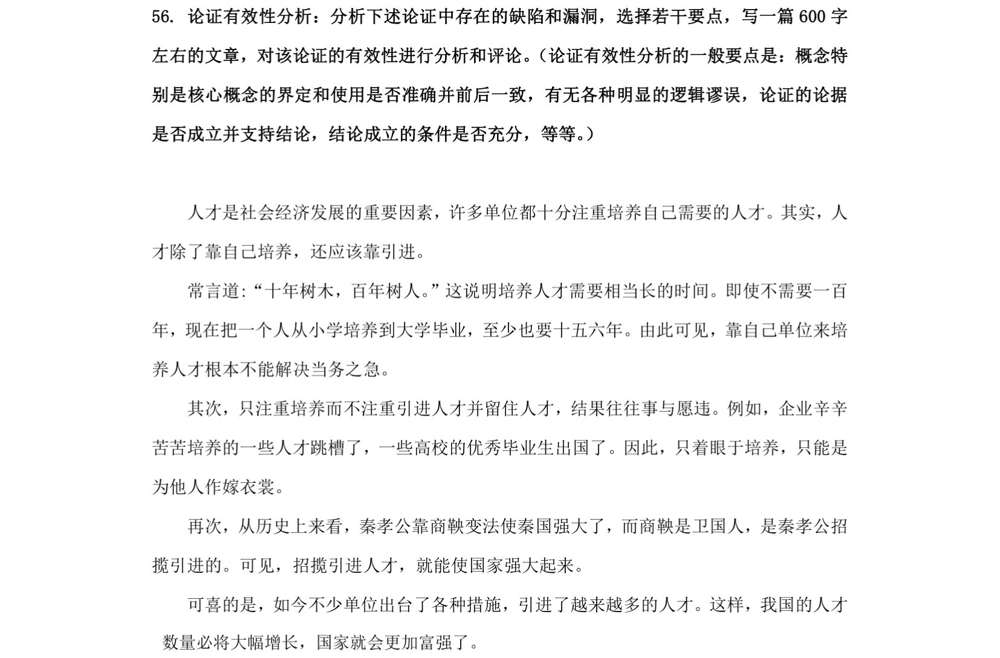

### 第 57 题 · 论说文 (35 分)

**根据下述材料，写一篇 700 字左右的论说文，题目自拟。**

> 发散性思维是指不依常规、寻求变异和多种答案的思维方式。具有这种思维形式的人，其言行往往会与众不同。

