# 2025 年全国硕士研究生招生考试管理类综合能力真题（199）

## 一、问题求解：第 1~15 小题，每小题 3 分，共 45 分。下列每题给出的 A、B、C、D、E 五个选项中，只有一项是符合试题要求的。请在答题卡上将所选项的字母涂黑。

### 第 1 题

两瓶酒精溶液体积相同，酒精与水的体积之比分别为 $1:2$ 和 $2:3$，将这两瓶酒精溶液混合，混合后酒精与水的体积之比为（ ）

- **A**．7:13
- **B**．11:19
- **C**．23:37
- **D**．3:5
- **E**．5:7

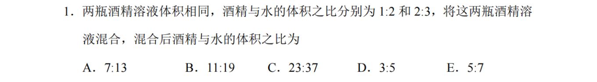

### 第 2 题

已知圆、正方形、等边三角形的周长分别为 $a, b, c$，若它们的面积相等，则（ ）

- **A**．$a < b < c$
- **B**．$a < c < b$
- **C**．$b < a < c$
- **D**．$b < c < a$
- **E**．$c < b < a$

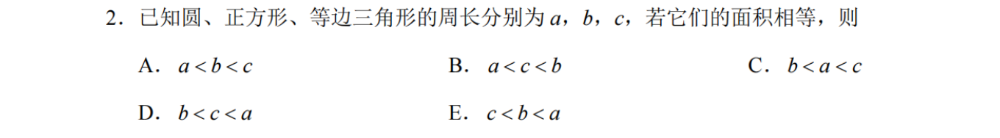

### 第 3 题

某人骑车从甲地前往到乙地，前三分之一路程的平均速度是 $12\text{ km/h}$，中间三分之一路程的平均速度为 $18\text{ km/h}$，后三分之一路程的平均速度为 $12\text{ km/h}$，此人全程的平均速度是（ ）

- **A**．$12.5\text{ km/h}$
- **B**．$13\text{ km/h}$
- **C**．$13.5\text{ km/h}$
- **D**．$14\text{ km/h}$
- **E**．$14.5\text{ km/h}$

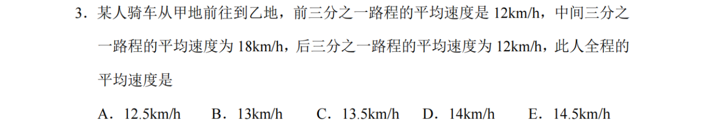

### 第 4 题

一项任务，甲单独完成需要 15 天，甲、乙两人共同完成需要 6 天，甲、乙、丙三人共同完成需要 4 天。现在乙单独工作 1 天后，余下工作由甲、丙两人共同完成，还需要（ ）

- **A**．4 天
- **B**．5 天
- **C**．6 天
- **D**．7 天
- **E**．8 天

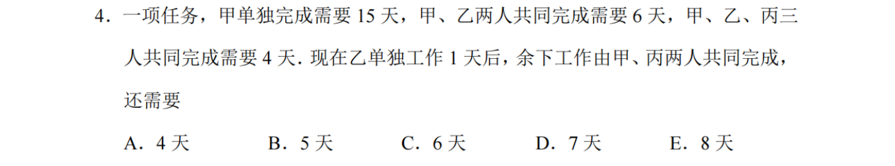

### 第 5 题

如图，圆的半径为 2，圆心角 $\angle AOB = 120^\circ$，点 $C$ 是劣弧 $AB$ 上的动点，则四边形 $AOBC$ 面积的最大值为（ ）

- **A**．$\sqrt{3}$
- **B**．$2\sqrt{3}$
- **C**．4
- **D**．$3\sqrt{3}$
- **E**．$4\sqrt{3}$

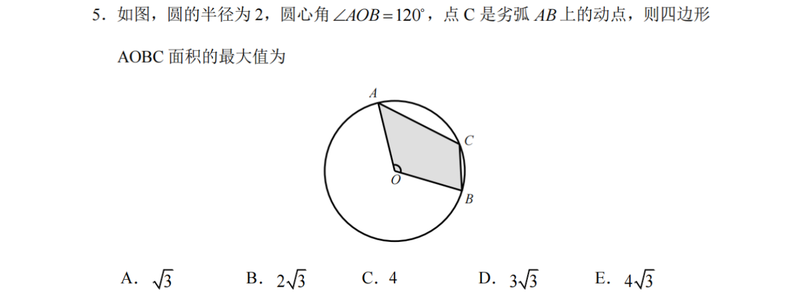

### 第 6 题

如图，在大半球中挖去一个同心小半球，小半球直径为大半球直径的一半，若小半球的体积为 $20\text{ cm}^3$，则剩下部分的体积为（ ）

- **A**．$160\text{ cm}^3$
- **B**．$140\text{ cm}^3$
- **C**．$100\text{ cm}^3$
- **D**．$80\text{ cm}^3$
- **E**．$60\text{ cm}^3$

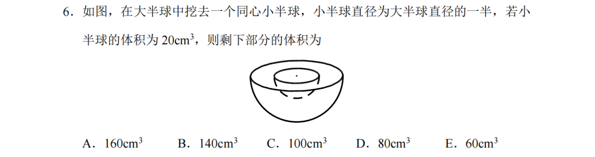

### 第 7 题

某单位举行田径赛，参加田赛项目有 50 人，参加径赛项目有 45 人。已知该单位有 90 名员工，其中 18 人未参加比赛。若两类项目均参加的女员工有 5 名，则两类项目均参加的男员工有（ ）

- **A**．10 人
- **B**．12 人
- **C**．14 人
- **D**．16 人
- **E**．18 人

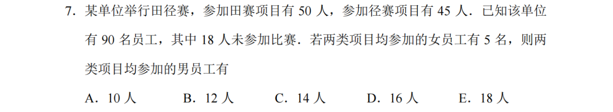

### 第 8 题

已知点 $A$ 是圆 $x^2 + y^2 - 16x - 12y + 75 = 0$ 的圆心。过原点 $O$ 作该圆的一条切线，切点为 $B$，则三角形 $AOB$ 的面积为（ ）

- **A**．$\dfrac{15}{2}\sqrt{5}$
- **B**．$15\sqrt{5}$
- **C**．25
- **D**．$25\sqrt{3}$
- **E**．$\dfrac{25}{2}\sqrt{3}$

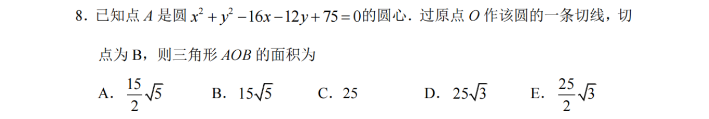

### 第 9 题

$1+2-3+4+5-6+7+8-9+10+\cdots+97+98-99=$（ ）

- **A**．1536
- **B**．1551
- **C**．1568
- **D**．1584
- **E**．1617

### 第 10 题

如图，在边长为 1 的正方形 $ABCD$ 中，$E, F$ 分别为 $AB, AD$ 的中点，$DE, BF$ 交于点 $O$。四边形 $BCDO$ 的面积为（ ）

- **A**．$\dfrac{2}{3}$
- **B**．$\dfrac{3}{4}$
- **C**．$\dfrac{5}{9}$
- **D**．$\dfrac{7}{12}$
- **E**．$\dfrac{11}{18}$

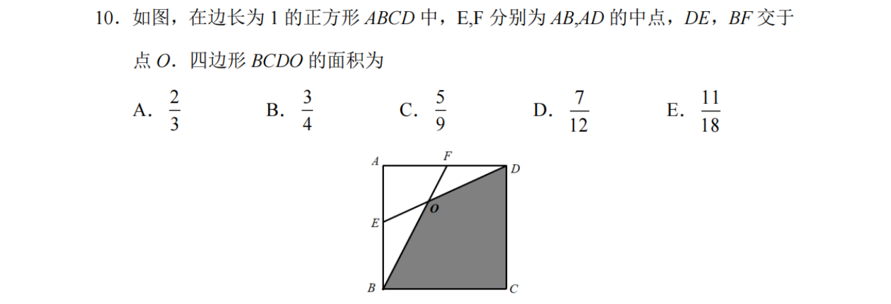

### 第 11 题

100 件商品中 2 件次品，将其分成 10 箱，每箱 10 件，则 2 件次品同一箱的概率为（ ）

- **A**．$\dfrac{1}{5}$
- **B**．$\dfrac{2}{11}$
- **C**．$\dfrac{1}{10}$
- **D**．$\dfrac{1}{11}$
- **E**．$\dfrac{9}{100}$

### 第 12 题

甲乙丙三股东，甲股份是丙的 2.4 倍，乙是丙 3 倍，年底分红，20% 红利 3 人均分，剩余按持有比例分，丙分 460 万元，则年底红利为（ ）

- **A**．2400 万
- **B**．2100 万
- **C**．1800 万
- **D**．1200 万
- **E**．1000 万

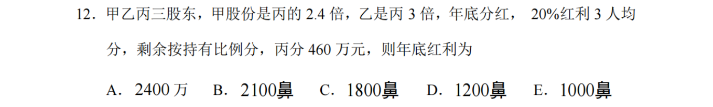

### 第 13 题

袋中两个红球，三个白球，四个黑球，随机摸两个，两个同色的概率为（ ）

- **A**．$\dfrac{1}{6}$
- **B**．$\dfrac{1}{4}$
- **C**．$\dfrac{7}{36}$
- **D**．$\dfrac{5}{18}$
- **E**．$\dfrac{1}{3}$

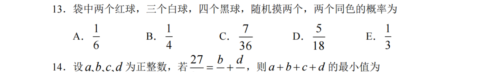

### 第 14 题

设 $a, b, c, d$ 为正整数，若 $\dfrac{27}{35} = \dfrac{b}{a} + \dfrac{d}{c}$，则 $a+b+c+d$ 的最小值为（ ）

- **A**．15
- **B**．16
- **C**．17
- **D**．18
- **E**．24

### 第 15 题

$A, B, C, D, E$ 五个集装箱堆放成两组，每次运走每组最上面一堆，将 5 个集装箱全部运走不同搬运顺序为（ ）

- **A**．5 种
- **B**．6 种
- **C**．10 种
- **D**．12 种
- **E**．15 种

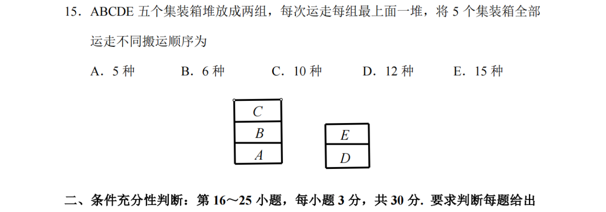

---

## 二、条件充分性判断：第 16～25 小题，每小题 3 分，共 30 分。要求判断每题给出的条件（1）和条件（2）能否充分支持题干所陈述的结论。（A）、（B）、（C）、（D）、（E）五个选项为判断结果，请选择一项符合试题要求的判断，在答题卡上将所选项的字母涂黑。

### 解题说明：
- **A**．条件（1）充分，但条件（2）不充分；
- **B**．条件（2）充分，但条件（1）不充分；
- **C**．条件（1）和（2）单独都不充分，但条件（1）和（2）联合起来充分；
- **D**．条件（1）充分，条件（2）也充分；
- **E**．条件（1）和（2）单独都不充分，条件（1）和（2）联合起来也不充分。

### 第 16 题

甲、乙、丙三人共同完成了一批零件的加工，三人的工作效率互不相同，已知他们的工作效率之比，则能确定这批零件的数量。

（1）已知甲、乙两人加工零件数量之差。  
（2）已知甲、丙两人加工零件数量之和。

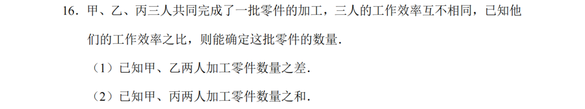

### 第 17 题

设 $m, n$ 为正整数，能确定 $m, n$ 的乘积。

（1）已知 $m, n$ 的最大公约数。  
（2）已知 $m, n$ 的最小公倍数。

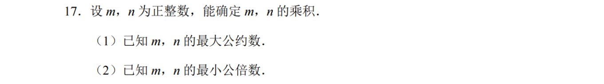

### 第 18 题

甲班 34 人，乙班 36 人，在满分 100 分的考试中，甲班总分数与乙班总分数相等，则可知两班的平均分之差。

（1）两班的平均分都是整数。  
（2）乙班的平均分不低于 65。

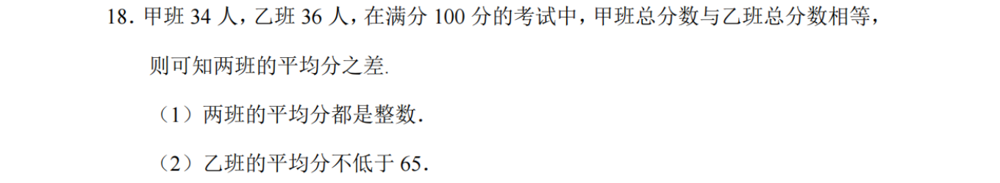

### 第 19 题

如图，在菱形 $ABCD$ 中，$M, N$ 分别为 $AD$ 和 $CD$ 的中点，$P$ 是 $AC$ 上的动点，则能确定 $PM+PN$ 的最小值。

（1）已知 $AC$。  
（2）已知 $AB$。

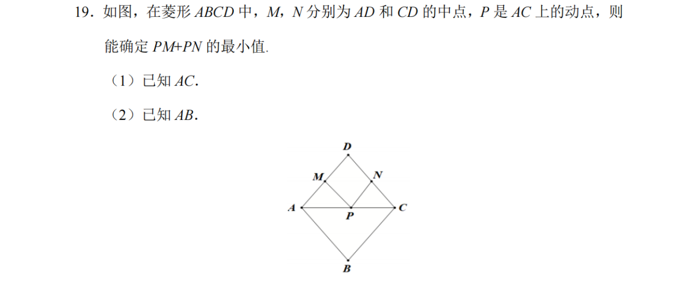

### 第 20 题

在分别标记了数字 1，2，3，4，5，$a$ 的 6 张卡片中，随机抽取 2 张，则这两张卡片上的数字之和为奇数的概率大于 $\dfrac{1}{2}$。

（1）$a = 7$。  
（2）$a = 8$。

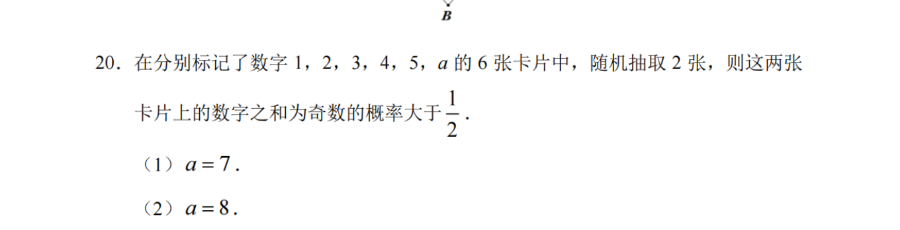

### 第 21 题

设 $a, b$ 为实数，则 $(a + b\sqrt{2})^{\frac{1}{2}} = 1 + \sqrt{2}$。

（1）$a = 3, b = 2$。  
（2）$(a - b\sqrt{2})(3 + 2\sqrt{2}) = 1$。

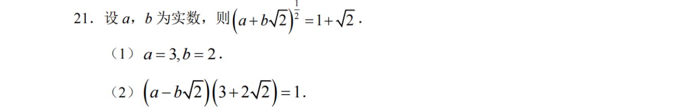

### 第 22 题

设 $p, q$ 为常数，一个等腰三角形的腰和底分别是方程 $x^2 - 3px + q = 0$ 的两个根，则能确定这个三角形。

（1）$q \le 2p^2$。  
（2）$p \ge 2$。

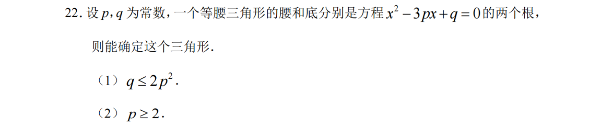

### 第 23 题

$x, y$ 是实数，则 $\sqrt{2x^2 + 2y^2} - |x| - y^2 \ge 0$。

（1）$|x| \le 1$。  
（2）$|y| \le 1$。

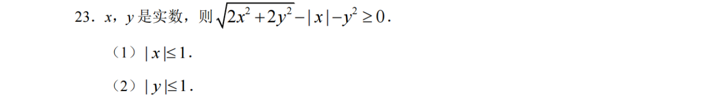

### 第 24 题

已知数列 $\{a_n\}$，则能确定 $a_1, a_2, a_3, a_4, a_5$ 成等差。

（1）已知 $a_1 + a_5 = a_2 + a_4$。  
（2）已知 $a_1 + a_5 = 2a_3$。

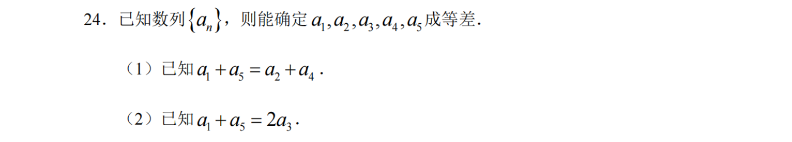

### 第 25 题

已知曲线 $L: y = a(x-1)(x-7)$，则能确定 $a$ 的值。

（1）曲线与圆 $(x-4)^2 + (y+1)^2 = 10$ 恰有 3 个交点。  
（2）曲线与圆 $(x-4)^2 + (y-4)^2 = 25$ 恰有 4 个交点。

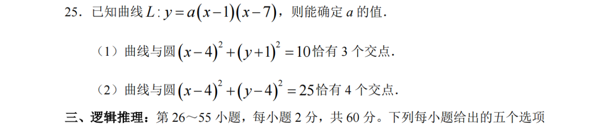

---

## 三、逻辑推理：第 26～55 小题，每小题 2 分，共 60 分。下列每题给出的五个选项中，只有一项是符合试题要求的。

### 第 26 题

以艺通心，是传统文化的核心艺术精神之一。艺术的本质是内心世界的外化，通过艺术人们既可以表达自己的内心世界，也可以看到别人的内心世界。由此有专家认为，艺术可通心，对于促进不同国家、不同语言、不同文化之间人们的沟通交流具有天然优势。

以下哪项如果为真，最能支持上述专家的观点？

- **A**．目前，全球有九大语系 7000 多种语言，对大多数人而言，进行跨文化沟通交流存在相当大的语言障碍。
- **B**．事实上，我们可以听懂、看懂千百年之前的音乐、绘画作品，可以不借助翻译而直接通过艺术作品感受世界各地人民的情感脉动。
- **C**．传统文化认为，“唯乐不可以为伪”，即艺术来不得半点虚假，必须是创作者内心的真实写照，必须忠实反映创作者内心的真情实感。
- **D**．艺术具有基于人性、传达情感、诉诸形式、付诸感性等特点，在艺术创造、传播、接受、反馈过程中，这些特点对于任何人都是一样的。
- **E**．要借助艺术实现跨文化沟通交流，仅有艺术的共情是不够的，还须将文化融入其中，以文化人，这样才能真正实现以艺通心。

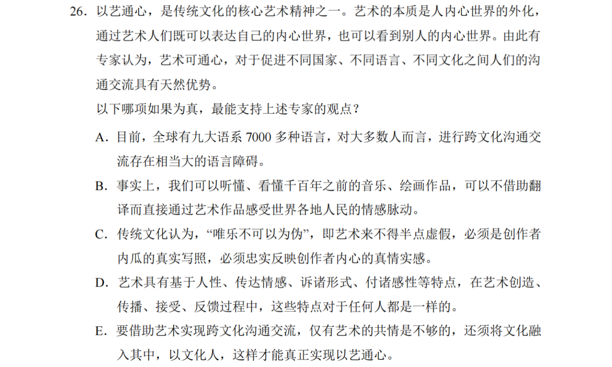

### 第 27 题

研究人员对近 12 万名 50 岁及以上受访者进行调查后发现，大约有一半的受访者每天久坐 10 小时或更长。在随后的五年内，这些习惯久坐的人当中有 805 人陆续死亡。他们还发现，如果每天增加 10 分钟的活动，则每天久坐不到 10 小时的死亡风险可降低 15%，而超过 10 小时的死亡风险可降低 35%。研究人员由此认为，每天活动 20 分钟可减少久坐危害，降低死亡风险。

以下哪项如果为真，最能质疑上述研究人员的观点？

- **A**．在已经离世的 805 人中，357 人每天久坐不到 10 小时，448 人每天久坐 10 小时或更长。
- **B**．每天 20 分钟的活动指的是快步走、爬山、骑行等运动强度较大的活动，对此许多中老年人难以坚持。
- **C**．随着年龄增大，中老年人的身体机能会逐渐下降，即使每天活动 20 分钟，其久坐时间也会越来越长，死亡风险也随之增加。
- **D**．许多久坐者认为，每天只需花 20 分钟活动，就可以长时间坐着阅读、追剧或工作，哪怕一天累计久坐 10 小时以上也无妨。
- **E**．每天活动 20 分钟，并不意味着每天活动可以减少到 20 分钟，20 分钟只是正常人一天活动的最低要求，为了健康，活动时间可以更长一些。

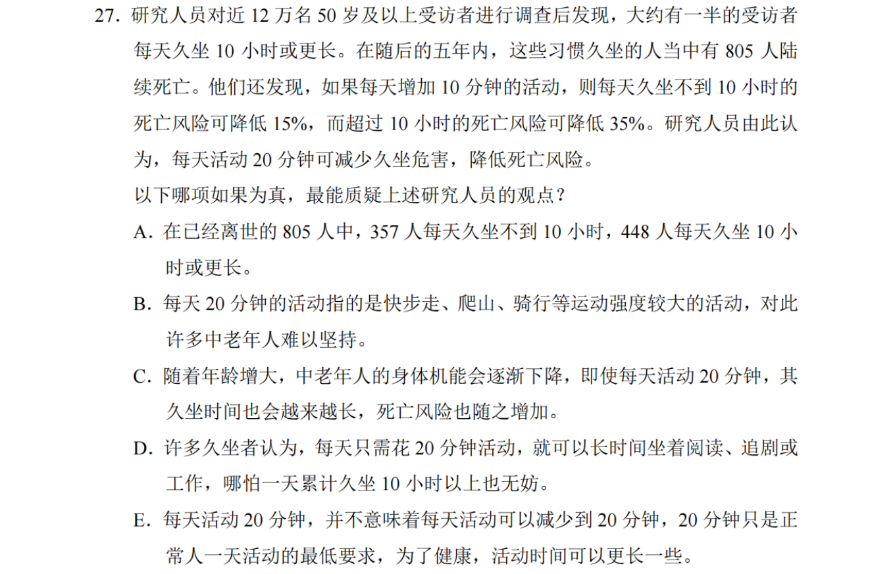

### 第 28 题

南方人习惯元宵节吃汤圆，这一习俗古已有之。有人将汤圆追溯至先秦时期南方流行的小吃“蜜饵”，《楚辞》中曾提到过它；也有人认为是唐朝时元宵节吃的一种称作“面茧”的带馅馒头。但有民俗学家指出，汤圆真正的前身是宋代被称为“圆子”的小吃。

以下哪项如果为真，能支持上述民俗学家的观点？

- **A**．“蜜饵”虽是一种用糯米粉裹以蜂蜜制成的糕点，但它不是元宵节的专属美食。
- **B**．宋代的“圆子”是用黑芝麻、猪油、白糖作馅，以糯米粉搓成圆形的“乳糖圆子”。
- **C**．宋代诗人周必大写的《元宵煮浮圆子》是迄今发现的最早描述元宵节水煮汤圆的诗歌。
- **D**．宋代饮食文化十分发达，相比于其他朝代，“圆子”种类更加繁多，比如山药圆子、珍珠圆子、金橘水团等。
- **E**．只有宋人常写涉及“圆子”的诗词，如南宋女诗人朱淑真曾在其《圆子》诗中写有“轻圆绝胜鸡头肉，滑腻偏宜蟹眼汤”。

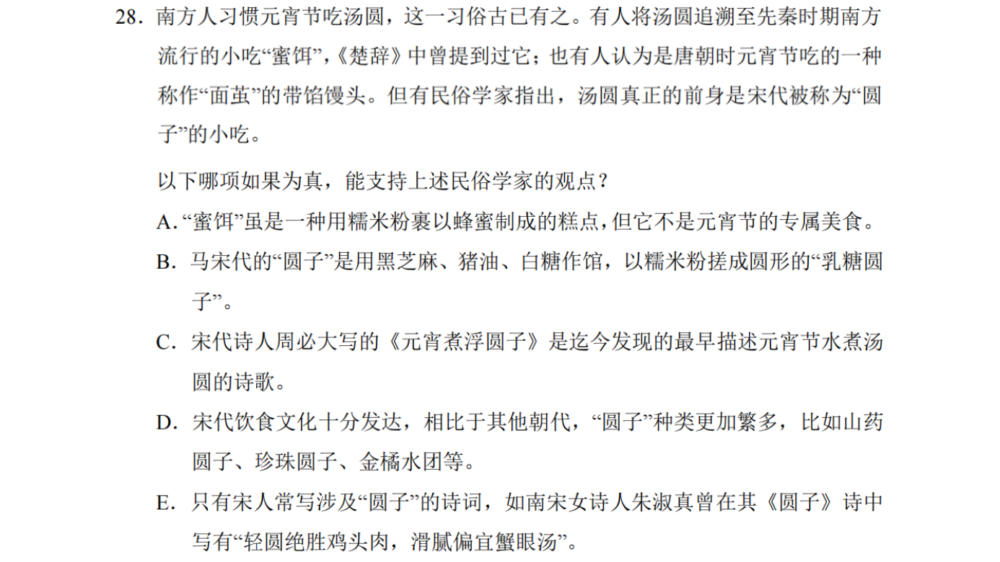

### 第 29 题

人生病时会出现发烧、疲倦、头疼、咳嗽、肌肉酸痛、食欲不振、精神萎靡等症状。有人认为，生病时出现这些症状是为了尽快清除病原体，让人恢复健康。比如，发烧是为了让人保持高体温以便杀死病原体。但是，也有研究人员发现，疲倦、头疼、心情抑郁和食欲不振等症状与清除病原体并没有直接的联系。他们据此推测，有些症状的出现不是为了提高个人的生存率，而是为了保护整个种群的利益。

以下哪项如果为真，最能支持上述研究人员的推测？

- **A**．病原体常常通过患者、医生、护士及患者家属扩散开来。
- **B**．一些病人在还没有发烧的时候，也会出现头疼、乏力和食欲不振等症状。
- **C**．出现疲倦、头疼和心情抑郁等症状是为了节约能量，便于人体继续保持高体温以杀死病原体。
- **D**．17 世纪黑死病传到一个英国村庄的时候，已被感染的村民为了不让病原体扩散，主动自我隔离，从而保护了周围村庄的安全。
- **E**．疲倦、心情抑郁等症状是为了让人减少社交，防止病原体人传人；咳嗽等症状是为了让同伴们知道自己生病了，最好离远些。

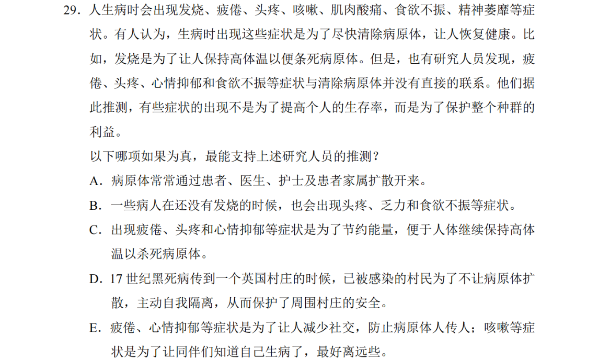

### 第 30 题

鹅，通体洁白，脖颈纤细流畅，常引颈高歌，缓步行走。秦汉时期，鹅已成为“庆祭丧婚，节岁礼馈”的必设之物，虽然也偶上餐桌，但其身价昂贵，只有贵族才可用。东晋时期书法家王羲之养鹅、爱鹅之雅事传于后世。一般认为，他养鹅、爱鹅，是为了观察鹅行走的步态而体悟书法之道、君子之风。但也有专家认为，王羲之养鹅、爱鹅，其实也看重鹅的药用价值。

以下哪项如果为真，最能支持上述专家的观点？

- **A**．《隋书》说鹅肉“肥腻而滑，味美可口”，到了宋朝，鹅开始成为舌尖上的美味，鹅类菜品琳琅满目。
- **B**．在道教流行的魏晋时期，鹅常被看作体内怀有仙气的禽鸟，融仙风与道骨于一体，食之益处良多，王羲之可能对此亦有同感。
- **C**．南朝医家陶弘景发现，鹅血能缓解药石引发的症状；而唐朝孟诜《食疗本草》还认为，鹅肉、鹅血均有解毒功效，对服食丹药的人大有裨益。
- **D**．王羲之为天师道世家出身，曾与道士许迈共同修道服食丹药，常不远千里采买药石，其间发现鹅血、鹅肉能缓解服用药石引发的燥热症状。
- **E**．魏晋名士崇尚自然，喜好养生，加之时道教和炼丹术习染，社会名士中服食药石之风盛行，而内服药石达到一定剂量即可使人中毒乃至死亡。

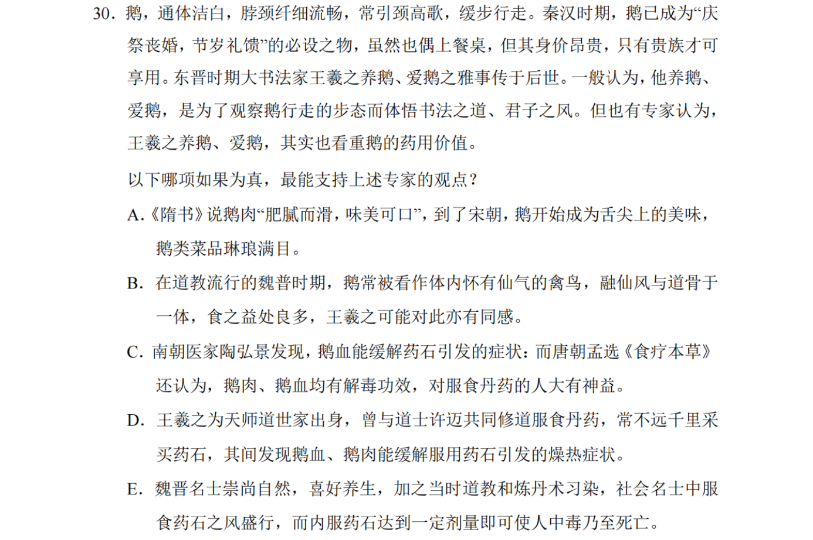

### 第 31 题

近日，火车无座票和有座票价格相同的话题再次引起广泛关注。有人在暑期买不到有座票，持无座票上车后又找不到座位，于是在“站得实在辛苦”之余，觉得“有无同价”有失公平。他们认为，既然一个有座位、另一个无座位，两者享受的服务不一样，价格怎么可以一样呢？对此，有专家却认为，如果铁路公司根据市场需求将有、无座位的票价拉开差距，就可能对低收入者产生不利影响。

以下哪项如果为真，最能支持上述专家的观点？

- **A**．现在的无座票只是表明没有事先预留座位，无座票乘客上车后仍可能找到座位，如果实行无座票打折政策，有座票乘客会觉得不公平。
- **B**．如果无座票打折，就会激励一些人去购买无座票，而买了无座票的人上车后看到空座位一般总会去坐，这种“蹭座”行为会加大铁路公司的监管成本。
- **C**．即使“有无同价”，与较晚购到无座票相比，提早买到有座票仍需要付出更多的时间和精力，这意味着有座票的真实价格其实是高于无座票的。
- **D**．目前，铁路公司以先到先得的原则先售完有座票，再出售无座票，低收入者只要早些去抢票，还是可以买到有座票的。
- **E**．如果铁路公司执行“谁花钱多谁就有座位使用权”的原则，完全按市场供需来决定票价，那么在出行高峰期，低收入者可能完全没有机会得到座位。

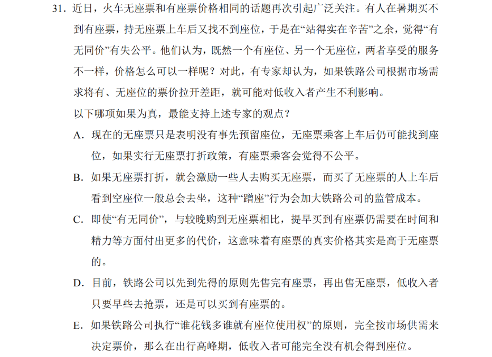

### 第 32 题

苏洵，字明允，是北宋文人苏轼的父亲，自南宋以来人们常以老泉称苏洵。但是，宋以后又有人发现，苏轼虽号东坡居士，但晚年也自号“老泉山人”。苏东坡有诗云“宝公骨冷唤不闻，却有老泉来唤人。此处，苏轼自称为“老泉”。与苏轼幼子苏迈交往甚密的叶梦得在其《石林燕语》中证实，苏轼“晚又号老泉山人，以眉山先茔有老翁泉，故云”。由此，有专家认为，南宋以来的人们将苏洵称作老泉纯属误传。

以下哪项如果为真，最能支持上述专家的观点？

- **A**．明人黄灿、黄炜在《重编嘉祐集纪事》中说，他们亲眼见到有人向他们展示的苏轼《阳美帖》上有“东坡居士、老泉山人”之图记。
- **B**．宋人梅尧臣曾作《赠老人泉寄苏明允》诗云：“泉上有老人，隐见不可常。苏子居其间，饮水乐未央。”这很容易让人以为苏老泉即苏洵。
- **C**．宋时避讳规矩严格，苏轼的祖父名苏序，苏轼在作诗文集序时均将“序”改称“叙”，从不敢违反避讳的规矩。
- **D**．宋光宗时郎晔《经进东坡文集事略》称苏轼为“老泉仲子也”；《三字经》的作者王应麟也说“苏老泉，二十七，始发愤”，其中的“苏老泉”即苏洵。
- **E**．西方人取名，经常用其祖父、外祖父或其他上辈的名字，以此表达纪念、尊敬、继承或荣耀之意。

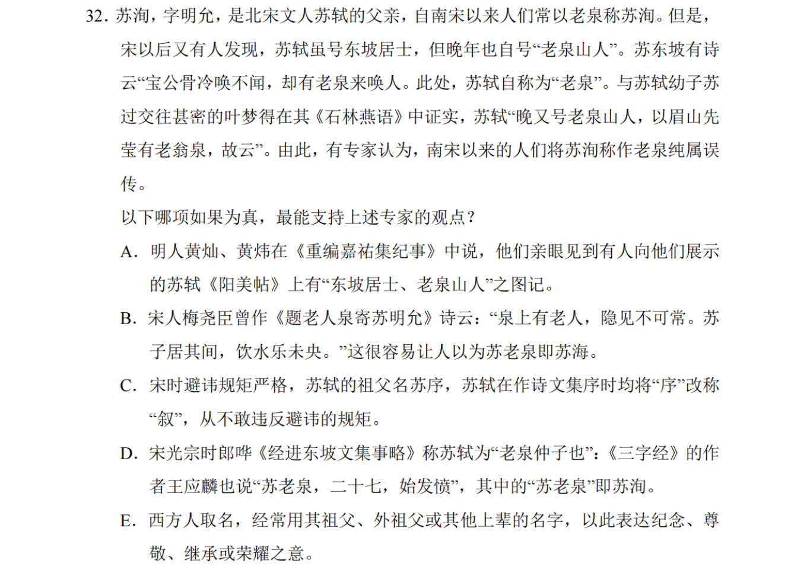

### 第 33 题

加强考勤管理，某公司制订了相关条例。其中两条为：

(1) 对连续 3 天以上未按时打卡且年终绩效排名在倒数 10% 之内的员工，扣发年终奖；  
(2) 对出现多次未按时打卡但年终绩效排名在前 10% 之内的员工，不扣发年终奖。

若该公司根据条例决定不扣发员工王某的年终奖，则以下哪项最能解释该公司决定的合理性？

- **A**．王某年终绩效排名在前 10% 之内。
- **B**．王某没有连续 3 天以上未按时打卡。
- **C**．王某虽多次未按时打卡但年终绩效排名在倒数 10% 之外。
- **D**．王某若年终绩效排名不在前 10% 之内，则他不曾多次未按时打卡。
- **E**．王某没有连续 3 天以上未按时打卡或者其年终绩效排名不在倒数 10% 之内。

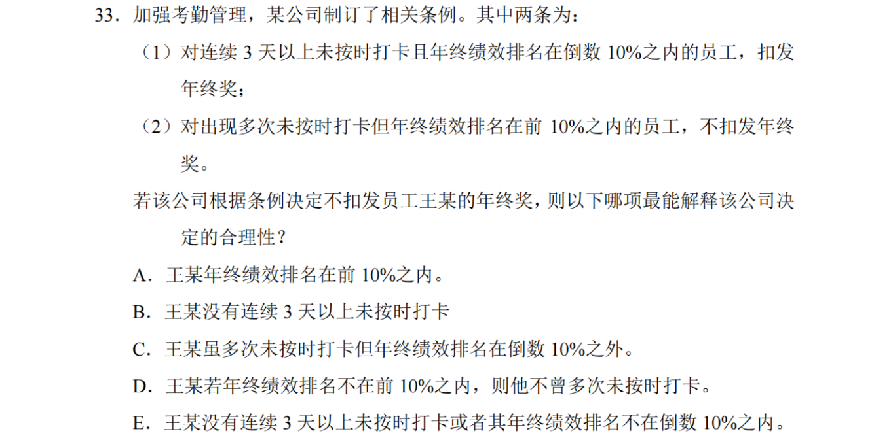

### 第 34 题

罗马帝国曾是世界上最强大的帝国之一，但西罗马早在公元 5 世纪就土崩瓦解，东罗马也在 15 世纪走向终结。如此庞大的帝国为何走向末路？有网友研究发现，罗马帝国的水渠管道有相当一部分是用铅铸造的。近年来又有考古人员发现，古罗马人的遗骨中铅含量异常，有的到了足以引发健康问题的程度。由此，这些网友认为，水在流经铅管道的时候被铅污染了，罗马居民天天饮用铅污染水，发生了铅中毒现象，从而加速了帝国的衰亡。

以下哪项如果为真，最能质疑上述网友的观点？

- **A**．罗马人广泛使用银作为货币和装饰，而用来冶炼出银的银矿石主体是铅，这使得罗马帝国每年产铅量巨大。
- **B**．铅金属熔点低又易铸造成型，拿来做水管极为合适，也可以用来制作生活中各种方便实用的合金工具。
- **C**．罗马人习惯用铅制容器加热葡萄汁，而实验发现在铅容器中熬制葡萄汁减少至三分之一时，每升葡萄汁中会含有高达一克的铅。
- **D**．罗马帝国早期很少有铅中毒的记载，直到公元 7 世纪，才有东罗马帝国的个别医师描述过慢性铅中毒症状，但对中毒原因莫衷一是。
- **E**．罗马帝国的铅水管里一般会结有一层很厚的水垢，这些水垢阻挡了水和铅的接触，使得水中的含铅量极少，并不足以威胁人的健康。

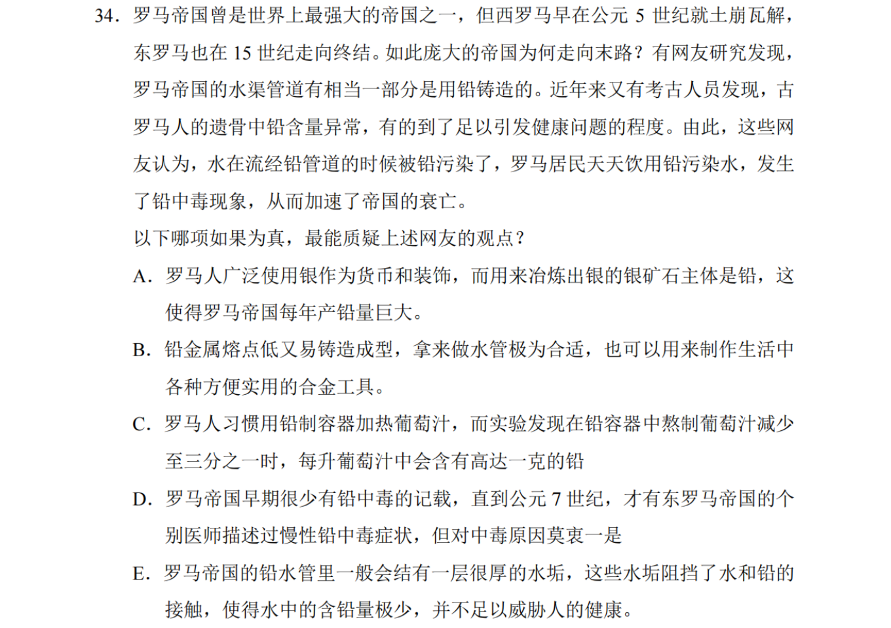

### 第 35 题

作为一款生成式人工智能软件，RZN-III 利用已有网络文献，可为提问者提供经过搜索整理后相对合理的答案，给大学生学习带来便利。目前，有些大学禁止学生在做论文和课程作业时使用 RZN-III，否则将被视为学术不端；但也有一部分大学不阻拦甚至鼓励学生使用它。对此有专家认为，RZN-III 虽只提供既有知识，但也能助力科技创新，大学禁用 RZN-III 其实不妥。

以下哪项如果为真，最能支持上述专家的观点？

- **A**．将 RZN-III 作为人的“外脑”，对人类的已有智慧进行向量化的储存和提取，会加速和简化人们的学习过程，这将为科技创新腾出时间和精力。
- **B**．传承文明需要一代代人组成人才梯队，不断学习、应用和创新。如果人类在 RZN-III 总结的前人智慧上躺平，其文明进程就会出现停滞甚至倒退。
- **C**．目前人类知识呈现大爆炸状态，很多人即使穷其一生都学不完某领域的基础知识，根本没有时间为该领域做些添砖加瓦的创新工作。
- **D**．大学不仅要传授知识与技艺，更要培养学生独立思考、科学思维的能力。如果让 RZN-III 替代学生思考，就会弱化他们的创新思维和进取心。
- **E**．作为一种现代社会的实用工具，RZN-III 应进入大学课堂，成为重要的大学教学内容，否则学生毕业后很难适应社会，更不用说参与激烈的人才竞争。

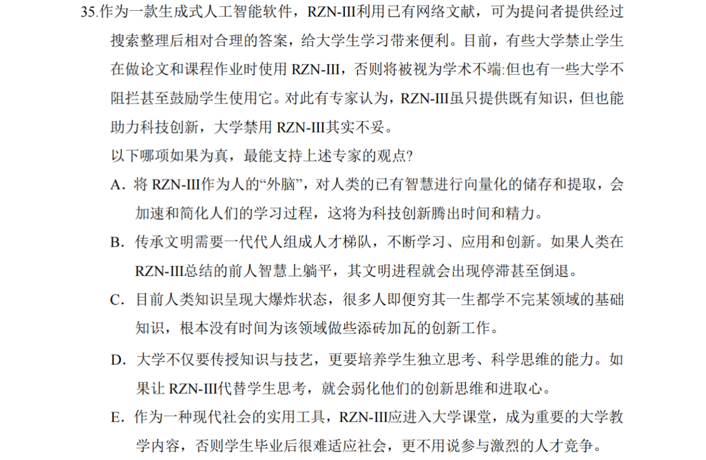

### 第 36 题

牛磺酸是半胱氨酸的天然代谢产物，人体内和大多数动物性食物中都能找到这种成分。有研究发现，人体内的牛磺酸含量随着年龄的增加而不断下降，一个 60 岁老人体内的牛磺酸水平只有 5 岁儿童的三分之一。一项针对万名 60 岁以上老人的体检统计显示，他们体内的牛磺酸水平越高，健康状况越好。有专家据此认为，人体内的牛磺酸水平与人体的健康状况呈正相关关系。

以下哪项如果为真，最能支持上述专家的观点？

- **A**．牛磺酸可能具备抗衰老功效，但这个推测目前还没有获得严格的实验证据支持。
- **B**．服用牛磺酸可缓解骨质疏松这种典型的中老年疾病，甚至还能促进骨骼生长。
- **C**．实验中服用牛磺酸的老鼠寿命延长了 3~4 个月，这相当于人类寿命的 7~8 年。
- **D**．不管从事何种体育运动，只要进行经常性锻炼都会提升体内的牛磺酸水平。
- **E**．有些猴子服用牛磺酸后，精力更加充沛，肌肉的耐力和爆发力都有所增长。

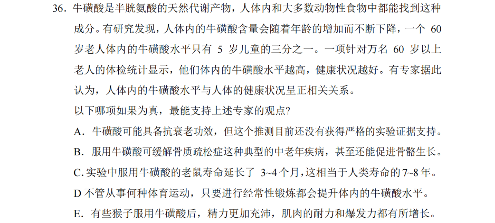

### 第 37 题

生态文明建设覆盖面广、综合性强，涉及价值理念、目标导向、生产和消费方式等多个方面，是一项复杂的系统性工程。过去一段时间，由于生态环境数据信息在区域、部门、单位之间共享不够，导致生态环境治理在一定程度上存在碎片化现象，一些地方生态环境治理中“反复治理、治理反复”的问题较为突出。由此可见，建成生态环境数据“一张网”、建设数字生态文明是非常必要的。

以下哪项如果真，最能支持上述论证？

- **A**．数字化和绿色化相互融合、相互促进，已成为全球发展的重要主题。
- **B**．建设数字生态文明能够有效提升生态文明建设的共享性、系统性和协同性。
- **C**．建成生态环境数据“一张网”可以科学高效地解决生态环境问题，拓展生态环境治理的方法和路径。
- **D**．建设绿色智慧的数字生态文明，可为促进经济社会全面绿色转型、建设人与自然和谐共生的现代化提供强劲动能。
- **E**．数字赋能生态文明建设可以不断健全生态环境领域数字化的标准规范体系，为建设全球生态文明贡献中国标准。

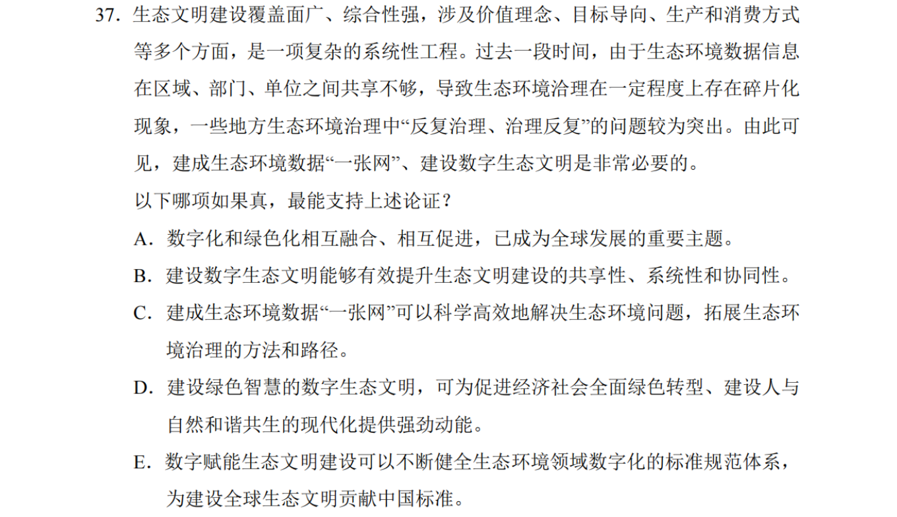

### 第 38 题

名山公园最美的风景往往在山顶才可寻觅。为了让游客既能看到美景又能轻松登山，很多公园在大山上安装了索道或电梯，实现了有些游客追求的“无痛登山”梦想。对此，许多登山爱好者却认为，“无痛登山”让登山失去了灵魂，这样的登山其实已经没有乐趣可言。

以下哪项如果为真，最能质疑上述登山爱好者的观点？

- **A**．很多名山公园的登山步道长达数千米，海拔高差也达数百米乃至千米以上，对那些运动能力欠佳但又想“一览众山小”的游客实在不太友好。
- **B**．一般来说，现在许多装有登山索道或电梯的名山公园，还留有传统登山步道供登山爱好者使用，游客可以量力而行，追寻各自的便利和快乐。
- **C**．无须风吹雨打、烈日炙烤，无须劳累辛苦、久耗时间，很多游客走出高山索道或电梯，就能欣赏眼前一片广阔风景，打卡拍照后潇洒离去，好不自在。
- **D**．在自然的山木中安装索道或电梯，不仅因耗费巨大而增加游客费用，而且会造成对绿水青山的破坏，不符合人与自然和谐共生的理念。
- **E**．登山者求的是探索自然的乐趣和登险克难的快感，“无痛登山”用身心的闲置取代身心的磨砺，让这种乐趣和快感荡然无存。

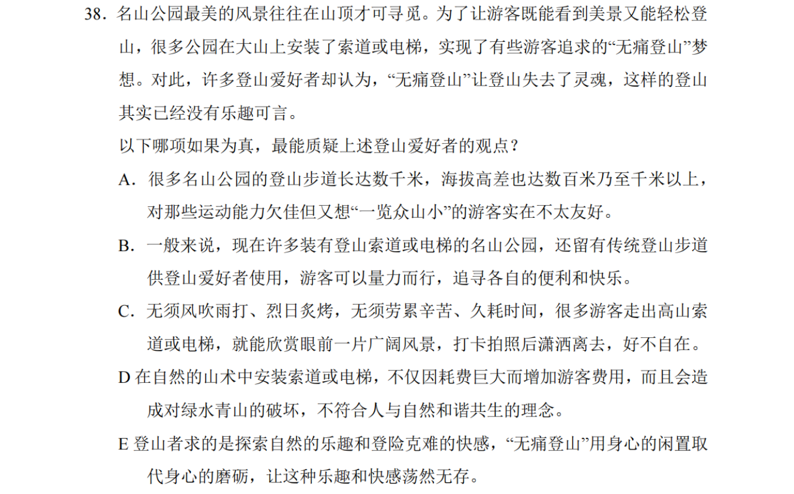

### 39～40 题基于以下题干

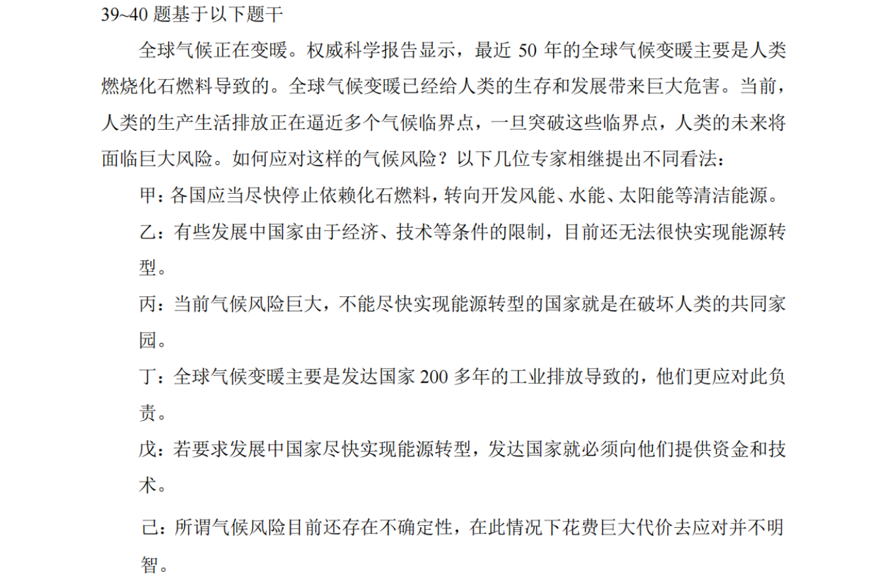

全球气候正在变暖。权威科学报告显示，最近 50 年的全球气候变暖主要是人类燃烧化石燃料导致的。全球气候变暖已经给人类的生存和发展带来巨大危害。当前，人类的生产生活排放正在逼近多个气候临界点，一旦突破这些临界点，人类的未来将面临巨大风险。如何应对这样的气候风险？以下几位专家相继提出不同看法：

甲：各国应当尽快停止依赖化石燃料，转向开发风能、水能、太阳能等清洁能源。  
乙：有些发展中国家由于经济、技术等条件的限制，目前还无法很快实现能源转型。  
丙：当前气候风险巨大，不能尽快实现能源转型的国家就是在破坏人类的共同家园。  
丁：全球气候变暖主要是发达国家 200 多年的工业排放导致的，他们更应对此负责。  
戊：若要求发展中国家尽快实现能源转型，发达国家就必须向他们提供资金和技术。  
己：所谓气候风险目前还存在不确定性，在此情况下花费巨大代价去应对并不明智。

### 第 39 题

根据以上信息，可以得出以下哪项？

- **A**．乙反驳了甲。
- **B**．丙反驳了甲。
- **C**．丁反驳了甲。
- **D**．己反驳了甲。
- **E**．戊反驳了甲。

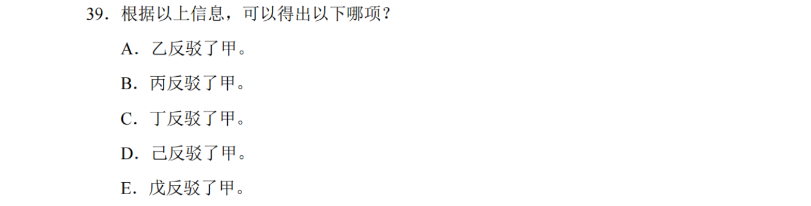

### 第 40 题

对于上述专家的观点，可以得出以下哪项？

- **A**．乙和丁支持戊。
- **B**．丙和戊支持甲。
- **C**．乙和丁支持戊。
- **D**．乙和丙支持己。
- **E**．戊和己支持乙。

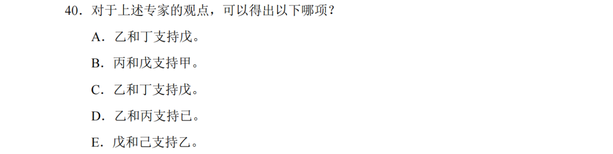

### 第 41 题

已知“■■■■”“■■■■”和“■■■■”是三组图形符号，其中有两组分别表示“春花开满园”和“满山梅花开”。

根据以上信息，可知“■■”中两个相邻图形符号表示的汉字有（详见原卷切片）：

- **A**．春山
- **B**．梅园
- **C**．梅山
- **D**．花园
- **E**．山花

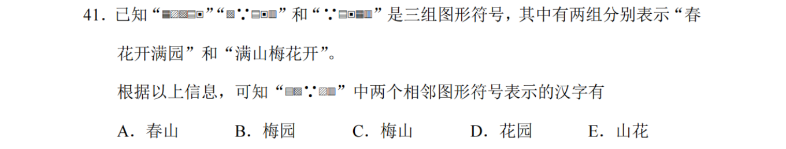

### 第 42 题

某小区院子里栽种了许多树，既有常绿树，也有落叶树。其中，针叶树都是常绿树，阔叶树都不是常绿树；针叶树大都属于观赏树种；果树大部分不是常绿树，少部分是常绿树。

根据以上信息，关于小区院子里栽种的树，可以得出以下哪项？

- **A**．针叶树有些是果树。
- **B**．阔叶树有些不是果树。
- **C**．有些针叶树不是果树。
- **D**．有些果树不是阔叶树。
- **E**．有些阔叶树是观赏树种。

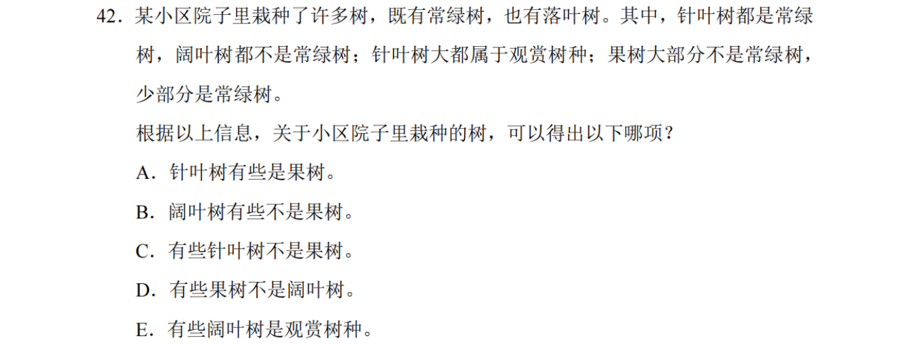

### 第 43 题

某地群山连绵，森林覆盖率高达 75%，具有林海、高山草甸、尺坑、峡谷等四种类型的自然景观，吸引着世界各地游客。一位细心的游客发现，该地四种自然景观共 16 处，每种类型的自然景观数量各不相同，另外，他还发现：

(1) 临海和峡谷的总数共是 6 处；  
(2) 临海和尺坑的总数共是 7 处；  
(3) 4 种类型自然景观中有一种类型的数量是 3 处。

根据以上信息，可以得出以下哪项？

- **A**．该地有 2 处临海。
- **B**．该地有 3 处尺坑。
- **C**．该地有 4 处峡谷。
- **D**．该地有 5 处高山草甸。
- **E**．该地有 8 处高山草甸。

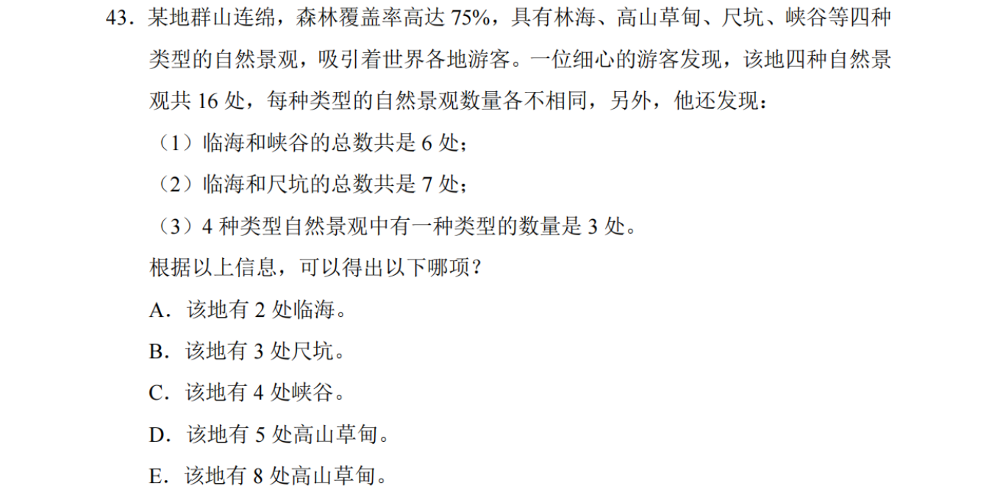

### 第 44 题

某大学新校区建成后，甲、乙、丙、丁 4 位校领导对新校区建设①②③④⑤等 5 项工作进行了检查，已知他们每个人至少检查了其中 1 项工作，每项工作均被检查过一遍，且不会被重复检查，关于他们 4 人与其检查工作的对应情况有如下 3 种描述：

| | ① | ② | ③ | ④ | ⑤ | 对应情况描述正确的数量 |
| :---: | :---: | :---: | :---: | :---: | :---: | :---: |
| **描述一** | 乙 | 甲 | 丁 | 丁 | 丙 | 2 |
| **描述二** | 丙 | 甲 | 乙 | 甲 | 丁 | 2 |
| **描述三** | 甲 | 丙 | 丁 | 乙 | 甲 | 3 |

根据上述信息，可以得出哪项一定为真？

- **A**．甲检查了工作④。
- **B**．甲检查了工作⑤。
- **C**．乙检查了工作③。
- **D**．丙检查了工作②。
- **E**．丁检查了工作④。

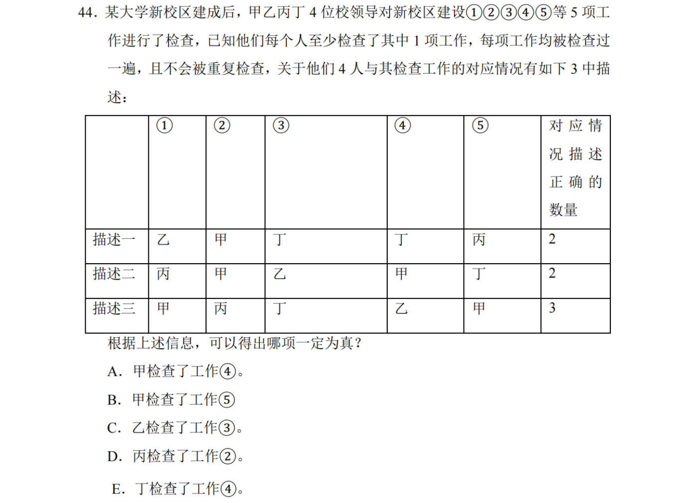

### 第 45 题

近期，某老年大学开设书法，手工，台球，古筝，声乐，绘画 6 门秋季课程，陆、赵、王、李 4 位老人均报名参加了其中 2 门课程的学习。已知：

(1) 上述每门课程均至少有其中的 1 人报名；  
(2) 李所报课程仅与其他 3 人中的 1 人所报课程完全不同；  
(3) 若李王 2 人至多有 1 人报书法课程，则李和陆均报了声乐和绘画课程。

根据以上信息，可以得出哪项？

- **A**．赵报古筝
- **B**．李报声乐
- **C**．陆报绘画
- **D**．王报台球
- **E**．李报书法

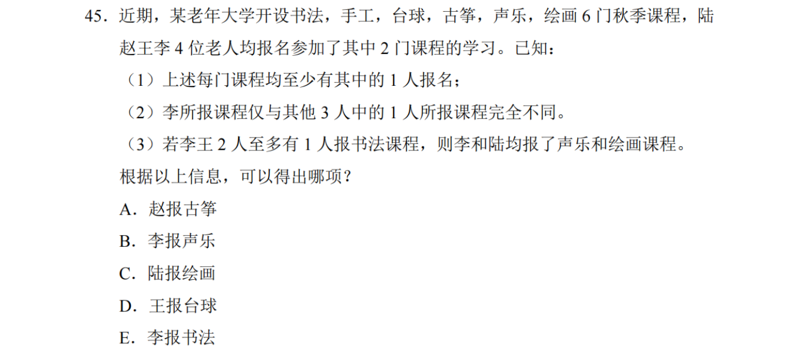

### 第 46 题

某单位今年招聘了甲、乙、丙、丁、戊、己 6 名应届毕业生，其中博士 1 人，硕士 2 人，学士 3 人；2 名男性，4 名女性。已知：

(1) 乙、丁 2 人性别相同，丙、己 2 人性别不同；  
(2) 甲、己 2 人学位相同，乙、丙、戊 3 人学位各不相同。

根据以上信息，可以得出以下哪项？

- **A**．乙、丁中至少有 1 人是女硕士。
- **B**．乙、丙中至少有 1 人是女硕士。
- **C**．丁、戊中至少有 1 人是男硕士。
- **D**．丙、戊中有 1 人是男博士。
- **E**．丙、戊中有 1 人是女博士。

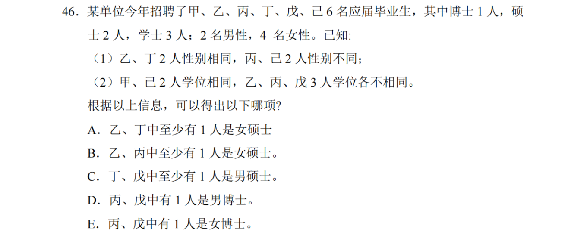

### 第 47 题

某部甲、乙、丙、丁、戊、己、庚、辛 8 名官兵以一路纵队进行（先后顺序未必如此）。已知：甲之后有 3 名士兵；丙是士兵，其后有 2 名士兵；丁之前有 2 名军官，其后有 2 名士兵；己之后无士兵。

根据以上信息，可以得出以下哪项？

- **A**．乙是军官。
- **B**．丁是军官。
- **C**．戊是士兵。
- **D**．己是军官。
- **E**．8 人中有 5 名军官、3 名士兵。

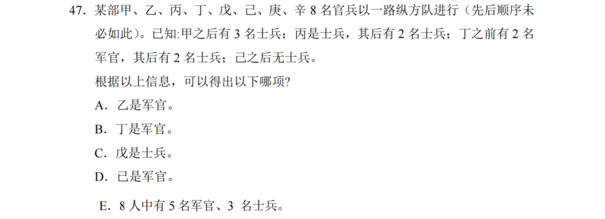

### 第 48 题

某大学开设 6 门中国古代经典选读课程，分别讲授《论语》《周易》《中庸》《墨经》《诗经》《尚书》之一，由周、吴、王 3 位老师各讲授其中 2 门且所讲完全不同。已知：

(1) 吴老师、讲授《诗经》的和讲授《论语》的 3 人均是文学院的；  
(2) 周老师、讲授《墨经》的和讲授《周易》的 3 人均住在教师公寓。

根据以上信息，以下哪项是不可能的？

- **A**．讲授《论语》《周易》的是同一位老师。
- **B**．讲授《中庸》《尚书》的是同一位老师。
- **C**．讲授《墨经》《诗经》的是同一位老师。
- **D**．讲授《中庸》《墨经》的是同一位老师。
- **E**．讲授《诗经》《尚书》的是同一位老师。

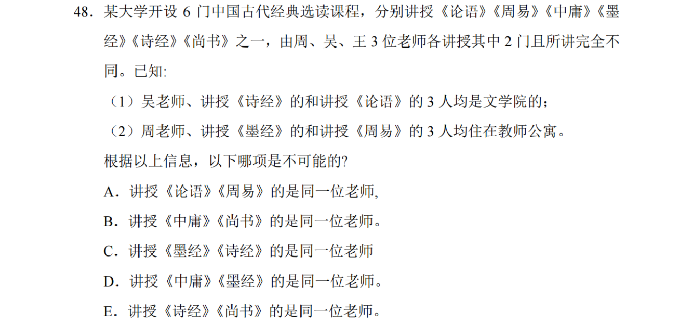

### 第 49 题

下图有一 $5\times 5$ 的方阵，它所含的每个小方格中均可填入“酸”“甜”“苦”“辣”“咸”五味名称之一，有部分方格已经填入，要求该方阵每行、每列以及两条对角线的 5 个小方格中均含有五味名称，不能重复也不能遗漏。

| ① | | | | 辣 |
| :---: | :---: | :---: | :---: | :---: |
| | | | | ② |
| | | 苦 | | |
| | | | | 甜 |
| 酸 | | | | |

根据上述要求，以下哪项是空格①②中依次应填入的五味名称？

- **A**．甜、酸
- **B**．甜、咸
- **C**．咸、酸
- **D**．甜、苦
- **E**．咸、苦

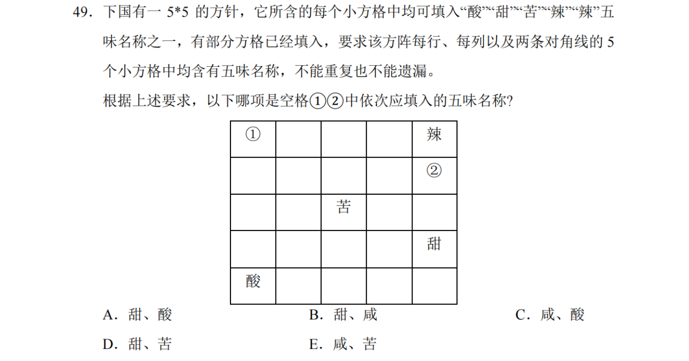

### 50～51 题基于以下题干

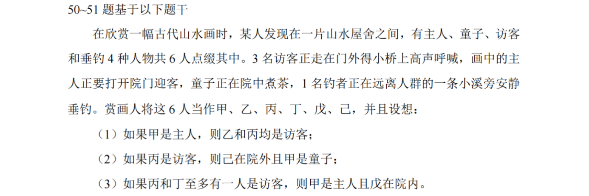

在欣赏一幅古代山水画时，某人发现在一片山水屋舍之间，有主人、童子、访客和垂钓 4 种人物共 6 人点缀其中。3 名访客正走在门外的小桥上高声呼喊，画中的主人正要打开院门迎客，童子正在院中煮茶，1 名钓者正在远离人群的一条小溪旁安静垂钓。赏画人将这 6 人当作甲、乙、丙、丁、戊、己，并且设想：

(1) 如果甲是主人，则乙和丙均是访客；  
(2) 如果丙是访客，则己在院外且甲是童子；  
(3) 如果丙和丁至多有一人是访客，则甲是主人且戊在院内。

### 第 50 题

根据以上信息，可以得出以下哪项？

- **A**．乙是访客。
- **B**．甲是童子。
- **C**．丙是主人。
- **D**．戊是访客。
- **E**．己是钓者。

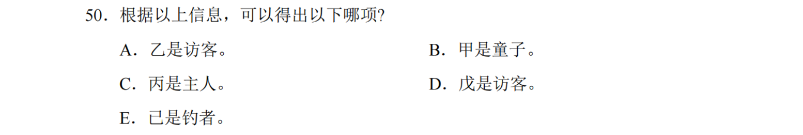

### 第 51 题

如果乙在院外，则可以得出以下哪项？

- **A**．丁是钓者。
- **B**．乙是访客。
- **C**．乙是钓者。
- **D**．戊是主人。
- **E**．己是访客。

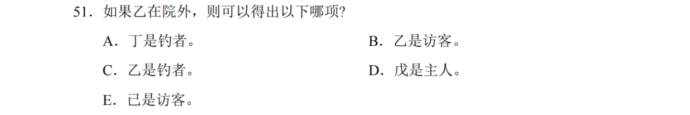

### 52～53 题基于以下题干

某次考试有 10 道选择题，小李、小王、小文 3 人均只答对其中 6 道题。已知：

(1) 没有人连续答对 3 道题；  
(2) 小李第 2、4、9 题答错了，小王第 1、5、8 题答错了，小文第 3、6、9 题答错了。

### 第 52 题

根据以上信息，以下哪项是可能的？

- **A**．小李第 6 题答错了。
- **B**．小李第 10 题答错了。
- **C**．小王第 9 题答错了。
- **D**．小王第 10 题答错了。
- **E**．小王第 6 题答错了。

### 第 53 题

若有一题 3 人均答对了，有一题 3 人均答错了，则以下哪项一定是错误的？

- **A**．小李第 3 题答对了。
- **B**．小王第 2 题答对了。
- **C**．小王第 3 题答错了。
- **D**．小文第 2 题答错了。
- **E**．小文第 4 题答对了。

### 54～55 题基于以下题干

某学院尚余 9 个考场的监考任务供甲、乙、丙、丁、戊 5 位老师选择。已知，每场考试 2 小时，每位老师均需监考 2~3 个考场；有 2 个考场要求其中 2 人共同监考；其余 7 个考场要求单独监考，各需 1 名监考人员。这 9 个考场的时间安排如下：

| 时间/星期 | 星期一 | 星期二 | 星期三 | 星期四 | 星期五 |
| :---: | :---: | :---: | :---: | :---: | :---: |
| **上午** 09:00~11:00 | 已安排 | 1 个考场 | 1 个考场 | 已安排 | 1 个考场 |
| **下午** 14:00~16:00 | 已安排 | 无监考 | 例会 | 2 个考场 | 已安排 |
| **晚上** 18:30~20:30 | 1 个考场 (2 人监考) | 1 个考场 | 1 个考场 | 1 个考场 (2 人监考) | 已安排 |

对于监考安排，丙、丁没有任何要求，但其他 3 位老师有如下要求：  
甲：我的监考需安排在晚上，但不要连续两个晚上都安排监考；  
乙：若我的监考没有都安排在前三天，则有一场需安排我和丙在同一天同一时间监考；  
戊：我想监考三场，但都不要安排在上午。  
事后得知，这 3 位老师的要求均得到了满足。

### 第 54 题

若周五安排乙监考，则可以得出以下哪项？

- **A**．甲都是单独监考。
- **B**．乙有一场共同监考。
- **C**．丙都是共同监考。
- **D**．丁有一场共同监考。
- **E**．戊至少有一场共同监考。

### 第 55 题

若丁的监考都安排在晚上，则可以得出以下哪项？

- **A**．周一晚上甲有监考
- **B**．周五上午乙有监考
- **C**．周四下午丙有监考
- **D**．周三晚上丁有监考
- **E**．周二晚上戊有监考

---

## 四、写作：第 56～57 小题，共 65 分。其中论证有效性分析 30 分，论说文 35 分。

### 56. 论证有效性分析：分析下述论证中存在的缺陷和漏洞，选择若干要点，写一篇 600 字左右的文章，对该论证的有效性进行分析和评论。（论证有效性分析的一般要点是：概念特别是核心概念的界定和使用是否准确并前后一致，有无各种明显的逻辑错误，论证的论据是否成立并支持结论，结论成立的条件是否充分，等等。）

有位西方哲学家曾经指出，一个人在已有的知识体系、价值观念、思维方式等因素的影响下，会形成特定的主观立场，即“前见”。实际上，人们在相互沟通与理解外部世界时无法摆脱这一“前见”。早在先秦时期庄子就说过，人们认为毛嫱是美女，但鱼见到毛嫱只会惊恐游走，这些都表明，人们在相互沟通与理解过程中，主观立场造成了很大障碍。

首先，不同个体交流时无法避免偏见，偏见是每个人都可能拥有的，这一主观立场正是我们沟通与理解的障碍。我们对喜欢的人往往会宽厚包容，对不喜欢的人会吹毛求疵。科学研究表明，别人对我们的实际印象与我们自认为留给别人的印象往往存在差异。

其次，性别不同也会带来主观立场的不同，从而导致沟通障碍。比如，家庭中丈夫和妻子在思维方式上存在不小的差异，丈夫往往偏重理性，而妻子则偏重感性，所以双方从各自的主观立场出发讨论问题时，就会产生分歧与争议。

再次，不同文化之间的交流与理解也存在同样问题。比如不同文化在审美标准上的主观差异通常会导致误解，与中国历史上伟大诗人李白作品相比，唐代僧人寒山的诗作更受一些美国人的喜爱。白居易的诗篇更受一些日本人青睐，所以不同文化背景下的读者在评判作家作品的高下时经常产生争议。

虽然主观立场造成了沟通与理解的障碍，但这并不意味着人们无法进行理解与沟通，千百年来通过换位思考来克服障碍，摆脱个人主观立场。

### 57. 论说文：根据下述材料，写一篇 700 字左右的论说文，题目自拟。

通常情况下，人们都希望被他人认可被社会承认。这种心理会促使他们去接受某种评价标准。因为只有接受了标准并身体力行，他们才能被社会肯定，否则便会被认为不合群。

