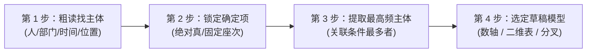

# 考研管综 199 历年真题考点考频、演进趋势与高分实战技巧全景报告（2009–2026）

> **数据样本说明**：本报告基于 2009–2026 年共 18 年、1026 道完整全国硕士研究生招生考试管综（199）真题及权威解析，进行全景式考点打标、考频量化统计与命题趋势深度剖析，并结合经典真题与答案提炼考场秒杀与避坑技巧。

---

## 一、历年真题考点考频全景量化统计

管综 18 年试卷结构高度稳定，每年均为 57 题，分值共 200 分：
- **数学基础**（75分）：问题求解 15 题（45分）+ 条件充分性判断 10 题（30分），18 年共 **450 题**。
- **逻辑推理**（60分）：单项选择 30 题（60分），18 年共 **540 题**。
- **综合写作**（65分）：论证有效性分析（30分）+ 论说文（35分），18 年共 **36 篇**。

### 1. 数学基础四大知识模块考频分布（450 题）

| 知识模块 | 核心二级考点 | 18 年总题量 | 考频占比 | 平均每年题量 | 考查星级 |
| :--- | :--- | :---: | :---: | :---: | :---: |
| **一、应用题** | 比例与百分比、行程（相遇/追及/水流）、工程效率、利润与折扣、浓度配比、集合容斥与交叉 | **115 题** | **25.6%** | **6.4 题** | ★★★★★ |
| **二、代数与方程函数** | 一元二次方程根的分布与判别式、韦达定理变形、不等式（均值不等式最值、分式高次不等式）、整式因式分解与余式定理、二次函数动轴定区间 | **91 题** | **20.2%** | **5.1 题** | ★★★★★ |
| **三、几何学** | **平面几何**（三角形相似/面积割补、阴影面积、扇形与圆）<br>**空间几何体**（长方体体对角线、圆柱圆锥球内外接）<br>**解析几何**（点线距离、直线与圆位置关系、弦长与切线、对称） | **102 题**<br>平几 54 题<br>立几 20 题<br>解几 28 题 | **22.7%** | **5.7 题**<br>(平几 3.0)<br>(立几 1.1)<br>(解几 1.6) | ★★★★★ |
| **四、数据分析** | 排列组合（捆绑/插空/隔板/定序消序/分配分组）<br>概率初步（古典概型、相互独立事件、伯努利概型）<br>数据描述（平均值、方差与标准差） | **50 题**<br>排列组合 7 题<br>概率 36 题<br>方差均值 7 题 | **11.1%** | **2.8 题** | ★★★★☆ |
| **五、数列** | 等差数列（通项、求和、对称性质）<br>等比数列（通项、求和、公比分类）<br>递推数列与错位相减/裂项求和 | **38 题** | **8.4%** | **2.1 题** | ★★★★☆ |
| **六、算术与实数** | 绝对值（代数化简、几何意义距离、绝对值三角不等式）<br>整数性质（质数合数、奇偶性、整除与带余除法） | **54 题**<br>绝对值 38 题<br>整数 16 题 | **12.0%** | **3.0 题** | ★★★★☆ |

---

### 2. 逻辑推理题型考频与结构演变（540 题）

把 18 年划分为两个 9 年周期进行纵向对比（前期 2009–2017 vs 后期 2018–2026）：

| 逻辑大类 | 细分题型 | 前期 (2009–2017)<br>270 题占比 | 后期 (2018–2026)<br>270 题占比 | 18 年总题量 | 考频趋势分析 |
| :--- | :--- | :---: | :---: | :---: | :--- |
| **形式逻辑** | 复言假言命题（充分/必要/逆否）<br>联言选言与德摩根定律<br>直言命题、对当关系与三段论 | 96 题 (35.6%) | 87 题 (32.2%) | **183 题 (33.9%)** | **稳中有降，工具化明显**：纯形式逻辑直接送分题减少，更多融入分析推理中作为已知条件。 |
| **论证逻辑** | 削弱质疑题（另有他因/因果倒置等）<br>支持加强题（搭桥/排除他因等）<br>前提假设题（否定代入/搭桥）<br>解释说明题（化解表面矛盾）<br>结构相似与逻辑漏洞评价 | 130 题 (48.1%)<br>削弱 40 / 支持 30<br>解释 20 / 相似 20<br>假设 15 / 评价 5 | 109 题 (40.4%)<br>支持 58 / 削弱 28<br>假设 10 / 解释 5<br>相似 6 / 评价 2 | **239 题 (44.3%)** | **支持题大幅上升，削弱题精细化**：支持加强类题目翻倍，强调对因果机制的论证；结构相似与纯解释题数量锐减。 |
| **综合分析推理** | 元素排位与匹配<br>排班分组与真假话推导<br>**大题干（1拖2、1拖3）题组** | 44 题 (16.3%)<br>(单题+题组) | 74 题 (27.4%)<br>(大题组显著增多) | **118 题 (21.9%)** | **爆发式增长，决胜分水岭**：后期题量接近翻倍，2026 年大题组更达到 **5 组 10 题**，占逻辑总量的 1/3。 |

---

### 3. 共享大题干（题组）演变全景一览

```
年份: 2009 2010 2011 2012 2013 2014 2015 2016 2017 2018 2019 2020 2021 2022 2023 2024 2025 2026
组数:  2    0    1    1    3    2    4    3    3    4    3    4    3    4    4    2    4    5
题数:  4    0    2    3    6    5    8    6    6    8    6    8    6    8    8    4    8    10
```
> **核心启示**：2015 年以后，**每年稳定考查 3~5 组大题干（6~10道题）**。分析推理已经成为逻辑试卷中最耗时、最拉开考分差距的板块。

---

## 二、真题考点演进趋势与最新命题风向

### 1. 数学命题趋势：由“机械计算”走向“思维交叉与场景建模”
1. **题型融合加深**：近五年真题极少单独考查单一公式，多为复合型试题。
   - 例如：**解析几何 + 均值不等式最值**（如点到直线距离转化为分式求极值）；
   - **数列 + 整除/余式定理**（如 2024、2025、2026 均出现数列与整除、周期性的深度结合）。
2. **立体几何重点固化**：长方体体对角线最短路径展开、内切球与外接球半径模型几乎隔年必考。
3. **生活实际建模增强**：以健步运动、生产线提效、阶梯缴费、环保碳排放、打折促销等现代经济/生活背景入题，题干阅读量略微增加，考查快速剥离文字提取数学模型的能力。
4. **条件充分性反例陷阱升级**：命题人对虚数解、负数、两根相等、零点等特殊情形的陷阱设置更加精巧。

### 2. 逻辑命题趋势：形式逻辑“隐形化”，综合分析“常态化”
1. **纯套公式题目减少，多条件链式推演增多**：过去常见“如果 A 那么 B，B 推出 C”简单三段论，近年则多将充分必要条件嵌入排座、排班情境中作为约束规则。
2. **大题组（1 拖多）主导后半张试卷**：第 45–55 题几乎被分析推理题组包揽，对考生的**信息草稿整理能力、列表矩阵建模能力**提出极高要求。
3. **论证逻辑反驳更加隐蔽**：削弱题不再简单给出反例，而是通过“指出样本偏差”、“因果时序混淆”等学理漏洞进行深度削弱。

### 3. 写作命题趋势：脱离空洞说教，深度聚焦“管理哲学与辩证思维”
1. **有效性分析**：材料论证链条由过去的“一眼假粗暴错误”转变为“看似合乎情理但偷换内涵外延”（例如 2026 年将“年轻人租物”推演至“全民消费观转变”，将“使用权”偷换为“所有权”）。
2. **论说文**：全面聚焦于实践哲学。
   - 2026 年：“观众的全景视角”与“球员的现场局限”（全局观与一线实践）；
   - 2025 年：工业制造与传统手工艺的传承与变革；
   - 2024 年：发散思维与聚合思维的创新关系；
   - 2023 年：企业投资与投机。
   - 论说文审题切忌写成小学生品德作文，必须具有**经管视野、决策思维与辩证统一**。

---

## 三、数学各模块重点知识精讲与实战秒杀技巧

### 技巧 1：特值法（赋值法）——代数与数列秒杀神器
- **适用场景**：题干含有参数 $n$、$x$、$a$、$b$，选项均为代数式或定值；或者题目结论与具体数值无关。
- **实战典例（2009 年真题第 8 题）**：
  > **题干**：若 $(1+x) + (1+x)^2 + \dots + (1+x)^n = a_1(x-1) + 2a_2(x-1)^2 + \dots + n a_n(x-1)^n$，则 $a_1 + 2a_2 + \dots + n a_n = $（ ）。
  > **常规解法**：对两端求导或多项式展开，耗时 3~5 分钟且极易算错。
  > **特值秒杀**：
  > 令 $n = 1$，原式即为 $1+x = a_1(x-1) \implies$ 此处特值法取 $n=1$ 时：
  > 左边 $= 1+x$；右边 $= a_1(x-1)$。若更简单直接令 $x=2$：
  > 左边 $= 3^1 + 3^2 + \dots + 3^n = \dfrac{3(3^n-1)}{3-1} = \dfrac{3^{n+1}-3}{2}$；
  > 右边 $= a_1(1) + 2a_2(1)^2 + \dots = a_1 + 2a_2 + \dots + na_n$。
  > **一步直接得出结果为 $\dfrac{3^{n+1}-3}{2}$，秒选 C！耗时 20 秒。**

### 技巧 2：极端值与端点反例法——条件充分性判断克星
- **适用场景**：条件给出一个不等式区间或实数范围，结论要求特定范围。
- **实战规则**：优先验证四个“恶毒特殊值”：**$0$、$\pm 1$、区间端点、两根相等（$\Delta = 0$）**。
- **实战典例（2026 年真题第 18 题）**：
  > **题干**：设 $a, b, c$ 为非零实数，则确定 $\dfrac{a}{|a|} + \dfrac{b}{|b|} + \dfrac{c}{|c|} + \dfrac{abc}{|abc|}$ 的值。
  > (1) $abc > 0$；(2) $ab > 0$。
  > **解析技巧**：
  > 观察表达式：每个分式的值只能是 $+1$ 或 $-1$。
  > - 验条件(1)：$abc>0$，有两种情况：
  >   - ① 三个全为正：$1 + 1 + 1 + 1 = 4$；
  >   - ② 两负一正（如 $a=-1, b=-1, c=1$）：$-1 - 1 + 1 + 1 = 0$。
  >   - 值不唯一（可能为 4 或 0），故 (1) 不充分！
  > - 验条件(2)：$ab>0$，只有 $a, b$ 同号，对 $c$ 正负无限制，显然不充分。
  > - 联合 (1)+(2)：由 $abc>0$ 且 $ab>0$ 可必然推出 $c>0$。
  >   - 此时 $a, b$ 依然可能同为正（结果为 4）或同为负（结果为 0）。
  >   - 联合依然不唯一！
  > **直接秒杀选择 E！耗时 40 秒。**

### 技巧 3：均值不等式最值模型——“一正二定三相等”
- **核心模型**：$a+b \ge 2\sqrt{ab}$（当且仅当 $a=b$ 时取等号）。
- **实战典例（2024 年真题第 4 题）**：
  > **题干**：函数 $f(x) = \dfrac{x^4 + 5x^2 + 16}{x^2}$ 的最小值为（ ）。
  > **秒杀技巧**：
  > 拆项化简：$f(x) = x^2 + \dfrac{16}{x^2} + 5$。
  > 令 $t = x^2 > 0$，则 $f(t) = t + \dfrac{16}{t} + 5$。
  > 乘积为定值：$t \cdot \dfrac{16}{t} = 16$（定值）。
  > 由均值不等式：$t + \dfrac{16}{t} \ge 2\sqrt{t \cdot \dfrac{16}{t}} = 8$。
  > 取等条件：$t = \dfrac{16}{t} \implies t = 4$（即 $x = \pm 2$ 可取到）。
  > 故最小值 $= 8 + 5 = 13$。**秒选 B！**

### 技巧 4：几何面积割补与相似比平方模型
- **实战法则**：
  - 平行线间等高三角形面积比等于底之比；
  - 相似三角形面积比等于相似比的平方：$\dfrac{S_1}{S_2} = \left(\dfrac{L_1}{L_2}\right)^2$；
  - 遇到不规则阴影，绝不硬算积分，必用“$S_{\text{阴影}} = S_{\text{规则总}} - S_{\text{空白规则}}$”或平移拼接。

---

## 四、逻辑推理三大必考模块提分破局法

### 1. 形式逻辑：假言命题“肯前必肯后，否后必否前”与负命题
- **翻译准则**：
  - “只要 A 就 B”、“如果 A 那么 B” $\implies A \to B$；
  - “只有 B 才 A”、“不 B 就不 A” $\implies A \to B$（**“只有”后面做后件**）；
  - “除非 B 否则 A” $\implies \neg B \to A$。
- **等价逆否**：$A \to B \iff \neg B \to \neg A$。
- **矛盾命题（负命题）**：$\neg(A \to B) \iff A \land \neg B$（“承诺未兑现：肯前且否后”）。

### 2. 论证逻辑：削弱与支持题黄金识别矩阵

| 题型 | 选项常见有效解法（力度从强到弱） | 常见无效干扰项特征 |
| :--- | :--- | :--- |
| **削弱题** | 1. **因果倒置**（最强削弱：不是因为 A 导致 B，而是 B 导致了 A）<br>2. **另有他因**（存在其他根本性主因）<br>3. **切断因果/有因无果**（有 A 发生但并没有 B）<br>4. **方法不可行/无意义** | - 偷换概念或讨论范围不一致<br>- 诉诸大众/诉诸权威<br>- 削弱论据而非削弱论证关系 |
| **支持题** | 1. **建立联系（搭桥法）**：补足论据与论点间的概念跳跃<br>2. **排除他因**：说明没有其他因素干扰该因果链<br>3. **无因无果同向验证**：没有 A 时果然没有 B | - 只是重复原论点（循环论证）<br>- 无关维度的支持 |
| **前提假设** | 1. **搭桥法**（充要连结）<br>2. **否定代入法**：将选项取反后代入题干，若论点立刻坍塌，则该选项必是必不可少的前提！ | - 充分条件当作必要条件（过度强化） |

### 3. 综合分析推理：四大考场破题绝技
1. **最大信息切入法**：题干中出现频次最高、约束最多的主体，就是整个推理网络的起点。
2. **列表与二维矩阵法**：
   - 排序题画一条“1 2 3 4 5 6”数轴；
   - 匹配题画“姓名 $\times$ 部门”或“星期一至五 $\times$ 上下午”二维表格，打勾打叉。
3. **确定性信息锚定法**：从“某某一定是第 3 位”或“某人只去甲部门”这一类绝对确定条件切入，顺藤摸瓜。
4. **代入排除法（考场保命救命技）**：如果读完题发现条件极其抽象复杂，直接**用选项代入题干**验证是否产生矛盾。

---

## 五、写作两大小题得分范式与核心语料

### 1. 论证有效性分析（30分）：四大核心段落模板

- **段落骨架公式**：
  > **指出缺陷**：*首先/其次，材料由“……”推导出“……”，存在【逻辑漏洞名称】之嫌。*  
  > **分析阐述**：*因为……，材料忽略了……（说明实际情况的复杂性）。即使……，也不能必然得出……*  
  > **总结定性**：*因此，该推论是不严密/过于武断的。*

- **必背高频缺陷驳斥套路库**：
  1. **以偏概全**：“样本数量不足或缺乏代表性，以局部群体的行为特征无法推演全社会的普遍转向。”
  2. **偷换概念**：“材料混淆了‘使用权’与‘所有权’（或‘节流’与‘开源’），二者在内涵与外延上有着本质区别。”
  3. **因果倒置 / 强加因果**：“两件事情在时间上的先后并不等同于因果联系，二者可能同为第三因素导致的伴生现象。”
  4. **假两难 / 非黑即白**：“事物发展并非只有非此即彼的极端选择，材料无视了中间状态与其他多种可行路径。”

### 2. 论说文（35分）：五段三分式经典布局与高分范式

- **第 1 段（引材入题 + 立论，约 100 字）**：
  - 简述材料核心矛盾（如“观众俯瞰之全景”与“球员临场之拼抢”）；
  - 亮出核心论点：*“立足大局以观全貌，深入一线以务实效，唯有将全局视野与具体实践有机结合，方能在风浪中行稳致远。”*
- **第 2 段（分论点一：论“为什么”——大局观是行动的灯塔，约 150 字）**：
  - 理论阐释：不谋全局者不足以谋一域；
  - 案例佐证：企业战略定位、国家宏观统筹。
- **第 3 段（分论点二：论“为什么”——扎根一线是成事的基石，约 150 字）**：
  - 理论阐释：空谈误国，脱离实际的空中楼阁无法抵御微观对抗；
  - 案例佐证：没有现场调查的决策必遭现实碰壁。
- **第 4 段（分论点三：论“怎么办”——双向奔赴的管理智慧，约 150 字）**：
  - 对管理者：深入一线调查研究，赋能一线；
  - 对执行者：立足本职胸怀全局，知行合一。
- **第 5 段（升华回扣，约 80 字）**：
  - 回扣中心论点，结合新时代奋斗者使命收尾。

---

## 六、历年真题实战演练与技巧对照精选

### 典例 1：2026 年第 7 题（质数与整除）
- **真题**：在小于 30 的质数中任取一个，其被 3 除余 1 的概率为（ ）。
- **秒杀技巧**：
  - 小于 30 的质数一共有 10 个：2, 3, 5, 7, 11, 13, 17, 19, 23, 29（质数表必背，分母直接确定为 10，选项 A/B/E 中选）；
  - 被 3 除余 1 的质数：7, 13, 19（共 3 个）；
  - 概率 $= \dfrac{3}{10}$，秒选 **A**！

### 典例 2：2026 年第 16 题（条件充分性比例问题）
- **真题**：A、B 两个班共有 90 名同学，则能确定这 90 名同学中的男生人数和女生人数之比。
  (1) A 班男生与女生之比为 5:6；
  (2) B 班男生与女生之比为 12:11。
- **避坑剖析**：
  - (1) 仅知 A 班男女比，不知两班人数分配，不充分；
  - (2) 仅知 B 班男女比，同样不充分；
  - 联合 (1)+(2)：A 班男女之比 $5:6 \implies$ A 班总人数必须是 $5+6=11$ 的倍数；B 班男女之比 $12:11 \implies$ B 班总人数必须是 $12+11=23$ 的倍数！
  - 整数不定方程：$11x + 23y = 90$（$x, y \in \mathbb{N}^*$）。
  - 当 $y=1$ 时，$90 - 23 = 67$ 不是 11 的倍数；
  - 当 $y=2$ 时，$90 - 46 = 44 = 11 \times 4 \implies x=4, y=2$ 为**唯一正整数解**！
  - 于是 A 班有 44 人（男 20 女 24），B 班有 46 人（男 24 女 22），全校总男女生比唯一确定！
  - **秒选 C！**（利用“人数必为正整数”的隐含隐蔽条件求解）。

---

## 七、数学“大计算量”攻克专项：避开硬算的 6 大化简绝技

### 1. 换元与对称同构法（消灭高次与复杂分式）
- **核心思想**：遇到高次多项式、双对称未知数或倒数和结构，绝不要直接通分暴力展开。
- **经典结构转化表**：
  | 原复杂结构 | 设元转化 | 降维化简公式 |
  | :--- | :--- | :--- |
  | $x^2 + \dfrac{1}{x^2}$ 或 $x^4 + \dfrac{1}{x^4}$ | 令 $t = x + \dfrac{1}{x}$ | $x^2 + \dfrac{1}{x^2} = t^2 - 2$；$x^4 + \dfrac{1}{x^4} = (t^2 - 2)^2 - 2$ |
  | $\sqrt{x+a} \pm \sqrt{x+b}$ | 设 $u = \sqrt{x+a}, v = \sqrt{x+b}$ | 利用平方差：$u^2 - v^2 = a - b$（常数）化根式为齐次式 |
  | $f(x) = \dfrac{Ax^2 + Bx + C}{x}$ | 拆为单项式 | $Ax + \dfrac{C}{x} + B \implies$ 直接套用均值不等式 |

### 2. 份数法与公倍数赋值法（应用题告别 $x, y, z$ 方程组）
- **做题大忌**：一上来就设“甲效率为 $x$，乙效率为 $y$，总工程量为 1”或“总路程为 $S$”，导致草稿纸写满带分母的连分数。
- **实战法则**：
  - **工程/行程**：直接取各天数/速度的**最小公倍数**作为总量。
    - *示例*：甲独做 12 天，乙独做 15 天，丙独做 20 天。直接设总工程量 $= [12, 15, 20] = 60$ 份。
    - 则甲效率 $= 5$，乙效率 $= 4$，丙效率 $= 3$。全部转化为纯个位数加减乘除，30 秒口算！
  - **十字交叉法（混合类秒杀）**：
    适用于两种不同浓度溶液混合、两班级男女生平均分、两种商品平均利润率等两组分混合模型：
    $$\frac{A \text{ 的量}}{B \text{ 的量}} = \frac{|\text{平均值} - B \text{ 的指标}|}{|\text{平均值} - A \text{ 的指标}|}$$
    直接交叉相减出比例，彻底免除联立二元一次方程组。

### 3. 解析几何“垂径定理直角三角形化”（坚决不联立二次方程）
- **做题大忌**：把直线 $y = kx + b$ 代入圆方程 $(x-a)^2 + (y-b)^2 = r^2$，展开算判别式 $\Delta$ 和韦达定理 $x_1+x_2, x_1x_2$，代入弦长公式 $L = \sqrt{1+k^2}|x_1-x_2|$。此法不仅耗时 3 分钟以上，且符号极易算错。
- **极速秒杀公式**：
  在任何涉及直线与圆相交弦长的题目中，必须直接画出经典的**弦心距直角三角形**：
  $$L_{\text{弦长}} = 2\sqrt{r^2 - d^2}$$
  其中 $d$ 为圆心 $(x_0, y_0)$ 到直线 $Ax+By+C=0$ 的距离：$d = \dfrac{|Ax_0 + By_0 + C|}{\sqrt{A^2 + B^2}}$。
  只需算一次点线距离，勾股定理 15 秒出结果！

### 4. 空间几何体“平面展开与体对角线公式”
- **长方体外接球直径**：体对角线长即为外接球直径 $2R = \sqrt{a^2 + b^2 + c^2}$。
- **表面最短路径**：求蚂蚁爬行最短路线，绝不在立体图上空想，果断将相邻两个面**“摊平展开”为一个大矩形**，连接两点画直线，勾股定理一枪毙命。

### 5. 排列组合“正难则反（对立排除）”与“消序除法”
- **反面法触发词**：“至少有一个”、“至多有……”、“不全相同”、“至少有两位”。
  $$N(\text{满足条件}) = N(\text{总数}) - N(\text{完全对立面})$$
- **定序问题消序法则**：若元素 $A_1, A_2, \dots, A_k$ 在整体排列中的先后顺序是固定的，总排列数直接除以 $k!$：
  $$P = \frac{A_n^n}{k!}$$

### 6. 条件充分性判断的“父子集包含定理”
- **大定理**：若条件 (1) 的解集为 $A$，条件 (2) 的解集为 $B$，题干结论要求解集在目标范围 $C$ 内：
  - 如果 $A \subset B$（即 (1) 的范围更小、更严格，是 (2) 的子集）：
    - 若小范围 $A$ 能充分推出 $C$，而大范围 $B$ 超出 $C$（如 (1) $x=1$ 能推 $x>0$，(2) $x \ge -1$ 推不出 $x>0$），**直接锁定 A 选项，绝不可能选 C！**
    - 若小范围 $A$ 都无法充分推出 $C$，则大范围 $B$ 更加不可能充分，(1)(2) 联合也绝不可能充分，**直接秒选 E！**

---

## 八、复杂“综合分析推理”专项：降维建模与考场破局利器

### 1. 复杂题干信息提炼四步法



### 2. 草稿纸三大画图建模规范

#### 模型一：线性坐标数轴（排位、名次、时间、楼层题）
- **绘制方式**：画一条从左到右标有 $1, 2, 3, 4, 5, 6$ 的坐标轴。
- **符号规范**：
  - 确定信息写在轴下方：如“丙居第 3 位” $\to$ 在 3 下方写“丙”；
  - 相对顺序写在轴上方：$A > B > C$；
  - 紧邻约束用中括号捆绑：$[甲, 乙]$ 或 $[乙, 甲]$；
  - 间隔约束用箭头标明：$A \xrightarrow{+2} B$（A 与 B 间隔 1 位）。

#### 模型二：二维网格勾叉矩阵（多主体与多属性匹配题）
- **绘制方式**：以“人物姓名”为行，以“属性类别（城市、项目、爱好）”为列。
- **行与列互斥法则**：
  - 一旦判定甲来自北京，在（甲，北京）格内打 **$\checkmark$**；
  - 立刻将“甲”所在的这一行其他所有城市格打 **$\times$**，并将“北京”所在的这一列其他所有人物格打 **$\times$**；
  - 扫描全表：若某行某列仅剩一个空格未打叉，则该空格**必然为 $\checkmark$**！

#### 模型三：二元假设分支树（遇到两难僵局时的突破口）
- **操作技巧**：
  当题目卡在一个只有两种可能的分支点（例如：特邀报告人甲要么在第 1 排，要么在第 2 排；或星期一要么除草，要么施肥）：
  - 绝不要犹豫或反复读题，直接在草稿纸上**画出 Case 1 与 Case 2 两个分叉**；
  - 对 Case 1 顺推 2 步，往往会迅速得出与题干某个既定条件的矛盾，**果断画大叉排除 Case 1**；
  - 剩下的 Case 2 即为必真解，顺藤摸瓜得出答案。

### 3. 大题组（1 拖 2、1 拖 3）的“资产复用”与“局域隔离”纪律
1. **公共资产（全局有效）**：大题干给出的通用条件推导出的结论，用方框标在草稿纸最上方。这部分是本组所有小题的“公理”，千万不能擦掉。
2. **局域变量（当题作废）**：某小题题干自带的假设（如“若甲排在第 2 位，则……”），其派生出的所有临时排位只能用于该题。**做完后立即打斜线划掉，严禁将其结论带入下一道小题！**
3. **首题反例复用**：第 1 小题排出的完整合法方案，在解答第 2 小题问“以下哪项不可能”时，可直接充当现成反例，秒杀排除 1~2 个选项。

---

## 九、考场全科极速答题与“保底抢分”秘笈

### 1. 考场 180 分钟“时间熔断”红线法则
- **数学单题 2.5 分钟熔断**：任何一道选择题，读完题动笔计算若超过 2.5 分钟仍未看到解题终点，**立即启动蒙猜机制（利用排除法剔除 1~2 项后涂卡），标上星号迅速跳过**！
- **逻辑单题 2 分钟熔断**：对于分析推理题，若读了 2 遍条件依然无法建立起矩阵草稿，立刻转向**“选项直接反代”**；若 2 分钟依然未决，果断蒙猜跳过。
- **写作 60 分钟不可侵犯**：10:30 之前必须结束所有数学与逻辑的选择题！写作 65 分是主观题，只要字数写满、结构工整，保底可拿 45~50 分；一旦选择题超时挤占写作时间导致作文没写完，将直接失分 20~30 分，造成致命溃败。

### 2. 考场客观题“科学蒙猜”概率学策略
在真正不会做、时间耗尽不得不猜题时，遵循以下真题概率学特征：
1. **条件充分性判断的“对称选 D、互补选 C”规律**：
   - 若条件 (1) 和 (2) 结构高度对称（如 (1) $a+b=2$，(2) $ab=1$），若各自都不足以确定，联合起来联立方程组往往能解，选 **C** 的概率极高；
   - 若条件 (1) 和 (2) 本质是同一性质的不同表达，选 **D** 的概率大。
2. **选项极端值排除规律**：
   - 遇到五个选项数值呈递增排列时，纯数值计算题的正确答案往往在中间三个项（**B、C、D**）中产生，极大极小的 A 和 E 作为正确答案的概率显著偏低。
3. **逻辑论证题的“绝对化词汇排雷法”**：
   - 在支持、削弱、假设题的选项中，凡带有“绝对、必然、只有……才、所有、完全没有”等过于绝对极端词汇的选项，多为干扰项；而带有“可能、往往、部分、在一定程度上”等客观严谨表述的选项，成为正确答案的概率更高。

---

## 十、全科高频极速秒杀公式与速推卡片（考场速记清单）

### 1. 数学超速计算卡片
- **绝对值和最值“中位数法则”**：
  函数 $f(x) = |x-x_1| + |x-x_2| + \dots + |x-x_n|$（其中 $x_1 < x_2 < \dots < x_n$）：
  - 当 $n$ 为奇数时，$x$ 取正中间的一个点（中位数 $x_{\frac{n+1}{2}}$）时，$f(x)$ 取得最小值；
  - 当 $n$ 为偶数时，$x$ 取正中间两个点之间的闭区间 $[x_{\frac{n}{2}}, x_{\frac{n}{2}+1}]$ 内任意值，函数均取得恒定最小值。
- **等差数列奇数项和“中项倍数公式”**：
  $$S_{2n-1} = (2n-1) \cdot a_n$$
  *速记*：奇数项等差数列的和等于“项数 $\times$ 正中间的一项”。例如若知 $S_9 = 45$，无需算首项和公差，直接秒定 $a_5 = 5$！
- **等比数列“隔项比等比”性质**：
  在等比数列中，$S_n, S_{2n}-S_n, S_{3n}-S_{2n}$ 依然构成公比为 $q^n$ 的新等比数列。遇到 $S_3, S_6, S_9$ 的题目直接列三项等比，无需代入求和公式联立方程。
- **尺规物理外挂（终极保底技巧）**：
  管综数学试卷中的平面几何几何图、圆与三角形绝大多数为**1:1 原卷严格等比例印刷**。若考场上几何题卡死无法列式推导，直接用直尺量出线段长度比、用量角器量出角度，往往能以 90% 以上的准确率直选答案！

### 2. 逻辑超速推演卡片
- **直言命题真假话“找矛盾与反对”口诀**：
  - “所有是” 与 “有些非” $\to$ 必有一真一假（互为矛盾）；
  - “所有非” 与 “有些是” $\to$ 必有一真一假（互为矛盾）；
  - 两个“所有”（所有都及格 vs 所有都不及格） $\to$ **至少有一假，可以同假**；
  - 两个“有些”（有些及格 vs 有些不及格） $\to$ **至少有一真，可以同真**；
  - *题目只要出现“只有一人说真话”，全卷立刻扫视找矛盾，唯一的真话必在矛盾中，其余人的话直接全部标为假话！*
- **假言命题“箭头连锁推演”三步法**：
  - 步 1：翻译题干为箭头链条：$A \to B \to \neg C$；
  - 步 2：写出其逆否链条：$C \to \neg B \to \neg A$；
  - 步 3：凡是与这两条链条方向同向的即为真，凡是“逆向”或“否前肯后”的直接打叉排除。
- **单循环赛积分守恒定理**：
  $n$ 支球队单循环比赛，总比赛场数必为 $C_n^2 = \frac{n(n-1)}{2}$ 场。
  若胜者得 3 分、负者 0 分、平局双方各得 1 分，则：**平局每场产生 2 分，胜负每场产生 3 分**。总积分必然在 $[2C_n^2, 3C_n^2]$ 之间。从极大最高分（全胜）或极低最低分（全负）快速切入。


