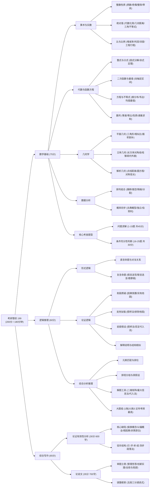
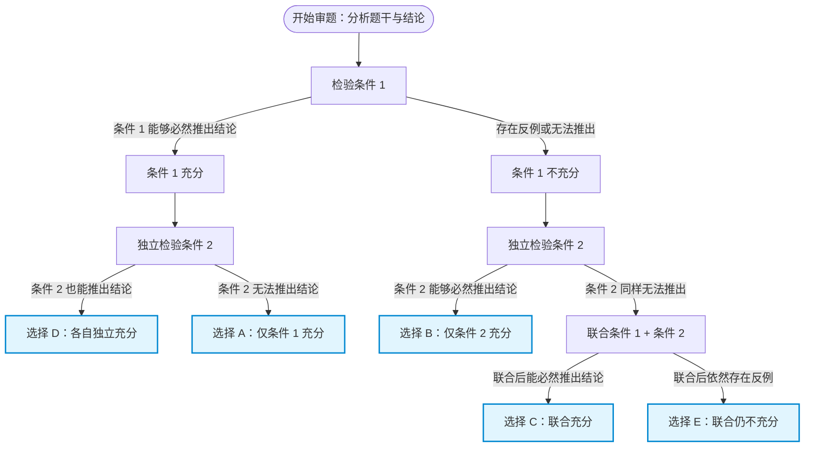
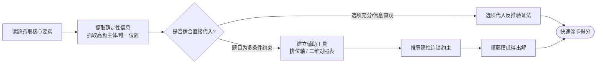

# 考研管综（199 管理类联考综合能力）历年真题全景复习指南

> 本指南基于 2009–2026 年共 18 年（1026 道真题）历年真题的命题规律、考点分布与题型演进趋势全面梳理，涵盖**数学基础、逻辑推理、写作**三大板块的核心考点、知识脉络、思维导图、命题动向与全阶段备考提分策略。

---

## 一、试卷基本结构与分值分布

管综 199 试卷满分 **200 分**，考试时间 **180 分钟**（3 小时）。题量大、时间极其紧张是管综最显著的特征（平均每道客观题仅 1.5~2 分钟思考作答时间）。

| 模块 | 题型 / 题号 | 题量与分值 | 建议用时 | 核心考查能力 |
| :--- | :--- | :--- | :--- | :--- |
| **一、数学基础**<br>(共 75 分) | **问题求解** (1–15 题) | 15 题 × 3 分 = 45 分 | 55–60 分钟 | 运算能力、逻辑思维、空间想象、数据处理 |
| | **条件充分性判断** (16–25 题) | 10 题 × 3 分 = 30 分 | | 逆向推导、充分必要逻辑、严密性与反例排除 |
| **二、逻辑推理**<br>(共 60 分) | **单项选择题** (26–55 题) | 30 题 × 2 分 = 60 分 | 50–55 分钟 | 形式逻辑推演、批判性思维、复杂综合分析推理 |
| **三、写作**<br>(共 65 分) | **论证有效性分析** (第 56 题) | 1 题，30 分 (约 600 字) | 25–30 分钟 | 批判性思维、论证缺陷识别与学理驳斥 |
| | **论说文** (第 57 题) | 1 题，35 分 (约 700 字) | 30–35 分钟 | 审题立意、逻辑说理、管理哲思与文字表达 |
| **涂卡与机动** | 答题卡填涂与检查 | — | 5–10 分钟 | 考场节奏控制与风险兜底 |

---

## 二、历年真题考点与核心题型深度剖析

### 1. 数学基础（75分）

数学不考高等数学，考查初高中数学内容，但**“初等数学，高等解法，注重技巧”**。

#### (1) 算术与实数
- **核心考点**：
  - **整数性质**：质数与合数、奇偶性分析、整除与带余除法、最大公约数与最小公倍数。
  - **绝对值**：绝对值的代数定义、几何意义（数轴距离）、绝对值三角不等式 $|a|-|b| \le |a\pm b| \le |a|+|b|$，非负性组合（$\sum |x_i|=0$ 或与平方、根号组合）。
  - **比与比例**：合分比定理、正反比、增减百分比、浓度配比问题、利润/折价/成本模型。
  - **平均值与方差**：算术平均值、加权平均值、均值方差的变化性质（平移与伸缩变化后的方差）。

#### (2) 代数与函数方程
- **整式与分式**：因式分解技巧（十字相乘、分组分解、换元）、整式除法与余式定理 $P(x)=(x-a)Q(x)+R$、分式化简求值。
- **函数**：一元二次函数的图像与性质、对称轴与顶点最值、闭区间二次函数最值（动轴定区间 / 定轴动区间）。
- **方程与不等式**：
  - 一元二次方程根的分布（判别式 $\Delta$、对称轴 $-\frac{b}{2a}$、端点函数值 $f(k)$ 三步法）。
  - 韦达定理综合变形（如 $\frac{1}{x_1}+\frac{1}{x_2}$、$x_1^2+x_2^2$、$|x_1-x_2|$）。
  - 均值不等式 $a+b \ge 2\sqrt{ab}$（求最值“一正二定三相等”）。
  - 分式不等式与高次不等式（穿针引线法）。
- **数列**：
  - 等差数列：通项 $a_n$、求和 $S_n$、对称性质 $a_m+a_n = a_p+a_q$、$S_n$ 为二次函数的最值判定。
  - 等比数列：通项、前 $n$ 项和（注意公比 $q=1$ 与 $q\ne 1$ 分类讨论）、乘积性质。
  - 数列综合与递推：裂项相消、错位相减、奇偶项分组求和。

#### (3) 几何学
- **平面几何**：
  - 三角形：面积公式、内角和、勾股定理、等高模型与面积比例、相似三角形判定与面积比（相似比平方）。
  - 四边形：梯形、平行四边形、矩形、菱形与正方形的几何性质。
  - 圆与扇形：圆周角定理、切线长定理、阴影面积割补法（同底等高平移、对称割补、容斥原理代数求和）。
- **空间几何体**：
  - 长方体与正方体：体对角线、表面积、体积、表面最短路径展开。
  - 圆柱、圆锥、球体：轴截面、母线与高、球内接长方体/圆柱（体对角线即球直径）、球的外切。
- **平面解析几何**：
  - 直线：斜率、五种方程、平行与垂直充要条件、点到直线距离公式。
  - 圆：标准方程与一般方程、直线与圆的位置关系（几何法：圆心到直线距离 $d$ 与半径 $r$ 比大小；代数法：判别式）。
  - 对称与弦长：点关于线对称、线关于线对称；垂径定理弦长公式 $L = 2\sqrt{r^2-d^2}$。

#### (4) 数据分析
- **计数原理与排列组合**：
  - 两个基本原理：分类加法与分步乘法。
  - 经典模型：相邻问题“捆绑法”、不相邻问题“插空法”、相同元素分配“隔板法”、定序问题“除法消序”、分组与分配模型（先均分再分配）、染色问题。
- **概率初步**：
  - 古典概型（分子分母有序/无序对齐）。
  - 相互独立事件与互斥事件概率加乘定理。
  - $n$ 重伯努利概型（独立重复试验 $P_n(k) = C_n^k p^k (1-p)^{n-k}$）。

#### (5) 条件充分性判断（199特有题型）
- **判定标准与逻辑**：
  - 条件 (1) 充分，(2) 不充分 $\to$ **A**
  - 条件 (2) 充分，(1) 不充分 $\to$ **B**
  - 条件 (1) 和 (2) 单独都不充分，但联合起来充分 $\to$ **C**
  - 条件 (1) 充分，(2) 也充分（各自独立充分） $\to$ **D**
  - 条件 (1) 和 (2) 联合仍不充分 $\to$ **E**
- **高频陷阱**：
  - 颠倒充分与必要（“充分”指条件推题干，绝不能由题干推条件）。
  - 忽略隐含范围（如题干限定“非零整数”、“边长为正数”、“$a>0$”等）。
  - 联合判断未复用条件（误将 (1) 或 (2) 的不充分结论直接带入排除 C）。

---

### 2. 逻辑推理（60分）

逻辑考卷从早期的“重形式、轻综合”演变为近年“**分析推理为主导，形式逻辑为基底，论证逻辑重批判**”的鲜明格局。

```
                     ┌─ 形式逻辑 (约 15-20%)：直言、联言、选言、假言、三段论
                     │
管综 30 道逻辑题 ────┼─ 论证逻辑 (约 35-40%)：削弱、支持、假设、解释、评价
                     │
                     └─ 综合分析推理 (约 40-50%)：排位、匹配、分组、真假话、一拖多
```

#### (1) 形式逻辑（确定性推演，追求 100% 正确率与秒杀速度）
- **直言命题与对当关系**：矛盾关系（所有是 vs 有些非）、反对与下反对关系，负命题等价转换。
- **复言命题（重中之重）**：
  - **假言命题**：
    - 充分条件：“如果 $A$ 则 $B$”、“只要 $A$ 就 $B$” $\implies A \to B$。
    - 必要条件：“只有 $B$ 才 $A$”、“不 $B$ 就不 $A$” $\implies A \to B$。
    - 逆否等价：$A \to B \iff \neg B \to \neg A$（非充分推非必要）。
    - 矛盾命题：$A \to B$ 的矛盾是 $A \land \neg B$。
  - **联言与选言命题**：
    - 德·摩根定律：$\neg(A \lor B) \iff \neg A \land \neg B$；$\neg(A \land B) \iff \neg A \lor \neg B$。
    - 相容选言推理：否定肯定律（$A \lor B$ 且 $\neg A \implies B$）。
    - 不相容选言：要么 $A$ 要么 $B$。

#### (2) 论证逻辑（批判性思维，日常语言语境）
- **核心结构**：明确**论题、论点、论据、隐含假设**。
- **题型与破题技巧**：
  - **削弱题**：割断因果、因果倒置、另有他因（最常见有力削弱）、反例推翻、方法不可行/达不到目的。
  - **支持题**：搭桥补足漏洞、排除他因、说明因果机制、无因无果同向验证。
  - **前提假设题**：搭桥法（连接跳跃概念）、否定代入验证法（若假设不成立，原论证必然坍塌，则该选项必是必要假设）。
  - **解释说明题**：化解表面上的自相矛盾（寻找引入外界新变量后两全其美的合理理由）。
  - **结构相似与评价题**：抽象论证的形式化骨架，找出同样的推理形式或逻辑谬误。

#### (3) 综合分析推理（近年来拉开分差的胜负手）
- **题型特征**：题干信息复杂冗长，给出若干主体与属性（人员、部门、座次、班次、排序），常以“**1 题干拖 2~3 道小题**”形式出现。
- **高效解题工具矩阵**：
  - **最大信息优先原则**：从出现频次最高、确定度最高的主体切入。
  - **符号化列表/网格矩阵**：二维表格、排位坐标轴（左/右、1-6位）、树状分组图。
  - **极端假设与代入法**：直接结合选项代入题干检验，或从矛盾项两难切入。
  - **考场心态**：遇到超长繁琐题组，如果读两遍毫无头绪，立即标星跳过，切忌死磕 10 分钟导致后面作文没时间写。

---

### 3. 写作（65分）

#### (1) 第 56 题：论证有效性分析（30分，约 600 字）
- **本质要求**：给出一段有缺陷的论证，要求考生找出论证中的漏洞并进行有条理、有说服力的批判分析。**不发表个人看法，只反驳原文推不出**。
- **高频典型逻辑缺陷库**：
  1. **概念混淆 / 偷换概念**：前后使用的同一术语内涵外延不同。
  2. **以偏概全 / 轻率归纳**：用个别样本推导全局普遍结论。
  3. **不当类比 / 机械类比**：两个本质属性完全不同的事物盲目类比。
  4. **强加因果 / 假性因果**：先后发生即当成因果（后此谬误）、倒因为果。
  5. **非黑即白 / 假二分法**：忽略了存在中间态或其他第三种可能。
  6. **忽略他因 / 单一归因**：结果由多元复杂因素造成，却片面归因于某一个要素。
  7. **自相矛盾**：论点与论据在逻辑前提上互为对立冲突。
- **标准四步成文结构**：
  - **标题**：带有批判倾向的凝练标题（如《草率的推断，难立的结论》、《xxxx的推导真的成立吗？》）。
  - **开头（约60-80字）**：概括原文核心结论与论证过程，指出其存在诸多逻辑缺陷，难以令人信服。
  - **正文缺陷批驳（4个核心自然段，每段约100-120字）**：
    - 公式化骨架：*首先，原文由“A”推断出“B”存在不当类比/以偏概全之嫌。因为……，作者忽略了……，因此不能必然得出……*
  - **结尾（约40-50字）**：总结全文，重申论证不严密，建议补充更加充分的论据。

#### (2) 第 57 题：论说文（35分，约 700 字）
- **本质要求**：结合材料审题立意，撰写一篇观点鲜明、结构严谨、逻辑闭环、文字流畅的议论文。
- **题材偏向**：
  - **企业经营管理**：战略创新、求真务实、合规风控、团队协作、匠人精神。
  - **社会与时代思辨**：传统与变革、秩序与自由、科技与人文伦理、义利并重。
  - **个人成长修养**：知行合一、行稳致远、底线思维、专注坚持。
- **高分结构框架（推荐：五段三分式 / 递进式）**：
  - **第 1 段（引材料+亮论点，100字）**：引述材料要点，明确立意，开门见山立论。
  - **第 2 段（分论点一，150字）**：从基础层面（是什么 / 认知端）切入，举例+说理论证。
  - **第 3 段（分论点二，150字）**：从核心驱动（为什么 / 价值端）切入，对比或因果分析。
  - **第 4 段（分论点三，150字）**：从实践路径（怎么办 / 落地端）切入，结合现代企业或社会管理。
  - **第 5 段（升华总结，80-100字）**：回扣中心论点，展望升华，语言有力。

---

## 三、知识脉络与思维导图

### 1. 考研管综 199 全景知识脉络图



---

### 2. 条件充分性判断标准决策流



---

### 3. 分析推理题考场秒杀路径



---

## 四、历年真题演进趋势与最新命题风向

通过对 2009–2026 年共 18 年真题的统计对比，管综考试呈现出以下三大演化趋势：

### 1. 数学：告别“死记硬背”，注重“思维灵活性与综合性”
- **计算量适度平稳，构思难度增加**：早期考题往往公式直接套用，如今多考查知识交叉（例如：解析几何结合均值不等式最值、数列求和与整式整除结合）。
- **应用题场景生活化**：结合实际经管情境（健步跑走步数、阶梯水电气费、打折返券、投资盈亏）。
- **条件充分性防坑**：命题人对“特殊值（如 0、负数、两根相等、极限态）”的考察更具针对性。

### 2. 逻辑：形式逻辑压缩，分析推理占据“半壁江山”
- **阅读量大幅激增**：整张逻辑卷阅读量突破 8000~10000 字，纯考形式逻辑套公式的题目缩减至 4~6 题。
- **大题组（1拖2、1拖3）成为常态**：自 2017 年后，真题每年稳定出现 2~3 个综合分析推理大题组，直接决定了 60 分逻辑的及格线和优秀线。
- **论证逻辑反驳更加隐蔽**：削弱与支持题中，干扰项多具有强迷惑性（例如仅削弱论据而非论证关系、因果无序等）。

### 3. 写作：从“文采修辞”转向“批判思维与专业管理素养”
- **有效性分析**：缺陷更加隐蔽，不仅考表面漏洞，更考深层次论证链条逻辑。
- **论说文**：摒弃单纯的心灵鸡汤，全面聚焦“数字化变革、创新驱动、系统工程、底线合规、稳中求进”等经管领域核心时代课题。

---

## 五、科学复习规划与实战高分建议

### 1. 四阶段备考时间表

| 阶段 | 周期 | 核心目标 | 落地任务与指标 |
| :--- | :--- | :--- | :--- |
| **第一阶段：基础筑基期** | 3月–6月 | 知识点无盲区 | - 通刷数学考纲考点，掌握公式推导；<br>- 掌握形式逻辑规则，能准确翻译逆否与德摩根；<br>- 建立错题本，完成基础分章习题集。 |
| **第二阶段：题型技巧期** | 7月–8月 | 提炼解题技巧与方法 | - 分题型总结技巧（特值法、排除法、代入法、列表法）；<br>- 学习论证有效性分析四大段驳斥套路；<br>- 整理论说文十大核心母题（创新、守信、合作等）与素材库。 |
| **第三阶段：真题精研期** | 9月–10月 | 掌握真题出题脉络 | - **逐题精研 2009–2020 真题**（至少刷 2 遍）；<br>- 做到每道错题明确考点、陷阱在哪里、为何选错；<br>- 每周动笔写 1 篇小作文 + 1 篇大作文并批改。 |
| **第四阶段：模拟冲刺期** | 11月–考前 | 考场配速与实战抗压 | - **严格按照 8:30–11:30 用 2021–2026 最新真题进行全真限时模考**；<br>- 严格练习使用答题卡涂卡与方格纸规范书写；<br>- 查缺补漏，回归核心公式与错题盲点。 |

### 2. 考场“黄金 180 分钟”配速与提分策略

> [!IMPORTANT]
> **管综的核心不是“看谁会得多”，而是“在有限时间内拿分最多”。** 绝大多数考生考不好的根源是**没写完卷子**（尤其是两篇作文来不及写导致失分 30+）。

1. **做题顺序与时间卡死**：
   - **8:30 – 9:25（55分钟）**：数学 25 题，先做会做的，卡壳超过 2.5 分钟果断标记跳过。
   - **9:25 – 10:20（55分钟）**：逻辑 30 题，优先拿完形式逻辑和论证逻辑，分析推理题先做单题和简单的题组，恶心题组放最后。
   - **10:20 – 10:45（25分钟）**：小作文（论证有效性分析），快速圈出 4 个漏洞，一气呵成写满 600 字。
   - **10:45 – 11:20（35分钟）**：大作文（论说文），审题 3-5 分钟列大纲，动笔一气呵成写满 700-800 字。
   - **11:20 – 11:30（10分钟）**：填涂答题卡、检查姓名考号、对标记难题做特值代入或排除猜答。

2. **考场保命准则**：
   - **草稿纸分区规划**：将草稿纸对折折成方格，标注题号演算，防止算完找不到数或者看窜题。
   - **条件充分性绝不主观臆断**：始终记住“充分”是必然成立，反例只要举出 1 个即推翻。
   - **作文书写就是分数**：管综写作主观评分受卷面影响极大（字迹工整无大面积涂改可多得 3–5 分）。严禁空卷，即便写不好也必须字数写满达标。
