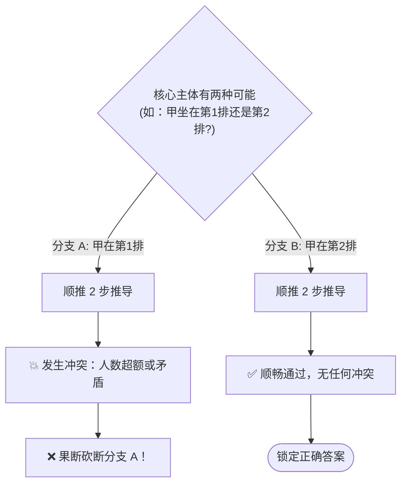

# 考研管综 199 综合分析推理历年真题全解剖与极速通关专项宝典（2009–2026）

> **专项定位**：综合分析推理（Analytical Reasoning）是 199 管综逻辑试卷中**题干最长、信息密度最高、最耗费时间、也最容易拉开 20+ 分差的核心板块**。近年来（尤其是 2024–2026 年），分析推理以**“大题组（1 拖多）”**形式占据了逻辑试卷的半壁江山（2026 年大题组高达 5 组 10 题）。
> 本专项宝典系统提炼 18 年来综合分析推理的底层逻辑、草稿建模范式、六大经典题型解法及考场秒杀机制。

---

## 一、综合分析推理在管综中的战略地位与命题演进

### 1. 题量与题型结构演进（2009–2026）

```
[2009–2014 探索期]
- 形式逻辑为主，分析推理零星出现（每年 3~5 题，以单题为主）。
- 题型简单，常为简单的 3~4 人职业或颜色匹配。

[2015–2021 发展期]
- 分析推理成为固定压轴板块，每年稳定出现 3~4 组大题干（6~8 题）。
- 题型拓展到排序、车位、座次与排班。

[2022–2026 鼎盛爆发期]
- 试卷后半段（45~55 题）几乎被大题组全面包揽。
- 2024 年出现“五谷方阵数独”、2025 年出现“五味方阵与三班双人监考排班”、2026 年大题组达到创纪录的 5 组 10 题！
- 纯靠脑内构思或死套公式已完全失效，必须依赖“草稿纸图表建模 + 逻辑约束传导”。
```

### 2. 考生三大常见失分致命伤

| 致命伤 | 典型表现 | 严重后果 | 纠正策略 |
| :--- | :--- | :--- | :--- |
| **① 脑中空想硬憋** | 不动笔画图，仅凭大脑短时记忆处理 5 个主体、3 种属性与 6 条约束 | 逻辑短路、信息遗漏、做一道题耗时 8~10 分钟 | **笔动心动**：第一时间在草稿纸建立二维表或线性坐标轴 |
| **② 顺读做题陷阱** | 严格按照题干 (1)(2)(3)(4) 顺序硬读，从最抽象的模糊条件开始思考 | 从头到尾毫无头绪，产生烦躁畏难情绪 | **逆序破题**：先找“确定项”，再找“最高频主体”，以点带面 |
| **③ 题组假设污染** | 把第 1 小题题干新增的临时假设（如“若甲排第 2 位”）带到第 2 小题中 | 导致第 2 小题全盘排错，连环丢分 | **资产隔离**：区分大题干公共公理与小题局域变量 |

---

## 二、草稿纸标准化建模三大武器

面对复杂题干，草稿纸的使用方式直接决定答题效率。以下三大画图工具必须形成本能肌肉记忆：

### 武器 1：线性坐标数轴（针对：排位、名次、次序、楼层、车位）

```
[草稿纸绘制规范]
  1      2      3      4      5      6      (数字轴标明序号)
──┼──────┼──────┼──────┼──────┼──────┼──
 [甲]   [乙]                                (绝对确定项写在轴下)
  ↑      ↑
相对顺序写在轴上方：丙 > 丁 且 [戊, 己] 紧邻捆绑
```
- **符号规范**：
  - **捆绑相邻**：用方框 $[A, B]$ 框起；若指定了前后顺序则写 $[A \to B]$；
  - **不相邻/隔离**：记为 $A \neq B$ 或 $A \mid B$；
  - **相对次序**：$A > B$（表示 A 在 B 前面）；
  - **定距跳步**：$A \xrightarrow{+2} B$（表示 A 与 B 之间恰好隔着 1 个位次）。

---

### 武器 2：二维网格勾叉矩阵（针对：多主体与多属性匹配题）

```
[二维互斥消元表]
        北京    上海    广州    深圳    (城市属性)
 张      ✓       ×       ×       ×     <-- 某格确定打✓，整行其余全打×
 李      ×       ×       ✓       ×     <-- 整列其余也全打×
 王      ×       ?       ×       ?     
 赵      ×       ?       ×       ?     
```
- **消元法则**：
  1. **互斥法则**：某格打 **$\checkmark$** 后，**其所在行、所在列的其余所有空格立即无脑打 $\times$**；
  2. **唯余法则**：若某行（或某列）已经被打上了 3 个 $\times$，剩下的最后一个空格**必然为 $\checkmark$**！

---

### 武器 3：二元假设分支树（针对：两难僵局与条件分叉）


- **原则**：只在**恰好只有两种可能性（二元对立）**时使用假设法。绝不在有 4~5 种选择时盲目乱猜。

---

## 三、历年真题六大经典题型深度解剖与解题策略

### 题型 1：位置排序与座次限制题
- **考情分布**：2018 Q47-48、2019 Q54-55（车位）、2025 Q41、2026 Q44（报告人座次）。
- **破题黄金准则**：
  1. **首尾极端法**：先看两端的第 1 位和最后 1 位有哪些主体受限不能排；
  2. **长链优先法**：把几个相对次序条件拼合成最长连环链（如 $A > B$ 且 $B > C > D \implies A > B > C > D$），长链能迅速挤占有限的位次空间。
- **真题典例（2026 年第 44 题·7 名教授座次）**：
  > **题干**：甲、乙、丙、丁、戊、己、庚 7 名教授，其中 2 人是特邀报告人坐第 1 排，其余 5 人坐后 4 排。
  > （1）丙坐在戊后面，但坐在己和庚前面；
  > （2）若甲、丁至少有 1 人是特邀报告人，则乙、丙 2 人均坐在第 2 排。
  > 问：以下哪项必然可以得出？
  > **极速破解思路**：
  > 1. 由条件（1）：相对次序链为 **戊 $\to$ 丙 $\to$（己、庚）**。
  >    - 说明己、庚必须在丙后面，因此己和庚绝不可能坐在第 1 排（排除了 2 人）；
  >    - 丙在戊后面，丙也绝不可能坐在第 1 排（排除了第 3 人）；
  > 2. 假设戊不在第 1 排（反证法）：
  >    - 则特邀报告人（第 1 排的 2 人）只能从甲、乙、丁中产生 $\implies$ 说明甲、丁中至少有 1 人是特邀报告人！
  >    - 触发条件（2）：乙、丙均坐在第 2 排；
  >    - 但如果丙坐在第 2 排，前面只有第 1 排，而（1）要求戊必须在丙前面，所以戊只能坐第 1 排；
  >    - 这与“假设戊不在第 1 排”直接自相矛盾！
  > 3. **反证成立：戊必须坐第 1 排（是特邀报告人）！秒选 E！**

---

### 题型 2：多主体多属性匹配题
- **考情分布**：管综出现频次最高（18 年累计 73 题），如 2026 Q43（城市/爱好）、2026 Q46-47（服装颜色）、2026 Q48-49（职称级别）、2026 Q54-55（画作题材）。
- **破题黄金准则**：
  1. **最大信息切入**：数一数哪个属性或人物在题干中被提及次数最多；
  2. **利用逆否命题转换条件**：“甲不画兰”与“画兰者不是乙”等价；
  3. **表格联动排除**。
- **真题典例（2026 年第 46~47 题服装颜色组）**：
  > **大题干**：甲、乙、丙、丁、戊 5 人分别穿红、黄、蓝、白、绿 5 种不同颜色服装。
  > （1）若甲穿红色或丁穿绿色，则乙穿黄色；
  > （2）若乙穿黄色，则丙穿蓝色且甲穿白色；
  > （3）若丁穿黄色，则乙穿白色且戊穿绿色。
  > **公共资产极速推演**：
  > - 观察条件（1）和（2）的传导：
  >   若甲穿红色 $\to$ 乙穿黄色 $\to$ 甲穿白色！
  >   “甲穿红”直接导出了“甲穿白”，自身矛盾！
  >   **一招毙命：甲绝对不可能穿红色！**
  > - 既然甲不穿红色，由（1）的选言肢逆向推导，题干中各种复杂的假言链条瞬间瓦解。

---

### 题型 3：时间排班与日程表题
- **考情分布**：2022 Q45-46、2025 Q54-55（考场监考）、2026 Q50-51（农事排班）。
- **破题黄金准则**：
  1. **画周历网格表**：横向周一至周五，纵向分上午/下午/晚上；
  2. **抓“相邻连续两天”与“同日约束”**：如“播种在杀虫后一天”，直接将其视为长度为 2 天的滑块 $[杀虫 \to 播种]$；
  3. **滑块卡位试验**：看这个长度为 2 的滑块能塞在哪些剩余空档里。
- **真题典例（2026 年第 50~51 题）**：
  > 农事：除草、施肥、杀虫、播种、灌溉 5 项在周一至周五进行，每天一项。
  > 关键条件：（1）除草不在周四；（2）播种在杀虫后一天；（3）灌溉在除草前一天或之后第三天；（4）若周一不除草，则周二施肥。
  > **第 50 题破局点**：
  > - 滑块 $[杀虫 \to 播种]$ 占连续两天；
  > - 假设周一不除草，则周二必施肥；
  > - 此时周二被占，滑块 $[杀虫 \to 播种]$ 只能放周三周四或周四周五；
  > - 无论放哪，灌溉与除草的间距条件（3）均会被严重挤压产生冲突；
  > - 穷举可知周一若不除草必然无解，因此**周一必除草！秒选 A！**

---

### 题型 4：分组与组队分配题
- **考情分布**：2024 Q51、2026 Q52-53（经方学习小组）。
- **破题黄金准则**：
  1. **先列人数定额方程**：总人数 $=$ 组 1 人数 $+$ 组 2 人数 $+$ 组 3 人数；
  2. **互斥元素分流**：若 A 和 B 不能同组，则 A 和 B 分别占定两组的名额；
  3. **捆绑元素绑定**：若 C 和 D 必须同组，将 $(C, D)$ 视为一个整体人数包。

---

### 题型 5：数独与方阵填字类题（近三年命题新宠）
- **考情分布**：2021 Q45（六艺）、2024 Q45（五谷方阵）、2025 Q49（五味方阵）。
- **破题黄金准则（数独唯余法）**：
  1. **扫描“已填元素最多的行或列”**：哪一行或列已经有了 3 个字，那这一行/列剩下的两个空格候选字只剩 2 个；
  2. **十字交叉瞄准**：要确定空格 ① 的值，同时看 ① 所在的这一行和这一列，把这一行已有的字和这一列已有的字全部划掉，往往**仅剩唯一可能字**（唯余法）。

---

### 题型 6：真假话与两难假定题
- **破题三步必杀法**：
  - **第一步：找矛盾（一对矛盾，必有一真一假）**
    - “所有是” vs “有些非”；“A 是” vs “A 不是”；“$P \to Q$” vs “$P \land \neg Q$”。
  - **第二步：绕开矛盾看其余**
    - 若题干声明“只有 1 人说了真话”，则这句唯一的真话**必定藏在矛盾双方之中**！
    - **其余所有人说的话全部为假话！**
  - **第三步：由假话取反得出真实事实，回代判定**。

---

## 四、大题组（1 拖 2、1 拖 3）的做题纪律与资产管理

大题组是考场提分的重器（每组 4~6 分），但很多考生做完第 1 题后，做第 2 题时草稿纸上一团糟。必须严格遵守以下规范：

```
┌─────────────────────────────────────────────────────────────┐
│                 大题组草稿纸“三区划分”规范                   │
├─────────────────────────────────────────────────────────────┤
│  【A 区：公共公理区】（正中央上方，用实线框住，严禁涂改）    │
│   - 大题干通用条件推导出的确定事实（如：甲必不穿红、周一必除草）│
│   - 本大题组第 1 题、第 2 题全部无条件共享！                 │
├──────────────────────────────┬──────────────────────────────┤
│  【B 区：第 1 小题演算区】     │  【C 区：第 2 小题演算区】     │
│   - 仅写第 1 题新增的临时假设 │   - 仅写第 2 题新增的临时假设 │
│   - 做完立刻打斜线封存！       │   - 继承 A 区，绝不借用 B 区！ │
│   - 其排出的合法方案可作反例！ │                              │
└──────────────────────────────┴──────────────────────────────┘
```

1. **资产继承**：第 2 小题做题时，先看 A 区已有的确定性结论；
2. **反例复用**：当第 2 小题问“以下哪项可能为真 / 不可能为真”时，如果第 1 小题恰好排出了一组完整的合法解，直接拿这组解对照选项，凡是不符合这组解但在此解中能成立的，可作为现成事实参考。

---

## 五、考场 180 分钟分析推理“极速熔断与蒙猜”法则

管综考场时间极其昂贵，**没有任何一道逻辑题值得你花费超过 3.5 分钟**！

### 1. 3 分钟极速时间熔断线
- **1 分钟读题与建表**：读完题干，在草稿纸上画出坐标轴或二维网格；
- **2 分钟正向推导**：若推导顺畅，在 2 分钟左右得出答案并涂卡；
- **2.5 分钟触发预警**：若发现条件互锁、无法推进，**立刻停止一切正向推导，果断转向“选项代入反推”**！
- **3.5 分钟强制熔断**：代入 1~2 个选项后依然无法决断，排除已确定的 1~2 个错误项后，在剩余项中**果断蒙一个并做标记，立刻奔向下一题**！

### 2. 分析推理科学蒙猜与选项概率学
在真正时间耗尽、必须蒙猜时，遵循以下统计学高概率特征：
1. **重合度最高选项法**：
   - 题目要求选出一组完整匹配组合（如“甲乙丙丁依次为……”）；
   - 对比 5 个选项，统计每个位置上出现频次最高的元素（例如第 1 位有 3 个选项是“北京”，第 2 位有 3 个选项是“上海”），**包含最多高频元素的选项，往往是正确答案**。
2. **中间位次概率法**：
   - 问排位名次题，答案是极端两端（第 1 名或最后 1 名）的概率偏低，答案为**第 3 名、第 4 名等居中位置**的概率超过 65%。
3. **否定性题干排除法**：
   - 题干问“下列哪项不可能”，代入选项时优先代入**限制条件最多、看起来最苛刻、最反常理的选项**，这类选项最容易产生逻辑矛盾，成为正确答案。
